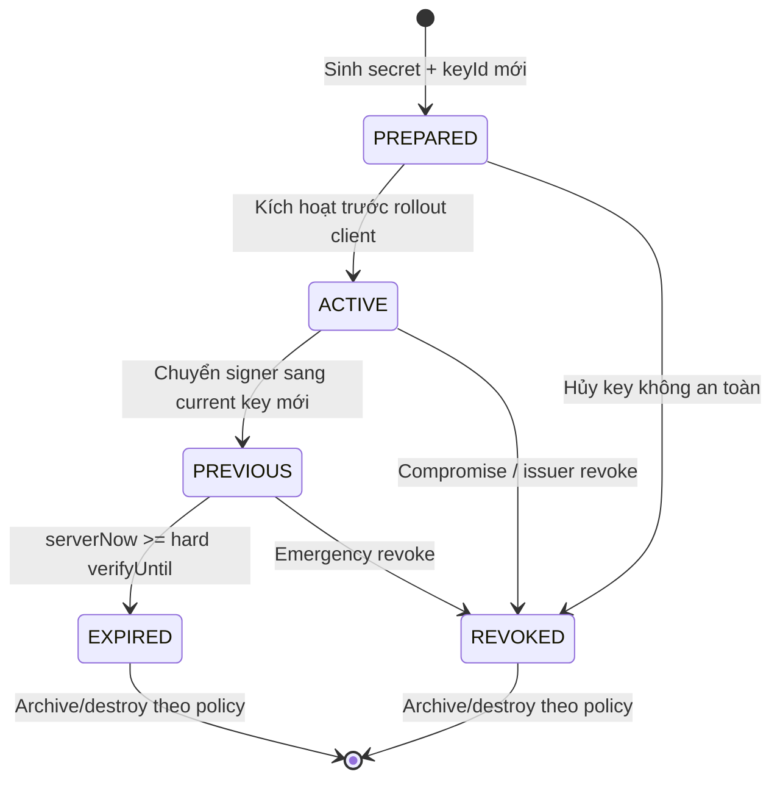
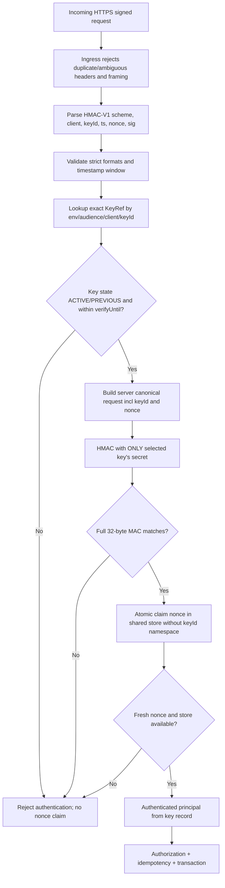
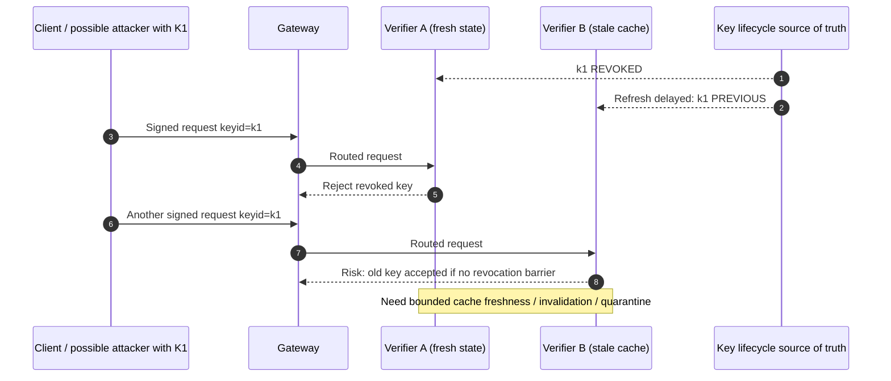

# Previous key trong Key rotation của HTTP HMAC Request Authentication

## Mục tiêu học tập

Sau khi hoàn thành bài học, bạn có thể:

- Giải thích **previous key** là khóa HMAC **của phiên bản trước**, có thể được verifier chấp nhận tạm thời trong một **rotation overlap window**; khác với **current key** dùng cho request mới và **revoked/expired key** tuyệt đối không được xác minh.
- Thiết kế chính sách **CURRENT/ACTIVE → PREVIOUS (verify-only) → RETIRED/REVOKED** có mốc ký mới và **hard verification deadline**, xác định tại chính xác mốc hết hạn server phải từ chối dù chữ ký vẫn đúng.
- Phân biệt việc **client biết cả current và previous secret**, **server có thể verify previous**, và điều thực tế rằng server **không thể chứng minh chữ ký previous key được tạo trước cutover** chỉ dựa trên timestamp do người nắm key ký.
- Dùng **explicit key ID** để tra duy nhất một bản ghi `(environment, audience, clientId, keyId)`; không fallback thử secret khác khi MAC sai, không dùng previous key của khách hàng khác.
- Ràng buộc `keyId`, timestamp, nonce, method, URI, Host/authority và các signed header/body vào **canonical request**; thực hành JCA `Mac`/`SecretKeySpec` và so full HMAC-SHA256 tag bằng `MessageDigest.isEqual`.
- Thiết kế nonce store **không tách theo phiên bản key** khi muốn bảo vệ cùng client/audience xuyên rotation, cùng TTL đủ che phủ toàn bộ timestamp window.
- Viết Java 17+ mô phỏng việc ký bằng old key trước cutover, verify bằng previous key trong overlap, ký bằng current key, từ chối replay/tamper/revoke/expiry và xác minh các ranh giới thời gian với `Clock.fixed`.
- Lập runbook triển khai, emergency revocation, rollback có kiểm soát, xử lý key-store cache stale ở nhiều replica, proxy/gateway và **idempotency/authorization**.

**Ngữ cảnh:** Bài thuộc chương **Key rotation**, chủ đề trực tiếp **Previous key**, của module `SECURITY_AUTHENTICATION_HMAC_REQUEST_AUTHENTICATION`. Module thiết kế xác thực HTTP request bằng **HMAC với shared secret** và canonical request chứa method, URI, headers hoặc body theo hợp đồng ký; người học thực hành xác minh chữ ký, chống replay bằng timestamp/nonce, quản lý key rotation, kiểm thử proxy/gateway và phân biệt xác thực với phân quyền. Trọng tâm là **cách xử lý credential phiên bản trước sau khi đổi secret**, chứ không chỉ hướng dẫn tạo key mới.

> Profile `hmac-previous-key-v1`, scheme `HMAC-V1` và các tên header/field trong bài là **hợp đồng minh họa tự thiết kế**. Không có wire format HMAC phổ quát bắt buộc mọi API dùng đúng cách này. Server/client phải thỏa thuận version, miền key, canonical bytes, chính sách thời hạn và key-state trước khi triển khai.

## 1. Previous key là gì?

Một client `partner-17` ban đầu dùng HMAC secret `K1` với `keyId=k1`. Khi xoay khóa, hệ thống tạo **secret mới độc lập** `K2` dưới **key ID mới** `k2`. Từ thời điểm cutover, client được yêu cầu ký request mới bằng `K2`. Nhưng mạng, job queue và các phiên bản SDK chưa triển khai có thể vẫn có **request dùng K1** trong lúc quá trình chuyển đổi diễn ra.

Trong khoảng có kiểm soát, server có thể giữ một record `k1` ở trạng thái **PREVIOUS**:

```text
Before cutover:
  k1 -> K1, ACTIVE (sign + verify)
  k2 -> K2, PREPARED

During overlap:
  k1 -> K1, PREVIOUS / VERIFY_ONLY (verify, không ký mới theo SDK policy)
  k2 -> K2, ACTIVE (sign + verify)

After old-key deadline:
  k1 -> K1, RETIRED/REVOKED (không verify)
  k2 -> K2, ACTIVE
```

**Previous key không phải secret được ưu tiên nếu verification thất bại.** Nó là một **key record có phiên bản cụ thể, owner cụ thể, expiration cụ thể**. Với request khai `keyId=k1`, verifier kiểm tra **đúng K1** nếu policy cho phép. Với request khai `keyId=k2`, verifier kiểm tra **đúng K2**; nó **không được thử K1** khi chữ ký với K2 sai.

### Bốn thuộc tính cần tách riêng

| Thuộc tính | `k1` khi là previous key | `k2` khi là current key |
|---|---|---|
| Secret material | `K1` bất biến, không đổi thành K2 | `K2` mới, độc lập với K1 |
| Key ID | `k1` vẫn là `k1` | `k2` mới |
| Signing policy | **Không ký request mới** từ client SDK chuẩn | Dùng để ký request mới |
| Verification policy | Có thể verify **trong overlap, trước hard deadline** | Có thể verify khi ACTIVE và còn hạn |
| Lifecycle metadata | State `PREVIOUS`, `verifyUntil`, owner/audience | State `ACTIVE`, `notBefore`, future deadlines |
| Key compromise | Thu hồi ngay, không kéo overlap | Thu hồi/rotate theo incident policy |

Điểm an ninh quan trọng: **PREVIOUS/VERIFY_ONLY là chính sách của hệ thống**, không phải khả năng mật mã khiến K1 chỉ ký được dữ liệu quá khứ. Người nắm K1 **vẫn có thể tính HMAC mới**. Do đó không được giữ previous key mãi mãi “để tương thích”.

## 2. Vì sao cần giữ previous key trong một khoảng ngắn?

Trong hệ thống có nhiều đối tác, replica hoặc worker, việc cutover ký và verify hiếm khi diễn ra đồng thời ở mọi nơi:

1. Server triển khai metadata/secret K2 đến tất cả verifier.
2. Client SDK bắt đầu ký K2; một số worker cũ có thể đang giữ K1.
3. Request đã được ký với K1 từ trước cutover có thể đang nằm trong hàng đợi hoặc trên đường truyền.
4. Server cần chọn giữa **ngừng mọi request K1 ngay** (có thể gây gián đoạn) và **cho xác minh K1 thêm một khoảng nhỏ**.

Giữ previous key trong overlap giảm gián đoạn, nhưng gia tăng **khoảng thời gian mà người giữ K1 vẫn có thể gửi HMAC hợp lệ**.

### Mục đích và giới hạn

- **Mục đích:** tiếp nhận có kiểm soát requests hợp lệ khi chuyển đổi, tránh gây gián đoạn hàng loạt vì signers cập nhật chậm.
- **Không phải mục đích:** cho khách hàng dùng hai khóa vô hạn, cứu mọi request tag sai, hay miễn credential expiration.
- **Đánh đổi:** overlap càng dài càng có lợi cho compatibility, nhưng **càng kéo dài cửa sổ lạm dụng nếu K1 đã bị lộ**.
- **Điều kiện:** cần deadline có thể kiểm toán, giới hạn traffic/monitoring, chính sách revoke bất thường và rollout verifier trước client.

Previous key còn có thể được nhắc đến trong **client credential store** để rollback khi chuyển đổi gặp lỗi. Đây là một trường hợp riêng: client vẫn lưu K1 một thời gian ngắn để rollback có phê duyệt, nhưng **không có nghĩa SDK được mặc nhiên tự fallback** sang K1 khi gặp bất kỳ lỗi HTTP nào.

## 3. Vòng đời: CURRENT, PREVIOUS, EXPIRED và REVOKED

Để tránh trộn trạng thái, profile sử dụng bốn tên:

| State | Client SDK ký mới? | Verifier nhận tag đúng? | Ý nghĩa |
|---|---|---|---|
| `PREPARED` | Không | Không | Khóa đã provision nhưng chưa được kích hoạt |
| `ACTIVE` | **Có** nếu chưa `signUntil` | **Có** nếu chưa `verifyUntil` | Phiên bản ký hiện tại |
| `PREVIOUS` | **Không** theo policy signer | **Có, chỉ trước `verifyUntil`** | Phiên bản trước, tạm verify-only |
| `REVOKED` | Không | Không | Không được xác minh dù MAC đúng |
| `EXPIRED` | Không | Không | Thời điểm server đã tới hard deadline; có thể là trạng thái suy ra |

Một bản ghi khóa có thể chứa:

```text
KeyRef(
  environment="production",
  audience="orders-api",
  clientId="partner-17",
  keyId="k1"
)
state=PREVIOUS
notBefore=2026-11-01T00:00:00Z
signUntil=2026-11-28T00:00:00Z
verifyUntil=2026-11-28T00:02:00Z
credentialExpiresAt=2026-11-28T00:02:00Z
principal=svc:partner-17
secret=K1 (giữ trong secret manager/KMS)
```

Các mốc là ví dụ. Chọn upper bounds **exclusive**:

\[
\text{mayVerify}(k, now)=
(state\in\{ACTIVE, PREVIOUS\})
\land now\ge notBefore
\land now<verifyUntil
\land now<credentialExpiresAt.
\]

Signer được phép tạo chữ ký mới nếu:

\[
\text{maySign}(k, now)=
(state=ACTIVE)\land now\ge notBefore\land now<signUntil.
\]

Không dùng request `ts` do client ký để thay `now` của server. Nếu server cho phép một credential k1 đã hết hạn vì signed timestamp của request nằm trước deadline, kẻ có K1 có thể tự tạo một **request mới** với timestamp lùi trong cửa sổ còn chấp nhận.

### Sơ đồ vòng đời



**Không khôi phục state REVOKED sang PREVIOUS chỉ vì muốn rollback traffic.** Nếu previous key nghi lộ, rollback phải dùng key mới khác (`k3`) chứ không tái kích hoạt K1.

## 4. Khóa “previous” được chọn theo key ID hay server tự thử?

Có hai họ giao thức, có rủi ro rất khác nhau.

### 4.1. Khuyến nghị: mỗi request khai key ID rõ ràng

```http
POST /v1/orders HTTP/1.1
Host: api.example.test
Content-Type: application/json
Idempotency-Key: order-2026-001
Authorization: HMAC-V1 client="partner-17", keyid="k1", ts="<unix-seconds>", nonce="<22-char-base64url>", sig="<43-char-base64url>"

{"orderId":"O-42","amountMinor":120000}
```

Đây là request dùng **K1**, được nhận **chỉ nếu** k1 đang trong previous verification window. Request khai `keyid=k2` phải được verify bằng K2.

Bảng quyết định:

| Incoming key ID | Trạng thái trong server key directory | Secret được dùng | Kết quả |
|---|---|---|---|
| `k1` | PREVIOUS, còn deadline | **K1** | Tính HMAC bằng K1 rồi quyết định |
| `k1` | REVOKED/EXPIRED | **Không dùng** để chấp nhận | Reject, dù K1 có thể tính tag đúng |
| `k2` | ACTIVE | **K2** | Tính HMAC bằng K2 rồi quyết định |
| `k2` | ACTIVE nhưng MAC sai | **K2**, không thử K1 | Reject |
| `unknown` | Không tồn tại trong scope | Không có | Reject |
| `k1` thuộc client A nhưng caller khai client B | Không có `KeyRef` đúng | Không có | Reject |

**Key ID là dữ liệu chưa xác thực cho đến khi HMAC khớp**, nhưng nó vẫn hữu ích như **lookup hint** được giới hạn theo client, environment và audience. Sau khi tra candidate, verify phải **đưa chính key ID khai trong Authorization vào canonical message**.

### 4.2. Giao thức cũ không có key ID: hỗ trợ previous key có kiểm soát

Một số API legacy chỉ gửi:

```text
Authorization: HMAC <signature-without-key-id>
```

Server buộc phải xác định secret từ ngữ cảnh khác. Nếu **bắt buộc** duy trì tương thích, có thể áp dụng profile legacy **tách riêng version và endpoint**, chọn **tập cực nhỏ, cố định, đúng owner/audience** gồm current và previous key **chỉ khi previous chưa hết hạn**.

Không được:

- Thử tất cả keys của tất cả clients, tenants hoặc môi trường.
- Thử tiếp previous key khi explicit key ID đã khai có MAC không đúng.
- Không có deadline cho previous hoặc để fallback phụ thuộc header do client tự chọn.
- Để thử key bất thường mở ra path/secret manager lookup không giới hạn hay key enumeration.
- Trả lỗi khác nhau làm lộ cấu trúc key, key ownership hoặc trạng thái rotation.

Nếu legacy cần thử hai key, hãy có **limit cố định**, policy state và deadline độc lập, metrics về accepted key, rate limits và kế hoạch **loại bỏ legacy mode**. Việc làm cho tổng thời gian phản hồi ít phụ thuộc vào key nào match có thể giảm oracle, nhưng không hứa toàn pipeline “constant time”; key store/cache/network còn nhiều biến thiên.

**Trong bài lab này chọn explicit `keyid`, không triển khai fallback.** Nhờ vậy mỗi request có một đường xác minh có thể audit.

## 5. KeyRef: previous key không bao giờ vượt owner/environment/audience

Ví dụ namespace:

```text
KeyRef = (environment, audience, clientId, keyId)

("production", "orders-api", "partner-17", "k1") -> K1, PREVIOUS
("production", "orders-api", "partner-17", "k2") -> K2, ACTIVE

("production", "orders-api", "partner-42", "k1") -> KEY_OTHER
("sandbox",    "orders-api", "partner-17", "k1") -> KEY_SANDBOX
("production", "refund-api", "partner-17", "k1") -> KEY_REFUNDS
```

Một chuỗi `k1` có thể tồn tại dưới nhiều owners. **Không được lấy key ID làm primary key toàn cục** nếu không có khả năng chứng minh uniqueness toàn hệ thống. Kể cả chọn globally unique ID, verifier vẫn cần owner/audience/environment checks.

| Thành phần | Nguồn | Giới hạn |
|---|---|---|
| Environment | Cấu hình deployment/ingress đáng tin | Không nhận trực tiếp từ header `X-Environment` untrusted |
| Audience/service | Service route và security policy | Phân biệt orders/refunds, không tin arbitrary forwarded Host |
| Client ID | Auth-param được khai | Chỉ dùng để lookup candidate trước HMAC |
| Key ID | Auth-param được khai | Trỏ tới **một record**, không quyết định role |
| Principal | Bản ghi khóa đã xác minh | Chỉ sau MAC mới dùng làm identity |
| Key state/verifyUntil | Trusted key directory/KMS | Không nhận trạng thái từ request |
| Secret K1/K2 | Secret manager, KMS/HSM hoặc mount được kiểm soát | Không có trong HTTP request/log |

### Bất biến secret immutability

Khi rotation, **K2 phải là secret mới thực sự**, không chỉ alias K1 bằng một tên khác. Không ghi đè K1 bằng K2 dưới cùng `keyId=k1`: verifier caches có thể không đồng bộ và tạo lỗi xác minh tùy node, đồng thời khiến việc rollback/thu hồi thiếu ranh giới rõ.

Một key record nên có `createdAt`, `notBefore`, `state`, `signUntil`, `verifyUntil`, `credentialExpiresAt`, `issuerVersion` hoặc generation number, và metadata audit/owner. Tránh để previous key trở thành một “bản sao secret vô danh” nằm ngoài key directory.

## 6. HMAC phải ký key ID, nonce và toàn bộ request semantics

Profile minh họa `hmac-previous-key-v1` dùng một Authorization duy nhất:

```text
Authorization: HMAC-V1 client="<clientId>", keyid="<keyId>", ts="<unix-epoch-seconds>", nonce="<base64url-22>", sig="<base64url-43>"
```

Verifier đã thống nhất:

- `POST /v1/orders`, không query trong profile này.
- Public Host `api.example.test` lấy từ ingress đáng tin.
- `Content-Type: application/json` và `Idempotency-Key` bắt buộc, được ký.
- `client`/`keyid`/`ts`/`nonce` từ **một** Authorization auth-param string đã parse.
- `X-Signature` hoặc `sig` không tự nằm trong canonical message.
- Body hash theo **exact raw body bytes**, không parse rồi serialize JSON lại.

Canonical text:

```text
hmac-previous-key-v1
POST
/v1/orders
host:api.example.test
content-type:application/json
idempotency-key:order-2026-001
environment:production
audience:orders-api
auth-scheme:hmac-v1
client:partner-17
keyid:k1
ts:<unix-seconds>
nonce:<22-char-base64url>
body-sha256:<base64url-sha256-exact-body>
```

**Quy tắc byte-level:**

1. Dòng theo thứ tự cố định, ngăn bởi **LF `0x0A`**, không thêm newline cuối.
2. Encode canonical text thành **UTF-8 không BOM**; tất cả metadata auth-param ở profile này giới hạn ASCII.
3. Body digest = `SHA256(exactRawBodyBytes)`, encode Base64URL không padding.
4. Tag = `HMAC-SHA256(secretOfExactKeyRef, UTF8(canonicalText))`; raw tag **32 byte**, Base64URL không padding **43 ký tự**.
5. Nonce raw 16 byte CSPRNG → Base64URL không padding 22 ký tự; strict decode/re-encode để reject pad bits không canonical.
6. `keyid` và `nonce` là **signed values**, không tự được lowercased/trim hoặc đổi representation khi gửi qua gateway.
7. `sig` không nằm trong canonical request để tránh vòng lặp tự tham chiếu.

### Tại sao ký key ID dù secret K1/K2 khác nhau?

Nếu attacker đổi `keyid="k1"` thành `keyid="k2"` nhưng giữ tag cũ, expected MAC với K2 **sẽ khác**. Bên cạnh đó, dòng `keyid:k2` cũng đổi canonical message, tạo domain binding rõ ràng giữa HMAC và key identity.

Nếu bỏ dòng `keyid`, hệ thống dễ phát sinh **key confusion** khi có secret reuse, alias, key lookup sai hoặc legacy fallback. Đừng coi “secret thường khác” là lý do bỏ signing key identity.

### Ký nonce không đủ nếu không ghi nhớ nonce

Nếu gửi lại **nguyên** signed request trong timestamp window thì HMAC bằng K1 vẫn đúng. Chỉ **shared nonce store** mới chặn được lần chấp nhận thứ hai. Nếu attacker đổi nonce mà giữ MAC cũ thì MAC mismatch, nhưng nếu client có secret K1/K2 và tự ký lại nonce mới thì đây là **signed request mới**, vẫn cần authorization/idempotency.

## 7. Thiết kế overlap window và hard deadline

Một previous key có thể xác minh chỉ khi:

\[
notBefore\le serverNow<verifyUntil\quad\land\quad
serverNow<credentialExpiresAt\quad\land\quad state=PREVIOUS
\]

Không thêm ±300 giây vào `verifyUntil` chỉ vì request timestamp policy là ±300 giây.

### Timeline mẫu có mốc cụ thể

```text
T0  2026-11-28T00:00:00Z
    k1 chuyển PREVIOUS; k2 ACTIVE
    client phải ký request mới bằng k2

T1  2026-11-28T00:01:59.999Z
    một request k1 có MAC đúng vẫn có thể qua key policy
    nếu timestamp và nonce hợp lệ

T2  2026-11-28T00:02:00.000Z
    k1 đã tới verifyUntil; phải REJECT (upper bound exclusive)

T3  sau T2
    k1 không bao giờ trở lại trong verified-key set;
    k2 tiếp tục ACTIVE hoặc rotate tiếp thành k3
```

### Một request ký k1 trước T0 nhưng đến sau T2

**Reject.** Timestamp do client khai không tạo quyền vượt hard key expiry. Nếu SLA đòi nhận dữ liệu offline rất lâu, phải dùng một giao thức/tài liệu có bằng chứng thời điểm phát hành riêng hoặc re-sign bằng credential hiện hành, không mở rộng previous verify window vô hạn.

### Khung overlap nên dài bao nhiêu?

Không có con số duy nhất. Hãy cân nhắc:

- Network latency, retry queue, batch processing và clock synchronization;
- Số clients offline, tiến độ cập nhật SDK và khả năng đưa new key tới mọi replica;
- Hạn credential theo issuer;
- Thời điểm nghi key compromise và mức độ nhạy cảm của endpoint.

Dù chọn 2 phút hay 30 phút, đó là **quyết định rủi ro có version và deadline**. Giữ previous key không có deadline để “không bao giờ 401” là một anti-pattern.

### Chính sách chụp thời gian (snapshot)

Verifier nên lấy **một serverNow snapshot** cho quyết định key-state/freshness của một request. Nếu credential hết hạn giữa verify và business commit, profile phải quy định **điểm quyết định**; trong ví dụ này key policy được quyết định lúc authentication. Endpoint nhạy cảm muốn “không commit sau khi revoked” có thể cần kiểm tra/fencing ở transaction boundary, vì snapshot chỉ bảo đảm tại thời điểm verify.

## 8. Thứ tự xác minh khi có previous key



Thứ tự quan trọng:

- Input `clientId/keyId` chỉ dùng cho **bounded key candidate lookup**; không là principal.
- Time-window prefilter theo `Clock` server có thể chạy sớm, nhưng timestamp chưa được chứng thực cho tới khi MAC đúng.
- **Key lifecycle check** được thực hiện cho đúng KeyRef; expired/revoked previous key bị reject ngay.
- Chỉ tính một expected MAC với đúng secret được chọn, **không try-all**.
- **Nonce claim sau HMAC**; nếu ghi trước, request giả với MAC sai có thể chiếm nonce hợp lệ.
- Side effect chỉ chạy sau nonce claim và **authorization** thành công.

### HTTP response cho previous key hết hạn

Khi k1 đã hết hạn, API có thể trả lỗi authentication chung, ví dụ:

```http
HTTP/1.1 401 Unauthorized
WWW-Authenticate: HMAC-V1 realm="orders-api"
Cache-Control: no-store
Content-Type: application/json

{"error":"authentication_failed"}
```

Nếu API công bố mã chi tiết `key_expired` cho clients đã được xác thực bằng kênh phù hợp, phải cân nhắc nguy cơ enumeration. Không tiết lộ owner khác, secret, expected MAC, key file path hay trạng thái nonce store trong public error.

## 9. Java 17+ — previous key, current key và HMAC verification

Ví dụ sau tập trung vào **previous key** dưới profile hẹp, không tự implement HTTP server hay secret manager thật. Các record và interface tách biệt để chuyển sang database/KMS và Redis/SQL có contract phù hợp.

**Tình huống demo:**

- Client đã ký bằng K1 trước cutover, với `keyid=k1`.
- Server sau cutover giữ k1 ở `PREVIOUS` tới deadline T2, đồng thời k2 ở `ACTIVE`.
- Server nhận request k1 trong overlap, nhận request k2 mới, chặn replay nguyên request và nonce reuse xuyên key IDs.
- Thay `keyid` mà giữ signature → HMAC fail, không fallback.
- K1 đúng HMAC nhưng đến đúng T2 hoặc bị revoke → reject theo policy, dù nonce chưa dùng và timestamp vẫn hợp lệ.

### 9.1. Mã Java độc lập

```java
import java.nio.charset.StandardCharsets;
import java.security.GeneralSecurityException;
import java.security.MessageDigest;
import java.security.SecureRandom;
import java.time.Clock;
import java.time.Instant;
import java.time.ZoneOffset;
import java.util.Arrays;
import java.util.Base64;
import java.util.Map;
import java.util.Optional;
import java.util.Set;
import java.util.concurrent.ConcurrentHashMap;
import java.util.regex.Matcher;
import java.util.regex.Pattern;
import javax.crypto.Mac;
import javax.crypto.spec.SecretKeySpec;

public final class PreviousKeyHmacV1 {
    private static final String CONTRACT = "hmac-previous-key-v1";
    private static final String ENV = "production";
    private static final String AUDIENCE = "orders-api";
    private static final String PUBLIC_HOST = "api.example.test";
    private static final String TARGET = "/v1/orders";
    private static final String CONTENT_TYPE = "application/json";
    private static final long WINDOW_SECONDS = 300L;
    // ±300s timestamp: TTL from earliest claim should span 2W + margin.
    private static final long NONCE_TTL_SECONDS = 605L;
    private static final long MAX_TIMESTAMP = 253402300799L;
    private static final Base64.Encoder B64 =
            Base64.getUrlEncoder().withoutPadding();

    private static final Pattern ID =
            Pattern.compile("[A-Za-z0-9][A-Za-z0-9._-]{0,63}");
    private static final Pattern IDEM =
            Pattern.compile("[A-Za-z0-9][A-Za-z0-9._-]{0,79}");
    private static final Pattern EPOCH =
            Pattern.compile("[1-9][0-9]{0,11}");
    private static final Pattern NONCE =
            Pattern.compile("[A-Za-z0-9_-]{22}");
    private static final Pattern TAG =
            Pattern.compile("[A-Za-z0-9_-]{43}");

    // Full match, one header with exactly five quoted auth-params.
    // Only scheme and parameter NAMES are case-insensitive.
    private static final Pattern AUTH = Pattern.compile(
            "(?i:HMAC-V1) (?i:client)=\"([A-Za-z0-9][A-Za-z0-9._-]{0,63})\", " +
            "(?i:keyid)=\"([A-Za-z0-9][A-Za-z0-9._-]{0,63})\", " +
            "(?i:ts)=\"([1-9][0-9]{0,11})\", " +
            "(?i:nonce)=\"([A-Za-z0-9_-]{22})\", " +
            "(?i:sig)=\"([A-Za-z0-9_-]{43})\"");

    private PreviousKeyHmacV1() {}

    public enum KeyState {
        PREPARED, ACTIVE, PREVIOUS, REVOKED
    }

    public record KeyRef(
            String environment, String audience,
            String clientId, String keyId) {}

    public record KeyRecord(
            KeyRef ref,
            String principal,
            KeyState state,
            Instant notBefore,
            Instant signUntil,
            Instant verifyUntil,
            Instant credentialExpiresAt,
            byte[] secret) {

        public KeyRecord {
            if (ref == null || principal == null || state == null ||
                    notBefore == null || signUntil == null ||
                    verifyUntil == null || credentialExpiresAt == null ||
                    secret == null || secret.length != 32 ||
                    !notBefore.isBefore(signUntil) ||
                    signUntil.isAfter(verifyUntil) ||
                    verifyUntil.isAfter(credentialExpiresAt)) {
                throw new IllegalArgumentException("Invalid key record");
            }
            secret = secret.clone();
        }

        @Override public byte[] secret() {
            return secret.clone();
        }

        public boolean maySign(Instant now) {
            return state == KeyState.ACTIVE &&
                    !now.isBefore(notBefore) &&
                    now.isBefore(signUntil) &&
                    now.isBefore(credentialExpiresAt);
        }

        public boolean mayVerify(Instant now) {
            return (state == KeyState.ACTIVE ||
                    state == KeyState.PREVIOUS) &&
                    !now.isBefore(notBefore) &&
                    now.isBefore(verifyUntil) &&
                    now.isBefore(credentialExpiresAt);
        }
    }

    public record Claims(
            String clientId, String keyId, String timestamp, String nonce) {}

    public record Parsed(Claims claims, byte[] receivedTag) {}

    // Constructed by a trusted HTTP adapter after cardinality/framing checks.
    public record Request(
            String method, String rawTarget, String publicHost,
            String contentType, String idempotencyKey, byte[] rawBody) {

        public Request {
            if (rawBody == null) {
                throw new IllegalArgumentException("Missing body");
            }
            rawBody = rawBody.clone();
        }

        @Override public byte[] rawBody() {
            return rawBody.clone();
        }
    }

    public interface KeyDirectory {
        Optional<KeyRecord> find(KeyRef ref);
    }

    public interface NonceStore {
        // Production: shared atomic insert-if-absent with durable TTL.
        boolean claim(String env, String audience, String authenticatedClient,
                      String nonce, long ttlSeconds);
    }

    public static String freshNonce(SecureRandom random) {
        byte[] bytes = new byte[16];
        random.nextBytes(bytes);
        return B64.encodeToString(bytes);
    }

    private static byte[] strictDecode(
            String text, Pattern grammar, int rawByteCount) {
        if (text == null || !grammar.matcher(text).matches()) {
            throw new IllegalArgumentException("Malformed Base64URL format");
        }
        final byte[] decoded;
        try {
            decoded = Base64.getUrlDecoder().decode(text);
        } catch (IllegalArgumentException badInput) {
            throw new IllegalArgumentException("Invalid Base64URL");
        }
        if (decoded.length != rawByteCount ||
                !B64.encodeToString(decoded).equals(text)) {
            throw new IllegalArgumentException("Noncanonical Base64URL");
        }
        return decoded;
    }

    private static long parseEpochSeconds(String text) {
        if (text == null || !EPOCH.matcher(text).matches()) {
            throw new IllegalArgumentException("Bad timestamp format");
        }
        long result = Long.parseLong(text);
        if (result > MAX_TIMESTAMP) {
            throw new IllegalArgumentException("Timestamp out of range");
        }
        return result;
    }

    private static void validateClaims(Claims c) {
        if (c == null || c.clientId() == null ||
                !ID.matcher(c.clientId()).matches() ||
                c.keyId() == null || !ID.matcher(c.keyId()).matches()) {
            throw new IllegalArgumentException("Bad client/key identity");
        }
        parseEpochSeconds(c.timestamp());
        strictDecode(c.nonce(), NONCE, 16);
    }

    private static void validateRequest(Request r) {
        if (r == null || !"POST".equals(r.method()) ||
                !TARGET.equals(r.rawTarget()) ||
                !PUBLIC_HOST.equals(r.publicHost()) ||
                !CONTENT_TYPE.equals(r.contentType()) ||
                r.idempotencyKey() == null ||
                !IDEM.matcher(r.idempotencyKey()).matches() ||
                r.rawBody().length == 0 ||
                r.rawBody().length > 16 * 1024) {
            throw new IllegalArgumentException("Bad signed request");
        }
    }

    public static Parsed parseAuthorization(String header) {
        // HTTP adapter must reject duplicate Authorization occurrences first.
        if (header == null || header.length() > 512) {
            throw new IllegalArgumentException("Bad Authorization header");
        }
        Matcher match = AUTH.matcher(header);
        if (!match.matches()) {
            throw new IllegalArgumentException("Bad auth-param syntax");
        }
        Claims claims = new Claims(
                match.group(1), match.group(2),
                match.group(3), match.group(4));
        validateClaims(claims);
        return new Parsed(
                claims, strictDecode(match.group(5), TAG, 32));
    }

    public static byte[] canonicalBytes(Request r, Claims c)
            throws GeneralSecurityException {
        validateRequest(r);
        validateClaims(c);
        byte[] digest = MessageDigest.getInstance("SHA-256")
                .digest(r.rawBody());
        String canonical = String.join("\n",
                CONTRACT,
                "POST",
                TARGET,
                "host:" + r.publicHost(),
                "content-type:" + r.contentType(),
                "idempotency-key:" + r.idempotencyKey(),
                "environment:" + ENV,
                "audience:" + AUDIENCE,
                "auth-scheme:hmac-v1",
                "client:" + c.clientId(),
                "keyid:" + c.keyId(),
                "ts:" + c.timestamp(),
                "nonce:" + c.nonce(),
                "body-sha256:" + B64.encodeToString(digest));
        return canonical.getBytes(StandardCharsets.UTF_8);
    }

    private static byte[] computeTag(
            byte[] temporarySecret, Request r, Claims c)
            throws GeneralSecurityException {
        try {
            Mac mac = Mac.getInstance("HmacSHA256");
            mac.init(new SecretKeySpec(temporarySecret, "HmacSHA256"));
            return mac.doFinal(canonicalBytes(r, c));
        } finally {
            // Best-effort cleanup of this clone; JVM/provider may keep copies.
            Arrays.fill(temporarySecret, (byte) 0);
        }
    }

    private static boolean timestampOk(long t, long serverEpoch) {
        if (serverEpoch < 0 || serverEpoch > MAX_TIMESTAMP) {
            return false;
        }
        long delta = t - serverEpoch;
        return delta >= -WINDOW_SECONDS && delta <= WINDOW_SECONDS;
    }

    // For client/test only. Server never signs as external caller.
    public static String signForClient(
            KeyRecord signingKey, Request r,
            Claims c, Clock clientClock)
            throws GeneralSecurityException {
        if (signingKey == null || c == null ||
                !ENV.equals(signingKey.ref().environment()) ||
                !AUDIENCE.equals(signingKey.ref().audience()) ||
                !signingKey.ref().clientId().equals(c.clientId()) ||
                !signingKey.ref().keyId().equals(c.keyId()) ||
                !signingKey.maySign(clientClock.instant()) ||
                !timestampOk(parseEpochSeconds(c.timestamp()),
                             clientClock.instant().getEpochSecond())) {
            throw new IllegalArgumentException("Key not allowed to sign");
        }
        byte[] tag = computeTag(signingKey.secret(), r, c);
        return "HMAC-V1 client=\"" + c.clientId() +
                "\", keyid=\"" + c.keyId() +
                "\", ts=\"" + c.timestamp() +
                "\", nonce=\"" + c.nonce() +
                "\", sig=\"" + B64.encodeToString(tag) + "\"";
    }

    public static Optional<String> authenticate(
            Request incoming, String authorizationValue,
            Clock serverClock, KeyDirectory keys, NonceStore nonceStore)
            throws GeneralSecurityException {
        final Parsed parsed;
        try {
            parsed = parseAuthorization(authorizationValue);
            validateRequest(incoming);
        } catch (IllegalArgumentException badRequest) {
            return Optional.empty();
        }

        // Single serverNow snapshot for request freshness and key expiry.
        Instant now = serverClock.instant();
        long signedTs = parseEpochSeconds(parsed.claims().timestamp());
        if (!timestampOk(signedTs, now.getEpochSecond())) {
            return Optional.empty();
        }

        // Exact lookup: there is no "try current then previous" fallback.
        KeyRef ref = new KeyRef(
                ENV, AUDIENCE, parsed.claims().clientId(),
                parsed.claims().keyId());
        Optional<KeyRecord> found = keys.find(ref);
        if (found.isEmpty()) return Optional.empty();

        KeyRecord record = found.get();
        if (!ref.equals(record.ref()) ||
                record.principal() == null ||
                !record.mayVerify(now)) {
            return Optional.empty();
        }

        byte[] expected = computeTag(
                record.secret(), incoming, parsed.claims());
        if (!MessageDigest.isEqual(expected, parsed.receivedTag())) {
            return Optional.empty();
        }

        // Claim AFTER correct key + HMAC, but BEFORE business side effect.
        // Do NOT include keyId in replay namespace.
        final boolean fresh;
        try {
            fresh = nonceStore.claim(
                    ENV, AUDIENCE, record.ref().clientId(),
                    parsed.claims().nonce(), NONCE_TTL_SECONDS);
        } catch (RuntimeException storeUnavailable) {
            return Optional.empty(); // Fail closed.
        }
        if (!fresh) return Optional.empty();

        return Optional.of(record.principal()); // Authn; authz still required.
    }

    public static void main(String[] args)
            throws GeneralSecurityException {
        Instant cutover = Instant.parse("2026-11-28T00:00:00Z");
        Instant oldExpiry = cutover.plusSeconds(120);
        Clock beforeCutover = Clock.fixed(
                cutover.minusSeconds(10), ZoneOffset.UTC);
        Clock atCutover = Clock.fixed(cutover, ZoneOffset.UTC);
        Clock justBeforeExpiry = Clock.fixed(
                oldExpiry.minusMillis(1), ZoneOffset.UTC);
        Clock exactlyAtExpiry = Clock.fixed(
                oldExpiry, ZoneOffset.UTC);

        SecureRandom random = new SecureRandom();
        byte[] rawK1 = new byte[32];
        byte[] rawK2 = new byte[32];
        random.nextBytes(rawK1);
        random.nextBytes(rawK2);

        KeyRef refK1 = new KeyRef(ENV, AUDIENCE, "partner-17", "k1");
        KeyRef refK2 = new KeyRef(ENV, AUDIENCE, "partner-17", "k2");

        // A client snapshot before cutover was permitted to sign with k1.
        KeyRecord oldSigner = new KeyRecord(
                refK1, "svc:partner-17", KeyState.ACTIVE,
                cutover.minusSeconds(86400), cutover,
                oldExpiry, oldExpiry, rawK1);

        // Server snapshot after cutover permits only verifying k1.
        KeyRecord previous = new KeyRecord(
                refK1, "svc:partner-17", KeyState.PREVIOUS,
                cutover.minusSeconds(86400), cutover,
                oldExpiry, oldExpiry, rawK1);
        KeyRecord current = new KeyRecord(
                refK2, "svc:partner-17", KeyState.ACTIVE,
                cutover, cutover.plusSeconds(3600),
                cutover.plusSeconds(7200),
                cutover.plusSeconds(7200), rawK2);
        Arrays.fill(rawK1, (byte) 0);
        Arrays.fill(rawK2, (byte) 0);

        Map<KeyRef, KeyRecord> registry =
                Map.of(refK1, previous, refK2, current);
        KeyDirectory directory =
                ref -> Optional.ofNullable(registry.get(ref));

        // TEST ONLY: local set; no TTL, cross-process sharing or durability.
        Set<String> seen = ConcurrentHashMap.newKeySet();
        NonceStore nonces = (env, aud, client, nonce, ttl) ->
                seen.add(env + "|" + aud + "|" + client + "|" + nonce);

        Request request = new Request(
                "POST", TARGET, PUBLIC_HOST, CONTENT_TYPE,
                "order-2026-001",
                "{\"orderId\":\"O-42\",\"amountMinor\":120000}"
                        .getBytes(StandardCharsets.UTF_8));

        Claims oldClaims = new Claims(
                "partner-17", "k1",
                Long.toString(beforeCutover.instant().getEpochSecond()),
                freshNonce(random));
        String oldHeader = signForClient(
                oldSigner, request, oldClaims, beforeCutover);

        // The previous key verifies an already signed request in overlap.
        if (!"svc:partner-17".equals(authenticate(
                request, oldHeader, atCutover, directory, nonces)
                .orElse(null))) {
            throw new AssertionError("Previous-key verification failed");
        }

        // The previous record is not allowed to SIGN new requests.
        if (previous.maySign(beforeCutover.instant()) ||
                previous.maySign(atCutover.instant())) {
            throw new AssertionError("Previous key signed a new request");
        }

        // Exact replay of oldHeader is rejected even though the MAC is valid.
        if (authenticate(request, oldHeader, atCutover,
                directory, nonces).isPresent()) {
            throw new AssertionError("Previous-key replay accepted");
        }

        // A fresh request from the CURRENT key is accepted.
        Claims newClaims = new Claims(
                "partner-17", "k2",
                Long.toString(atCutover.instant().getEpochSecond()),
                freshNonce(random));
        String newHeader = signForClient(
                current, request, newClaims, atCutover);
        if (!"svc:partner-17".equals(authenticate(
                request, newHeader, atCutover, directory, nonces)
                .orElse(null))) {
            throw new AssertionError("Current key rejected");
        }

        // Reusing nonce across key versions must NOT reset the replay gate.
        Claims crossVersionReuse = new Claims(
                "partner-17", "k2", newClaims.timestamp(),
                oldClaims.nonce());
        String crossVersionHeader = signForClient(
                current, request, crossVersionReuse, atCutover);
        if (authenticate(request, crossVersionHeader, atCutover,
                directory, nonces).isPresent()) {
            throw new AssertionError("Nonce reuse across keys accepted");
        }

        // Fresh, unclaimed old-key request to isolate MAC and expiry tests.
        Claims freshOldClaims = new Claims(
                "partner-17", "k1", oldClaims.timestamp(),
                freshNonce(random));
        String freshOldHeader = signForClient(
                oldSigner, request, freshOldClaims, beforeCutover);

        // Changing explicit keyId k1 to k2 cannot fall back to K1.
        String relabeled = freshOldHeader.replace(
                "keyid=\"k1\"", "keyid=\"k2\"");
        if (authenticate(request, relabeled, atCutover,
                directory, nonces).isPresent()) {
            throw new AssertionError("KeyId confusion accepted");
        }

        // Previous key passes just BEFORE its hard deadline.
        if (!"svc:partner-17".equals(authenticate(
                request, freshOldHeader, justBeforeExpiry,
                directory, nonces).orElse(null))) {
            throw new AssertionError("Previous key rejected before expiry");
        }

        // Another VALID old MAC with a nonce not yet claimed.
        Claims deadlineProbe = new Claims(
                "partner-17", "k1", oldClaims.timestamp(),
                freshNonce(random));
        String deadlineHeader = signForClient(
                oldSigner, request, deadlineProbe, beforeCutover);
        if (authenticate(request, deadlineHeader, exactlyAtExpiry,
                directory, nonces).isPresent()) {
            throw new AssertionError("Expired previous key accepted");
        }

        // Revocation overrides a deadline that has not yet passed.
        KeyRecord revokedPrevious = new KeyRecord(
                refK1, "svc:partner-17", KeyState.REVOKED,
                cutover.minusSeconds(86400), cutover,
                oldExpiry, oldExpiry, previous.secret());
        KeyDirectory afterRevoke = ref ->
                Optional.ofNullable(Map.of(
                        refK1, revokedPrevious,
                        refK2, current).get(ref));
        if (authenticate(request, deadlineHeader, atCutover,
                afterRevoke, nonces).isPresent()) {
            throw new AssertionError("Revoked previous key accepted");
        }

        // A missing key is rejected; no scan or trial of other secrets.
        String unknownIdHeader = deadlineHeader.replace(
                "keyid=\"k1\"", "keyid=\"unknown\"");
        if (authenticate(request, unknownIdHeader, atCutover,
                directory, nonces).isPresent()) {
            throw new AssertionError("Unknown key ID accepted");
        }

        System.out.println("Previous key HMAC policy: PASS");
    }
}
```

### 9.2. Các hành vi mã biểu diễn

- `KeyState.PREVIOUS` nghĩa là record **có thể verify** nhưng `maySign` **không trả true**. Chuyển đổi xảy ra ở **metadata của K1**, không biến K1 thành K2.
- `KeyRef` bao gồm **environment + audience + clientId + keyId**; mỗi request chỉ tra một record. Không dùng `findAnyKeyMatchingSignature()`.
- `KeyRecord.mayVerify(now)` tính trên **`Clock.instant()` server**, upper bounds exclusive; không dựa vào `Claims.timestamp` để gia hạn key.
- Parser `Authorization` là full-match profile hẹp, **một** `keyid`/`nonce` và reject syntax thêm bớt. HTTP adapter vẫn phải reject nhiều occurrences của cả header.
- Nonce 16 bytes CSPRNG → 22 Base64URL chars; signature HMAC-SHA256 32 bytes → 43 chars; cả hai decode/re-encode canonical.
- `canonicalBytes` ràng buộc `keyid`, nonce, timestamp và signed HTTP semantics. `MessageDigest.isEqual` so **32 raw tag bytes**.
- `NonceStore` dùng namespace **không chứa key ID**, nên không cho `k2` làm mới lại một nonce đã được claim bởi `k1`.
- `main` test previous-key overlap, current key, replay, cross-key nonce reuse, key ID tampering, before/exact expiry, revoke và unknown key. Các trường hợp sử dụng **nonce mới, chưa claim** khi cần cô lập nguyên nhân fail.
- Dữ liệu key trong demo lấy từ `SecureRandom` làm fixture; **không có secret thực** được hardcode. `Arrays.fill` chỉ giảm thời gian sống bản sao, không hứa zeroization hoàn toàn trong JVM/JCA.

### 9.3. Những giới hạn cần triển khai ở production

Code chỉ là **logic giáo dục** và không kết nối HTTP server, secret manager, Redis hay database. Để dùng trong hệ thống thật, bắt buộc bổ sung:

1. Trusted HTTP adapter xử lý HTTP/1.1/2/3, duplicate `Authorization`, Host/`:authority`, framing, content encoding, raw target/body và header limits.
2. `KeyDirectory` tích hợp KMS/secret manager và lifecycle source of truth; chỉ các keys được provision trước mới được tra; cache có revocation/invalidation.
3. `NonceStore.claim` phải **atomic, shared và đủ durable** qua các replicas/vùng, TTL được kiểm chứng và fail closed khi lỗi.
4. Key material cung cấp qua secret injection có least privilege; không log raw key hoặc toàn bộ Authorization, không dùng secret của một tenant cho tenant khác.
5. Authorization của backend dựa trên principal đã verify và resource/tenant thực tế; idempotency ledger/transaction bảo vệ duplicate logical operation.
6. Endpoint có high-risk side effects cần kiểm soát rate limit, body size, timeout, KMS outage, audit và lockout policy.

**Đừng dùng `ConcurrentHashMap` trong `main` làm production nonce store:** nó không chia sẻ nhiều JVM, không có TTL/durability, không bảo đảm replay khi failover.

## 10. Previous key và replay protection trong rotation

Một kẻ quan sát gửi lại request trước cutover mang `k1`, timestamp `t`, nonce `N` và tag `S1`. Nếu K1 đang PREVIOUS và chưa hết `verifyUntil`, **HMAC vẫn đúng**. Để chống replay, verifier cần **nonce store** như bình thường.

### Scope nonce không nên tách theo key version

Profile chọn:

```text
replayScope = (
    environment,
    audience,
    authenticatedClientId,
    nonce
)
```

**Không** thêm `keyId` vào replay namespace khi muốn giữ uniqueness xuyên rotation. Nếu client ký cùng nonce N bằng cả K1 và K2, đó phải là **một nonce đã dùng** trong scope, không phải hai cơ hội xử lý độc lập.

Nonce identity dùng chính **Base64URL canonical text** hoặc raw bytes có biểu diễn duy nhất; không lowercase, truncate hoặc đoán decode.

### Atomic claim, không GET rồi SET

Một thao tác Redis minh họa:

```redis
SET replay:<encoded-scope>:<nonce> 1 NX EX 605
```

`NX` và `EX` phải nằm trong **cùng thao tác atomic claim** trên miền consistency phù hợp. SQL có thể dùng **unique constraint** trên `(environment,audience,clientId,nonce)` và transaction; **GET rồi SET** sẽ tạo race khi hai verifier xử lý cùng request.

Nếu Redis replication/failover làm mất key đã ack, một replay có thể được chấp nhận lại. Do đó cần đánh giá durability/consistency trong topology thực, không chỉ nhìn thấy `SET NX EX` trong mã.

### TTL từ timestamp window, không từ key overlap

Với request timestamp `t` được chấp nhận trong cửa sổ đối xứng `±W`:

\[
now-W\le t\le now+W
\]

Một timestamp có thể hợp lệ từ `now=t-W` tới `now=t+W` — tổng độ dài **`2W`**. Fixed nonce TTL tính từ lúc claim cần che phủ ít nhất **`2W + safetyMargin`** nếu policy giữ cửa sổ ấy.

Ví dụ `W=300s`, TTL lab `605s` với margin 5 giây trong một môi trường đơn giản. Trong thực tế phải xét clock skew, Redis TTL resolution, replication/failover và network delay.

**Không đặt TTL bằng 120 giây chỉ vì previous key hết hạn sau 120 giây.** Nonce retention và key lifecycle có mục tiêu khác; với scope xuyên K1/K2, request hợp lệ khác có thể dùng key hiện tại khi previous key đã retire.

### Replay gate và key-state check đều phải fail closed

- K1 đã REVOKED → reject **trước** nonce claim.
- K1 còn PREVIOUS, MAC sai → reject, **không claim nonce**.
- K1 còn PREVIOUS, MAC đúng, nonce trùng → reject replay.
- Store timeout hoặc không chắc claim outcome → không thực hiện side effect.
- K2 ACTIVE với một nonce N đã dùng dưới K1 → reject nếu policy scope yêu cầu một nonce cho một client.

## 11. Retry, idempotency và previous key

Một response `201 Created` bị mất sau khi backend đã commit có thể dẫn tới client retry. Nếu lần đầu dùng `k1` và lần retry dùng `k2`:

```text
Logical operation:
    Idempotency-Key = order-2026-001
    business payload = {"orderId":"O-42","amountMinor":120000}

Attempt A:
    keyid=k1, timestamp=T1, nonce=N1, tag=HMAC(K1,M1)

Attempt B:
    keyid=k2, timestamp=T2, nonce=N2, tag=HMAC(K2,M2)

Same logical operation; different signed HTTP attempts.
```

K2 request **có nonce mới và MAC mới**, nên có thể qua replay gate. Backend vẫn phải dùng **Idempotency-Key ổn định** gắn với authenticated principal/tenant/operation/fingerprint để không tạo order mới.

| Vấn đề | Cơ chế kiểm soát |
|---|---|
| Attacker phát lại **nguyên** request k1 | Nonce store reject (khi k1 còn được verify) |
| Client re-sign cùng operation bằng k2 | Idempotency ledger nhận diện cùng logical operation |
| K1 expired nhưng client chưa có K2 | Reject authentication; client cần provisioning/rotation |
| K2 hợp lệ nhưng caller không có quyền trên order | Authorization deny |
| K1 bị compromise | Revoke K1 sớm; previous-key overlap không cứu rủi ro |
| K2 request chứa body khác cùng idempotency key | Fingerprint conflict, không âm thầm trả kết quả cũ |

### Có nên dùng previous key để tự retry?

Không cho SDK tự downgrade sang `k1` mỗi khi nhận `401`; `401` có thể là stale timestamp, canonical mismatch, key revoked hoặc sai owner. Nếu client liên tục quay lại K1, rotation sẽ không bao giờ hoàn thành và có thể bị điều khiển qua lỗi. Chỉ rollback khi **operator/issuer đã kiểm tra key K1 còn an toàn và policy cho phép**, giới hạn thời gian và audit.

## 12. Nhiều replica/region: previous key dễ trở thành stale key

Một verifier có thể giữ K1 ở `PREVIOUS` trong cache trong khi key directory đã đánh dấu `REVOKED`. Một verifier khác cập nhật trước; kẻ giữ K1 sẽ gặp kết quả pass/fail tùy route.



### Các nguy cơ phải dự phòng

| Tình huống | Hậu quả | Kiểm soát |
|---|---|---|
| Verifier A có K2, B chưa load K2 | Client mới bị 401 ngẫu nhiên | Provision tất cả verifiers trước client cutover |
| B cache K1 PREVIOUS sau emergency revoke | K1 vẫn usable ở B | Revocation propagation, cache invalidation, quarantine/fail-closed |
| Restore backup key directory cũ | K1 REVOKED hồi sinh | Versioned/tombstoned revoke state, restore checks |
| Multi-region clock skew | Vùng này vẫn thấy before verifyUntil | Clock health, drift alarms, readiness policy |
| KMS timeout lúc lookup | Unknown key state | Fail closed; không dùng “known previous” tùy tiện |
| K1/K2 secrets bị ghi đè cùng key ID | Một số node chọn wrong bytes | Immutable KeyRef mapping; mới key ID mới |
| Region độc lập nonce stores | Same request đi qua hai vùng | Consistent nonce claim domain hoặc fail closed |
| Reroute traffic sang replica stale | Quay lại previous key bị revoke | Đưa node stale khỏi load balancer |

**Một mốc `verifyUntil` được so bằng server clock** giúp loại bỏ K1 sau deadline ngay cả khi job cập nhật state chưa chạy. Tuy nhiên nó **không thay thế revocation propagation** nếu cần cấm K1 **trước** deadline.

### Clock drift sát deadline

Nếu `verifyUntil=00:02:00Z`, replica A đọc `00:02:00.100Z` và B đọc `00:01:59.700Z`, B có thể vẫn chấp nhận K1. Nên dùng đồng bộ thời gian, monitor offset và một policy conservative khi clock unhealthy; **không khẳng định `Clock.systemUTC()` tạo đồng hồ nhất quán tuyệt đối trên nhiều máy**.

## 13. Gateway, HTTP parser và key-selection confusion

HMAC previous-key verification chỉ an toàn nếu verifier và backend cùng hiểu **đúng dữ liệu đã ký**.

| Input/hành vi | Rủi ro | Đáp ứng |
|---|---|---|
| Hai `Authorization` headers | Một hop chọn first, hop khác chọn last | Reject duplicate ở ingress |
| Hai `keyid` auth-param | Parser dùng key ID đầu hoặc cuối khác nhau | Reject full grammar |
| `keyid` và `KEYID` | Tên auth-param không phân biệt case nên là duplicate | Reject |
| `keyid="k2"`, MAC tính với K1 | Verifier “fallback” sang previous key | Không fallback, reject MAC |
| Key ID cực dài/invalid | Lookup DoS / injection | Strict ASCII grammar/length |
| Client gửi `X-Key-File: ...` | Remote secret path selection | Không dùng; source secret do server provision |
| Gateway bỏ Authorization | Không còn key ID/nonce/tag | Reject/sửa route |
| Host public→internal | MAC của public Host không khớp | Trusted original authority |
| Path/query rewrite | Verifier và backend dùng resource khác | Signing target và route semantics rõ ràng |
| JSON body reserialization | Raw body digest khác | Hash exact incoming body bytes |
| HTTP/2 `:authority` khác HTTP/1.1 Host | Audience/key scope có thể khác | Reject ambiguity |
| `X-Forwarded-Host` do client giả | Dẫn lookup nhầm audience | Strip/overwrite tại trusted ingress |
| Automatic redirect | Forward auth cũ sang host mới | Không forward cross-origin; re-sign sau xác nhận |
| Proxy retry POST nguyên request | Same nonce/tag | Replay gate reject; SDK retry với idempotency |
| Backend nhận forged principal header | Bypass key state/HMAC | Chỉ tin identity từ trusted verifier/hop |
| Ingress không kiểm tra credential expiry | Backend tự tin “gateway đã auth” dù stale | Enforce ở điểm trust-boundary đã quy định và bảo vệ internal path |

### Có nên gửi `previousKeyId` trong request để nhờ server tìm khóa?

**Không theo profile này.** Client gửi **chỉ một `keyid`** đang thực sự dùng để ký request. Không gửi `currentKeyId` và `previousKeyId` rồi bảo server tự chọn. “Previous” là **state từ key directory do server kiểm soát**, không phải quyền do caller xin bằng header.

### Không làm lộ previous secret qua debug

Để điều tra rotation, log **key ID và trạng thái đã lọc** (hoặc hash/reference), request trace ID, lý do fail ở mức nội bộ. Không log shared secret, full Authorization, raw expected HMAC tag, body có PII hoặc key-store path. Mặc dù key ID không phải secret, kết hợp client ID + key ID + timestamp có thể tiết lộ lịch rotation/khách hàng.

## 14. Runbook previous key: cutover, retire và rollback

### Bước 1 — Provision K2 trước

- Sinh **32 bytes CSPRNG độc lập** cho K2 theo policy HMAC-SHA256; dùng secret manager/KMS/HSM có quyền phù hợp.
- Tạo `KeyRef(...,k2)` mới, không overwrite `k1`; đánh dấu `PREPARED`.
- Phân phối metadata/secret tới mọi verifier, kiểm tra owner/audience/algorithm policy, hạ tầng proxy.
- Đặt `verifyUntil` cho k1 theo overlap policy và `credentialExpiresAt` không được vượt.

### Bước 2 — Enable K2 rồi cutover client

- Chuyển k2 thành `ACTIVE` trong key directory.
- Chạy client canary ký bằng K2 qua gateway và nhiều verifiers; kiểm tra HMAC, nonce, backend authorization.
- Khi ready, cho client ký request mới bằng k2; previous record k1 chuyển `PREVIOUS`.
- Các queued requests cũ phải nằm trong thời gian verify-only hoặc được ký lại bằng K2 khi có thể.

### Bước 3 — Theo dõi previous traffic

Theo dõi `hmac_verified_by_key{k1}`, `hmac_verified_by_key{k2}`, error `key_state_rejected`, `MAC mismatch`, `nonce replay`, client/region version, queue age và deadline còn lại. **Không gia hạn deadline vô hạn** để che một client chưa cập nhật.

### Bước 4 — Kết thúc overlap

- Đến `verifyUntil`, tất cả verifiers phải từ chối K1; không chờ một scheduled job cập nhật trạng thái đúng từng mili giây nếu code đã enforce deadline.
- Cập nhật state `REVOKED/EXPIRED`, invalidate cache, kiểm tra failover/backup và bảo vệ bản ghi audit.
- Loại bỏ K1 khỏi đường xác minh active, xử lý key material theo secret retention và destruction policy.

### Bước 5 — Rollback chỉ khi an toàn

Nếu K2 rollout có lỗi kỹ thuật:

- Trước khi K1 revoked, có thể quyết định quay signer về K1 **trong cửa sổ còn được phép** sau khi đánh giá rủi ro và phê duyệt. Mỗi request được re-sign với nonce/timestamp mới; không tái sử dụng tag.
- Không “phục sinh” K1 đã bị đánh dấu `REVOKED` do compromise; thay bằng `K3` nếu K2 không dùng được.
- Không tự fallback ở verifier/SDK trên `401` không rõ nguyên nhân.
- Khi rollback, phải đảm bảo key states của tất cả verifier và SDK deployment policy nhất quán, không còn node hiểu cùng key ID là secret khác.

### Emergency previous-key compromise

Khi có bằng chứng K1 bị lộ, **ngừng overlap ngay**: revoke K1 ở source of truth, invalidation/quarantine caches, audit request được verify bằng K1, chuyển client đang lệ thuộc K1 sang K2/K3, đánh giá side effects đã xảy ra và tránh log/backup còn chứa key.

**Nonce store không thể ngăn người có K1 tạo nonce mới và MAC mới.** Previous key hợp lệ là một năng lực ký request thực, nên giảm thời gian nó được chấp nhận là mục tiêu an ninh cốt lõi.

## 15. Ma trận kiểm thử Previous key

| Test | Dữ liệu/điều kiện | Kỳ vọng |
|---|---|---|
| K1 ACTIVE trước cutover | Client ký K1, timestamp hợp lệ | Sign/verify được |
| K2 PREPARED | Request ký K2 trước activation | Reject key state |
| K1 chuyển PREVIOUS | Request K1 đã ký, đến trong overlap | Verify được nếu các kiểm tra khác pass |
| K1 PREVIOUS dùng ký mới trong SDK | `maySign` khi state=PREVIOUS | Reject signing policy |
| K2 ACTIVE sau cutover | Request mới ký K2 | Verify được |
| Previous chỉ còn 1 ms | ServerNow = verifyUntil−1ms | Có thể verify |
| Previous đúng verifyUntil | ServerNow = verifyUntil | **Reject** |
| Previous sau verifyUntil | ServerNow > deadline | Reject |
| PREVIOUS nhưng credentialExpiresAt sớm hơn | ServerNow ≥ expiresAt | Reject |
| K1 REVOKED giữa overlap | HMAC K1 đúng và nonce mới | Reject trước claim |
| Một key ID nhưng secret bị overwrite | K1 mapping thay bytes | Detect; dùng key ID mới cho secret mới |
| K1 bị đổi label sang K2 | Giữ tag K1 | Reject; không fallback |
| K2 tag sai | Expected MAC với K2 không khớp | Reject; không thử K1 |
| Key ID unknown | `keyid=does-not-exist` | Reject |
| Key ID khác owner | K1 của A dùng làm key của B | Reject scoped lookup |
| Key ID sandbox trên production | Scope khác | Reject |
| Key ID orders trên refunds | Audience khác | Reject |
| Hai `keyid` auth-param | Duplicate trong Authorization | Reject parser |
| Duplicate Authorization headers | Nhiều occurrences | Reject ingress |
| Noncanonical nonce/signature | Base64URL pad bits sai, padding hoặc size sai | Reject |
| Timestamp quá cũ/tương lai | Ngoài `±W` | Reject dù K1 chưa expired |
| Replay chính xác request K1 | Giữ timestamp/nonce/tag | Reject shared nonce store |
| Nonce N K1 dùng lại với K2 | Re-sign tag K2 nhưng giữ N | Reject nếu scope nonce xuyên versions |
| Nonce store unavailable | Timeout/không chắc claim | Fail closed |
| Hai replica claim same N | Hai attempts đồng thời | Tối đa một atomic claim pass |
| Two-region eventual replication | Cả hai vùng nhận N | Test phát hiện race và chọn consistency policy |
| K2 rollout không đồng đều | Vùng B thiếu K2 | Phải phát hiện trước client switch |
| Cache stale sau revoke K1 | Một verifier vẫn thấy PREVIOUS | Không được tiếp tục phục vụ request rủi ro |
| Backdated signed timestamp | K1 đã expired theo serverNow | **Reject**, không dùng `ts` gia hạn |
| Gateway rewrite Host/URI/body | Signed semantics thay đổi | HMAC mismatch hoặc reject |
| Gateway thử key khác khi lỗi | K2 sai tag, server dùng K1 | Test phải phát hiện bypass/fallback |
| Retry business request bằng K2 | Stable Idempotency-Key, nonce/tag mới | Ledger tránh side effect trùng |
| HMAC đúng nhưng sai tenant | Principal A gọi resource B | Authn pass; authz deny |
| K1 compromised | Người có K1 tự ký nonce mới | Emergency revoke; previous overlap không bảo vệ |
| Return error khác nhau theo key | Attacker enumerate trạng thái key | Response policy không lộ key existence |

### Cách kiểm thử có khả năng cô lập nguyên nhân

Khi test expired key, **chọn nonce K1 chưa bao giờ được claim và timestamp vẫn còn trong cửa sổ**; nếu dùng request đã replay, test có thể reject vì nonce trùng thay vì thật sự chứng minh expiry logic đúng.

Khi test changed key ID, dùng một request **fresh nonce** và cả K1/K2 đều còn verify được về state; nếu request fail do key revoked, test chưa chứng minh ràng buộc `keyId` trong HMAC.

Khi test nonce cross-version, tạo signature **mới bằng K2** với **nonce đã được claim dưới K1**, nhưng cùng authenticated principal/audience. Nếu store key chứa keyId, bài test sẽ chỉ ra việc hai namespace tách nhau.

### Bốn cấp độ test

1. **Unit:** `Clock.fixed`, key lifecycle `maySign/mayVerify`, timestamp/nonce/signature parser, canonical HMAC full tag, boundary đúng deadline.
2. **Integration:** key directory trạng thái K1/K2, cache invalidation, nonce store atomic/TTL, secret manager, key owner checks.
3. **E2E:** client ký request qua proxy/gateway tới verifier và backend; kiểm tra raw Host/target/headers/body, authz/idempotency.
4. **Chaos:** KMS outage, replica cache stale, network partition giữa regions, failover key directory/nonce state và key revocation trong lúc traffic đang chạy.

**STEP 4 của module chỉ ghi tài liệu; các test code trong bài là mục tiêu người học thực hiện, không phải đã được chạy để chứng minh hệ thống production an toàn.**

## 16. Bài tập thực hành: Previous key cho Orders API

Bối cảnh: `orders-api` nhận HMAC-signed `POST /v1/orders` từ `partner-17`; có nhiều Java verifier replicas phía sau API gateway, key directory/KMS và shared nonce store. Hệ thống chuẩn bị chuyển `k1` thành previous key khi `k2` thành current key. Timestamp window `±300s`. Một lệnh tạo đơn có thể được client retry sau khi mất response.

Hãy triển khai và giải thích:

1. **Lập threat model:** attacker có thể phát lại signed K1 request, client bị lộ K1, replica cache old key state và gateway rewrite metadata. Phân biệt replay so với một request mới được attacker có K1 ký.
2. **Thiết kế KeyRef:** `(environment,audience,clientId,keyId)`, immutable secret mapping, owner/principal, PREPARED/ACTIVE/PREVIOUS/REVOKED, `signUntil`/`verifyUntil`/`credentialExpiresAt`.
3. **Chọn overlap:** đặt T0/T1/T2 có deadline cứng, không kéo dài vô hạn; thiết kế request K1 trước cutover nhưng đến sau expiry phải reject.
4. **Đặc tả wire format:** Authorization HMAC-V1 chứa client/keyid/ts/nonce/sig duy nhất, strict Base64URL 22/43 ký tự, signed method/URI/Host/Content-Type/Idempotency-Key/raw body.
5. **Viết client Java:** trước T0 ký bằng K1, sau T0 ký bằng K2; mỗi HTTP attempt tạo nonce/timestamp mới; không tự downgrade nếu K2 lỗi.
6. **Viết verifier Java:** lấy server `Clock.instant()`, tìm đúng một KeyRef, kiểm tra `mayVerify`, tính HMAC-SHA256 trên canonical bytes của request thực nhận và so raw full tag bằng `MessageDigest.isEqual`.
7. **Thử previous key:** K1 còn verify trong overlap, K1 không sign theo policy, expired/revoked key reject dù MAC đúng.
8. **Thử key confusion:** thay `keyid=k1` thành `k2` và giữ tag, client B khai K1 của client A, K2 tag sai; không có trường hợp fallback.
9. **Chống replay:** nonce 16 bytes CSPRNG/22 chars, atomic claim sau MAC, TTL đủ cho timestamp window và namespace không tách theo keyId.
10. **Kiểm thử concurrency:** hai verifiers cùng request/nonce song song, đảm bảo tối đa một nonce claim; thử network partition/failover.
11. **Cutover/rollback:** provision K2 tới mọi replica trước signer, đo K1 traffic, retire theo deadline; rollback có phê duyệt chỉ khi K1 chưa bị compromise/revoked.
12. **Proxy/gateway:** duplicate Authorization, Host/authority mismatch, path/query rewrite, body JSON reserialization, forged forwarded headers và backend bypass.
13. **Retry và idempotency:** request K1 đã tạo order rồi response mất, retry K2 với nonce/tag mới nhưng `Idempotency-Key` ổn định → không tạo order thứ hai.
14. **Authorization:** `partner-17` HMAC đúng với previous/current key vẫn **không được** thao tác order thuộc tenant khác nếu policy từ chối.

**Tiêu chí hoàn thành:** chứng minh đường đi **keyId rõ ràng → scoped previous/current record → server-clock lifetime policy → canonical HMAC verification → atomic nonce claim xuyên versions → authenticated principal → authorization/idempotency**. Không có trường hợp **MAC sai nhưng được cứu bằng previous key fallback**, không có previous key được chấp nhận **sau hard deadline**, và không có client/tenant ngoài scope dùng được K1.

---

## Ghi nhớ

Trong `SECURITY_AUTHENTICATION_HMAC_REQUEST_AUTHENTICATION`, **Previous key** là phiên bản shared secret **trước current key**, chỉ còn được xác minh trong **rotation overlap hữu hạn** khi hệ thống chủ động cho phép. Nó **không phải khóa dự phòng để thử khi HMAC current key sai**. Hãy dùng key ID được ký trong canonical request để **lookup đúng một `KeyRef`**, kiểm tra state `PREVIOUS` và deadline bằng **server clock**, xác minh HMAC-SHA256 với **đúng secret K1**, sau đó mới **atomic claim nonce** và trả principal. Khi key hết hạn hoặc revoked, **reject ngay cả khi tag đúng**. Rotation an toàn còn cần K2 được rollout trước signer, nonce store nhất quán qua key versions, kiểm soát proxy/gateway, idempotency khi retry, bảo vệ secret và **authorization độc lập theo tài nguyên**.
