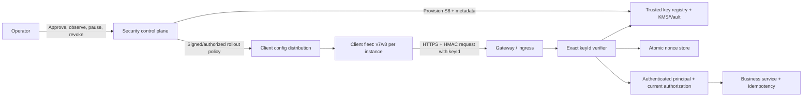
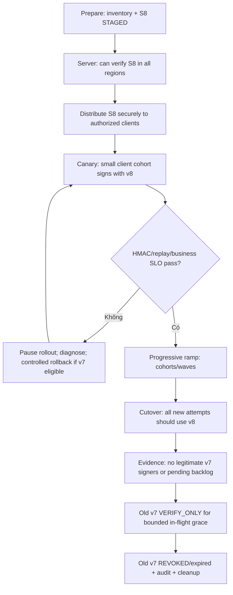

# Client rollout khi xoay vòng khóa HMAC request authentication

## 1. Client rollout là bước khó nhất của key rotation trong hệ thống phân tán

Trong module `SECURITY_AUTHENTICATION_HMAC_REQUEST_AUTHENTICATION`, client giữ **shared secret** và ký HTTP request bằng HMAC trên **canonical request**: HTTP method, raw URI/query, các signed headers và/hoặc digest của raw body. Server chọn đúng credential bằng `keyId`, tự dựng canonical bytes, xác minh HMAC, kiểm tra timestamp/nonce chống replay, key lifecycle và cuối cùng **authorization** trên tài nguyên thực tế.

**Key rotation** không chỉ là tạo một secret mới trên server. Khi có nhiều client instances, mobile releases, batch workers, nhiều region, proxy/gateway và các service chạy lâu, chúng **không đổi key cùng một thời điểm**. Chủ đề **“Client rollout”**, thuộc chương **“Key rotation”**, trả lời câu hỏi:

> Làm thế nào chuyển **toàn bộ client fleet** từ key cũ sang key mới, không gián đoạn request hợp lệ, không chấp nhận credential bị thu hồi, không tạo lỗ hổng replay/downgrade và không phát sinh side effect trùng khi retry?

Giả sử ứng dụng `cli_checkout_42` đang dùng:

```text
Old credential:
    keyId          = kid_checkout_v7
    secret         = S7 (32 random bytes)
    algorithm      = HmacSHA256
    audience       = payments-api/prod
    canonical      = HMAC-REQUEST/ROLLOUT-V1

New credential:
    keyId          = kid_checkout_v8
    secret         = S8 (32 random bytes, S8 != S7)
    algorithm      = HmacSHA256
    audience       = payments-api/prod
    canonical      = HMAC-REQUEST/ROLLOUT-V1

Both key records map to:
    clientId       = cli_checkout_42
    principalId    = service:merchant-42-checkout
```

Client fleet:

```text
Singapore API client instances       40 replicas
Vietnam API client instances         24 replicas
Scheduled payment jobs                8 workers
Long-running partner integration      6 connectors
Disaster recovery client pool         4 warm standbys

All use the same logical registered client but deploy independently.
```

Nếu server thu hồi v7 **trước** khi các client có v8 và chuyển sang sử dụng nó, những clients còn ký v7 sẽ bị `401` hàng loạt. Nếu client bắt đầu ký v8 **trước** khi verifier load metadata/secret v8, chữ ký đúng vẫn bị từ chối vì key ID chưa biết. Nếu server thử *bất cứ key nào* khi chữ ký fail để “không làm gián đoạn rollout”, ta mở đường **downgrade, key confusion và vô hiệu hóa revocation**.

Vì vậy, client rollout cần **trình tự rõ ràng, khoảng overlap có giới hạn, tính sẵn sàng được đo, khả năng tạm dừng/rollback có điều kiện và bước decommission có kiểm chứng**.

### Mục tiêu học tập

Sau bài này, bạn có thể:

1. Phân biệt **rotation of signing secret**, **rotation of key-encryption key** và **protocol/canonical version migration**.
2. Xây dựng kế hoạch **server-first, client-canary, progressive rollout, cutover, verify-only grace, revoke**.
3. Phân biệt trạng thái credential server và lựa chọn `primary signing key` của từng client instance.
4. Thực hiện **atomic configuration snapshot**, tránh trộn `keyId=v8` với `secret=S7` trong một lần ký.
5. Thiết kế SDK Java 17+ dùng `SecureRandom`, `Mac`, `Clock`, `HttpClient` và snapshot body đã đóng băng.
6. Giữ timestamp, nonce, canonical bytes, replay domain và idempotency an toàn khi retry qua key versions.
7. Xác định **rollback được phép** khác với việc “thử key cũ khi HMAC sai” hoặc “mở lại revoked key”.
8. Triển khai telemetry theo cohort/key version, deadline và điều kiện stop/go cho rollout.
9. Kiểm thử client cũ/mới, gateway/proxy, nhiều replica/region, clock skew, in-flight requests và incident compromise.

## 2. Bốn loại version cần được tách bạch

Một request HMAC có thể liên quan đến **bốn vòng đời** khác nhau:

| Thành phần | Ví dụ | Khi thay đổi cần làm gì? |
| --- | --- | --- |
| **Signing key version** | `kid_checkout_v7` → `kid_checkout_v8`, S7 → S8 | Provision secret mới, thay client signing profile, server verify cả hai có kiểm soát, cuối cùng retire v7. |
| **Canonical protocol version** | `ROLLOUT-V1` → `ROLLOUT-V2` | Thay byte-level contract; cần golden vectors, khả năng server/client hỗ trợ version mới và migration policy riêng. |
| **Encryption-at-rest / KEK version** | `KMS KEK-4` → `KMS KEK-5` | Có thể rewrap DEK hoặc re-encrypt secret **không làm raw HMAC secret đổi**; client thường không cần rollout. |
| **Client application/config revision** | SDK release 3.4 → 3.5 hoặc config generation 128 → 129 | Deploy/hot reload kiểm soát, có thể đổi lựa chọn primary key nhưng không nhất thiết tạo secret mới. |

Ví dụ một đội vận hành thay KMS wrapping key, nhưng S7 vẫn là S7. **Đó không phải credential rotation** nếu raw HMAC secret đã bị lộ từ client. Attacker biết S7 vẫn có thể ký request mới khi server còn chấp nhận v7.

Ngược lại, đổi `keyId` mà **tái dùng S7** cũng không phải secret rotation đúng nghĩa. Với same secret ở hai records và khác `keyId`, người giữ S7 có thể tạo HMAC cho ID mới nếu biết chính sách canonicalization.

### 2.1 Mỗi key ID đại diện một material identity riêng

Bất biến của bài:

```text
keyId(v7)   -> exactly one immutable key record -> secret S7
keyId(v8)   -> exactly one immutable key record -> secret S8

S7 != S8, independently generated.
A client has multiple key records, but each key record has one owner.
Never rebind keyId(v7) to S8.
Never transfer keyId(v7) to a different client.
Never try all candidate secrets after an HMAC mismatch.
```

Server lấy `clientId`, `principalId`, `audience`, `algorithm`, `canonicalVersion` và `secretRef` từ **trusted registry**, không suy owner từ tiền tố `keyId` hay một `X-Client-Id` không được xác thực.

### 2.2 Old key có thể đang ACTIVE trong lúc canary

Khi rollout theo đợt, client A đã chuyển sang v8 nhưng client B vẫn dùng v7. Server phải có trạng thái cho phép **cả v7 và v8** verify tại cùng thời điểm. Mô hình đơn giản bài sử dụng:

- `STAGED`: v8 được provision nhưng **chưa được verify**.
- `ACTIVE`: server cho verify key trong validity window; phía client được phép chọn nó làm signing key nếu đã provision và rollout policy cho phép.
- `VERIFY_ONLY`: server còn verify những requests v7 đã in-flight/đang được loại dần; clients **phải ngừng tạo signing attempts mới** với v7.
- `REVOKED`: từ chối v7 bất kể request timestamp; không hồi sinh key.

Trong **phased canary**, cả v7 và v8 có thể tạm thời `ACTIVE` trên server: **client cohort config** quyết định instance nào ký bằng v8. Khi tất cả cohorts đã cutover và có bằng chứng không còn tạo attempts v7 mới, mới chuyển v7 sang `VERIFY_ONLY` trong thời hạn ngắn đã phê duyệt.

Nếu hệ thống sử dụng state model chỉ cho **một active signing key** trên server, cần biểu diễn riêng `verifyAllowed` và `newSigningPreferred` hoặc thiết kế parallel credential grants. **Không ép một trạng thái đơn giản làm hai nhiệm vụ rồi để clients bị từ chối vô cớ.**

## 3. Trust boundaries trong client rollout



Có hai **control planes** cần phân biệt:

1. **Credential management plane:** ai được tạo/activate/revoke key ID, ai được nhận S8, thời gian hiệu lực, audience và trạng thái. Phải dùng authentication/authorization mạnh, audit, approvals và secret delivery bảo mật.
2. **Client rollout plane:** instance/cohort nào **được phép chọn v8 để ký** tại thời điểm nào, config revision bao nhiêu, có thể rollback về v7 khi nào. Rollout plane **không được** override server revocation hoặc chuyển owner của key.

HTTP business plane vẫn thực hiện HMAC, timestamp/nonce và authorization bình thường. Request có `X-HMAC-Key-Id: kid_checkout_v8` không thể buộc server “tạo key v8 nếu chưa thấy”. Nó chỉ là selector để thử một record đã tồn tại.

### 3.1 Client không được tạo secret bằng metadata URL

Sai:

```text
rolloutFlag: v8
client computes secretRef = "vault/keys/" + keyId
client fetches arbitrary secret based on server response
```

Đúng:

- Client secret S8 được provision qua kênh an toàn **cho đúng client identity**; có thể dùng secret manager/keystore của client phù hợp.
- Client chọn một **signing profile đã được local authorization/config quản lý** gồm `keyId` + secret handle + algorithm + audience + canonical version.
- Server tra secret bằng trusted `secretRef` từ key registry, không bằng URI do request tự chọn.
- Mỗi profile được cấu hình cùng nhau để không trộn key ID và secret của hai versions.

### 3.2 Rollout flag không là cơ chế authentication

Không đưa:

```http
X-Rollout-Cohort: canary
X-Key-Rotation-Override: force-old
```

rồi để verifier bỏ HMAC hoặc nhận key đã REVOKED. Cohort là **operational metadata** được điều khiển bởi control plane đáng tin; request internet không được quyền quyết định backend policy. Nếu một header ảnh hưởng nghĩa request, nó cần signed contract và vẫn không override metadata policy.

### 3.3 Vì sao TLS vẫn cần thiết?

HMAC ký request **không mã hóa nội dung request**, và một bản signed request bị lộ có thể bị phát lại nếu nonce chưa được dùng hoặc replay store có lỗ hổng. Distribution của S8 phải đi qua kênh **được xác thực và mã hóa**, không phải email plaintext, query parameter, log hoặc một HTTP endpoint không phân quyền.

Secret của v7/v8 không được ghi nguyên vào telemetry để đo rollout. **Key ID có thể được ghi theo quyền chính sách**, nhưng là selector có thể liên quan đối tác/metadata nhạy cảm, không nên làm metric label có cardinality vô hạn trước authentication.

## 4. Lập danh sách client fleet trước khi nhấn nút canary

**Không thể hoàn thành rollout nếu không biết còn những ai đang ký bằng key cũ.** Một ứng dụng không chỉ là pods đang running trong Kubernetes; có thể có:

- Các API service replicas ở nhiều zones/regions, blue/green hoặc shadow deployments;
- Scheduled/cron workers chạy vài giờ một lần, queue consumers có retry rất lâu;
- Serverless functions, mobile/desktop apps, thiết bị offline hoặc partner SDK nằm ngoài hạ tầng của mình;
- Disaster-recovery standby chưa active, autoscaling templates/AMIs/VM images với key cũ;
- Third-party integrations có quy trình release riêng;
- Canary/QA tool, maintenance jobs, batch imports hoặc scripts có credential riêng;
- Các request **in-flight** hoặc bị gateway buffer, retry queue dùng snapshot signed attempt cũ.

### 4.1 Inventory tối thiểu

| Thông tin | Ví dụ | Vì sao cần? |
| --- | --- | --- |
| Logical client ID / owner | `cli_checkout_42` / Merchant 42 | Biết ai nhận S8 và có quyền approve. |
| Key IDs đang dùng | `kid_checkout_v7` | Xác định v7 còn được ký, ở đâu. |
| Region / service / workload | `vn-prod/payment-worker` | Biết mọi ingress/replica liên quan. |
| Deployment artifact | `checkout-sdk:3.4.2` | Phát hiện image cũ sẽ sống lại sau autoscaling. |
| Config generation | `cfg-128` | Phân biệt “đã nhận S8” và “đã chuyển signing primary”. |
| Secret delivery channel | Managed secret store / partner portal | Chứng minh S8 đã đến đúng chủ thể. |
| Observed signed keyId | v7 hoặc v8 sau HMAC pass | Đo adoption thực tế, không chỉ config declarations. |
| SLO, retry deadline, longest idle time | P99 batch idle 48 giờ | Tính thời gian quan sát và grace. |
| Owner/contact & fallback runbook | Security/on-call/partner liaison | Xử lý failed cohort, compromise, rollback. |
| Cutover/retire gates | `>=99.99% v8 for 48h` *theo policy* | Không decommission chỉ dựa vào % chung. |

Các con số `99.99%`, `48h` là **ví dụ vận hành**, không phải tiêu chuẩn bắt buộc cho mọi hệ thống. Client chạy mỗi tuần một lần có thể cần thời gian xác nhận dài hơn rất nhiều hoặc một cách heartbeat/provisioning attestation riêng.

### 4.2 Mỗi cohort cần một nguồn bằng chứng

Để nói “cohort X đã chuyển sang v8” cần ít nhất:

1. Config/artifact report đã nhận **generation mới** và có profile S8 được cung cấp;
2. **Request đã HMAC-verified thật** với key v8 xuất hiện từ cohort đó;
3. Tỷ lệ lỗi HMAC/time/nonce/5xx không tăng vượt ngưỡng;
4. Không còn v7 ở cohort trong một khoảng đủ bao phủ workload cycle/retry backlog;
5. Có owner xác nhận khi client ngoài quyền kiểm soát (partner SDK/offline).

**Không lấy key ID chưa verify** từ attacker gửi làm bằng chứng một client đã nâng cấp: request giả có thể làm méo adoption metrics. Nên liên kết cohort với principal/workload identity đã được xác minh và giới hạn cardinality.

## 5. Runbook server-first → client rollout → old-key retirement

Đây là **trình tự mặc định khi không có bằng chứng key cũ bị compromise**. Với key đã lộ, quy trình emergency revoke khác và ưu tiên an toàn hơn availability.

### 5.1 Những trạng thái chính



**A. Prepare (chưa đổi client primary):**

- Security admin được xác thực/authorization cấp S8 **mới**, không clone S7; tạo key ID mới, client owner cũ và đúng audience/algorithm/version.
- Lưu S8 qua Vault/KMS/HSM an toàn; key v8 `STAGED`; xác minh integrity, policy metadata, regional replication và test-only fixtures.
- Điều tra compatibility client SDK, proxy/gateway, keyId length/format, base64 signature, skew, body size.
- Thống nhất plan, owners, rollout cohorts, stop conditions, rollback gate và incident contacts.

**B. Server readiness trước client cutover:**

- Đưa v8 vào registry, xác định `verifyNotBefore`, activate và bảo đảm **mọi ingress có khả năng verify** v8 với secret S8.
- Key v7 vẫn được verify; trong canary/ramp, clients chưa chuyển vẫn được phép ký v7.
- Test cross-region/layer: client test credential hoặc controlled probe có HMAC đúng được verify ở tất cả verifier paths. Không trích S8 vào test logs.

**C. Secure distribution:**

- Gửi đúng S8 cho đúng client identity qua channel được authentication/authorization; không ép mọi instance bắt đầu ký v8 ngay chỉ vì đã nhận secret.
- Client lưu profile key v7/v8 **riêng**, cache/vault ACL thích hợp và config revision có integrity.
- Tách **availability of new key** khỏi **selection of new signing key**: readiness first, switch later.

**D. Canary:**

- Chỉ vài cohorts đã biết được chọn v8, tạo signatures mới. Phần còn lại tiếp tục v7 trong overlap.
- Quan sát metrics HMAC verified per key/cohort, invalid signature categories, replay collisions, authz denies và business idempotency.
- Gate theo cả tỉ lệ lỗi **và** sample/cycle coverage; nếu lệch, pause để chẩn đoán.

**E. Progressive ramp:**

- Mở rộng theo region/workload/partner với rollout generation có version.
- Chờ evidence đủ ở cohort hiện tại rồi mới mở cohort tiếp.
- Không để toàn bộ fleet cùng hit KMS/secret manager hoặc reboot/hot reload một lúc.

**F. Global cutover và retirement:**

- Khi không còn legitimate client tạo attempts v7, chuyển v7 thành `VERIFY_ONLY` để drain các attempts **đã được ký trước cutover** (trong chính sách TTL và acceptance).
- Sau grace có hạn và xác nhận offline/batch/DR clients, `REVOKED` v7; propagate revocation, kiểm tra mọi regions; giữ tombstone/audit.
- Xóa S7 khỏi client configs, old images, secret stores/backup theo retention/legal policy, không tái dùng v7 key ID hoặc material.

### 5.2 Server-first không có nghĩa server thử mọi key

Server có thể duy trì **hai records** v7/v8 trong registry. Mỗi request vẫn khai **một key ID**, và verifier chỉ đọc **đúng record tương ứng**:

```text
Request keyId=v7 -> metadata v7 -> secret S7 -> one HMAC verification
Request keyId=v8 -> metadata v8 -> secret S8 -> one HMAC verification

No:
    try S7, then S8
    accept any MAC that matches
    fallback algorithm=HmacSHA1
    use previous canonical version when new one fails
```

Chấp nhận cùng lúc hai key IDs trong overlap là **policy có chủ đích**, không phải **bỏ kiểm soát chữ ký**. Mỗi record có own verify window, status, revision, audience và secretRef.

## 6. Thiết kế thời gian overlap, grace và decommission

Rotation schedule phải xét **ít nhất** sáu khoảng:

| Khoảng | Chức năng | Cần lấy từ đâu? |
| --- | --- | --- |
| Provisioning lead time | Server/client nhận S8 | Secret delivery, approvals, partner lead time. |
| Server propagation time | Mọi verifiers thấy v8 và permission để verify | Registry/KMS/cache/region SLO. |
| Client rollout duration | Từng cohort thực sự ký v8 | Fleet inventory, release windows, offline cycles. |
| Request freshness window | Một signed attempt được chấp nhận trong bao lâu | Timestamp policy, ví dụ [-300s,+30s]. |
| Maximum in-flight/buffer time | Gateway có thể giữ body/request bao lâu | Upload, queues, proxies, request timeouts. |
| Business retry/idempotency horizon | Một ý định thanh toán còn cần được deduplicate khi retry | API contract, payment provider, durable state. |

**Không tự lấy “grace = 5 phút” chỉ vì timestamp window 5 phút.** Nếu vẫn có client batch chưa đổi thì grace không giải quyết vấn đề: đó vẫn là **active signer v7**, phải hoàn tất rollout, cách ly hoặc chủ động ngừng phục vụ nó trước khi v7 chỉ VERIFY_ONLY. Còn nếu client đã chuyển hết, grace cho các **in-flight** requests có thể dựa vào signed freshness, queue timeout và clock error, nhưng phải định nghĩa acceptance time cụ thể.

### 6.1 Hai loại cửa sổ khác nhau

- **Overlap window:** **v7/v8 cùng được server verify**, và tùy cohort clients có thể ký v7 hoặc v8. Dùng trong staged rollout.
- **Drain/verify-only grace:** **không sinh signing attempts mới dưới v7**; server còn verify một số v7 requests được tạo trước cutover cho đến deadline. Dùng sau cutover.

Nếu v7 bị **compromised**, không giữ nó verify-only chỉ để bảo vệ availability: attacker cũng có S7 và có thể tự ký requests mới. Phải áp **emergency revoke** và chấp nhận một số clients/offline sẽ bị lỗi đến khi khôi phục credential mới.

### 6.2 Bảng mốc thời gian ví dụ

```text
D-14     Inventory: all client cohorts + owner contacts
D-10     Provision S8, key v8 STAGED; independent test-only vectors
D-7      Activate v8 server-side in all regions
D-6      Distribute S8 to client secret stores, primary still v7
D-5      Canary 1% signed attempts or selected non-critical clients
D-4      Canary passed -> 5%, then 25% with explicit gates
D-2      Expand to 50%, 95%, 100% by verified cohorts
D0       All new signing attempts SHOULD use v8; last signer evidence
D+1      Old v7 -> VERIFY_ONLY only after no active legitimate v7 signer
D+2      Verify-only grace ends; v7 REVOKED + cache invalidation
D+3      Audit, delete residual access under retention policy
```

Các mốc D-14…D+3 là **kịch bản**, không phải chuẩn chung. Một partner offline 90 ngày hoặc thiết bị không có remote provisioning **không thể** an toàn dùng một lịch 3 ngày; có thể phải hết hạn credential, yêu cầu explicit re-enrollment hoặc áp chính sách tương thích khác được phê duyệt.

## 7. Contract HMAC của ví dụ: ROLLOUT-V1 ký key ID và idempotency key

Để client rollout có thể kiểm thử độc lập, ta định nghĩa một **hợp đồng minh họa** `HMAC-REQUEST/ROLLOUT-V1`. Đây là contract phục vụ bài học, **không phải định dạng bắt buộc của mọi API hoặc AWS**.

### 7.1 Request minh họa cho một payment intent

```http
POST /v1/payments?mode=instant HTTP/1.1
Host: payments.example.test
Content-Type: application/json
Idempotency-Key: pay-intent-2026-00017
X-HMAC-Key-Id: kid_checkout_v8
X-HMAC-Timestamp: 1796083200
X-HMAC-Nonce: 7d46b2dd65d618a32ba74de99da88d80
X-HMAC-Signed-Headers: content-type;idempotency-key;x-hmac-key-id;x-hmac-nonce;x-hmac-timestamp
X-HMAC-Signature: <base64-standard-full-hmac-sha256>

{"amountMinor":125000,"currency":"VND","beneficiaryId":"b-7"}
```

Timestamp `1796083200` là một fixture cho `2026-12-01T00:00:00Z`. Khi gửi request thực tế phải dùng **epoch seconds hiện tại** trong configured freshness window. `X-HMAC-Signature` là placeholder; body được định nghĩa là **đúng byte UTF-8 của JSON trên, không có LF cuối**.

### 7.2 Các trường và rule bắt buộc

| Trường | Quy tắc ROLLOUT-V1 |
| --- | --- |
| Algorithm | `HmacSHA256`, full 32-byte raw tag, Base64 chuẩn padded 44 ký tự. |
| Canonical version | `HMAC-REQUEST/ROLLOUT-V1`, pin bởi metadata key ở verifier. |
| HTTP method | `POST` thực nhận, không method override. |
| Raw target | Origin-form `/v1/payments?mode=instant`, không tự decode/sort query. |
| Audience | `payments-api/prod` từ server config/key metadata, không lấy từ Host untrusted. |
| Content-Type | Exactly one, canonical value `application/json`. |
| Idempotency-Key | Exactly one, ASCII `[A-Za-z0-9._:-]{8,128}`, **giữ ổn định** qua retry cùng intent. |
| X-HMAC-Key-Id | Exactly one, ASCII `[A-Za-z0-9._:-]{1,96}`; **được ký**, đổi khi chuyển v7→v8. |
| X-HMAC-Timestamp | Unix epoch **seconds**, ASCII canonical, ký trong MAC. |
| X-HMAC-Nonce | 128-bit random mới mỗi signed attempt, lowercase hex 32 ký tự, ký trong MAC. |
| Signed-header manifest | Chính xác danh sách đã ghim, lower-case + thứ tự cố định. |
| Body | Raw application bytes sau HTTP framing, demo cấm Content-Encoding/gateway body transform. |
| Body-size | Decimal raw byte count, không lấy từ client `Content-Length`. |
| Body-sha256 | Lowercase hex SHA-256(raw bytes). |
| Canonical bytes | **13 dòng** UTF-8, nối bằng LF `0x0A`, **không có LF cuối**. |
| Replay scope | `(authenticatedClientId, audience, nonce)`, **không chia theo keyId**. |
| Business idempotency | `(authenticatedClientId, audience, idempotencyKey)` + fingerprint method/target/content-type/body; durable commit riêng. |

**Không bỏ signed `Idempotency-Key`** khi retry thanh toán: nếu middleware tự tạo idempotency key mới mỗi attempt, hai request khác nonce/khác key vẫn có thể tạo **hai payments** dù HMAC đều hợp lệ. Định dạng version khác cần thiết kế lại signed fields và fingerprint, không lặng lẽ thêm/bớt.

### 7.3 Chính xác 13 dòng canonical

```text
HMAC-REQUEST/ROLLOUT-V1
HMAC-SHA256
POST
/v1/payments?mode=instant
audience:payments-api/prod
content-type:application/json
idempotency-key:pay-intent-2026-00017
x-hmac-key-id:kid_checkout_v8
x-hmac-nonce:7d46b2dd65d618a32ba74de99da88d80
x-hmac-timestamp:1796083200
signed-headers:content-type;idempotency-key;x-hmac-key-id;x-hmac-nonce;x-hmac-timestamp
body-size:<actual-byte-count>
body-sha256:<sha256-lowercase-hex-of-exact-raw-body>
```

Hai giá trị `<...>` là **placeholder**, phải được tính từ body byte[] thực gửi rồi thay bằng số thực trước HMAC. Không có dòng chứa raw `X-HMAC-Signature` vì đó là **kết quả** tính HMAC, không được tự ký chính nó.

```text
rawBody = freeze(UTF8(serializedJSON))
bodyHash = lowercase_hex(SHA256(rawBody))
canonicalText = joinLF(exactly13Lines, noFinalLF)
tagBytes = HMAC_SHA256(secretSelectedByKeyId, UTF8(canonicalText))
signature = Base64StandardPadded(tagBytes)
```

Verifier phải dựng lại **13 dòng** từ request **thực nhận** và metadata policy, không tin một canonical text do client gửi.

### 7.4 Những gì thay đổi khi chuyển từ v7 sang v8?

```text
Same business intent:
   Idempotency-Key = pay-intent-2026-00017   STABLE
   Method          = POST                    STABLE
   Raw target      = /v1/payments?mode=instant
   Body bytes      = exact same snapshot     STABLE

Attempt A before client cutover:
   keyId           = kid_checkout_v7
   secret          = S7
   nonce           = N7
   timestamp       = T7
   HMAC            = HMAC(S7, canonicalWithKeyIdV7AndN7AndT7)

Attempt B after client cutover (retry of same intent):
   keyId           = kid_checkout_v8
   secret          = S8
   nonce           = NEW N8
   timestamp       = NEW T8
   HMAC            = HMAC(S8, canonicalWithKeyIdV8AndN8AndT8)
```

**Không giữ nguyên signature S7 rồi chỉ thay key ID thành v8.** Key ID là một dòng canonical đã được ký, v8 có secret khác và signature phải tính lại. **Không tái sử dụng nonce N7** khi ký attempt B, vì replay domain đi theo client/audience xuyên key rotation.

## 8. Các điều kiện go/no-go cho từng rollout wave

Chỉ số “bao nhiêu pod đã deploy” **không đủ** để đo key adoption. Một instance có config v8 có thể vẫn ký v7 do SDK cache hoặc middleware xây header từ biến môi trường cũ.

### 8.1 Metric do verifier xác minh

| Metric / signal | Phải chứng minh điều gì? | Chú ý |
| --- | --- | --- |
| `hmac_verified_requests_by_key_version` | Request **MAC pass** thực sự dưới v7/v8 | Đo theo bounded version/cohort labels, không attacker keyId raw. |
| `hmac_invalid_signature_rate` | Có mismatch mới trong cohort v8 không? | Tách bad canonical, wrong secret, proxy rewrite, không tiết lộ MAC cho client. |
| `hmac_unknown_key_rate` | Có client bắt đầu ký v8 trước server readiness không? | Chỉ dùng internal trace, untrusted keyId không phải danh tính. |
| `hmac_timestamp_out_of_window` | Hot reload khiến clock/timestamp sai? | Health của clock/Gateway buffer; không tự nới window. |
| `hmac_nonce_duplicate` | SDK vô tình giữ N cũ khi chuyển profile? | Không mặc định là attacker; vẫn reject replay. |
| `hmac_key_revocation_lag` | Sau revoke v7, mọi region đã ngừng accept chưa? | Phải đo **decision**, không chỉ đã publish event. |
| `client_rollout_generation_healthy` | Workload nào nhận config generation và secret handle v8? | Dựa trên attestation/authenticated telemetry. |
| `client_old_key_usage_last_seen` | Instance nào còn ký v7? | Bắt buộc xét batch/offline workload schedule. |
| `payment_idempotency_conflict/in_progress` | Retry khi rotation có tạo lặp intent không? | Idempotency fingerprint exclude nonce/keyId. |
| `business_duplicate_effect_detected` | Có double payment không? | Đo business commit/provider charge, không chỉ HTTP 200. |
| `kms_secret_unavailable` | Secret config mới không thể load? | Không fallback default secret; gate rollout. |
| `authorization_denied` | Client sau rotation có thay quyền ngoài dự kiến không? | Key rotation **không cấp permissions mới**. |

### 8.2 Gate minh họa

Một wave chỉ PASS khi:

- Server đã xác minh test-only v8 request ở **tất cả đường ingress/regions** của cohort.
- Phần lớn/số lượng kỳ vọng của cohort gửi request verified bằng v8 trong chu kỳ quan sát.
- Invalid HMAC/unknown key tăng **không vượt ngưỡng alert được phê duyệt** so với baseline.
- Timestamp/nonce fail rate và gateway route failures không tăng bất thường.
- Business payment commit/authorization/idempotency metrics vẫn bình thường.
- Rollback từ wave hiện tại vẫn được phép theo trạng thái key v7, có runbook/owner on-call.
- Không có **security incident** đòi emergency revoke v7/v8.

Ví dụ số liệu:

```text
Wave VN payment API, 24 replicas, generation=cfg-129
  24/24 report config applied
  24/24 have verified v8 requests
  old-v7 verified attempts last 30 min = 0
  v8 HMAC invalid rate ~= baseline
  idempotency duplicate effects = 0
  all regions KMS/replay store healthy

Decision: proceed to next wave (if approved policy gates).
```

Dấu `~≈` hoặc “baseline” là mô tả, không xác nhận metric thực tế. Các clients idle có thể **không xuất hiện request trong 30 phút**; chúng cần xác nhận theo workload cycle hoặc test probe có quyền và khả năng chạy.

### 8.3 Pause, rollback và emergency revoke là ba thao tác khác nhau

| Thao tác | Khi nào? | Điều kiện an toàn |
| --- | --- | --- |
| **Pause** | Một wave có lỗi, cần giữ hiện trạng | Không mở thêm cohort, key policies không thay đổi trái phép. |
| **Rollback client selection** | v8 có lỗi cấu hình/SDK, v7 **chưa bị compromise, chưa revoked**, còn được server verify | Chọn lại v7 ở control plane qua config generation mới, log/audit; **không tự đổi key khi 401**. |
| **Emergency revoke** | v7 hoặc v8 bị lộ/mạo danh | Thu hồi ngay theo security policy, kể cả gián đoạn; không giữ verify-only grace vì availability. |
| **Server policy rollback** | Registry update sai nhưng không compromise | Thay đổi có phê duyệt, audit/CAS; không override REVOKED hoặc mở auth bypass. |
| **Retry business request** | Network timeout/503 sau gửi | Fresh HMAC attempt, stable idempotency key, bounded backoff, không đồng nghĩa rollback credential. |

Một client SDK **không được** “thử v8, nhận 401 thì tự gửi lại bằng v7”, vì 401 có thể do HMAC sai, key revoked, timestamp sai, nonce duplicate, thiếu quyền hoặc attack; việc tự thử key cũ tạo downgrade oracle và có thể lặp side effect. **Rollback là quyết định vận hành có kiểm soát**, không là secret guessing trong request handler.

## 9. Client config phải có integrity và snapshot per signing attempt

Giả sử hai config fields được cập nhật riêng:

```text
Thread A sees keyId = kid_checkout_v8
Thread B has not updated secret, still S7
Thread A signs canonical with v8 but using S7
Result: MAC mismatch, request fails.
```

Trong một client nhiều threads, config rollout cần được thay **nguyên một profile bất biến/atomically**. Một signed attempt phải dùng cùng:

```text
keyId + secretHandle + audience + algorithm + canonicalVersion
    from ONE trusted signing profile snapshot.
```

### 9.1 Thiết kế `SigningProfile`

Ví dụ logic:

```text
SigningProfile generation cfg-128:
    primaryKey = (kid_checkout_v7, SecretHandle(S7))
    signingVersion = ROLLOUT-V1
    audience = payments-api/prod

SigningProfile generation cfg-129:
    primaryKey = (kid_checkout_v8, SecretHandle(S8))
    signingVersion = ROLLOUT-V1
    audience = payments-api/prod

Each request:
    profile = atomicRef.get()          // one snapshot
    serialize/freeze body              // immutable byte snapshot
    timestamp = current epoch seconds
    nonce = SecureRandom(16 bytes)     // new per attempt
    canonical = build with profile.keyId
    mac = HMAC(profile.secret, canonical)
    send exactly the bytes/headers signed
```

**Không cho phép** người gọi tự inject key ID không tương ứng với secret. Config revision cũng cần được chứng minh từ distribution channel tin cậy (mTLS, signed config, scoped secret store/IAM), chứ không lấy từ HTTP response header `X-Recommended-Key-Id` do mạng có thể giả mạo.

### 9.2 Hot reload có thể diễn ra giữa các retries

Một business intent có thể có:

```text
Attempt 1: before cutover
  key v7, nonce N1, timestamp T1, idempotency key I, body B

Attempt 2: after cutover
  key v8, nonce N2, timestamp T2, idempotency key I, body B
```

Đây là **hai HMAC attempts riêng**, nhưng **một business intent**. Về bảo mật:

- Không dùng lại N1; nonce store scope client+audience không chia bởi key ID.
- Không sửa `Idempotency-Key` khi retry cùng operation.
- Không tự tạo payload JSON B2 từ Map thay vì snapshot B; nếu fingerprint thay đổi, server phải conflict.
- Không dùng MAC v7 cho canonical v8.
- Không đổi key version giữa lúc đã tính MAC và lúc build HTTP headers.

**Per-attempt pinning** không nhất thiết pin một key cho toàn bộ vòng đời business intent; nó bảo đảm **tính nhất quán trong một lần gửi**. Việc đổi key qua attempts là hợp lệ nếu v8 đã được provision/activate và idempotency scope server được giữ ổn định.

## 10. Java 17+: Client SDK dùng atomic signing profile và fresh nonce

Ví dụ dưới đây triển khai **client-side signer cho ROLLOUT-V1**. Một instance nhận `SigningProfile` từ **trusted secret/config distribution**, giữ bằng `AtomicReference` và chụp **đúng một profile** cho từng signed attempt. Config generation phải tăng đơn điệu; SDK không tự thay primary key theo một HTTP 401.

Đây là **mẫu học tập**, không có chức năng phân phối S7/S8, IAM, HSM, rate limit hay KMS. Nó chỉ mô tả nguyên tắc client rollout quan trọng nhất: **không trộn key ID và secret giữa generations**, freeze body và ký lại nonce/timestamp mỗi attempt.

### 10.1 `ClientRolloutSignerV1` — triển khai hoàn chỉnh phần signer

```java
import java.nio.charset.StandardCharsets;
import java.security.GeneralSecurityException;
import java.security.MessageDigest;
import java.security.SecureRandom;
import java.time.Clock;
import java.util.Base64;
import java.util.HexFormat;
import java.util.Map;
import java.util.Objects;
import java.util.concurrent.atomic.AtomicReference;
import javax.crypto.Mac;
import javax.crypto.SecretKey;

public final class ClientRolloutSignerV1 {
    public static final String AUDIENCE = "payments-api/prod";
    public static final String CANONICAL_VERSION =
            "HMAC-REQUEST/ROLLOUT-V1";
    public static final String RAW_TARGET =
            "/v1/payments?mode=instant";
    public static final String SIGNED_MANIFEST =
            "content-type;idempotency-key;x-hmac-key-id;"
          + "x-hmac-nonce;x-hmac-timestamp";

    private static final SecureRandom RANDOM = new SecureRandom();

    // Profile được tạo từ nguồn cấu hình BẢO MẬT.
    // Không dựng profile mới từ header HTTP của server response.
    public record SigningProfile(
            long configRevision,
            String keyId,
            SecretKey signingKey) {

        public SigningProfile {
            if (configRevision < 1
                    || keyId == null
                    || !keyId.matches("[A-Za-z0-9._:-]{1,96}")
                    || signingKey == null
                    || !"HmacSHA256".equals(signingKey.getAlgorithm())) {
                throw new IllegalArgumentException(
                        "Invalid trusted HMAC signing profile");
            }
        }
    }

    public record SignedAttempt(
            long configRevision,
            String keyId,
            String rawTarget,
            byte[] body,
            Map<String, String> headers) {

        public SignedAttempt {
            Objects.requireNonNull(keyId);
            Objects.requireNonNull(rawTarget);
            body = Objects.requireNonNull(body).clone();
            headers = Map.copyOf(Objects.requireNonNull(headers));
        }

        @Override
        public byte[] body() {
            return body.clone();
        }
    }

    private final AtomicReference<SigningProfile> active;

    public ClientRolloutSignerV1(SigningProfile initial) {
        active = new AtomicReference<>(Objects.requireNonNull(initial));
    }

    /**
     * Caller PHẢI kiểm tra trust/authorization/integrity của config.
     * Cho phép áp dụng config mới có revision lớn hơn.
     * Không rollback bằng cách "cố thử key cũ" khi HMAC fail.
     */
    public boolean installTrustedProfile(SigningProfile next) {
        Objects.requireNonNull(next);
        while (true) {
            SigningProfile previous = active.get();
            if (next.configRevision() <= previous.configRevision()) {
                return false; // stale/out-of-order config generation
            }
            if (active.compareAndSet(previous, next)) {
                return true; // atomic switch of whole keyId+secret profile
            }
        }
    }

    /**
     * Mỗi lời gọi sinh một signed attempt mới.
     * stableIntentKey và stableBody cần giữ nguyên khi retry
     * CÙNG một business intent; mọi attempt có nonce mới.
     */
    public SignedAttempt signNewAttempt(
            byte[] stableBody,
            String stableIntentKey,
            Clock clientClock) {

        Objects.requireNonNull(stableBody);
        Objects.requireNonNull(clientClock);
        if (stableIntentKey == null
                || !stableIntentKey.matches(
                        "[A-Za-z0-9._:-]{8,128}")) {
            throw new IllegalArgumentException(
                    "Invalid business idempotency key");
        }

        // ONE snapshot cho TOÀN BỘ ký và HTTP headers của attempt.
        SigningProfile selected = active.get();
        byte[] bodySnapshot = stableBody.clone();

        byte[] randomNonce = new byte[16];
        RANDOM.nextBytes(randomNonce);
        String nonce = HexFormat.of().formatHex(randomNonce);
        String timestamp = Long.toString(
                clientClock.instant().getEpochSecond());

        final String digest;
        final String signature;
        try {
            digest = HexFormat.of().formatHex(
                    MessageDigest.getInstance("SHA-256")
                            .digest(bodySnapshot));

            String canonical = String.join("\n",
                    CANONICAL_VERSION,
                    "HMAC-SHA256",
                    "POST",
                    RAW_TARGET,
                    "audience:" + AUDIENCE,
                    "content-type:application/json",
                    "idempotency-key:" + stableIntentKey,
                    "x-hmac-key-id:" + selected.keyId(),
                    "x-hmac-nonce:" + nonce,
                    "x-hmac-timestamp:" + timestamp,
                    "signed-headers:" + SIGNED_MANIFEST,
                    "body-size:" + bodySnapshot.length,
                    "body-sha256:" + digest);

            byte[] canonicalBytes =
                    canonical.getBytes(StandardCharsets.UTF_8);

            Mac mac = Mac.getInstance("HmacSHA256");
            mac.init(selected.signingKey());
            byte[] fullTag = mac.doFinal(canonicalBytes);
            signature = Base64.getEncoder().encodeToString(fullTag);
        } catch (GeneralSecurityException cryptoFailure) {
            throw new IllegalStateException(
                    "HMAC signing unavailable", cryptoFailure);
        }

        Map<String, String> signedHeaders = Map.of(
                "Content-Type", "application/json",
                "Idempotency-Key", stableIntentKey,
                "X-HMAC-Key-Id", selected.keyId(),
                "X-HMAC-Nonce", nonce,
                "X-HMAC-Timestamp", timestamp,
                "X-HMAC-Signed-Headers", SIGNED_MANIFEST,
                "X-HMAC-Signature", signature);

        return new SignedAttempt(
                selected.configRevision(),
                selected.keyId(),
                RAW_TARGET,
                bodySnapshot,
                signedHeaders);
    }
}
```

**Điểm thiết kế quan trọng:**

1. `SigningProfile` chứa `keyId` và **đúng secret handle**; `AtomicReference.get()` chụp **một immutable record**. Dù thread khác install v8 giữa lúc ký, request hiện tại vẫn hoàn tất bằng cùng profile được chọn.
2. `configRevision` tăng đơn điệu. `installTrustedProfile` chỉ chống **out-of-order update tại JVM**; bản thân hàm này **không xác thực người phát config**. Caller cần mTLS/signed config/secret ACL và approvals trước khi gọi.
3. `RANDOM.nextBytes(16)` tạo nonce 128-bit **mới mỗi lời gọi**, không suy từ key ID, config generation hay timestamp.
4. `stableBody.clone()` giúp digest và body gửi HTTP xuất phát từ cùng snapshot. Nếu client serialize JSON lại mỗi retry, fingerprint có thể đổi dù nghiệp vụ giống nhau.
5. `stableIntentKey` được caller cấp **một lần cho business intent** và giữ qua retries, kể cả khi keyId đổi v7→v8.
6. `String.join("\n", ...)` tạo **13 canonical lines**, không có LF cuối; body size là byte length và hash là lowercase SHA-256.
7. `X-HMAC-Key-Id` được ký cùng nonce/timestamp/`Idempotency-Key`, không tạo signature trước rồi thay header.
8. `SecretKey` là credential object được cung cấp bởi trust store; code không log hoặc `getEncoded()` raw bytes. Hệ thống thật cần giảm lifetime/đảm bảo revoke secrets trong memory theo chính sách.
9. Không dùng `HttpClient` auto-retry hoặc interceptor sửa signed headers sau HMAC mà không ký lại theo contract.
10. Rollback v8→v7 **về mặt kỹ thuật** là cài một profile v7 với configRevision mới hơn, nhưng chỉ khi **operator đã xác nhận v7 vẫn hợp lệ/không compromise**; `installTrustedProfile` không tự đưa ra quyết định này.
11. Mã chỉ giới hạn một endpoint/manifest; muốn hỗ trợ các endpoint/HTTP methods khác phải có parser/contract signed fields được phiên bản hóa, **không** tự thay query/route bytes.

### 10.2 Gửi request bằng Java 17 `HttpClient`

Ví dụ caller đã có một `ClientRolloutSignerV1 signer` và một `String intentKey` được lưu cho business operation. `stableBody` phải tồn tại trước vòng retry:

```java
import java.io.IOException;
import java.net.URI;
import java.net.http.HttpClient;
import java.net.http.HttpRequest;
import java.net.http.HttpResponse;
import java.nio.charset.StandardCharsets;
import java.time.Clock;
import java.time.Duration;

byte[] stableBody =
        ("{\"amountMinor\":125000,\"currency\":\"VND\","
         + "\"beneficiaryId\":\"b-7\"}")
            .getBytes(StandardCharsets.UTF_8);

String intentKey = "pay-intent-2026-00017";

ClientRolloutSignerV1.SignedAttempt signed =
        signer.signNewAttempt(
                stableBody,
                intentKey,
                Clock.systemUTC());

HttpClient client = HttpClient.newBuilder()
        .followRedirects(HttpClient.Redirect.NEVER)
        .build();

HttpRequest.Builder request = HttpRequest.newBuilder(
        URI.create("https://payments.example.test"
                + signed.rawTarget()))
        .timeout(Duration.ofSeconds(15))
        .POST(HttpRequest.BodyPublishers.ofByteArray(signed.body()));

signed.headers().forEach(request::header);

try {
    HttpResponse<String> response = client.send(
            request.build(),
            HttpResponse.BodyHandlers.ofString());

    // Chỉ chấp nhận kết quả theo HTTP + business contract.
    // Không chuyển sang old key chỉ vì status 401.
    handleResponseAccordingToContract(response);
} catch (InterruptedException interrupted) {
    Thread.currentThread().interrupt();
    // Không suy ra server chưa thực thi; reconcile intent.
    markIntentOutcomeUnknown(intentKey);
} catch (IOException ambiguousNetworkFailure) {
    // Unknown outcome: giữ intentKey, ký attempt mới nếu retry safe.
    markIntentOutcomeUnknown(intentKey);
}
```

`handleResponseAccordingToContract` và `markIntentOutcomeUnknown` là **hàm ứng dụng minh họa**, không thuộc JDK. `HttpClient` trong Java 17 chưa hỗ trợ dùng trực tiếp `try-with-resources`; nên tái sử dụng client instance đúng lifecycle. Đoạn này không tự động implement retry/backoff — đó là policy endpoint/business riêng.

### 10.3 Kiểm thử tính atomic của profile switch

Test concept:

```text
Given:
   trusted profile p7: keyId=v7, secret=S7, configRevision=128
   trusted profile p8: keyId=v8, secret=S8, configRevision=129
   signing requests concurrent with installTrustedProfile(p8)

For every generated attempt:
   either:
      keyId=v7 AND HMAC verifies under S7, not S8
   or:
      keyId=v8 AND HMAC verifies under S8, not S7

Never:
   keyId=v8 + HMAC computed with S7
   keyId=v7 + HMAC computed with S8
```

Unit tests nên dùng **test-only SecretKeySpecs** và independent canonical verifier; không in secret hoặc full Authorization/signature trong log. Với deterministic golden vectors, inject `Clock.fixed` và **nonce provider kiểm thử** tách biệt (`SecureRandom` production vẫn bắt buộc); cùng lúc kiểm tra keyId và body bytes đã đóng băng.

## 11. Server-side readiness: verify hai key mà không đánh đổi policy

Client rollout chỉ an toàn nếu backend đủ thông tin **cho từng key ID**.

### 11.1 Trusted credential records

```text
key registry:
  keyId=kid_checkout_v7
    clientId=cli_checkout_42
    principal=service:merchant-42-checkout
    secretRef=vault://.../kid_checkout_v7
    algorithm=HmacSHA256
    canonical=HMAC-REQUEST/ROLLOUT-V1
    audience=payments-api/prod
    status=ACTIVE during rollout
    verifyUntil=oldKeyDeadline

  keyId=kid_checkout_v8
    clientId=cli_checkout_42
    principal=service:merchant-42-checkout
    secretRef=vault://.../kid_checkout_v8
    algorithm=HmacSHA256
    canonical=HMAC-REQUEST/ROLLOUT-V1
    audience=payments-api/prod
    status=ACTIVE after server readiness
    verifyNotBefore=activationTime
```

**Key v8 phải được phân phối đúng client**, và server phải biết đúng S8. Nếu client dùng S8 với keyId v7, hoặc server map keyId v8 sang alias S7, signature không đạt chính sách/key attribution.

### 11.2 Server pipeline mẫu

```java
// PSEUDOCODE: không phải toàn bộ type dưới đây nằm trong JDK.
ValidatedRequest req = ingress.parseStrict(http);
// One each: keyId, timestamp, nonce, signature, signed manifest,
// Content-Type, Idempotency-Key; reject duplicate/framing ambiguity.

String wireKeyId = req.uniqueHeader("X-HMAC-Key-Id");
KeyRecord key = registry.exactLookup(wireKeyId);

if (key == null
        || !key.mayVerifyNow()
        || !"HmacSHA256".equals(key.algorithm())
        || !"HMAC-REQUEST/ROLLOUT-V1"
            .equals(key.canonicalVersion())
        || !"payments-api/prod".equals(key.audience())) {
    rejectAuthenticationGeneric();
    return;
}

ClientRecord client = clients.exactLookup(key.clientId());
if (client == null || !client.enabled()) {
    rejectAuthenticationGeneric();
    return;
}

// secretRef là metadata đáng tin, không nối từ wireKeyId.
SecretKey keyMaterial =
        secretProvider.loadTrusted(key.secretRef());
byte[] canonical = canonicalizer.buildActualRolloutV1(
        req, key); // 13 exact UTF8 LF lines, no trailing LF

if (!constantTimeFullHmacSha256.verify(
        keyMaterial, canonical, req.signature())) {
    rejectAuthenticationGeneric();
    return;
}

// Check current status/revision after long body upload if needed.
if (!clockHealth.healthy()
        || !freshness.accepts(req.signedTimestamp(), clock.instant())
        || !registry.stillCurrentAndVerifiable(key)
        || !clients.stillEnabled(client)) {
    rejectAuthenticationOrUnavailable();
    return;
}

// Cross-version anti-replay namespace is clientId + audience + nonce.
NonceReservation nonce = nonceStore.atomicReserve(
        client.clientId(), key.audience(),
        req.signedNonce(), configuredNonceTtl);

if (nonce != NonceReservation.INSERTED) {
    rejectReplayOrNonceStoreUnavailable();
    return;
}

// Authentication only proves key ownership, not resource permission.
Principal principal = identity.fromVerifiedKeyAndClient(key, client);
if (!authorization.canCreatePayment(
        principal, req.actualTenant(), req.actualResource())) {
    rejectForbidden();
    return;
}

// Verified, signed Idempotency-Key enters a separate durable store.
// Its identity/fingerprint MUST NOT include volatile keyId/nonce.
businessIdempotency.executeOrRecover(
        principal, req.signedIdempotencyKey(),
        req.method(), req.rawTarget(),
        req.contentType(), req.rawBodyBytes());
```

`canonicalizer.buildActualRolloutV1` là tên hàm **minh họa**, không phải API có sẵn. Tầng thực tế phải validate exact manifest, byte-level URI/body contract và key ID; không tin request do client tự cung cấp canonical blob. **Không reserve nonce trước MAC pass** vì attacker có key ID thật nhưng không có secret có thể poison nonce store.

### 11.3 Metadata trạng thái trong canary và verify-only

| Stage | Key v7 | Key v8 | Hành vi đúng của server |
| --- | --- | --- | --- |
| Provision | ACTIVE | STAGED | v7 requests pass; v8 requests reject. |
| Server ready | ACTIVE | ACTIVE | Exact lookup cho từng key; cả hai có thể verify. |
| Client canary/ramp | ACTIVE | ACTIVE | v7/v8 requests pass nếu MAC/time/nonce/current metadata đúng. |
| Full cutover | ACTIVE tạm cho signers chưa xác minh hết | ACTIVE | Không đổi v7 VERIFY_ONLY khi vẫn có legitimate signers tạo attempts mới. |
| In-flight drain | VERIFY_ONLY đến deadline | ACTIVE | Server có thể verify old attempts trong freshness; clients được yêu cầu không tiếp tục ký v7. |
| Retired | REVOKED/expired | ACTIVE | v7 reject dù MAC đúng và timestamp còn mới. |

**Quan trọng:** Server không thể phân biệt bằng mật mã rằng một request v7 trong VERIFY_ONLY thực sự được ký **trước** thời điểm cutover; một bên vẫn giữ S7 có thể tự điền signed timestamp trong cửa sổ freshness. `VERIFY_ONLY` là **chính sách vận hành và eligibility**, không phải bằng chứng cryptographic về thời điểm ký. Vì vậy grace phải hữu hạn, không dùng với compromised key và phải tiếp tục kiểm tra timestamp/nonce.

### 11.4 Không cache key status vô hạn

Key v7 được revoke ở control plane nhưng cache region B vẫn nói ACTIVE. Một attacker đã có S7 có thể tiếp tục ký v7 để được accept ở B. Cần:

- Revision/state version, cache invalidation và recheck theo SLO thu hồi;
- Giới hạn độ tươi metadata; nếu không thể xác nhận status current, fail-closed;
- Quy tắc conflict `REVOKED` ưu tiên `ACTIVE` stale; không dùng last-write-wins khiến revoke bị rollback;
- Secret cache keyed theo exact keyId/material version, không alias `currentSecretForClient`;
- Test revoke trong lúc body stream lâu, proxy queue và DNS/failover.

Một `KeyRecord` đang ACTIVE không cho phép client tạo payment của tenant khác; authorization vẫn kiểm tra actual resource sau authentication.

## 12. Retry, replay và idempotency khi hai keys cùng tồn tại

Client rollout và network failures thường xảy ra cùng lúc. **Đổi HMAC key không thay identity của một business intent**.

### 12.1 Sơ đồ timeout xuyên cutover

```text
Client                                     API / verifier + DB
  |
  | Attempt 1:
  |   keyId=v7, nonce=N1, timestamp=T1
  |   Idempotency-Key=I, body=B
  |--------------------------------------------> HMAC v7 PASS
  |                                              reserve N1
  |                                              create payment P-501
  |                     [response lost]           commit I -> P-501
  X
  |
  | config hot reload: primary key now v8
  |
  | Attempt 2:
  |   keyId=v8, nonce=N2, timestamp=T2
  |   Idempotency-Key=I, body=B
  |--------------------------------------------> HMAC v8 PASS
  |                                              reserve N2
  |                                              find I already COMMITTED
  |<---------- return P-501 after current authz --
```

Một attempt v8 mới có thể HMAC đúng dù request v7 ban đầu đã tạo payment. **Server phải deduplicate business intent**, không được hiểu “new key version = new payment”. Nếu idempotency store identity có `(clientId, keyId, idempotencyKey)` thì hai key versions tạo **hai namespaces** và có thể double-charge. Trong ví dụ, scope phải là:

```text
business intent:
    (authenticatedClientId, audience, Idempotency-Key)

fingerprint:
    (method, rawTarget, contentType, rawBodySha256)

NOT:
    (keyId, timestamp, nonce, signature)
```

**Không dùng một idempotency key chưa ký** để trả cached payment result; contract ROLLOUT-V1 đã đưa nó vào canonical line và header manifest.

### 12.2 Exact signed-request retry khác fresh attempt retry

| Retry | Key ID | Nonce | Signature | Anti-replay | Business result |
| --- | --- | --- | --- | --- | --- |
| Gửi lại **y nguyên** attempt đã reserve | v7 | N1 | S1 | Duplicate → reject replay | Không suy ra effect đã commit hay chưa. |
| Ký attempt mới cùng key | v7 | N2 | S2 | Fresh nếu v7 still allowed | Idempotency dedup theo I. |
| Ký attempt mới sau cutover | v8 | N3 | S3 | Fresh nếu v8 ACTIVE | **Cùng I**, không tạo payment thứ hai. |
| Ký attempt mới với **key cũ REVOKED** | v7 | N4 | S4 | Authentication reject trước business | Không dùng grace để hồi sinh v7. |
| Ký attempt mới nhưng thay `Idempotency-Key` | v8 | N5 | S5 | Có thể auth pass | **Intent khác**, nguy cơ double effect khi SDK bug. |
| Ký attempt mới nhưng body khác, cùng I | v8 | N6 | S6 | Có thể auth pass | Idempotency fingerprint conflict, không xử lý B2 như B1. |

### 12.3 Không suy kết quả từ HTTP timeout

Mất response, 502/503/504 hoặc network reset **không chứng minh server chưa commit**. Với endpoint side-effecting:

- Lưu bền intent key, body snapshot, operation ID và retry deadline trên client;
- Retry **attempt mới** nếu business contract cho phép, nhưng giữ intent key và payload fingerprint;
- Với `PENDING/UNKNOWN` ở downstream payment provider, reconcile trước khi gọi effect mới;
- Bounded retries + exponential backoff with jitter + `Retry-After` theo policy;
- Không tự dùng v7 khi server trả 401 cho v8; cần xác định nguyên nhân ở control plane;
- Client có thể thay signing profile giữa attempts, nhưng mỗi attempt phải snapshot profile nhất quán.

**At-most-one effect** cần unique business operation/DB transaction/provider idempotency; nó không tự đến từ HMAC, nonce hay key rotation. Replay guard bảo vệ signed attempt; idempotency bảo vệ business intent.

### 12.4 TTL nonce vẫn phải đủ cho old/new credentials

Với freshness chấp nhận `serverNow - 300 <= T <= serverNow + 30`, clock error tối đa ±5s và safety margin 20s, TTL mẫu:

```text
minimumNonceTtl >= maxPastAge + maxFutureAllowance
                   + 2*maxClockError + safetyMargin

                >= 300 + 30 + 10 + 20 = 360 seconds
```

Sử dụng atomic reservation trong một domain **(clientId, audience, nonce)** xuyên v7/v8. Không chia nonce store bằng key ID, vì điều đó cho phép reuse một nonce khi đổi key version. Lỗi Redis timeout/unknown outcome phải **fail-closed**; không chuyển local in-memory cache hoặc xóa nonce vì business 500.

Đây là mô hình theo giả định clock error/durability cụ thể, **không** chứng minh chống replay nếu Redis eviction/failover làm mất reservation hoặc region A/B độc lập cùng reserve.

## 13. Proxy, API gateway và các sự cố dễ bị chẩn đoán sai thành “key mới hỏng”

### 13.1 Key rotation không làm thay đổi canonical HTTP contract

Nếu v7 và v8 đều dùng ROLLOUT-V1, việc thay key material không được đổi:

```text
POST /v1/payments?mode=instant
Content-Type: application/json
Idempotency-Key: pay-intent-2026-00017
bodyBytes = exact same serialized JSON snapshot
```

Nhưng HTTP stack/gateway có thể:

- Decode `%2F` thành `/` trong path, sort query hoặc đổi percent-hex case;
- Rewrite Host/`:authority` hoặc HTTP/2 `:path` khi chuyển protocol;
- Gộp duplicate signed headers theo cách khác giữa gateway và backend;
- Thêm `charset=utf-8` vào `Content-Type`;
- Nén/giải nén body hoặc serialize lại JSON;
- Auto-redirect signed POST sang URL khác;
- Retry một signed attempt **nguyên xi**, giữ nonce N1;
- Copy security headers từ client không tin cậy như `X-Verified-Client`.

Nếu MAC mismatch sau rollout, **không đoán lỗi từ S8 trước**. Kiểm tra exact bytes và trust boundary trên **đường thực**. Một lỗi canonicalization tồn tại từ v7 có thể chỉ lộ khi cohort v8 đi qua một gateway mới/region mới.

### 13.2 Gateway verify trước rewrite

```text
Client signs actual method+raw URI+headers+body
  -> Gateway verifies HMAC + nonce with trusted registry
  -> Gateway strips forged internal headers
  -> Gateway sends protected authenticated context
  -> Backend authorizes the ACTUAL resource/action it executes
```

Gateway cần chuyển authenticated client/principal và key revision qua **kênh có integrity** (mTLS, service identity/attestation và policy), không tin `X-Verified-Principal` do Internet tự khai. Backend vẫn phải authorization trên actual route/tenant, không chỉ dựa vào “MAC PASS”.

### 13.3 Backend verify sau rewrite

Nếu verifier nằm sau proxy, backend phải có **provenance tin cậy** của raw origin-form target và bytes đã ký. Không tin `X-Original-URI` do client Internet có thể tạo. Nếu gateway làm biến đổi payload, HMAC contract phải định nghĩa rõ transformation đã được bảo vệ hoặc từ chối.

Hai signed inputs có vẻ “giống nhau” về ý nghĩa URI:

```text
/v1/payments?ref=a%2Fb
/v1/payments?ref=a/b
```

nhưng **khác raw bytes**. Verifier không được thử cả hai canonical variants để tăng tỷ lệ pass khi key mới vừa rollout. Một cơ chế fallback như vậy có thể mở parser differential hoặc request smuggling.

### 13.4 Cross-region rollout

Trước khi canary ở region B:

1. Key v8 và correct trusted secretRef đã được replicate/accessible ở verifier B chưa?
2. Region B có KMS/Vault IAM grant đúng và secret material S8 version ổn định chưa?
3. Registry cache B đã nhìn thấy `status=ACTIVE`, `verifyNotBefore` và audience chưa?
4. Cùng request body/raw target qua HTTP/2 gateway có tạo exact canonical bytes không?
5. Replay store across A/B có **atomic decision** chung theo client+audience không?
6. Nếu request authenticated bằng key v8 ở A nhưng retry bằng v7/v8 qua B, idempotency scope/business DB có nhất quán không?
7. Key revoke event có thể được nhận và áp dụng ở mọi region theo SLO không?

**Không** bắt đầu client v8 rollout chỉ vì region A đã verify một request test; một load balancer có thể chuyển request đến B bất kỳ lúc nào.

## 14. Điều phối rollout: observability, owner, approval và rollback gates

### 14.1 Một cấu hình rollout có thể audit

Ví dụ control-plane record:

```yaml
# Ví dụ vận hành, KHÔNG phải secret/config thật.
clientId: cli_checkout_42
oldKeyId: kid_checkout_v7
newKeyId: kid_checkout_v8
targetAudience: payments-api/prod
canonicalVersion: HMAC-REQUEST/ROLLOUT-V1

rolloutGeneration: 129
rolloutState: CANARY
canaryCohorts:
  - vn-prod/api-checkout
  - sg-prod/low-risk-batch
enabledKeyForNewSigning: kid_checkout_v8

serverCompatibility:
  oldKey: ACTIVE
  newKey: ACTIVE

gates:
  requireAllRegionsVerifyNewKey: true
  requireAuthenticatedAdoptionEvidence: true
  requireNoBusinessDuplicateEffect: true
  requireRevocationSloHealthy: true

rollback:
  permittedOnlyWhenOldKeyNotCompromised: true
  requireOperatorApproval: true
  rejectUnknownProfileGeneration: true
```

Rollout record không chứa S7/S8, plaintext DEK hay vault access tokens. `enabledKeyForNewSigning` chỉ áp dụng cho **cohorts đã được quyết định**, không thể bắt tất cả clients bắt buộc lấy key mới chỉ bằng metadata trên HTTP business traffic.

### 14.2 Runbook cho người vận hành

**Trước khi bắt đầu:**

- Chốt owner và channel bảo mật để cấp v8, chạy thử staging/prod bằng test-only vectors và giả lập gateway.
- Kiểm tra key statuses, expiry, service audience, algorithm, signature encoding và clock synchronization.
- Inventory tất cả cohorts: batch/offline/DR, rollback paths, config revisions, secret delivery.
- Kiểm tra cache invalidation/nonce store/idempotency service và alert budgets.
- Đặt **hard deadline** để revoke v7; đừng duy trì hai active secrets vô hạn trừ khi policy cấp quyền rõ.

**Trong canary/ramp:**

- Install trusted config generation; theo dõi **HMAC-verified** v8 requests, không chỉ keyId client báo.
- Dùng ít nhất một full business cycle hoặc approved synthetic probe cho workloads idle.
- Nếu HMAC mismatch, kiểm tra config keyId+secret snapshot, canonical bytes, gateway rewrite và KMS metadata, **không** tắt signature verification.
- Nếu timeout/503 tăng, đánh giá unknown business outcomes và idempotency; không cho retry tạo intents mới.

**Khi cutover:**

- Ngừng tạo signing attempts v7 ở mọi cohorts có trách nhiệm vận hành.
- Chờ evidence về in-flight requests/buffers và replay TTL theo contract.
- Chuyển v7 sang VERIFY_ONLY chỉ khi không còn legitimate active signer; deadline phải hữu hạn.
- Thu hồi v7, recheck all regions/gateways, xóa S7 khỏi runtime/images/secret stores theo retention.
- Audit coverage và incident gaps.

### 14.3 Bằng chứng để quyết định “xong rollout”

Một biên bản hoàn thành nên chứa:

```text
clientId / audience / primary new keyId
server registry version and status by region
client config generation(s) installed by cohort
last authenticated v7 usage and coverage of idle workloads
first authenticated v8 usage per cohort
HMAC mismatch, timestamp/nonce, 401/403, key-unavailable rates
business idempotency duplicate-effect count
old key VERIFY_ONLY/REVOKED decision timestamp + revision
revocation propagation SLO evidence
secret cleanup / DR rotation evidence
approver and incident contact
```

Không cho rằng **“không có v7 requests 10 phút qua”** là đủ khi một cron job chỉ chạy cuối tuần. Đối với thiết bị không thể nâng cấp, cần quyết định explicit re-enrollment/expiry/deny traffic; không giữ một key yếu hoạt động mãi để phục vụ unknown clients.

## 15. Sự cố: khi nào rollback, khi nào phải revoke khẩn cấp?

### 15.1 Rollback cấu hình khi lỗi kỹ thuật, không có compromise

Giả sử 5% clients chuyển sang v8 nhưng có bug serialize JSON khác nhau. v8 key/secret vẫn an toàn, server đã chuẩn bị và v7 vẫn ACTIVE. Có thể:

1. Pause wave và ngăn mở rộng canary.
2. Chẩn đoán canonical mismatch theo golden vector; không log body/secret nhạy cảm.
3. Nếu rollback được phép, phát hành **trusted config generation 130** chọn lại signing profile v7 cho cohort bị ảnh hưởng.
4. Đảm bảo v7 vẫn **còn hợp lệ** và không compromise; không mở lại revoked credential.
5. Retry network requests theo **stable signed idempotency key** và nonce mới; không tự chạy lại payment intent mới.
6. Sửa SDK, test, sau đó lại canary v8 bằng generation cao hơn.
7. Audit lý do/owner, key revision, các business effects và số request thất bại.

**Rollback config generation** khác “rollback key registry status”. Nếu v7 đã chuyển VERIFY_ONLY theo policy một chiều và không cho active trở lại, không được tự thay `REVOKED→ACTIVE`; cần phương án khôi phục hợp lệ như cấp **key v9** hoặc một approved migration riêng. Đừng hứa rollback luôn khả dụng ở mọi giai đoạn.

### 15.2 Emergency revoke nếu v7 đã lộ

Nếu phát hiện attacker biết S7:

- Thu hồi v7 **theo security incident policy**, bất kể đang canary hay chưa; secret cũ không còn đáng tin.
- Bảo đảm mọi verifiers và gateways ngừng accept v7 trong revocation SLO; nếu chưa bảo đảm, tạm cách ly traffic chịu ảnh hưởng.
- Cấp S8 hoặc v9 **independently random**, qua secure channel và đúng owner; không sao chép compromised secret.
- Không mở verify-only grace cho v7 chỉ vì clients lagging, vì attacker biết S7 có thể tạo timestamp/nonce và MAC mới.
- Thông báo các client owners phải cập nhật; giới hạn business requests nếu chưa có key mới.
- Điều tra key exposure: code/log/backup/heap dump, secret manager permissions và cache.
- Kiểm tra requests HMAC pass trước/đúng thời gian incident, authorization violations và business side effects; dữ liệu “MAC hợp lệ” không chứng minh caller đúng là legitimate owner khi secret đã lộ.

### 15.3 Emergency revoke nếu v8 vừa bị lộ

Một rollout có thể chưa hoàn thành mà key **mới** bị compromise. Không chỉ rollback về v7 nếu v7 đã revoke hoặc cũng compromised. Xem xét **tạo v9 và giới hạn traffic**, đồng thời revoke v8, không dùng “S8 vẫn mới nên chắc an toàn”. Quyết định phải dựa trên exposure scope, trusted issuer/IAM và incident response plan.

### 15.4 Outage không cấp quyền bỏ HMAC

Nếu key registry hoặc KMS chưa propagate v8, server có thể tạm không verify được. **Fail-closed**; không chấp nhận empty signature, default key, thử tất cả secrets hoặc tắt nonce khi downtime. Sửa bằng **server readiness trước client**, cache hợp lệ có bounded freshness và rollback có điều kiện, không bằng bypass authentication.

## 16. Ma trận kiểm thử end-to-end cho Client rollout

Một test suite tốt phải có **hai thật sự khác nhau** S7/S8, hai key IDs, same authenticated client, nhiều cohorts, clock injection và controlled DB/Redis/KMS failures. Unit tests Java cho signer giúp kiểm tra atomic config; integration tests cần ingress/gateway/key registry/caches thực. Với side effects, phải đếm **business commits/provider effects** chứ không chỉ response HTTP.

| Case | Kịch bản | Kết quả kỳ vọng |
| --- | --- | --- |
| L01 | Key v8 còn STAGED, client gửi signature v8. | Reject, không tự activate từ header. |
| L02 | Server activate v8 trước khi client được cấp S8. | v7 requests vẫn pass; v8 chưa xuất hiện từ client hợp lệ. |
| L03 | Client ký v8 trước khi region B có metadata v8. | Region B reject; gate không cho rollout tới B. |
| L04 | V7/v8 cùng ACTIVE trong canary, cả hai MAC đúng. | Verify đúng theo exact key ID/secret, cùng client principal. |
| L05 | v7 key ID nhưng secret S8. | MAC fail, không tự thử S7/S8. |
| L06 | v8 key ID nhưng secret S7. | MAC fail, không fallback key cũ. |
| L07 | S7 và S8 vô tình có cùng raw bytes. | Provisioning/review phát hiện secret reuse; cấp lại. |
| L08 | Hai keys cùng client nhưng `audience` khác. | Reject key wrong audience dù HMAC đúng. |
| L09 | v8 key metadata có canonicalVersion khác endpoint. | Reject hoặc route vào explicit version migration, không đoán. |
| L10 | Client gửi `X-HMAC-Algorithm=HmacSHA1`. | Không override pinned HmacSHA256; reject unsupported header. |
| L11 | Key ID có whitespace/CRLF/Unicode không hợp lệ. | Strict ingress/parser reject. |
| L12 | Duplicate `X-HMAC-Key-Id` header khác case. | Reject trước khi framework chọn first/last. |
| L13 | Duplicate signed `Idempotency-Key` values. | Reject ambiguous request, không cache result tùy value. |
| L14 | v7 được server mark VERIFY_ONLY sau cutover. | Có thể verify trong grace nếu policy/time/nonce pass. |
| L15 | Client còn phát sinh attempt v7 mới khi v7 VERIFY_ONLY. | Test/telemetry phát hiện noncompliant cohort; không tự xem đó là proof pre-cutover. |
| L16 | v7 đã REVOKED, MAC đúng và timestamp còn mới. | Reject, không hồi sinh bằng timestamp. |
| L17 | v7 đã expired ở verifyUntil. | Reject tại biên exclusive, bất kể MAC đúng. |
| L18 | Client offline xuất hiện lại sau revoke v7. | Reject cũ; yêu cầu re-enrollment, không bật key revoked. |
| L19 | DR standby dùng config generation 128 và S7. | Inventory/probe phát hiện trước revoke; cập nhật hoặc policy deny. |
| L20 | Batch worker chạy 48 giờ một lần chưa nâng cấp. | Không coi 30 phút không có v7 usage là rollout complete. |
| L21 | Region A nhận config/key v8, region B chưa có. | Gate toàn ingress path chặn mở cohort. |
| L22 | Key v8 secretRef KMS permission denied tại region B. | Fail-closed, alert, không dùng S7 làm secret cho v8. |
| L23 | Registry cache region B giữ status v7 ACTIVE sau revoke. | Recheck/freshness SLO ngăn accept stale. |
| L24 | Rotation worker ghi ACTIVE từ rev cũ sau REVOKED. | CAS/revision/state machine ngăn revive. |
| L25 | Client config generation 129 đến trước 128 do network reorder. | Older config 128 bị từ chối install. |
| L26 | Client install trusted generation 130 rollback sang v7 hợp lệ. | Một switch atomic, mỗi attempt dùng một profile nhất quán. |
| L27 | Untrusted HTTP 401 kèm gợi ý `X-Use-Old-Key`. | SDK không tự đổi key; chỉ control plane được phép. |
| L28 | 401 do HMAC v8 sai. | Không retry mù bằng v7; debug canonical/secret. |
| L29 | 403 thiếu quyền sau rotation. | Rotation không cấp quyền; authorization deny. |
| L30 | Key v8 MAC đúng nhưng client disabled. | Reject, không tạo authenticated principal. |
| L31 | Thread ký khi config switch v7→v8 đồng thời. | Request dùng trọn v7+S7 hoặc v8+S8, không trộn. |
| L32 | Header `X-HMAC-Key-Id` đổi sau signer trả kết quả. | MAC mismatch, không accept. |
| L33 | Body bị serialize lại khác whitespace giữa ký và HTTP send. | SHA-256/HMAC mismatch; cần frozen bytes. |
| L34 | Timestamp/nonce bị reuse qua retries. | Atomic nonce store chặn replay theo scope. |
| L35 | Một nonce N được sử dụng bằng v7 và sau đó v8 cùng client. | Duplicate trong replay domain client+audience; reject. |
| L36 | Hai clients khác nhau cùng tenant dùng cùng nonce ngẫu nhiên. | Không chặn chéo nếu namespace theo client ID. |
| L37 | Nonce store timeout/unknown outcome. | Fail-closed, không dùng local JVM Map fallback. |
| L38 | TTL nonce 300s nhưng time window [-300,+30]. | Test thấy gap; cấu hình TTL phù hợp error model. |
| L39 | Redis multi-region independent stores cùng reserve N. | Integration test phát hiện double admission, yêu cầu consistency. |
| L40 | Network timeout sau payment commit v7; client retry v8 với cùng I. | Trả result trước đó sau current authz, không double-charge. |
| L41 | Retry v8 tự tạo Idempotency-Key mới do SDK bug. | Test phát hiện duplicate business intent/effect, sửa SDK. |
| L42 | Retry v8 cùng I nhưng đổi body JSON. | Fingerprint conflict, không xử lý payload thứ hai. |
| L43 | Idempotency namespace chứa keyId. | Test phát hiện v7/v8 tạo hai owners; sửa scope. |
| L44 | Payment provider response mất sau external charge. | Reconcile/provider idempotency, không gửi effect khác mù quáng. |
| L45 | Two fresh attempts v7/v8 tới hai replicas cùng intent đồng thời. | Unique claim/transaction chỉ cho một business effect. |
| L46 | Client 503 retry storm trong thời gian canary. | Bounded backoff+jitter, rate limit, no signing bypass. |
| L47 | HTTP/2 `:path` bị gateway normalize sau ký. | Canonical mismatch/reject, không thử decoded URI. |
| L48 | Proxy thay `Content-Type` thêm charset. | Signed header mismatch, test đường thực. |
| L49 | Gateway gzip/decompress body ngoài ROLLOUT-V1. | Reject transform hoặc version contract mới, không bỏ body hash. |
| L50 | Client auto-redirect POST tới host khác sau ký. | Không forward signature, `Redirect.NEVER` hoặc ký request mới theo policy. |
| L51 | Client gửi `X-Verified-Principal` giả. | Strip/overwrite tại gateway, backend chỉ tin trusted context. |
| L52 | New key ID thuộc staging nhưng request production. | Reject cross-environment audience. |
| L53 | Key v8 được cấp đúng client, nhưng client ký tenant ngoài grant. | HMAC có thể pass, current authorization deny. |
| L54 | Dashboard chỉ dùng keyId trước MAC verify để đo adoption. | Test phát hiện fake adoption bởi attacker. |
| L55 | Canary có 0 verified v7 events nhưng batch idle 2 ngày. | Không decommission khi chưa đủ workload coverage. |
| L56 | Key v7 leaked trong overlap. | Emergency revoke ngay, không chờ grace/canary hoàn tất. |
| L57 | Key v8 leaked khi v7 cũng revoked. | Không rollback bằng revoked key; cần credential v9/re-enrollment. |
| L58 | Rollback đã mất quyền dùng v7, client vẫn cố ký S7. | Reject; runbook chuyển sang new key hoặc tạm dừng business. |
| L59 | Rewrap KMS KEK nhưng S7 vẫn lộ trên client. | Không coi là HMAC secret rotation; revoke/reissue. |
| L60 | Clone S7 thành S8 nhưng đổi keyId. | Security test chặn material reuse; cấp secret độc lập. |
| L61 | Backup restore làm resurrect key v7 REVOKED. | Reconcile revocation log/status trước nhận traffic. |
| L62 | Key v8 config applied nhưng secret handle unavailable. | Fail-closed, pause wave, không ký với empty/default key. |
| L63 | Cache plaintext S7 còn ở client sau v7 retirement. | Cleanup/revoke test, giới hạn heap dump và local secret caches. |
| L64 | Clock drift sau reload khiến timestamp +60s so với server. | Reject freshness, health alarm; không nới window tự động. |
| L65 | Verify-only grace kéo dài vô hạn vì unknown client. | Policy gate báo rủi ro, quyết định re-enrollment/deny thay vì vô hạn. |
| L66 | Golden vector client Java/Go/Node cho S7 và S8 độc lập. | Mỗi key có 13-line canonical/HMAC tag đúng, signed keyId khớp. |
| L67 | Synthetic test v8 pass ở A nhưng B mất KMS grant. | All-region readiness gate fail, canary chưa mở. |
| L68 | Server trả cached payment trước HMAC/replay/authorization. | Test phát hiện data exposure; không bypass pipeline. |
| L69 | Cohort rollback qua generation mới trong lúc 100 threads ký. | Không có attempt trộn profile, mọi business intent giữ I. |
| L70 | Key bị revoke giữa upload lớn, signed timestamp cũ. | Current key/client recheck trước admission từ chối. |

### 16.1 Golden vectors cần dữ liệu gì?

Để kiểm thử rollout, mỗi fixture cần **hai material test-only khác nhau**:

```text
Registered client:
    clientId              = cli_checkout_42
    principalId           = service:merchant-42-checkout
    audience              = payments-api/prod
    activeCanonical       = HMAC-REQUEST/ROLLOUT-V1

Credential v7:
    keyId                 = kid_checkout_v7
    secretBytes           = exact_test_only_S7
    metadata              = ACTIVE, valid verify window

Credential v8:
    keyId                 = kid_checkout_v8
    secretBytes           = exact_test_only_S8, different from S7
    metadata              = ACTIVE, valid verify window

HTTP business intent:
    method                = POST
    rawTarget             = /v1/payments?mode=instant
    contentType           = application/json
    idempotencyKey        = pay-intent-2026-00017
    body                  = exact UTF8 JSON bytes, no terminal LF

Attempt v7:
    timestamp             = fixed test epoch seconds
    nonce                 = exact test nonce N7
    canonical             = 13 exact UTF8 LF lines, no trailing LF
    expectedTag           = HMAC_SHA256(S7, canonical)
    expectedBase64        = paddedBase64(expectedTag)

Attempt v8:
    timestamp             = another fixed test epoch seconds
    nonce                 = different test nonce N8
    canonical             = 13 exact UTF8 LF lines, no trailing LF
    expectedTag           = HMAC_SHA256(S8, canonical)
    expectedBase64        = paddedBase64(expectedTag)

Expected business:
    authenticatedPrincipal = same principal for both keys
    replayDomain           = same clientId + audience
    idempotencyDomain      = same clientId + audience + intentKey
```

Đây là **khuôn fixture**, chưa phải giá trị tag đã tính số cụ thể. Test suite cần chứa secret/digest/canonical/HMAC expected bytes **được tính độc lập**, tránh client và server cùng dùng một hàm canonical builder sai mà test vẫn pass. Phải chạy qua actual HTTP ingress/proxy, không chỉ gọi Java methods nội bộ.

### 16.2 Kiểm thử song song và failure injection

Một workload mô phỏng hữu ích:

```text
Setup:
  profile p7 loaded, config generation 128
  server accepts v7 and v8 under same client
  test-only secrets S7 != S8
  100 concurrent signing workers with stable business intents

Action:
  security config channel publishes generation 129
  atomically install p8
  inject HTTP delays, timeouts and proxy retry
  inject region B registry lag, Redis failover and client crash

Assertions:
  every individual request uses a coherent keyId+secret snapshot
  valid MAC never requires scanning every secret
  same signed nonce never admitted twice in replay domain
  retry with fresh nonce across keys preserves idempotency intent
  no second business commit for same intent
  no revoked key accepted after authoritative decision deadline
  unauthorized tenant never gets a payment effect
  unknown backend outcome never triggers a second external charge
```

Unit test với `AtomicReference` chứng minh không trộn profile trong một process nhưng **không chứng minh** KMS distribution, key registry consistency hoặc “exactly-once” ở external provider. Cần integration tests với storage/HTTP gateway tương tự production và chủ động inject fault.

## 17. Case study: triển khai v8 thành công 95% nhưng thanh toán bị nhân đôi

Một công ty có ba cohorts:

```text
Cohort A: online checkout API, 120 replicas, 24/7
Cohort B: batch settlement, 20 workers, chạy mỗi 36 giờ
Cohort C: partner offline connector, đồng bộ mỗi tuần
```

HMAC server dùng raw target/body digest, timestamp ±window và Redis nonce store. Team cấp `kid_checkout_v8` cho cùng client, đưa v8 vào key registry region A và bắt đầu rollout client A. Metrics hiển thị **95% requests khai keyId v8** nên team tuyên bố “đã chuyển gần hết”. Sau đó:

1. Region B chưa có metadata/key material v8 do KMS grant lỗi.
2. SDK ở một số instances cập nhật `keyId=v8`, nhưng giữ `secret=S7` vì hai config fields reload riêng.
3. Client retry payment timeout sau commit; một middleware tạo **Idempotency-Key mới** khi key profile đổi.
4. Batch cohort B vẫn ký v7; team chuyển v7 `VERIFY_ONLY` trước khi B chạy lần tiếp theo.
5. Partner cohort C vẫn giữ S7 trong một local image cũ; team không có inventory/owner.
6. Gateway ở region B rewrite query và nén body của một số requests.
7. Key v7 bị lộ trong log của partner, nhưng team vẫn giữ verify-only grace “cho đỡ lỗi”.
8. Dashboard đo **raw keyId trước HMAC**, nên attacker gửi giả key v8 có thể làm adoption trông đẹp hơn.

Kết quả: một số clients bị 401 vì wrong secret/unknown key, batch jobs chưa sẵn sàng, và hai payment intents bị tạo từ một lần retry vì idempotency key bị thay.

### 17.1 Chẩn đoán theo lớp, không sửa bằng fallback chữ ký

| Triệu chứng | Root cause cần kiểm tra | Sửa đúng |
| --- | --- | --- |
| v8 MAC fail trên một số instances | Key ID v8 nhưng secret S7, hoặc canonical mismatch | Atomic signing profile; test keyId+secret consistency; freeze bytes. |
| v8 chỉ fail ở region B | Registry/KMS permission, missing metadata/replication | Server-first/all-region readiness; pause v8 cohort cho tới khi B sẵn sàng. |
| Tỷ lệ v8 “95%” nhưng còn clients v7 | Dashboard đọc claim chưa verify, batch/offline chưa có coverage | Dùng authenticated cohort evidence và workload-cycle inventory. |
| Payment trùng sau timeout/cutover | Idempotency key thay theo key profile | Signed stable intent key + durable dedup independent keyId. |
| Batch chạy v7 bị lỗi sau VERIFY_ONLY | Old signing cohort vẫn active | Không chuyển old key sang verify-only trước khi complete active signers. |
| Gateway khác canonical | Rewrite raw URI/Content-Type/body | Pin trust boundary; integration test; không fallback canonical variants. |
| v7 secret lộ nhưng vẫn verify grace | Credential compromise | Emergency revoke v7, không duy trì grace, cấp material mới. |
| Old config từ DR/partner hồi sinh | Inventory và config revision thiếu | Re-enrollment, deny old key sau revoke, audit cleanup. |

### 17.2 Kế hoạch khắc phục

**Giai đoạn containment:**

1. Pause waves, khóa quy trình auto-fallback v8→v7.
2. Vì S7 đã lộ, **revoke v7** theo incident policy và xác minh mọi regions ngừng accept.
3. Ngăn payment side effects từ clients chưa có key hợp lệ; không tắt HMAC/nonce.
4. Reconcile payment intents bị double-commit, tìm provider transactions/callbacks và xử lý business incident.
5. Kiểm tra IAM/secret delivery/log leak cho cả S8; nếu nghi lộ S8 phải rotate tiếp v9.

**Giai đoạn sửa kỹ thuật:**

1. Tạo trusted config generation mới với **atomic (keyId, secret handle)**, rollback gate riêng.
2. Sửa Redis nonce scope xuyên key versions và TTL đủ cho freshness; fail-closed multi-region.
3. Giữ idempotency key cố định xuyên HMAC attempts; fingerprint không gồm keyId/timestamp/nonce.
4. Đảm bảo v8 key metadata/secret/KMS grant/caches ở mọi region trước khi mở canary lại.
5. Bảo toàn raw URI/headers/body ở gateway hoặc verify trước transform; chống duplicate headers.
6. Đo adoption theo **HMAC-verified actual usage** của từng cohort, không theo keyId client tự khai.
7. Bổ sung offline/DR inventory; không chờ vô hạn key v7 mà đã revoked.
8. Kiểm tra current authorization trên actual tenant/resource sau verify v8, kể cả cached idempotency responses.

**Giai đoạn xác nhận:**

- Chạy test concurrency config switches, region outages, Redis failover và HTTP/2 gateway rewrite.
- Xác minh không có unauthorized business side effects hoặc double payment khi retry v7→v8.
- Ghi audit trạng thái/revision v7/v8, last verified usage và cleanup theo retention.
- Chỉ công bố rollout hoàn tất khi đủ cohort coverage và revocation SLO, không theo một phần trăm request khai báo.

## 18. Bài tập áp dụng và tổng kết

### Bài tập 1 — Sắp xếp thứ tự triển khai

Bạn có các thao tác:

```text
A. Revoke v7.
B. Test v8 verified trên tất cả regions.
C. Provision S8 độc lập và đưa v8 STAGED vào registry.
D. Activate v8 server-side.
E. Securely distribute v8 profile to authorized clients.
F. Canary và progressive rollout.
G. Chuyển mọi new signing attempts sang v8.
H. Đợi proof không còn legitimate v7 signers, drain in-flight.
I. v7 VERIFY_ONLY một khoảng hữu hạn (nếu old key không compromised).
```

**Một thứ tự hợp lý:** C → D → B → E → F → G → H → I → A. Có thể phân phối S8 sớm hơn nếu server và client kiểm soát chặt điều kiện **không ký v8 khi server chưa ready**. Trong sự cố compromised key v7, **A cần được ưu tiên** theo incident response, không chờ H/I.

### Bài tập 2 — Phân biệt rollback hợp lệ và downgrade

Client đã dùng v8 bị 401 vì key registry region B outage. Bạn có thể:

- Sửa server readiness/IAM, tạm dừng wave mới và retry khi an toàn.
- Nếu v7 **chưa compromise và còn ACTIVE**, rollback selection qua một config generation có integrity và approval.
- **Không** cho SDK tự gửi lần lượt v8/v7 khi 401 và chỉ chấp nhận MAC nào pass.
- **Không** re-activate v7 nếu đã REVOKED; dùng key mới khác nếu cần recovery.

Hãy giải thích vì sao mỗi phương án trên khác nhau về **trust và audit**.

### Bài tập 3 — Viết test concurrency

Dùng `ClientRolloutSignerV1`, cấu hình p7 rồi p8, tạo 1.000 attempts trên nhiều threads và thay profile một lần giữa lúc ký. Với independent verifier dùng test-only S7/S8, assert:

```text
for each attempt:
    if keyId == v7: full HMAC verifies only with S7
    if keyId == v8: full HMAC verifies only with S8

    signed timestamp and nonce are in canonical bytes
    HTTP header values match canonical values
    BodyPublishers send exact frozen body bytes

across retries for same business intent:
    Idempotency-Key is unchanged
    nonce is freshly generated for each signing attempt
    two key versions do not create two business effects
```

Test không nên tin rằng 1.000 random nonces **chứng minh xác suất trùng bằng 0**; xác suất va chạm 128-bit rất nhỏ trong điều kiện CSPRNG đúng, nhưng yêu cầu chống replay cuối cùng vẫn dựa vào **atomic nonce store**.

### 18.1 Câu hỏi tự kiểm tra

1. Vì sao đổi `secretRef` của key ID v7 thành S8 không phải một key rotation tốt?
2. Key ID là proof của client hay là selector dùng trước HMAC verification?
3. Vì sao server phải hỗ trợ key mới **trước** khi một cohort bắt đầu ký bằng nó?
4. Có thể có hai credentials `ACTIVE` cho cùng một client trong canary không? Cần policy rõ như thế nào?
5. `VERIFY_ONLY` khác `ACTIVE` và `REVOKED` ra sao? Nó có chứng minh request được ký trước cutover không?
6. Tại sao một client batch mỗi 48 giờ không thể được xác nhận đã upgrade từ metric của 30 phút?
7. Server nên dùng key nào khi request khai `kid_checkout_v8` nhưng MAC tính từ S7?
8. Vì sao thử tuần tự secrets v7, v8 để “cứu” một request là anti-pattern?
9. Client config nào cần cập nhật **nguyên tử** để tránh trộn key ID và secret?
10. `AtomicReference` trong Java đảm bảo điều gì, và điều gì vẫn phải do trusted distribution channel đảm bảo?
11. Vì sao nonce 128-bit mới được sinh cho mỗi signed attempt, kể cả retry sau rotation?
12. Trong ROLLOUT-V1, `keyId` và `Idempotency-Key` có được ký trong canonical không?
13. Hai attempts v7/v8 của cùng business intent nên chia sẻ những field nào?
14. Vì sao idempotency scope không nên chứa key ID nếu mục tiêu là chống double payment khi rotation?
15. Tại sao một signed request v7 bị replay trong freshness window phải bị từ chối dù server vẫn chấp nhận v7 trong overlap?
16. Nonce scope `(clientId, audience, nonce)` mang lại thuộc tính gì khi rotate?
17. Nếu v7 bị lộ, có nên giữ verify-only grace để tránh downtime không?
18. Client nên làm gì khi nhận 401 với v8: tự retry v7 hay báo lỗi/diagnose/controlled rollback?
19. Vì sao có thể rollback primary selection sang v7 **trước** khi v7 bị revoke nhưng không nên hồi sinh v7 sau revoke?
20. Chỉ số adoption lấy từ raw `X-HMAC-Key-Id` có thể bị attacker thao túng thế nào?
21. Điều kiện nào cần để công bố server readiness ở **mọi regions**?
22. Gateway có thể làm khác raw URI/body những gì khiến MAC sai sau rollout?
23. Verify HMAC tại gateway có tự cấp quyền truy cập tài nguyên ở backend không?
24. Khi key revoke trong lúc upload 500 MB, điểm kiểm tra current status nào quan trọng?
25. Khi Redis nonce store timeout, có thể “tạm cho qua” để bảo vệ availability không?
26. Nếu client mất response sau payment commit v7 rồi retry v8, server cần phục hồi outcome thế nào?
27. Tại sao rewrap KMS KEK không giải quyết raw HMAC secret S7 bị lộ từ một partner?
28. Những artifacts nào cần lưu trong audit để chứng minh rollout hoàn tất theo client/cohort?
29. Vì sao HMAC golden vectors cho v7/v8 cần được tính bằng implementation độc lập?
30. Nếu DR standby còn S7 sau revoke, phương án an toàn cho workload đó là gì?

**Ghi nhớ:** **Client rollout trong key rotation** là một quy trình **phân phối và chuyển signing credential theo cohort có bằng chứng**, không chỉ thay secret trên server. Hãy **provision secret mới độc lập + key ID mới**, bật server verification ở mọi regions trước, cấp secret qua trusted channel, canary/ramp theo telemetry **HMAC-verified** rồi mới cutover/drain/revoke key cũ. Mỗi signed attempt phải chụp **một signing profile atomic (keyId+secret)**, ký canonical method/raw URI/headers/body và keyId/timestamp/nonce, dùng nonce mới; khi retry cùng ý định nghiệp vụ giữ **Idempotency-Key đã được ký** ổn định xuyên key versions. Overlap và rollback chỉ được dùng khi old key còn an toàn/hợp lệ; **compromised/revoked key không được hồi sinh** vì availability. Proxy/gateway, key registry/KMS, multi-region nonce store, revocation cache và authorization trên actual resource đều phải tiếp tục **fail-closed** và được kiểm thử end-to-end.


