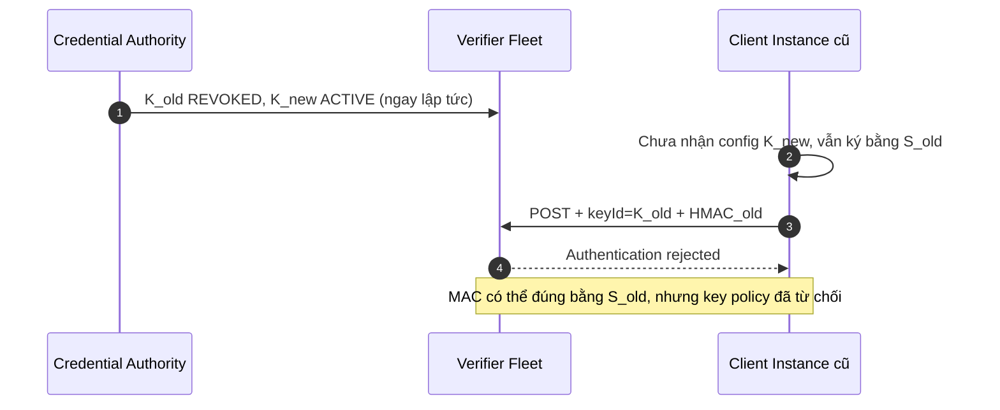
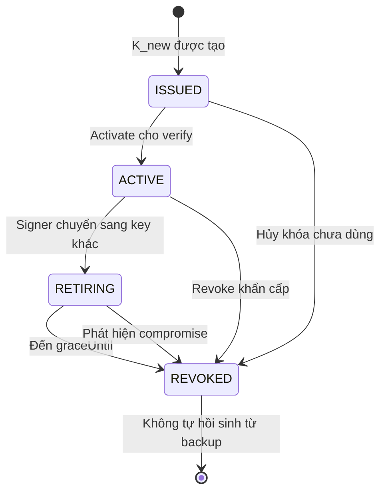
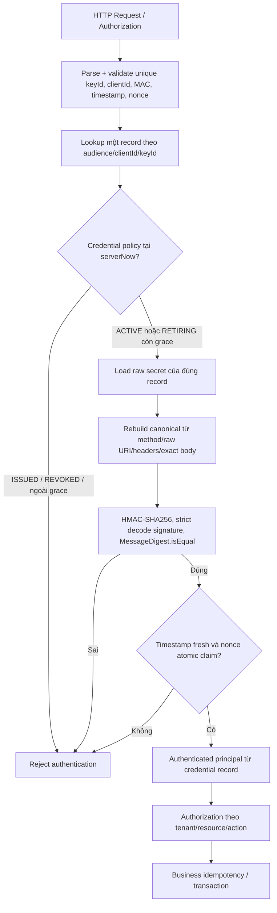

# Grace period trong key rotation của HMAC request authentication

## Mục tiêu học tập

Trong chương **Key rotation**, *grace period* là **khoảng chuyển tiếp hữu hạn mà server tiếp tục xác minh một khóa HMAC cũ sau khi client được yêu cầu chuyển sang khóa mới**, nhằm tránh từ chối nhầm các request còn trên đường truyền, các phiên bản client chưa nhận cấu hình mới hoặc những lần retry hợp lệ. Đây là một **quyết định chấp nhận credential tại server**, không phải khả năng suy ra khóa từ chữ ký hay cơ chế nới lỏng mọi điều kiện xác thực.

Bài thuộc module `SECURITY_AUTHENTICATION_HMAC_REQUEST_AUTHENTICATION`: thiết kế xác thực HTTP request bằng **HMAC với shared secret** và **canonical request** có method, URI, header hoặc body theo hợp đồng; kiểm tra chữ ký, chống replay bằng timestamp/nonce, quản lý key rotation, kiểm thử qua proxy/gateway và phân biệt **authentication** với **authorization**.

Học xong, người học có thể:

- Giải thích **grace period** và quan hệ với planned rotation, key retirement, overlap, cutover và emergency revocation.
- Phân biệt **grace period của khóa** với **timestamp freshness window**, **nonce TTL**, **Idempotency-Key retention**, token expiry và retry deadline.
- Viết policy quyết định tại **server time**: khóa cũ `RETIRING` có thể được xác minh trước `graceUntil`, nhưng bị từ chối từ chính mốc đó trở đi.
- Thiết kế **dual-key verification** nhưng **single-key signing** cho mỗi signed attempt; không “thử mọi secret cho đến khi MAC khớp”.
- Tính grace period từ độ trễ phân phối, request đang bay, queue, client retry và clock uncertainty, đồng thời xem xét **giới hạn rủi ro** khi secret cũ còn hợp lệ.
- Ràng buộc `keyId` vào canonical request HMAC, kiểm tra key status, timestamp/nonce, authorization và idempotency xuyên key rotation.
- Thực hành Java 17 với `Clock.fixed` để kiểm tra biên grace, hết hạn, key substitution, replay xuyên hai khóa và revoke khẩn cấp.
- Chuẩn bị runbook, monitoring và các ca kiểm thử đa node/region trước khi đóng grace period.

## 1. Grace period giải quyết vấn đề gì?

### 1.1. Vấn đề khi thay khóa ngay lập tức

Giả sử client `order-sync-prod` đang ký request bằng shared secret `S_old`, có `keyId=K_old`. Security service cấp thêm `S_new` và `keyId=K_new`.

Nếu server ngừng chấp nhận K_old **trước khi toàn bộ client biết K_new**, một request hợp lệ có thể bị từ chối:



Các nguyên nhân dẫn tới “chưa đồng bộ” thường gồm: client SDK triển khai theo đợt, container restart chậm, secret manager propagation delay, message queue giữ request, proxy retry hoặc load balancer chuyển request sang region khác.

### 1.2. Grace period là một overlap có giới hạn

Thay vì revoke K_old ngay, hệ thống planned rotation có thể:

- **Cấp** K_new với raw secret **độc lập**, không derive từ S_old.
- **Chuẩn bị verifier** có thể dùng K_new và trạng thái credential mới.
- **Kích hoạt** K_new trước khi client bắt đầu ký bằng nó.
- **Chuyển signer** sang K_new, ngừng chủ động tạo signed attempts mới bằng K_old.
- **Giữ K_old ở trạng thái RETIRING** cho đến một mốc `graceUntil` đã công bố.
- **Từ chối K_old** tại hoặc sau `graceUntil`, rồi xử lý revoke/cleanup theo policy.

Trong grace, verifier chỉ chấp nhận request từ **một trong những key IDs đã được cho phép rõ ràng**, không phải “bất kỳ chữ ký nào có secret từng tồn tại”.

### 1.3. Grace không đồng nghĩa key cũ an toàn

Nếu attacker đã biết S_old, trong grace họ cũng có thể tạo **request hoàn toàn mới**, với timestamp và nonce mới, và một MAC hợp lệ bằng S_old. Do đó:

> Grace period là sự đánh đổi có kiểm soát giữa khả dụng trong **planned rotation** và thời gian khóa cũ còn có thể bị lạm dụng. **Không tự áp dụng grace khi khóa có dấu hiệu bị lộ.**

Trong **emergency rotation** do compromise, security policy có thể yêu cầu **revoke ngay**, chấp nhận một khoảng gián đoạn có chủ đích để chặn người đang giữ S_old.

## 2. Grace period nằm ở đâu trong vòng đời credential?

### 2.1. State machine đề xuất



Đây là **mô hình thiết kế của bài**, không phải trạng thái được một RFC áp bắt buộc cho mọi hệ thống. Platform có thể dùng `PENDING/ENABLED/SECONDARY/DISABLED` hoặc các trường policy riêng. Điểm quan trọng là **phân biệt quyền ký request mới và quyền xác minh request đang đến**.

| Trạng thái | Client signer chủ động chọn? | Verifier có thể chấp nhận? | Điều kiện |
| --- | --- | --- | --- |
| `ISSUED` | Không | Không | Key mới tồn tại nhưng chưa được kích hoạt. |
| `ACTIVE` | Có, nếu được cấu hình làm signing key hiện hành | Có | Đúng principal/audience, trong thời gian hiệu lực và mọi kiểm tra HMAC đạt. |
| `RETIRING` | Không nên chọn cho signed attempt mới | **Có thể** trong grace | `serverNow < graceUntil` và chưa bị revoke; timestamp/nonce/MAC/authz vẫn phải đạt. |
| `REVOKED` | Không | **Không** | Không được khôi phục hoạt động chỉ nhờ backup. |

Đừng đọc bảng thành “mọi key ACTIVE được signer tự động chọn”. Một client có thể có nhiều key ACTIVE trong overlap, nhưng **mỗi attempt phải chọn rõ đúng một key ID và secret tương ứng**.

### 2.2. Timeline chính xác

Ký hiệu:

- `T_issue`: key mới được tạo ở registry/secret manager.
- `T_enable`: tất cả verifier sẵn sàng, authority kích hoạt K_new.
- `T_switch`: signer bắt đầu chọn K_new làm mặc định.
- `T_graceStart`: bắt đầu chính sách verify-only cho K_old.
- `T_graceEnd`: mốc kết thúc grace, **exclusive**.
- `T_revoke`: mốc authority chuyển K_old thành REVOKED hoặc DISABLED; nên không muộn hơn chính sách chấp nhận thực tế.

```text
Server time UTC -------------------------------------------------------->

T_issue          T_enable           T_switch=T_graceStart    T_graceEnd
  |                 |                        |                   |
K_new ISSUED  K_new ACTIVE              K_new ACTIVE         K_new ACTIVE
K_old ACTIVE  K_old ACTIVE              K_old RETIRING       K_old not allowed
                                            [ GRACE PERIOD )
                                   verify K_old có điều kiện
                                   signer mặc định dùng K_new
```

**Bắt đầu grace và chuyển signer không nhất thiết trùng chính xác một thời điểm trên mọi pod.** Hệ thống phân tán có rollout delay. Cần kiểm soát mốc authority và bảo đảm K_new đã được triển khai rộng trước `T_switch`.

### 2.3. Quy tắc biên bằng toán học

Định nghĩa policy minh họa:

```text
oldKeyMayVerify =
    key.status == RETIRING
    AND key.notBefore <= serverNow
    AND graceStart <= serverNow
    AND serverNow < graceUntil
    AND NOT emergencyRevoked

newKeyMayVerify =
    key.status == ACTIVE
    AND key.notBefore <= serverNow
    AND serverNow < key.verifyUntil  # nếu có

Nếu serverNow == graceUntil:
    K_old KHÔNG còn được chấp nhận.
```

Sử dụng mốc kết thúc **exclusive** tránh nhập nhằng “hết hạn lúc 12:00:00” có bao gồm chính giây đó không. Mọi verifier phải hiểu cùng đơn vị thời gian (ví dụ **Unix epoch seconds UTC**), cùng quy tắc biên và đồng bộ clock.

**Không sử dụng timestamp do client tự khai để quyết định key có còn trong grace.** Giá trị server time tại lúc verify, cùng authoritative credential policy, quyết định có chấp nhận hay không. Attacker biết S_old có thể ký một timestamp mới thuộc cửa sổ hợp lệ; việc ký bằng S_old **không trao quyền kéo dài deadline**.

## 3. Grace period khác các cửa sổ thời gian khác như thế nào?

### 3.1. Bốn loại “hết hạn” độc lập

| Cửa sổ | Đối tượng | Ví dụ | Câu hỏi |
| --- | --- | --- | --- |
| **Key grace period** | Credential K_old | 110 giây sau switch | K_old còn được **verify** theo policy không? |
| **Timestamp freshness** | Signed attempt | `P=300s, F=60s` | Timestamp của request có đủ mới so với server clock không? |
| **Nonce replay TTL** | Một nonce đã claim | Ít nhất `P+F+margin` (ví dụ 370s) | Signed attempt này có thể bị phát lại mà store đã quên không? |
| **Idempotency retention** | Một logical operation | Có thể là nhiều giờ/ngày tùy API | Các retry hợp lệ có thể tạo side effect trùng không? |

Grace period **không được** tái sử dụng làm TTL nonce hoặc TTL idempotency. Ngay cả khi K_old hết grace, K_new vẫn cần nonce protection và business idempotency; hai cơ chế đó không phụ thuộc tên key cũ/mới.

### 3.2. Hai điều kiện phải đồng thời đúng

Hệ thống ví dụ nhận request HMAC nếu:

```text
acceptAuthentication =
    correctRequestGrammar
    AND credentialLookupBy(audience, clientId, keyId) exists
    AND credentialPolicyPermitsVerificationAt(serverNow)
    AND timestampWithinFreshnessWindow(serverNow, signedAt)
    AND bodyHashMatchesExactBodyBytes
    AND constantTimeMacVerificationPasses
    AND atomicNonceClaimOncePasses

Then:
    authorizationFor(principal, effectiveResource, action)
    AND businessIdempotency/transactionRules (khi có side effect)
```

**Grace đúng nhưng timestamp hết hạn → reject.** Timestamp hợp lệ nhưng **grace đã kết thúc → reject**. HMAC đúng nhưng key `REVOKED` → reject. Các điều kiện bảo vệ nhau, không được cho một điều kiện “bù” cho điều kiện khác.

### 3.3. Ví dụ timestamp nằm ngay trước grace cutoff

Giả sử:

```text
T_graceEnd  = 1700000150  (fixture, không phải thời gian hiện tại)
T_signed    = 1700000149
T_received  = 1700000151
P = 300, F = 60
```

Tại `T_received`, timestamp chỉ cũ 2 giây, nằm trong freshness window. Nhưng `serverNow > T_graceEnd`, nên K_old **không được phép xác minh**.

Không đưa client-supplied `T_signed` vào hàm kiểm tra grace thay cho `T_received`. Nếu cho phép “mọi request ký trước deadline vẫn được nhận trong 5 phút sau deadline”, đó là **một chính sách kéo dài khả năng chấp nhận** cần được đặt tên và tính rủi ro riêng; không được âm thầm suy ra từ freshness window.

### 3.4. Nonce TTL không được rút ngắn theo grace

Cho timestamp policy:

```text
serverNow - P <= signedAt <= serverNow + F
P = 300s, F = 60s
```

Một request với timestamp t có thể được chấp nhận từ `t-F` tới `t+P`. Nếu nonce được claim sớm tại `t-F`, phải giữ tới tận `t+P` để không cho replay sau khi đã quên claim. Vì thế **TTL tính từ lúc claim** ít nhất gần `P+F` cộng biên vận hành, ví dụ **370 giây** với margin 10 giây.

Khi có cả K_old và K_new:

```text
replayKey = (audience, authenticatedPrincipalId, nonce)
```

được ưu tiên trong hợp đồng yêu cầu nonce duy nhất theo principal. **Không chỉ scope theo keyId**, nếu không kẻ đang có cả hai key hoặc hệ thống retry sai có thể reuse cùng nonce trong hai namespace khác nhau.

Đồng thời, store phải **atomic claim** và có consistency/durability phù hợp. Một Redis primary có `SET NX EX` là nguyên tử trên primary đó, nhưng replication bất đồng bộ/failover vẫn cần phân tích nguy cơ mất nonce đã được ACK.

### 3.5. Idempotency-Key ổn định dù key ID thay

```text
Logical operation: create payout OP42

Attempt 1:
    keyId=K_old, timestamp=T1, nonce=N1, MAC1, Idempotency-Key=OP42

Attempt 2 (retry):
    keyId=K_new, timestamp=T2, nonce=N2, MAC2, Idempotency-Key=OP42
```

Đây là **hai signed attempts khác nhau** cho **một logical operation**. Idempotency registry nên scope theo `(audience, authenticatedPrincipal, operationId)` và fingerprint nghiệp vụ **không chứa keyId, timestamp, nonce, MAC** vì các giá trị này thay đổi qua rotation/retry.

Nếu server scope idempotency theo keyId, K_new có thể khiến request thứ hai tạo **payout mới** sau khi attempt đầu đã commit nhưng response bị mất. Grace period không khắc phục lỗi này. Cần atomic operation reservation, stored outcome và reconciliation ở tầng nghiệp vụ.

## 4. Chọn độ dài grace period dựa trên bằng chứng

### 4.1. Grace không nên là hằng số “30 ngày cho chắc”

Đặt grace quá ngắn sẽ tăng 401 do client chậm cập nhật. Đặt quá dài làm giảm giá trị của rotation vì S_old còn được phép xác thực request lâu hơn cần thiết.

Những đại lượng phải đo:

- **D_config:** thời gian tối đa cho client/verifier nhận config/secret version, gồm canary, rollout và propagation của secret manager.
- **D_inflight:** request đã tạo từ K_old còn đang đi qua network, proxy hoặc queue.
- **D_retry:** retry/backoff/deadline cho phép bởi client SDK; lưu ý mỗi retry hợp lệ phải **ký mới**.
- **D_clock:** clock uncertainty giữa các node và thời điểm cutover.
- **D_margin:** biên bổ sung cho scheduling jitter và an toàn vận hành.
- **R_max:** thời gian rủi ro cao nhất mà security policy chấp nhận để S_old tiếp tục hợp lệ.

### 4.2. Một công thức lập kế hoạch tham khảo

Nếu triển khai từng giai đoạn nối tiếp, có thể dùng **ước lượng bảo thủ**:

```text
G_required = D_config + D_inflight + D_retry + D_clock + D_margin

G_selected phải thỏa:
    G_selected >= nhu cầu thực sự cần hỗ trợ
    G_selected <= R_max
```

Những độ trễ chạy đồng thời thường nên dùng **max** thay vì cộng mù quáng; phải mô hình hóa timeline thực tế. Công thức trên **không phải chuẩn mật mã**, chỉ là khung lập kế hoạch.

Ví dụ giả định:

| Thành phần | Giá trị |
| --- | ---: |
| Phát config tới signer chậm nhất | 45 giây |
| Retry/backoff theo SDK | 35 giây |
| In-flight/network/queue | 10 giây |
| Clock uncertainty | 5 giây |
| Biên an toàn | 15 giây |
| **Tổng bảo thủ** | **110 giây** |

Nếu `R_max=120s`, có thể chọn **grace 110–120 giây** và đo traffic thực tế. Nếu `R_max=60s`, không thể “chọn 110s cho an toàn” mà bỏ qua threat model: cần giảm D_config/D_retry, tách rollout, đổi chính sách retry hoặc chấp nhận có request bị từ chối.

**Con số trên chỉ là ví dụ**, không phải khuyến nghị phổ quát cho payment API. Một số hệ thống chọn overlap vài phút, một số yêu cầu ngắn hơn, số khác phải thích nghi với thiết bị thỉnh thoảng mới online — cần contract và đánh giá rủi ro riêng.

### 4.3. Grace tính từ mốc nào?

Không nhất thiết tính từ thời điểm **tạo** K_new. Một mô hình rõ:

```text
T0 = provision K_new (chưa verify)
T1 = tất cả verifier đã sẵn sàng; activate K_new
T2 = client signer được yêu cầu switch sang K_new
T3 = graceUntil = T2 + G
```

Nếu tính G từ T0, trong khi việc triển khai mất gần hết G, client gần như **không có thời gian chuyển tiếp thực sự**. Trong hệ thống thật, `T2` nên là sự kiện **do credential authority công bố có mốc UTC**, không phải thời điểm từng client tự đoán.

Có thể đặt `graceStart=T2` sau khi đã xác nhận verifier phân phối đủ rộng. T3 phải được commit vào policy registry **với revision được bảo vệ**, không phải mỗi node tự tính `now()+G` khi nhận cấu hình (có thể khiến mỗi node chấp nhận K_old khác nhau hoặc tự kéo dài grace khi restart).

### 4.4. Đừng tự gia hạn grace theo last-use

Sai:

```text
onEachRequestSignedByOldKey:
    graceUntil = now() + 5 minutes
```

Nếu một client hoặc attacker tiếp tục ký bằng S_old, grace được gia hạn **vô thời hạn**. Đây là *sliding grace window* làm vô hiệu deadline revoke theo dự định.

Đúng hơn:

```text
graceUntil = fixed UTC deadline assigned by credential authority
if serverNow >= graceUntil:
    reject K_old
```

Việc **thay đổi deadline** chỉ được thực hiện như một **policy change có phê duyệt, audit, revision và giới hạn mới**, không dựa trên request hoặc “số lần dùng khóa cũ”. Nếu khóa nghi lộ, **revoke ngay** có thể là bắt buộc, thay vì kéo dài deadline.

## 5. Từ định danh khóa tới HMAC canonical request trong grace

### 5.1. Hợp đồng ký mẫu `grace-period-v1`

Để bài tự chứa, định nghĩa **một contract giáo dục** cho API `POST /v1/payouts`. Đây không phải scheme HMAC mặc định của HTTP hay RFC 9421.

```http
POST /v1/payouts?tenant=merchant-42 HTTP/1.1
Host: payments.example.test
Content-Type: application/json
Authorization: HMAC-SHA256 clientId="payout-worker-prod", keyId="<key-id>", timestamp="<epoch-seconds>", nonce="<nonce-b64url>", signature="<mac-b64url>"
Idempotency-Key: <operation-id-b64url>
X-Content-SHA256: <sha256-body-b64url>

{"amount":120000,"currency":"VND"}
```

Chuỗi trong `<...>` là placeholder. Client gửi **keyId công khai** và HMAC signature, **không gửi raw shared secret**. API chỉ chấp nhận một Authorization field và một bộ auth-params rõ ràng; reject duplicate `keyId`/`KEYID`, unknown scheme, header injection và ambiguity.

Canonical **12 dòng UTF-8**, nối bằng LF (`\n`), **không LF cuối**:

```text
HMAC-SHA256
grace-period-v1
payments-api-prod
payout-worker-prod
<key-id>
POST
/v1/payouts?tenant=merchant-42
application/json
<sha256-exact-body-base64url>
<idempotency-key-base64url>
<timestamp-epoch-seconds>
<nonce-base64url>
```

| Dòng | Trường ký | Ý nghĩa |
| --- | --- | --- |
| 1 | `HMAC-SHA256` | Pin algorithm của contract. |
| 2 | `grace-period-v1` | Version canonicalization. |
| 3 | `payments-api-prod` | Audience do verifier biết, tránh dùng key sai service. |
| 4 | `clientId` | Client ID gắn credential record. |
| **5** | **`keyId`** | **K_old hay K_new được MAC ràng buộc rõ ràng.** |
| 6–7 | Method/raw request-target | Không được proxy âm thầm sửa sau khi ký. |
| 8–9 | Content-Type/body SHA-256 | Bảo vệ exact body bytes, không serialize lại JSON. |
| 10 | Idempotency-Key | Giữ nguyên qua retry cho cùng logical operation. |
| 11–12 | Timestamp/nonce | Freshness và replay protection cho **signed attempt**. |

Công thức:

```text
bodyHash = Base64URL_NoPadding(SHA256(exactBodyBytes))
canonical = join(LF, 12 fields)
macBytes = HMAC-SHA256(rawSecretForSelectedKeyId, UTF8(canonical))
signature = Base64URL_NoPadding(macBytes)  # 32 bytes -> 43 chars
```

`keyId` có thể thay từ K_old sang K_new trong lúc retry, nhưng phải **tính lại MAC bằng raw secret tương ứng**, trên canonical **có keyId mới**. Không giữ chữ ký cũ rồi sửa ID. Nếu một lỗi provisioning khiến hai key IDs trỏ cùng secret, ràng buộc `keyId` trong MAC vẫn ngăn chuyển ID giữ nguyên chữ ký.

### 5.2. Verifier không chọn “secret nào khớp thì dùng”

Sơ đồ xử lý:



Một request khai K_old thì server dùng **chính K_old** để kiểm tra key status và MAC. Nếu K_old hết grace, không được tự thử K_new, không được lấy secret mặc định và không được dùng raw `keyId` làm HMAC secret.

### 5.3. Tách xác thực và phân quyền

HMAC xác minh credential nguồn và request integrity. Grace quyết định **một credential cũ còn được phép dùng để authenticate không**. Cả hai **không tự** cho phép client thao tác trên tenant `merchant-99` khi policy chỉ cho `merchant-42`.

Do đó, sau MAC và replay protection, backend kiểm tra authenticated principal, scopes, tenant và effective resource/action. Một stored result trong idempotency cache cũng không được lộ cho người chỉ biết `keyId` hoặc operation key.

## 6. Grace period trong planned và emergency rotation

### 6.1. Planned rotation: grace có điều kiện

Một flow được phép:

```text
1. K_old ACTIVE; tạo K_new với raw secret độc lập.
2. Provision K_new và registry metadata cho mọi verifier.
3. Activate K_new khi mọi ingress đã sẵn sàng.
4. Switch signer sang K_new.
5. K_old RETIRING, graceUntil được policy ghi cố định.
6. Theo dõi số client còn dùng K_old; cảnh báo trước deadline.
7. Đúng graceUntil: K_old không còn được verify.
8. Chuyển policy K_old REVOKED/DISABLED và invalidate cache.
```

Điểm 7 là **hiệu lực policy**, không được phụ thuộc job dọn cache ở điểm 8. Kể cả khi scheduled revocation job chạy chậm, verifier vẫn phải so `serverNow < graceUntil` và từ chối K_old từ deadline. Ngược lại, nếu key bị revoke khẩn cấp ở giữa grace, trạng thái `REVOKED` thắng deadline.

### 6.2. Compromise rotation: không “cứ dùng grace thêm vài phút”

Nếu S_old xuất hiện trong log/CI, máy signer bị chiếm hoặc có dấu hiệu attacker tạo MAC hợp lệ, overlap có thể mở rộng thời gian cho attacker ký request mới. Runbook cần:

- Phân loại và xác nhận phạm vi compromise.
- **Revoke K_old theo incident policy**, có thể ngay lập tức.
- Không tự khôi phục K_old sang ACTIVE từ backup hay cache cũ.
- Cấp K_new/S_new qua **kênh sạch**, xác thực operator/workload độc lập với key đã lộ.
- Giới hạn tác động nghiệp vụ nếu chưa bảo đảm nonce/idempotency/authorization.
- Điều tra requests, transaction và các bản sao secret đã lộ.

Không gọi việc giữ key bị lộ ở `RETIRING` là “grace an toàn” nếu security policy yêu cầu revoke. **Availability không được bảo vệ bằng việc để attacker giữ quyền xác thực.**

### 6.3. Rollback signer khi đã hết grace

Trong planned rotation, rollback client từ K_new về K_old **chỉ được cân nhắc** nếu:

- K_old chưa bị revoke/compromise.
- Hiện tại vẫn nằm trong khoảng verify cho phép.
- Đã có approval/change policy phù hợp.
- K_old còn raw secret được phân phối an toàn.
- Việc rollback không phá business idempotency hoặc yêu cầu thu hồi.

Tại hoặc sau `graceUntil`, rollback bằng K_old **không hợp lệ**. Nếu K_new gặp lỗi, phải khắc phục K_new, triển khai key dự phòng đã phê duyệt hoặc cấp một credential mới; không tự kéo dài grace bởi từng verifier để “cứu traffic”.

## 7. Triển khai grace qua gateway, client fleet và nhiều region

### 7.1. Tất cả verifier phải biết cùng một deadline

Rủi ro phổ biến là mỗi server tạo `graceUntil = localNow + G` ngay khi nhận event retirement:

```text
Credential authority phát event "K_old RETIRING" ở T0.

Verifier A nhận T0 + 1s  -> graceUntilA = T0 + 1 + G
Verifier B nhận T0 + 20s -> graceUntilB = T0 + 20 + G
Verifier C restart muộn  -> graceUntilC = restartTime + G
```

Dù các node có cùng cấu hình G, chúng **khác deadline thực tế**; việc restart C có thể kéo dài khả năng chấp nhận K_old bất ngờ.

Thiết kế đúng:

```text
Credential authority:
    keyId=K_old
    status=RETIRING
    graceStart=1700000060  (fixture UTC)
    graceUntil=1700000150  (exclusive)
    policyRevision=47

Verifier A/B/C:
    lấy/chứng thực revision 47
    quyết định bằng serverNow < 1700000150
    không tự tính lại graceUntil khi restart
```

Metadata này thuộc **policy authority**, không phải một trường do client tự đặt. Nếu cache mất kết nối với registry, phải có **cache validity / revocation SLA** rõ. Với secret nghi lộ, việc dùng policy stale chấp nhận K_old có thể không đáp ứng threat model; phải chọn cách fail closed thích hợp.

### 7.2. Clock skew phải được giám sát, không phải che đi

Giả sử tại thời điểm UTC thực 12:00:00, grace hết hạn. Node A chạy nhanh 4 giây, node B chậm 5 giây:

```text
UTC thật: 12:00:00
A server clock: 12:00:04 -> reject K_old
B server clock: 11:59:55 -> vẫn accept K_old
```

Cách xử lý:

- Đồng bộ thời gian (time synchronization) và giám sát offset/skew.
- Định nghĩa timestamp/deadline theo epoch seconds UTC và **biên exclusive**.
- Trong rollout có deadline cố định, công bố biên và kiểm tra bằng `Clock.fixed` trong test.
- Nếu yêu cầu revoke nhanh hơn khả năng đồng bộ clock, áp dụng **authority status=REVOKED** hoặc cơ chế consistency được thiết kế riêng; không phụ thuộc một timestamp local không đáng tin.
- Không nới grace hoặc freshness window tùy tiện theo lỗi clock.

Trong code, dùng `java.time.Clock` để test; trong service thật cần clock source nhất quán và chính sách ứng xử khi clock không đáng tin.

### 7.3. Grace có ảnh hưởng đến HTTP Authorization header?

Trong scheme ví dụ `HMAC-SHA256`, client gửi key ID qua Authorization. Grace chỉ thay đổi **policy cho phép key ID**, không làm thay đổi grammar header:

```http
Authorization: HMAC-SHA256 clientId="payout-worker-prod", keyId="<K_old>", timestamp="<t>", nonce="<n>", signature="<mac>"
```

Gateway/backend phải:

- Nhận **đúng một** Authorization field line và đúng một `keyId` auth-param, không chọn first/last tùy ý.
- Không lẫn `Authorization` dành cho origin với `Proxy-Authorization` dành cho proxy.
- Không strip/replace HMAC header bởi middleware Bearer auth mà backend vẫn nghĩ có thể verify HMAC gốc.
- Giữ nguyên **giá trị** keyId case-sensitive theo contract; tên HTTP field/auth-param có quy tắc case khác.
- Ký/verify đúng raw method, URI/query, Content-Type, body bytes; không rewrite sau sign mà không có trust-boundary strategy.
- Không cho client tự gán `X-Key-Grace-Until` hay yêu cầu “extend old key” như một trường signed/unsigned. Quyền gia hạn thuộc authority, không thuộc request.

Việc gateway tự động retry nguyên signed attempt với nonce cũ có thể khiến replay store từ chối dù khóa còn grace. Retry cần signer mới và idempotency policy.

### 7.4. Canary, rollout và khả năng quan sát

Một planned rollout nên có **những cột mốc đo được**:

| Mốc | Điều kiện tiến tiếp |
| --- | --- |
| K_new provision | Secret mới độc lập, key ID duy nhất, registry metadata đã xác thực. |
| Verifier ready | Mọi ingress/region có K_new; test HMAC với key mới đạt. |
| Signer switch | SDK signer chọn K_new; latency/authentication errors trong giới hạn. |
| Grace đang chạy | Metrics cho biết client còn gửi K_old, số lượng giảm theo thời gian. |
| Trước `graceUntil` | Không còn client hợp lệ quan trọng dùng K_old; owner xác nhận deadline. |
| Tại `graceUntil` | K_old bị reject **ngay cả khi timestamp/MAC đúng**. |
| Sau grace | Negative test K_old qua từng endpoint/region, refresh caches, cleanup/analyze. |

Không nên gắn **full key ID** vào metric label high-cardinality toàn hệ thống; dùng cohort, trạng thái, hashed ID hoặc dashboard có quyền truy cập phù hợp. **Không log raw Authorization hay secret** để debug grace.

### 7.5. Grace trên active-active multi-region

Nếu Region A và B có policy revision khác nhau:

```text
A: K_old RETIRING, graceUntil=12:00:00 UTC, revision=47
B: K_old ACTIVE từ backup cũ, revision=43
```

Một request bằng S_old có thể bị A từ chối nhưng B vẫn nhận, tạo **revocation gap**. Với giao dịch nhạy cảm, hệ thống cần authority/policy replication và hiệu lực revoke phù hợp, chặn stale policy, thử failover/network partition. **Không** coi eventual replication là đủ chỉ vì mỗi node đều tính HMAC chính xác.

Tương tự, nonce store phải ngăn claim cùng nonce trên nhiều ingress. Idempotency/ledger cũng cần bảo vệ giao dịch trùng xuyên region, kể cả các attempt có nonce và key IDs khác nhau.

### 7.6. Grace và stored secret caches

Verifier thường giữ secret trong memory cache để giảm latency của secret manager. Cache có thể giúp availability, nhưng cũng có hai rủi ro:

1. Sau grace, key cũ vẫn có secret trong cache và code bỏ qua `graceUntil` nên tiếp tục chấp nhận.
2. Security revoke K_old giữa grace, nhưng cache vẫn lưu `status=RETIRING` cũ và accept.

Khắc phục bằng cách tách:

- **Key material cache**: chứa secret đúng version dưới quyền tối thiểu, có TTL/eviction phù hợp.
- **Credential policy status**: trạng thái hiệu lực/revocation được áp theo authority với revision và độ trễ revoke được kiểm soát.

Sự tồn tại của raw secret trong cache **không phải bằng chứng key còn được phép**. Xóa cache secret cũng **không thay thế** việc từ chối key trong verifier theo policy.

## 8. Java 17: kiểm tra grace period tại đúng biên thời gian

Ví dụ `GracePeriodHmacDemo.java` chỉ dùng **JDK 17+**, không cần framework. Nó minh họa server **xác minh HMAC bằng đúng secret theo keyId**, đồng thời kiểm tra status, `graceStart/graceUntil` và server time. Dùng `Clock.fixed` tạo ra các thời điểm test deterministic.

### 8.1. Tình huống thực nghiệm

Mốc thời gian **cố định cho test**, không phải thời gian hiện tại:

```text
T0 = 1_700_000_000

T0:        K_old ACTIVE, K_new ISSUED
T0 + 30:   activate K_new
T0 + 60:   switch signer; K_old RETIRING,
           graceStart = T0+60
           graceUntil = T0+150 (90 giây)
T0 + 149:  K_old còn trong grace
T0 + 150:  K_old hết grace (exclusive)
```

Các ca:

1. K_new ở `ISSUED` không được accept dù có secret đúng.
2. Sau activate, K_old (`RETIRING`) và K_new (`ACTIVE`) đều có thể được verify trong overlap.
3. Đổi `keyId` trong attempt K_old sang K_new nhưng giữ MAC cũ: `BAD_MAC`.
4. Replay cùng signed attempt: `REPLAYED`.
5. Tạo MAC mới bằng K_new nhưng **reuse nonce đã claim của K_old**: `REPLAYED` theo principal.
6. K_old ở `T0+149` → `ACCEPTED`; đúng `T0+150` → `KEY_NOT_PERMITTED`.
7. K_new vẫn hoạt động sau khi grace của K_old hết.
8. Một key khác còn ở `RETIRING` nhưng bị revoke **trước deadline** → từ chối ngay.
9. Client MAC đúng cho tenant ngoài quyền → `FORBIDDEN`.
10. Mọi signed attempts giữ **một Idempotency-Key** cho cùng operation; ví dụ không thực thi business side effect.

### 8.2. Mã nguồn hoàn chỉnh

```java
import java.nio.charset.StandardCharsets;
import java.security.GeneralSecurityException;
import java.security.MessageDigest;
import java.security.SecureRandom;
import java.time.Clock;
import java.time.Instant;
import java.time.ZoneOffset;
import java.util.Arrays;
import java.util.Base64;
import java.util.Objects;
import java.util.Set;
import java.util.concurrent.ConcurrentHashMap;
import java.util.concurrent.ConcurrentMap;
import java.util.regex.Pattern;
import javax.crypto.Mac;
import javax.crypto.spec.SecretKeySpec;

public final class GracePeriodHmacDemo {
    private static final String AUDIENCE = "payments-api-prod";
    private static final String CLIENT = "payout-worker-prod";
    private static final String PRINCIPAL = "payout-worker-service";
    private static final long PAST = 300L;
    private static final long FUTURE = 60L;

    private static final Pattern ID = Pattern.compile(
            "[A-Za-z0-9_-]{1,64}");
    private static final Pattern KEY_ID = Pattern.compile(
            "kid_[A-Za-z0-9_-]{22}");
    private static final Pattern TARGET = Pattern.compile(
            "/v1/payouts\\?tenant=[A-Za-z0-9_-]{1,64}");
    private static final Pattern EPOCH = Pattern.compile(
            "[1-9][0-9]{0,11}");

    private static final Base64.Encoder ENC =
            Base64.getUrlEncoder().withoutPadding();
    private static final Base64.Decoder DEC =
            Base64.getUrlDecoder();

    private GracePeriodHmacDemo() {}

    enum Status { ISSUED, ACTIVE, RETIRING, REVOKED }
    enum Verdict {
        ACCEPTED, INVALID_INPUT, KEY_NOT_PERMITTED,
        OUTSIDE_WINDOW, BAD_MAC, REPLAYED, FORBIDDEN
    }

    record KeyRef(String audience, String clientId, String keyId) {}

    record Credential(
            KeyRef identity, String principalId,
            byte[] secret, Status status,
            long notBefore, long graceStart, long graceUntil) {
        Credential {
            secret = Objects.requireNonNull(secret).clone();
        }
        @Override public byte[] secret() {
            return secret.clone();
        }
        Credential withStatus(
                Status newStatus, long start, long until) {
            return new Credential(identity, principalId, secret,
                    newStatus, notBefore, start, until);
        }
    }

    record Operation(
            String method, String rawTarget, String contentType,
            byte[] body, String idempotencyKey) {
        Operation {
            body = Objects.requireNonNull(body).clone();
        }
        @Override public byte[] body() {
            return body.clone();
        }
    }

    record SignedAttempt(
            KeyRef ref, Operation operation, String timestamp,
            String nonce, String bodyHash, String signature) {}

    static final class Registry {
        private final ConcurrentMap<KeyRef, Credential> credentials =
                new ConcurrentHashMap<>();

        Credential issue(
                SecureRandom rng, String clientId,
                Status initial, long notBefore) {
            if (!ID.matcher(clientId).matches()) {
                throw new IllegalArgumentException("Invalid client");
            }
            for (int attempt = 0; attempt < 10; attempt++) {
                byte[] randomId = new byte[16];
                byte[] secret = new byte[32];
                rng.nextBytes(randomId);
                rng.nextBytes(secret); // KHÔNG derive từ randomId.
                String id = "kid_" + ENC.encodeToString(randomId);
                KeyRef ref = new KeyRef(AUDIENCE, clientId, id);
                Credential record = new Credential(
                        ref, PRINCIPAL, secret, initial,
                        notBefore, 0L, Long.MAX_VALUE);
                Arrays.fill(randomId, (byte) 0);
                Arrays.fill(secret, (byte) 0);
                if (credentials.putIfAbsent(ref, record) == null) {
                    return record;
                }
            }
            throw new IllegalStateException("Cannot allocate keyId");
        }

        Credential lookup(KeyRef ref) {
            return credentials.get(ref);
        }

        void activate(KeyRef ref) {
            credentials.compute(ref, (ignored, old) -> {
                if (old == null || old.status() != Status.ISSUED) {
                    throw new IllegalStateException("Not ISSUED");
                }
                return old.withStatus(
                        Status.ACTIVE, 0L, Long.MAX_VALUE);
            });
        }

        void startGrace(KeyRef ref, long graceStart, long graceUntil) {
            credentials.compute(ref, (ignored, old) -> {
                if (old == null || old.status() != Status.ACTIVE
                        || graceStart < old.notBefore()
                        || graceUntil <= graceStart) {
                    throw new IllegalStateException("Invalid grace");
                }
                return old.withStatus(
                        Status.RETIRING, graceStart, graceUntil);
            });
        }

        void revoke(KeyRef ref) {
            credentials.compute(ref, (ignored, old) -> {
                if (old == null) {
                    throw new IllegalStateException("Key not found");
                }
                // Không tự cho chuyển từ REVOKED về ACTIVE.
                return old.withStatus(Status.REVOKED, 0L, 0L);
            });
        }
    }

    static final class DemoNonceStore {
        // RAM trong 1 JVM, KHÔNG có TTL/persistence/cross-region.
        private final Set<String> claimed =
                ConcurrentHashMap.newKeySet();

        boolean claim(
                String audience, String principal, String nonce) {
            return claimed.add(audience + "|" + principal + "|" + nonce);
        }
    }

    static byte[] strictB64Url(
            String value, int textSize, int byteSize) {
        if (value == null || value.length() != textSize
                || !value.matches("[A-Za-z0-9_-]+")) {
            throw new IllegalArgumentException("Bad Base64URL text");
        }
        byte[] raw = DEC.decode(value);
        if (raw.length != byteSize
                || !ENC.encodeToString(raw).equals(value)) {
            throw new IllegalArgumentException("Noncanonical Base64URL");
        }
        return raw;
    }

    static String randomToken(SecureRandom rng) {
        byte[] b = new byte[16];
        rng.nextBytes(b);
        String text = ENC.encodeToString(b);
        Arrays.fill(b, (byte) 0);
        return text;
    }

    static boolean valid(Pattern pattern, String value) {
        return value != null && pattern.matcher(value).matches();
    }

    static void validate(SignedAttempt a) {
        if (a == null || a.ref() == null || a.operation() == null) {
            throw new IllegalArgumentException("Missing signed attempt");
        }
        KeyRef ref = a.ref();
        if (!AUDIENCE.equals(ref.audience())
                || !valid(ID, ref.clientId())
                || !valid(KEY_ID, ref.keyId())) {
            throw new IllegalArgumentException("Invalid key reference");
        }
        strictB64Url(ref.keyId().substring(4), 22, 16);

        Operation op = a.operation();
        if (!"POST".equals(op.method())
                || !valid(TARGET, op.rawTarget())
                || !"application/json".equals(op.contentType())
                || op.body().length == 0
                || op.body().length > 1_048_576) {
            throw new IllegalArgumentException("Invalid operation");
        }
        strictB64Url(op.idempotencyKey(), 22, 16);
        if (!valid(EPOCH, a.timestamp())) {
            throw new IllegalArgumentException("Invalid timestamp");
        }
        strictB64Url(a.nonce(), 22, 16);
    }

    static boolean mayVerify(Credential key, long serverNow) {
        if (key.notBefore() > serverNow) {
            return false;
        }
        return switch (key.status()) {
            case ACTIVE -> true;
            case RETIRING -> key.graceStart() <= serverNow
                    && serverNow < key.graceUntil();
            case ISSUED, REVOKED -> false;
        };
    }

    static byte[] sha256(byte[] data)
            throws GeneralSecurityException {
        return MessageDigest.getInstance("SHA-256").digest(data);
    }

    static String canonical(SignedAttempt a, String bodyHash) {
        validate(a);
        strictB64Url(bodyHash, 43, 32);
        KeyRef ref = a.ref();
        Operation op = a.operation();

        return String.join("\n",
                "HMAC-SHA256",
                "grace-period-v1",
                AUDIENCE,
                ref.clientId(),
                ref.keyId(), // Ký exact key ID.
                op.method(),
                op.rawTarget(),
                op.contentType(),
                bodyHash,
                op.idempotencyKey(),
                a.timestamp(),
                a.nonce());
        // 12 dòng UTF-8, LF, không LF cuối.
    }

    static byte[] hmac(byte[] secret, String canonicalText)
            throws GeneralSecurityException {
        Mac engine = Mac.getInstance("HmacSHA256");
        engine.init(new SecretKeySpec(secret, "HmacSHA256"));
        return engine.doFinal(
                canonicalText.getBytes(StandardCharsets.UTF_8));
    }

    // Helper ký có chủ đích dùng được cả RETIRING/ISSUED/REVOKED
    // để unit test verifier PHẢI từ chối theo status/deadline.
    // Client production phải chọn signing key được phép từ config.
    static SignedAttempt sign(
            Credential credential, Operation operation,
            Clock clock, String nonce)
            throws GeneralSecurityException {
        String now = Long.toString(
                Instant.now(clock).getEpochSecond());
        String bodyHash =
                ENC.encodeToString(sha256(operation.body()));
        SignedAttempt unsigned = new SignedAttempt(
                credential.identity(), operation, now,
                nonce, bodyHash, "");
        String signature = ENC.encodeToString(
                hmac(credential.secret(), canonical(unsigned, bodyHash)));
        return new SignedAttempt(
                credential.identity(), operation, now,
                nonce, bodyHash, signature);
    }

    static SignedAttempt signFresh(
            Credential credential, Operation operation,
            Clock clock, SecureRandom rng)
            throws GeneralSecurityException {
        return sign(credential, operation, clock, randomToken(rng));
    }

    static Verdict verify(
            SignedAttempt a, Registry registry,
            Clock serverClock, DemoNonceStore nonceStore)
            throws GeneralSecurityException {
        try {
            validate(a);
            // Untrusted clientId/keyId chỉ là lookup hints.
            Credential key = registry.lookup(a.ref());
            if (key == null) {
                return Verdict.KEY_NOT_PERMITTED;
            }
            long now =
                    Instant.now(serverClock).getEpochSecond();
            if (!mayVerify(key, now)) {
                return Verdict.KEY_NOT_PERMITTED;
            }

            long sent = Long.parseLong(a.timestamp());
            if (sent < Math.subtractExact(now, PAST)
                    || sent > Math.addExact(now, FUTURE)) {
                return Verdict.OUTSIDE_WINDOW;
            }

            byte[] actualBodyHash = sha256(a.operation().body());
            byte[] declaredBodyHash =
                    strictB64Url(a.bodyHash(), 43, 32);
            if (!MessageDigest.isEqual(actualBodyHash, declaredBodyHash)) {
                return Verdict.BAD_MAC;
            }

            byte[] suppliedMac = strictB64Url(
                    a.signature(), 43, 32);
            byte[] expectedMac = hmac(
                    key.secret(),
                    canonical(a, ENC.encodeToString(actualBodyHash)));
            if (!MessageDigest.isEqual(expectedMac, suppliedMac)) {
                return Verdict.BAD_MAC;
            }

            // Nonce theo principal ổn định khi đổi key ID.
            if (!nonceStore.claim(
                    AUDIENCE, key.principalId(), a.nonce())) {
                return Verdict.REPLAYED;
            }

            // Mock authorization: chỉ được merchant-42.
            if (!"/v1/payouts?tenant=merchant-42"
                    .equals(a.operation().rawTarget())) {
                return Verdict.FORBIDDEN;
            }
            return Verdict.ACCEPTED;
        } catch (IllegalArgumentException | ArithmeticException ex) {
            return Verdict.INVALID_INPUT;
        }
    }

    static Clock at(long epochSeconds) {
        return Clock.fixed(
                Instant.ofEpochSecond(epochSeconds), ZoneOffset.UTC);
    }

    static Operation target(Operation op, String rawTarget) {
        return new Operation(op.method(), rawTarget,
                op.contentType(), op.body(), op.idempotencyKey());
    }

    public static void main(String[] args)
            throws GeneralSecurityException {
        final long t0 = 1_700_000_000L; // Fixture cố định.
        SecureRandom rng = new SecureRandom();
        Registry registry = new Registry();
        DemoNonceStore nonces = new DemoNonceStore();

        Credential oldKey = registry.issue(
                rng, CLIENT, Status.ACTIVE, t0);
        Credential newKey = registry.issue(
                rng, CLIENT, Status.ISSUED, t0);

        Operation op = new Operation(
                "POST", "/v1/payouts?tenant=merchant-42",
                "application/json",
                "{\"amount\":120000,\"currency\":\"VND\"}"
                        .getBytes(StandardCharsets.UTF_8),
                randomToken(rng));

        SignedAttempt pending = signFresh(
                newKey, op, at(t0 + 20), rng);
        System.out.println("New ISSUED: "
                + verify(pending, registry, at(t0 + 20), nonces));

        registry.activate(newKey.identity());
        registry.startGrace(oldKey.identity(), t0 + 60, t0 + 150);

        SignedAttempt oldInGrace = signFresh(
                oldKey, op, at(t0 + 60), rng);
        System.out.println("Old grace begins: "
                + verify(oldInGrace, registry, at(t0 + 60), nonces));

        SignedAttempt newDuringGrace = signFresh(
                newKey, op, at(t0 + 60), rng);
        System.out.println("New key during grace: "
                + verify(newDuringGrace, registry, at(t0 + 60), nonces));

        SignedAttempt swappedKeyId = new SignedAttempt(
                newKey.identity(), op, oldInGrace.timestamp(),
                oldInGrace.nonce(), oldInGrace.bodyHash(),
                oldInGrace.signature());
        System.out.println("Changed keyId, old signature: "
                + verify(swappedKeyId, registry,
                        at(t0 + 60), nonces));

        System.out.println("Replay exact old attempt: "
                + verify(oldInGrace, registry, at(t0 + 61), nonces));

        SignedAttempt sameNonceNewKey = sign(
                newKey, op, at(t0 + 61), oldInGrace.nonce());
        System.out.println("Reused nonce across keys: "
                + verify(sameNonceNewKey, registry,
                        at(t0 + 61), nonces));

        SignedAttempt oneSecondBefore = signFresh(
                oldKey, op, at(t0 + 149), rng);
        System.out.println("Old just before grace end: "
                + verify(oneSecondBefore, registry,
                        at(t0 + 149), nonces));

        SignedAttempt atDeadline = signFresh(
                oldKey, op, at(t0 + 150), rng);
        System.out.println("Old at grace end: "
                + verify(atDeadline, registry,
                        at(t0 + 150), nonces));

        SignedAttempt newAfterDeadline = signFresh(
                newKey, op, at(t0 + 150), rng);
        System.out.println("New after grace end: "
                + verify(newAfterDeadline, registry,
                        at(t0 + 150), nonces));

        // Khóa thứ ba: còn grace nhưng được REVOKE khẩn cấp.
        Credential emergencyKey = registry.issue(
                rng, CLIENT, Status.ACTIVE, t0);
        registry.startGrace(
                emergencyKey.identity(), t0 + 60, t0 + 200);
        SignedAttempt beforeRevocation = signFresh(
                emergencyKey, op, at(t0 + 65), rng);
        System.out.println("Grace key before emergency revoke: "
                + verify(beforeRevocation, registry,
                        at(t0 + 65), nonces));

        registry.revoke(emergencyKey.identity());
        SignedAttempt afterRevocation = signFresh(
                emergencyKey, op, at(t0 + 66), rng);
        System.out.println("Grace key after emergency revoke: "
                + verify(afterRevocation, registry,
                        at(t0 + 66), nonces));

        Operation forbidden = target(
                op, "/v1/payouts?tenant=merchant-99");
        SignedAttempt forbiddenSigned = signFresh(
                newKey, forbidden, at(t0 + 70), rng);
        System.out.println("MAC valid, tenant forbidden: "
                + verify(forbiddenSigned, registry,
                        at(t0 + 70), nonces));

        System.out.println("Operation ID stable across key switch: "
                + oldInGrace.operation().idempotencyKey()
                        .equals(newDuringGrace.operation().idempotencyKey()));
    }
}
```

Kết quả kỳ vọng:

```text
New ISSUED: KEY_NOT_PERMITTED
Old grace begins: ACCEPTED
New key during grace: ACCEPTED
Changed keyId, old signature: BAD_MAC
Replay exact old attempt: REPLAYED
Reused nonce across keys: REPLAYED
Old just before grace end: ACCEPTED
Old at grace end: KEY_NOT_PERMITTED
New after grace end: ACCEPTED
Grace key before emergency revoke: ACCEPTED
Grace key after emergency revoke: KEY_NOT_PERMITTED
MAC valid, tenant forbidden: FORBIDDEN
Operation ID stable across key switch: true
```

### 8.3. Những điều cần chú ý trong chương trình

**Deadline được lưu trong registry, không trong header.** `startGrace` đặt `graceStart` và `graceUntil` cố định. Hàm `mayVerify` kiểm tra server time và trạng thái. `ISSUED`/`REVOKED` luôn bị từ chối; `RETIRING` chỉ đạt với `graceStart <= now < graceUntil`.

**Tạo key độc lập.** `Registry.issue` sinh 16 byte opaque ID và 32 byte raw HMAC secret bằng hai lần `SecureRandom.nextBytes` riêng, tuyệt đối không biến secret thành ID hay dùng ID như HMAC key.

**Canonical có keyId.** Dòng thứ năm của `grace-period-v1` là exact `keyId`. Thay ID trên request đã ký phải làm MAC fail, kể cả khi tồn tại nhiều key ACTIVE.

**Timestamp freshness và grace là hai kiểm tra khác nhau.** Một attempt có MAC đúng và timestamp mới vẫn bị `KEY_NOT_PERMITTED` tại `graceUntil`. Ngược lại, key còn grace không cứu được request có timestamp cũ quá window.

**Nonce store scope theo principal.** Cùng một nonce bị claim bởi K_old phải bị từ chối nếu sau đó K_new dùng lại nó, mặc dù chữ ký HMAC của request thứ hai được tính mới bằng secret khác.

**Chữ ký MAC được so trên bytes.** `strictB64Url` decode về raw MAC 32 byte và chuẩn hóa lại để reject padding/noncanonical text; `MessageDigest.isEqual` dùng so sánh MAC bytes. Không lấy `String.equals` làm giải pháp timing-safe cho MAC.

### 8.4. Những giới hạn cố ý của demo

Code **không phải production HTTP server**:

- `Registry` và `DemoNonceStore` chỉ là map/set trong **một JVM**, không có persistence, TTL, failover hoặc global consistency.
- Code không có secret manager/KMS, approval policy, registry revisions, audit, cache invalidation hoặc multi-region.
- `sign` cho phép signer test dùng cả khóa `ISSUED/REVOKED` để chứng minh verifier phải reject; client production **không được** chọn key bị cấm ký.
- Không có parser HTTP thực: duplicate Authorization/Idempotency-Key, query normalization, Content-Encoding, body streaming và header smuggling là trách nhiệm HTTP adapter.
- Không có business idempotency store hay payout transaction. `ACCEPTED` chỉ chứng minh mock HMAC/freshness/nonce/authorization, không chứng minh payout thực hiện đúng một lần.
- Không có network delay, propagation delay hoặc clock skew thật. `Clock.fixed` chỉ cho phép kiểm thử logic deadline có tính xác định.

Để triển khai thực tế, phải thay registry/nonce mock bằng các authority có consistency và durability tương ứng, kiểm thử gateway trust boundary và thực thi transaction/idempotency với downstream dependencies.

## 9. Ma trận kiểm thử grace period

Mỗi test cần quan sát ít nhất bốn thứ: **credential status**, **server clock**, **signature/timestamp/nonce verdict**, và **tác động nghiệp vụ**. Việc thấy HTTP `200` hoặc `401` đơn lẻ không đủ chứng minh hệ thống có chấp nhận sai key hoặc gây double side effect không.

Trong bảng dưới, dùng các mốc:

```text
T0           = 1700000000  (fixture, Unix seconds)
graceStart   = T0 + 60
graceUntil   = T0 + 150  (exclusive)
P            = 300 seconds
F            = 60 seconds
nonceTTL     = 370 seconds (ví dụ margin 10 seconds)
K_old        = RETIRING từ graceStart tới graceUntil
K_new        = ACTIVE khi grace bắt đầu
```

| Trường hợp | Input/điều kiện | Kết quả kỳ vọng |
| --- | --- | --- |
| Khóa mới chưa activate | K_new `ISSUED`, MAC đúng | Reject credential; không dùng vì tồn tại secret. |
| Khóa mới active | K_new `ACTIVE`, MAC/nonce hợp lệ | Accept nếu policy/authorization đạt. |
| Khóa cũ vừa bắt đầu grace | `serverNow=graceStart` | Có thể accept K_old theo policy inclusive start. |
| Khóa cũ ngay trước hết grace | `serverNow=graceUntil-1` | Có thể accept nếu các kiểm tra khác đạt. |
| Khóa cũ đúng mốc hết grace | `serverNow=graceUntil` | **Reject K_old** bất kể MAC/timestamp đúng. |
| Khóa cũ sau grace | `serverNow>graceUntil` | Reject K_old, không fallback. |
| Timestamp cũ nhưng key còn grace | `signedAt<serverNow-P` | Reject freshness. |
| Timestamp tương lai quá biên | `signedAt>serverNow+F` | Reject freshness. |
| Timestamp còn hạn nhưng grace hết | `signedAt=graceUntil-1`, nhận sau grace | Reject vì credential policy. |
| Lùi client timestamp để “kéo grace” | Request mới signedAt trước deadline, nhận sau | Reject K_old. |
| Đổi raw key ID sau ký | K_old → K_new, MAC_old giữ | Reject MAC/key identity. |
| Dùng S_old nhưng khai K_new | Credential lookup chọn S_new | Reject MAC; không thử secret khác. |
| Trùng keyId giữa hai client | C1/K và C2/K có secrets khác nhau | Tra đúng composite key, không lẫn client. |
| Key revoked giữa grace | `status=REVOKED` tại T trước graceUntil | **Reject ngay tại T**, không chờ cutoff. |
| Registry backup cũ hồi trạng thái | Bản snapshot nói ACTIVE, authority nói REVOKED | Reject, không rollback revocation. |
| Extension grace không được phê duyệt | Client gửi `X-Grace-Extension` | Không thay server policy; reject/ignore theo contract. |
| Sliding grace anti-pattern | K_old gọi lại liên tục | `graceUntil` không tự tăng. |
| Cache verifier restart | Registry cung cấp cùng deadline UTC | Không được tính lại `now()+G`. |
| Region A/B deadline khác | Một node giữ revision cũ | Phát hiện drift, fail closed đối với key không chứng minh được trạng thái. |
| Region failover sau revoke | Cache region B chưa nhận revocation | Negative test không chấp nhận K_old. |
| Clock skew hai node | `graceUntil` giống nhau, giờ local lệch | Quan sát inconsistency, sửa nguồn clock/authority. |
| Nonce replay với cùng key | Signed request cũ gửi hai lần | Lần sau reject replay trong horizon. |
| Reuse nonce xuyên hai key | K_old và K_new cùng principal, MAC đều đúng | Request sau bị reject nếu nonce đã claim. |
| Hai signed attempts nonce khác | Cùng logical operation, K_old/K_new | HMAC có thể đúng cả hai, business idempotency xử lý trùng. |
| Idempotency-Key thay khi retry | Client sinh operation ID mới ngoài ý muốn | Phát hiện nguy cơ duplicate; SDK không được làm vậy. |
| Fingerprint đổi cùng operation key | Số tiền/tenant đổi | Conflict; không xử lý như retry cũ. |
| Nonce store unavailable | HMAC đúng | Không bỏ replay check; fail closed. |
| Nonce state mất trong failover | Request cũ còn freshness window | Không accept replay; cần DR/quarantine authority. |
| Credential registry unavailable | Không xác minh key status/secret | Fail closed theo policy; không dùng default secret. |
| Gateway strip Authorization | Header HMAC bị bỏ | Reject hoặc dùng trusted delegation được thiết kế. |
| Gateway rewrite raw URI | Signer/verifier nhìn target khác | MAC mismatch hoặc verify tại đúng trust boundary. |
| Proxy tự retry nguyên request | Same nonce đã claim | Reject replay; signer phải tạo attempt mới. |
| Key ID duplicate auth-param | `keyId=K_old, KEYID=K_new` | Reject parser trước lookup. |
| Hai Authorization fields | Gateway/backend có thể chọn khác | Reject ambiguity. |
| MAC text noncanonical | Padding `=`/pad-bit khác contract | Reject trước so MAC. |
| Key ngoài audience | Staging key dùng gọi prod | Reject credential/audience. |
| Key cũ dùng tenant ngoài quyền | HMAC cũ còn grace, principal thiếu quyền | Authorization reject, không phụ thuộc grace. |
| Trả stored result sau retry | Caller mất quyền, key mới MAC đúng | Kiểm tra authorization hiện tại; không lộ result. |
| Secret cũ có dấu hiệu compromise | K_old còn grace planned | Revoke theo incident policy; không gia hạn. |
| K_new deploy chưa đủ region | Một region chưa nhận key | Rollout không đạt; không switch signer toàn fleet. |
| Ngày giờ/số giây overflow | Timestamp ngoài giới hạn format | Reject, không mặc định phút/milliseconds. |

### 9.1. Kiểm thử với test vector byte-for-byte

Ngoài `Clock.fixed`, cần bộ test vector cross-language cho Java, Go, Node.js và gateway dùng **chỉ secret giả**:

1. Hai `keyId` public độc lập, hai raw secrets giả độc lập, principal/audience.
2. Exact method, raw request-target, Content-Type, body UTF-8 bytes.
3. Canonical 12 dòng, LF không LF cuối, body SHA-256 raw bytes/Base64URL.
4. Idempotency-Key, timestamp và nonce cố định cho attempt mẫu.
5. Expected HMAC-SHA256 **raw 32 bytes** và Base64URL không padding 43 ký tự.
6. Verifier status và `graceStart/graceUntil` cho từng test time; phiên bản policy/revision.
7. Negative vectors: sai secret, sai keyId, query rewrite, noncanonical Base64URL, nonce replay, revoked key và tenant forbidden.

Nếu MAC sai, phân tích theo trình tự: **raw secret được chọn → canonical bytes → body digest → HMAC algorithm → signature encoding → gateway transformations**. Nếu MAC đúng nhưng request bị reject ở cutoff, đó có thể là hành vi **đúng về bảo mật**, không phải lỗi crypto.

### 9.2. Kiểm thử fault injection và hiệu ứng nghiệp vụ

Trong staging cô lập, hãy cố ý:

- Chặn propagation của revision `REVOKED` trên một region.
- Restart một verifier giữa grace, xem nó có tự tạo deadline mới hay không.
- Thay clock offset node sát cutoff để đo safety margin.
- Làm mất nonce state sau failover, thử replay request K_old còn fresh.
- Cắt mạng sau khi business DB commit nhưng trước response, retry bằng K_new với **cùng Idempotency-Key**.
- Kích hoạt gateway path rewrite hoặc Content-Encoding transform khi backend verify.
- Cho hai request cùng operation key/nonce khác nhau đến hai process đồng thời.
- Gắn một secret cũ vào cache dù registry đã revoke, xác nhận verifier vẫn từ chối.

Quan sát **có duplicate side effect hay không**, không chỉ số lượng successful authentication. Chính các test này phân biệt một giải pháp grace an toàn với một bản demo chấp nhận MAC ở một JVM.

## 10. Runbook quản lý grace period

### 10.1. Planned rotation: các bước có thể vận hành

```text
RUNBOOK: planned HMAC key rotation / grace-period-v1

PREPARE
  - Ghi owner, audience, principal, K_old/K_new, change ticket.
  - Xác nhận S_old chưa có dấu hiệu compromise.
  - Đo propagation, retries, in-flight, queue và time skew.
  - Chọn graceDuration G có security risk budget và approval.
  - Công bố UTC graceStart/graceUntil (exclusive), policy revision.

ISSUE + VERIFY READINESS
  - Sinh K_new và S_new độc lập; secret manager bảo vệ S_new.
  - Đưa K_new vào registry ISSUED; cung cấp cho client đúng quyền.
  - Triển khai verifier K_new ở mọi region; test HMAC qua gateway.
  - ACTIVATE K_new khi test readiness đủ.

CUTOVER
  - Chuyển signer sang K_new; timestamp/nonce/MAC mới mỗi attempt.
  - Đặt K_old RETIRING + fixed graceUntil trong authority.
  - Không yêu cầu signer ký bằng K_old trong grace.
  - Gắn Idempotency-Key ổn định với logical business operation.

DURING GRACE
  - Theo dõi auth successes/failures theo key cohort.
  - Liên hệ các client còn gửi K_old; xử lý stale config.
  - Test status/policy revisions ở nhiều node, không tự gia hạn G.
  - Nếu phát hiện compromise: REVOKE ngay theo incident policy.

AT/AFTER DEADLINE
  - Verifier reject K_old từ chính graceUntil, kể cả job revoke chậm.
  - Mark REVOKED, invalidate stale caches, audit.
  - Negative test K_old tại mọi ingress/region/gateway.
  - Thu hồi secret cũ khỏi deployment và backups theo policy.

CLOSE
  - Ghi thực tế D_config/D_inflight/D_retry, lỗi và bài học.
  - Xác nhận signer chỉ dùng K_new và không còn active secret copies trái phép.
  - Không ghi raw secret hoặc Authorization header trong ticket/log.
```

### 10.2. Nếu còn client dùng K_old gần deadline thì sao?

Có ít nhất bốn lựa chọn phải đánh giá:

| Lựa chọn | Khi nào hợp lý? | Lưu ý bảo mật |
| --- | --- | --- |
| Đẩy cập nhật client/config nhanh hơn | Có thể deploy hoặc refresh secret an toàn | Ưu tiên nếu đáp ứng deadline. |
| Phối hợp giảm queue/retry delay | Giao thức cho phép kiểm soát timeout/deadline | Không hy sinh idempotency hoặc ký trước khi chờ. |
| Chấp nhận một số request bị reject khi cutoff | Risk budget không cho grace dài | Cần client error handling và incident communications. |
| **Xin gia hạn grace có phê duyệt** | S_old chưa nghi lộ, deadline ban đầu thật sự không đủ, risk budget còn | Chỉ authority thay policy revision, audit rõ mốc mới; không làm sliding auto-extension. |

Nếu đã có bằng chứng S_old bị lộ, **gia hạn grace không phải lựa chọn mặc định hợp lệ**. Cần ứng phó sự cố và cân nhắc vô hiệu hóa key cũ, dù làm giảm availability.

### 10.3. Rollback và cơ chế thoát lỗi

Một rollback signer về K_old chỉ có thể xảy ra khi K_old **chưa revoked**, **không nghi lộ**, **chưa hết grace** và authority đồng ý. Đừng coi rollback tự động là khả năng luôn tồn tại sau cutover.

Nếu K_new không hoạt động do secret mismatch, gateway rewrite hay stale region:

1. Xác định chính xác lớp lỗi: raw secret, key ID, algorithm, canonical bytes, registry revision hay policy.
2. Sửa rollout/adapter hoặc cấp credential mới theo quy trình có kiểm soát.
3. Dùng K_old tạm thời **chỉ nếu** policy và security risk cho phép.
4. Giữ nguyên Idempotency-Key cho operation chưa rõ outcome; không tạo giao dịch mới để “thử lại”.
5. Không tắt kiểm tra signature, nonce, status hoặc authorization để làm traffic “xanh” giả.

### 10.4. Metrics, alert và audit

| Chỉ số | Mục tiêu sử dụng |
| --- | --- |
| `hmac_verify_total{key_cohort="old|new"}` | Quan sát tỷ lệ traffic chuyển sang K_new. |
| `hmac_verify_failure_total{cause=...}` | Phân biệt key expired/revoked, MAC sai, timestamp, nonce và parser. |
| `credential_grace_remaining_seconds` | Cảnh báo client vẫn dùng old key trước cutoff. |
| `credential_policy_revision` theo node | Phát hiện replica/cache lệch policy. |
| `credential_revocation_propagation_seconds` | Đo thời gian sau revoke còn node nhận key cũ. |
| `credential_old_key_last_seen_at` | Dự báo tail clients còn chưa chuyển. |
| `clock_offset_seconds` | Giám sát clock skew sát cutoff. |
| `nonce_replay_reject_total` | Phát hiện retry nguyên signed attempt hoặc replay. |
| `idempotency_hit/conflict/in_progress` | Phân biệt business dedup với authentication error. |

Các tên metrics là **đề xuất**, không phải API chuẩn. Không đặt full `keyId`, raw signature, secret, tenant ID nhạy cảm hoặc body vào label high-cardinality. Audit key rotation nên lưu **who/what/when/approvedUntil/revision/outcome** theo chính sách, không lưu key material.

## 11. Bài thực hành theo cấp độ

Tạo một ứng dụng Java 17 mô phỏng `POST /v1/payouts?tenant={tenantId}` và một key rotation có grace period.

1. **Thiết kế credential record:** `audience, clientId, principalId, keyId, secretRef, status, notBefore, graceStart, graceUntil, policyRevision`.
2. **Sinh hai secret độc lập:** dùng `SecureRandom` cấp K_old/S_old và K_new/S_new; key IDs là opaque random identifiers, không chứa secret.
3. **Viết canonical builder:** 12 dòng `grace-period-v1` với algorithm/version/audience/clientId/keyId/method/raw URI/Content-Type/body SHA-256/Idempotency-Key/timestamp/nonce.
4. **Viết signer:** chọn đúng key ID và raw secret, strict Base64URL text cho nonce/signature và ký bằng `Mac.getInstance("HmacSHA256")`.
5. **Viết verifier:** parse field/header nghiêm ngặt, tra đúng registry record, kiểm tra status và grace bằng server time, tái hash exact body, so MAC bằng `MessageDigest.isEqual`.
6. **Chuẩn bị K_new:** để `ISSUED` và xác nhận MAC đúng bằng S_new vẫn chưa thể authenticate; activate rồi test lại.
7. **Bắt đầu grace:** dùng `graceStart=T0+60`, `graceUntil=T0+150`, đặt K_old `RETIRING`.
8. **Kiểm thử boundary:** `Clock.fixed(T0+149)` cho K_old đạt, `Clock.fixed(T0+150)` phải reject dù MAC mới đúng.
9. **Kiểm thử thời điểm ký:** signedAt trước cutoff nhưng request đến sau cutoff phải reject; signedAt sau cửa sổ freshness dù key còn grace cũng phải reject.
10. **Key substitution:** đổi `keyId` K_old thành K_new trong một request đã ký, giữ MAC cũ; reject. Thử trường hợp test hai IDs cố tình dùng cùng secret để chắc chắn `keyId` được MAC ký.
11. **Anti-replay:** nonce 16 byte CSPRNG mỗi attempt, claim một lần scope theo audience/authenticatedPrincipal; thử reuse nonce giữa K_old và K_new.
12. **Retry:** giữ Idempotency-Key và immutable request semantics, lấy timestamp/nonce/MAC mới sau backoff; chứng minh không duplicate business effect với transactional idempotency store.
13. **Emergency revoke:** revoke K_old giữa grace, thử MAC đúng bằng S_old sau revoke; phải reject trước cutoff.
14. **Proxy/gateway:** thử rewrite URI/query, thay Content-Type, JSON body transform, duplicate Authorization/keyId; kiểm tra đúng trust boundary.
15. **Multi-node:** cố ý cho một verifier policy revision cũ hoặc đồng hồ sai, đo false accept/false reject và thiết kế fail-closed.
16. **Phân tích độ dài:** giả định D_config, D_inflight, D_retry, D_clock, risk budget; tính G và giải thích chọn gia hạn hay chấp nhận từ chối một số request.
17. **Runbook:** mô phỏng cảnh báo 60/30/5 giây trước cutoff, thông báo owner, negative test sau deadline và audit sự kiện rotation/revoke.

**Câu hỏi tự đánh giá:**

- Grace period **thuộc trạng thái khóa** hay thuộc timestamp của request?
- Vì sao K_old có thể còn được verify nhưng client signer không nên tiếp tục chủ động chọn K_old?
- Tại sao `graceUntil` cần là một mốc UTC **cố định, exclusive** thay vì `now()+G` tại mỗi node?
- Timestamp request vừa mới có giúp K_old được chấp nhận sau grace không?
- Một key bị revoke giữa grace có được dùng tới `graceUntil` không?
- Vì sao giảm TTL nonce bằng grace length có thể tạo lỗ hổng replay?
- Nếu K_new và K_old thuộc cùng principal, nonce replay key nên scope theo gì?
- Retry POST sau response lost cần thay nonce/MAC nhưng giữ trường nào ổn định?
- Những độ trễ nào được cân nhắc khi chọn G, và risk budget giới hạn chúng như thế nào?
- Nếu Region A từ chối K_old còn Region B có policy stale vẫn accept, điều gì đã sai?
- Gateway đổi raw request-target khi client ký K_new, nên sửa secret hay sửa trust boundary?
- Có nên chấp nhận một khoảng downtime để revoke ngay S_old đã nghi lộ không? Vì sao?

## 12. Tài liệu tham khảo

- **RFC 2104 — HMAC: Keyed-Hashing for Message Authentication:** vai trò raw shared secret trong HMAC.
- **RFC 4231 — Identifiers and Test Vectors for HMAC-SHA Algorithms:** vector HMAC-SHA256 cho signer/verifier.
- **RFC 4648 — The Base16, Base32, and Base64 Data Encodings:** Base64URL không padding cho nonce, body digest và signature.
- **RFC 9110 — HTTP Semantics:** HTTP method, Authorization field, timestamp không phải cơ chế HTTP mặc định, authentication/authorization và request semantics.
- **RFC 9421 — HTTP Message Signatures:** một giao thức chuẩn hóa khác với `grace-period-v1` custom trong bài; không tự coi hai scheme tương thích.
- **NIST SP 800-57 Part 1 — Recommendation for Key Management:** key lifecycle, activation, cryptoperiod, retirement và revocation.
- **OWASP Secrets Management Cheat Sheet:** rotation, quản lý secret, cấp phát, thu hồi và kiểm toán.
- **Java SE 17 API — `java.security.SecureRandom`, `java.time.Clock`, `javax.crypto.Mac`, `javax.crypto.spec.SecretKeySpec`, `java.security.MessageDigest`, `java.util.Base64`:** CSPRNG, timestamp test, HMAC và so sánh MAC.
- **Tài liệu secret manager/KMS, credential registry, HTTP gateway/proxy và datastore thực tế:** xác định propagation, cache consistency, revocation SLAs, failover và operational policy.

## 13. Kết luận

**Grace period** là **khoảng verify-only hữu hạn dành cho credential cũ** trong một **planned key rotation**, không phải đặc quyền vĩnh viễn của client, không phải timestamp freshness window hay cơ chế chống replay. Hãy cấp khóa HMAC mới **độc lập**, chuẩn bị verifier, chuyển signer sang khóa mới, đặt `graceUntil` thành **mốc UTC cố định do authority kiểm soát**, và **từ chối khóa cũ tại hoặc sau deadline**, kể cả khi MAC và timestamp vẫn hợp lệ.

Nếu raw secret cũ bị nghi lộ, **revoke theo incident policy thay vì kéo dài grace**. Trong mọi giai đoạn, request còn phải qua canonical HMAC có `keyId`, freshness timestamp, atomic nonce replay check, authorization và business idempotency cho retry. Kết hợp các kiểm tra đó với thử nghiệm qua gateway, multi-region và audit cutover mới giúp grace period bảo vệ availability **mà không biến khóa cũ thành một cửa hậu xác thực kéo dài**.


