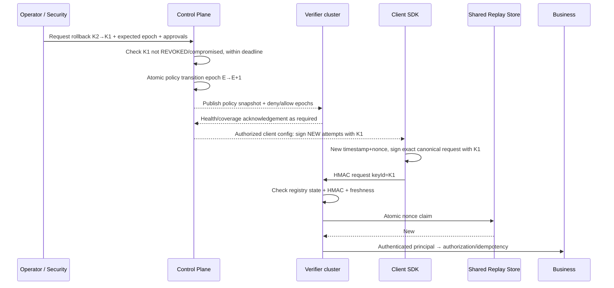
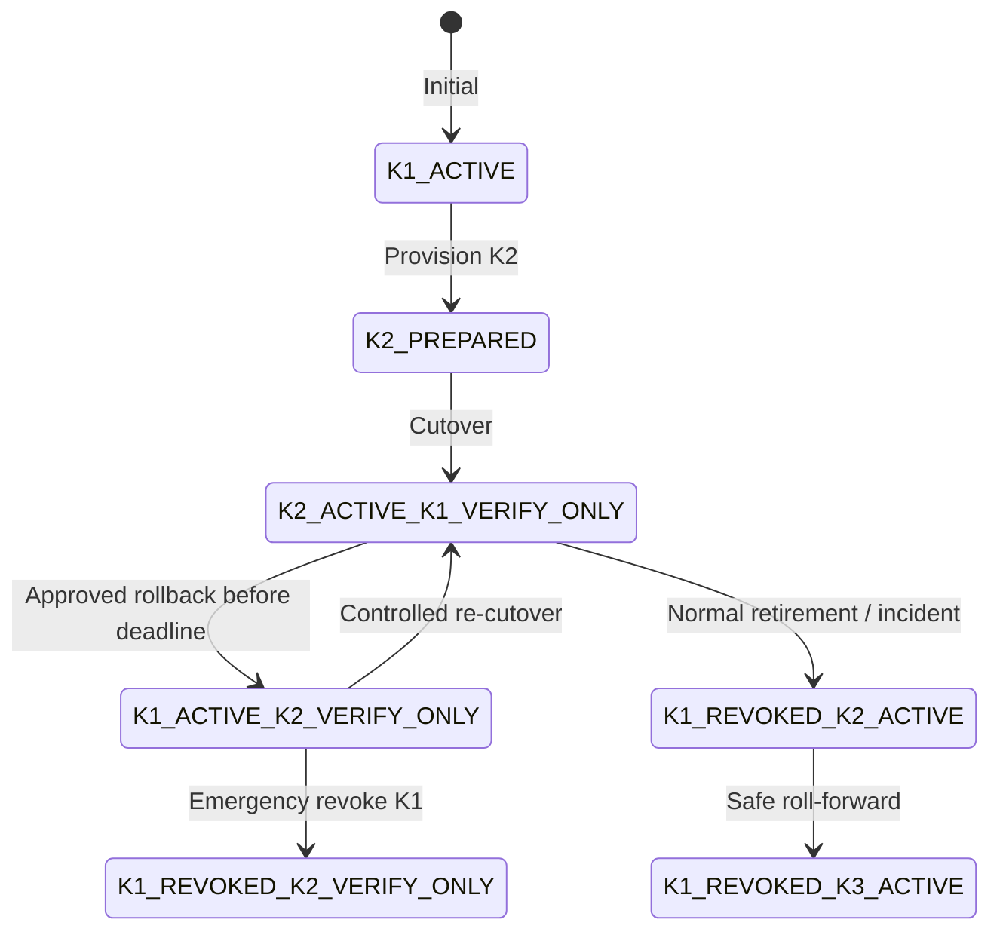
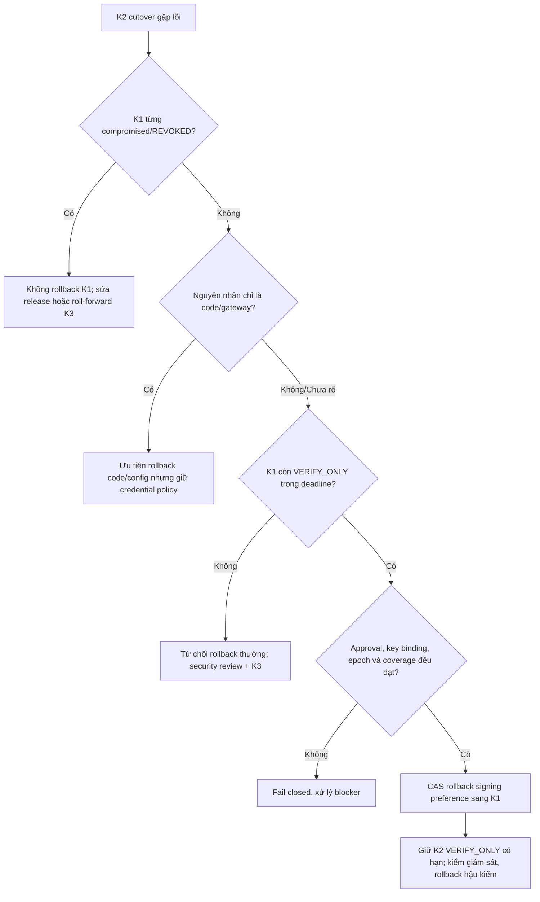
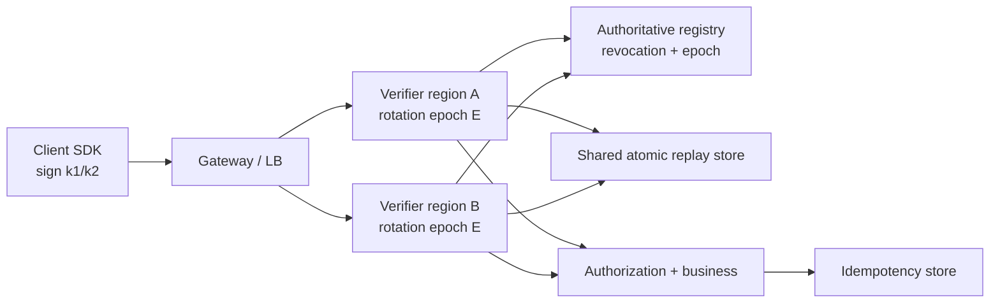

# Rollback rotation HMAC: quay lui an toàn khi đổi khóa gặp sự cố

> **Chương:** Key rotation  
> **Bài học:** Rollback rotation  
> **Module:** `SECURITY_AUTHENTICATION_HMAC_REQUEST_AUTHENTICATION` — thiết kế xác thực HTTP request bằng HMAC với shared secret và canonical request bảo vệ method, URI, header và/hoặc body theo hợp đồng ký. Bài này tập trung vào **rollback trong quá trình key rotation**: phân biệt quay lui ứng dụng, cấu hình signer và chính sách verifier; điều kiện được phép quay lại khóa trước; xử lý key compromised/revoked; cache, proxy/gateway, timestamp/nonce, replay database, idempotency và authorization.

## 1. Bối cảnh: rollback rotation thực sự là gì?

Một API dùng HMAC-SHA256 cấp hai credential cho cùng merchant:

```text
Credential trước: merchant-a-k1 -> K1 -> principal merchant-A
Credential mới:   merchant-a-k2 -> K2 -> principal merchant-A

Request:
  POST /v1/payments?orderId=42
  X-Key-Id: merchant-a-k2
  X-Timestamp: 1767225600
  X-Nonce: 87a3d56ea72d40af89f5b68cb3e831d4
  Idempotency-Key: pay-order-42
  X-Signature: v1=<BASE64URL_HMAC_SHA256_TAG>
```

Khi đổi signer từ k1 sang k2, một lỗi triển khai có thể khiến lượng `401` tăng mạnh: client đang ký k2 nhưng một số verifier chưa được cấp K2, gateway sửa signed headers, mapping key ID sai, cache chưa refresh hoặc SDK có bug canonicalization.

**Rollback rotation** là quyết định có kiểm soát để quay về **một trạng thái vận hành trước đó** trong khi giữ nguyên các bất biến bảo mật. Nó **không có nghĩa** tự động khôi phục mọi trạng thái cũ, và **không được dùng để làm sống lại khóa đã REVOKED vì lộ secret**.

### Những câu hỏi cần trả lời trước khi rollback

- Sự cố là **mismatch phần mềm/cấu hình**, hay đã có dấu hiệu **K1/K2 bị lộ**?
- Cần rollback **deployment**, **active signing key**, **credential registry** hay **giao thức ký**?
- K1 có còn **đủ điều kiện được verifier chấp nhận**, và client thực sự còn giữ K1 an toàn không?
- K1 đang ở `VERIFY_ONLY` trong cửa sổ overlap hay đã `REVOKED`?
- K2 có thể tiếp tục xác minh các request đã gửi khi client quay lại ký K1 không?
- Mọi vùng/instance có nhìn thấy cùng **rotation epoch**, revocation state và trust boundary không?
- Nếu client retry POST sau timeout, hệ thống có giữ **Idempotency-Key** nhưng tạo nonce/timestamp/tag mới không?
- Trạng thái authorization có đổi không, hay chỉ thay credential được dùng để chứng minh cùng principal?
- Nếu trả về K1 không an toàn, đã có phương án **roll-forward sang K3** hoặc tạm từ chối thay vì fail-open chưa?

**Mục tiêu của rollback an toàn:** khôi phục khả năng tương thích mà **không nới rộng tập credential đã bị thu hồi**, không làm yếu chữ ký, không mở lại replay, không nhân đôi giao dịch và không cấp quyền nghiệp vụ ngoài policy.

## 2. Phân biệt 5 kiểu “rollback”

| Kiểu rollback | Thành phần thay đổi | Có thể làm mà không quay lại secret cũ? | Rủi ro |
| --- | --- | --- | --- |
| **Rollback deployment** | Quay lại phiên bản Java service, signer SDK hoặc gateway config. | Có, nếu phiên bản cũ hỗ trợ k2 và signing contract hiện tại. | Binary cũ có thể không hiểu key ID/algorithm mới, bỏ freshness/replay hoặc đọc cache stale. |
| **Rollback signer selection** | Client ngừng ký mới bằng k2 và tạm ký bằng k1. | Không, nếu thật sự chọn K1. | Chỉ được khi K1 chưa compromised/revoked và đang được cho phép. |
| **Rollback verifier policy** | Điều chỉnh danh sách credential được phép verify trong overlap. | Có thể, nhưng **không được** nhận lại key đã REVOKED. | Mở rộng vô hạn cửa sổ chấp nhận K1, sai trạng thái giữa các regions. |
| **Rollback secret material/config** | Khôi phục mapping key ID → bytes/path hoặc bản ghi Vault. | Thường không nên xem như rollback thường. | Bị nhầm KV v2 version với credential key version, overwrite secret, đánh mất audit. |
| **Rollback protocol version** | Quay lại canonicalization/header/signature contract cũ. | Có thể nếu version cũ **vẫn được allowlist**, không bị deprecate do lỗ hổng. | Downgrade, signature confusion, parser differential và bypass các signed components. |

**Nguyên tắc:** Chọn **phạm vi thay đổi nhỏ nhất** đủ sửa sự cố. Nếu root cause là một phiên bản gateway normalize query sai, sửa/rollback gateway sau khi kiểm test signing contract có thể an toàn hơn việc kích hoạt lại K1.

### Ví dụ về rollback không cần đổi credential

```text
k2 đã ACTIVE; K2 chưa bị lộ.
Gateway release mới làm mất X-Nonce.
HMAC mismatch tăng từ 0.1% lên 35%.

Đúng:
  rollback gateway release / sửa forwarded-header policy;
  vẫn dùng k2 và không mở lại k1 ngoài overlap.

Sai:
  tự động đánh dấu k1 ACTIVE, bỏ X-Nonce khỏi chữ ký
  hoặc tắt replay protection để giảm 401.
```

## 3. Định nghĩa thuật ngữ và trạng thái

| Thuật ngữ | Ý nghĩa trong bài | Không đồng nghĩa |
| --- | --- | --- |
| `keyId` | Định danh credential do client gửi, ví dụ `merchant-a-k2`. | Secret hoặc authorization scope. |
| `K1`, `K2` | **Shared secret bytes** của hai credentials khác nhau. | “KV version 1/2” trong Vault. |
| **ACTIVE** | Credential được phép **ký mới** theo signing policy và được verifier chấp nhận. | Mọi client đã chuyển sang dùng key đó. |
| **VERIFY_ONLY** | Server tạm chấp nhận chữ ký dùng key cũ trong overlap; client **không nên ký mới**. | Credential đã REVOKED. |
| **PREPARED** | Credential đã provision nhưng chưa cho traffic thông thường. | Có thể dùng fallback tự do. |
| **REVOKED** | Không được xác thực request mới bằng credential này. | Chỉ là “không ưu tiên ký”. |
| **Rotation epoch / registry revision** | Phiên bản monotonic của quyết định active/accepted keys. | Unix timestamp do client gửi. |
| **Rollback deadline** | Thời hạn được phép phục hồi signer cũ theo runbook, ví dụ trong overlap. | Nonce TTL hoặc token TTL Vault. |
| **Admission fence** | Cơ chế bảo đảm request không được đi vào business sau một revocation/epoch quyết định. | Một thao tác đọc cache rồi hy vọng không có race. |
| **Idempotency-Key** | ID ổn định của business intent qua nhiều signing attempts. | HMAC nonce hay keyId. |

**Các trạng thái ở trên là mô hình ứng dụng minh họa**, không phải state có sẵn của RFC 2104, JCA hoặc HashiCorp Vault.

## 4. Threat model: rollback không được phục hồi khả năng tấn công

### 4.1. K1 chưa bị lộ, lỗi chỉ ở SDK

Client chuyển sang k2 nhưng SDK mới ký sai thứ tự query. K1 hiện `VERIFY_ONLY` và secret vẫn được bảo quản theo policy, overlap chưa hết.

Có thể cân nhắc **tạm cho client ký lại K1**, đồng thời giữ K2 trong nhóm verifier-accepted để xử lý requests đang bay. Trước khi làm:

1. Kiểm bằng chứng K1 **không compromised/revoked**.
2. Kiểm deadline và quyết định có thẩm quyền của security/operations.
3. Kiểm registry epoch, trust boundary và parser/gateway có nhận đúng K1.
4. Giới hạn thời gian và danh sách clients cần rollback.
5. Lập plan quay lại K2/K3 và đo acceptance window.

### 4.2. K1 đã bị lộ hoặc REVOKED

Nếu K1 bị lộ:

```text
Attacker biết K1:
  có thể tạo timestamp mới;
  sinh nonce chưa dùng;
  ký request POST thay đổi amount/recipient.

Rollback k2 -> k1 sẽ cấp lại khả năng giả mạo request.
```

**Không được rollback signer hoặc verifier về K1** chỉ vì sản phẩm đang lỗi. Hãy:

- Giữ K1 ở `REVOKED` tại mọi verifier.
- Chọn rollback **phần mềm/gateway** không phụ thuộc K1, hoặc
- Provision **K3 mới** bằng CSPRNG và roll-forward sang K3, hoặc
- Tạm từ chối những operations không thể xác thực an toàn (**fail closed**).

**Bất biến:** Một credential đã REVOKED do compromise không được khôi phục thành ACTIVE/VERIFY_ONLY chỉ bằng rollback deployment, backup, KV version hoặc config toggle.

### 4.3. K2 cũng bị nghi lộ

Nếu cả K1 và K2 không còn đáng tin, không có “khóa tốt cũ” để quay lại. Phương án là ngừng chấp nhận credentials bị ảnh hưởng, xử lý sự cố, tạo secret mới, cấp phát an toàn, xác minh lại control plane và phục hồi từng nhóm khách hàng. Không bật `allowUnknownKeyId`, không thử mọi keys hoặc bỏ HMAC.

### 4.4. Replay và downgrade khi rollback

Rollback protocol thiếu `X-Nonce` hoặc không ký body có thể khiến request cũ hoặc request bị sửa được chấp nhận. Bảo đảm:

- Timestamp/nonce, key ID và các trường ảnh hưởng method/URI/headers/body vẫn được ký đúng contract.
- Verifier **không thử tất cả signature versions/key IDs** cho đến khi một tag khớp.
- Mỗi key ID chọn **một credential và signing version được allowlist**.
- Replay store không xóa nonce cũ khi đổi signing key hay rollback signer.
- Authorization dùng principal đã xác thực, không dựa trên việc client chọn k1 hay k2.

## 5. Timeline rotation và vị trí được phép rollback

Xét một đợt rotation không liên quan sự cố lộ khóa:

```text
T0  | K1 ACTIVE; K2 chưa tạo
T1  | K2 PREPARED; đã lưu Secret Manager, chưa cho ký
T2  | Verifier rollout: cả K1 và K2 được policy nhận trong scope định trước
T3  | Client cutover: K2 ACTIVE; K1 VERIFY_ONLY, đặt deadline D
T4  | Phát hiện lỗi tương thích trước D; cân nhắc rollback signer về K1
T5  | Đã sửa lỗi, client lại ký K2 hoặc K3
T6  | K1 REVOKED; kết thúc overlap
T7  | K1 QUARANTINED/PURGED theo retention riêng
```

Rollback có thể hợp lệ tại **T4** khi K1 còn verify-eligible và risk approval đạt. Sau **T6**, việc quay lại K1 phải được xem là **không hợp lệ**; nếu cần phục hồi dịch vụ, phát credential mới.

### Thời gian ví dụ

```text
K2 cutover epoch: 2026-01-01 10:00:00 UTC
Overlap policy:    15 phút
Rollback deadline: 2026-01-01 10:15:00 UTC

10:07:00 UTC:  K2 có sự cố; K1 vẫn VERIFY_ONLY
               → Có thể cân nhắc rollback nếu không compromised.

10:16:00 UTC:  K1 đã ngoài policy accept window
               → Không mặc nhiên kéo dài deadline; cần k3/roll-forward
                 hoặc thay đổi plan được phê duyệt, không silently fail-open.
```

Đây là fixture thời gian, không phải khuyến nghị bắt buộc dùng overlap 15 phút. Thời gian overlap cần đủ cho **clock skew, in-flight requests, retry policy, rollout lag và vận hành**, nhưng không được kéo dài vô hạn.

### Đường đi đúng khi rollback signer



**K1 được chọn để ký request mới** không có nghĩa xóa K2 khỏi verifier ngay. Requests ký K2 có thể vẫn đang trong mạng; thường tiếp tục VERIFY_ONLY K2 trong một overlap khác có hạn để tránh từ chối oan request đã gửi trước rollback.

## 6. State machine: tách signer selection và verifier acceptance



Đây là state machine khái niệm; **tên state thể hiện snapshot của hai credentials**, không phải một enum cho một secret.

### 6.1. Vì sao phải tách hai quyết định?

Một endpoint verifier có thể chấp nhận cả k1/k2, nhưng **client chỉ có một signing key được ưu tiên** trong mỗi thời điểm. Nếu đặt chung một flag `active=true` cho cả hai, khó phân biệt ai được ký mới và ai chỉ được verify in-flight traffic.

| Key | Trước cutover | Sau cutover | Sau rollback có phê duyệt |
| --- | --- | --- | --- |
| K1 | ACTIVE (sign+verify) | VERIFY_ONLY (verify đến deadline) | ACTIVE (sign+verify), **chỉ nếu đủ điều kiện**. |
| K2 | PREPARED | ACTIVE (sign+verify) | VERIFY_ONLY (verify đến deadline mới). |
| K1 sau compromise/revoke | REVOKED | REVOKED | **Vẫn REVOKED**; rollback bị từ chối. |

### 6.2. Bất biến của rotation controller

1. **Một** signing key ưu tiên trên mỗi principal/credential group tại một epoch.
2. Mỗi key ID ánh xạ tới **đúng một tập key bytes và một credential identity**, không tùy ý thử mọi Vault versions.
3. Một key `REVOKED` không trở lại ACTIVE/VERIFY_ONLY thông qua thao tác rollback tự động.
4. `VERIFY_ONLY` chỉ được chấp nhận khi `now <= acceptUntil`; không kéo dài vô hạn.
5. Rollback yêu cầu **expected epoch/CAS**, approval hợp lệ, security review và đúng group/principal.
6. Chỉ chọn key có material còn sẵn, chính sách thuật toán/version được allowlist và không compromised.
7. Registry snapshot rollback phải được phát hành **nguyên tử**; không để một nửa nodes coi cả hai key là signer mặc định.
8. Revoke/deny policy phải được thực thi trên serving path trước khi tuyên bố effective.
9. Nếu không thể chứng minh các điều kiện, **từ chối rollback và fail closed**.
10. **Khôi phục deployment không tự khôi phục credential**; state của control plane độc lập với version binary.

## 7. Điều kiện tiên quyết: checklist “được phép rollback” và “bắt buộc roll-forward”

| Gate | Điều kiện an toàn | Nếu không đạt |
| --- | --- | --- |
| **Compromise review** | K1 không bị lộ/nghi compromise, không bị revoke. | Không bật lại K1; dùng K3 hoặc tạm từ chối. |
| **State** | K1 còn `VERIFY_ONLY` và within deadline theo signed-off policy. | Từ chối thao tác rollback thường. |
| **Version** | Signing contract cũ không có lỗ hổng, không downgrade. | Sửa triển khai, không quay lui protocol yếu. |
| **Vault material** | K1 có đúng secret bytes trong kho tin cậy và registry mapping. | Không tự restore KV history/thử nhiều versions. |
| **Identity** | K1 và K2 cùng principal/tenant đúng phạm vi nghiệp vụ dự định. | Không đổi principal bằng rollback. |
| **Approvals** | Operator có quyền và phê duyệt security/incident theo quy trình. | Không thực hiện qua feature flag tự do. |
| **Concurrency** | Atomic epoch transition, CAS và fencing policy rõ. | Không đảo ngược registry bằng snapshot stale. |
| **Coverage** | Verifiers biết policy mới hoặc node stale bị cô lập. | Không công bố rollback hoàn tất. |
| **Replay** | Nonce store còn các record đến hết freshness windows. | Không xóa nonce để làm request cũ “hợp lệ”. |
| **Business** | Idempotency scope ổn định; không đổi quyền tenant. | Chặn rollout và sửa business safety. |
| **Recovery** | Có kế hoạch đưa clients trở lại K2/K3 sau sự cố. | Không để rollback kéo dài vô hạn. |

### Cây quyết định tại thời điểm sự cố



**Lưu ý:** Mũi tên “rollback code” không có nghĩa **bỏ kiểm** policy. Version cũ phải đủ an toàn, hiểu đúng HMAC signing contract và không đọc credential state từ snapshot đã bị thay thế.

## 8. Control plane: rollback bằng versioned snapshot, không bằng ba file cấu hình rời

Nếu mỗi verifier đọc `activeKeyId` và `allowedKeyIds` từ nhiều nơi không atomic:

```text
Config A: activeSigningKey=k1
Config B: allowedVerifierKeys={k2}
Config C: credentialRegistry k1.state=REVOKED
```

Các bộ phận có thể hiểu nhau mâu thuẫn. Một giải pháp là có **authoritative rotation snapshot**:

```json
{
  "principalId": "merchant-A",
  "rotationEpoch": 42,
  "preferredSigningKeyId": "merchant-a-k2",
  "credentials": [
    {
      "keyId": "merchant-a-k1",
      "state": "VERIFY_ONLY",
      "verifyUntil": "2026-01-01T10:15:00Z",
      "credentialIdentity": "cred-a-001"
    },
    {
      "keyId": "merchant-a-k2",
      "state": "ACTIVE",
      "verifyUntil": null,
      "credentialIdentity": "cred-a-002"
    }
  ]
}
```

Rollback an toàn tạo **epoch 43**, không “khôi phục file epoch 41”:

```json
{
  "principalId": "merchant-A",
  "rotationEpoch": 43,
  "preferredSigningKeyId": "merchant-a-k1",
  "credentials": [
    {
      "keyId": "merchant-a-k1",
      "state": "ACTIVE",
      "verifyUntil": null,
      "credentialIdentity": "cred-a-001"
    },
    {
      "keyId": "merchant-a-k2",
      "state": "VERIFY_ONLY",
      "verifyUntil": "2026-01-01T10:22:00Z",
      "credentialIdentity": "cred-a-002"
    }
  ]
}
```

**Không giảm rotationEpoch.** Một epoch tăng dần giúp nodes nhận diện snapshot mới hơn và ngăn bản cấu hình cũ được “đẩy lại” do eventual replication/restore. Các mốc thời gian ở trên là fixtures.

### 8.1. Admin rollback API cần gì?

```http
POST /admin/credential-rotations/merchant-A/rollback HTTP/1.1
Authorization: Bearer <SCOPED_ADMIN_TOKEN>
If-Match: "rotation-epoch-42"
Idempotency-Key: incident-2026-001
Content-Type: application/json

{
  "fromKeyId": "merchant-a-k2",
  "toKeyId": "merchant-a-k1",
  "reason": "client_sdk_canonicalization_regression",
  "approvalId": "security-review-123",
  "requestedVerifyOnlySecondsForK2": 420
}
```

Đây là một **endpoint ứng dụng minh họa**, không phải Vault API có sẵn. Quản trị phải kiểm:

- **Admin authentication** mạnh (SSO/MFA/workload identity phù hợp).
- **Authorization** riêng `credential:rollback` đúng tenant/principal, tách `credential:revoke` và `credential:purge`.
- `If-Match`/expected epoch để tránh mất cập nhật do hai operators đồng thời.
- Operation `Idempotency-Key` để retry admin command sau timeout mà không tạo hai transitions.
- Approval/risk assessment, retention/audit và allowed rollback deadline.
- Thời hạn `VERIFY_ONLY` cho key mới, không nhận infinite `Long.MAX_VALUE` do caller tự yêu cầu.
- Không cho client HTTP HMAC tự gọi rollback chỉ vì nó chứng minh biết K1.

### 8.2. Gợi ý SQL CAS

```sql
-- Pseudocode schema: một record authority cho mỗi principal/group.
CREATE TABLE hmac_rotation_policy (
    principal_id VARCHAR(128) PRIMARY KEY,
    rotation_epoch BIGINT NOT NULL,
    preferred_signing_key_id VARCHAR(128),
    updated_at TIMESTAMPTZ NOT NULL DEFAULT clock_timestamp()
);

CREATE TABLE hmac_credential_state (
    credential_id VARCHAR(128) PRIMARY KEY,
    principal_id VARCHAR(128) NOT NULL,
    key_id VARCHAR(128) NOT NULL UNIQUE,
    state VARCHAR(32) NOT NULL,
    verify_until TIMESTAMPTZ,
    secret_ref VARCHAR(512) NOT NULL,
    compromised BOOLEAN NOT NULL DEFAULT FALSE,
    CONSTRAINT ck_state CHECK (
        state IN ('PREPARED','ACTIVE','VERIFY_ONLY','REVOKED')
    )
);
```

**Không** thực thi hai `UPDATE` credential state ở các transaction độc lập để rollback. Sử dụng transaction quản lý policy row, trạng thái keys, audit/outbox và kiểm expected epoch:

```sql
BEGIN;

SELECT rotation_epoch
FROM hmac_rotation_policy
WHERE principal_id = :principalId
FOR UPDATE;

-- Server validate expected epoch, trust state, compromise flag,
-- verifyUntil, approvals; no arbitrary values from HTTP caller.
-- Trong CÙNG transaction:
UPDATE hmac_credential_state
SET state = 'ACTIVE', verify_until = NULL
WHERE key_id = :previousKeyId
  AND principal_id = :principalId
  AND state = 'VERIFY_ONLY'
  AND compromised = FALSE
  AND verify_until >= clock_timestamp();

UPDATE hmac_credential_state
SET state = 'VERIFY_ONLY',
    verify_until = :newVerifyUntil
WHERE key_id = :currentKeyId
  AND principal_id = :principalId
  AND state = 'ACTIVE'
  AND compromised = FALSE;

UPDATE hmac_rotation_policy
SET preferred_signing_key_id = :previousKeyId,
    rotation_epoch = rotation_epoch + 1,
    updated_at = clock_timestamp()
WHERE principal_id = :principalId
  AND rotation_epoch = :expectedEpoch;

-- Audit + outbox event thuộc cùng transaction.
COMMIT;
```

**Cảnh báo:** `:name` trong đoạn trên là **placeholder SQL/pseudocode**, không phải placeholder JDBC `?`. Đây là skeleton minh họa, chưa đủ để chạy: application phải assert **row count của từng UPDATE bằng 1**, kiểm approval/state/credential binding dưới lock và **ROLLBACK toàn transaction** nếu bất kỳ điều kiện nào không đạt. Nếu update policy ra 0 rows, không được commit hai changes trước.

### 8.3. Distributed cache và rollback epoch

```text
Region A: rotationEpoch 43, signing k1, verifier k1/k2
Region B: rotationEpoch 42, signing k2, verifier k1/k2
Region C: rotationEpoch 39, verifier k1 only   <-- không hợp lệ
```

B có thể tồn tại trong rollout có kiểm soát vì vẫn chỉ dùng keys được phép; C phải bị cách ly nếu không đáp ứng freshness/deny policy. Không dựa vào “thấy nhiều yêu cầu 401 thì cache tự hết hạn” khi cần rollback khẩn.

### 8.4. Admission fencing, đặc biệt sau revoke

Một `registry.get()` rồi `Mac.doFinal()` rồi `registry.get()` lần nữa giúp **giảm** stale-state window nhưng không tạo linearizability trên nhiều regions. Nếu rollback/revoke yêu cầu **không có request được admitted sau một mốc commit**, cần một admission authority/fence chung hoặc quy trình drain/ack phù hợp. Khi không thể xác minh trạng thái đủ mới, fail closed.

## 9. Vault KV v2: rollback key ID không phải restore secret version

Một secret manager có thể lưu:

```text
kv/data/services/prod/payments/hmac/merchant-a-k1
  data.secret_b64 = Base64(K1)
  metadata.version = 7

kv/data/services/prod/payments/hmac/merchant-a-k2
  data.secret_b64 = Base64(K2)
  metadata.version = 2
```

**KV record version 7 không đồng nghĩa `keyId k7`.** Đây là phiên bản dữ liệu lưu tại một path, không phải phiên bản HMAC credential trong client header.

### Vì sao không rollback bằng cách restore một version Vault cũ?

- Nếu K1 đã compromised, restore K1 **không làm nó trở lại an toàn**.
- Nếu registry ghi `k1 REVOKED`, key material có còn cũng **không được chấp nhận**.
- Thử Vault versions `1..N` đến khi một tag HMAC khớp tạo khả năng downgrade ngoài policy.
- Ghi đè `merchant-a-k2` bằng K1 khiến key ID k2 đại diện secret khác, phá identity và audit.
- Vault Agent template/cache hoặc client vẫn có bản sao, nên restore version không bảo đảm đồng bộ.

**Cách an toàn:** tạo **credential/key ID riêng cho mỗi secret version** và giữ mapping keyId → stable credential identity → secretRef đáng tin. Rollback **signer selection** chỉ dùng lại K1 nếu K1 **đã được đánh giá an toàn, chưa revoke và còn nằm trong policy**; không âm thầm chỉnh secretRef của k2 sang K1.

### Vault auth/ACL cho control plane và verifier

Verifier chỉ cần `read` đúng secrets được phép. Job provisioning/rotation có quyền `create/update` ở path riêng. Job purge có quyền destructive được phê duyệt riêng. Không cấp root token cho application để “dễ rollback”.

### Khi Vault unavailable

- Nếu credential key material chưa được load và không có cache hợp lệ theo policy: **fail closed**.
- Nếu cache còn hợp lệ, secret chưa revoked và snapshot epoch/revision đáng tin: có thể verify theo policy cache, **không kéo dài hard expiry vô hạn**.
- Nếu không thể xác định K1 còn được phép hay đã compromise: **không rollback**.
- Không gửi Vault token qua query/log/gateway.
- Không chuyển sang dùng test key, literal secret trong code hoặc bỏ xác minh để duy trì availability.

## 10. HTTP signing contract phải bất biến trong rollback

Ví dụ minh họa `HMAC-ROLLBACK-V1`:

```http
POST /v1/payments?orderId=42 HTTP/1.1
Host: api.example.test
Content-Type: application/json
Idempotency-Key: pay-order-42
X-Key-Id: merchant-a-k1
X-Timestamp: 1767225600
X-Nonce: 87a3d56ea72d40af89f5b68cb3e831d4
X-Signature: v1=<BASE64URL_43_CHARS>

{"amount":100000,"currency":"VND"}
```

Đây là **request fixture**, signature là placeholder, timestamp/nonce không được dùng lại cho production.

### Canonical request minh họa

```text
POST
api.example.test
/v1/payments
orderId=42
content-type:application/json
idempotency-key:pay-order-42
x-key-id:merchant-a-k1
x-nonce:87a3d56ea72d40af89f5b68cb3e831d4
x-timestamp:1767225600
content-type;idempotency-key;x-key-id;x-nonce;x-timestamp
<SHA256_HEX_OF_EXACT_RAW_BODY_BYTES>
```

Các dòng dùng LF `\n`, không có LF cuối toàn chuỗi. Sign:

```text
bytesToSign =
    UTF8("HMAC-SHA256/HMAC-ROLLBACK-V1\n" + canonicalRequest)

rawTag =
    HMAC-SHA256(secretOfExactlySelectedKeyId, bytesToSign)

X-Signature =
    "v1=" + Base64URLNoPadding(rawTag)
```

**Không tự đổi algorithm/version khi rollback**. Signature full HMAC-SHA256 32 bytes → 43 Base64URL chars không padding. Verifier so **raw bytes** bằng `MessageDigest.isEqual`.

### Rollback không làm key ID thành “header trang trí”

Nếu client chuyển k1→k2 hoặc ngược lại, `X-Key-Id` phải nằm trong signing input. HMAC mới được tạo bằng **secret tương ứng đúng key ID**. Không được giữ tag k2 rồi chỉ sửa `X-Key-Id` về k1. Không thử K1 khi caller khai k2 mà signature với K2 sai.

### Bảo đảm trong proxy/gateway

- Method, original target/authority, query, covered headers và raw body phải được client/gateway/verifier hiểu cùng contract.
- Reject duplicated `X-Key-Id`/`X-Nonce`/`X-Timestamp`/`X-Signature`/`Idempotency-Key` trước khi proxy coalesce.
- Gateway phải strip/overwrite forwarded principal/tenant headers do Internet caller tự khai.
- Chọn **một authoritative nonce claim point**, không để gateway và backend claim lại cùng nonce.
- Không dùng rollback K1 để bỏ signed body/query hoặc tắt HTTP adapter validation khi một proxy release sai.
- Test cả HTTP/1.1↔HTTP/2/redirect/content encoding/JSON reserialization với golden byte vectors.

## 11. Replay và idempotency khi signer chuyển qua lại K1/K2

Giả sử lần POST đầu tiên:

```text
Operation: pay-order-42
Attempt 1: K2, nonce=N2a, timestamp=T2a
Outcome: payment P42 committed, HTTP response lost.
```

Sau rollback signer:

```text
Attempt 2:
  keyId = K1
  nonce = N1b (MỚI)
  timestamp = T1b (MỚI)
  signature = HMAC(K1, new canonical request)
  Idempotency-Key = pay-order-42 (GIỮ NGUYÊN)
  business body = giống Attempt 1
```

### Hai kho có nhiệm vụ khác nhau

| Kho | Khóa đề xuất | Mục tiêu | Ảnh hưởng rollback |
| --- | --- | --- | --- |
| Replay database | `(stableCredentialIdentity, nonce)` theo signing contract | Chặn **cùng attempt** được gửi lại trong timestamp window. | Không xóa record K1/K2 khi đổi signer; giữ TTL `T+P+margin`. |
| Idempotency store | `(authenticatedPrincipal, tenant, operation, Idempotency-Key)` | Chặn **cùng business intent** tạo side effect nhiều lần. | Không key theo keyId K1/K2 nếu cả hai cùng principal; giữ record xuyên rotation/rollback. |
| Credential registry | `keyId → secretRef, principal, status, epoch` | Quyết định secret nào được phép xác thực. | Cập nhật có CAS và policy; REVOKED không được khôi phục. |

Nếu retry **nguyên request** k2 với cùng nonce, replay store vẫn từ chối dù K2 đang VERIFY_ONLY. Nếu retry bằng nonce mới nhưng giữ idempotency key cũ, HMAC/replay có thể pass và business idempotency trả kết quả P42 cũ.

### TTL không được reset theo rotation

Với signed timestamp `T`, past window `P`, future window `F`:

\[
N-P\le T\le N+F
\]

Request còn tươi khi:

\[
T-F\le N\le T+P
\]

Replay record cần tồn tại ít nhất tới `T+P+margin`, **không** đơn giản là 300 giây từ lúc claim sớm nhất. Rollback key không được rút ngắn TTL đang bảo vệ request ký trước đó.

### Authorization vẫn độc lập

K1 và K2 có thể cùng map tới `merchant-A`, nhưng **quyền** của principal trên payment/tenant vẫn được kiểm riêng, nhất là sau một thay đổi role/scope. Rollback signer **không được** rollback permission database hoặc tự cấp lại quyền cũ. Một request có tag đúng vẫn có thể bị `403`.

## 12. Runbook rollback rotation trong vận hành

### Giai đoạn A — Phát hiện và khoanh vùng

1. So sánh `hmac_invalid_signature`, `unknown_key_id`, `stale_timestamp`, `nonce_replay`, `forbidden`, `vault_read_failure` theo key ID/region/client version mà không log secret.
2. Dùng golden fixtures để xác định khác canonical bytes hay thiếu K2/registry cache.
3. Kiểm khách hàng bị ảnh hưởng: nhóm k2 mới, tất cả, hay chỉ qua gateway release?
4. Kiểm sự cố có dấu hiệu exfiltration/compromise không; nếu có, **không quay về K1** khi K1 bị nghi.
5. Freeze automation có thể tiếp tục rotate/revoke đồng thời; **không** freeze emergency revoke/incident handling.

### Giai đoạn B — Chọn phương án và phê duyệt

1. Ưu tiên sửa/rollback binary hoặc gateway config nếu **không cần** thay credential.
2. Chỉ chọn rollback signer K2→K1 nếu K1 còn `VERIFY_ONLY`, không compromised, trong deadline và hợp policy.
3. Đặt rõ `requestedVerifyOnlySecondsForK2` theo giới hạn đã phê duyệt.
4. Security/operations phê duyệt, ghi operation ID và expected epoch.
5. Chốt lộ trình quay lại K2 hoặc roll-forward K3 sau khi nguyên nhân được xử lý.

### Giai đoạn C — Thực thi

1. Control plane đọc authority snapshot và CAS transition `epoch E → E+1`.
2. Cập nhật trạng thái K1 ACTIVE và K2 VERIFY_ONLY **trong một transaction/snapshot**.
3. Viết audit/outbox cùng commit, phân phối epoch mới và áp fencing/ack theo policy.
4. Không route traffic tới verifiers chưa đáp ứng trust/secret readiness.
5. Client SDK đổi **preferred signing key**, sinh timestamp/nonce mới, ký lại full canonical request.
6. Giữ replay/idempotency records, không bật lại REVOKED key, không nới authz.

### Giai đoạn D — Kiểm chứng và theo dõi

1. Chạy canary từ client dùng K1 mới và test K2 in-flight còn hợp lệ tới deadline.
2. Kiểm HMAC mismatch giảm **đúng nhóm nguyên nhân**, không chỉ giảm 401 do một bypass.
3. Kiểm duplicate nonce vẫn bị từ chối, stale timestamp vẫn fail.
4. Kiểm business transaction count/idempotency không tăng bất thường.
5. Kiểm các pods/regions nhận epoch mong muốn, không có cache trái policy.
6. Kiểm old revoked/compromised credentials **vẫn bị từ chối** trong test âm.
7. Đặt deadline rollback và theo dõi việc quay lại K2/K3; không duy trì K1 vĩnh viễn.

### Giai đoạn E — Hậu kiểm

- Viết postmortem: root cause, first bad deploy, affected clients/regions, rollback decision, key exposure assessment.
- Bổ sung golden vectors đa ngôn ngữ, gateway transformations, registry cache/epoch tests.
- Xóa secrets/tokens bị log nhầm theo incident process, rotate nếu đã lộ.
- Cập nhật runbooks, alerts và điều kiện tự động hoá; **không** nới policy chỉ để tránh phát cảnh báo.
- Quyết định retirement/revoke/purge K1 theo credential lifecycle riêng sau khi không còn cần rollback.

## 13. Lỗi và anti-pattern đặc biệt nguy hiểm

| Anti-pattern | Vì sao sai | Hướng xử lý |
| --- | --- | --- |
| Re-enable `REVOKED` K1 để hết lỗi k2. | Có thể cho attacker biết K1 giả mạo request. | Roll-forward K3 hoặc rollback phần mềm không dùng K1. |
| Restore KV version 1 vào path của K2. | Làm keyId trỏ tới material không khớp, mất provenance. | Immutable key ID/secretRef; tạo credential riêng. |
| Coi “rollback thành công” khi DB config commit nhưng pods chưa sync. | Serving nodes có thể dùng epoch cũ/khác nhau. | Acknowledgments/fencing/coverage SLA. |
| Trả API success khi admin request timeout sau CAS. | Có thể mơ hồ đã commit hay chưa. | OperationId, status query, idempotent reconcile. |
| Đặt cả K1/K2 “ACTIVE” cho mọi client không thời hạn. | Không còn khái niệm signing preference và retirement. | ACTIVE một key/group, VERIFY_ONLY có deadline. |
| Retry bằng signature cũ nhưng đổi keyId. | HMAC mismatch, caller không chứng minh key mới. | Ký lại toàn bộ request với đúng secret. |
| Khi HMAC sai, thử K1, K2, KV versions cho đến khi trúng. | Tạo downgrade/credential confusion, khó revoke. | keyId → duy nhất key và version theo policy. |
| Đổi canonicalization để bỏ path/body/nonce. | Signature không còn ràng buộc tài nguyên và replay. | Sửa parser/gateway; giữ security invariants. |
| Xóa nonce store để “cho client retry được”. | Replay nguyên request cũ có thể được nhận. | Nonce mới/tag mới; idempotency cho business intent. |
| Dùng keyId làm toàn bộ idempotency namespace. | Rollback signer có thể khiến payment bị tạo lại. | Stable principal/tenant/operation. |
| Nhầm `401` với `403`. | Đổi key không sửa lỗi thiếu quyền. | Quan sát separate authn/authz decisions. |
| Lấy principal từ `X-Authenticated-User` do caller gửi. | Bypass authorization khi proxy trust boundary sai. | Gateway strip/overwrite, secure internal identity. |
| Mở Vault wildcard root policy để khôi phục K1. | Tăng blast radius secrets. | Least privilege, explicit secret references. |
| Giữ verify-only vô hạn sau rollback. | Key cũ tiếp tục có khả năng bị lạm dụng. | Set verify-until, metrics, retire/revoke. |
| Giảm epoch khi restore backup. | Cấu hình cũ có thể đè state mới/deny rules. | Monotonic epochs, revocation ledger và recovery validation. |
| Fail open khi control plane/cache/Vault down. | Attacker có thể dùng key không còn hợp lệ. | Fail closed, bounded cache và recovery. |

---

## 14. Java 17+: mô phỏng rollback rotation với registry versioned và HMAC

Ví dụ dưới đây chạy **offline chỉ với JDK 17+**, không cần PostgreSQL, Vault, Redis hay HTTP server. Nó minh họa logic cần test **trước** khi thay bằng distributed control plane:

- Có một registry snapshot gồm `rotationEpoch`, `preferredSigningKeyId` và danh sách credentials.
- `cutover(k1,k2)` chuyển k1 `ACTIVE → VERIFY_ONLY`, k2 `PREPARED → ACTIVE`, đặt hạn cho k1.
- `rollback(k2,k1)` chỉ thực hiện nếu k1 còn `VERIFY_ONLY`, chưa hết deadline, **không compromised**, cùng principal, approval đầy đủ và expected epoch đúng.
- `revoke(k1)` biến k1 thành `REVOKED` terminal. Rollback sau revoke **không được phép**.
- Mọi thay đổi registry dùng `AtomicReference.compareAndSet`; chỉ có **một** thao tác cạnh tranh trên cùng epoch thành công trong JVM demo.
- Verifier chọn **đúng secretRef** của key ID đã xác thực, kiểm HMAC-SHA256, freshness, replay nonce và authorization riêng.
- Key ID và Idempotency-Key nằm trong canonical HMAC input; một retry business phải giữ Idempotency-Key nhưng có nonce mới.
- Fake Vault và fake replay store có thể lỗi để chứng minh fail closed.

### 14.1. Giới hạn và khung bảo đảm

**Đây là mô hình in-memory, không có HTTP ingress thực và không có distributed consistency.** Các điểm chỉ được giả định:

1. `Snapshot` giống một record authoritative đã được commit, nhưng code không có database, replication, network partitions hoặc multi-region fencing.
2. `FakeVault` chứa bytes fixture công khai; client thực không tự đi đọc Vault nội bộ của verifier.
3. `LocalReplayStore` chỉ atomic một JVM; production dùng shared atomic store có TTL/durability.
4. `clock` trong tests là fixed UTC; production phải đồng bộ đồng hồ và giới hạn skew.
5. Quyền admin trong `Approval` là dữ liệu **đã được control plane kiểm chứng**, không phải input boolean do client gửi là được tin ngay.
6. Việc kiểm epoch trước và sau HMAC **giảm** stale acceptance, không cung cấp bảo đảm linearizable revoke/admission nếu chuyển sang distributed deployment.
7. Method/authority/path/query/Content-Type cố định để tập trung vào rotation; HTTP adapter production phải kiểm raw request thực nhận và reject duplicate security headers.

### 14.2. Chương trình `HmacRotationRollbackDemo.java`

```java
import java.nio.charset.StandardCharsets;
import java.security.GeneralSecurityException;
import java.security.MessageDigest;
import java.time.Clock;
import java.time.Instant;
import java.time.ZoneOffset;
import java.util.Arrays;
import java.util.Base64;
import java.util.HashMap;
import java.util.HexFormat;
import java.util.Map;
import java.util.Objects;
import java.util.concurrent.Callable;
import java.util.concurrent.ConcurrentHashMap;
import java.util.concurrent.CountDownLatch;
import java.util.concurrent.ExecutorService;
import java.util.concurrent.Executors;
import java.util.concurrent.Future;
import java.util.concurrent.TimeUnit;
import java.util.concurrent.atomic.AtomicBoolean;
import java.util.concurrent.atomic.AtomicReference;
import java.util.function.Function;
import javax.crypto.Mac;
import javax.crypto.spec.SecretKeySpec;

public final class HmacRotationRollbackDemo {
    private static final HexFormat HEX = HexFormat.of();
    private static final long PAST = 300L;
    private static final long FUTURE = 300L;
    private static final long NONCE_MARGIN = 60L;
    private static final String PREFIX =
            "HMAC-SHA256/HMAC-ROLLBACK-V1\n";
    private static final String SIGNED_NAMES =
            "content-type;idempotency-key;x-key-id;"
            + "x-nonce;x-timestamp";

    private HmacRotationRollbackDemo() {}

    enum State { PREPARED, ACTIVE, VERIFY_ONLY, REVOKED }

    enum Decision {
        ACCEPT, MALFORMED, UNAUTHENTICATED,
        STALE, REPLAY, FORBIDDEN, UNAVAILABLE
    }

    record Credential(
            String keyId,
            String principal,
            String secretRef,
            State state,
            boolean compromised,
            long verifyUntil) {
        Credential {
            Objects.requireNonNull(keyId);
            Objects.requireNonNull(principal);
            Objects.requireNonNull(secretRef);
            Objects.requireNonNull(state);
        }

        Credential with(
                State newState,
                boolean newCompromised,
                long newVerifyUntil) {
            return new Credential(keyId, principal, secretRef,
                    newState, newCompromised, newVerifyUntil);
        }
    }

    record Snapshot(
            long epoch, String preferredKeyId,
            Map<String, Credential> credentials) {
        Snapshot {
            Objects.requireNonNull(preferredKeyId);
            credentials = Map.copyOf(credentials);
            if (epoch <= 0) {
                throw new IllegalArgumentException("Bad epoch");
            }
        }
    }

    // Approval này là kết quả đã kiểm tại admin trust boundary.
    // Không tin trực tiếp boolean từ một HTTP request của client.
    record Approval(
            boolean operatorAuthorized,
            boolean securityApproved,
            boolean noKnownCompromise,
            long validUntilEpochSeconds) {
        boolean validAt(long now) {
            return operatorAuthorized && securityApproved
                    && noKnownCompromise
                    && now <= validUntilEpochSeconds;
        }
    }

    static final class Controller {
        private final AtomicReference<Snapshot> current;
        volatile boolean unavailable;

        Controller(Snapshot initial) {
            this.current = new AtomicReference<>(
                    Objects.requireNonNull(initial));
        }

        Snapshot view() {
            if (unavailable) {
                throw new IllegalStateException(
                        "Rotation registry unavailable");
            }
            return current.get();
        }

        private Snapshot update(
                long expectedEpoch,
                Function<Snapshot, Snapshot> transform) {
            Snapshot before = view();
            if (before.epoch() != expectedEpoch) {
                throw new IllegalStateException(
                        "Stale expected rotation epoch");
            }
            Snapshot after = transform.apply(before);
            if (after.epoch() != before.epoch() + 1) {
                throw new IllegalStateException(
                        "Rotation epoch must increase by one");
            }
            if (!current.compareAndSet(before, after)) {
                throw new IllegalStateException(
                        "Concurrent rotation update");
            }
            return after;
        }

        Snapshot cutover(
                String oldKey, String newKey,
                long expectedEpoch,
                long now, long oldKeyOverlapSeconds) {
            return update(expectedEpoch, before -> {
                if (oldKeyOverlapSeconds <= 0
                        || oldKeyOverlapSeconds > 3600
                        || !oldKey.equals(before.preferredKeyId())) {
                    throw new IllegalStateException(
                            "Invalid cutover policy");
                }
                Credential old = before.credentials().get(oldKey);
                Credential fresh = before.credentials().get(newKey);
                if (old == null || fresh == null
                        || old.state() != State.ACTIVE
                        || fresh.state() != State.PREPARED
                        || old.compromised()
                        || fresh.compromised()
                        || !old.principal().equals(fresh.principal())) {
                    throw new IllegalStateException(
                            "Keys not eligible for cutover");
                }
                long expiry = Math.addExact(
                        now, oldKeyOverlapSeconds);
                Map<String, Credential> next =
                        new HashMap<>(before.credentials());
                next.put(oldKey, old.with(
                        State.VERIFY_ONLY, false, expiry));
                next.put(newKey, fresh.with(
                        State.ACTIVE, false, Long.MAX_VALUE));
                return new Snapshot(
                        before.epoch() + 1, newKey, next);
            });
        }

        Snapshot rollback(
                String currentKey, String previousKey,
                long expectedEpoch,
                long now, long currentKeyOverlapSeconds,
                Approval approval) {
            return update(expectedEpoch, before -> {
                if (approval == null || !approval.validAt(now)
                        || currentKeyOverlapSeconds <= 0
                        || currentKeyOverlapSeconds > 3600
                        || !currentKey.equals(
                                before.preferredKeyId())) {
                    throw new IllegalStateException(
                            "Rollback approval/policy invalid");
                }

                Credential currentKeyRecord =
                        before.credentials().get(currentKey);
                Credential previousKeyRecord =
                        before.credentials().get(previousKey);
                if (currentKeyRecord == null
                        || previousKeyRecord == null
                        || currentKeyRecord.state() != State.ACTIVE
                        || previousKeyRecord.state()
                            != State.VERIFY_ONLY
                        || currentKeyRecord.compromised()
                        || previousKeyRecord.compromised()
                        || now > previousKeyRecord.verifyUntil()
                        || !currentKeyRecord.principal().equals(
                                previousKeyRecord.principal())) {
                    throw new IllegalStateException(
                            "Unsafe rotation rollback");
                }

                // Snapshot swap in one CAS; no REVOKED key can revive.
                long expiry = Math.addExact(
                        now, currentKeyOverlapSeconds);
                Map<String, Credential> next =
                        new HashMap<>(before.credentials());
                next.put(previousKey, previousKeyRecord.with(
                        State.ACTIVE, false, Long.MAX_VALUE));
                next.put(currentKey, currentKeyRecord.with(
                        State.VERIFY_ONLY, false, expiry));
                return new Snapshot(
                        before.epoch() + 1, previousKey, next);
            });
        }

        Snapshot revoke(
                String keyId, long expectedEpoch,
                boolean suspectedCompromised) {
            return update(expectedEpoch, before -> {
                Credential old = before.credentials().get(keyId);
                if (old == null || old.state() == State.REVOKED) {
                    throw new IllegalStateException(
                            "Unknown or already revoked");
                }
                Map<String, Credential> next =
                        new HashMap<>(before.credentials());
                next.put(keyId, old.with(State.REVOKED,
                        old.compromised() || suspectedCompromised,
                        0L));

                String preferred = before.preferredKeyId()
                        .equals(keyId)
                        ? "" : before.preferredKeyId();

                return new Snapshot(
                        before.epoch() + 1, preferred, next);
            });
        }
    }

    record SecretRecord(String credentialKeyId, byte[] bytes) {
        SecretRecord {
            Objects.requireNonNull(credentialKeyId);
            Objects.requireNonNull(bytes);
            bytes = bytes.clone();
        }
        @Override public byte[] bytes() {
            return bytes.clone();
        }
    }

    static final class FakeVault {
        private final ConcurrentHashMap<String, SecretRecord> records =
                new ConcurrentHashMap<>();
        volatile boolean unavailable;

        void put(String trustedSecretRef, SecretRecord secret) {
            records.put(trustedSecretRef, secret);
        }

        SecretRecord read(String trustedSecretRef) {
            if (unavailable) {
                throw new IllegalStateException("Secret store unavailable");
            }
            return records.get(trustedSecretRef);
        }
    }

    interface ReplayStore {
        boolean claim(String scopedKey, long expiry, long now);
    }

    // Local-only demo. Production must use shared atomic replay store.
    static final class LocalReplayStore implements ReplayStore {
        private final ConcurrentHashMap<String, Long> used =
                new ConcurrentHashMap<>();

        @Override
        public boolean claim(String scopedKey, long expiry, long now) {
            if (expiry <= now) {
                throw new IllegalStateException("Bad nonce expiry");
            }
            AtomicBoolean claimed = new AtomicBoolean(false);
            used.compute(scopedKey, (ignored, previousExpiry) -> {
                if (previousExpiry == null || previousExpiry <= now) {
                    claimed.set(true);
                    return expiry;
                }
                return previousExpiry;
            });
            return claimed.get();
        }
    }

    record Request(
            String keyId, String timestamp, String nonce,
            String idempotencyKey, byte[] rawBody, String signature) {
        Request {
            Objects.requireNonNull(keyId);
            Objects.requireNonNull(timestamp);
            Objects.requireNonNull(nonce);
            Objects.requireNonNull(idempotencyKey);
            Objects.requireNonNull(rawBody);
            Objects.requireNonNull(signature);
            rawBody = rawBody.clone();
        }
        @Override public byte[] rawBody() {
            return rawBody.clone();
        }
    }

    private static void validate(Request request) {
        if (!request.keyId().matches("[A-Za-z0-9._-]{1,64}")
                || !request.timestamp().matches("[1-9][0-9]{9,10}")
                || !request.nonce().matches("[0-9a-f]{32}")
                || !request.idempotencyKey()
                    .matches("[A-Za-z0-9._-]{1,64}")
                || request.rawBody().length > 64 * 1024) {
            throw new IllegalArgumentException(
                    "Malformed signed request");
        }
    }

    // Endpoint fixture, not a general HTTP canonicalizer.
    private static String canonical(Request request)
            throws GeneralSecurityException {
        validate(request);
        byte[] digest = MessageDigest.getInstance("SHA-256")
                .digest(request.rawBody());
        return String.join("\n",
                "POST",
                "api.example.test",
                "/v1/payments",
                "orderId=42",
                "content-type:application/json",
                "idempotency-key:" + request.idempotencyKey(),
                "x-key-id:" + request.keyId(),
                "x-nonce:" + request.nonce(),
                "x-timestamp:" + request.timestamp(),
                SIGNED_NAMES,
                HEX.formatHex(digest));
    }

    private static byte[] tag(Request request, byte[] key)
            throws GeneralSecurityException {
        if (key.length != 32) {
            throw new IllegalStateException("Invalid secret record length");
        }
        Mac mac = Mac.getInstance("HmacSHA256");
        mac.init(new SecretKeySpec(key, "HmacSHA256"));
        return mac.doFinal((PREFIX + canonical(request))
                .getBytes(StandardCharsets.UTF_8));
    }

    private static String encodeTag(byte[] rawTag) {
        if (rawTag.length != 32) {
            throw new IllegalArgumentException("Invalid tag length");
        }
        return "v1=" + Base64.getUrlEncoder().withoutPadding()
                .encodeToString(rawTag);
    }

    private static byte[] decodeTag(String value) {
        if (!value.matches("v1=[A-Za-z0-9_-]{43}")) {
            throw new IllegalArgumentException(
                    "Invalid signature grammar");
        }
        String encoded = value.substring(3);
        byte[] bytes = Base64.getUrlDecoder().decode(encoded);
        if (bytes.length != 32
                || !encoded.equals(Base64.getUrlEncoder()
                    .withoutPadding().encodeToString(bytes))) {
            throw new IllegalArgumentException(
                    "Noncanonical signature");
        }
        return bytes;
    }

    // Client secret đã được cấp qua một kênh an toàn từ trước.
    static Request sign(
            String keyId, String timestamp, String nonce,
            String idempotencyKey, String json,
            byte[] clientSecret)
            throws GeneralSecurityException {
        Request unsigned = new Request(
                keyId, timestamp, nonce, idempotencyKey,
                json.getBytes(StandardCharsets.UTF_8), "");
        return new Request(
                keyId, timestamp, nonce, idempotencyKey,
                unsigned.rawBody(), encodeTag(tag(unsigned, clientSecret)));
    }

    static Decision verify(
            Request request,
            Controller controller, FakeVault vault,
            ReplayStore replay, Clock clock,
            boolean authorized) {
        try {
            validate(request);
            byte[] supplied = decodeTag(request.signature());
            long now = clock.instant().getEpochSecond();
            Snapshot first = controller.view();

            Credential record =
                    first.credentials().get(request.keyId());
            if (record == null
                    || record.compromised()
                    || (record.state() != State.ACTIVE
                        && record.state() != State.VERIFY_ONLY)
                    || (record.state() == State.VERIFY_ONLY
                        && now > record.verifyUntil())) {
                return Decision.UNAUTHENTICATED;
            }

            SecretRecord secret = vault.read(record.secretRef());
            if (secret == null
                    || !secret.credentialKeyId().equals(record.keyId())) {
                return Decision.UNAVAILABLE;
            }
            byte[] keyCopy = secret.bytes();
            byte[] expected;
            try {
                expected = tag(request, keyCopy);
            } finally {
                // Best effort: JVM/JCA may have other copies.
                Arrays.fill(keyCopy, (byte) 0);
            }

            if (!MessageDigest.isEqual(expected, supplied)) {
                return Decision.UNAUTHENTICATED;
            }

            long t = Long.parseLong(request.timestamp());
            if (t < now - PAST || t > now + FUTURE) {
                return Decision.STALE;
            }

            // Demonstration only: fail closed on any epoch change.
            // Real distributed admission/revoke needs authoritative fencing.
            Snapshot latest = controller.view();
            if (latest.epoch() != first.epoch()) {
                return Decision.UNAVAILABLE;
            }

            long expiry = t + PAST + NONCE_MARGIN;
            String replayKey = record.keyId() + ":" + request.nonce();
            if (!replay.claim(replayKey, expiry, now)) {
                return Decision.REPLAY;
            }
            if (!authorized) {
                return Decision.FORBIDDEN;
            }
            return Decision.ACCEPT;
        } catch (IllegalArgumentException malformed) {
            return Decision.MALFORMED;
        } catch (GeneralSecurityException crypto) {
            return Decision.UNAVAILABLE;
        } catch (RuntimeException infrastructure) {
            return Decision.UNAVAILABLE;
        }
    }

    private static void check(boolean condition, String reason) {
        if (!condition) throw new AssertionError(reason);
    }

    private static void expect(Decision actual, Decision wanted) {
        check(actual == wanted,
                "Expected " + wanted + ", got " + actual);
    }

    private static Controller freshController(
            String ref1, String ref2) {
        Credential k1 = new Credential(
                "merchant-a-k1", "merchant-A",
                ref1, State.ACTIVE, false, Long.MAX_VALUE);
        Credential k2 = new Credential(
                "merchant-a-k2", "merchant-A",
                ref2, State.PREPARED, false, 0L);
        return new Controller(new Snapshot(
                1, k1.keyId(),
                Map.of(k1.keyId(), k1, k2.keyId(), k2)));
    }

    private static void mustReject(Runnable action, String reason) {
        try {
            action.run();
        } catch (IllegalStateException denied) {
            return;
        }
        throw new AssertionError(reason);
    }

    public static void main(String[] args) throws Exception {
        // PUBLIC TEST KEYS ONLY. Never provision these to clients.
        byte[] k1 = HEX.parseHex(
                "000102030405060708090a0b0c0d0e0f"
              + "101112131415161718191a1b1c1d1e1f");
        byte[] k2 = HEX.parseHex(
                "f0e0d0c0b0a090807060504030201000"
              + "ffeeddccbbaa99887766554433221100");
        String ref1 =
                "services/test/payments/hmac/merchant-a-k1";
        String ref2 =
                "services/test/payments/hmac/merchant-a-k2";

        FakeVault vault = new FakeVault();
        vault.put(ref1, new SecretRecord("merchant-a-k1", k1));
        vault.put(ref2, new SecretRecord("merchant-a-k2", k2));

        Controller control = freshController(ref1, ref2);
        long t = 1767225600L;
        Clock fixed = Clock.fixed(
                Instant.ofEpochSecond(t), ZoneOffset.UTC);
        Approval approved = new Approval(
                true, true, true, t + 1200L);
        String json =
                "{\"amount\":100000,\"currency\":\"VND\"}";
        String idemKey = "pay-order-42";

        Request firstK1 = sign(
                "merchant-a-k1", "1767225600",
                "aaaaaaaaaaaaaaaaaaaaaaaaaaaaaaaa",
                idemKey, json, k1);
        Request preparedK2 = sign(
                "merchant-a-k2", "1767225600",
                "bbbbbbbbbbbbbbbbbbbbbbbbbbbbbbbb",
                idemKey, json, k2);
        LocalReplayStore sharedReplay = new LocalReplayStore();

        expect(verify(firstK1, control, vault, sharedReplay,
                fixed, true), Decision.ACCEPT);
        expect(verify(firstK1, control, vault, sharedReplay,
                fixed, true), Decision.REPLAY);
        expect(verify(preparedK2, control, vault,
                sharedReplay, fixed, true),
                Decision.UNAUTHENTICATED);

        // Controlled cutover k1 ACTIVE -> VERIFY_ONLY, k2 ACTIVE.
        Snapshot afterCutover = control.cutover(
                "merchant-a-k1", "merchant-a-k2",
                1, t, 900);
        check(afterCutover.epoch() == 2
                && afterCutover.preferredKeyId()
                    .equals("merchant-a-k2"),
                "Cutover policy wrong");

        Request inFlightK1 = sign(
                "merchant-a-k1", "1767225600",
                "cccccccccccccccccccccccccccccccc",
                idemKey, json, k1);
        Request newK2 = sign(
                "merchant-a-k2", "1767225600",
                "dddddddddddddddddddddddddddddddd",
                idemKey, json, k2);
        expect(verify(inFlightK1, control, vault,
                sharedReplay, fixed, true), Decision.ACCEPT);
        expect(verify(newK2, control, vault,
                sharedReplay, fixed, true), Decision.ACCEPT);

        // Rollback without security approval MUST be denied.
        Approval missingApproval = new Approval(
                true, false, true, t + 1200L);
        mustReject(() -> control.rollback(
                "merchant-a-k2", "merchant-a-k1",
                2, t + 60, 420, missingApproval),
                "Rollback without approval was allowed");
        check(control.view().epoch() == 2,
                "Rejected rollback mutated snapshot");

        // Approved rollback before K1 VERIFY_ONLY deadline.
        Snapshot rolledBack = control.rollback(
                "merchant-a-k2", "merchant-a-k1",
                2, t + 60, 420, approved);
        check(rolledBack.epoch() == 3
                && rolledBack.preferredKeyId()
                    .equals("merchant-a-k1"),
                "Rollback signing key wrong");
        check(rolledBack.credentials().get("merchant-a-k2")
                .state() == State.VERIFY_ONLY,
                "K2 should still verify in-flight requests");

        Clock afterRollback = Clock.fixed(
                Instant.ofEpochSecond(t + 60), ZoneOffset.UTC);
        Request newK1 = sign(
                "merchant-a-k1", "1767225660",
                "eeeeeeeeeeeeeeeeeeeeeeeeeeeeeeee",
                idemKey, json, k1);
        Request inFlightK2 = sign(
                "merchant-a-k2", "1767225660",
                "ffffffffffffffffffffffffffffffff",
                idemKey, json, k2);
        expect(verify(newK1, control, vault,
                sharedReplay, afterRollback, true), Decision.ACCEPT);
        expect(verify(inFlightK2, control, vault,
                sharedReplay, afterRollback, true), Decision.ACCEPT);

        // CAS: old epoch cannot overwrite rollback policy.
        mustReject(() -> control.rollback(
                "merchant-a-k2", "merchant-a-k1",
                2, t + 70, 300, approved),
                "Stale expected epoch was allowed");

        // K1 HMAC signed with wrong key K2 must not verify.
        Request wrongKey = sign(
                "merchant-a-k1", "1767225660",
                "11111111111111111111111111111111",
                idemKey, json, k2);
        expect(verify(wrongKey, control, vault,
                new LocalReplayStore(), afterRollback, true),
                Decision.UNAUTHENTICATED);

        // Properly signed but stale timestamp remains forbidden.
        Request stale = sign(
                "merchant-a-k1", "1767225359",
                "22222222222222222222222222222222",
                idemKey, json, k1);
        expect(verify(stale, control, vault,
                new LocalReplayStore(), afterRollback, true),
                Decision.STALE);

        // Authenticated request may still fail business authorization.
        expect(verify(newK1, control, vault,
                new LocalReplayStore(), afterRollback, false),
                Decision.FORBIDDEN);

        vault.unavailable = true;
        expect(verify(newK1, control, vault,
                new LocalReplayStore(), afterRollback, true),
                Decision.UNAVAILABLE);
        vault.unavailable = false;

        control.unavailable = true;
        expect(verify(newK1, control, vault,
                new LocalReplayStore(), afterRollback, true),
                Decision.UNAVAILABLE);
        control.unavailable = false;

        // Separate scenario: old key expires before rollback.
        Controller deadlineCase = freshController(ref1, ref2);
        deadlineCase.cutover("merchant-a-k1",
                "merchant-a-k2", 1, t, 900);
        mustReject(() -> deadlineCase.rollback(
                "merchant-a-k2", "merchant-a-k1",
                2, t + 901, 300,
                new Approval(true, true, true, t + 2000)),
                "Expired VERIFY_ONLY key was reactivated");

        // Separate scenario: revoked/compromised key NEVER revived.
        Controller incidentCase = freshController(ref1, ref2);
        incidentCase.cutover("merchant-a-k1",
                "merchant-a-k2", 1, t, 900);
        Snapshot afterRevoke = incidentCase.revoke(
                "merchant-a-k1", 2, true);
        check(afterRevoke.epoch() == 3
                && afterRevoke.credentials().get("merchant-a-k1")
                    .state() == State.REVOKED,
                "Compromised credential not revoked");
        mustReject(() -> incidentCase.rollback(
                "merchant-a-k2", "merchant-a-k1",
                3, t + 60, 300, approved),
                "Revoked credential was reactivated");
        expect(verify(inFlightK1, incidentCase, vault,
                new LocalReplayStore(), fixed, true),
                Decision.UNAUTHENTICATED);
        expect(verify(newK2, incidentCase, vault,
                new LocalReplayStore(), fixed, true),
                Decision.ACCEPT);

        // Two admin rollback requests with the SAME epoch:
        // only one atomic CAS can succeed in this JVM.
        Controller racing = freshController(ref1, ref2);
        racing.cutover("merchant-a-k1",
                "merchant-a-k2", 1, t, 900);
        ExecutorService pool = Executors.newFixedThreadPool(2);
        CountDownLatch ready = new CountDownLatch(2);
        CountDownLatch start = new CountDownLatch(1);
        Callable<Boolean> task = () -> {
            ready.countDown();
            start.await();
            try {
                racing.rollback("merchant-a-k2",
                        "merchant-a-k1", 2, t + 60,
                        420, approved);
                return true;
            } catch (IllegalStateException conflict) {
                return false;
            }
        };
        try {
            Future<Boolean> left = pool.submit(task);
            Future<Boolean> right = pool.submit(task);
            check(ready.await(5, TimeUnit.SECONDS),
                    "Admin requests not ready");
            start.countDown();
            boolean a = left.get(5, TimeUnit.SECONDS);
            boolean b = right.get(5, TimeUnit.SECONDS);
            check(a != b, "Expected exactly one CAS winner");
            check(racing.view().epoch() == 3,
                    "Concurrent rollback epoch wrong");
        } finally {
            start.countDown();
            pool.shutdownNow();
        }

        System.out.println(
                "PASS: HMAC rotation rollback, revoke and CAS");
    }
}
```

Lưu đúng tên `HmacRotationRollbackDemo.java` và chạy với **JDK 17+**:

```bash
javac HmacRotationRollbackDemo.java
java HmacRotationRollbackDemo
```

Kết quả mong đợi nếu thực sự biên dịch và chạy thành công:

```text
PASS: HMAC rotation rollback, revoke and CAS
```

**Không khẳng định** đoạn mã đã chạy trong hệ thống production. Vòng STEP 4 chỉ cần viết và đọc lại bài. Trước triển khai thật, phải thêm database transactions, durable operations, cache invalidation, TLS/HTTP ingress, SIEM/audit, Vault workload auth, distributed admission fencing và integration tests.

### 14.3. Đọc các assertions quan trọng

**Khi K2 còn PREPARED:** Dù K2 có secret đúng và client tạo HMAC hợp lệ, verifier vẫn từ chối, bởi credential policy **chưa activate**.

**Sau cutover:** K1 vẫn `VERIFY_ONLY` trong một cửa sổ ngắn; có thể verify request K1 hợp lệ đang bay. K2 là preferred signer.

**Khi rollback được phê duyệt:** K1 có thể trở thành ACTIVE trở lại **vì chưa từng REVOKED và chưa compromised**; K2 chuyển VERIFY_ONLY có hạn. Một request cũ gửi lại nguyên nonce vẫn bị replay store từ chối.

**Khi không có approval hoặc hết deadline:** `rollback` ném lỗi, snapshot không đổi. Không tự gia hạn thời hạn theo nhu cầu request của client.

**Khi K1 bị revoke vì incident:** Sau rollback request cũ vẫn có HMAC tag toán học đúng, nhưng state REVOKED khiến verifier từ chối. Không có phương thức khôi phục K1 từ REVOKED.

**Khi hai operators cạnh tranh:** Một CAS thành công, thao tác còn lại thất bại do epoch cũ. Trên distributed database, cần isolation/linearizability tương đương tại authoritative store; `AtomicReference` trên một JVM không đủ.

## 15. Kiểm thử rollover/rollback qua gateway và multi-instance

### 15.1. Những lớp phải tương thích



Một rollout tương thích phải xét:

- K2 secret đã được provision đúng trước khi clients bắt đầu ký K2.
- Gateway không sửa `X-Key-Id`, `X-Nonce`, `X-Timestamp`, `Idempotency-Key` hoặc signing input URI/body.
- Verifier chọn secret bằng key ID **trong registry đáng tin**, không từ path do client chỉ định.
- Cross-region caches phản ánh epoch/revocation state đủ mới để phục vụ.
- Thời hạn VERIFY_ONLY của K1/K2 không bị các node hiểu khác do clock skew.
- Sau rollback, idempotency record cũ không bị mất chỉ vì credential đổi.
- Không tồn tại đường gọi thẳng business service bỏ authentication/replay.

### 15.2. Mô hình shadow validation

Trước cutover, có thể cho client test/canary K2 với endpoint không tạo side effects, hoặc verifier chạy **shadow verification** trên fixtures có kiểm soát. Không được tạo “shadow business execution” sinh payment hai lần chỉ để đo signer compatibility.

Nếu test K2 khi trạng thái PREPARED cần quy trình canary có scope riêng, không lén cho production verifier chấp nhận mọi key PREPARED.

### 15.3. Các failure injection đáng ưu tiên

1. Gateway release mới làm mất signed header nhưng chỉ ở HTTP/2.
2. Verifier region B chưa load K2 khi client chuyển active key.
3. Region A cập nhật epoch 43, region B giữ epoch 42 do partition.
4. K1 bị REVOKED trong lúc operator rollback với expected epoch cũ.
5. Vault/secret manager unavailable ở thời điểm cần signer rollback.
6. Nonce store mất ack sau claim; request retry cùng nonce.
7. Business đã commit payment nhưng HTTP response mất đúng lúc client đổi K2→K1.
8. Restore backup cũ khiến registry quay về trạng thái K1 ACTIVE.
9. Old verify-only deadline hết khi queue còn request k1.
10. Client SDK tự động redirect đến authority khác mà vẫn mang K1 signature.

**Expected behavior:** không fail-open, không resurrect revoked key, không làm yếu canonical signed fields, không tạo duplicate side effects; nếu điều kiện không kiểm chứng được, từ chối hoặc giới hạn traffic theo runbook.

## 16. Ma trận kiểm thử 65 tình huống rollback rotation

| # | Tình huống | Kết quả mong đợi |
| --- | --- | --- |
| 1 | K1 ACTIVE, HMAC đúng, nonce mới. | Xác thực được và tiếp tục authorization. |
| 2 | K2 PREPARED, tag đúng bằng K2. | Reject vì chưa được activate. |
| 3 | Provision K2 với secret ngẫu nhiên mới, khác K1. | Không trùng material, registry path riêng. |
| 4 | Cutover K1→K2 với expected epoch đúng. | K1 VERIFY_ONLY, K2 ACTIVE, epoch tăng. |
| 5 | Cutover với expected epoch cũ. | CAS conflict, không thay snapshot. |
| 6 | K1 request in-flight trong overlap, HMAC đúng. | Verify theo deadline, freshness/replay vẫn kiểm. |
| 7 | K2 request mới ngay sau cutover. | Verify bằng K2, gán cùng principal đúng. |
| 8 | K1 đã VERIFY_ONLY, client vẫn sign mới kéo dài. | Client policy/canary phát hiện vi phạm signing preference. |
| 9 | Rollback K2→K1 có approval, trước deadline, K1 an toàn. | Chuyển K1 ACTIVE và K2 VERIFY_ONLY atomically. |
| 10 | Rollback không có security approval. | Reject; snapshot giữ nguyên. |
| 11 | Operator không có quyền rollback. | Reject admin authorization. |
| 12 | Approval hết hiệu lực trước thời điểm rollback. | Reject; không suy approval từ log cũ. |
| 13 | K1 đã vượt VERIFY_ONLY deadline. | Reject rollback thường; cân nhắc K3. |
| 14 | K1 bị đánh dấu compromised. | Reject rollback. |
| 15 | K1 REVOKED do incident. | Không được khôi phục ACTIVE/VERIFY_ONLY. |
| 16 | K1 REVOKED nhưng Vault vẫn giữ K1 bytes. | Verifier từ chối theo registry state. |
| 17 | K1 REVOKED nhưng cache chứa K1. | Revocation/fencing chặn admission mới. |
| 18 | K1 REVOKED, operator restore registry backup ACTIVE. | Revocation ledger/monotonic epoch phát hiện rollback sai. |
| 19 | K1/K2 không cùng principal/tenant scope. | Reject rollback cross-identity. |
| 20 | K1 secretRef không tồn tại hoặc không khớp key ID. | Reject/fail closed, không thử key khác. |
| 21 | Vault KV version khác HMAC keyId suffix. | Không nhầm KV history với credential version. |
| 22 | Restore K1 KV version cũ để ký thay cho K2. | Reject process; không override K2 material. |
| 23 | K1 COMPROMISED, K2 cũng không dùng được. | Không fail-open; roll-forward K3 hoặc tạm dừng. |
| 24 | K2 unavailable do gateway rewrite query. | Ưu tiên rollback gateway/config, không đổi key policy. |
| 25 | Client đổi `X-Key-Id` K2→K1 nhưng giữ old tag. | HMAC mismatch. |
| 26 | Client ký bằng K1 nhưng khai keyId=K2. | HMAC mismatch; không thử K1 fallback. |
| 27 | KeyId được ký đúng và canonical request giữ body digest. | Thay keyId/body làm tag khác. |
| 28 | Signature Base64URL thiếu/nhầm padding, sai 43 chars. | Reject signature grammar. |
| 29 | Timestamp milli thay epoch seconds. | Reject malformed/freshness. |
| 30 | Timestamp stale, chữ ký với K1 vẫn đúng. | Reject freshness. |
| 31 | Nonce lặp nguyên request dù K2 VERIFY_ONLY. | Replay store reject. |
| 32 | Nonce mới và HMAC mới sau rollback. | Hợp lệ về replay nếu các điều kiện khác đúng. |
| 33 | Replay store bị clear do rollback. | Test phát hiện replay risk; không được deploy. |
| 34 | Replay TTL bị tính `now+P` cho request tới sớm. | Test phát hiện expiry trước `T+P+margin`. |
| 35 | Gateway và service đều claim cùng nonce. | Test phát hiện double-claim, chọn một authority. |
| 36 | Hai API pods dùng local nonce map. | Concurrency test phát hiện double-accept across pods. |
| 37 | Retry POST bằng K1 sau rollback, nonce mới, Idempotency-Key cũ. | Idempotency trả kết quả cũ; không tạo P2. |
| 38 | Idempotency store key theo keyId K1/K2. | Test phát hiện duplicate business; đổi stable identity scope. |
| 39 | Retry cùng Idempotency-Key nhưng amount khác. | Fingerprint conflict, không tạo side effect. |
| 40 | K1 HMAC pass nhưng principal không có quyền tenant B. | Authorization 403, không bypass. |
| 41 | Gateway cho Internet caller tự set `X-Authenticated-Principal`. | Reject/strip untrusted identity header. |
| 42 | Duplicate `X-Key-Id` hoặc `X-Nonce`, tên header khác case. | Reject tại ingress trước khi merge. |
| 43 | Proxy sửa path/query/body sau signing. | Reject HMAC hoặc verify tại boundary đúng. |
| 44 | HTTP/1.1 chuyển HTTP/2, field name lower-case. | Canonical semantics và signed bytes đồng nhất. |
| 45 | Client redirect sang host khác cùng signature. | Không forward untrusted target; kiểm authority rồi ký lại nếu hợp lệ. |
| 46 | K1/K2 secret cache ở hai regions khác revision. | Node stale bị cách ly/fail closed theo policy. |
| 47 | Registry unavailable khi verifier xác minh. | Fail closed, không tin unknown cached state. |
| 48 | Vault unavailable khi secret chưa được load. | Fail closed, không dùng hardcoded fallback. |
| 49 | Cache vẫn hợp lệ nhưng revocation event mới tới. | Revoke/deny epoch ưu tiên hơn cache TTL. |
| 50 | Hai admin rollback đồng thời cùng expected epoch. | Exactly one CAS winner, không mất update. |
| 51 | Revoke K1 cạnh tranh với rollback K1. | REVOKED không bị overwrite; transactional/epoch conflict. |
| 52 | Rotation automation tiếp tục cutover trong lúc rollback. | Controlled freeze/epoch conflict, không ghi đè blind. |
| 53 | Admin rollback API timeout sau commit. | Query operation ID; không gửi undo mù. |
| 54 | Outbox publish sau commit bị mất/kẹt. | Alert/retry, serving policy không được fail open. |
| 55 | Verifiers đã ack epoch khác nhau. | Không báo rollback effective tới khi đạt coverage guarantee. |
| 56 | Key state VERIFY_ONLY bị set vô hạn do rollback. | Reject policy, set deadline bounded. |
| 57 | K2 in-flight sau rollback K1. | K2 VERIFY_ONLY trong window được phê duyệt. |
| 58 | Rollback protocol phiên bản cũ bỏ signed nonce/body. | Không downgrade; rollback software khác hoặc K3. |
| 59 | Goldens của signer Java và gateway khác bytes. | Fix canonicalizer/transport, không nới allowed fields. |
| 60 | Client telemetry gửi raw secret trong incident logs. | Security test/incident process phát hiện và revoke. |
| 61 | K1 bị revoke khẩn, khách hàng chưa migrate. | Deny K1 theo incident SLA, không giữ overlap để “dễ chịu”. |
| 62 | K1 đã PURGED, yêu cầu rollback sang K1. | Reject; provision credential mới K3. |
| 63 | Rollback làm phục hồi quyền nghiệp vụ cũ. | Test fail: authorization policy độc lập. |
| 64 | Backup restore làm mất idempotency records K2. | Recovery/reconciliation, không tạo business effect mới. |
| 65 | Sau rollback, rollback hậu kiểm và cutover K3. | Key IDs/epochs mới, golden checks, retirement K1/K2 an toàn. |

### Những assertion phải đo được

- Với cùng **expected epoch**, chỉ có **một** policy mutation hợp lệ được commit.
- `REVOKED` và compromised credentials không được quay lại ACTIVE qua rollback.
- Trạng thái mọi verifier trên serving path đạt đúng revision/epoch theo SLA đã cam kết.
- K1/K2 tag luôn được verify bằng **đúng secret của key ID đã được ký**.
- Nonce của request cũ vẫn bị chặn ở cả trước và sau rollback.
- Business idempotency không đổi khi key ID của cùng principal đổi.
- Không có payment/event phát sinh khi HMAC, replay, authorization hoặc idempotency thất bại.
- Khi registry/Vault/replay store không thể đưa ra quyết định an toàn, endpoint không thực thi business.
- Logs/audit có operation ID/epoch/decision, nhưng không chứa secret hoặc full HMAC key material.

## 17. Giám sát và cảnh báo trong rollback rotation

| Metric / sự kiện | Câu hỏi giải đáp |
| --- | --- |
| `hmac_verify_success_total{key_class}` | K1/K2 có được verifier chấp nhận theo đúng rollout không? |
| `hmac_invalid_signature_total` | Canonical bytes/secret có mismatch không? |
| `unknown_key_id_total` | Một số verifiers chưa provision K2 hoặc khách hàng dùng ID sai? |
| `credential_state_rejected_total` | Có client tiếp tục dùng PREPARED/REVOKED keys không? |
| `rotation_epoch_lag_seconds` | Có regions/pods chưa nhận snapshot mới? |
| `rotation_policy_cas_conflict_total` | Có automation/operator cạnh tranh thay state? |
| `verify_only_deadline_seconds` | Cửa sổ rollback/overlap sắp hết chưa? |
| `credential_revoke_propagation_lag_seconds` | Có stale acceptance sau revoke không? |
| `vault_key_load_error_total` | Key ref/ACL/cache có sẵn không? |
| `nonce_replay_rejected_total` | Replay protection có còn hoạt động sau rollback? |
| `idempotency_replayed_total` | Retry POST có trả lại business outcome cũ? |
| `payment_duplicate_prevented_total` | Idempotency đã chặn duplicate tác động? |
| `authorization_forbidden_total` | Lỗi 403 có bị chẩn đoán nhầm thành HMAC mismatch? |
| `proxy_signature_mismatch_total` | Release gateway có thay signed components không? |

**Không gắn raw key material, signed body hoặc HMAC secret vào metric labels/logs.** Key ID ở mức phân nhóm/masking theo chính sách privacy; tránh high-cardinality labels và khả năng enumeration.

### Phân loại HTTP lỗi

| Nhóm lỗi | Nội bộ | HTTP response gợi ý |
| --- | --- | --- |
| Sai auth fields/grammar | `malformed_signature` | 400 hoặc 4xx theo contract. |
| Unknown/revoked key, HMAC mismatch | `unauthenticated` | 401 theo authentication scheme. |
| Timestamp hết hạn / nonce replay | `stale/replay` | Lỗi auth/replay theo policy, không side effect. |
| Key/control plane unavailable | `verification_unavailable` | 503, **fail closed**. |
| Signed request hợp lệ nhưng thiếu quyền | `forbidden` | 403. |
| Same idempotency key, business fingerprint khác | `idempotency_conflict` | 409 theo policy. |
| Rollback admin CAS conflict | `rotation_epoch_conflict` | 409 hoặc 412. |
| Rollback không đủ approval, key compromised | `unsafe_rollback_denied` | 403/409 tùy admin API; không đổi policy. |

Không chỉ nhìn `401` để kết luận “rotation rollback cần thiết”. Lỗi signature có thể do canonicalization, clock skew, wrong environment/credential, proxy transformations hoặc key registry chưa rollout. Mỗi nhóm cần cách sửa khác nhau.

## 18. Bài tập thực hành

### Bài tập A — Quyết định rollback hay roll-forward

Một đợt k1→k2 có 20% request k2 bị lỗi vì SDK mới normalize query sai, k1 còn VERIFY_ONLY 10 phút và không có bằng chứng lộ khóa.

Thiết kế hai phương án: rollback **SDK/gateway** giữ k2 và rollback **signer** về k1. Xác định ưu/nhược, deadline, risk approval, epoch, acceptance của k2 in-flight và cách chọn.

**Tiêu chí đạt:** Không thay credential policy nếu rollback phần mềm đã đủ, không nới covered fields và có canary/golden fixtures.

### Bài tập B — K1 bị nghi lộ trong lúc k2 gặp lỗi

K1 đã `REVOKED` do secret leak, còn k2 gặp lỗi load Vault ở một region.

**Yêu cầu:** Thiết kế recovery dùng registry/Vault policy sửa lỗi hoặc provision k3, không bật lại K1. Nêu rõ trường hợp fail closed khi không có secret đáng tin.

**Tiêu chí đạt:** Không có đường từ REVOKED về ACTIVE, không thử old KV versions hoặc fallback key.

### Bài tập C — PostgreSQL CAS

Từ schema mục 8, mô phỏng hai admin cùng gửi rollback với `expectedEpoch=42`.

**Yêu cầu:** Transaction lock policy row, verify key states, update hai credential rows, increment epoch, audit/outbox; nếu update count bất kỳ != 1, rollback transaction.

**Tiêu chí đạt:** Một commit duy nhất; không có snapshot K1/K2 nửa chuyển đổi.

### Bài tập D — Multi-region revocation và stale caches

Một region dùng epoch 43, region khác epoch 42, trong khi K1 vừa bị REVOKED do incident.

**Yêu cầu:** Mô tả admission fencing, routing isolation và cách báo rollback/revoke effective cho operator.

**Tiêu chí đạt:** Không có serving path tự chấp nhận K1 bị revoke theo các SLA đã tuyên bố; nếu không thể đảm bảo, từ chối traffic.

### Bài tập E — HMAC retry và idempotency sau rollback

Attempt 1 ký bằng K2 tạo payment nhưng response mất. Attempt 2 sau rollback ký K1, timestamp/nonce mới, Idempotency-Key giữ nguyên.

**Yêu cầu:** Assert HMAC đúng theo keyId, nonce mới, principal không đổi, business fingerprint trùng và idempotency trả payment cũ.

**Tiêu chí đạt:** Không nhân đôi payment, không nhầm retry hợp lệ với replay cùng nonce.

### Bài tập F — Gateway regression test

Gửi golden signed fixtures qua gateway trong HTTP/1.1 và HTTP/2 trước và sau rollback deployment, thử duplicate security headers, normalized query/body.

**Tiêu chí đạt:** Verifier và backend thống nhất method/URI/query/headers/body; không bỏ ký thành phần quan trọng để pass.

### Bài tập G — Viết runbook sự cố đầy đủ

Soạn một runbook với `incidentId`, `expectedEpoch`, rollback approval, K1 compromise checklist, canary metrics, kill switch, timeout handling, planned re-cutover K2/K3 và postmortem.

**Tiêu chí đạt:** Một operator thứ hai có thể thực hiện đúng các bước và **biết chính xác khi nào phải dừng**, không cần đọc hidden source code để đoán.

## 19. Câu hỏi tự kiểm tra

**Câu 1.** Rollback deployment và rollback signing key khác nhau thế nào?

*Đáp án:* Rollback deployment đổi binary/config để sửa lỗi; không nhất thiết chọn secret cũ. Rollback signer đổi credential dùng để ký attempts mới, chỉ được nếu key cũ còn an toàn và policy cho phép.

**Câu 2.** Khi nào có thể cân nhắc rollback K2→K1?

*Đáp án:* Khi K1 chưa compromised/revoked, còn VERIFY_ONLY trong deadline, đúng principal/scope, signing contract an toàn, có approval và epoch consistency/fencing.

**Câu 3.** K1 REVOKED có thể được activate lại vì K2 đang lỗi không?

*Đáp án:* Không. Revoke do compromise phải được tôn trọng. Sửa phần mềm hoặc cấp K3 mới, không làm sống lại K1.

**Câu 4.** Vì sao rollback không được làm rotationEpoch giảm?

*Đáp án:* Epoch monotonic ngăn snapshot stale/backup cũ ghi đè policy mới và giúp verifiers phát hiện thay đổi. Rollback là **transition mới**, không xóa lịch sử.

**Câu 5.** Tại sao cần `If-Match` hoặc expected epoch?

*Đáp án:* Để hai operators/automation không ghi đè concurrent rotation, revoke hoặc rollback; atomic compare-and-set khiến một transition được quyết định rõ.

**Câu 6.** Một key `VERIFY_ONLY` có được chấp nhận mãi không?

*Đáp án:* Không. Nó có overlap deadline. Sau khi deadline hết phải reject, kể cả HMAC toán học đúng.

**Câu 7.** Vì sao vẫn giữ K2 VERIFY_ONLY sau rollback signer về K1?

*Đáp án:* Các attempts đã ký K2 có thể còn đang bay. Giữ một khoảng verify có hạn giúp giảm false rejects mà không cho client tiếp tục dùng K2 để ký mới theo preference.

**Câu 8.** Có thể dùng Vault KV version history để tìm key nào verify được request không?

*Đáp án:* Không. KV version không tương đương credential version, và thử nhiều secrets tạo đường downgrade/revocation bypass. Chọn đúng key theo key ID/registry.

**Câu 9.** Rollback key có cho phép bỏ ký nonce/timestamp/body để sửa lỗi mismatch không?

*Đáp án:* Không. Những trường này gắn với replay, integrity và đối tượng nghiệp vụ. Cần sửa canonicalizer/gateway theo signing contract.

**Câu 10.** Retry POST sau rollback có nên dùng lại nguyên signature và nonce không?

*Đáp án:* Không nếu attempt trước có thể đã được server nhận. Tạo timestamp/nonce/signature mới, giữ Idempotency-Key và business intent ổn định.

**Câu 11.** Vì sao không key idempotency store chỉ theo keyId K1/K2?

*Đáp án:* Cùng principal có thể ký bằng hai credentials trong rotation. Scope theo keyId tạo hai records và có thể duplicate payment. Dùng stable principal/tenant/operation.

**Câu 12.** HMAC với K1 đúng sau revoke có nghĩa request được xác thực không?

*Đáp án:* Không. HMAC chỉ chứng minh possession of K1; credential state REVOKED khiến authentication bị từ chối.

**Câu 13.** Một Java verifier đọc registry hai lần có chặn được mọi race với revoke không?

*Đáp án:* Không. Revoke có thể chen vào giữa lần đọc cuối và business admission. Muốn guarantee mạnh cần authoritative fencing/linearization hoặc drain policy được thiết kế.

**Câu 14.** Gateway và service cùng claim nonce có phải bảo vệ tốt hơn không?

*Đáp án:* Không nếu cả hai claim cùng replay key như hai requests độc lập; nó khiến request hợp lệ bị từ chối lần thứ hai. Chọn một authoritative claim point/delegation rõ.

**Câu 15.** Vì sao authorization không được rollback theo HMAC key?

*Đáp án:* Credential authentication và business permission là hai lớp riêng. Cùng principal ký bằng K1/K2 không có nghĩa được khôi phục roles/scopes/tenant đã bị thu hồi.

**Câu 16.** Khi Vault mất kết nối trong rollback, có thể accept request dùng secret hardcoded dự phòng không?

*Đáp án:* Không. Nếu không có cache/registry state đáng tin theo policy thì phải fail closed; root cause cần xử lý ở secret manager/control plane.

**Câu 17.** Operator thấy 401 tăng sau cutover, có nên lập tức revert K1 không?

*Đáp án:* Chưa. Phải phân biệt malformed, wrong keyId, canonical mismatch, timestamp skew, replay, proxy rewriting và registry rollout. Rollback phần mềm có thể an toàn hơn.

**Câu 18.** Khi nào rollback được coi là hoàn tất?

*Đáp án:* Khi policy commit thành công, expected verifiers đạt epoch/coverage guarantee, canary signer hoạt động, replay/idempotency/authz còn đúng và không có stale/revoked key acceptance. Chỉ đổi flag trong DB là chưa đủ.

**Câu 19.** Hai admin rollback cùng epoch, điều gì phải xảy ra?

*Đáp án:* Một CAS/transaction được commit; thao tác còn lại nhận conflict hoặc trạng thái đã xử lý theo idempotency contract, không thực hiện thay đổi trên snapshot cũ.

**Câu 20.** Nếu cả K1/K2 đều không an toàn và business đang bị gián đoạn, chọn gì?

*Đáp án:* Không bật lại secret bị lộ. Quarantine/revoke credentials liên quan, tạo K3 mới qua provisioning an toàn và phục hồi từng nhóm; nếu chưa thể xác thực thì fail closed.

---

## Tài liệu tham khảo

- [RFC 2104 — HMAC: Keyed-Hashing for Message Authentication](https://www.rfc-editor.org/rfc/rfc2104): cơ chế HMAC có khóa, không tự có rotation hoặc revocation semantics.
- [RFC 4231 — HMAC-SHA-224/256/384/512 Test Vectors](https://www.rfc-editor.org/rfc/rfc4231): known-answer tests cho HMAC-SHA256, tránh nhầm lỗi crypto và canonicalization.
- [RFC 9110 — HTTP Semantics](https://www.rfc-editor.org/rfc/rfc9110): method, fields, authentication và authorization.
- [RFC 3986 — Uniform Resource Identifier Generic Syntax](https://www.rfc-editor.org/rfc/rfc3986): URI/path/query/percent-encoding trong canonical request.
- [RFC 4648 — Base16, Base32, Base64 Data Encodings](https://www.rfc-editor.org/rfc/rfc4648): Base64URL no padding, bytes representation.
- [RFC 9421 — HTTP Message Signatures](https://www.rfc-editor.org/rfc/rfc9421): chuẩn ký HTTP, khác custom `HMAC-ROLLBACK-V1` minh họa.
- [NIST SP 800-57 Part 1 Rev. 5 — Recommendation for Key Management](https://csrc.nist.gov/pubs/sp/800/57/pt1/r5/final): crypto key lifecycle, compromise, renewal/rotation và quản trị.
- [HashiCorp Vault — KV Secrets Engine v2](https://developer.hashicorp.com/vault/docs/secrets/kv/kv-v2): KV version history, data/metadata, distinct from HMAC credential version.
- [HashiCorp Vault — Policies](https://developer.hashicorp.com/vault/docs/concepts/policies): least-privilege access cho signer/verifier/provisioning workflows.
- [PostgreSQL — Explicit Locking](https://www.postgresql.org/docs/current/explicit-locking.html): row locking và concurrent control plane transactions.
- [PostgreSQL — Transactions](https://www.postgresql.org/docs/current/tutorial-transactions.html): atomic state/audit/outbox commit.
- [Oracle Java SE 17 — `javax.crypto.Mac`](https://docs.oracle.com/en/java/javase/17/docs/api/java.base/javax/crypto/Mac.html): tính HmacSHA256 trên secret bytes.
- [Oracle Java SE 17 — `MessageDigest`](https://docs.oracle.com/en/java/javase/17/docs/api/java.base/java/security/MessageDigest.html): SHA-256 body digest và compare tag bytes.
- [Oracle Java SE 17 — `ConcurrentHashMap`](https://docs.oracle.com/en/java/javase/17/docs/api/java.base/java/util/concurrent/ConcurrentHashMap.html): atomic map operations trong JVM demo.
- [Oracle Java SE 17 — `AtomicReference`](https://docs.oracle.com/en/java/javase/17/docs/api/java.base/java/util/concurrent/atomic/AtomicReference.html): CAS snapshot trong JVM, **không thay database transaction/distributed fencing**.
- [Oracle Java SE 17 — `Clock`](https://docs.oracle.com/en/java/javase/17/docs/api/java.base/java/time/Clock.html): deterministic time test.

**Ghi nhớ:** **Rollback rotation là transition bảo mật mới, không phải khôi phục mù trạng thái cũ.** Hãy ưu tiên rollback code/gateway nếu đủ sửa sự cố; chỉ quay lại signer K1 khi K1 **chưa compromised, chưa REVOKED, còn trong VERIFY_ONLY window, được phê duyệt** và registry epoch/serving nodes nhất quán. Không restore Vault KV history để bật lại secret cũ, không thử mọi keys khi tag sai, không bỏ signed method/URI/headers/body/nonce. Mọi request vẫn cần **HMAC verification, timestamp freshness, shared replay protection, authorization và business idempotency**. Khi không thể chứng minh rollback an toàn, **fail closed hoặc roll-forward credential mới**, tuyệt đối không dùng compromised secret.
