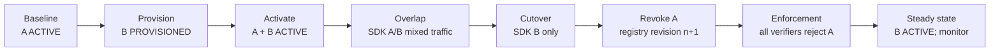
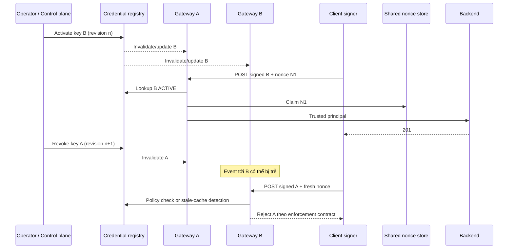
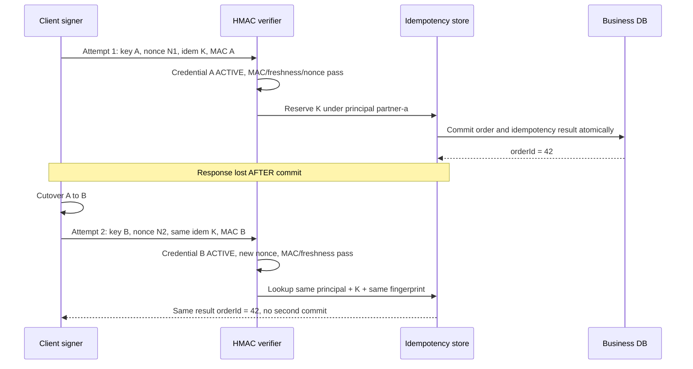

# Kiểm thử rotation: Xác minh chuyển đổi Key ID và HMAC secret không gián đoạn, không hạ cấp bảo mật

Một client đang ký `POST /v1/orders` bằng credential `partner-a-202611` và shared secret A. Đội vận hành muốn thay thế bằng credential `partner-a-202702` và secret B. Client và server có thể cùng chạy nhiều phiên bản, request đi qua nhiều gateway, một số request được gửi lại sau timeout. Nếu chỉ kiểm tra “HMAC B đúng” rồi kết luận **rotation thành công**, có thể bỏ sót những lỗi nghiêm trọng: SDK ghép **Key ID B với secret A**, một gateway còn cache trạng thái cũ, credential A vẫn được nhận **sau thời hạn thu hồi**, hoặc retry cùng ý định nghiệp vụ tạo **đơn hàng thứ hai**.

**Kiểm thử rotation** (*key rotation testing*) phải chứng minh trọn chu kỳ: **provision B → activate B → overlap A/B theo policy → client cutover → revoke A → giám sát enforcement**, với tiêu chí rõ cho **đúng credential, đúng principal, đúng audience, không mất xác thực ngoài dự kiến và không kéo dài quyền dùng secret cũ**. Rotation là thay **credential version**, không phải sửa tên Key ID trong header.

Bài thuộc chương **Key rotation**, chủ đề **Kiểm thử rotation**, module `SECURITY_AUTHENTICATION_HMAC_REQUEST_AUTHENTICATION`. Phạm vi module là thiết kế xác thực HTTP request bằng **HMAC với shared secret và canonical request** gồm phương thức, URI, header hoặc body theo hợp đồng ký; xác minh chữ ký, chống replay qua timestamp/nonce, quản lý vòng đời khóa, kiểm thử proxy/gateway và phân biệt **authentication** với **authorization**. Không có ghi chú đặc biệt bổ sung cho bài. Các format, thời lượng overlap và status trong ví dụ là **hợp đồng minh họa**, không được coi là chuẩn bắt buộc của mọi API.

## 1. Mục tiêu và tiêu chí hoàn thành

Sau bài học, bạn có thể:

1. Viết kế hoạch test có **mốc chuyển trạng thái và test oracle** cho A/B từ lúc B chưa ACTIVE đến khi A bị revoke.
2. Phân biệt **Key ID**, secret, credential version, authenticated principal và authorization; kiểm tra rotation không làm sai ánh xạ client/tenant/audience.
3. Phát hiện **mixed credential pair**, key fallback, thuật toán downgrade, unsigned key ID, lỗi serialization/canonicalization và replay trong lúc đổi secret.
4. Thiết kế test **overlap**, **cutover**, **revoke**, **expiry**, registry/cache consistency và event invalidation trên nhiều gateway.
5. Chứng minh mỗi HTTP attempt có **nonce mới + timestamp mới phù hợp + HMAC mới**, trong khi **Idempotency-Key giữ nguyên** cho cùng business intent dù chuyển sang B.
6. Thiết kế fail-closed test khi secret manager/registry/nonce store lỗi, kể cả khi client đang tự động retry.
7. Viết và phân tích demo **Java 17** mô phỏng HMAC-SHA256, staged rotation, `AtomicReference` credential pair, replay, idempotency và concurrency.
8. Phân biệt điều đã kiểm ở **unit/component** với điều chỉ chứng minh được bằng **integration/chaos test nhiều instance**.
9. Tổng hợp báo cáo: thời điểm revoke commit, gateway cuối cùng ngừng chấp nhận A, lỗi 401/403/409, side effects, rollback và giới hạn bằng chứng.

**Định nghĩa hoàn thành:** test đạt khi mọi acceptance/rejection khớp trạng thái credential/contract, không có request nào được nhận bằng **sai secret hoặc sai principal**, không xảy ra duplicate business effect ngoài policy và bằng chứng xác nhận key cũ bị chặn trong **revocation enforcement SLA**. Một response 200/201 **không đủ** để khẳng định các bất biến này.

## 2. Rotation là gì? Kịch bản nghiệp vụ để test

Rotation chuẩn có thể là:

```text
principal = partner-a
tenant    = tenant-42
audience  = orders-api-prod

Time          key A / secret A       key B / secret B       client signer
T0 baseline   ACTIVE                 không tồn tại          A
T1 provision  ACTIVE                 PROVISIONED           A
T2 activate   ACTIVE                 ACTIVE                A
T3 overlap    ACTIVE                 ACTIVE                A hoặc B
T4 cutover    ACTIVE (nếu policy)    ACTIVE                B
T5 revoke A   REVOKED                ACTIVE                B
T6 steady     REVOKED                ACTIVE                B
```

Các giá trị thời gian do đội vận hành và mức rủi ro quyết định; **không mặc định 24 giờ overlap hoặc chấp nhận A vô thời hạn**.

| Khái niệm | Nhiệm vụ trong rotation | Bất biến cần test |
| --- | --- | --- |
| **Key ID** | Chỉ một credential version để server tra secret. | A và B có **ID khác**, không dùng lại một ID cho hai secret. |
| **Shared secret** | Bytes bí mật làm HMAC. | B **độc lập với A**; signer và verifier dùng secret của **đúng ID**. |
| **Credential registry** | Mapping Key ID → secretRef, state, audience, principal, validity. | Không nhầm B thành principal khác hoặc audience khác. |
| **Protocol version** | Canonical fields, HMAC algorithm, tag encoding. | Không tự downgrade/đoán version chỉ vì rotation; version thay đổi cần kế hoạch riêng. |
| **Nonce store** | Claim từng signed HTTP attempt. | A/B đều chống replay, không nhận nguyên request cũ do rotation. |
| **Idempotency store** | Dedupe **business intent**. | Không tạo order trùng khi retry dưới B cho intent đã commit dưới A. |
| **Authorization** | Quyền gọi method/resource/tenant. | Credential B không được vô tình nhận scope rộng hơn A. |

**Rotation khác revocation do compromise:** rotation theo lịch có thể có overlap; nếu secret A đã bị lộ, giữ A ACTIVE chỉ để tránh downtime có thể trái mục tiêu an ninh. Khi test incident rotation phải ưu tiên **revoke theo incident policy**, có thể chấp nhận gián đoạn client, và kiểm tra propagation nghiêm ngặt.

## 3. Test oracle: kiểm những lớp nào?

Một test chỉ gọi `verifySignature()` sẽ bỏ sót hạ tầng và nghiệp vụ. Nên có **bốn lớp quan sát**:

| Lớp | Điều kiểm chứng | Bằng chứng |
| --- | --- | --- |
| **Wire/protocol** | Client gửi một Key ID, đúng signed headers, raw URI/body, timestamp/nonce/signature; proxy không làm sai canonical. | Synthetic HTTP captures không chứa secret thật, vectors, response. |
| **Authentication** | Chỉ credential ACTIVE/đúng audience, HMAC với đúng secret, fresh và nonce mới được chấp nhận. | Registry revision, verifier decision codes, nonce outcomes. |
| **Identity/authorization** | A/B cùng client/tenant khi mong đợi; không nâng scope, không dùng tenant do client tự khai. | Trusted principal, authorization decision, security audit đã lọc. |
| **Business** | Retry cùng intent qua A/B không nhân đôi side effects; key bị revoke không truy cập cached result. | DB rows, unique business constraint, outbox, ledger, idempotency record. |

Ví dụ một intent tạo đơn:

```text
Attempt A:
  keyId          = partner-a-202611
  nonce          = N1
  signature      = HMAC(secretA, canonical(..., keyId=A, nonce=N1))
  idempotencyKey = intent-K
  response       = 201 {"orderId":42}

Attempt B, retry sau lost response:
  keyId          = partner-a-202702
  nonce          = N2 (N2 != N1)
  signature      = HMAC(secretB, canonical(..., keyId=B, nonce=N2))
  idempotencyKey = intent-K
  response       = 201 {"orderId":42}  (contract minh họa)

Oracle:
  same clientId/tenantId
  same intent-K + same business fingerprint
  business commits for intent-K == 1
  nonce N1 and N2 each claimed once
```

Nếu client gửi lại **nguyên Attempt A** (nonce N1, signature A), verifier phải **từ chối replay** theo anti-replay contract; không trả cached response bằng cách bỏ qua HMAC/nonce.

## 4. Hợp đồng ký HMAC cho bộ test

Để có test vector xác định, bài dùng một giao thức **tự định nghĩa `HMAC-SHA256-V2`** trong đó `Idempotency-Key` được ký. Chọn V2 vì idempotency key quyết định backend có tạo effect mới hay không; nếu V1 không ký header đó thì **không được âm thầm thêm vào canonical mà vẫn nhận là V1**.

```http
POST /v1/orders?channel=partner HTTP/1.1
Host: api.example.test
Content-Type: application/json
X-Key-Id: partner-a-202702
X-Timestamp: 2026-11-28T03:00:00Z
X-Nonce: Az73FMePq9MALwzFK2_tPQ
Idempotency-Key: 3e97fc94-8a32-4e02-9411-b89e88fe2cb6
X-Signature: v2=<BASE64_FULL_HMAC_SHA256>

{"sku":"BK-42","quantity":2}
```

Dấu `<...>` là placeholder, **không phải MAC thực**. Hợp đồng minh họa:

| Field | Quy tắc |
| --- | --- |
| Scheme | Dòng đầu `HMAC-SHA256-V2`, algorithm JCA `HmacSHA256`. |
| Audience | `orders-api-prod` từ trusted router và credential registry, **không** từ `X-Audience` client. |
| Method/raw target | `POST` và `/v1/orders?channel=partner`, giữ **raw path/query** theo contract. |
| `Content-Type` | Một value `application/json`. Không cho `Content-Encoding` trong demo. |
| `X-Key-Id` | Một ID ASCII lowercase theo `[a-z0-9][a-z0-9._-]{0,63}`, ký nguyên giá trị. |
| `X-Timestamp` | UTC `YYYY-MM-DDTHH:mm:ssZ`, signed, window ±300 s. |
| `X-Nonce` | CSPRNG 16 byte, Base64URL **không padding**, 22 ký tự, signed. |
| `Idempotency-Key` | UUID lowercase chuẩn, một value, signed; giữ nguyên cho cùng intent. |
| Body | SHA-256 trên **raw body bytes** thực nhận, hex thường. |
| Canonical bytes | UTF-8, LF giữa các dòng, **không LF cuối**. |
| Signature | `v2=` + Base64 **standard padded** của **full 32-byte HMAC-SHA256** (44 ký tự sau prefix). |

Ví dụ canonical request:

```text
HMAC-SHA256-V2
orders-api-prod
POST
/v1/orders?channel=partner
content-type:application/json
x-key-id:partner-a-202702
x-timestamp:2026-11-28T03:00:00Z
x-nonce:Az73FMePq9MALwzFK2_tPQ
idempotency-key:3e97fc94-8a32-4e02-9411-b89e88fe2cb6
sha256:<LOWERCASE_SHA256_HEX_OF_RAW_BODY>
```

\[
D=\operatorname{SHA256}(\mathrm{rawBodyBytes}),\qquad
T=\operatorname{HMAC}_{\mathrm{SHA256}}(K_{\mathrm{keyId}},\operatorname{UTF8}(C)),\qquad
S=\texttt{v2=}\Vert\operatorname{Base64}(T).
\]

Server phải dựng canonical từ **request thực nhận tại trust boundary**, không tin chuỗi canonical do client gửi. Không được **thử nhiều secret, version, path normalization hoặc JSON reserialization** đến khi MAC khớp.

### Vì sao ký Key ID đặc biệt quan trọng khi rotation?

Nếu client ký:

```text
x-key-id:partner-a-202611
signature: v2=<MAC_WITH_SECRET_A>
```

sau đó proxy hoặc attacker sửa thành:

```text
x-key-id:partner-a-202702
signature: v2=<OLD_SIGNATURE_FOR_A>
```

server phải lookup B, tạo canonical có dòng **Key ID B** rồi so HMAC bằng **secret B**. Không dùng A làm fallback. Ký Key ID giúp ràng buộc version credential với nội dung, nhưng **không thay thế việc cấp secret B độc lập**: nếu A/B dùng chung secret, người biết secret vẫn có thể **tự tạo** chữ ký mới cho ID B.

## 5. Kế hoạch staged rotation: các checkpoint và expected outcomes



| Checkpoint | Hành động test | Bằng chứng PASS |
| --- | --- | --- |
| **P0 — Baseline** | A ACTIVE, B chưa tồn tại. | A ký đúng pass; unknown B fail; principal/scope đúng. |
| **P1 — Provision** | B đã lưu ở `PROVISIONED`, chưa ACTIVE. | B ký HMAC đúng **vẫn bị từ chối**; A hoạt động. |
| **P2 — Activate** | B chuyển `ACTIVE`, revision tăng; A còn ACTIVE. | B ký bằng **secret B** pass, A vẫn pass nếu overlap được phép. |
| **P3 — Overlap** | Chạy A/B xen kẽ ở nhiều client/gateway. | Không sai credential mapping, không tăng 401 bất thường ngoài policy. |
| **P4 — Cutover** | Client signer chuyển sang B theo snapshot nguyên tử. | New attempts dùng ID B + secret B đồng bộ, không mixed pair. |
| **P5 — Revoke A** | Registry commit `REVOKED(A)`, phát invalidation. | A fail dù secret A biết và nonce/timestamp fresh; B vẫn pass. |
| **P6 — Propagation** | Gửi fixture đến mọi gateway/region. | **Không còn acceptance A** quá SLA, báo last-acceptance có chứng cứ. |
| **P7 — Steady** | Kiểm TTL/restart/cache/cleanup sau cutover. | Không hồi sinh A, không ID recycling; B tiếp tục pass. |

**Điểm mấu chốt:** `P5=registry commit` và `P6=all verifiers enforced` **không phải một thời điểm** khi hệ phân tán dùng cache và invalidation bất đồng bộ. Mọi báo cáo test phải tách hai trạng thái này.

### Overlap có giới hạn rõ ràng

Overlap giúp tránh downtime, nhưng đồng thời tăng số credential ACTIVE của client. Chính sách cần nêu:

- **B bắt đầu ACTIVE khi nào?** Dùng `validFrom` inclusive.
- **A hết quyền khi nào?** `validUntil` exclusive hoặc revoke rõ thời điểm.
- **Ai phê duyệt tăng/giảm overlap?** Control plane có audit, không dựa vào HTTP request header.
- **Có cho rollback về A không?** Chỉ khi A **chưa revoked/chưa compromise**, theo change policy.
- **Client/tenant mapping có thay đổi không?** Rotation thường **không** đổi principal; thay đổi entitlement phải được test riêng.

## 6. Một ma trận âm bắt buộc tại các ranh giới

| Dữ liệu/động tác | Expected |
| --- | --- |
| `X-Key-Id=B` nhưng ký bằng **secret A**. | `INVALID_SIGNATURE`, không thử A/không downgrade. |
| `X-Key-Id=A` nhưng ký bằng secret B. | `INVALID_SIGNATURE`, không thử B. |
| B đã provision nhưng chưa activate. | `INVALID_CREDENTIAL`, không cấp principal dù MAC đúng. |
| A đã revoke nhưng request ký trước revoke vẫn fresh. | Reject theo revocation policy; không “grandfather” signed request. |
| A đã revoke, attacker biết secret A và tự tạo **nonce mới**. | Reject do credential state, không dựa nonce store. |
| Thay ID A→B trong request nhưng giữ MAC cũ. | MAC mismatch vì ID được ký. |
| Key ID đúng nhưng scheme/audience/version sai. | Reject policy, không thử secret ở môi trường khác. |
| Key ID bị dùng lại cho secret C sau revoke. | Control plane từ chối ID recycling. |
| A/B mapping sai tenant hoặc scope rộng hơn. | Test fail, chặn activation B. |
| Credential registry unavailable. | `UNAVAILABLE`/5xx, fail closed, không dùng stale cache ngoài policy. |
| Nonce store unavailable. | `UNAVAILABLE`, không chấp nhận request chỉ vì HMAC pass. |
| Hai requests cùng signed nonce tới hai gateways. | Shared atomic nonce store chỉ claim tối đa một. |
| Client retry sau timeout dưới B với cùng intent K. | Nonce/signature mới, dedupe theo **principal/tenant/intent**. |
| Client gửi lại nguyên request A. | Replay reject dù key A ACTIVE/overlap. |
| Gateway còn cache A ACTIVE sau revoke. | Test phát hiện stale acceptance, đo độ trễ và SLA. |
| Header `X-Key-Id` bị duplicate/case-fold value. | Reject duplicate/sai grammar trước lookup, không chọn first/last. |

**Không được gộp tất cả fail thành 401 trong test oracle nội bộ.** Ngoài Internet có thể trả lỗi authentication chung để hạn chế dò key, nhưng test cần phân biệt **credential inactive**, **invalid signature**, **timestamp**, **nonce replay**, **authorization denied** và **dependency unavailable**.

## 7. Client SDK và “mixed credential pair”

Lỗi hot reload phổ biến:

```java
// KHÔNG AN TOÀN: hai giá trị có thể lấy từ hai phiên bản config.
String keyId = config.getCurrentKeyId();   // B
byte[] keyBytes = config.getCurrentSecret(); // vẫn A
```

Verifier lookup B và tính expected MAC bằng B, trong khi client ký A: lỗi không ngẫu nhiên ở tầng mật mã mà là **race trong việc chọn credential**. Không sửa bằng cách server thử cả A/B.

Mẫu tốt hơn:

```java
record SigningCredential(String keyId, byte[] secret) {
    SigningCredential {
        secret = secret.clone();
    }
    @Override
    public byte[] secret() {
        return secret.clone();
    }
}

// update nguyên tham chiếu snapshot, không đổi 2 field độc lập.
java.util.concurrent.atomic.AtomicReference<SigningCredential> current =
        new java.util.concurrent.atomic.AtomicReference<>(
                new SigningCredential("partner-a-202611", testSecretA));

// Sau khi B đã được provision và ACTIVE trong policy:
current.set(new SigningCredential("partner-a-202702", testSecretB));

// Bắt đầu MỘT HTTP attempt:
SigningCredential selected = current.get();
String keyIdForHeader = selected.keyId();
byte[] keyForMac = selected.secret();
// Dùng selected cho toàn bộ canonical, HTTP headers và MAC.
```

Đây là **mảnh mã minh họa**; `testSecretA` và `testSecretB` là fake bytes. Production cần secret manager/opaque handle và tránh giữ secret trong `String`. `byte[]` có thể bị copy bởi JCA/JVM nên xóa copy chỉ là best effort.

### Concurrency test cho SDK

1. Tạo signing credentials A/B với secret khác nhau.
2. Trong khi một thread liên tục `current.set(A)` và `current.set(B)`, nhiều threads ký requests bằng **một snapshot** lấy từ `get()`.
3. Mỗi attempt có nonce riêng; chạy verify khi A/B **đều ACTIVE**.
4. Assert: **mọi request ký với một snapshot hợp lệ** đều verify, không có “ID B nhưng MAC A”.
5. Revoke A **sau** pha overlap; bây giờ các attempts vẫn chọn A phải bị từ chối, đó là expected rollout state chứ không phải race của signer.

**Đừng lấy trạng thái B ACTIVE làm chứng minh SDK đã chuyển hết.** Phải có client-side telemetry (không lộ secret) hoặc thống kê verifier **theo credential fingerprint/version** để biết traffic A đã giảm thật.

## 8. Replay, nonce, timestamp và idempotency xuyên rotation

Bốn giá trị thường bị nhầm:

| Giá trị | Ý nghĩa | Cùng business intent, retry dưới B? |
| --- | --- | --- |
| **Key ID** | Credential version/secret chọn cho attempt. | Có thể đổi A → B. |
| **X-Timestamp** | Thời điểm attempt được ký, giúp kiểm freshness. | Phải còn fresh; thường tạo mới. |
| **X-Nonce** | Định danh **một HTTP attempt** chống replay. | **Mới, không reuse**. |
| **Idempotency-Key** | Định danh **một ý định nghiệp vụ**. | **Giữ nguyên** nếu payload/fingerprint cùng intent. |

### Chống replay theo key

Một replay key có thể là `(trustedAudience, keyId, nonce)`. Trong overlap, nonce giống nhau dưới A/B **không nhất thiết** là cùng signed request; mỗi attempt phải có signature hợp lệ dưới đúng secret. Nếu yêu cầu không tái sử dụng nonce **xuyên hai key cùng client**, cần namespace theo **authenticated principal** thay vì key ID. Quy tắc phải viết rõ trong protocol/threat model.

Với freshness `±300s`, nếu nonce đã claim tại thời điểm signed timestamp `T`, cần giữ đến ít nhất `T + allowedPast + safetyMargin`; request có signed timestamp ở tương lai có thể được nhận từ `T-300s` đến `T+300s`. TTL cố định **300s từ lúc claim sớm nhất** có thể cho phép replay khi timestamp vẫn fresh.

**Revoke không có nghĩa xóa nonce store.** Xóa toàn bộ replay state lúc rotate có thể làm request đã ký dưới **B đang ACTIVE** được nhận thêm lần nữa.

### Idempotency không nên phụ thuộc Key ID khi rotation

Nếu idempotency scope là `(keyId, idempotencyKey)`, intent tạo order `K` dưới A rồi retry dưới B có thể tạo **hai order**. Nên cân nhắc scope theo `(audience, authenticatedClientId, tenantId, Idempotency-Key)`, với request fingerprint bao gồm method/raw target/content-type/body digest, **không bao gồm Key ID, nonce hay signature**. Phải kiểm fingerprint conflict, state `IN_PROGRESS` và atomic business commit.

Phân biệt:
- **Replay nguyên request A:** nonce A đã claim → authentication reject.
- **Retry intent K dưới B:** nonce B mới, signature B mới → authentication B pass, idempotency trả **result cũ** sau authorization.
- **Cùng K nhưng body khác:** HMAC B có thể vẫn đúng, nhưng idempotency nên trả **409 conflict** theo contract, **không** chạy payload mới.
- **Khác principal với cùng chuỗi K:** không được đọc cached result của principal kia; scope đúng.

## 9. Key rotation trong hệ phân tán: chỗ nào cần test nhiều node?



**Phải test khác biệt giữa registry commit và gateway enforcement**, nhất là khi có:
- Positive cache lưu ACTIVE A quá lâu; miss invalidation.
- Event invalidate bị duplicate hoặc đến sai thứ tự; revision mới không được bị ghi đè bằng event cũ.
- Registry failover/replica lag, zone partition, node restart với snapshot cũ.
- Secret manager trả key B nhưng một gateway vẫn thấy metadata B `PROVISIONED`.
- Gateway edge verify nhưng backend tin header `X-Authenticated-Client` giả hoặc route rewrite.
- HTTP/1.1↔HTTP/2 đổi **tên** field sang lowercase (bình thường) nhưng **value** ID không được sửa.
- CDN/proxy tự retry POST; chữ ký cũ cùng nonce không được chấp nhận lại.
- Hệ thống có region khác nhau với anti-replay store không chia sẻ trạng thái.

Một đơn vị test chỉ dùng `synchronized Map` trong **một JVM** không chứng minh tính đúng đắn của cache/registry/replay store **trên nhiều instance**. Bài thực hành bên dưới minh họa lõi quyết định; bài kiểm thử production còn cần topology thật và fault injection.


## 10. Java 17: Demo kiểm thử rotation, replay và idempotency

Chương trình sau dùng **JDK 17**, không cần Spring, Redis hoặc thư viện ngoài. Nó **mô phỏng** HTTP ingress bằng `SignedRequest` và hai tầng:

- **Authentication**: registry exact lookup `(trustedAudience,keyId)`; kiểm tra trạng thái ACTIVE, validity/version, HMAC full tag, signed timestamp và atomic nonce claim.
- **Business**: store idempotency **trong cùng JVM**, scope theo authenticated principal/audience và key ý định, kiểm fingerprint; không tạo đơn thứ hai khi retry bằng credential khác.

Demo có **key A ACTIVE**, **key B PROVISIONED rồi ACTIVE**, secret độc lập, signer chọn `AtomicReference<SigningCredential>`, thử mixed pair, sửa signed header, replay, conflict, revoke A, tiếp tục dùng B, registry/nonce outage, client disable, concurrent signer cutover và hai request cùng nonce. Tất cả key trong mã là **fake bytes**.

> **Giới hạn:** `HashMap + synchronized` của demo không đủ chứng minh hệ thống phân tán, chống crash hoặc outbox/payment side effects. Demo không mở HTTP socket và giả định ingress đã chặn duplicate header, framing sai và raw-target confusion. Nó không dùng secret production, không log raw key bytes. Những test integration còn thiếu được trình bày ở phần tiếp theo.

Lưu file `KeyRotationHmacTestDemo.java`:

```java
import java.nio.charset.StandardCharsets;
import java.security.GeneralSecurityException;
import java.security.MessageDigest;
import java.security.SecureRandom;
import java.time.Clock;
import java.time.Instant;
import java.time.ZoneOffset;
import java.time.format.DateTimeParseException;
import java.util.Arrays;
import java.util.Base64;
import java.util.HashMap;
import java.util.HashSet;
import java.util.HexFormat;
import java.util.Map;
import java.util.Set;
import java.util.UUID;
import java.util.concurrent.Callable;
import java.util.concurrent.CountDownLatch;
import java.util.concurrent.ExecutorService;
import java.util.concurrent.Executors;
import java.util.concurrent.Future;
import java.util.concurrent.atomic.AtomicReference;
import javax.crypto.Mac;
import javax.crypto.spec.SecretKeySpec;

public final class KeyRotationHmacTestDemo {
    private static final String SCHEME = "HMAC-SHA256-V2";
    private static final String AUDIENCE = "orders-api-prod";
    private static final String TARGET = "/v1/orders?channel=partner";
    private static final String CONTENT_TYPE = "application/json";
    private static final String SIGNATURE_PREFIX = "v2=";
    private static final long WINDOW_SECONDS = 300;
    private static final long NONCE_MARGIN_SECONDS = 30;

    private KeyRotationHmacTestDemo() {}

    public enum KeyState { PROVISIONED, ACTIVE, REVOKED }

    public enum AuthStatus {
        AUTHENTICATED, BAD_REQUEST, INVALID_CREDENTIAL,
        INVALID_SIGNATURE, NOT_FRESH, REPLAY, UNAVAILABLE
    }

    public record Principal(
            String clientId, String tenantId, Set<String> scopes) {
        public Principal {
            scopes = Set.copyOf(scopes);
        }
    }

    public record AuthResult(
            AuthStatus status, Principal principal, String credentialId) {
        public AuthResult {
            if ((status == AuthStatus.AUTHENTICATED)
                    != (principal != null && credentialId != null)) {
                throw new IllegalArgumentException(
                        "Authenticated principal invariant");
            }
        }
        static AuthResult deny(AuthStatus status) {
            return new AuthResult(status, null, null);
        }
        static AuthResult allow(Principal principal, String keyId) {
            return new AuthResult(AuthStatus.AUTHENTICATED,
                    principal, keyId);
        }
    }

    public record Credential(
            String keyId, String clientId, String tenantId,
            String audience, String scheme, KeyState state,
            Instant validFrom, Instant validUntil, long revision,
            byte[] secret, Set<String> scopes) {
        public Credential {
            secret = secret == null ? null : secret.clone();
            scopes = Set.copyOf(scopes);
        }
        @Override
        public byte[] secret() {
            return secret == null ? null : secret.clone();
        }
        @Override
        public String toString() {
            return "Credential[REDACTED]";
        }
        Credential transitionTo(KeyState next) {
            return new Credential(
                    keyId, clientId, tenantId, audience, scheme,
                    next, validFrom, validUntil, revision + 1,
                    next == KeyState.REVOKED ? null : secret(),
                    scopes);
        }
    }

    public record SigningCredential(String keyId, byte[] secret) {
        public SigningCredential {
            secret = secret.clone();
        }
        @Override
        public byte[] secret() {
            return secret.clone();
        }
        @Override
        public String toString() {
            return "SigningCredential[REDACTED]";
        }
    }

    public record SignedRequest(
            String method, String rawTarget, String contentType,
            String keyId, String timestamp, String nonce,
            String idempotencyKey, byte[] body, String signature) {
        public SignedRequest {
            if (body != null) {
                body = body.clone();
            }
        }
        @Override
        public byte[] body() {
            return body == null ? null : body.clone();
        }
        @Override
        public String toString() {
            return "SignedRequest[REDACTED]";
        }
    }

    public record RegistryKey(String audience, String keyId) {}

    public static class RegistryUnavailable extends Exception {}
    public static class NonceUnavailable extends Exception {}

    public interface CredentialRegistry {
        Credential find(String trustedAudience, String keyId)
                throws RegistryUnavailable;
        boolean clientEnabled(String clientId)
                throws RegistryUnavailable;
    }

    /** Atomic mutations within ONE JVM; not a distributed registry. */
    public static final class LocalRegistry
            implements CredentialRegistry {
        private final Map<RegistryKey, Credential> entries =
                new HashMap<>();
        private final Set<String> disabledClients = new HashSet<>();
        private boolean online = true;

        public synchronized void register(Credential candidate) {
            RegistryKey key = new RegistryKey(
                    candidate.audience(), candidate.keyId());
            if (entries.containsKey(key)) {
                throw new IllegalStateException("Key ID cannot be reused");
            }
            entries.put(key, candidate);
        }

        public synchronized void activate(String audience, String keyId) {
            RegistryKey key = new RegistryKey(audience, keyId);
            Credential old = entries.get(key);
            if (old == null || old.state() != KeyState.PROVISIONED) {
                throw new IllegalStateException("Invalid activation");
            }
            entries.put(key, old.transitionTo(KeyState.ACTIVE));
        }

        public synchronized void revoke(String audience, String keyId) {
            RegistryKey key = new RegistryKey(audience, keyId);
            Credential old = entries.get(key);
            if (old == null) {
                throw new IllegalArgumentException("Unknown credential");
            }
            if (old.state() == KeyState.REVOKED) {
                return;  // Idempotent, terminal state.
            }
            // Tombstone stores NO secret; old client copies may remain.
            entries.put(key, old.transitionTo(KeyState.REVOKED));
        }

        public synchronized void disableClient(String clientId) {
            disabledClients.add(clientId);
        }

        public synchronized void setOnline(boolean online) {
            this.online = online;
        }

        @Override
        public synchronized Credential find(
                String audience, String keyId)
                throws RegistryUnavailable {
            if (!online) {
                throw new RegistryUnavailable();
            }
            return entries.get(new RegistryKey(audience, keyId));
        }

        @Override
        public synchronized boolean clientEnabled(String clientId)
                throws RegistryUnavailable {
            if (!online) {
                throw new RegistryUnavailable();
            }
            return !disabledClients.contains(clientId);
        }
    }

    public interface NonceStore {
        boolean claim(String key, Instant expiresAt, Instant now)
                throws NonceUnavailable;
    }

    /** Only demonstrates a per-JVM atomic claim. */
    public static final class LocalNonceStore implements NonceStore {
        private final Map<String, Instant> expiries = new HashMap<>();

        @Override
        public synchronized boolean claim(
                String key, Instant expiresAt, Instant now) {
            expiries.entrySet().removeIf(
                    e -> !e.getValue().isAfter(now));
            if (!expiresAt.isAfter(now) || expiries.containsKey(key)) {
                return false;
            }
            expiries.put(key, expiresAt);
            return true;
        }
    }

    private static boolean validKeyId(String keyId) {
        return keyId != null
                && keyId.matches("[a-z0-9][a-z0-9._-]{0,63}");
    }

    private static boolean validIdempotencyKey(String key) {
        if (key == null || key.length() != 36) {
            return false;
        }
        try {
            return UUID.fromString(key).toString().equals(key);
        } catch (IllegalArgumentException invalid) {
            return false;
        }
    }

    private static String newNonce(SecureRandom random) {
        byte[] bytes = new byte[16];
        random.nextBytes(bytes);
        return Base64.getUrlEncoder().withoutPadding()
                .encodeToString(bytes);
    }

    private static boolean validNonce(String nonce) {
        if (nonce == null || nonce.length() != 22) {
            return false;
        }
        try {
            byte[] bytes = Base64.getUrlDecoder().decode(nonce);
            return bytes.length == 16
                    && Base64.getUrlEncoder().withoutPadding()
                            .encodeToString(bytes).equals(nonce);
        } catch (IllegalArgumentException invalid) {
            return false;
        }
    }

    private static Instant timestampUtc(String timestamp) {
        if (timestamp == null || !timestamp.matches(
                "[0-9]{4}-[0-9]{2}-[0-9]{2}T"
                + "[0-9]{2}:[0-9]{2}:[0-9]{2}Z")) {
            throw new IllegalArgumentException("Invalid timestamp format");
        }
        try {
            Instant parsed = Instant.parse(timestamp);
            if (!parsed.toString().equals(timestamp)) {
                throw new IllegalArgumentException(
                        "Noncanonical timestamp");
            }
            return parsed;
        } catch (DateTimeParseException invalid) {
            throw new IllegalArgumentException(
                    "Invalid timestamp value", invalid);
        }
    }

    /** Request fields are assumed to be validated at HTTP ingress. */
    private static boolean validShape(SignedRequest r) {
        if (r == null || !"POST".equals(r.method())
                || !TARGET.equals(r.rawTarget())
                || !CONTENT_TYPE.equals(r.contentType())
                || !validKeyId(r.keyId())
                || !validNonce(r.nonce())
                || !validIdempotencyKey(r.idempotencyKey())
                || r.body() == null || r.body().length > 8192) {
            return false;
        }
        try {
            timestampUtc(r.timestamp());
            return true;
        } catch (IllegalArgumentException invalid) {
            return false;
        }
    }

    private static String sha256Hex(byte[] body)
            throws GeneralSecurityException {
        return HexFormat.of().formatHex(
                MessageDigest.getInstance("SHA-256").digest(body));
    }

    private static byte[] canonical(
            String audience, SignedRequest r)
            throws GeneralSecurityException {
        String value = String.join("\n",
                SCHEME, audience, r.method(), r.rawTarget(),
                "content-type:" + r.contentType(),
                "x-key-id:" + r.keyId(),
                "x-timestamp:" + r.timestamp(),
                "x-nonce:" + r.nonce(),
                "idempotency-key:" + r.idempotencyKey(),
                "sha256:" + sha256Hex(r.body()));
        return value.getBytes(StandardCharsets.UTF_8);
    }

    private static byte[] hmac(
            byte[] secret, byte[] message)
            throws GeneralSecurityException {
        if (secret == null || secret.length < 32) {
            // Demo provisioning policy, NOT a universal JCA rule.
            throw new GeneralSecurityException(
                    "Test credential must be at least 32 bytes");
        }
        Mac mac = Mac.getInstance("HmacSHA256");
        mac.init(new SecretKeySpec(secret, "HmacSHA256"));
        return mac.doFinal(message);
    }

    private static byte[] decodeTag(String wire) {
        if (wire == null || wire.length() != 47
                || !wire.startsWith(SIGNATURE_PREFIX)) {
            return null;
        }
        String encoded = wire.substring(SIGNATURE_PREFIX.length());
        if (!encoded.matches("[A-Za-z0-9+/]{43}=")) {
            return null;
        }
        try {
            byte[] bytes = Base64.getDecoder().decode(encoded);
            return bytes.length == 32
                    && Base64.getEncoder().encodeToString(bytes)
                            .equals(encoded) ? bytes : null;
        } catch (IllegalArgumentException invalid) {
            return null;
        }
    }

    /**
     * Test signer reads ONE immutable snapshot; keyId and secret
     * cannot be taken from different credential versions.
     */
    public static SignedRequest signForTest(
            SigningCredential selected, String timestamp,
            String nonce, String idempotencyKey, byte[] body)
            throws GeneralSecurityException {
        SignedRequest draft = new SignedRequest(
                "POST", TARGET, CONTENT_TYPE, selected.keyId(),
                timestamp, nonce, idempotencyKey, body, null);
        if (!validShape(draft)) {
            throw new IllegalArgumentException("Invalid test fixture");
        }

        byte[] keyCopy = selected.secret();
        try {
            String signature = SIGNATURE_PREFIX
                    + Base64.getEncoder().encodeToString(
                    hmac(keyCopy, canonical(AUDIENCE, draft)));
            return new SignedRequest(
                    draft.method(), draft.rawTarget(),
                    draft.contentType(), draft.keyId(), timestamp,
                    nonce, idempotencyKey, body, signature);
        } finally {
            Arrays.fill(keyCopy, (byte) 0); // Best effort only.
        }
    }

    public static final class Verifier {
        private final String trustedAudience;
        private final CredentialRegistry registry;
        private final NonceStore nonces;
        private final Clock clock;

        public Verifier(String trustedAudience,
                CredentialRegistry registry, NonceStore nonces,
                Clock clock) {
            this.trustedAudience = trustedAudience;
            this.registry = registry;
            this.nonces = nonces;
            this.clock = clock;
        }

        public AuthResult authenticate(SignedRequest r) {
            if (!validShape(r)) {
                return AuthResult.deny(AuthStatus.BAD_REQUEST);
            }
            Credential c;
            Instant now = clock.instant();
            try {
                c = registry.find(trustedAudience, r.keyId());
                if (c == null || c.state() != KeyState.ACTIVE
                        || !SCHEME.equals(c.scheme())
                        || !trustedAudience.equals(c.audience())
                        || !r.keyId().equals(c.keyId())
                        || now.isBefore(c.validFrom())
                        || !now.isBefore(c.validUntil())
                        || !registry.clientEnabled(c.clientId())) {
                    return AuthResult.deny(
                            AuthStatus.INVALID_CREDENTIAL);
                }
            } catch (RegistryUnavailable unavailable) {
                return AuthResult.deny(AuthStatus.UNAVAILABLE);
            }

            byte[] supplied = decodeTag(r.signature());
            if (supplied == null) {
                return AuthResult.deny(AuthStatus.INVALID_SIGNATURE);
            }

            byte[] keyCopy = c.secret();
            try {
                byte[] expected =
                        hmac(keyCopy, canonical(trustedAudience, r));
                if (!MessageDigest.isEqual(expected, supplied)) {
                    // Do NOT try another credential or protocol version.
                    return AuthResult.deny(
                            AuthStatus.INVALID_SIGNATURE);
                }
            } catch (GeneralSecurityException providerFailure) {
                return AuthResult.deny(AuthStatus.UNAVAILABLE);
            } finally {
                if (keyCopy != null) {
                    Arrays.fill(keyCopy, (byte) 0);
                }
            }

            Instant signedTime = timestampUtc(r.timestamp());
            if (signedTime.isBefore(
                        now.minusSeconds(WINDOW_SECONDS))
                    || signedTime.isAfter(
                        now.plusSeconds(WINDOW_SECONDS))) {
                return AuthResult.deny(AuthStatus.NOT_FRESH);
            }

            String nonceKey = "replay:v2:" + trustedAudience
                    + ":" + c.keyId() + ":" + r.nonce();
            Instant expires = signedTime.plusSeconds(
                    WINDOW_SECONDS + NONCE_MARGIN_SECONDS);
            try {
                if (!nonces.claim(nonceKey, expires, now)) {
                    return AuthResult.deny(AuthStatus.REPLAY);
                }
            } catch (NonceUnavailable unavailable) {
                return AuthResult.deny(AuthStatus.UNAVAILABLE);
            }

            // Authenticated principal comes from registry, not key ID
            // naming or client-supplied X-Client-Id/X-Tenant-Id.
            return AuthResult.allow(
                    new Principal(c.clientId(), c.tenantId(), c.scopes()),
                    c.keyId());
        }
    }

    public record Response(int status, String body, boolean reused) {}
    public record Scope(String audience, String clientId,
            String tenantId, String idempotencyKey) {}
    private record Saved(String fingerprint, Response result) {}

    /**
     * One-JVM simplified idempotency. In production use DB
     * transaction/unique constraints and outbox/recovery.
     */
    public static final class IdempotentOrders {
        private final Map<Scope, Saved> done = new HashMap<>();
        private int committed = 0;

        public synchronized Response create(
                Principal principal, SignedRequest r) {
            Scope scope = new Scope(
                    AUDIENCE, principal.clientId(),
                    principal.tenantId(), r.idempotencyKey());
            String fingerprint;
            try {
                fingerprint = String.join("\n",
                        r.method(), r.rawTarget(),
                        r.contentType(), sha256Hex(r.body()));
            } catch (GeneralSecurityException unavailable) {
                throw new IllegalStateException(
                        "Hash provider unavailable");
            }
            Saved previous = done.get(scope);
            if (previous != null) {
                if (!fingerprint.equals(previous.fingerprint())) {
                    return new Response(409,
                            "{\"error\":\"idempotency_conflict\"}",
                            false);
                }
                return new Response(
                        previous.result().status(),
                        previous.result().body(), true);
            }
            int orderId = ++committed;
            Response created = new Response(
                    201, "{\"orderId\":" + orderId + "}", false);
            done.put(scope, new Saved(fingerprint, created));
            return created;
        }

        public synchronized int committedOrders() {
            return committed;
        }
    }

    public static final class Gateway {
        private final Verifier verifier;
        private final IdempotentOrders orders;

        public Gateway(Verifier verifier, IdempotentOrders orders) {
            this.verifier = verifier;
            this.orders = orders;
        }

        public Response handle(SignedRequest request) {
            AuthResult auth = verifier.authenticate(request);
            if (auth.status() != AuthStatus.AUTHENTICATED) {
                int code = auth.status() == AuthStatus.UNAVAILABLE
                        ? 503 : auth.status() == AuthStatus.BAD_REQUEST
                        ? 400 : 401;
                return new Response(
                        code, "{\"error\":\"authentication_failed\"}",
                        false);
            }
            if (!auth.principal().scopes().contains("orders:create")) {
                return new Response(
                        403, "{\"error\":\"forbidden\"}", false);
            }
            return orders.create(auth.principal(), request);
        }
    }

    private static void expect(int expected, Response response,
            String label) {
        if (response.status() != expected) {
            throw new AssertionError(label + ": expected "
                    + expected + ", got " + response.status());
        }
    }

    public static void main(String[] args) throws Exception {
        // Fake keys only. NEVER use actual production credentials.
        byte[] secretA = new byte[32];
        byte[] secretB = new byte[32];
        byte[] secretC = new byte[32];
        Arrays.fill(secretA, (byte) 0x41);
        Arrays.fill(secretB, (byte) 0x42);
        Arrays.fill(secretC, (byte) 0x43);

        SigningCredential pairA =
                new SigningCredential("partner-a-202611", secretA);
        SigningCredential pairB =
                new SigningCredential("partner-a-202702", secretB);
        SigningCredential pairC =
                new SigningCredential("partner-c-202611", secretC);

        Instant from = Instant.parse("2026-01-01T00:00:00Z");
        Instant until = Instant.parse("2028-01-01T00:00:00Z");
        Credential a = new Credential(
                pairA.keyId(), "partner-a", "tenant-42",
                AUDIENCE, SCHEME, KeyState.ACTIVE,
                from, until, 1L, secretA, Set.of("orders:create"));
        Credential b = new Credential(
                pairB.keyId(), "partner-a", "tenant-42",
                AUDIENCE, SCHEME, KeyState.PROVISIONED,
                from, until, 1L, secretB, Set.of("orders:create"));
        Credential c = new Credential(
                pairC.keyId(), "partner-c", "tenant-99",
                AUDIENCE, SCHEME, KeyState.ACTIVE,
                from, until, 1L, secretC, Set.of("orders:create"));

        LocalRegistry registry = new LocalRegistry();
        registry.register(a);
        registry.register(b);
        registry.register(c);

        Clock clock = Clock.fixed(
                Instant.parse("2026-11-28T03:00:30Z"),
                ZoneOffset.UTC);
        SecureRandom random = new SecureRandom();
        LocalNonceStore nonces = new LocalNonceStore();
        IdempotentOrders orders = new IdempotentOrders();
        Verifier verifier = new Verifier(
                AUDIENCE, registry, nonces, clock);
        Gateway gateway = new Gateway(verifier, orders);

        String timestamp = "2026-11-28T03:00:00Z";
        byte[] body = "{\"sku\":\"BK-42\",\"quantity\":2}"
                .getBytes(StandardCharsets.UTF_8);
        String businessIntent = UUID.randomUUID().toString();

        // P0: A ACTIVE. First request commits one order.
        SignedRequest firstA = signForTest(
                pairA, timestamp, newNonce(random),
                businessIntent, body);
        Response first = gateway.handle(firstA);
        expect(201, first, "P0 first request under A");
        if (first.reused() || orders.committedOrders() != 1) {
            throw new AssertionError("Initial order invariant failed");
        }

        // P1: B PROVISIONED but must not authenticate yet,
        // even when its test signer knows secret B.
        SignedRequest pendingB = signForTest(
                pairB, timestamp, newNonce(random),
                businessIntent, body);
        expect(401, gateway.handle(pendingB), "P1 B provisioned");
        if (orders.committedOrders() != 1) {
            throw new AssertionError("Provisioned B ran business");
        }

        // P2: Activate B; both A and B allowed during overlap.
        registry.activate(AUDIENCE, pairB.keyId());
        SignedRequest firstB = signForTest(
                pairB, timestamp, newNonce(random),
                businessIntent, body);
        Response retryB = gateway.handle(firstB);
        expect(201, retryB, "P2 B activated");
        if (!retryB.reused()
                || !retryB.body().equals(first.body())
                || orders.committedOrders() != 1) {
            throw new AssertionError("Cross-key idempotency failed");
        }
        SignedRequest freshA = signForTest(
                pairA, timestamp, newNonce(random),
                businessIntent, body);
        Response overlapA = gateway.handle(freshA);
        expect(201, overlapA, "P3 A overlap");
        if (!overlapA.reused()) {
            throw new AssertionError("A should see previous intent");
        }

        // P3: Key ID B with secret A must not be rescued by fallback.
        SigningCredential wrongPair = new SigningCredential(
                pairB.keyId(), secretA);
        SignedRequest mixed = signForTest(
                wrongPair, timestamp, newNonce(random),
                businessIntent, body);
        expect(401, gateway.handle(mixed), "mixed key ID and secret");

        // Attacker modifies signed Key ID but retains original MAC.
        SignedRequest swapped = new SignedRequest(
                firstA.method(), firstA.rawTarget(),
                firstA.contentType(), pairB.keyId(),
                firstA.timestamp(), firstA.nonce(),
                firstA.idempotencyKey(), firstA.body(),
                firstA.signature());
        expect(401, gateway.handle(swapped), "swapped signed Key ID");

        // Same intent K with DIFFERENT body is a business conflict,
        // even when the new HMAC is perfectly valid.
        byte[] changed = "{\"sku\":\"BK-42\",\"quantity\":3}"
                .getBytes(StandardCharsets.UTF_8);
        SignedRequest conflict = signForTest(
                pairB, timestamp, newNonce(random),
                businessIntent, changed);
        expect(409, gateway.handle(conflict), "changed intent payload");
        if (orders.committedOrders() != 1) {
            throw new AssertionError("Conflict created a second order");
        }

        // Replaying same signed attempt is an AUTH rejection; cannot
        // bypass nonce validation via stored idempotency result.
        expect(401, gateway.handle(firstB), "replay of B attempt");

        // P4: SDK uses ONE immutable snapshot per request.
        AtomicReference<SigningCredential> current =
                new AtomicReference<>(pairA);
        current.set(pairB); // Atomic cutover.
        SignedRequest afterCutover = signForTest(
                current.get(), timestamp, newNonce(random),
                businessIntent, body);
        expect(201, gateway.handle(afterCutover), "SDK cutover to B");

        // Exercise concurrent signers during A/B overlap:
        // each attempt reads a single keyId+secret snapshot.
        ExecutorService pool = Executors.newFixedThreadPool(3);
        CountDownLatch start = new CountDownLatch(1);
        Callable<Void> changer = () -> {
            start.await();
            for (int i = 0; i < 400; i++) {
                current.set((i & 1) == 0 ? pairA : pairB);
            }
            current.set(pairB);
            return null;
        };
        Callable<Void> sender = () -> {
            start.await();
            SecureRandom localRandom = new SecureRandom();
            for (int i = 0; i < 80; i++) {
                SigningCredential selected = current.get();
                SignedRequest signed = signForTest(
                        selected, timestamp, newNonce(localRandom),
                        businessIntent, body);
                Response response = gateway.handle(signed);
                expect(201, response, "concurrent rotation signer");
                if (!response.body().equals(first.body())) {
                    throw new AssertionError(
                            "Concurrent retry changed order");
                }
            }
            return null;
        };
        try {
            Future<Void> switcher = pool.submit(changer);
            Future<Void> sender1 = pool.submit(sender);
            Future<Void> sender2 = pool.submit(sender);
            start.countDown();
            switcher.get();
            sender1.get();
            sender2.get();
        } finally {
            pool.shutdownNow();
        }
        if (orders.committedOrders() != 1) {
            throw new AssertionError("Overlap created duplicate effect");
        }

        // Same signed B request raced across two threads:
        // one accepted, one replay rejected by local atomic nonce.
        SignedRequest raced = signForTest(
                pairB, timestamp, newNonce(random),
                businessIntent, body);
        ExecutorService replayPool = Executors.newFixedThreadPool(2);
        CountDownLatch replayStart = new CountDownLatch(1);
        Callable<Response> replayTask = () -> {
            replayStart.await();
            return gateway.handle(raced);
        };
        try {
            Future<Response> f1 = replayPool.submit(replayTask);
            Future<Response> f2 = replayPool.submit(replayTask);
            replayStart.countDown();
            Response x = f1.get();
            Response y = f2.get();
            int accepted = (x.status() == 201 ? 1 : 0)
                    + (y.status() == 201 ? 1 : 0);
            int rejected = (x.status() == 401 ? 1 : 0)
                    + (y.status() == 401 ? 1 : 0);
            if (accepted != 1 || rejected != 1) {
                throw new AssertionError("Nonce race was not atomic");
            }
        } finally {
            replayPool.shutdownNow();
        }
        if (orders.committedOrders() != 1) {
            throw new AssertionError("Nonce race created new order");
        }

        // P5: Revoke A; a new signed A request must be rejected.
        registry.revoke(AUDIENCE, pairA.keyId());
        SignedRequest signedAfterRevoke = signForTest(
                pairA, timestamp, newNonce(random),
                businessIntent, body);
        expect(401, gateway.handle(signedAfterRevoke),
                "P5 revoked A");
        if (orders.committedOrders() != 1) {
            throw new AssertionError("Revoked A reached business");
        }

        // Revoked key ID is terminal; never recycle it.
        try {
            registry.register(a);
            throw new AssertionError("Recycled revoked Key ID");
        } catch (IllegalStateException expected) {
            // Correct: registry refused the old key identifier.
        }

        // P6: B remains ACTIVE, same principal/business intent.
        SignedRequest stillB = signForTest(
                pairB, timestamp, newNonce(random),
                businessIntent, body);
        Response afterRevokeB = gateway.handle(stillB);
        expect(201, afterRevokeB, "P6 B after A revoked");
        if (!afterRevokeB.reused()
                || !afterRevokeB.body().equals(first.body())
                || orders.committedOrders() != 1) {
            throw new AssertionError("B did not preserve business intent");
        }

        // Registry outage means 503, NOT "try old A".
        registry.setOnline(false);
        SignedRequest whenOffline = signForTest(
                pairB, timestamp, newNonce(random),
                businessIntent, body);
        expect(503, gateway.handle(whenOffline),
                "registry unavailable");
        registry.setOnline(true);

        // Independent nonce-store outage must also fail closed.
        NonceStore offlineNonce = (key, expiresAt, now) -> {
            throw new NonceUnavailable();
        };
        Gateway nonceDown = new Gateway(
                new Verifier(AUDIENCE, registry, offlineNonce, clock),
                orders);
        SignedRequest freshForOutage = signForTest(
                pairB, timestamp, newNonce(random),
                businessIntent, body);
        expect(503, nonceDown.handle(freshForOutage),
                "nonce store unavailable");

        // Signed timestamp older than 300 seconds is rejected.
        SignedRequest tooOld = signForTest(
                pairB, "2026-11-28T02:55:29Z", newNonce(random),
                businessIntent, body);
        expect(401, gateway.handle(tooOld), "timestamp not fresh");

        // Disabling the WHOLE client is distinct from revoking A.
        registry.disableClient("partner-a");
        SignedRequest disabledB = signForTest(
                pairB, timestamp, newNonce(random),
                businessIntent, body);
        expect(401, gateway.handle(disabledB), "client disabled");

        // Independent client C may use same string intent key, but
        // must never read partner-a's previous idempotency response.
        SignedRequest otherClient = signForTest(
                pairC, timestamp, newNonce(random),
                businessIntent, body);
        Response newClientResult = gateway.handle(otherClient);
        expect(201, newClientResult, "other principal scope");
        if (newClientResult.reused()
                || newClientResult.body().equals(first.body())
                || orders.committedOrders() != 2) {
            throw new AssertionError("Cross-principal data leak");
        }

        System.out.println(
                "Rotation, overlap, cutover, revoke, retry, "
                + "concurrency and outages: PASS");
        System.out.println("Orders committed = "
                + orders.committedOrders());
    }
}
```

### Kết quả dự kiến

```text
javac KeyRotationHmacTestDemo.java
java KeyRotationHmacTestDemo

Rotation, overlap, cutover, revoke, retry, concurrency and outages: PASS
Orders committed = 2
```

**Hai orders** trong demo: một ý định của `partner-a` (nhiều retries dưới A/B đều trả cùng `orderId`), một ý định độc lập của `partner-c` dùng **cùng chuỗi Idempotency-Key** nhưng principal/tenant khác. Replay nguyên request, key bị revoke, conflict, mixed pair và lỗi registry/nonce store **không** tạo thêm order.

### Những gì chương trình chứng minh và chưa chứng minh

| Phạm vi | Có thể kết luận từ demo | Chưa được kết luận |
| --- | --- | --- |
| **Signing snapshot** | Một attempt được ký bằng ID và secret cùng `SigningCredential`. | SDK thật không có interceptor/hot reload đổi dữ liệu sau khi ký. |
| **HMAC + Key ID** | B ký với B pass; B ID + secret A fail; không fallback. | Mọi gateway/proxy trong production có cùng canonical behavior. |
| **Rotation state** | PROVISIONED B không pass, ACTIVE B pass, REVOKED A fail tại registry demo. | Revoke đã propagate trên mọi region/edge cache. |
| **Replay** | Hai threads dùng chung `LocalNonceStore` chỉ một attempt accepted. | Shared atomic nonce giữa các JVM/gateway/region. |
| **Idempotency** | Một JVM dedupe cùng intent qua hai Key IDs của cùng principal. | Recovery sau crash, DB transaction, payment/outbox dedupe. |
| **Failure handling** | Registry/nonce store outage fail closed. | Failover thực, timeout/retry policy và cache consistency. |
| **Security boundary** | Principal từ registry, checks trước business. | Ingress chặn duplicate, backend không bị bypass, authorization đầy đủ theo resource. |

**Lưu ý:** `LocalRegistry` kiểm state ở một thời điểm trước khi làm HMAC. Nếu revoke được commit ngay sau lookup và trước khi gửi principal, còn **in-flight race**. Demo không tuyên bố giải quyết race đó; production cần hợp đồng về in-flight/point-of-use và các test riêng. `LocalNonceStore`, `IdempotentOrders` không có transaction bền vững; code chỉ phục vụ học thuật.


## 11. Ma trận kiểm thử rotation đầy đủ

Bộ test dưới đây dùng quy ước **Key A và B cùng client/tenant**, secret khác nhau; `A=ACTIVE` trước cutover, `B=PROVISIONED` rồi chuyển `ACTIVE`; cuối cùng `A=REVOKED`. Tất cả authentication tests tạo **MAC thực bằng fake secret** và **nonce mới**; nếu muốn kiểm replay thì phát lại **đúng signed request**.

| ID | Trạng thái/kích thích | Kết quả dự kiến |
| --- | --- | --- |
| `ROT-01` | Baseline A ACTIVE, đúng scheme/audience/freshness. | HMAC A pass và principal đúng. |
| `ROT-02` | B chưa được tạo, gửi request khai Key ID B. | Unknown credential; không fallback A. |
| `ROT-03` | B ở `PROVISIONED`, MAC bằng secret B vẫn đúng. | Reject credential chưa ACTIVE, không claim nonce. |
| `ROT-04` | B vừa ACTIVE tại `validFrom` inclusive. | Có thể authenticate B nếu các điều kiện còn lại đạt. |
| `ROT-05` | B trước `validFrom` một đơn vị thời gian. | Reject. |
| `ROT-06` | A/B đều ACTIVE trong overlap, key/secret tương ứng. | Cả hai pass, **cùng clientId/tenantId và scopes kỳ vọng**. |
| `ROT-07` | Key ID B, HMAC bằng secret A. | Reject signature; không thử A. |
| `ROT-08` | Key ID A, HMAC bằng secret B. | Reject signature; không thử B. |
| `ROT-09` | Thay Key ID A→B nhưng giữ MAC A. | Reject; Key ID là signed field. |
| `ROT-10` | Thay `Idempotency-Key` sau khi ký. | Reject MAC, không thay business intent. |
| `ROT-11` | B có sai audience hoặc protocol version. | Reject policy; không tự downgrade/vào registry khác. |
| `ROT-12` | SDK đọc Key ID B và secret A trong hot reload. | Test bắt mixed pair; sửa atomic snapshot. |
| `ROT-13` | SDK đổi cặp A/B liên tục với nhiều threads ký. | Mỗi attempt dùng **một snapshot**, verify theo đúng key. |
| `ROT-14` | Full request A phát lại trong overlap. | Nonce replay reject; không trả cached order trước authentication. |
| `ROT-15` | Retry intent K bằng B với nonce mới, body giống. | Pass HMAC B, **không tạo side effect mới**, cùng result. |
| `ROT-16` | Cùng intent K dưới B nhưng body khác, ký hợp lệ. | Business conflict `409` theo contract minh họa; không effect mới. |
| `ROT-17` | Request B cùng nonce nhưng timestamp khác và MAC mới. | Reject nếu nonce scope đã claim theo `(audience,keyId,nonce)`. |
| `ROT-18` | A/B vô tình dùng cùng nonce nhưng mỗi bên ký đúng secret. | Theo **per-key nonce policy**, có thể được xem là hai attempts; xem xét principal-wide policy. |
| `ROT-19` | Nonce store timeout khi B HMAC đúng. | `UNAVAILABLE`, fail closed, không business commit. |
| `ROT-20` | Registry timeout giữa overlap/cutover. | `UNAVAILABLE`, không thử secret cũ/anonymous fallback. |
| `ROT-21` | HMAC valid nhưng timestamp quá window. | Reject `NOT_FRESH` dù credential ACTIVE. |
| `ROT-22` | A đến đúng `validUntil` exclusive. | Reject, không nhận vì đã ký trước expiry. |
| `ROT-23` | Revoke A rồi gửi signed request A mới, nonce mới. | Reject credential policy dù MAC đúng. |
| `ROT-24` | Key B còn ACTIVE sau revoke A. | B tiếp tục pass; đúng principal và scopes. |
| `ROT-25` | Client-level disable sau revoke A. | B cũng bị chặn, không chỉ A. |
| `ROT-26` | Revoked A được register lại với secret khác. | Control plane từ chối ID recycling. |
| `ROT-27` | API gateway A nhận invalidate, gateway B chưa nhận. | Phát hiện stale acceptance, đo revocation enforcement lag. |
| `ROT-28` | Invalidation event revision mới tới trước event cũ. | Không ghi đè `REVOKED` bằng stale `ACTIVE`. |
| `ROT-29` | Node restart, cache còn trạng thái A ACTIVE cũ. | Reconcile policy/watermark trước khi tiếp tục accept. |
| `ROT-30` | Region partition, không đọc được revocation policy. | Fail closed hoặc tuân consistency policy **đã thiết kế**, không silently accept ngoài SLA. |
| `ROT-31` | Proxy đổi **tên** `X-Key-Id` thành `x-key-id`. | Hợp lệ nếu chỉ đổi casing tên field, ký theo canonical name. |
| `ROT-32` | Proxy đổi **giá trị** Key ID sang uppercase. | Reject grammar/MAC theo V2. |
| `ROT-33` | Hai `X-Key-Id` hoặc hai `Idempotency-Key` khác casing tên. | Ingress reject duplicate, không chọn first/last. |
| `ROT-34` | Proxy rewrite signed raw URI/query, JSON body hoặc Content-Type. | MAC mismatch hoặc trust-boundary rejection, không tự thử biến thể. |
| `ROT-35` | Proxy đổi `Host/:authority` dẫn đến audience khác. | Trusted-route binding và registry audience chặn sai dịch vụ. |
| `ROT-36` | Client gửi `X-Authenticated-Client` giả. | Backend không tin header ngoài; principal từ verifier. |
| `ROT-37` | A/B credential mapping sang khác tenant. | Test **fail** trước activation B; không để cross-tenant. |
| `ROT-38` | B vô tình có quyền `orders:admin` trong khi A chỉ `orders:create`. | Test policy diff fail; không nâng quyền qua rotation. |
| `ROT-39` | A/B có full MAC hợp lệ nhưng client thiếu scope tạo order. | Authenticated có thể pass; authorization vẫn `403`. |
| `ROT-40` | Credential B ở credential store nhưng secret manager không trả B. | Fail closed/alert, không đọc A để verify B. |
| `ROT-41` | Client B bị lỗi ký ngay sau cutover, A chưa revoke. | Rollback về A **chỉ nếu change/security policy cho phép**. |
| `ROT-42` | Secret A đã compromise và A REVOKED, B signer lỗi. | **Không re-enable A**; sửa B/cấp C theo incident runbook. |
| `ROT-43` | Request authenticated dưới A trước revoke, job commit sau revoke. | Kết quả theo **in-flight policy**; test point-of-use nếu yêu cầu. |
| `ROT-44` | Revoke A commit nhưng response admin mất. | Idempotent retry/reconciliation; không khôi phục ACTIVE. |
| `ROT-45` | SDK ghi debug secret A/B, full signature/canonical request. | Security test fail; audit allowlist, rotate nếu secret thật lộ. |
| `ROT-46` | Rotate giữa lúc load cao/circuit breaker/tracing bật. | Không bypass HMAC/authorization; latency/error budget phù hợp. |
| `ROT-47` | Secret B vô tình bằng bytes secret A. | Provisioning policy/test độc lập key material fail; ký Key ID không tạo cách ly bí mật. |
| `ROT-48` | Hai principals khác nhau dùng cùng idempotency key K. | Scope độc lập, không lộ cached response. |

**Phân biệt ba loại kết quả:** request **được xác thực**, request **được phân quyền**, và business **tạo side effect**. Một phép thử `ROT-15` có thể có hai authentication accepts nhưng **một** business commit; `ROT-14` chỉ có một authentication accept vì nonce cũ bị chặn.

## 12. Kiểm thử đồng thời, cắt mạch lỗi và consistency

### 12.1. Dựng integration test ít nhất hai verifier

```text
Client A/B signer
   → Load balancer / API Gateway
       ├── Verifier-1 (registry cache v12)
       └── Verifier-2 (registry cache v12)
   → Shared credential registry (revisioned)
   → Shared atomic nonce store
   → Business service + transactional idempotency DB + outbox
```

Test tuần tự:

1. Provision **fake credentials A/B** với secret độc lập, cùng principal và phạm vi đã khai; không dùng credential production.
2. Ghi baseline `A ACTIVE` bằng các signed requests mới qua cả hai verifier.
3. Activate B trong registry, ghi **commit revision/time**, gửi attempts B tới từng verifier cho đến khi quan sát trạng thái phù hợp SLA.
4. Dùng **barrier** kích hoạt hàng trăm client requests ký xen kẽ A/B trong overlap; mỗi attempt có nonce CSPRNG riêng và một set Idempotency-Key được thiết kế trước.
5. Assert principal/tenant/scope, status code và **số committed business effects**, không chỉ successful HMAC.
6. Cho client cutover B; đo tỷ lệ traffic theo **credential fingerprint/version** (không log secret), kiểm còn caller nào dùng A.
7. Commit revoke A, phát invalidate; gửi signed A mới có fresh nonce tới mọi verifier qua **test endpoint vô hại**, đo **last acceptance / first denial**.
8. Duy trì B traffic để chắc chắn revoke A **không chặn nhầm B**.
9. Lặp lại khi node restart, rolling deploy, failover, cache refresh, lost invalidation event, clock skew và retry sau lost response.
10. Kết luận theo **SLA/consistency policy**, và đánh dấu `NOT_COVERED` cho thành phần không kiểm được.

**Không dùng `Thread.sleep(24h)` để thử expiry** hoặc “đợi xem có lúc nào race”: sử dụng clock injection cho unit/component tests và fault injection/barrier chính xác ở integration.

### 12.2. Fault injection theo điểm cắt

| Điểm lỗi được chèn | Quan sát | Bất biến cần kiểm |
| --- | --- | --- |
| B provision xong nhưng chưa ACTIVE. | SDK B đã gửi request. | Không chấp nhận B sớm, không fallback A. |
| B ACTIVE nhưng gateway chưa refresh registry. | B bị trả `401` tại một region. | Error nằm trong propagation policy, không tự bypass. |
| B secret manager unavailable. | HMAC không tính/verify được. | Fail closed, không dùng A để verify B. |
| SDK hot reload giữa `getKeyId` và `getSecret`. | Mixed pair khi thiết kế sai. | Atomic snapshot sẽ loại bỏ race này. |
| A revoke commit rồi invalidation event thất lạc. | Gateway tiếp tục ACTIVE A stale. | Detection, bounded latency hoặc fail closed theo SLA. |
| Invalidation event `REVOKED@102` tới trước `ACTIVE@101`. | Out-of-order delivery. | Monotonic revision; không resurrect A. |
| Gateway A/B có clock lệch. | Timestamp freshness khác nhau. | Monitoring, policy drift; không “nới window” tùy tiện. |
| Shared nonce store failover trong overlap. | Một request có thể không xác định đã claim chưa. | Không retry business mù hoặc xóa replay state; fail closed. |
| Idempotency DB commit, HTTP response mất. | Client chuyển A→B rồi retry intent K. | Chỉ một business effect, trả stored result/recovery. |
| Worker crash sau business commit trước ghi idem result. | Record không hoàn chỉnh nếu khác transaction. | Transaction/outbox/reconciliation, không tạo duplicate. |
| Gateway verify A, operator revoke A trước backend commit. | In-flight auth completed. | Point-of-use/in-flight contract đúng, không tự coi edge check đủ. |
| Registry primary switch/replica lag. | Trạng thái/revision đọc được khác nhau. | Không chấp nhận stale ACTIVE ngoài consistency policy. |
| Client cutover B nhưng B bị revoke vì compromise. | Hai key có thể đều unusable. | Không hồi sinh A đã compromise; cấp credential C/contain theo incident. |

### 12.3. Một ví dụ race nguy hiểm

```text
T0 Registry: A ACTIVE, revision 100
T1 Gateway-1 caches A ACTIVE, revision 100
T2 Admin revokes A -> registry revision 101
T3 Gateway-2 receives revision 101, rejects A
T4 Gateway-1 misses invalidation; still accepts signed A
T5 Production dashboard says "rotation complete"
```

Nếu `T4` xảy ra **ngoài revocation enforcement SLA**, không được báo PASS chỉ vì registry đã REVOKED. Cần đánh giá cache TTL, subscriber health, version watermark, reconciliation và kênh giữa gateway/backend. **Một lần kiểm state cuối verifier** có thể giảm race nhưng **không giải quyết** revoke ngay sau lần kiểm đó; bảo đảm in-flight mạnh cần point-of-use coordination.

## 13. Test ranh giới thời gian và vòng đời khóa

Credential có thể có các mốc:

```text
validFrom <= verifierNow < validUntil
state = ACTIVE
trustedAudience = credential.audience
protocol = allowedScheme
clientAccount = ENABLED
```

Test **biên chính xác**:

| Tình huống | Expected |
| --- | --- |
| `now = validFrom - 1ms` | Không sử dụng credential. |
| `now = validFrom` | Hợp lệ về khoảng thời gian, nếu đã ACTIVE. |
| `now = validUntil - 1ms` | Có thể hợp lệ theo policy. |
| `now = validUntil` | Expired, reject. |
| A bị revoke khi còn 10 phút trong validity. | Reject ngay theo policy, expiry không “cứu” A. |
| B ACTIVE trước `validFrom` do provisioning bug. | Vẫn reject. |
| Key ID B xuất hiện trong một registry region trước khi state ACTIVE. | Region đó không được cho qua dựa chỉ vào sự hiện diện của secret. |
| Clock server lệch ±vài giây. | Behavior nhất quán với signed freshness và credential validity; cảnh báo NTP drift. |

**Thời điểm sử dụng để quyết định cần được định nghĩa rõ.** Ví dụ dùng server clock khi bắt đầu xác minh, hoặc một policy snapshot tại checkpoint; đừng lẫn `signedTimestamp` với `credential.validFrom/Until`: timestamp do client ký không cho phép kéo dài quyền sử dụng credential đã hết hạn/revoked.

### Rotation và replay TTL không dùng chung

- **Credential expiry/revocation:** quyết định key có được dùng cho authentication ở thời điểm hiện tại.
- **Nonce TTL:** bảo vệ chống tái sử dụng signed attempt trong freshness window.
- **Idempotency retention:** thời gian hỗ trợ business retries theo một ý định.

Không dùng một TTL 300 giây cho cả ba chỉ vì chúng đều lưu trạng thái. Revocation xảy ra không cho phép tự xóa nonce store, và retention của idempotency có thể dài hơn overlap/rotation rất nhiều.

## 14. Retry, idempotency và kết quả commit trong khi rotation

Một HTTP retry cần xem xét **kết quả của lần đầu không rõ**:



**Ba nguyên tắc bắt buộc khi test:**

1. **Every attempt authenticated independently:** Retry dưới B không được bỏ qua MAC/nonce vì đã có `Idempotency-Key`. Retry bằng A đã revoked phải bị từ chối **trước** khi lấy cached response.
2. **Scope theo principal/tenant, không theo credential Key ID:** A/B có thể cùng chủ sở hữu, nhưng key ID là version secret và thay đổi trong rotation.
3. **At-most-once business effect phải dựa vào durable atomicity/recovery**, không chỉ một `HashMap` trong demo. Với thanh toán/email, cần provider idempotency, transactional outbox, consumer dedupe hoặc reconciliation.

### Lỗi cần chủ động thử

```java
// SAI: rotation làm cùng intent K thành hai namespace khác nhau.
String cacheScope = keyId + ":" + idempotencyKey;

// CÓ THỂ PHÙ HỢP hơn, sau khi HMAC/authorization đều đạt:
String cacheScope = audience + ":" + authenticatedClientId
        + ":" + tenantId + ":" + idempotencyKey;
```

Đây là pseudocode về scope, **không phải cấu trúc key production hoàn chỉnh**: cần serialization không nhập nhằng, hash/HMAC theo policy, unique index, request fingerprint và retention.

## 15. Rollback, revoke và incident rotation

Rollback trong rotation thường bị lẫn với “kích hoạt lại secret cũ”:

| Tình huống | Có thể làm gì? | Không nên làm gì? |
| --- | --- | --- |
| B vừa ACTIVE nhưng client SDK B chưa sẵn sàng; A vẫn ACTIVE và an toàn. | Theo change policy, client có thể **tạm quay lại A**, tiếp tục sửa B, giữ overlap có giới hạn. | Không tự tăng overlap vô hạn hoặc bỏ audit. |
| A đã REVOKED sau planned cutover. | Sửa B hoặc phát hành **key C/secret C** để khôi phục. | Không recycle Key ID A hoặc bật lại secret A đã revoked. |
| A bị lộ trong log, cần chuyển B khẩn cấp. | Contain, revoke A theo incident policy, activate B hợp lệ và kiểm privilege. | Không giữ A ACTIVE chỉ vì metric 401 tăng, không dùng nonce TTL thay revocation. |
| Key B bị cấp sai tenant/scope. | Dừng/revoke B, sửa provisioning, tạo C; kiểm business impact. | Không coi HMAC B hợp lệ là đã đúng authorization. |
| Secret manager B tạm outage. | Fail closed, traffic shedding/operational recovery; xem change policy cho A **nếu còn an toàn**. | Không thử secret A để verify request khai B. |
| Nhiều region có registry snapshot không đồng nhất. | Đo/sửa propagation, reconcile revision, có kế hoạch kiểm soát availability. | Không tự nới credential validation hoặc bỏ qua state vì lỗi hạ tầng. |

**Lộ secret làm thay đổi mức ưu tiên:** thậm chí nếu A còn ACTIVE vì overlap, attacker biết A có thể **tự ký timestamp và nonce mới**. Khi đã xác nhận compromise, rotation phải tuân **incident revocation** chứ không chỉ planned maintenance.

### Key material thực sự độc lập?

Test bảo mật nên xác nhận secret B được cấp từ nguồn ngẫu nhiên phù hợp và không bằng A; không nên yêu cầu ứng dụng production **log/so sánh raw secrets** để tạo bằng chứng. Dùng metadata/audit của provisioning hoặc kiểm tra có kiểm soát trong secret manager/HSM với quyền tối thiểu. Key ID không phải secret và ký Key ID không thể tạo cách ly nếu hai credentials **thực sự dùng chung secret**.

## 16. Metrics, audit và cảnh báo trong rollout

Một rollout có thể xem xét:

| Tín hiệu | Cách diễn giải | Lưu ý bảo mật |
| --- | --- | --- |
| `auth_attempts_by_credential_version` | Bao nhiêu attempts còn dùng A/B theo timeline. | Tránh raw Key ID làm high-cardinality metric label; dùng version bucket hoặc pseudonym được phép. |
| `invalid_signature_rate` | Phát hiện mixed key pair/canonicalization bug ở SDK. | Không log supplied/expected HMAC. |
| `invalid_credential_rate` | Phát hiện B chưa ACTIVE, A revoked hoặc propagation. | Internal reason codes phân biệt; response ngoài chung. |
| `nonce_replay_rejections` | Phát hiện client gửi lại nguyên attempt. | Không log raw nonce/full request. |
| `credential_registry_lookup_latency_ms` | Caches/failover/secret-manager ảnh hưởng. | Không log secretRef/raw config. |
| `registry_cache_revision_skew` | Độ lệch registry revision giữa gateways. | Không cho stale ACTIVE vượt SLA. |
| `credential_revocation_enforcement_lag_ms` | Từ commit revoke đến verifier cuối ngừng chấp nhận A. | Cần phương pháp đo và coverage rõ. |
| `idempotency_reused_results` | Retry sau chuyển B dùng kết quả cũ. | Kiểm cùng business effect count và lỗi conflict. |
| `business_duplicate_intents_total` | Cảnh báo trùng order/payment. | Không dùng mỗi HTTP 201 làm chứng minh. |
| `authz_denied_total` | Kiểm B có scope/tenant bất thường sau cutover. | Không ghép với authn failures thành một metric duy nhất. |

### Audit event minh họa

```json
{
  "eventType": "CREDENTIAL_ROTATION_CHECK",
  "changeId": "change-2026-281",
  "audience": "orders-api-prod",
  "credentialRef": "fp-v1:masked",
  "credentialStage": "REVOKED",
  "registryRevision": 1194,
  "gatewayId": "gw-b",
  "authOutcome": "REJECTED",
  "observedAtUtc": "2026-11-28T03:10:01Z"
}
```

Không ghi secret A/B, raw canonical request, full signature, Authorization header, nonce hoặc body nhạy cảm. `credentialRef` có thể là pseudonym dùng **audit HMAC key riêng**, versioned và có ACL, không phải HMAC request signature. Log chỉ cung cấp bằng chứng một checkpoint, không thay thế registry state và DB ledger.

### Chỉ số “rotation hoàn thành” nên có điều kiện

Một dashboard có thể hiển thị **B traffic 100%**, nhưng vẫn có gateway cache A ACTIVE hoặc client cũ không gửi traffic trong giờ đo. Vì vậy cần cả **explicit revoked-A negative probes tại từng verifier**, revision evidence và SLA, không chỉ “traffic A giảm về 0”.

## 17. Kế hoạch CI và chứng cứ bàn giao

| Tầng | Tần suất gợi ý | Phần cần kiểm |
| --- | --- | --- |
| **Unit** | Mỗi PR | Signer snapshot, exact lookup, canonical bytes, timestamp/nonce, state transition, key ID signing, identity mapping. |
| **Component** | Mỗi PR hoặc nightly | Registry fake/real test container, activation/revoke, revision, positive/negative cache, bounded TTL. |
| **API integration** | Mỗi release | HTTPS, actual gateway/HTTP client, HTTP/1.1/2, duplicate headers, raw URI/body, authn/authz. |
| **Concurrency** | Nightly hoặc theo kế hoạch | Signer hot reload A/B, nonce atomicity, same-intent retry, multi-instance consistency. |
| **Fault injection** | Nightly hoặc trước hạ tầng mới | Registry/secret manager outage, stale cache, invalidation lost, failover, post-commit response loss. |
| **Security/incident drill** | Theo chu kỳ | Compromised key revoke, response generic, no secret logs, last acceptance SLA, client suspension. |
| **Load/soak** | Theo SLO | Rotation trong khi traffic thật của test fixture tăng; latency/error budget và memory/cache pressure. |

**Test data:** chỉ dùng credential riêng của test, secret ngẫu nhiên hoặc **fake bytes cố định** cho test vector, HTTP body vô hại, ID test riêng, clock có thể inject, cách dọn fixture an toàn. Không xóa nonce store production để chạy lại regression. Không bật raw request logging để đối chiếu MAC.

### Mẫu báo cáo có thể tái lập

```text
Scenario: Planned HMAC key rotation A -> B
Environment: integration / sandbox
Audience: orders-api-prod (fixture)
Principal: partner-a (synthetic)
Key A reference: <AUDIT_FINGERPRINT_A>
Key B reference: <AUDIT_FINGERPRINT_B>
Protocol: HMAC-SHA256-V2
Registry revision B activated: <REVISION>
Overlap start: <UTC>
Client cutover commit: <UTC>
Registry revision A revoked: <REVISION>
All verifier instances probed: <GATEWAY_IDS>
Last A acceptance after revoke: <TIME_OR_NONE>
Revocation enforcement SLA: <POLICY_VALUE>
B HMAC verify after A revoke: PASS / FAIL
Authz/tenant equivalence A vs B: PASS / FAIL
Same intent K, A then B retry: PASS / FAIL
Business side effects for intent K: <COUNT>
Replay/nonce store shared: PASS / FAIL / NOT_COVERED
Registry outages/partial failover: PASS / FAIL / NOT_COVERED
Proxy duplicate/raw target handling: PASS / FAIL / NOT_COVERED
Overall result: PASS / FAIL / NOT_COVERED
```

`<...>` là placeholders, không phải kết quả đã chạy. Nếu bộ test **chưa** đi qua proxy thật hoặc không có multi-region, hãy ghi `NOT_COVERED` thay vì tuyên bố production đã được chứng minh.

## 18. Bài tập tình huống

### Bài 1 — B đúng secret nhưng vẫn 401

B có secret đúng, signature được tạo chính xác; registry B vẫn `PROVISIONED`. Vì sao không được xác thực?

**Gợi ý:** Credential state là một điều kiện của authentication. Secret possession và HMAC đúng **không đủ** khi policy chưa ACTIVE.

### Bài 2 — B ID, A secret

SDK hot reload lấy `X-Key-Id=B` từ config mới nhưng secret A từ config cũ. Team muốn verifier thử cả A/B cho mỗi request để “không bị downtime”. Cách này sai ở đâu?

**Gợi ý:** Phá ràng buộc credential version, policy/audit và tăng bề mặt tấn công. Dùng `AtomicReference<SigningCredential>` hay snapshot nguyên tử, để server exact lookup B và reject khi MAC sai.

### Bài 3 — Client chuyển B nhưng gateway B chưa cập nhật

Một gateway đã có B ACTIVE, gateway khác vẫn chưa biết B. Lỗi nằm ở đâu và test cần ghi gì?

**Gợi ý:** Registry/cache propagation. Cần commit revision/time, per-gateway observed revision, expected activation SLA và fail-closed behavior, không tự sửa signature bằng thử key khác.

### Bài 4 — Key A revoke, request còn fresh

A bị revoke lúc `03:01Z`, request A ký lúc `03:00Z` đến lúc `03:01:05Z` với MAC đúng và nonce mới. Có nhận không?

**Gợi ý:** Không theo contract revoke có hiệu lực tại verifier. Timestamp còn fresh không vô hiệu hóa policy revoke.

### Bài 5 — Retry xuyên Key ID

POST A đã commit order 42 nhưng client mất response; retry bằng B, nonce mới và cùng Idempotency-Key. Backend tạo order 43. Lỗi ở đâu?

**Gợi ý:** Idempotency scope theo Key ID hoặc transaction/recovery sai. Scope theo authenticated principal/tenant/intent và fingerprint, thêm durable business uniqueness/atomic result.

### Bài 6 — “Rotation complete” qua metric

Tỷ lệ traffic dùng A bằng 0 sau 10 phút. Có thể kết luận A đã bị chặn trên mọi gateway không?

**Gợi ý:** Không. Client A có thể đang offline; gateway cache ACTIVE vẫn còn. Cần explicit A negative probes, registry revision và enforcement SLA.

### Bài 7 — Hai signed nonce giống nhau dưới A/B

Trong overlap, A và B dùng chung nonce nhưng chữ ký mỗi bên khác. Có bắt buộc chặn request B không?

**Gợi ý:** Tùy nonce namespace. Theo scope `(audience,keyId,nonce)`, chúng là hai credential scopes; nếu contract yêu cầu principal-wide uniqueness thì phải claim theo authenticated principal, không đoán.

### Bài 8 — B có thêm quyền admin

A chỉ có `orders:create`, B được provision nhầm thêm `orders:admin`. HMAC B hợp lệ. Rotation đã pass không?

**Gợi ý:** Chưa. Cần test principal/tenant/scopes/policy diff, authorization resource-level; thay khóa không tự cấp quyền mới.

### Bài 9 — Secret A xuất hiện trong log

Team đã provision B nhưng chưa kịp cutover. Có nên kéo dài overlap A thêm 7 ngày để tránh downtime không?

**Gợi ý:** Phải áp incident policy. Secret bị lộ cho phép ký requests mới với nonce/timestamp mới. Contain/revoke A, chuyển B an toàn hoặc cấp C; đánh giá blast radius và service availability, không tự kéo overlap.

### Bài 10 — Event invalidate đảo thứ tự

Gateway nhận `REVOKED(A)@revision105` rồi `ACTIVE(A)@revision104`. Lỗi nếu apply last-arrived là gì?

**Gợi ý:** Re-activate key đã revoke từ stale event. State application phải monotonic revision và reconcile với registry.

### Bài 11 — Transaction sau revoke

A được authenticated tại gateway trước khi operator revoke, nhưng business commit sau revoke. Có phải HMAC verifier sai?

**Gợi ý:** Phụ thuộc **in-flight revocation contract**. Muốn cấm side effect sau revoke phải có point-of-use authorization/transaction barrier, không chỉ verify ban đầu.

### Bài 12 — Lỗi 503 giữa rotation

Registry không sẵn sàng, verifier dùng secret A cached để verify request khai ID B. Vì sao phải dừng?

**Gợi ý:** Sai credential identity, có thể dùng key đã revoke hoặc hạ cấp bảo mật. Fail closed hoặc recovery theo policy cache freshness đã thiết kế, không chọn secret khác vì dependency lỗi.

## 19. Checklist kiểm thử rotation và kết luận

Trước khi ghi nhận bài kiểm thử rotation **PASS**:

- [ ] Có kế hoạch các mốc `PROVISIONED → ACTIVE → overlap → cutover → REVOKED` với owner, change ID và thời điểm rõ ràng.
- [ ] Credential B có **Key ID khác + secret độc lập** với A; không tái sử dụng ID/secret theo trust domain.
- [ ] Registry mapping A/B đến đúng authenticated client, tenant, audience, scheme và scope **không bị nâng quyền**.
- [ ] B không được authenticate khi còn `PROVISIONED`, không trước `validFrom`; A bị chặn tại `validUntil` exclusive hoặc sau revoke.
- [ ] Canonical HMAC ký **Key ID**, audience, method, raw target, selected headers, body digest, timestamp/nonce và Idempotency-Key nếu hợp đồng dùng.
- [ ] Signer và verifier đều dùng **chính xác cặp Key ID + secret của attempt**, không thử secret khác hoặc downgrade version.
- [ ] SDK chọn snapshot credential **nguyên tử** trong mỗi HTTP attempt, không đọc hai field rời khi hot reload.
- [ ] Full HMAC-SHA256 tag được verify bằng so bytes phù hợp; HTTP ingress chặn duplicate security headers và nhập nhằng URI/body.
- [ ] Overlap A/B pass độc lập khi policy cho phép, mọi attempt có timestamp/nonce/signature mới, không bypass replay store.
- [ ] Nonce store được claim atomically dùng chung trong topology; TTL theo signed timestamp freshness, không bị xóa khi rotate.
- [ ] Retry business intent xuyên A/B dùng Idempotency-Key **ổn định**, dedupe theo authenticated principal/tenant, business effect **tối đa một**.
- [ ] Cùng idempotency key khác fingerprint trả conflict; principal khác không đọc cached result của nhau.
- [ ] Cutover B được chứng minh qua cả client signer và verifier telemetry đã lọc, không chỉ registry B ACTIVE.
- [ ] Revoke A có revision/time audit, cache invalidation/reconcile, **enforcement SLA đo** trên mọi gateway được yêu cầu.
- [ ] A đã revoke không được accept với MAC đúng và nonce mới; B vẫn hoạt động nếu chỉ A bị revoke.
- [ ] Failover, lost invalidation/out-of-order events, stale cache và node restart không hồi sinh A.
- [ ] Registry/KMS/nonce store unavailable **fail closed**, không dùng A để verify request B hoặc cấp principal mù.
- [ ] In-flight revocation policy rõ; nếu cấm business commit sau revoke phải test point-of-use/transactional controls.
- [ ] Proxy/gateway bảo vệ trusted audience, giữ signed values, không tin forwarded/identity headers do client tự khai.
- [ ] Authentication ≠ authorization: credential B có HMAC đúng vẫn phải qua scope, tenant và resource checks.
- [ ] Planned rollback về A chỉ được phép khi A **vẫn ACTIVE và an toàn**; không re-enable key đã revoke vì compromise.
- [ ] Không log shared secret A/B, full signature, raw canonical request hoặc body nhạy cảm khi debug rotation.
- [ ] Test qua **ít nhất hai instances** nếu production có cluster, có fault injection và business ledger/outbox assertions.
- [ ] Báo cáo ghi `PASS/FAIL/NOT_COVERED` theo từng ranh giới, tách **registry commit** khỏi **observed enforcement**.

**Kết luận:** **Kiểm thử key rotation không chỉ là ký thành công bằng secret mới.** Một quá trình đáng tin phải chứng minh **đúng Key ID/secret/version trong mọi attempt**, client cutover nguyên tử, overlap có giới hạn, revoke khóa cũ được thực thi đến các gateway theo SLA, HMAC/freshness/nonce không bị bypass, quyền principal không đổi ngoài chủ đích và **retry cùng ý định nghiệp vụ không tạo side effect trùng**. Bằng chứng unit Java 17 chỉ kiểm tra lõi logic; mức production còn cần **HTTP gateway, shared stores, multi-instance concurrency, cache consistency, failure injection và business ledger**.
