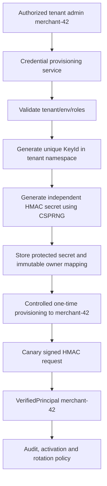
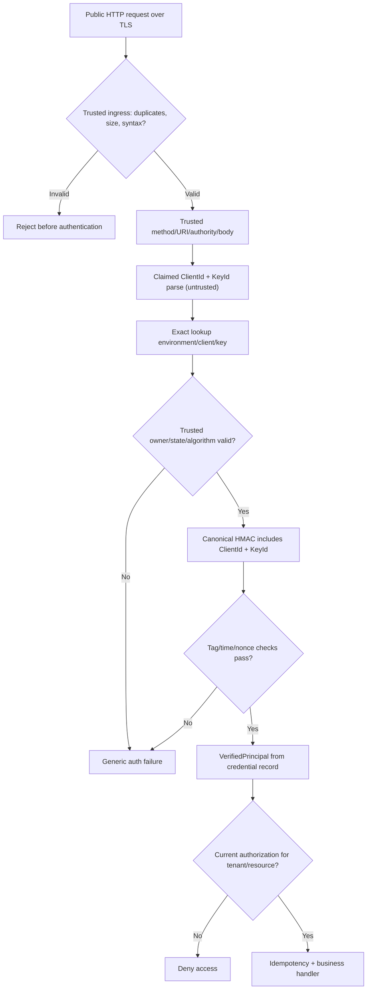

# Key ID riêng từng client

## 1. Tại sao hệ thống nhiều client cần Key ID riêng?

Trong xác thực HTTP request bằng **HMAC với shared secret**, client và verifier cùng nắm một secret để ký/xác minh các byte của **canonical request**: HTTP method, URI, những header được chọn và body hoặc body digest. Khi hệ thống phục vụ **nhiều client độc lập**, câu hỏi bảo mật không chỉ là “HMAC có đúng hay không?”, mà còn là **“chữ ký thuộc đúng client nào và đúng phiên bản secret nào?”**.

Giả sử API nhận hai merchant độc lập:

```text
Client merchant-42                 API gateway + HMAC verifier
  secret A42       -- signed request -->
                                  lookup đúng credential của merchant-42
Client merchant-73                 verify signature + freshness + nonce
  secret B73       -- signed request --> verified principal + authorization
```

Nếu cả hai được ký bằng một **global shared secret** và server chỉ dựa vào header `X-Client-Id` do caller tự khai, ai biết secret chung có thể ký request với **client ID của người khác**. Nếu hệ thống lưu key chỉ theo `keyId` nhưng key ID đó chỉ duy nhất trong từng client, server có thể **tra secret sai owner**, làm xác thực chéo tenant hoặc gặp lỗi không ổn định.

**Key ID riêng từng client** có nghĩa là mỗi client có **tập credential và secret độc lập**, được định danh theo một namespace rõ ràng. Key ID có thể là tên local bên trong từng client, ví dụ cả hai cùng có `key-2026-b`, hoặc một chuỗi ID **duy nhất toàn hệ thống**. Dù chọn mô hình nào, verifier phải ánh xạ **một request tới đúng một credential record đã khai báo owner**, không bao giờ đoán identity từ ID tự khai hoặc thử tất cả keys.

Bài nằm trong chương **Multi-client** của module `SECURITY_AUTHENTICATION_HMAC_REQUEST_AUTHENTICATION`, tập trung vào xác thực HTTP bằng HMAC và canonical method/URI/headers/body, replay protection bằng timestamp/nonce, key rotation, gateway/proxy và phân biệt **authentication** với **authorization**. Vì vậy ví dụ sẽ xét cả tenant isolation, rotation, store consistency và quyền xử lý nghiệp vụ, không chỉ cách đặt tên một field.

Sau bài, bạn có thể:

- Phân biệt **client ID, key ID, key version, raw secret và verified principal**.
- Chọn namespace `(environment, clientId, keyId)` hoặc global opaque key ID, kèm unique constraints thích hợp.
- Thiết kế provisioning **secret độc lập** và nhiều active key versions theo từng client.
- Đưa **ClientId và KeyId vào canonical HMAC input** và kiểm tra ownership trước khi tạo verified principal.
- Chặn key confusion, cross-tenant credential lookup, duplicated headers và raw secret reuse.
- Giữ nonce/replay store và idempotency **theo verified principal**, không theo key ID.
- Kiểm thử Java 17 với ba golden HMAC vectors và các tình huống cùng local KeyId nhưng khác client.
- Vận hành trên gateway/HTTP/2/3, nhiều replica và secret manager mà không lộ credential hoặc bypass authorization.

**Bất biến cốt lõi:** một chữ ký đúng chỉ có thể tạo principal **được gắn với owner của credential đã được server xác minh**. Không có đường để key của `merchant-42` trở thành quyền của `merchant-73` chỉ bằng sửa header.

## 2. Đừng nhầm Key ID với Client ID hoặc secret

### 2.1. Năm khái niệm khác nhau

| Thành phần | Ví dụ | Chức năng | Có được xem là bí mật? |
| --- | --- | --- | --- |
| **Client ID** | `merchant-42` | Định danh ứng dụng/tenant gọi API | Không mặc định; cần kiểm soát enumeration |
| **Key ID** | `key-2026-b` | Chọn credential version trong namespace của client hoặc global | Không phải secret |
| **Raw HMAC secret** | 32 bytes ngẫu nhiên | Tạo và xác minh tag HMAC-SHA256 | **Phải bí mật** |
| **Credential record** | owner, status, policy, secret reference | Liên kết secret với client, environment, version và quyền sử dụng | Record có dữ liệu nhạy cảm |
| **Verified principal** | `merchant-42` sau MAC/freshness | Danh tính đã xác thực để xét authorization | Kết quả của trusted verifier, không phải input tự khai |

Ví dụ:

```text
environment: prod
clientId: merchant-42
keyId: key-2026-b
ownerClientId: merchant-42
algorithm: HmacSHA256
status: ACTIVE
secretRef: secret-manager/prod/merchant-42/key-2026-b
scope: orders:create
```

`secretRef` là **reference đến secret manager**, không phải raw secret. Một secret record cũng có thể có `notBefore`, `expiresAt`, allowed versions, quota và audit metadata. Ngược lại, `KeyId` không mang sẵn quyền `orders:create`; quyền có hiệu lực phải lấy từ policy tin cậy tại thời điểm xử lý.

### 2.2. Key ID không phải danh tính đã xác thực

Trước khi xác minh, client có thể gửi:

```http
X-Client-Id: merchant-42
X-Key-Id: key-2026-b
X-Signature: <43-char-Base64url-HMAC>
```

Cả `X-Client-Id` và `X-Key-Id` đều do **caller tự khai**. Verifier chỉ dùng chúng như **lookup selectors**, sau đó kiểm tra secret/policy và HMAC input. Cụ thể:

```text
Input chưa đáng tin:
  X-Client-Id = merchant-42
  X-Key-Id    = key-2026-b

Lookup server-side:
  (prod, merchant-42, key-2026-b)
      -> credential owner = merchant-42
      -> status ACTIVE, HmacSHA256, secret S42B

Verify MAC + timestamp + atomic nonce claim:
      -> VerifiedPrincipal("merchant-42")

Business authorization:
      -> merchant-42 có quyền tạo order cho account này không?
```

**Không gọi** `Principal.fromHeader("X-Client-Id")` trước khi MAC khớp. Một client hợp lệ `merchant-42` cũng không tự được quyền đọc invoice/order của `merchant-73`; authentication và authorization là hai bước độc lập.

### 2.3. Rotation tạo Key ID mới, không tạo client mới

Một client có thể có đồng thời:

```text
prod / merchant-42 / key-2026-a -> secret A (VERIFY_ONLY)
prod / merchant-42 / key-2026-b -> secret B (ACTIVE)

verified principal = merchant-42 ở cả hai trường hợp
```

Key ID thay theo credential version nhưng **principal vẫn là client đó**. Đó là lý do không đưa key ID vào scope của authorization principal, nonce replay hoặc idempotency chỉ để phân biệt hai lần ký nếu policy muốn continuity qua rotation.

## 3. Hai cách tổ chức Key ID đúng trong multi-client

### 3.1. Phương án A: Key ID unique trong từng client (composite namespace)

Một thiết kế phổ biến:

```text
Credential identity = (environment, clientId, keyId)

prod / merchant-42 / key-2026-b --> secret S42B
prod / merchant-73 / key-2026-b --> secret S73B
prod / merchant-42 / key-2026-c --> secret S42C
```

Ở đây chuỗi `key-2026-b` xuất hiện **hai lần hợp lệ** vì nó chỉ duy nhất **bên trong owner**. Verifier **phải tra đủ 3 trường**, không được `findByKeyId("key-2026-b")` rồi lấy record đầu tiên.

Ưu điểm:

- Có thể đặt Key ID dễ dùng cho từng client như `v2`, `current`, `key-2026-b`.
- Tự nhiên hỗ trợ khóa theo environment/tenant.
- Dễ giữ local credential inventory và key rotation timeline.
- Storage unique constraint đơn giản trên composite key.

Hạn chế:

- Một header `KeyId` **không đủ** để lookup global nếu thiếu client/context.
- Log, cache, metrics và audit phải luôn mang namespace; nếu một hệ thống trung gian chỉ lưu `keyId` sẽ gây collision.
- Truy vấn, serialization, cache keys và secret paths phải **consistent** với composite key.

### 3.2. Phương án B: Global opaque Key ID

Một lựa chọn khác:

```text
globallyUniqueKeyId -> credentialRecord

kid_q2h8m_9x7... -> {owner=merchant-42, secret S42B, env=prod}
kid_r3k1n_4a2... -> {owner=merchant-73, secret S73B, env=prod}
```

Ở đây Key ID được cấp **duy nhất trên toàn hệ thống**, có thể tự lookup record rồi lấy **owner tin cậy từ record**, đối chiếu client ID đã ký (nếu contract có client ID). Có thể sử dụng random opaque ID/UUID, nhưng **entropy của Key ID không thay thế entropy của HMAC secret**.

Ưu điểm:

- Lookup/cache bằng một Key ID có thể đơn giản hơn.
- Tránh collision do local naming giữa tenants.
- Có thể giảm phụ thuộc client ID khai trong lookup sơ bộ.

Hạn chế:

- Cần global unique constraint và quy trình cấp phát ID; không được reuse ID cho secret mới.
- Key ID lộ ra vẫn có thể hỗ trợ enumeration/traffic correlation; không nên coi nó là token bí mật.
- Dù ID unique global, **vẫn phải validate owner/environment/status**, không mặc định `KeyId` tự là principal.

### 3.3. Nên chọn phương án nào?

| Tiêu chí | Composite `(env,clientId,keyId)` | Global unique Key ID |
| --- | --- | --- |
| Key ID trùng giữa clients | Hợp lệ | Không hợp lệ |
| Credential lookup | Đúng namespace 3 trường | Global ID + check owner/environment |
| Chặn cross-tenant | Đảm bảo exact tuple và owner binding | Đảm bảo record owner binding và signed client check |
| Rotation trong một client | Key ID mới dưới cùng owner | Global ID mới trỏ về cùng owner |
| Cache key | Phải composite | Có thể global ID, vẫn check policy |
| Khả năng user-friendly ID | Cao | Thường opaque |
| Migration | Từ local sang global cần mapping/cutover | Từ global sang local cần namespace rõ |

**Bài lab chọn phương án A** để minh họa lỗi khó thấy nhất: **hai clients có cùng chuỗi Key ID nhưng phải dùng secret khác nhau**. Đây không phải yêu cầu mọi API nhất thiết phải chấp nhận trùng Key ID; nếu sản phẩm công bố global uniqueness, cần thực thi đúng phương án B.

### 3.4. Không nên chọn namespace từ dữ liệu dễ bị giả mạo sau trust boundary

Nếu gateway xác minh HMAC nhưng backend chỉ nhận một header `X-Key-Id` không có verified client, backend có thể lookup nhầm key hoặc cho caller ghi đè thông tin principal. Cần truyền verified identity bằng security context đáng tin (ví dụ service-to-service authenticated channel), không để client tự đưa identity vào forwarded headers rồi tin ngay.

## 4. Threat model của Key ID riêng từng client

### 4.1. Những kiểu lỗi điển hình

| Threat / lỗi | Ví dụ | Hậu quả có thể xảy ra |
| --- | --- | --- |
| **Global shared secret** | Hai merchant được cấp cùng raw secret | Client A có thể ký request tự khai client B nếu verifier trust sai |
| **Lookup chỉ theo local Key ID** | `findByKeyId("key-2026-b")` | Chọn sai secret/owner hoặc trả kết quả không ổn định |
| **Cache key không có tenant** | `cache["key-2026-b"]` | Credential của tenant này thay tenant khác |
| **Signed input bỏ ClientId** | ClientId được dùng routing nhưng không ký | Tampering/identity binding confusion |
| **Signed input bỏ KeyId** | Key ID được dùng lookup nhưng ngoài MAC | Key-version confusion |
| **Owner mapping thiếu kiểm tra** | Record key thuộc merchant-42 trả principal merchant-73 | Cross-tenant identity spoof |
| **Sao chép raw secret khi onboarding** | New client B dùng secret của A | Blast radius và authentication confusion |
| **Duplicate signed header** | Hai `X-Client-Id`/`X-Key-Id` khác case | Gateway/backend parser disagreement |
| **Proxy đổi value case** | `merchant-42` → `Merchant-42` | Lookup sai hoặc MAC không khớp |
| **Key rotation cùng ID** | Ghi đè A bằng secret B dưới một ID | Cache inconsistency, audit khó phân biệt |
| **Key revocation stale cache** | Edge vẫn giữ ACTIVE sau revoke | Client/key bị lộ tiếp tục hoạt động |
| **Replay namespace theo KeyId** | Cùng client đổi key và dùng lại nonce | Anti-replay bị reset qua rotation |
| **Idempotency scope theo KeyId** | Retry order bằng key mới | Trùng side effect sau lost response |
| **Logs chứa secret** | HMAC key được ghi trong startup config | Ai đọc log có thể ký request |
| **Business authorization dựa ClientId header** | Caller tự khai merchant khác | Truy cập resource của tenant khác |

### 4.2. Phân tích blast radius

Với `N` clients dùng chung secret S, compromise S có thể ảnh hưởng **toàn bộ các clients mà server chấp nhận S xác thực**, tùy contract và authorization. Với mỗi client có **secret độc lập**, compromise của client A nên giới hạn khả năng tạo HMAC tới owner A, **nếu** verifier có ownership binding và authz đúng.

```text
Shared S:    merchant-42 ----\
                              > same key -> blast radius lớn
             merchant-73 ----/

Isolated:    merchant-42 -> S42 -> principal merchant-42
             merchant-73 -> S73 -> principal merchant-73
```

Đây là **giảm blast radius**, không phải bảo đảm client A không thể tấn công B theo cách khác. Ví dụ authorization bug, shared admin account, SSRF hoặc compromise credential store vẫn có thể tạo tấn công chéo tenant. Cần defense in depth.

### 4.3. Vì sao secret phải độc lập, không chỉ ID khác?

Một team có thể cấp:

```text
merchant-42 / key-2026-b -> rawSecret = "same-shared-key"
merchant-73 / key-2026-b -> rawSecret = "same-shared-key"
```

Dù namespace đúng, client `merchant-42` đã biết raw secret của `merchant-73`. Nếu thông tin ClientId/KeyId được HMAC ký, bên nắm secret S vẫn có thể **tính HMAC mới** cho thông điệp tự khai client B, bởi họ biết S. **Ký ClientId không sửa được lỗi cấp cùng secret cho hai owner**.

Cấp secret **32 raw random bytes** độc lập bằng CSPRNG (lab dùng 256-bit) qua secret manager/provisioning được bảo vệ. Không derive từ client ID có thể đoán được, dùng password yếu, dùng cùng environment variable cho mọi tenant hoặc copy secret giữa prod/staging.

## 5. Mô hình dữ liệu và ràng buộc toàn vẹn

### 5.1. Schema gợi ý với composite key

```sql
-- SQL mang tính khái niệm; điều chỉnh theo DB engine thực tế.
CREATE TABLE client_credentials (
    environment        VARCHAR(32)  NOT NULL,
    client_id          VARCHAR(128) NOT NULL,
    key_id             VARCHAR(128) NOT NULL,
    owner_client_id    VARCHAR(128) NOT NULL,
    secret_ref         VARCHAR(512) NOT NULL,
    algorithm          VARCHAR(32)  NOT NULL,
    status             VARCHAR(20)  NOT NULL,
    not_before_epoch   BIGINT       NOT NULL,
    expires_at_epoch   BIGINT       NOT NULL,
    credential_version BIGINT       NOT NULL,
    PRIMARY KEY (environment, client_id, key_id),
    CHECK (expires_at_epoch > not_before_epoch),
    CHECK (credential_version > 0),
    CHECK (owner_client_id = client_id)
);
```

Đặt các constraints này nhằm phòng lỗi ghi dữ liệu; production còn phải kiểm soát quyền ghi bảng, secret material uniqueness, key states/allowed protocol versions, transaction isolation và audit. Nếu business có principal types khác nhau, `owner_client_id = client_id` có thể thay bằng owner FK + verified mapping, nhưng không được để record trỏ owner không kiểm tra.

Một bảng khác quản lý client:

```sql
CREATE TABLE api_clients (
    environment VARCHAR(32) NOT NULL,
    client_id   VARCHAR(128) NOT NULL,
    status      VARCHAR(20) NOT NULL,
    PRIMARY KEY (environment, client_id)
);
```

Credential nên có foreign key phù hợp tới client nếu database hỗ trợ. Có thể dùng unique indexes theo `(environment, client_id, key_id)` và quản lý `ACTIVE`/`VERIFY_ONLY` per credential; **không** chỉ cho một key ID active trên toàn môi trường làm ảnh hưởng client khác.

### 5.2. Query đúng và query sai

```sql
-- SAI nếu Key ID chỉ unique trong client:
SELECT * FROM client_credentials
WHERE key_id = :key_id;

-- ĐÚNG với composite namespace:
SELECT * FROM client_credentials
WHERE environment = :environment
  AND client_id = :claimed_client_id
  AND key_id = :claimed_key_id;
```

Sau query **chưa được** trả principal. Phải xác minh `owner_client_id`, active status, algorithm, not-before/expiry, secret và HMAC rồi timestamp/nonce.

Ngay cả với global key ID, query đúng cũng cần `environment`/owner policy. Không dùng `SELECT ... LIMIT 1` để che dữ liệu trùng sai, và không thử nhiều records nếu key ID trùng ngoài hợp đồng.

### 5.3. Key IDs và secret references không được tái sử dụng tùy tiện

Khi client xoay secret:

```text
merchant-42/key-2026-b -> secret B42, state VERIFY_ONLY
merchant-42/key-2026-c -> secret C42, state ACTIVE
```

Không ghi đè raw key B42 bằng C42 dưới cùng ID. Nếu cache/verifier cũ còn B42, sẽ có request verify khác nhau theo node. **Immutable KeyId per material version** giúp audit, rollback có kiểm soát và revocation rõ ràng.

Không dùng `key-2026-b` làm path segment mà không validate/escape theo storage contract. Key ID cần grammar ASCII/length limits; mọi đường filesystem/secret-manager path phải chống traversal và không truy vấn dựa vào chuỗi chưa validate.

### 5.4. Cache key và config isolation

```text
Sai:    credentialCache[keyId]
Đúng:   credentialCache[(environment, clientId, keyId, credentialGeneration)]
```

Nếu có global key ID, cache có thể index bằng global ID nhưng vẫn phải ràng buộc environment/owner và áp status. Invalidation khi revoke/rotation phải lan tới mọi replica. Không được để client A làm đầy cache bằng IDs của B hoặc lấy metadata secret của B qua error messages.

**Key ID không phải secret**, nhưng không vì vậy mà trả một endpoint `GET /credentials/{keyId}` công khai chứa owner/status/secret refs của tenants khác. Tránh enumeration bằng rate limits, generic auth errors và admin APIs có authorization rõ.

## 6. Vòng đời cấp Key ID riêng và quản lý nhiều clients

### 6.1. Onboarding credential đúng ranh giới tenant

Một quy trình cấp credential cho client mới cần các bước được xác thực và kiểm toán:

1. **Xác thực quản trị client**: control plane biết ai có quyền tạo key cho `merchant-42`. Không lấy `X-Client-Id` của request quản trị rồi cấp key mà không kiểm tra authorization.
2. **Chọn environment và owner**: `prod/merchant-42` khác `staging/merchant-42`. Không chia raw secret giữa hai môi trường chỉ vì cùng client ID.
3. **Sinh local Key ID mới** (hoặc global opaque key ID theo chiến lược khác) và áp unique constraint. Key ID không được tái sử dụng cho một secret material khác.
4. **Sinh raw secret độc lập** với `SecureRandom` hoặc secret manager/KMS theo policy; ví dụ một key HMAC-SHA256 256-bit. Tránh timestamp/PIN/password làm nguồn ngẫu nhiên.
5. **Lưu secret vào protected store** và chỉ lưu `secretRef`/version/owner/policy trong credential catalog; encryption-at-rest, IAM, audit và backup có quy trình.
6. **Phân phối secret cho client** qua kênh provisioning được xác thực và giới hạn quyền; tránh debug logs, plain email, Git, shared chat và việc hiển thị lại tùy ý.
7. **Định nghĩa trạng thái và thời hạn** như `PREPARED`, `ACTIVE`, `VERIFY_ONLY`, `REVOKED`, `notBefore` và `expiresAt`.
8. **Canary bằng HMAC request**: client ký đúng KeyId/ClientId, verifier xác minh đúng principal, nonce/idempotency/authorization đều đạt, còn key khác tenant phải fail.
9. **Ghi audit và inventory**: ai tạo, key ID, owner, environment, source credential version, secret distribution status và rotation deadline. Không ghi raw secret.



**Không coi việc tạo key mới là thay đổi quyền tự động.** Trước khi bật credential, server phải xác định client hiện còn được phép truy cập API nào và resource nào. Nếu account đã disabled, secret mới không tự khôi phục quyền.

### 6.2. Nhiều key versions cho một client

```text
prod / merchant-42:
  key-2026-a  status=VERIFY_ONLY  expiresAt=deadline
  key-2026-b  status=ACTIVE       preferredForSigning=true
  key-2026-c  status=PREPARED     notBefore=next rollout

prod / merchant-73:
  key-2026-b  status=ACTIVE       independent secret
```

Điều này giải quyết hai yêu cầu tưởng mâu thuẫn:

- **Một client cần thay key mà không làm mất identity**: có thể giữ key cũ trong một overlap có deadline để SDK cập nhật dần.
- **Hai clients không được chia sẻ cùng secret**: mặc dù cùng chuỗi local `key-2026-b`, mỗi record có owner và secret riêng.

Đừng đổi `keyId` cùng `rawSecret` trong một record cũ khi rotation. Client/gateway có thể cache dữ liệu cũ, gây verify pass/fail theo node. Key IDs nên **immutable per secret material version**.

### 6.3. Rotation, revocation và emergency response theo client

Giả sử secret của `merchant-42/key-2026-b` bị lộ:

- Chỉ revoke affected credential của `merchant-42` và cấp version mới, **không** làm hỏng credential `merchant-73/key-2026-b` dù chuỗi key ID trùng.
- Kiểm tra status/revocation propagation ở mọi gateway và region; không nhận key cũ từ cache.
- Review các business operations đã được ký bằng key bị lộ, không chỉ dựa trên việc HMAC có pass.
- Đảm bảo key mới độc lập, môi trường provisioning an toàn; nếu nguồn leak còn đó thì key mới cũng sẽ bị lộ.
- Giữ audit/forensic backups theo policy nhưng không tự kích hoạt lại key revoked khi disaster recovery.

**Trong sự cố key đã compromise**, không giữ secret bị lộ ở `VERIFY_ONLY` lâu chỉ vì muốn migration êm; trạng thái này **vẫn cho phép** HMAC đúng bằng secret cũ trong giai đoạn overlap. Cần ưu tiên containment/revocation theo severity.

### 6.4. Cách nghĩ về multi-client quota và quyền

Một tenant có thể có nhiều keys nhưng quota/rate limits thường cần gắn **verified principal** (và operation), không chỉ key ID. Nếu chia quota theo key ID, client có thể phát thêm keys để vượt quota. Cũng không nên lấy claimed ClientId làm key của rate limiter duy nhất trước MAC vì attacker có thể spoof nó để gây DoS lên tenant khác; pre-authn abuse controls nên dùng các tín hiệu/quotas phù hợp threat model, post-authn policy mới dùng principal xác thực.

## 7. Hợp đồng HMAC bind đúng ClientId và KeyId

Hợp đồng lab tên **`HTTP-HMAC-MULTICLIENT-V1`** minh họa việc **hai IDs được ký bằng HMAC**. Đây là format dạy học, không phải HTTP signature standard được mọi gateway tự động hỗ trợ.

### 7.1. HTTP request mẫu

```http
POST /v1/orders?source=mobile HTTP/1.1
Host: api.example.test
Content-Type: application/json
X-Client-Id: merchant-42
X-Key-Id: key-2026-b
X-Timestamp: 1790000015
X-Nonce: QEFCQ0RFRkdISUpLTE1OTw
X-Idempotency-Key: order-903
X-Signature: k88G7GtqZC4YPpljSKQjHEt5klgV6Hz3hFfbpXRM-2M

{"orderId":"ord-903","amount":125000,"currency":"VND"}
```

Quy tắc ký **phiên bản 1**:

1. Method `POST`, raw path `/v1/orders`, raw query `source=mobile` và trusted external authority `api.example.test` được chọn tại authentication boundary.
2. Bảo vệ đúng các singleton headers `content-type`, `x-client-id`, `x-key-id`, `x-timestamp`, `x-nonce`, `x-idempotency-key`; `X-Signature` cũng singleton nhưng là output **không đưa vào canonical input**.
3. **Bắt duplicate header occurrences** case-insensitive tại ingress trước khi framework/proxy coalesce. Không chọn first/last khi có hai `X-Client-Id` hoặc `X-Key-Id`.
4. HTTP field names canonical lowercase ASCII; header values `merchant-42` và `key-2026-b` **case-sensitive**. Grammar lab cho IDs `[A-Za-z0-9._-]{1,64}`.
5. Content type cố định `application/json`. Body SHA-256 tính trên **exact UTF-8 bytes** đã ký, không reserialize JSON. Không có trailing LF trong body fixture.
6. Timestamp là decimal canonical Unix epoch seconds. Nonce là raw 16 bytes encode Base64url không padding thành **22 ký tự**; chữ ký raw HMAC-SHA256 32 bytes encode Base64url không padding **43 ký tự**.
7. Key lookup theo `(environment, clientId, keyId)`; environment lấy từ server routing/config chứ không từ header tự khai. Lookup record không cấp quyền cho tới khi MAC khớp.
8. Canonical request gồm **12 dòng**, UTF-8, nối bằng LF byte `0x0A` **không LF cuối**; dòng đầu là domain prefix `HTTP-HMAC-MULTICLIENT-V1`.
9. Server kiểm tra key owner/status/algorithm/not-before/expiry, HMAC tag bằng raw byte comparison, timestamp và atomic nonce claim trước verified principal.
10. Business authorization xét account/resource/action riêng, còn idempotency dùng verified principal/operation/key để bảo vệ side effects khi retry.

### 7.2. Signed identifiers và trust boundary

Hai dòng:

```text
x-client-id:merchant-42
x-key-id:key-2026-b
```

phải ở trong canonical string. Nếu attacker sửa `X-Client-Id` thành `merchant-73` nhưng giữ HMAC tag của 42, server **không thể xác minh** với secret của 73 (trừ khi hệ thống đã cấp trùng raw secret, đây là lỗi provisioning), và secret của 42 cũng ký một canonical string **khác**.

Điểm quan trọng: **kẻ đang có secret A vẫn có thể tính tag mới** cho payload tùy chọn. Vì vậy signed fields chỉ chống **tampering bởi người không nắm secret**, còn client isolation yêu cầu raw secrets độc lập, owner mapping và authorization.

### 7.3. Dạng Authorization header thay thế

Một API có thể chở selector trong:

```http
Authorization: HMAC Version=1,ClientId=merchant-42,KeyId=key-2026-b,Signature=<tag>
```

Thay vì `X-Client-Id`, `X-Key-Id`, `X-Signature` riêng. Nếu chọn cách đó, canonical input phải dùng các **giá trị đã parse/validate** của `ClientId` và `KeyId`, cùng protocol/version được MAC-bind, không ký nguyên header `Authorization` chứa `Signature` output.

**Không trộn cả hai conventions** trên cùng endpoint rồi lấy cái nào có giá trị. Nếu có migration, phải có protocol/version rõ, duplicate/mismatch rejection, và gateway/backend cùng parser. Bài tiếp tục dùng X-headers của `HTTP-HMAC-MULTICLIENT-V1` để test byte-level.

### 7.4. Tại sao chỉ thêm KeyId vào header là chưa đủ?

Một implementation sai có thể làm:

```text
secret = credentialStore.findByKeyId(xKeyId).secret
principal = xClientId
if HMAC(secret, method+path+body) == signature:
    allow request
```

Sai ở **ba nơi**: lookup không có tenant scope, principal lấy từ claimed header và ClientId/KeyId không được ký. Dù raw HMAC match, request có thể được gán sai owner.

Thứ tự đúng:

```text
validate HTTP/parser/duplicate/length
  -> read environment from trusted routing
  -> parse claimed ClientId & KeyId
  -> lookup EXACT (env,ClientId,KeyId)
  -> check credential owner/status/algorithm/validity
  -> compute canonical HMAC including both identifiers
  -> constant-time raw tag comparison
  -> signed timestamp window
  -> atomic nonce claim by VERIFIED principal
  -> VerifiedPrincipal(owner)
  -> authorization and idempotency/business
```

**Không có nhánh** `findAnyKeyIfMissing`, `tryAllKeys`, `trustClaimedClient` hoặc `returnCachedResponseBeforeAuth`.

## 8. Golden vectors độc lập: hai clients cùng local KeyId

### 8.1. Dữ liệu chung trong fixtures

Để dễ kiểm tra, ba fixtures dùng cùng method, path, query, content type, timestamp, nonce, idempotency key và exact body. Điều **khác nhau** là client ID, key ID và raw secret theo từng credential.

```text
Method: POST
Raw path: /v1/orders
Raw query: source=mobile
External authority: api.example.test
Content-Type: application/json
Signed timestamp: 1790000015
Signed nonce Base64url: QEFCQ0RFRkdISUpLTE1OTw
Signed idempotency key: order-903

Exact JSON body:
{"orderId":"ord-903","amount":125000,"currency":"VND"}

Body UTF-8 bytes: 54
SHA-256(body) lowercase hex:
86c07293b5e5828fd51865e1c563a2d7c525d7451fdf2790c11081253974df6f

Nonce raw bytes hex (40..4f):
404142434445464748494a4b4c4d4e4f
```

**Timestamp/nonce/keys cố định chỉ dùng cho cryptographic test vectors.** Với HTTP thực, mỗi client phải tạo nonce mới bằng CSPRNG và timestamp theo clock; nếu cùng một verified client gửi lại nonce N qua hai key versions, shared replay store phải từ chối request thứ hai.

### 8.2. Canonical request cho merchant-42/key-2026-b

```text
HTTP-HMAC-MULTICLIENT-V1
POST
/v1/orders
source=mobile
authority:api.example.test
content-type:application/json
x-client-id:merchant-42
x-key-id:key-2026-b
x-timestamp:1790000015
x-nonce:QEFCQ0RFRkdISUpLTE1OTw
x-idempotency-key:order-903
86c07293b5e5828fd51865e1c563a2d7c525d7451fdf2790c11081253974df6f
```

Canonical string có **12 dòng, 302 bytes UTF-8**, nối LF, **không LF cuối**. Các fixture `merchant-73/key-2026-b` và `merchant-42/key-2026-c` chỉ thay tương ứng dòng `x-client-id`/`x-key-id`. Tất cả có cùng 302 bytes vì các ID có độ dài bằng nhau trong fixture.

### 8.3. Ba credential và secret public (chỉ cho kiểm thử)

| Fixture | Scope `(env,clientId,keyId)` | Test secret bytes | HMAC-SHA256 raw tag hex | Base64url no padding |
| --- | --- | --- | --- | --- |
| **A** | `(test,merchant-42,key-2026-b)` | `00..1f` | `93cf06ec6b6a642e183e996348a4231c4b79925815e87cf78457dba5744cfb63` | `k88G7GtqZC4YPpljSKQjHEt5klgV6Hz3hFfbpXRM-2M` |
| **B** | `(test,merchant-73,key-2026-b)` | `20..3f` | `fdc3aba1aff0393d64b083d1255ce71e796f3c674d50cf20b5472276cb903d4b` | `_cOroa_wOT1ksIPRJVznHnlvPGdNUM8gtUcidsuQPUs` |
| **C** | `(test,merchant-42,key-2026-c)` | `50..6f` | `6bc4feeb01c87ccb2e07c5318342920101f4e0bcb0883b2f547fd0bb2f2ab578` | `a8T-6wHIfMsuB8Uxg0KSAQH04LywiDsvVH_Quy8qtXg` |

Full public test keys theo hexadecimal:

```text
A: 000102030405060708090a0b0c0d0e0f101112131415161718191a1b1c1d1e1f
B: 202122232425262728292a2b2c2d2e2f303132333435363738393a3b3c3d3e3f
C: 505152535455565758595a5b5c5d5e5f606162636465666768696a6b6c6d6e6f
```

Những giá trị trên được tính **độc lập** từ SHA-256/HMAC-SHA256. Chúng giúp phát hiện một lỗi mà test `sign() == verify()` trong cùng implementation có thể bỏ qua: cả hai phía cùng quên ký ClientId hoặc cùng dùng sai key lookup.

### 8.4. Đọc vector theo góc nhìn multi-client

- **A và B** có cùng `KeyId=key-2026-b`, cùng body/timestamp/nonce nhưng secret và client ID khác nhau. Mỗi thứ phải ánh xạ tới credential của **đúng owner**; tag khác là expected.
- **A và C** thuộc **cùng verified principal `merchant-42`** nhưng có key IDs/secrets khác nhau: đây là ví dụ key rotation cho một client.
- **B không được xác thực bằng secret A**, cũng như A không được chuyển thành principal B nếu sửa claimed ClientId.
- **C không thể dùng lại nonce của A** trong shared replay namespace của `merchant-42`. Phần cryptographic golden vector được kiểm tra **trước bước nonce claim** hoặc với replay stores tách biệt khi cần test riêng từng MAC.
- **A và B có thể dùng cùng nonce bytes N** trong hai namespaces verified principal khác nhau theo policy minh họa; điều đó không vi phạm “mỗi client nonce một lần”, nhưng clients thật vẫn phải sinh nonce độc lập.

Với các fixture, `Clock.fixed` ở epoch `1790000000` có thể kiểm tra timestamp `1790000015` (+15 giây) trong window tương lai 30 giây. **Không gửi timestamp cố định này trong traffic thực ngày hôm nay**; nó chỉ dành cho deterministic tests.

## 9. Java 17: verifier không xác thực nhầm client khi KeyId trùng

### 9.1. Ranh giới của ví dụ

`MultiClientHmacV1` là một **lab verifier** nhận các field đã qua HTTP adapter. Nó không tự đọc raw socket request và **không phát hiện được duplicate occurrences nếu gateway đã gộp trước**. Do đó ingress phải reject duplicate `X-Client-Id`, `X-Key-Id`, `X-Signature` và các signed headers khác; xác định external authority, raw URI/query và exact body bytes tin cậy.

Code dùng một endpoint cố định để golden vector tái lập; production cần contract canonicalization và router/versioning phù hợp nhiều endpoints. Về mặt xử lý bảo mật, lớp này thực hiện:

```text
Validate fields and header semantics (HTTP adapter)
    -> tuple lookup (environment, claimedClientId, claimedKeyId)
    -> record owner/status/algorithm validity
    -> HMAC-SHA256 over signed ClientId AND KeyId
    -> raw MAC constant-time comparison
    -> trusted server timestamp window
    -> atomic claim nonce under VERIFIED principal
    -> VerifiedPrincipal(ownerFromTrustedRecord)
    -> authorization by business service (ngoài class)
```

### 9.2. Class MultiClientHmacV1

```java
import java.nio.charset.StandardCharsets;
import java.security.GeneralSecurityException;
import java.security.MessageDigest;
import java.time.Clock;
import java.util.Base64;
import java.util.HexFormat;
import java.util.Optional;
import javax.crypto.Mac;
import javax.crypto.spec.SecretKeySpec;

public final class MultiClientHmacV1 {
    private static final String CONTEXT =
        "HTTP-HMAC-MULTICLIENT-V1";
    private static final String MAC_ALGORITHM = "HmacSHA256";
    private static final long PAST_TOLERANCE_SECONDS = 300;
    private static final long FUTURE_TOLERANCE_SECONDS = 30;
    private static final long NONCE_MARGIN_SECONDS = 60;

    public enum CredentialState {
        PREPARED, ACTIVE, VERIFY_ONLY, REVOKED
    }

    // Được tạo SAU HTTP adapter đã validate names/duplicates,
    // raw URI/authority và exact body bytes tại trust boundary.
    public record SignedRequest(
        String method,
        String rawPath,
        String rawQuery,
        String trustedAuthority,
        String contentType,
        String claimedClientId,
        String claimedKeyId,
        String timestamp,
        String nonce,
        String idempotencyKey,
        byte[] exactBodyBytes
    ) {
        public SignedRequest {
            if (exactBodyBytes == null) {
                throw new IllegalArgumentException("Missing body");
            }
            exactBodyBytes = exactBodyBytes.clone();
        }

        @Override
        public byte[] exactBodyBytes() {
            return exactBodyBytes.clone();
        }
    }

    public record Credential(
        String ownerClientId,
        String keyId,
        String algorithm,
        CredentialState state,
        boolean ownerEnabled,
        long notBeforeEpoch,
        long expiresAtEpoch,
        byte[] secret
    ) {
        public Credential {
            if (secret == null) {
                throw new IllegalArgumentException("Missing secret");
            }
            secret = secret.clone();
        }

        @Override
        public byte[] secret() {
            return secret.clone();
        }

        @Override
        public String toString() {
            return "Credential[redacted]";
        }
    }

    public record VerifiedPrincipal(
        String clientId, String verifiedKeyId
    ) {}

    // Idempotency và authorization KHÔNG lấy principal từ header;
    // chỉ nhận VerifiedPrincipal sau khi verify() thành công.
    public interface CredentialStore {
        Optional<Credential> find(
            String environment,
            String claimedClientId,
            String claimedKeyId);
    }

    public interface NonceStore {
        // Implementation thực: atomic insert-if-absent with TTL
        // trên shared store, không phải local JVM map.
        // Exception/timeout/unknown outcome -> fail closed.
        boolean claim(
            String environment,
            String verifiedClientId,
            byte[] rawNonce,
            long expiresAtEpochSeconds);
    }

    private MultiClientHmacV1() {}

    private static void validate(SignedRequest r) {
        if (r == null
                || !"POST".equals(r.method())
                || !"/v1/orders".equals(r.rawPath())
                || !"source=mobile".equals(r.rawQuery())
                || !"api.example.test".equals(
                    r.trustedAuthority())
                || !"application/json".equals(r.contentType())
                || r.exactBodyBytes().length > 1_048_576
                || r.claimedClientId() == null
                || !r.claimedClientId().matches(
                    "[A-Za-z0-9._-]{1,64}")
                || r.claimedKeyId() == null
                || !r.claimedKeyId().matches(
                    "[A-Za-z0-9._-]{1,64}")
                || r.idempotencyKey() == null
                || !r.idempotencyKey().matches(
                    "[A-Za-z0-9._-]{8,64}")
                || r.timestamp() == null
                || !r.timestamp().matches(
                    "[1-9][0-9]{0,18}")) {
            throw new IllegalArgumentException(
                "Malformed or unsupported signed request");
        }

        try {
            Long.parseLong(r.timestamp());
        } catch (NumberFormatException overflow) {
            throw new IllegalArgumentException(
                "Timestamp not representable as long", overflow);
        }
        strictDecode(r.nonce(), 22, 16, "nonce");
    }

    public static byte[] strictDecode(
            String value, int textLength,
            int byteLength, String field) {
        if (value == null || value.length() != textLength
                || !value.matches("[A-Za-z0-9_-]+")) {
            throw new IllegalArgumentException(
                "Bad Base64url " + field);
        }

        final byte[] raw;
        try {
            raw = Base64.getUrlDecoder().decode(value);
        } catch (IllegalArgumentException malformed) {
            throw new IllegalArgumentException(
                "Invalid " + field, malformed);
        }
        String canonical = Base64.getUrlEncoder()
            .withoutPadding().encodeToString(raw);
        if (raw.length != byteLength
                || !canonical.equals(value)) {
            throw new IllegalArgumentException(
                "Noncanonical " + field);
        }
        return raw;
    }

    private static String bodyHash(SignedRequest request)
            throws GeneralSecurityException {
        byte[] digest = MessageDigest.getInstance("SHA-256")
            .digest(request.exactBodyBytes());
        return HexFormat.of().formatHex(digest);
    }

    public static byte[] canonicalBytes(SignedRequest request)
            throws GeneralSecurityException {
        validate(request);

        String canonical = String.join("\n",
            CONTEXT,
            request.method(),
            request.rawPath(),
            request.rawQuery(),
            "authority:" + request.trustedAuthority(),
            "content-type:" + request.contentType(),
            "x-client-id:" + request.claimedClientId(),
            "x-key-id:" + request.claimedKeyId(),
            "x-timestamp:" + request.timestamp(),
            "x-nonce:" + request.nonce(),
            "x-idempotency-key:" + request.idempotencyKey(),
            bodyHash(request)
        );
        return canonical.getBytes(StandardCharsets.UTF_8);
    }

    private static byte[] computeMac(byte[] secret, byte[] input)
            throws GeneralSecurityException {
        if (secret == null || secret.length < 32) {
            throw new IllegalStateException(
                "HMAC secret missing or below lab policy");
        }
        // Mac is mutable: create one for each calculation,
        // never share an instance across concurrent requests.
        Mac mac = Mac.getInstance(MAC_ALGORITHM);
        mac.init(new SecretKeySpec(secret, MAC_ALGORITHM));
        return mac.doFinal(input);
    }

    // Test only. Production client uses properly provisioned
    // secret + current key ID, freshly generated nonce/time.
    public static String signForTest(
            SignedRequest request, byte[] testSecret)
            throws GeneralSecurityException {
        byte[] tag = computeMac(
            testSecret, canonicalBytes(request));
        return Base64.getUrlEncoder().withoutPadding()
            .encodeToString(tag);
    }

    public static Optional<VerifiedPrincipal> verify(
            SignedRequest request,
            String receivedSignature,
            String environment,
            CredentialStore credentialStore,
            NonceStore nonceStore,
            Clock trustedClock
    ) throws GeneralSecurityException {
        // Both client/key IDs are UNTRUSTED selectors here.
        byte[] input = canonicalBytes(request);
        byte[] suppliedTag = strictDecode(
            receivedSignature, 43, 32, "signature");

        // Critical: exact lookup on THREE fields, never keyId-only.
        Optional<Credential> selected = credentialStore.find(
            environment,
            request.claimedClientId(),
            request.claimedKeyId()
        );
        if (selected.isEmpty()) return Optional.empty();

        Credential c = selected.get();
        long now = trustedClock.instant().getEpochSecond();
        boolean allowedState =
            c.state() == CredentialState.ACTIVE
            || c.state() == CredentialState.VERIFY_ONLY;

        // Owner is from TRUSTED record, checked against claimed ID.
        if (!allowedState || !c.ownerEnabled()
                || !request.claimedClientId().equals(
                    c.ownerClientId())
                || !request.claimedKeyId().equals(c.keyId())
                || !MAC_ALGORITHM.equals(c.algorithm())
                || now < c.notBeforeEpoch()
                || now >= c.expiresAtEpoch()) {
            return Optional.empty();
        }

        byte[] expectedTag = computeMac(c.secret(), input);
        if (!MessageDigest.isEqual(expectedTag, suppliedTag)) {
            return Optional.empty();
        }

        long signedTs = Long.parseLong(request.timestamp());
        final long earliest, latest, nonceExpiry;
        try {
            earliest = Math.subtractExact(
                now, PAST_TOLERANCE_SECONDS);
            latest = Math.addExact(
                now, FUTURE_TOLERANCE_SECONDS);
            nonceExpiry = Math.addExact(
                signedTs,
                PAST_TOLERANCE_SECONDS + NONCE_MARGIN_SECONDS);
        } catch (ArithmeticException overflow) {
            throw new IllegalStateException(
                "Unsafe trusted server clock arithmetic", overflow);
        }
        if (signedTs < earliest || signedTs > latest) {
            return Optional.empty();
        }

        byte[] rawNonce = strictDecode(
            request.nonce(), 22, 16, "nonce");

        // Scope by VERIFIED owner, not by key ID.
        // Two clients may each use the same raw nonce bytes,
        // but one client cannot reuse it after key rotation.
        if (!nonceStore.claim(
                environment, c.ownerClientId(),
                rawNonce, nonceExpiry)) {
            return Optional.empty();
        }

        // Authentication is done; still require authorization
        // for account/action/resource before any business effect.
        return Optional.of(new VerifiedPrincipal(
            c.ownerClientId(), c.keyId()));
    }
}
```

### 9.3. Không nên hiểu sai phạm vi của code

**Code chứng minh** key ID được canonical ký, lookup theo composite tuple, kiểm tra record owner, HMAC và nonce được scope theo verified principal. Nó **không tự giải quyết**:

- HTTP parser ambiguity nếu `X-Client-Id`/`X-Key-Id` xuất hiện hai lần, proxy chọn value khác nhau hoặc header injection.
- Credential store đa replica, key rotation/revocation cache lag, secret material bị copy giữa clients.
- KMS IAM, secret provisioning, source code/CI leak, log redaction và audit.
- JSON canonicalization/URI percent encoding, HTTP/2 pseudo-headers, trusted authority sau gateway rewrite.
- Account/resource ownership, per-client quota, fraud rules và authorization nghiệp vụ.
- Idempotency store/transaction khi hai HTTP attempts có nonce/HMAC mới nhưng cùng ý định order.
- Chính sách error response/timing leak toàn pipeline; `MessageDigest.isEqual` chỉ là primitive compare raw tags.

Đặc biệt, `CredentialStore` trả `Credential` là một trusted server-side object. **Không bao giờ deserialise credential hoặc owner trực tiếp từ request body/header của caller** rồi dùng làm trust anchor. Nếu store timeout/outage, verifier phải fail-closed; không trả một principal “tạm” dựa vào header.

## 10. Java 17: kiểm thử namespace, tenant isolation và concurrency

### 10.1. Nonce store giả lập có scope theo verified client

Trong lab, để chứng minh hai clients có thể cùng sử dụng raw nonce bytes nhưng một client **không thể tái sử dụng nonce qua hai key versions**, dùng `ConcurrentHashMap.compute` với key:

```text
(environment, verifiedClientId, canonicalRawNonce)
```

Store chỉ atomic **trong một process**, không có durability hoặc replication; production cần Redis/DB conditional write với TTL đúng và fail-closed khi kết quả không chắc chắn.

```java
import java.time.Clock;
import java.util.Base64;
import java.util.concurrent.ConcurrentHashMap;
import java.util.concurrent.atomic.AtomicBoolean;

public final class MultiClientNonceStoreV1
        implements MultiClientHmacV1.NonceStore {
    private record ReplayKey(
        String environment,
        String verifiedClientId,
        String nonceB64url) {}

    private final Clock clock;
    private final ConcurrentHashMap<ReplayKey, Long> expiryByKey =
        new ConcurrentHashMap<>();

    public MultiClientNonceStoreV1(Clock clock) {
        if (clock == null) throw new IllegalArgumentException();
        this.clock = clock;
    }

    @Override
    public boolean claim(
            String environment, String verifiedClientId,
            byte[] rawNonce, long expiresAtEpochSeconds) {
        long now = clock.instant().getEpochSecond();
        if (environment == null || environment.isEmpty()
                || verifiedClientId == null
                || verifiedClientId.isEmpty()
                || rawNonce == null || rawNonce.length != 16
                || expiresAtEpochSeconds <= now) {
            throw new IllegalStateException(
                "Invalid replay key or expiry");
        }

        ReplayKey replayKey = new ReplayKey(
            environment, verifiedClientId,
            Base64.getUrlEncoder().withoutPadding()
                .encodeToString(rawNonce));

        AtomicBoolean winner = new AtomicBoolean(false);
        expiryByKey.compute(replayKey, (k, previousExpiry) -> {
            if (previousExpiry == null
                    || previousExpiry <= now) {
                winner.set(true);
                return expiresAtEpochSeconds;
            }
            return previousExpiry;
        });
        return winner.get();
    }
}
```

Khi timestamp được ký và server chấp nhận window:

```text
serverNow - 300 <= signedTimestamp <= serverNow + 30
```

record cần tồn tại ít nhất đến hết khoảng request có thể được nhận. Ví dụ lab dùng `nonceExpiry = signedTimestamp + 300 + 60`; buffer 60s giảm nguy cơ race/clock skew. **Không** chỉ dùng TTL 300 giây tính từ thời điểm request đến nếu future skew có thể lên tới 30 giây.

Đồng thời, `ConcurrentHashMap` ở trên không có cleanup background, nên tăng bộ nhớ nếu dùng lâu. Nó chỉ là test double; một replay store production cần eviction/storage TTL, cross-region consistency và monitoring.

### 10.2. Class MultiClientChecksV1

Harness dưới đây kiểm tra cả ba vectors A/B/C, cùng Key ID khác client, cross-client nonce namespace, same-client cross-key replay, owner mismatch, revoked credential, tampering và 32 concurrent requests.

```java
import java.nio.charset.StandardCharsets;
import java.time.Clock;
import java.time.Instant;
import java.time.ZoneOffset;
import java.util.HexFormat;
import java.util.Map;
import java.util.Optional;
import java.util.concurrent.CountDownLatch;
import java.util.concurrent.ExecutorService;
import java.util.concurrent.Executors;
import java.util.concurrent.Future;
import java.util.concurrent.atomic.AtomicInteger;
import java.util.ArrayList;
import java.util.List;

public final class MultiClientChecksV1 {
    private static final Clock FIXED_CLOCK = Clock.fixed(
        Instant.ofEpochSecond(1790000000L), ZoneOffset.UTC);

    private static final String TAG_A =
        "k88G7GtqZC4YPpljSKQjHEt5klgV6Hz3hFfbpXRM-2M";
    private static final String TAG_B =
        "_cOroa_wOT1ksIPRJVznHnlvPGdNUM8gtUcidsuQPUs";
    private static final String TAG_C =
        "a8T-6wHIfMsuB8Uxg0KSAQH04LywiDsvVH_Quy8qtXg";

    private record Scope(
        String environment, String clientId, String keyId) {}

    private static byte[] secretA() {
        return HexFormat.of().parseHex(
            "000102030405060708090a0b0c0d0e0f"
          + "101112131415161718191a1b1c1d1e1f");
    }

    private static byte[] secretB() {
        return HexFormat.of().parseHex(
            "202122232425262728292a2b2c2d2e2f"
          + "303132333435363738393a3b3c3d3e3f");
    }

    private static byte[] secretC() {
        return HexFormat.of().parseHex(
            "505152535455565758595a5b5c5d5e5f"
          + "606162636465666768696a6b6c6d6e6f");
    }

    private static MultiClientHmacV1.SignedRequest request(
            String claimedClient, String claimedKey) {
        return new MultiClientHmacV1.SignedRequest(
            "POST", "/v1/orders", "source=mobile",
            "api.example.test", "application/json",
            claimedClient, claimedKey,
            "1790000015", "QEFCQ0RFRkdISUpLTE1OTw",
            "order-903",
            "{\"orderId\":\"ord-903\","
          + "\"amount\":125000,\"currency\":\"VND\"}"
                .getBytes(StandardCharsets.UTF_8)
        );
    }

    private static MultiClientHmacV1.Credential credential(
            String clientId, String keyId, byte[] secret,
            MultiClientHmacV1.CredentialState state) {
        return new MultiClientHmacV1.Credential(
            clientId, keyId, "HmacSHA256",
            state, true,
            1789990000L, 1790100000L, secret
        );
    }

    private static Map<Scope, MultiClientHmacV1.Credential>
            activeRecords() {
        // Lưu ý hai records khác client nhưng key ID giống nhau.
        return Map.of(
            new Scope("test", "merchant-42", "key-2026-b"),
            credential("merchant-42", "key-2026-b",
                secretA(), MultiClientHmacV1.CredentialState.ACTIVE),
            new Scope("test", "merchant-73", "key-2026-b"),
            credential("merchant-73", "key-2026-b",
                secretB(), MultiClientHmacV1.CredentialState.ACTIVE),
            new Scope("test", "merchant-42", "key-2026-c"),
            credential("merchant-42", "key-2026-c",
                secretC(), MultiClientHmacV1.CredentialState.ACTIVE)
        );
    }

    private static MultiClientHmacV1.CredentialStore store(
            Map<Scope, MultiClientHmacV1.Credential> records) {
        return (env, client, key) ->
            Optional.ofNullable(
                records.get(new Scope(env, client, key)));
    }

    private static void check(boolean value, String message) {
        if (!value) throw new AssertionError(message);
    }

    public static void main(String[] args) throws Exception {
        var reqA = request("merchant-42", "key-2026-b");
        var reqB = request("merchant-73", "key-2026-b");
        var reqC = request("merchant-42", "key-2026-c");

        // 3 independent golden tags: cùng local key ID A/B,
        // khác owner+secret. C là key rotation của merchant-42.
        check(MultiClientHmacV1.canonicalBytes(reqA).length == 302,
            "A canonical length");
        check(MultiClientHmacV1.canonicalBytes(reqB).length == 302,
            "B canonical length");
        check(MultiClientHmacV1.canonicalBytes(reqC).length == 302,
            "C canonical length");

        check(TAG_A.equals(
            MultiClientHmacV1.signForTest(reqA, secretA())),
            "A golden tag");
        check(TAG_B.equals(
            MultiClientHmacV1.signForTest(reqB, secretB())),
            "B golden tag");
        check(TAG_C.equals(
            MultiClientHmacV1.signForTest(reqC, secretC())),
            "C golden tag");

        var credentials = store(activeRecords());
        var sharedNonces = new MultiClientNonceStoreV1(FIXED_CLOCK);

        // Same nonce bytes N are allowed in DIFFERENT
        // verified principal namespaces per lab contract.
        var a = MultiClientHmacV1.verify(
            reqA, TAG_A, "test", credentials,
            sharedNonces, FIXED_CLOCK);
        var b = MultiClientHmacV1.verify(
            reqB, TAG_B, "test", credentials,
            sharedNonces, FIXED_CLOCK);
        check(a.isPresent()
                && "merchant-42".equals(a.get().clientId()),
            "A must become merchant-42");
        check(b.isPresent()
                && "merchant-73".equals(b.get().clientId()),
            "B must become merchant-73");

        // Same principal merchant-42 cannot reuse nonce N after
        // rotating KeyId from key-2026-b to key-2026-c.
        check(MultiClientHmacV1.verify(
            reqC, TAG_C, "test", credentials,
            sharedNonces, FIXED_CLOCK).isEmpty(),
            "Nonce replay across key rotation must fail");

        // The crypto/key C is otherwise valid with an isolated
        // test replay store (do not deploy isolated stores!).
        check(MultiClientHmacV1.verify(
            reqC, TAG_C, "test", credentials,
            new MultiClientNonceStoreV1(FIXED_CLOCK),
            FIXED_CLOCK).isPresent(),
            "Key C must verify for merchant-42");

        // Same request twice -> replay rejection.
        check(MultiClientHmacV1.verify(
            reqA, TAG_A, "test", credentials,
            sharedNonces, FIXED_CLOCK).isEmpty(),
            "Same-client nonce reuse must fail");

        // Cross-client HMAC substitution fails, not remapped owner.
        check(MultiClientHmacV1.verify(
            reqA, TAG_B, "test", credentials,
            new MultiClientNonceStoreV1(FIXED_CLOCK),
            FIXED_CLOCK).isEmpty(),
            "B tag must never prove merchant-42");
        check(MultiClientHmacV1.verify(
            reqB, TAG_A, "test", credentials,
            new MultiClientNonceStoreV1(FIXED_CLOCK),
            FIXED_CLOCK).isEmpty(),
            "A tag must never prove merchant-73");

        // Tampering KeyId across rotation invalidates the HMAC.
        check(MultiClientHmacV1.verify(
            reqC, TAG_A, "test", credentials,
            new MultiClientNonceStoreV1(FIXED_CLOCK),
            FIXED_CLOCK).isEmpty(),
            "Old tag cannot authenticate new KeyId");

        // Trusted credential points to wrong owner:
        // even a mathematically correct tag B must not grant B.
        var poisonedOwner = store(Map.of(
            new Scope("test", "merchant-73", "key-2026-b"),
            credential("merchant-42", "key-2026-b",
                secretB(), MultiClientHmacV1.CredentialState.ACTIVE)
        ));
        check(MultiClientHmacV1.verify(
            reqB, TAG_B, "test", poisonedOwner,
            new MultiClientNonceStoreV1(FIXED_CLOCK),
            FIXED_CLOCK).isEmpty(),
            "Owner mismatch must fail authentication");

        // Revoke A (merchant-42/key-b) while B (merchant-73/key-b)
        // remains active despite identical local KeyId text.
        var revokedA = store(Map.of(
            new Scope("test", "merchant-42", "key-2026-b"),
            credential("merchant-42", "key-2026-b",
                secretA(), MultiClientHmacV1.CredentialState.REVOKED),
            new Scope("test", "merchant-73", "key-2026-b"),
            credential("merchant-73", "key-2026-b",
                secretB(), MultiClientHmacV1.CredentialState.ACTIVE)
        ));
        check(MultiClientHmacV1.verify(
            reqA, TAG_A, "test", revokedA,
            new MultiClientNonceStoreV1(FIXED_CLOCK),
            FIXED_CLOCK).isEmpty(),
            "Revoked A must be rejected");
        check(MultiClientHmacV1.verify(
            reqB, TAG_B, "test", revokedA,
            new MultiClientNonceStoreV1(FIXED_CLOCK),
            FIXED_CLOCK).isPresent(),
            "B must not be affected by revoking A");

        // Unknown environment must not fall back to test credentials.
        check(MultiClientHmacV1.verify(
            reqA, TAG_A, "prod", credentials,
            new MultiClientNonceStoreV1(FIXED_CLOCK),
            FIXED_CLOCK).isEmpty(),
            "Never fall back across environments");

        // Bad MAC is rejected BEFORE atomic nonce claim.
        AtomicInteger claimCount = new AtomicInteger();
        MultiClientHmacV1.NonceStore spy =
            (env, owner, nonce, expiry) -> {
                claimCount.incrementAndGet();
                return true;
            };
        check(MultiClientHmacV1.verify(
            reqA, "A" + TAG_A.substring(1),
            "test", credentials, spy, FIXED_CLOCK).isEmpty(),
            "Modified HMAC must fail");
        check(claimCount.get() == 0,
            "Bad HMAC must not poison nonce state");

        // 32 requests for same verified client/nonce:
        // at most one claim in one JVM.
        var concurrentNonces =
            new MultiClientNonceStoreV1(FIXED_CLOCK);
        ExecutorService pool = Executors.newFixedThreadPool(8);
        CountDownLatch start = new CountDownLatch(1);
        List<Future<Boolean>> futures = new ArrayList<>();
        try {
            for (int i = 0; i < 32; i++) {
                futures.add(pool.submit(() -> {
                    start.await();
                    return MultiClientHmacV1.verify(
                        reqA, TAG_A, "test", credentials,
                        concurrentNonces, FIXED_CLOCK).isPresent();
                }));
            }
            start.countDown();
            int successes = 0;
            for (Future<Boolean> f : futures) {
                if (f.get()) successes++;
            }
            check(successes == 1,
                "Expected exactly one nonce-claim winner");
        } finally {
            pool.shutdownNow();
        }

        System.out.println(
            "Golden, client isolation, replay and concurrency OK");
    }
}
```

### 10.3. Các giới hạn của test harness

- Test dùng **một process**; cần test multi-replica/Redis/DB để xác nhận atomic claim và key revocation propagation thật.
- Cùng nonce N xuất hiện trong A/B để kiểm tra **namespace đúng**, không có nghĩa nonce cố định là an toàn. Production mỗi attempt sinh 16 random bytes mới và giữ timestamp hợp lệ.
- Test fixture HMAC secrets công khai là **test data**, tuyệt đối không deploy vào production hoặc đưa chúng vào client SDK phát hành.
- `CredentialStore` giả lập không chứng minh IAM, secret manager, backup/DR hoặc current client state consistency.
- Unit test trả `VerifiedPrincipal` nhưng không gọi business handler; integration test phải kiểm tra authorization và side effects của order.
- Concurrency test với `ConcurrentHashMap` chứng minh atomicity trong JVM, không chứng minh system-wide isolation hay exactly-once payment semantics.
- Nếu client ID/key ID chỉ khác về Unicode normalization, percent-encoding hoặc case, lab **không cố sửa**; contract chấp nhận ASCII case-sensitive IDs để tránh ambiguity.

**Lưu ý về lời hứa bảo mật:** không thể kết luận “hai clients hoàn toàn cách ly” chỉ từ ba golden HMAC vectors. Phải kết hợp phân phối secret độc lập, trusted credential ownership, parser đúng, revocation, authorization và data isolation của business service.

## 11. Replay, idempotency và authorization khi có nhiều client keys

### 11.1. Nonce replay namespace phải dùng verified owner

Nonce là định danh cho **một lần sử dụng request authentication**, không phải định danh một key secret hoặc một ý định nghiệp vụ.

Hai clients độc lập có thể ngẫu nhiên sinh trùng nonce 16 bytes với xác suất rất nhỏ, hoặc test chủ động dùng cùng nonce bytes. Nếu anti-replay store chỉ scope theo raw nonce toàn cục, client A có thể làm B gặp lỗi khi trùng nonce (DoS chéo tenant). Nếu store scope theo **key ID đơn lẻ**, cả hai client dùng `key-2026-b` sẽ chia replay namespace không mong muốn; đồng thời khi một client xoay key, nonce cũ có thể được dùng lại dưới key mới.

Hợp đồng lab:

```text
replayKey = (environment, verifiedClientId, rawNonce)
replayExpiresAt = signedTimestamp + pastTolerance + safetyMargin

Được phép:
  merchant-42 / nonce N  -> first claim
  merchant-73 / nonce N  -> first claim trong namespace khác

Không được phép:
  merchant-42 / key-b / nonce N -> claim SUCCESS
  merchant-42 / key-c / nonce N -> DUPLICATE cùng verified owner
```

**Thứ tự:** Verify HMAC/credential/timestamp trước, lấy principal từ trusted record, **sau đó** atomic claim nonce theo principal. Không lấy claimed client ID header làm owner trusted cho nonce state trước khi HMAC. Nếu storage lỗi/timeout/outcome unknown, không được bỏ qua replay check chỉ vì credential của client còn ACTIVE.

Trong hệ nhiều replicas/regions, replay store có thể dùng shared Redis `SET NX` kèm TTL atomically, database conditional insert hoặc thiết kế phân vùng nhất quán; local per-replica map không bảo đảm chặn double acceptance. Nếu server hỗ trợ multiple environments, environment là một phần của replay namespace để staging và prod tách biệt.

### 11.2. Idempotency namespace không được rò giữa tenants

Idempotency key nhận diện một **business intent** qua các lần thử hợp lệ. Ví dụ cả hai merchants có thể gửi `X-Idempotency-Key: order-903` mà tạo orders riêng:

```text
Idempotency scope =
  (environment, verifiedPrincipal, stableOperation, idempotencyKey)

(test, merchant-42, POST /v1/orders, order-903) -> order của 42
(test, merchant-73, POST /v1/orders, order-903) -> order của 73
```

Nếu store lookup chỉ bằng `idempotencyKey` toàn cục, client B có thể **nhận cached response của A**, nhận false conflict hoặc gây DoS chéo tenant. Nếu scope chứa `keyId`, client A khi rotate từ key B sang C có thể tạo **hai orders** cho cùng một idempotency key. Cả hai trường hợp đều sai nếu hợp đồng định nghĩa identity nghiệp vụ theo verified principal.

Quy tắc xử lý:

1. Mỗi HTTP attempt phải có **HMAC đúng, timestamp hợp lệ và nonce mới**; idempotency không thay thế authentication.
2. **Authorization hiện hành** được đánh giá trước khi tra hoặc trả cached result, kể cả khi record đã `COMPLETED`.
3. Lookup theo verified owner/operation/key; so **stable operation fingerprint** bao phủ business effects.
4. Same key + same fingerprint → trả persisted result hoặc `PENDING`; không chạy lại side effect.
5. Same key + khác fingerprint → conflict (ví dụ `409`), không sửa record trước.
6. Key rotation có thể thay KeyId/timestamp/nonce/signature nhưng **không thay business scope/fingerprint**.

Nếu operation gọi payment provider ngoài DB, atomic idempotency reservation không tự bảo đảm exactly-once end-to-end; cần outbox, unique business reference và reconciliation.

### 11.3. Authorization không được dựa vào KeyId một mình

Giả sử `merchant-42` và `merchant-73` cùng có `key-2026-b` và cả hai HMAC đều hợp lệ. Server trả hai `VerifiedPrincipal` khác nhau:

```text
VerifiedPrincipal(clientId="merchant-42", keyId="key-2026-b")
VerifiedPrincipal(clientId="merchant-73", keyId="key-2026-b")
```

Đoạn kiểm tra sai:

```java
// SAI: cùng local KeyId ở nhiều tenants.
// Không xác minh owner/resource.
if (principal.verifiedKeyId().equals("key-2026-b")) {
    allowCreateOrder();
}
```

Cách đúng về ý tưởng:

```text
authorize(
  verifiedPrincipal = merchant-42,
  action = "orders:create",
  resource = account-42,
  currentTenantPolicy = trustedPolicyStore
)
```

**Key ID không phải role hay scope.** Key version mới không tự trở thành admin. Nếu một client có nhiều key IDs với purpose khác nhau, permission policy phải được **tin cậy** từ credential/client configuration và kiểm tra với principal/resource, chứ không từ key naming convention như `key-admin` hoặc header `X-Role` do caller tự gửi.

### 11.4. Rate limiting, quota và phân vùng storage

Khi một merchant tạo thêm nhiều keys, quota nghiệp vụ nên gắn **verified client + operation** nếu chính sách là “mỗi merchant 1000 orders/phút”. Nếu limiter chỉ dùng `KeyId`, client có thể tăng quota bằng cách tạo keys mới hoặc, với Key ID local trùng giữa merchants, các clients có thể ảnh hưởng quota lẫn nhau.

Tách biệt:

- **Pre-authn rate limiting**: chống abuse theo nguồn request/tín hiệu đáng tin; không đưa claimed client ID vào bucket có thể bị spoof để dễ gây DoS cho victim.
- **Post-authn quota/rate limiting**: dựa vào verified principal, scopes/tenant plan và operation.
- **Credential-management quotas**: giới hạn số key versions per client để tránh key sprawl, stale secrets và KMS/lookups vô hạn.
- **Storage partition/shard**: chọn partition từ verified principal hoặc validated trusted ownership; không cho client đưa raw internal shard ID không được ký vào request rồi tự điều hướng.

### 11.5. Secret backup và disaster recovery theo từng client

Backup phải ràng buộc encrypted secret với **environment + owner client ID + KeyId + material version** bằng metadata/AAD/approved restore target. Không được lấy backup secret của `merchant-42` rồi gán vào `merchant-73` chỉ vì cả hai cùng dùng local `key-2026-b`.

Một bản backup cũ có thể ghi credential `ACTIVE` nhưng hiện nay nó đã bị `REVOKED`. Khi restore:

- Decrypt vào quarantine; **không tự kích hoạt**.
- Đối chiếu owner/key ID, environment, current revocation/rotation state độc lập với snapshot.
- Khôi phục/đối chiếu replay nonce history và idempotency/business journal trước khi mở traffic.
- Kiểm tra client đang dùng đúng secret/key ID và authorization policy hiện hành.
- Nếu secret đã bị compromise, cấp mới và revoke thay vì khôi phục lại secret cũ.

**Đảm bảo HMAC đúng sau restore chưa đủ** để khẳng định API multi-client an toàn: phải kiểm tra isolation/authorization và không side effect trùng.

## 12. Gateway, HTTP/2/3 và vận hành multi-client trên nhiều replicas

### 12.1. Parser và proxy không được tự quyết định credential owner



Một gateway có thể xác minh HMAC rồi forward principal, hoặc backend tự xác minh trên dữ liệu request tin cậy. Cả hai mô hình cần **một authentication boundary nhất quán**. Nếu gateway verify rồi backend verify lại với **cùng nonce store**, backend có thể coi request hợp lệ đã được gateway claim là replay; cần chỉ định **một owner của bước nonce claim** hoặc dùng cơ chế trusted assertion rõ ràng, không nới để chấp nhận trùng tùy tiện.

### 12.2. Lỗi proxy thường gặp

| Tình huống | Rủi ro multi-client | Expected behavior |
| --- | --- | --- |
| HTTP/1.1 → HTTP/2 lowercases **tên header** | `X-Key-Id` thành `x-key-id` | Semantic field không đổi |
| Proxy lowercases **giá trị** `merchant-42` hoặc `key-2026-b` | Tenant/key IDs bị biến đổi | Lookup/MAC reject theo contract |
| Duplicate `X-Client-Id` khác case | Gateway chọn A, backend chọn B | Reject trước coalescing |
| Duplicate `X-Key-Id` | Có thể chọn credential khác | Reject, không first/last |
| Gateway bỏ `X-Key-Id` | Service đoán default key | Reject; không chọn secret tùy tiện |
| Gateway rewrite path/query/authority | Server ký/thực thi request khác | Verify đúng boundary hoặc trusted original representation |
| Proxy reserialize body JSON | Signed body digest sai | Verify exact bytes trước biến đổi |
| CDN/cache dùng `KeyId` làm cache key duy nhất | Cùng local ID chéo client | Cache key có scope/verified principal |
| Caller gửi `X-Verified-Client: merchant-73` | Principal spoof | Loại bỏ/không tin forwarded header ngoài |
| Caller truy cập trực tiếp backend | Bypass HMAC/routing policy | Network isolation hoặc verifier tương đương |
| Gateway có client context từ Host do caller khai | Tenant misrouting | Trusted routing và owner/HMAC validation |
| Client A gửi `Proxy-Authorization` | Nhầm proxy credentials với API client credentials | Không dùng fallback |
| Hai gateways cùng nonce, local caches | Cùng client được accept hai lần | Shared atomic replay store |
| Key revoke nhưng edge cache stale | Old compromised credential vẫn được nhận | Cache invalidation và revocation SLA |

HTTP field names **case-insensitive**, nhưng không được lowercase tùy ý **header values**. `ClientId`, `KeyId`, HMAC tag và idempotency key có thể case-sensitive theo contract.

### 12.3. Identity propagation giữa gateway và backend

Một backend không được tin:

```http
X-Verified-Client: merchant-73
X-Verified-Key-Id: key-2026-b
```

do caller ngoài tự gửi. Nếu gateway đã xác minh, cần **mTLS, authenticated service identity hoặc signed internal security context**, loại bỏ headers giả mạo từ Internet và giới hạn thời gian/nơi dùng assertion. Backend phải xét quyền và data tenant isolation trên **verified principal**, không chỉ key ID.

Không dùng một `X-Original-Client-Id` hoặc `X-Forwarded-Client` tự khai để thay owner trong credential lookup; nếu cần original metadata, nó phải đến từ trusted ingress/security context được bảo vệ.

### 12.4. Multi-region consistency và cache invalidation

Đối với môi trường nhiều region:

- Credential catalog/secret manager phải đồng bộ identity mapping và status; không nhận `merchant-42/key-b` thành owner khác ở region B.
- Revocation là biến cố bảo mật; caching phải có TTL/invalidation phù hợp severity và negative canary tests kiểm tra **tất cả** nodes từ chối credential revoked.
- Replay state phải đạt consistency mà threat model yêu cầu; local per-region nonce stores có thể cho phép double acceptance trong lúc failover.
- Idempotency/business journal phải bảo vệ side effects xuyên region, không chỉ per-instance.
- Nếu central credential lookup/KMS/nonce store bị lỗi, **fail-closed** thay vì thử “key mặc định”, “tenant mặc định” hoặc bypass authentication.
- Backup/restore cần authoritative ownership/revocation state chống rollback, không nhập lại record có owner sai chỉ vì key ID trùng.

Không mặc định eventual consistency của một cache đủ an toàn cho revocation hoặc nonce uniqueness; phải test dựa trên mô hình failure và chấp nhận rủi ro được xác định rõ.

### 12.5. Migration từ global secret sang per-client secrets

Nếu hệ thống cũ dùng global HMAC secret, việc chỉ **thêm KeyId trong bảng** mà vẫn dùng cùng raw secret không đạt mục tiêu isolation. Quy trình nâng cấp:

1. Inventory clients và chặn tạo thêm credentials dùng global secret.
2. Thiết kế namespace Key ID (composite/global), owner mapping và canonical signed ClientId/KeyId.
3. Sinh **secret độc lập cho từng client** qua CSPRNG/secret manager; lưu protected references theo environment.
4. Phát hành SDK/signer mới, bảo đảm **không fallback** sang global secret khi ký thất bại bằng key riêng.
5. Có giai đoạn dual acceptance **được risk-review** nếu cần, nhưng global key vẫn làm hệ thống bị ảnh hưởng rộng khi nó còn được chấp nhận.
6. Theo dõi **verified traffic theo credential owner/version** và xác nhận clients chuyển xong.
7. Revoke global secret trên mọi gateway/region, loại bỏ legacy lookup/default key path; kiểm thử tamper/cross-client/rollback.
8. Khôi phục backup/catalog/replay/idempotency và audit đã thích ứng với tenant-scoped identity.

**Không tuyên bố đã tách clients** khi các client vẫn có thể ký bằng global secret được verifier chấp nhận. Kế hoạch cần có deadline và emergency revoke procedure.

### 12.6. Observability và error policy

Các nhóm lỗi nội bộ nên phân biệt:

```text
MISSING_OR_DUPLICATE_CLIENT_ID
MISSING_OR_DUPLICATE_KEY_ID
MALFORMED_CREDENTIAL_SELECTOR
UNKNOWN_COMPOSITE_CREDENTIAL
CREDENTIAL_OWNER_MISMATCH
CREDENTIAL_REVOKED_OR_EXPIRED
CREDENTIAL_ALGORITHM_NOT_ALLOWED
INVALID_HMAC
TIMESTAMP_OUT_OF_WINDOW
NONCE_REPLAY
CREDENTIAL_STORE_UNAVAILABLE
NONCE_STORE_UNAVAILABLE
AUTHORIZATION_DENIED
IDEMPOTENCY_CONFLICT
```

Phản hồi công khai có thể gom nhóm credential failures để hạn chế enumeration; không trả “KeyId này có thật nhưng thuộc merchant-73” cho caller chưa xác thực. Log **claimed client ID** và **verified client ID** phải được phân biệt; không dùng claimed identifiers chưa validate để tạo metric labels vô hạn hoặc thông tin nhạy cảm.

Không log raw shared secret, full HMAC signature, full Authorization header, full sensitive body hoặc KMS decrypt response. Bổ sung trace ID, error code, verified principal đã được phân quyền xem, key version bị che/mask và audit log có quyền truy cập phù hợp.

Các chỉ số hữu ích: tỉ lệ xác minh thành công theo verified client/key version (đã kiểm soát cardinality), owner mismatch count, cross-client duplicate KeyId inventory, revocation propagation lag, nonce replay count, tenant-specific auth errors và DR consistency.

## 13. Ma trận kiểm thử Key ID riêng từng client

Test cần tách bốn kết quả: **HTTP parsing**, **credential lookup + HMAC authentication**, **nonce/idempotency/authorization** và **business side effects**. Một request có tag đúng nhưng được gán nhầm tenant hoặc tạo order cho tenant khác vẫn là lỗi nghiêm trọng.

### 13.1. Header parser và canonical HMAC input

| Test | Thao tác | Kết quả mong đợi |
| --- | --- | --- |
| P01 | Golden A `merchant-42/key-2026-b` | Canonical đúng 12 dòng/302 bytes |
| P02 | Exact JSON body fixture | SHA-256 `86c07293...74df6f` |
| P03 | Public test secret A `00..1f` | HMAC `k88G7GtqZC4YPpljSKQjHEt5klgV6Hz3hFfbpXRM-2M` |
| P04 | Public test secret B `20..3f` | HMAC `_cOroa_wOT1ksIPRJVznHnlvPGdNUM8gtUcidsuQPUs` |
| P05 | Public test secret C `50..6f` | HMAC `a8T-6wHIfMsuB8Uxg0KSAQH04LywiDsvVH_Quy8qtXg` |
| P06 | Bỏ `X-Client-Id` | Reject, không default tenant |
| P07 | Bỏ `X-Key-Id` | Reject, không chọn key mặc định |
| P08 | `X-Client-Id` duplicate khác case | Reject trước header coalescing |
| P09 | `X-Key-Id` duplicate, hai values khác nhau | Reject, không first/last |
| P10 | `X-Key-Id` duplicate, hai values giống nhau | Vẫn reject duplicate |
| P11 | Đổi case **tên** header sang lowercase HTTP/2 | Canonical semantics không đổi |
| P12 | Đổi case **giá trị** `merchant-42` | Không tự lowercase; lookup/MAC reject |
| P13 | Đổi case **giá trị** `key-2026-b` | Không tự lowercase; lookup/MAC reject |
| P14 | Client ID/Key ID có CR/LF, Unicode hoặc quá dài | Reject syntax/size |
| P15 | `X-Signature` có padding `=` hoặc ký tự `+`/`/` | Reject strict Base64url V1 |
| P16 | `X-Signature` bị truncate dưới 32 raw bytes | Reject |
| P17 | Đổi method/URI/query sau ký | Reject route hoặc MAC mismatch |
| P18 | Thay body JSON một byte nhưng giữ signature | HMAC mismatch |
| P19 | Bỏ dòng `x-client-id` hoặc `x-key-id` khỏi canonical input | Golden test fail |
| P20 | Signed timestamp/nonce bị sửa nhưng tag giữ nguyên | HMAC mismatch, không claim nonce |

### 13.2. Tenant-scoped lookup, owner mapping và key lifecycle

| Test | Setup | Kết quả mong đợi |
| --- | --- | --- |
| K01 | `merchant-42/key-2026-b` | Lookup chính xác credential A |
| K02 | `merchant-73/key-2026-b` | Lookup chính xác credential B dù local ID giống A |
| K03 | `merchant-42/key-2026-c` | Lookup đúng credential C của cùng owner |
| K04 | Tra DB chỉ bằng `keyId=key-2026-b` | Negative test tìm cross-tenant collision |
| K05 | Cache chỉ có `keyId` | Negative test phát hiện client A/B ghi đè cache |
| K06 | Record B có `ownerClientId=merchant-42` sai | Reject owner mismatch, không trả merchant-73 |
| K07 | Client A dùng tag B với KeyId cùng text | Reject, không xác thực A/B chéo nhau |
| K08 | Client B dùng tag A | Reject, không trả principal A |
| K09 | Thay claimed ClientId A→B giữ tag A | Reject |
| K10 | Thay KeyId b→c cho client A giữ tag A | Reject |
| K11 | `merchant-42/key-b` bị REVOKED | Reject dù HMAC A toán học đúng |
| K12 | Revoke key-b của merchant-42 | Không ảnh hưởng key-b của merchant-73 |
| K13 | Owner/client account bị disabled | Không cấp principal dù credential key còn ACTIVE |
| K14 | Credential PREPARED/not-before tương lai | Reject trước activation |
| K15 | Credential hết expiresAt | Reject sau expiry |
| K16 | Credential algorithm không phải HmacSHA256 | Reject, không chọn algorithm theo caller |
| K17 | Environment prod không có fixture chỉ trong test | Không fallback sang test/staging |
| K18 | Client A/B được provision cùng raw secret | Security provisioning audit test fail |
| K19 | Key ID bị reuse cho raw secret mới cùng owner | Lifecycle constraint/immutable version test fail |
| K20 | Credential store unavailable/unknown lookup result | Fail-closed, không thử key khác/default tenant |

### 13.3. Replay, idempotency, authorization và concurrency

| Test | Tình huống | Kết quả mong đợi |
| --- | --- | --- |
| R01 | A claim raw nonce N | Success lần đầu |
| R02 | B claim cùng N nhưng verified client khác | Success trong namespace riêng của B |
| R03 | A gửi lại N | Replay reject |
| R04 | C ký lại bằng key mới cùng N của A | Replay reject vì verified client vẫn merchant-42 |
| R05 | C dùng nonce mới và HMAC mới | Có thể authn pass nếu key ACTIVE |
| R06 | Hai replicas cùng client A claim N | Tối đa một atomic winner |
| R07 | Hai gateways dùng local maps riêng cho A | Negative test phát hiện double acceptance |
| R08 | Nonce TTL quá ngắn với future skew | Fuzz/integration test phát hiện replay window |
| R09 | MAC sai, nonce chưa dùng | Không ghi/claim nonce |
| R10 | Nonce store timeout sau MAC đúng | Fail-closed, không thực thi |
| R11 | A/B cùng idempotency key `order-903` | Hai namespaces theo verified client, không leak cached result |
| R12 | A retry cùng order bằng key C, nonce mới | Cùng idempotency record, không tạo order lần hai |
| R13 | Idempotency namespace chứa KeyId | Negative test phát hiện duplicate order sau rotation |
| R14 | Same scope/key nhưng body khác | Fingerprint conflict, không ghi đè result |
| R15 | B đoán idempotency key của A | Không đọc/cached response A |
| R16 | Client A được authn nhưng thiếu quyền account B | Authorization reject, business count=0 |
| R17 | Key ID mang chuỗi `key-admin` | Không tự trở thành role admin |
| R18 | 32 concurrent requests của A, cùng nonce | Chỉ một authn nonce claim success |
| R19 | Client thay key để vượt quota per merchant | Quota theo verified principal vẫn được enforce |
| R20 | Retry hợp lệ sau lost response, key rotation B→C | Persisted result được trả lại sau authn/authz |

### 13.4. Gateway, provisioning, incident và disaster recovery

| Test | Tình huống | Kết quả mong đợi |
| --- | --- | --- |
| I01 | HTTP/2 hạ case tên signed headers | Verify đúng semantic representation |
| I02 | Proxy lowercase value `ClientId`/`KeyId` | Reject, không đổi identity |
| I03 | Gateway gộp duplicate credential headers | Ingress chặn duplicate trước coalescing |
| I04 | Gateway rewrite raw URI/query/authority/body | Signed request đúng boundary hoặc reject |
| I05 | Client gửi forged `X-Verified-Client` | Backend không tin principal từ Internet |
| I06 | Direct-backend path bỏ qua gateway | Network chặn hoặc backend verify |
| I07 | Gateway và backend cùng claim nonce | Test xác định replay owner nhất quán |
| I08 | Gateway cache chỉ keyed bằng local KeyId | Negative test phát hiện key collision chéo tenants |
| I09 | Multi-region revoke A nhưng một region stale ACTIVE | Fail negative canary, đo propagation lag |
| I10 | Client B cùng KeyId local bị lỗi vì A revoked | Tenant isolation regression phải phát hiện |
| I11 | Cấp key mới dùng raw secret của tenant khác | Provisioning test fail |
| I12 | Admin client A gọi API tạo key cho B | Authorization control-plane deny |
| I13 | Production secret được copy sang staging | Provisioning/security policy deny |
| I14 | Restore backup A vào record của B | AAD/owner/approval check reject |
| I15 | Restore backup cũ có status ACTIVE cho revoked A | Anti-rollback check reject |
| I16 | Mất nonce store nhưng keys còn ACTIVE | DR fail-closed hoặc drain window có kiểm chứng |
| I17 | Mất idempotency record sau order commit | Reconciliation chống double order |
| I18 | Credential KMS/secret-manager outage | No fallback global key, fail-closed |
| I19 | Access log in raw secret/full Authorization/signature | Redaction test fail |
| I20 | Legacy global key vẫn accepted sau tenant migration | Rollout completion check fail; revoke global path |

**Tổng cộng 80 ca kiểm thử được đánh số**: P01–P20, K01–K20, R01–R20, I01–I20. Test code mục 10 là minh họa một phần; các ca về HTTP wire parser, KMS, multi-region, database và authorization cần fixture/integration environment riêng.

### 13.5. Property-based, fuzzing và failure injection

Có thể thêm các bất biến để giảm nguy cơ “test một ví dụ đúng, hệ thống tổng quát vẫn sai”:

- Với mọi credential tuple `(env,clientId,keyId)`, lookup chỉ được trả record có **owner đúng client** và environment đúng, bất kể local KeyId bị trùng ở clients khác.
- Với mọi hai clients có secret độc lập, việc thay `clientId` sau ký mà giữ tag không được tạo principal khác.
- Với mọi key IDs thuộc cùng principal, nonce N đã claim không thể được claim lại trong accepted timestamp window, kể cả khi key ID đổi.
- Với mọi KeyId random/malformed/unknown, verifier không chọn một default/global secret hoặc thử tất cả keys.
- Với mọi owner disabled/revoked credential, HMAC toán học đúng vẫn không trả verified principal.
- Với mọi operation đã được xác thực nhưng không có quyền resource, business side effect count bằng 0.
- Với mọi two-client same-idempotency-key test, result của A không bao giờ được trả cho B.
- Với mọi gateway transform không thuộc canonical contract, signature cũ phải bị reject (ngoại trừ xác suất collision MAC cực nhỏ).
- Với mọi database/cache/nonce-store outage có kết quả không xác định, không được bỏ qua authentication hoặc replay guard.
- Với mọi concurrent calls cùng replay namespace và nonce, số successful claim không vượt quá một trong consistency boundary đã công bố.

Fuzz headers với mixed case, duplicate occurrences, comma folding, CRLF/obs-fold, Unicode confusables, invalid Base64url, leading/trailing whitespace, overly long IDs và request framing không nhất quán. **Không** lấy Java `Map<String,String>` đã mất occurrence data làm nguồn duy nhất cho HTTP parser fuzzing.

### 13.6. Release gate và evidence

Trước khi đánh dấu multi-client credential isolation đạt, cần evidence thực tế:

1. **Cryptographic oracle**: ba golden vector A/B/C, raw canonical bytes và tag đã được kiểm tra độc lập giữa signer/verifier.
2. **Identity oracle**: người dùng key A không thể nhận principal B; owner mapping có unique constraints.
3. **Isolation oracle**: cùng KeyId text của hai tenants không trùng secret, cache, nonce record, quota, idempotency result hay authorization.
4. **Lifecycle oracle**: revoke riêng credential của client A không ảnh hưởng client B cùng local KeyId; expired/disabled statuses được enforce đa replica.
5. **Distributed oracle**: HMAC, timestamp, nonce store và idempotency/transaction đúng qua gateway, failover và region.
6. **Operations oracle**: provisioning, backup/DR, redaction, detection metrics và emergency rotation đạt policy.

**Chỉ “HMAC trả 200 OK” chưa chứng minh hệ multi-client an toàn**. Cần kiểm tra verified owner và downstream business isolation.

## 14. Mười hai tình huống thực tế và lời giải

### A. “Hai merchants cùng KeyId=key-2026-b có nguy hiểm không?”

`merchant-42` và `merchant-73` cùng có local `key-2026-b`, nhưng mỗi người được cấp secret riêng và credential store lookup theo `(environment,clientId,keyId)`.

**Phân tích:** Hoàn toàn hợp lệ nếu **KeyId unique trong mỗi client**, không bắt buộc global. Rủi ro nằm ở một tầng nào đó (cache, database query, audit, backup hoặc gateway) dùng **chỉ KeyId**. Phải bảo toàn đầy đủ composite namespace. Nếu sản phẩm chọn global unique IDs thì cần constraint toàn cục và thiết kế khác.

### B. “Đã ký ClientId, cho mọi client dùng cùng secret vẫn an toàn”

Team cấp raw HMAC secret S cho cả hai merchants nhưng canonical request có dòng `x-client-id`. Một merchant muốn giả merchant còn lại.

**Phân tích:** Signed ClientId ngăn **sửa request mà không biết secret**. Nhưng client đang biết S có thể tạo **một tag mới** cho bất kỳ ClientId nào nếu verifier dùng cùng S cho mọi tenant. Vì vậy **secret phải độc lập** theo owner, không chỉ có KeyId/ClientId khác tên.

### C. “Cache theo KeyId cho nhanh”

Gateway cache `cache["key-2026-b"]`; request của merchant-42 nạp secret A, request merchant-73 ghi đè thành secret B.

**Phân tích:** Credential lookup có thể dùng sai owner/secret và cho kết quả thất thường. Với local IDs, cache key cần `(environment, clientId, keyId)` và status/version được invalidated đúng. Không dùng `LIMIT 1` hoặc first match để che collision.

### D. “Client đổi ClientId để xem order người khác”

Client A có một HMAC hợp lệ; attacker thay `X-Client-Id` thành `merchant-73` nhưng giữ signature cũ.

**Phân tích:** Nếu client ID đã được ký trong canonical request thì tag cũ không khớp; server không được tin ClientId trước khi MAC được xác minh. Khi HMAC đúng, vẫn phải kiểm tra authorization theo resource owner, không chỉ `isAuthenticated()`.

### E. “Record owner không khớp namespace”

Do migration sai, record tìm theo `(test,merchant-73,key-2026-b)` có secret B nhưng `ownerClientId=merchant-42`.

**Phân tích:** Verifier phải **reject** ngay cả khi HMAC toán học có thể đúng. Không được lấy client ID từ header hoặc record sai để tự chọn principal. Dùng database constraints, nguồn provisioning đáng tin và kiểm thử owner-mismatch để phát hiện lỗi.

### F. “Xoay khóa làm nonce cũ trở lại mới”

`merchant-42` ký request bằng key B với nonce N, sau đó dùng key C ký lại cùng N. Replay store keyed theo `(clientId,keyId,nonce)`.

**Phân tích:** Cùng một principal có hai namespaces theo key version và có thể lọt replay. Policy lab dùng `(environment,verifiedClientId,rawNonce)` nên key C/N bị reject. Retry hợp lệ cần **nonce mới, timestamp mới nếu cần và chữ ký mới**.

### G. “Hai clients trùng nonce thì B bị replay”

Server lưu nonce chỉ theo raw N trên toàn hệ thống. Merchant-42 đã claim N, merchant-73 trong test cũng gửi N.

**Phân tích:** Với policy nonce per-client, store thiếu verified-principal scope gây false conflict và DoS chéo tenant. Nonce store nên keyed theo verified client/environment, nhưng vẫn atomic trong phạm vi đó. Client thực vẫn cần CSPRNG để giảm xác suất trùng nonce.

### H. “Idempotency key order-903 của hai merchants va nhau”

Merchant A đã tạo order dùng `order-903`. Merchant B gửi một ý định khác nhưng cùng chuỗi idempotency key, server lookup toàn cục chỉ theo key.

**Phân tích:** Có thể trả cached result của A cho B hoặc tạo false conflict. Scope theo **verified principal + operation + idempotency key**. Không đưa KeyId vào scope, vì một merchant xoay key rồi retry cùng ý định vẫn phải nhận **một** kết quả nghiệp vụ.

### I. “Revoke merchant-42/key-b làm merchant-73 cũng ngừng”

Runbook chạy SQL `UPDATE credentials SET status='REVOKED' WHERE key_id='key-2026-b'`, ảnh hưởng cả hai merchants.

**Phân tích:** Với local IDs, lệnh revoke phải có **environment/clientId/keyId**, kiểm tra affected row count và canary negative/positive. Merchant-42/key-b phải reject, trong khi merchant-73/key-b vẫn hợp lệ nếu policy của B không đổi.

### J. “HTTP/2 gateway lowercase toàn bộ Authorization value”

Một proxy lowercase `Merchant-42` hoặc `Key-2026-B` cùng HMAC tag vì tưởng HTTP/2 yêu cầu lowercase headers.

**Phân tích:** HTTP/2 canonicalize **tên field**, không được tự lowercase giá trị header. Với contract case-sensitive, đổi values có thể làm lookup sang record khác hoặc HMAC mismatch. Test HTTP/1.1/2/3, duplicate headers và preserving signed values.

### K. “Backup tenant A restore sang tenant B”

Cả hai cùng có local `key-2026-b`. Restore tool tìm object chỉ bằng tên key ID và import secret của A vào record B.

**Phân tích:** Backup phải có protected metadata/AAD gắn environment, owner, KeyId, material version và một **approved destination**. Restore vào quarantine, reconcile authoritative revocation/ownership và chỉ activate sau approval. Không coi cùng local KeyId là cùng credential.

### L. “HMAC A hợp lệ nên tạo order của tenant B”

Merchant-42 ký request đúng, nhưng business handler chỉ kiểm tra principal đã authenticated, không kiểm tra order thuộc tenant nào.

**Phân tích:** Key isolation giúp biết **ai đang gọi**, không xác định **họ được làm gì**. Business authorization phải kiểm tra action/scope/resource ownership theo verified principal và dữ liệu nghiệp vụ. Client ID/Key ID hợp lệ không tự mở quyền trên order tenant khác.

## 15. Checklist triển khai Key ID riêng từng client

- [ ] Xác định rõ ClientId, KeyId, raw HMAC secret, credential record, key material version và verified principal là các khái niệm độc lập.
- [ ] Quyết định namespace chính thức: **composite (environment,clientId,keyId)** hoặc **globally unique opaque KeyId**.
- [ ] Nếu KeyId unique theo client, database/query/cache/audit/backup/revocation phải dùng **đầy đủ composite tuple**; không tra cứu chỉ bằng local KeyId.
- [ ] Nếu KeyId global, có unique constraint toàn hệ thống nhưng vẫn verify owner/environment và authorization; ID không trở thành secret.
- [ ] Mỗi client có **secret CSPRNG độc lập**, mỗi environment/purpose cũng tách theo chính sách; không cấp cùng raw secret cho tenants khác.
- [ ] Không derive raw secret từ ClientId/KeyId, timestamp hoặc password yếu; không copy secret prod sang staging.
- [ ] Key IDs bất biến theo raw secret version; rotation dùng KeyId mới, không ghi đè một ID với secret khác.
- [ ] Provisioning client/key là thao tác control plane có **authorization, audit và least privilege**; client A không được cấp/revoke key cho B.
- [ ] Không lưu plaintext HMAC secret trong Git, CI/logs, config commit, email, chat hay public debug endpoints.
- [ ] Credential record có trusted owner, status, algorithm, validity, allowed auth protocol versions và secret reference.
- [ ] **Cả ClientId và KeyId được ký trong canonical HMAC input**; dùng golden vectors/cross-language tests để xác minh exact bytes.
- [ ] HTTP parser/ingress phát hiện duplicate `X-Client-Id`/`X-Key-Id`/`X-Signature` trước coalescing và từ chối CRLF/obs-fold/invalid schemas.
- [ ] Header names case-insensitive, **header values case-sensitive** theo contract; không lowercase IDs hoặc signature tùy ý.
- [ ] Method, path/query, trusted external authority và exact body digest phải phù hợp request được xử lý ở gateway/backend.
- [ ] Lookup credential **chính xác theo namespace**, không `tryAllKeys`, `findAnyKey` hoặc default global secret.
- [ ] So owner trong record với claimed client selector; chỉ tạo verified principal **sau HMAC/credential/time/nonce** hợp lệ.
- [ ] HMAC-SHA256 raw tag đủ 32 bytes, strict Base64url no-padding; so qua `MessageDigest.isEqual` và không chấp nhận truncated tags.
- [ ] Trusted server clock kiểm tra signed timestamp; nonce 16-byte CSPRNG và atomic claim sau MAC/time, store fail-closed.
- [ ] Nonce replay scope theo **environment + verified principal + raw nonce**, không local KeyId; không reset history sau key rotation.
- [ ] Hai verified clients có thể cùng nonce bytes mà không false conflict trong policy per-client; cùng principal không reuse nonce.
- [ ] Idempotency namespace theo **environment + verified principal + operation + key**, không KeyId; không leak cached result cross-tenant.
- [ ] Authorization theo verified principal, action/scope và resource; KeyId không phải role hoặc permission.
- [ ] Quota nghiệp vụ theo verified client/operation theo policy; tạo thêm keys không tự tăng quota.
- [ ] Key revocation đúng tuple, không ảnh hưởng các clients khác trùng local KeyId; các replicas/regions đồng bộ trạng thái và cache invalidation.
- [ ] Gateway/HTTP/1.1/2/3 không đổi signed values, coalesce duplicate hoặc tin `X-Verified-Client` do caller ngoài gửi.
- [ ] Nếu gateway verify rồi forward principal, dùng authenticated internal security context; chặn direct-backend bypass.
- [ ] Secret backup/DR bảo vệ owner/environment/version, reconcile authoritative revocation và không autoactivate old snapshots.
- [ ] Mất replay/idempotency state khi DR phải fail-closed/reconcile trước khi mở traffic nhạy cảm.
- [ ] Có ba golden vectors độc lập A/B/C: A/B **cùng local KeyId khác client**, A/C **cùng client khác key version**.
- [ ] Kiểm thử owner mismatch, key-ID tampering, revoked keys, cross-client signature substitution, replay/idempotency và concurrent claims.
- [ ] Nếu chuyển từ global secret, cấp **independent secret per client** và ngừng nhận legacy global key với deadline và negative tests.
- [ ] Logs/metrics phân biệt claimed và verified identifiers, không lộ raw secret/full signature và có cardinality/access controls.
- [ ] Release gate xác nhận: credential của A **không thể tạo principal B hoặc truy cập business data B**, kể cả khi KeyId text trùng.

**Kết luận:** *Key ID riêng từng client* không chỉ là một chuỗi đặt tên, mà là **ràng buộc giữa environment, client owner, credential version và HMAC secret độc lập**. Có thể dùng KeyId duy nhất toàn cục hoặc KeyId chỉ duy nhất trong mỗi client, miễn toàn bộ database, cache, verifier và gateway tôn trọng cùng namespace. Ký cả ClientId/KeyId trong canonical request, chọn đúng record owner, kiểm tra HMAC/timestamp/nonce rồi mới cấp verified principal giúp ngăn key confusion. Replay, idempotency, authorization, rotation và disaster recovery vẫn phải duy trì **tenant isolation theo principal đã xác thực**, cả trước lẫn sau khi KeyId thay đổi.


