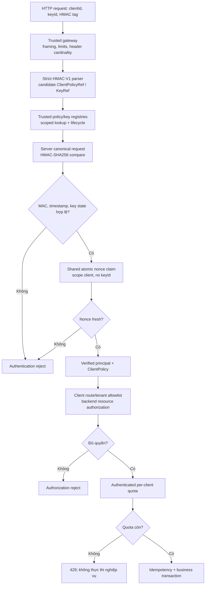
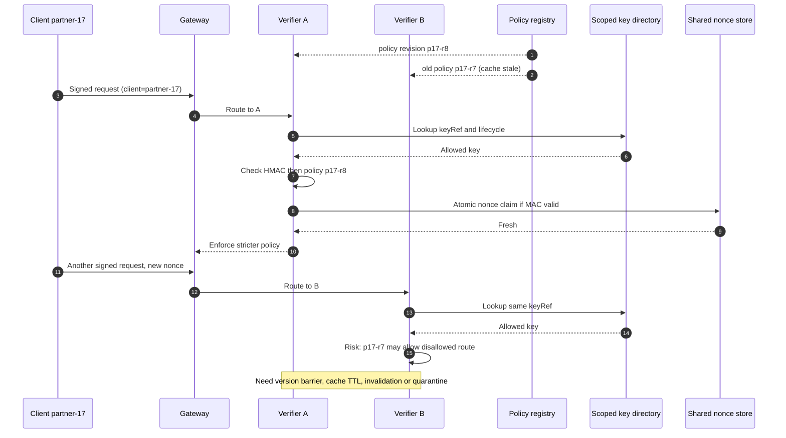

# Chính sách theo client trong hệ thống Multi-client HMAC Request Authentication

## Mục tiêu học tập

Sau bài học, người học có thể:

- Giải thích vì sao **multi-client HMAC** không thể chỉ dùng một shared secret hoặc một tập rule chung không phân biệt khách hàng; định nghĩa chính sách theo từng **client identity đã xác thực** mà không tin những lời khai chưa kiểm chứng trên HTTP.
- Thiết kế `ClientPolicy` có version và owner, được tra theo **`(environment, audience, clientId)`**, gắn với key records `(environment, audience, clientId, keyId)` và các giới hạn timestamp, body size, route, tenant, quota, nonce, key rotation.
- Tách biệt **đặc tả mật mã/canonical request** áp dụng chung cho một protocol version với **chính sách nghiệp vụ và rủi ro thay đổi theo client**; không để khách hàng tự chọn bỏ ký header, bỏ nonce hoặc đổi thuật toán HMAC.
- Phân biệt ba điểm quyết định: **lookup policy candidate từ claim chưa đáng tin**, **authentication bằng HMAC + anti-replay**, và **authorization/quota dựa trên authenticated principal**.
- Dựng canonical request theo bytes thực nhận, có method, raw URI, Host, signed headers, body SHA-256, `clientId`, `keyId`, timestamp và nonce; so full tag HMAC-SHA256 bằng `MessageDigest.isEqual`.
- Viết Java 17 minh họa **hai client dùng cùng chuỗi keyId nhưng secret, tenant, policy khác nhau**, gồm strict header parser, scoped key/policy registry, replay store và quota giả lập.
- Chứng minh không có **cross-client impersonation**, client A không thể giảm policy bằng claim của B, quota của B không bị trừ cho A, nonce/Idempotency-Key được scope rõ và key rotation không phá retry.
- Thiết kế kiểm thử unit/integration/E2E/chaos cho proxy/gateway, multi-replica, policy cache/revoke, fail-closed và monitoring phân tách lỗi authentication với authorization.

**Ngữ cảnh:** Bài thuộc chương **Multi-client**, chủ đề **Chính sách theo client**, của module `SECURITY_AUTHENTICATION_HMAC_REQUEST_AUTHENTICATION`. Mục tiêu toàn module là thiết kế **xác thực HTTP request bằng HMAC với shared secret và canonical request bao gồm method, URI, signed header hoặc body theo hợp đồng ký**, thực hành xác minh tag, chống replay bằng timestamp/nonce, key rotation, kiểm thử proxy/gateway và phân biệt xác thực với phân quyền. Bài này đi sâu vào **cách áp dụng chính sách an ninh khác nhau cho nhiều client mà không làm yếu bảo đảm HMAC chung**.

> Trong bài, `HMAC-V1`, `hmac-multi-client-v1`, endpoints, giới hạn và HTTP response là **profile minh họa tự định nghĩa**, không phải một wire standard phổ quát. Các tham số và key material trong ví dụ là dữ liệu học tập; sản phẩm thật cần security review, vận hành secret manager/KMS và shared distributed stores.

## 1. Vấn đề: một API, nhiều client, nhiều rủi ro

Giả sử `orders-api` phục vụ hai đối tác:

- `partner-17`: một hệ thống đặt hàng nội bộ, cần phản hồi nhanh, lưu lượng thấp, được phép tạo đơn **chỉ** cho `tenant-alpha`.
- `partner-42`: hệ thống tích hợp đối tác lớn, có độ lệch đồng hồ dự kiến lớn hơn, body tối đa lớn hơn, traffic cao hơn, được phép thao tác với `tenant-beta` và một endpoint kiểm tra đơn.
  
Cả hai gọi HTTP qua cùng API gateway đến nhiều Java verifier replicas. Họ dùng **cùng thuật toán HMAC-SHA256 và cùng protocol version**, nhưng có **shared secret riêng** và chính sách khác nhau.

| Tiêu chí minh họa | `partner-17` | `partner-42` |
|---|---|---|
| Environment / audience | `production / orders-api` | `production / orders-api` |
| Client ID | `partner-17` | `partner-42` |
| Key ID đang ký mới | `k2` | `k1` |
| Key ID verify-only | `k1`, có hard deadline | Không có trong ví dụ |
| Secret material | K17-k1, K17-k2 | K42-k1, **khác** K17-k1 |
| Time window quanh server clock | `±30 s` | `±300 s` |
| Max raw body bytes | `4096` | `16384` |
| Quota request hợp lệ | `2/phút` | `4/phút` |
| Raw target được phép | `POST /v1/orders` | `POST /v1/orders` và `POST /v1/orders/validate` |
| Tenant scope sau xác thực | `tenant-alpha` | `tenant-beta` |
| Timestamp/nonce và MAC | Bắt buộc | Bắt buộc |
| Signed header set của `hmac-multi-client-v1` | **Giống nhau** | **Giống nhau** |

Các con số là **giới hạn minh họa cho lab**, không phải khuyến nghị áp dụng nguyên xi cho mọi API.

### Ba câu hỏi độc lập

1. **Request có thực sự được ký bởi chủ sở hữu secret cho client đang khai không?** → HMAC authentication.
2. **Request có còn hợp lệ theo freshness, nonce, key state và policy của client đã xác thực không?** → security policy/replay protection.
3. **Principal ấy có quyền với tenant/resource/action cụ thể không?** → authorization ở API/backend.

Một request có HMAC chính xác vẫn có thể bị **429** do quota, **403** do không có quyền, **409** do idempotency conflict hoặc bị từ chối vì timestamp hết hạn. **HMAC pass không đồng nghĩa business request được cho phép**.

## 2. Mô hình dữ liệu: client, key, policy, principal, tenant

Cần tách các namespace:

```text
ClientPolicyRef
  = (environment, audience, clientId)

KeyRef
  = (environment, audience, clientId, keyId)

VerifiedIdentity
  = (principal từ trusted key record, policyRef, tenant entitlement)

OperationId
  = (authenticated principal/tenant/operation, Idempotency-Key)
```

Ví dụ bản ghi:

```yaml
# Chỉ là ví dụ schema mô tả; không phải manifest được dùng để deploy.
environment: production
audience: orders-api
clientId: partner-17
policyRevision: p17-r8
profile: hmac-multi-client-v1
maxSkewSeconds: 30
maxBodyBytes: 4096
maxRequestsPerMinute: 2
allowedRawTargets:
  - /v1/orders
allowedTenants:
  - tenant-alpha
keyIds:
  k1: VERIFY_ONLY
  k2: ACTIVE
```

**Không đưa shared secret vào policy JSON/YAML công khai.** Key records giữ `secretRef` hoặc key handle ở hệ thống bí mật riêng, với ACL và lifecycle. `policyRevision` dùng cho quản trị/kiểm toán; **không để HTTP client tự khai một revision cũ nhằm quay về rule yếu**.

### Từng loại dữ liệu đáng tin ở thời điểm nào?

| Dữ liệu | Nguồn | Được tin trước MAC? | Sau MAC? |
|---|---|---|---|
| HTTP `clientId` | `Authorization` do client khai | **Không**, chỉ lookup hint có giới hạn | So với `KeyRef` đã xác thực; tạo principal |
| `keyId` | Auth-param do client khai | **Không**, chỉ chọn candidate key | Phải đúng key record và được ký |
| `environment` | Deployment/ingress | **Có, nếu boundary đã bảo vệ** | Giữ nguyên |
| `audience` | Service route/endpoint | **Có, nếu server xác lập** | Giữ nguyên |
| `ClientPolicy` | Trusted policy registry | Có thể lấy **candidate** nhưng chưa nhận caller là chủ policy | Áp giới hạn cho authenticated client |
| `principal` | Key record đã verify | **Chưa tồn tại** | Có thể dùng cho authorization |
| `X-Tenant-Id` | HTTP header được ký | Có thể parse nhưng **không tự tạo quyền** | So với tenant entitlement và resource ownership |
| `Idempotency-Key` | HTTP header được ký | Không tự tạo quyền | Dùng trong scoped business ledger |
| Secret K | Secret manager/KMS/key registry | Chỉ thành phần tin cậy truy cập | Không đưa vào response/log |

### Một client có nhiều keys không có nghĩa nhiều danh tính

Trong rotation, `partner-17` có thể đồng thời có `keyId=k1` (verify-only) và `keyId=k2` (active). Cả hai map về **cùng principal `svc:partner-17`** nếu chính sách identity không thay đổi. Rate limits, nonce replay namespace và idempotency **không nên reset chỉ vì key version đổi**.

Ngược lại, **một chuỗi `keyId=k1` xuất hiện ở hai client** không có nghĩa hai client dùng chung secret; `KeyRef` bao gồm client ID, audience và environment để phân biệt.

## 3. Kiến trúc phân tầng chính sách



**Hai lớp policy cần phân biệt:**

- **Authentication/security policy:** giao thức/thuật toán/key state, timestamp window, nonce, payload limit, required signed fields. Không có valid MAC thì không có principal.
- **Authorization/business policy:** allowed tenants, allowed operations, resource ownership, scopes, định mức nghiệp vụ. Chỉ quyết định sau khi caller được xác thực.

Một số hệ thống chạy route allowlist hoặc size guard **trước** HMAC để giảm tải; điều đó hợp lệ nếu không có side effect và không trả thông tin nội bộ nhạy cảm. Nhưng đừng lấy **`clientId` chưa xác thực** để cấp quyền hoặc để trừ quota của một client đích (kẻ tấn công có thể giả ID và làm cạn budget của người khác).

## 4. Giao thức mật mã chung, không downgrade theo client

Một câu hỏi quan trọng: “Client A được ký ít headers hơn client B không?” Có thể xây nhiều profile, nhưng **đây là thay đổi protocol, không phải một trường tùy ý mà caller tự chọn**.

Trong bài này, **toàn bộ khách hàng** dùng:

- `HmacSHA256` cố định, 32-byte tag.
- `hmac-multi-client-v1` cố định với domain separator và canonical field set.
- `Authorization: HMAC-V1` có đúng năm tham số `client, keyid, ts, nonce, sig`.
- Timestamp được ký, nonce được ký; raw body SHA-256 và target/authority/signed headers được ký.
- TLS, key lookup đúng scope, atomic nonce claim là **bắt buộc**.
- Không có option `alg=none`, `skipNonce=true`, `unsignedBody=true` hay “legacy auto fallback” từ HTTP request.

**Chỉ các giới hạn/entitlements có kiểm soát mới khác theo client**, ví dụ skew window nhỏ hơn, body size, quota và route/tenant allowlist.

### Nếu buộc phải có profile khác cho một client legacy

Cần profile version riêng (`hmac-legacy-v0`), được **server allowlist theo client và endpoint**, có lịch loại bỏ, giới hạn exposure; không tự động downgrade khi MAC mismatch. Không cho attacker thử một giao thức yếu chỉ bằng cách thêm header `X-Signature-Version: old`.

Nếu server cho phép nhiều protocol versions, phải **ràng buộc version vào canonical message** và tách key/secret policy phù hợp. Chỉ sau khi HMAC khớp với một key record trong profile đang được phép mới coi caller thuộc client đó.

### Tăng/giảm skew có thể ảnh hưởng replay TTL

Nếu client A có W=30 giây, B có W=300 giây và hệ thống dùng cùng nonce store, không nên lấy TTL bằng 2×W của client tại thời điểm claim rồi quên **policy có thể được mở rộng**. Một nonce được claim theo W=30 nhưng sau đó policy tăng thành W=300 có thể bị replay nếu record đã hết hạn trong khi signed timestamp lại được chấp nhận.

**Thiết kế bảo thủ cho ví dụ:** nonce TTL cố định **`2×MAX_ALLOWED_SKEW + margin = 2×300 + 5 = 605 giây`** cho tất cả clients trong namespace, bao phủ trường hợp đổi policy window. Production còn phải tính clock skew giữa các nodes, TTL resolution, failure/replication và nhu cầu consistency.

## 5. Hợp đồng HTTP và canonical request theo byte

Profile dùng:

```http
POST /v1/orders HTTP/1.1
Host: api.example.test
Content-Type: application/json
X-Tenant-Id: tenant-alpha
Idempotency-Key: order-2026-001
Authorization: HMAC-V1 client="partner-17", keyid="k2", ts="<epoch-seconds>", nonce="<22-char-base64url>", sig="<43-char-base64url>"

{"orderId":"O-42","amountMinor":120000,"currency":"VND"}
```

Những giá trị `<...>` là placeholder, không phải signature test vector hoàn chỉnh. Trong profile này **không cho query**, raw target là `/v1/orders` hoặc `/v1/orders/validate` và body là bytes UTF-8 chính xác **không có LF cuối**.

### Canonical string

```text
hmac-multi-client-v1
POST
/v1/orders
host:api.example.test
content-type:application/json
x-tenant-id:tenant-alpha
idempotency-key:order-2026-001
environment:production
audience:orders-api
auth-scheme:hmac-v1
client:partner-17
keyid:k2
ts:<epoch-seconds>
nonce:<base64url-nonce>
body-sha256:<base64url-sha256-of-exact-body>
```

**Hợp đồng rõ từng byte:**

1. Thứ tự các dòng cố định. Chỉ dùng **LF 0x0A**, không có LF cuối, encode **UTF-8 không BOM**.
2. Server dựng lại canonical **từ request thực nhận** qua trusted HTTP adapter, không nhận một canonical text do client cung cấp.
3. `host` là public authority xác lập từ ingress tin cậy; `X-Forwarded-Host` của client Internet không đáng tin.
4. `raw target` là target mà backend sẽ thực thi; nếu gateway rewrite, phải verify tại boundary đúng hoặc bảo vệ original target metadata.
5. `Content-Type`, `X-Tenant-Id` và `Idempotency-Key` có **một occurrence**; reject duplicate/ambiguous values.
6. Body SHA-256 lấy từ **exact raw body bytes** khi request đã được framing đúng, không parse JSON rồi serialize lại.
7. `environment` và `audience` do server xác lập và client provision hợp đồng từ trước, **không cho HTTP header tùy ý đổi**.
8. `client` và `keyid` từ Authorization được đưa vào canonical; **values phân biệt hoa/thường**, không lowercase ID.
9. `nonce` 16 bytes CSPRNG encode Base64URL không padding 22 ký tự; tag HMAC-SHA256 32 bytes encode 43 ký tự; decode/re-encode canonical.
10. `sig` không nằm trong canonical string để tránh tự tham chiếu.

Cryptographic operation:

```text
bodyHash = SHA256(rawBodyBytes)
message  = UTF8(joinWithLF(signedFields))
tagBytes = HMAC-SHA256(secretOfExactKeyRef, message)
sig      = Base64URL_NoPadding(tagBytes)
```

**Mỗi client có secret riêng, nhưng canonical contract giống nhau.** Client B không thể gửi `client="partner-17"` với HMAC tính bằng secret B rồi mong verifier chấp nhận, vì key lookup đúng `KeyRef` sẽ chọn secret A và canonical còn ký chính client ID.

## 6. Thiết kế ClientPolicyRef và KeyRef chống nhầm khóa

```text
ClientPolicyRef("production", "orders-api", "partner-17")
ClientPolicyRef("production", "orders-api", "partner-42")

KeyRef("production", "orders-api", "partner-17", "k1")
KeyRef("production", "orders-api", "partner-17", "k2")
KeyRef("production", "orders-api", "partner-42", "k1")
```

Có thể thấy **`k1` trùng chuỗi nhưng thuộc hai client khác nhau**. Registry đúng phải dùng full tuple. Không lookup key bằng `Map<String keyId, Secret>` nếu hệ thống cho phép reuse key IDs trong các client scopes.

### Lookup và authenticate

```text
Input untrusted:
    Authorization.client = partner-17
    Authorization.keyid  = k2

Trusted context:
    env      = production
    audience = orders-api

candidatePolicy = policyRegistry.get(env, audience, partner-17)
candidateKey    = keyRegistry.get(env, audience, partner-17, k2)

if absent/disabled/mismatched -> reject generic auth failure
if now outside key verification lifecycle -> reject
if signed timestamp outside candidatePolicy.window -> reject
if HMAC(secret(candidateKey), serverCanonical) != supplied -> reject
if atomicNonceClaim(authenticatedClientId, nonce) != fresh -> reject

verifiedPrincipal = candidateKey.principal
then authorization + quotas by verified principal/client policy
```

### Tránh policy-confusion giữa client

Một kẻ có quyền sửa request trên mạng có thể thay `client="partner-17"` thành `client="partner-42"`. Nếu server chọn policy B với skew lớn hơn dựa trên claim rồi **bỏ qua bước HMAC**, client A có thể bypass freshness. Nhưng nếu server **luôn** lookup secret B theo scope và ký cả client ID, tag từ secret A không pass.

Tuy vậy, hệ thống vẫn phải bảo vệ các **prefilters trước HMAC**: không dùng claim để loại traffic khỏi global DoS budget của IP, ưu tiên quá mức trong queue hay mở endpoint đặc biệt. Những quyết định có tác dụng cấp quyền, quota hoặc side effect bắt buộc dựa trên **verified identity**.

### Không trộn identity migration với key rotation

Khi `partner-17` chuyển từ `k1` sang `k2`, principal và quyền của client này **không tự đổi**. Nếu đồng thời chuyển owner sang một service account khác, đó là **identity migration** cần kiểm toán riêng, không được âm thầm xảy ra chỉ vì key mới được phát hành.

## 7. Chính sách freshness và chống replay theo client

Với một key/policy đã tra, client A có cửa sổ W=30 giây, client B W=300 giây. Server kiểm tra timestamp `t` theo một `serverNow`:

\[
now-W_{\text{client}} \le t \le now+W_{\text{client}}.
\]

`t` phải là **Unix epoch seconds** trong grammar và phải nằm trong canonical HMAC. Tại biên `t=now±W`, profile chấp nhận; ngoài biên 1 giây reject.

### Nonce scope

```text
ReplayKey = (environment, audience, authenticatedClientId, canonicalNonce)
```

- **Không** scope nonce theo `keyId` trong cùng client nếu chính sách là một nonce chỉ được dùng một lần qua key rotation.
- **Có** scope theo client identity để hai client khác nhau vô tình sinh cùng 16 bytes nonce không chiếm nonce lẫn nhau.
- Sau HMAC verify, lấy client identity từ **key record**, không đưa tùy tiện một header chưa được xác thực vào nonce namespace.
- Claim phải **atomic, shared giữa replicas/regions có thể xử lý cùng scope**, có TTL đủ dài; không dùng `GET` rồi `SET`.

Redis minh họa:

```redis
SET replay:<scope-encoded>:<nonce> 1 NX EX 605
```

`SET NX EX` ở một miền dữ liệu cung cấp atomic set-if-absent, nhưng **replication/failover bất đồng bộ có thể mất claim**; topology cần đánh giá consistency/durability, không hứa exactly-once chỉ nhờ Redis. Store timeout hoặc không rõ claim outcome → **fail closed** trước side effect.

### Thay đổi policy khi có request in-flight

Giả sử A đang được chấp nhận với W=30, policy mới có W=300. Khi reload, cần bảo đảm:

- Mỗi verify dùng **một policy snapshot nhất quán** cho timestamp, body limit, route và nonce TTL.
- Các signed requests từng claim nonce theo policy cũ **chưa hết record** trước khi policy mới có thể nhận timestamp xa hơn.
- Dùng TTL theo **global upper bound W** hoặc chiến lược versioned policy/nonce retention có chứng minh được độ phủ.
- Nếu giảm W hoặc revoke key, không để cache stale của một replica tiếp tục áp policy yếu quá ngưỡng đã cam kết.

## 8. Rate limits, quotas và quyền: đặt đúng sau authentication

Một tình huống thường gặp: hệ thống có quota `partner-17: 2 requests/minute`. Attacker gửi một triệu request với header `client="partner-17"` và HMAC ngẫu nhiên. Nếu quota của `partner-17` bị trừ **trước khi HMAC được xác minh**, attacker có thể làm cạn budget của nạn nhân mà không biết secret.

**Thiết kế nên có ít nhất hai tầng:**

1. **Pre-auth infrastructure controls:** giới hạn connection, header/body sizes, parser effort, IP/source rate, concurrency và key lookup budget trên toàn API. Không tin client ID để được ưu tiên.
2. **Post-auth client-specific quota:** sau HMAC hợp lệ và danh tính đã xác thực, trừ quota trong namespace `(environment,audience,authenticatedClientId,operation,window)`.

Sau đó backend vẫn làm **resource-level authorization**. Ví dụ `X-Tenant-Id: tenant-alpha` được HMAC ký nhưng **không phải bằng chứng sở hữu một order cụ thể**; chỉ là input được bảo vệ. API phải đối chiếu tenant đã ký với principal entitlements và resource owner trong database.

### Có nên trừ quota trước hay sau nonce claim?

Không có một thứ tự duy nhất cho mọi API. Profile bài này dùng:

```text
HMAC + key state + timestamp
    → atomic nonce claim
    → client tenant/route authorization
    → per-client quota
    → idempotency/transaction
```

Theo thứ tự này, **request bị 429 đã tiêu thụ nonce** vì nó đã là một signed attempt được chấp nhận vào replay gate. Client muốn retry phải **re-sign với nonce mới**, giữ cùng `Idempotency-Key` nếu là cùng logical operation. Nếu hệ thống chọn quota trước claim, phải định nghĩa rõ retry/mutation semantics và tránh cho unauthenticated traffic tiêu thụ quota của một client thật.

**Quota không thay thế replay store.** Một request nguyên HMAC có thể được phát lại nhiều lần ở mức dưới quota; anti-replay vẫn cần nonce atomic.

## 9. Java 17 — hai client, chính sách khác nhau, một HMAC contract

Ví dụ xây dựng một verifier với:

- `ClientPolicyRef(env,audience,clientId)` là khóa tra policy từ **trusted registry**.
- `KeyRef(env,audience,clientId,keyId)` là khóa tra đúng secret.
- Hai clients có **cùng chuỗi `keyId=k1` nhưng secret khác nhau**.
- `partner-17` có k1 `VERIFY_ONLY` và k2 `ACTIVE`; `partner-42` có k1 `ACTIVE`.
- Policy A: skew 30 s, body 4 KiB, 2 requests/minute, một target/tenant.
- Policy B: skew 300 s, body 16 KiB, 4 requests/minute, hai targets, một tenant khác.
- HMAC-SHA256/canonicalization **cố định**, không có tùy chọn thuật toán hoặc unsigned header theo client.
- Store nonce và rate limiter in-memory **chỉ là test fixtures trong một JVM**.

### 9.1. Mã Java đầy đủ

```java
import java.nio.charset.StandardCharsets;
import java.security.GeneralSecurityException;
import java.security.MessageDigest;
import java.security.SecureRandom;
import java.time.Clock;
import java.time.Instant;
import java.time.ZoneOffset;
import java.util.Arrays;
import java.util.Base64;
import java.util.Map;
import java.util.Optional;
import java.util.Set;
import java.util.concurrent.ConcurrentHashMap;
import java.util.concurrent.atomic.AtomicBoolean;
import java.util.regex.Matcher;
import java.util.regex.Pattern;
import javax.crypto.Mac;
import javax.crypto.spec.SecretKeySpec;

public final class MultiClientHmacPolicyV1 {
    private static final String PROFILE = "hmac-multi-client-v1";
    private static final String ENV = "production";
    private static final String AUDIENCE = "orders-api";
    private static final String HOST = "api.example.test";
    private static final String TYPE = "application/json";
    private static final String CREATE = "/v1/orders";
    private static final String VALIDATE = "/v1/orders/validate";
    private static final int MAX_SKEW = 300;
    private static final int GLOBAL_MAX_BODY = 16 * 1024;
    private static final long NONCE_TTL = 2L * MAX_SKEW + 5L;
    private static final long MAX_EPOCH = 253402300799L;

    private static final Base64.Encoder B64 =
            Base64.getUrlEncoder().withoutPadding();
    private static final Pattern ID =
            Pattern.compile("[A-Za-z0-9][A-Za-z0-9._-]{0,63}");
    private static final Pattern IDEM =
            Pattern.compile("[A-Za-z0-9][A-Za-z0-9._-]{0,79}");
    private static final Pattern TS =
            Pattern.compile("[1-9][0-9]{0,11}");
    private static final Pattern NONCE =
            Pattern.compile("[A-Za-z0-9_-]{22}");
    private static final Pattern TAG =
            Pattern.compile("[A-Za-z0-9_-]{43}");

    // Full match: names case-insensitive, values case-sensitive.
    // Fixed order/spacing/quotes as agreed by this custom profile.
    private static final Pattern AUTH = Pattern.compile(
            "(?i:HMAC-V1) (?i:client)=\"([A-Za-z0-9][A-Za-z0-9._-]{0,63})\", " +
            "(?i:keyid)=\"([A-Za-z0-9][A-Za-z0-9._-]{0,63})\", " +
            "(?i:ts)=\"([1-9][0-9]{0,11})\", " +
            "(?i:nonce)=\"([A-Za-z0-9_-]{22})\", " +
            "(?i:sig)=\"([A-Za-z0-9_-]{43})\"");

    private MultiClientHmacPolicyV1() {}

    public record PolicyRef(
            String environment, String audience, String clientId) {}

    public record KeyRef(
            String environment, String audience,
            String clientId, String keyId) {}

    public enum KeyState {
        PREPARED, ACTIVE, VERIFY_ONLY, REVOKED
    }

    public record ClientPolicy(
            PolicyRef ref, String revision,
            Set<String> allowedTargets, Set<String> allowedTenants,
            int maxSkewSeconds, int maxBodyBytes,
            int maxRequestsPerMinute) {

        public ClientPolicy {
            if (ref == null || revision == null || revision.isBlank() ||
                    allowedTargets == null || allowedTargets.isEmpty() ||
                    allowedTenants == null || allowedTenants.isEmpty() ||
                    maxSkewSeconds <= 0 || maxSkewSeconds > MAX_SKEW ||
                    maxBodyBytes <= 0 || maxBodyBytes > GLOBAL_MAX_BODY ||
                    maxRequestsPerMinute <= 0) {
                throw new IllegalArgumentException("Invalid client policy");
            }
            allowedTargets = Set.copyOf(allowedTargets);
            allowedTenants = Set.copyOf(allowedTenants);
        }
    }

    public record KeyRecord(
            KeyRef ref, String principal, KeyState state,
            Instant notBefore, Instant verifyUntil, byte[] secret) {

        public KeyRecord {
            if (ref == null || principal == null || principal.isBlank() ||
                    state == null || notBefore == null ||
                    verifyUntil == null || !notBefore.isBefore(verifyUntil) ||
                    secret == null || secret.length != 32) {
                throw new IllegalArgumentException("Invalid key record");
            }
            secret = secret.clone();
        }

        @Override
        public byte[] secret() {
            return secret.clone();
        }

        public boolean mayVerify(Instant now) {
            return (state == KeyState.ACTIVE ||
                    state == KeyState.VERIFY_ONLY) &&
                    !now.isBefore(notBefore) &&
                    now.isBefore(verifyUntil);
        }
    }

    public record Claims(
            String clientId, String keyId, String timestamp, String nonce) {}

    public record Parsed(Claims claims, byte[] receivedTag) {}

    // Trusted HTTP adapter must provide a validated immutable snapshot.
    public record Request(
            String method, String rawTarget, String publicHost,
            String contentType, String tenantHeader,
            String idempotencyKey, byte[] rawBody) {

        public Request {
            if (rawBody == null) {
                throw new IllegalArgumentException("Missing body");
            }
            rawBody = rawBody.clone();
        }

        @Override
        public byte[] rawBody() {
            return rawBody.clone();
        }
    }

    public enum Decision {
        OK, AUTH_FAILED, REPLAY, FORBIDDEN, THROTTLED
    }

    public record Result(Decision decision, String principal) {}

    public interface PolicyStore {
        Optional<ClientPolicy> find(PolicyRef ref);
    }

    public interface KeyDirectory {
        Optional<KeyRecord> find(KeyRef ref);
    }

    public interface NonceStore {
        // Production: atomic, shared and durable enough for every replica.
        boolean claim(PolicyRef authenticatedClient, String nonce,
                      long ttlSeconds);
    }

    public interface RateLimiter {
        // Must key by authenticated client scope, not raw HTTP claim.
        boolean allow(PolicyRef authenticatedClient, long serverEpoch,
                      int maxRequestsPerMinute);
    }

    // Demo only: atomic within one JVM, no cleanup or distributed sharing.
    public static final class LocalFixedWindowLimiter implements RateLimiter {
        private record Count(long window, int used) {}
        private final ConcurrentHashMap<PolicyRef, Count> counts =
                new ConcurrentHashMap<>();

        @Override
        public boolean allow(PolicyRef ref, long epoch, int maxPerMinute) {
            long bucket = Math.floorDiv(epoch, 60L);
            AtomicBoolean accepted = new AtomicBoolean(false);
            counts.compute(ref, (key, old) -> {
                int oldCount = old == null || old.window() != bucket
                        ? 0 : old.used();
                if (oldCount >= maxPerMinute) {
                    return new Count(bucket, oldCount);
                }
                accepted.set(true);
                return new Count(bucket, oldCount + 1);
            });
            return accepted.get();
        }
    }

    public static String freshNonce(SecureRandom random) {
        byte[] value = new byte[16];
        random.nextBytes(value);
        return B64.encodeToString(value);
    }

    private static byte[] decodeCanonical(
            String text, Pattern grammar, int length) {
        if (text == null || !grammar.matcher(text).matches()) {
            throw new IllegalArgumentException("Bad Base64URL grammar");
        }
        final byte[] decoded;
        try {
            decoded = Base64.getUrlDecoder().decode(text);
        } catch (IllegalArgumentException malformed) {
            throw new IllegalArgumentException("Invalid Base64URL");
        }
        if (decoded.length != length ||
                !B64.encodeToString(decoded).equals(text)) {
            throw new IllegalArgumentException("Noncanonical Base64URL");
        }
        return decoded;
    }

    private static long timestamp(String raw) {
        if (raw == null || !TS.matcher(raw).matches()) {
            throw new IllegalArgumentException("Invalid epoch seconds");
        }
        long value = Long.parseLong(raw);
        if (value > MAX_EPOCH) {
            throw new IllegalArgumentException("Epoch seconds out of range");
        }
        return value;
    }

    private static void validateRequest(Request r) {
        if (r == null || !"POST".equals(r.method()) ||
                !(CREATE.equals(r.rawTarget()) ||
                  VALIDATE.equals(r.rawTarget())) ||
                !HOST.equals(r.publicHost()) ||
                !TYPE.equals(r.contentType()) ||
                r.tenantHeader() == null ||
                !ID.matcher(r.tenantHeader()).matches() ||
                r.idempotencyKey() == null ||
                !IDEM.matcher(r.idempotencyKey()).matches() ||
                r.rawBody().length == 0 ||
                r.rawBody().length > GLOBAL_MAX_BODY) {
            throw new IllegalArgumentException("Invalid signed request");
        }
    }

    private static void validateClaims(Claims c) {
        if (c == null || c.clientId() == null ||
                !ID.matcher(c.clientId()).matches() ||
                c.keyId() == null ||
                !ID.matcher(c.keyId()).matches()) {
            throw new IllegalArgumentException("Invalid client/key ID");
        }
        timestamp(c.timestamp());
        decodeCanonical(c.nonce(), NONCE, 16);
    }

    public static Parsed parseAuthorization(String header) {
        // HTTP adapter must reject duplicate Authorization occurrences.
        if (header == null || header.length() > 512) {
            throw new IllegalArgumentException("Invalid Authorization");
        }
        Matcher m = AUTH.matcher(header);
        if (!m.matches()) {
            throw new IllegalArgumentException("Bad HMAC-V1 syntax");
        }
        Claims claims = new Claims(
                m.group(1), m.group(2), m.group(3), m.group(4));
        validateClaims(claims);
        return new Parsed(
                claims, decodeCanonical(m.group(5), TAG, 32));
    }

    public static byte[] canonicalBytes(Request r, Claims c)
            throws GeneralSecurityException {
        validateRequest(r);
        validateClaims(c);
        byte[] bodyHash = MessageDigest.getInstance("SHA-256")
                .digest(r.rawBody());
        String canonical = String.join("\n",
                PROFILE,
                "POST",
                r.rawTarget(),
                "host:" + r.publicHost(),
                "content-type:" + r.contentType(),
                "x-tenant-id:" + r.tenantHeader(),
                "idempotency-key:" + r.idempotencyKey(),
                "environment:" + ENV,
                "audience:" + AUDIENCE,
                "auth-scheme:hmac-v1",
                "client:" + c.clientId(),
                "keyid:" + c.keyId(),
                "ts:" + c.timestamp(),
                "nonce:" + c.nonce(),
                "body-sha256:" + B64.encodeToString(bodyHash));
        return canonical.getBytes(StandardCharsets.UTF_8);
    }

    private static byte[] hmac(
            byte[] temporarySecret, Request r, Claims c)
            throws GeneralSecurityException {
        try {
            Mac mac = Mac.getInstance("HmacSHA256");
            mac.init(new SecretKeySpec(temporarySecret, "HmacSHA256"));
            return mac.doFinal(canonicalBytes(r, c));
        } finally {
            // Best effort cleanup of THIS copy, not all JVM copies.
            Arrays.fill(temporarySecret, (byte) 0);
        }
    }

    // Only a test helper: it simulates client signing with provisioned K.
    // It is NOT a production server function that signs on behalf of clients.
    public static String signFixture(
            KeyRecord signingFixture, Request request, Claims claims)
            throws GeneralSecurityException {
        if (!signingFixture.ref().clientId().equals(claims.clientId()) ||
                !signingFixture.ref().keyId().equals(claims.keyId())) {
            throw new IllegalArgumentException("Wrong fixture identity");
        }
        String tag = B64.encodeToString(
                hmac(signingFixture.secret(), request, claims));
        return "HMAC-V1 client=\"" + claims.clientId() +
                "\", keyid=\"" + claims.keyId() +
                "\", ts=\"" + claims.timestamp() +
                "\", nonce=\"" + claims.nonce() +
                "\", sig=\"" + tag + "\"";
    }

    public static Result verify(
            Request received, String authorization, Clock serverClock,
            PolicyStore policies, KeyDirectory keys,
            NonceStore nonces, RateLimiter limiter)
            throws GeneralSecurityException {
        final Parsed parsed;
        try {
            parsed = parseAuthorization(authorization);
            validateRequest(received);
        } catch (IllegalArgumentException badInput) {
            return new Result(Decision.AUTH_FAILED, null);
        }

        // Untrusted clientId is a BOUNDED LOOKUP HINT, never a principal.
        PolicyRef policyRef = new PolicyRef(
                ENV, AUDIENCE, parsed.claims().clientId());
        KeyRef keyRef = new KeyRef(
                ENV, AUDIENCE,
                parsed.claims().clientId(), parsed.claims().keyId());
        Optional<ClientPolicy> policyCandidate = policies.find(policyRef);
        Optional<KeyRecord> keyCandidate = keys.find(keyRef);
        if (policyCandidate.isEmpty() || keyCandidate.isEmpty()) {
            return new Result(Decision.AUTH_FAILED, null);
        }

        ClientPolicy policy = policyCandidate.get();
        KeyRecord key = keyCandidate.get();
        Instant now = serverClock.instant();
        if (!policyRef.equals(policy.ref()) ||
                !keyRef.equals(key.ref()) ||
                !key.mayVerify(now)) {
            return new Result(Decision.AUTH_FAILED, null);
        }

        // Policy limits are server-owned, not selected by a signed header.
        long t = timestamp(parsed.claims().timestamp());
        long serverSeconds = now.getEpochSecond();
        if (serverSeconds < 0 || serverSeconds > MAX_EPOCH ||
                t - serverSeconds < -policy.maxSkewSeconds() ||
                t - serverSeconds > policy.maxSkewSeconds() ||
                received.rawBody().length > policy.maxBodyBytes()) {
            return new Result(Decision.AUTH_FAILED, null);
        }

        byte[] expected = hmac(
                key.secret(), received, parsed.claims());
        if (!MessageDigest.isEqual(
                expected, parsed.receivedTag())) {
            return new Result(Decision.AUTH_FAILED, null);
        }

        // Only NOW can policyRef be treated as an authenticated identity.
        final boolean fresh;
        try {
            fresh = nonces.claim(
                    policyRef, parsed.claims().nonce(), NONCE_TTL);
        } catch (RuntimeException storeFailure) {
            return new Result(Decision.AUTH_FAILED, null); // Fail closed.
        }
        if (!fresh) return new Result(Decision.REPLAY, null);

        // Signed tenant header is only a requested tenant; not a grant.
        if (!policy.allowedTargets().contains(received.rawTarget()) ||
                !policy.allowedTenants().contains(received.tenantHeader())) {
            return new Result(Decision.FORBIDDEN, key.principal());
        }

        // In production, backend must ALSO authorize resource ownership.
        // This in-memory quota is NOT a multi-replica implementation.
        if (!limiter.allow(policyRef, serverSeconds,
                policy.maxRequestsPerMinute())) {
            return new Result(Decision.THROTTLED, key.principal());
        }

        return new Result(Decision.OK, key.principal());
    }

    private static void require(Decision actual, Decision expected) {
        if (actual != expected) {
            throw new AssertionError(
                    "Expected " + expected + ", got " + actual);
        }
    }

    public static void main(String[] args)
            throws GeneralSecurityException {
        Instant t0 = Instant.parse("2026-11-28T00:00:00Z");
        Clock clock = Clock.fixed(t0, ZoneOffset.UTC);
        SecureRandom rng = new SecureRandom();

        PolicyRef a = new PolicyRef(ENV, AUDIENCE, "partner-17");
        PolicyRef b = new PolicyRef(ENV, AUDIENCE, "partner-42");
        ClientPolicy policyA = new ClientPolicy(a, "p17-r8",
                Set.of(CREATE), Set.of("tenant-alpha"),
                30, 4096, 2);
        ClientPolicy policyB = new ClientPolicy(b, "p42-r3",
                Set.of(CREATE, VALIDATE), Set.of("tenant-beta"),
                300, 16384, 4);
        PolicyStore policies = ref ->
                Optional.ofNullable(Map.of(
                        a, policyA, b, policyB).get(ref));

        KeyRef aK1 = new KeyRef(ENV, AUDIENCE, a.clientId(), "k1");
        KeyRef aK2 = new KeyRef(ENV, AUDIENCE, a.clientId(), "k2");
        KeyRef bK1 = new KeyRef(ENV, AUDIENCE, b.clientId(), "k1");
        byte[] rawA1 = new byte[32];
        byte[] rawA2 = new byte[32];
        byte[] rawB1 = new byte[32];
        rng.nextBytes(rawA1);
        rng.nextBytes(rawA2);
        rng.nextBytes(rawB1);

        KeyRecord prevA = new KeyRecord(aK1, "svc:partner-17",
                KeyState.VERIFY_ONLY, t0.minusSeconds(3600),
                t0.plusSeconds(120), rawA1);
        KeyRecord curA = new KeyRecord(aK2, "svc:partner-17",
                KeyState.ACTIVE, t0.minusSeconds(3600),
                t0.plusSeconds(3600), rawA2);
        KeyRecord curB = new KeyRecord(bK1, "svc:partner-42",
                KeyState.ACTIVE, t0.minusSeconds(3600),
                t0.plusSeconds(3600), rawB1);
        Arrays.fill(rawA1, (byte) 0);
        Arrays.fill(rawA2, (byte) 0);
        Arrays.fill(rawB1, (byte) 0);

        KeyDirectory keys = ref ->
                Optional.ofNullable(Map.of(
                        aK1, prevA, aK2, curA, bK1, curB).get(ref));

        // TEST ONLY: no TTL, cross-JVM sharing, failover or durable claim.
        Set<String> seen = ConcurrentHashMap.newKeySet();
        NonceStore nonces = (ref, nonce, ttl) ->
                seen.add(ref.toString() + "|" + nonce);
        RateLimiter quotas = new LocalFixedWindowLimiter();

        Request orderA = new Request(
                "POST", CREATE, HOST, TYPE, "tenant-alpha",
                "order-alpha-001",
                "{\"orderId\":\"A-1\",\"amountMinor\":1000}"
                        .getBytes(StandardCharsets.UTF_8));
        Request orderB = new Request(
                "POST", CREATE, HOST, TYPE, "tenant-beta",
                "order-beta-001",
                "{\"orderId\":\"B-1\",\"amountMinor\":2000}"
                        .getBytes(StandardCharsets.UTF_8));
        Request validationA = new Request(
                "POST", VALIDATE, HOST, TYPE, "tenant-alpha",
                "validate-alpha-001", orderA.rawBody());
        Request forbiddenB = new Request(
                "POST", CREATE, HOST, TYPE, "tenant-alpha",
                "order-not-owned-by-b", orderB.rawBody());

        // Simulate an in-flight old-key request already signed pre-cutover.
        // signFixture intentionally does not enforce client signing state.
        Claims aOld = new Claims(a.clientId(), "k1",
                Long.toString(t0.getEpochSecond()), freshNonce(rng));
        String hOld = signFixture(prevA, orderA, aOld);
        require(verify(orderA, hOld, clock, policies, keys, nonces,
                quotas).decision(), Decision.OK);

        require(verify(orderA, hOld, clock, policies, keys, nonces,
                quotas).decision(), Decision.REPLAY);

        // Same nonce after rotation to k2 remains REPLAY.
        Claims reusedAcrossKeys = new Claims(a.clientId(), "k2",
                aOld.timestamp(), aOld.nonce());
        String crossKey = signFixture(curA, orderA, reusedAcrossKeys);
        require(verify(orderA, crossKey, clock, policies, keys, nonces,
                quotas).decision(), Decision.REPLAY);

        // A and B may both have literal keyId="k1", but different secrets.
        Claims bNew = new Claims(b.clientId(), "k1",
                Long.toString(t0.getEpochSecond()), freshNonce(rng));
        String hB = signFixture(curB, orderB, bNew);
        require(verify(orderB, hB, clock, policies, keys, nonces,
                quotas).decision(), Decision.OK);

        // Tamper A's client claim but retain its MAC; B cannot inherit A.
        Claims aTamperSource = new Claims(a.clientId(), "k1",
                aOld.timestamp(), freshNonce(rng));
        String hA = signFixture(prevA, orderA, aTamperSource);
        String relabeled = hA.replace(
                "client=\"partner-17\"", "client=\"partner-42\"");
        require(verify(orderA, relabeled, clock, policies, keys, nonces,
                quotas).decision(), Decision.AUTH_FAILED);

        // A cannot use a B-only endpoint, even with a valid HMAC.
        Claims notAllowed = new Claims(a.clientId(), "k2",
                aOld.timestamp(), freshNonce(rng));
        String hNotAllowed = signFixture(curA, validationA, notAllowed);
        require(verify(validationA, hNotAllowed, clock, policies,
                keys, nonces, quotas).decision(), Decision.FORBIDDEN);

        // B cannot access tenant-alpha; signature is still valid.
        Claims wrongTenant = new Claims(b.clientId(), "k1",
                bNew.timestamp(), freshNonce(rng));
        String hWrongTenant = signFixture(curB, forbiddenB, wrongTenant);
        require(verify(forbiddenB, hWrongTenant, clock, policies,
                keys, nonces, quotas).decision(), Decision.FORBIDDEN);

        // A's second accepted attempt is signed with current key k2.
        Claims aCurrent = new Claims(a.clientId(), "k2",
                aOld.timestamp(), freshNonce(rng));
        String hACurrent = signFixture(curA, orderA, aCurrent);
        require(verify(orderA, hACurrent, clock, policies, keys, nonces,
                quotas).decision(), Decision.OK);

        // A's third valid attempt exceeds A's per-minute quota, not B's.
        Claims aThird = new Claims(a.clientId(), "k2",
                aOld.timestamp(), freshNonce(rng));
        String hAThird = signFixture(curA, orderA, aThird);
        require(verify(orderA, hAThird, clock, policies, keys, nonces,
                quotas).decision(), Decision.THROTTLED);

        // A accepts only ±30s; B accepts ±300s in this test policy.
        Claims staleA = new Claims(a.clientId(), "k2",
                Long.toString(t0.minusSeconds(60).getEpochSecond()),
                freshNonce(rng));
        String hStaleA = signFixture(curA, orderA, staleA);
        require(verify(orderA, hStaleA, clock, policies, keys, nonces,
                quotas).decision(), Decision.AUTH_FAILED);

        Claims olderB = new Claims(b.clientId(), "k1",
                Long.toString(t0.minusSeconds(60).getEpochSecond()),
                freshNonce(rng));
        String hOlderB = signFixture(curB, orderB, olderB);
        require(verify(orderB, hOlderB, clock, policies, keys, nonces,
                quotas).decision(), Decision.OK);

        // Expired/REVOKED previous key fails even with valid fresh MAC.
        KeyRecord revokedA = new KeyRecord(aK1, "svc:partner-17",
                KeyState.REVOKED, t0.minusSeconds(3600),
                t0.plusSeconds(120), prevA.secret());
        KeyDirectory revokedKeys = ref ->
                Optional.ofNullable(Map.of(
                        aK1, revokedA, aK2, curA, bK1, curB).get(ref));
        Claims revokeProbe = new Claims(a.clientId(), "k1",
                aOld.timestamp(), freshNonce(rng));
        String hRevoke = signFixture(prevA, orderA, revokeProbe);
        require(verify(orderA, hRevoke, clock, policies,
                revokedKeys, nonces, quotas).decision(),
                Decision.AUTH_FAILED);

        // B and A are separate quota and nonce namespaces.
        System.out.println("Multi-client HMAC policies: PASS");
    }
}
```

### 9.2. Đọc kết quả demo đúng phạm vi

- `partner-17` và `partner-42` đều có một `keyId="k1"`, nhưng `KeyDirectory` tra **full KeyRef**, giữ K17-k1 và K42-k1 riêng.
- `ClientPolicy` lưu tối đa skew/body/quota/allowedTargets/allowedTenants từ server registry; không nhận policy từ header.
- `parseAuthorization` kiểm tra đúng một serialization của profile; **HTTP adapter vẫn phải reject duplicate Authorization occurrences** trước khi đưa một String vào parser.
- `canonicalBytes` dựng chung format cho tất cả clients, bao gồm signed tenant header và `clientId`/`keyId`/nonce/timestamp; body được SHA-256 theo bytes nhận.
- `verify` dùng policy window 30/300 giây, kiểm tra key state, HMAC full 32 byte bằng `MessageDigest.isEqual`, rồi claim nonce.
- `NonceStore` trong fixture scope theo **PolicyRef, không theo keyId**. Request k2 ký lại bằng nonce từng claim khi k1 vẫn là replay.
- `RateLimiter` chỉ trừ quota **sau khi xác thực**, nên attacker có tag ngẫu nhiên không thể làm cạn quota của `partner-17` qua mã này.
- `Decision.FORBIDDEN` biểu diễn route/tenant policy deny; **không phải bằng chứng** backend đã kiểm tra resource ownership trong DB.
- Code kiểm tra input/nonce/tag format, tampering claim client ID, wrong tenant, disallowed route, per-client skew/quota, previous-key revoke, replay xuyên rotation.
- `signFixture` cố tình mô phỏng một request đã ký từ trước bằng previous key; **không phải signer production**. SDK thật không được tạo request mới bằng VERIFY_ONLY key sau cutover.

### 9.3. Những giới hạn quan trọng của demo

Demo **không** thay thế production implementation:

1. `ConcurrentHashMap.newKeySet` không có TTL, persistence hoặc chia sẻ đa JVM/region; cần shared atomic nonce store thực.
2. `LocalFixedWindowLimiter` là bộ đếm in-memory đơn giản, không có distributed quota, cleanup, burst control, retry semantics hoặc fairness chống DDoS.
3. `Map.of` policy/key registry chỉ là **snapshot**, không hỗ trợ cập nhật policy/revocation toàn fleet hay consistency khi failover.
4. `Request` chưa đến từ HTTP parser thật; gateway phải xác minh các trường raw target, public Host, header cardinality, content framing và trusted forwarded metadata.
5. Code không có database authorization thực (row-level/tenant ownership), idempotency ledger, transaction hoặc outbox.
6. Secret trong test sinh ngẫu nhiên bởi `SecureRandom`, không có credential production; KMS/secret injection/rotation/zeroization đầy đủ là phần phải xây riêng.
7. HTTP status public không nên leak client existence, key state hay expected MAC chỉ vì `Decision` dùng cho lab.

**Không** chuyển `Map.of`/`ConcurrentHashMap` thành cấu hình production bằng cách đổi tên class; điều cần chứng minh còn là **atomic distributed state**, key lifecycle, audit và E2E protocol agreement.

## 10. Key rotation và policy lifecycle của nhiều client

Một client có thể có hai key records trong một policy scope:

```text
ClientPolicyRef(production, orders-api, partner-17)
  policyRevision p17-r8
  KeyRef(..., k1): VERIFY_ONLY until 2026-11-28T00:02:00Z
  KeyRef(..., k2): ACTIVE until later deadline

ClientPolicyRef(production, orders-api, partner-42)
  policyRevision p42-r3
  KeyRef(..., k1): ACTIVE, independent material
```

**Không để key rotation của A làm đổi key B**, dù cả hai dùng key ID `k1`. Mọi secret mới phải có **key ID mới trong client scope** và mapping `KeyRef→secret` bất biến.

### Chính sách theo client khi rotate

- Provision secret k2 cho **đúng owner/client**, đúng environment/audience.
- Cho mọi verifier biết k2, state và policy tương ứng trước client cutover.
- Chuyển client sang ký k2; k1 thành VERIFY_ONLY có **verifyUntil** hữu hạn.
- Nonce namespace **không thêm keyId** để tránh reset replay domain khi đổi k1→k2.
- Quota và idempotency theo authenticated client/principal/tenant **không reset** vì key ID đổi.
- Khi k1 REVOKED/expired, từ chối bằng **server clock/policy state** ngay cả khi HMAC toán học vẫn đúng.
- Nếu client A bị lộ K1, revoke **K1 của A**, không vô hiệu hóa oan credential của client B có `keyId=k1` khác.
- Không tự fallback K2→K1 sau một lỗi 401; chỉ rollback theo quy trình phê duyệt nếu old key chưa compromise/revoke.

### Policy revision có nên ký trong canonical?

Bài chọn **protocol profile version** `hmac-multi-client-v1` được ký/dẫn xuất vào canonical, còn **runtime policy revision** `p17-r8` không đưa vào wire. Nhờ đó **thay quota, skew window hoặc tenant entitlement** không bắt buộc SDK client ký theo revision mới, nhưng hiệu lực policy phải được thông báo và giám sát.

Nếu business cần client ký một **contract version đặc thù** (ví dụ signed field set thay đổi), hãy thiết kế protocol version riêng, issuer-controlled allowlist và migration rõ ràng. Không đồng nhất “policy revision” với “cryptographic contract version” hoặc cho phép header `X-Policy-Revision: old` tắt những rule mới.

## 11. Policy registry, cache, invalidation và multi-region

Một policy theo client chỉ đáng tin nếu các verifier thấy **cùng quyết định** hoặc mức nhất quán đủ an toàn.



### Những thay đổi cần consistency mạnh

| Loại thay đổi | Nguy cơ nếu cache stale | Chính sách vận hành |
|---|---|---|
| Revoke client/credential | Replica vẫn authenticate request đã bị cấm | Push invalidation, revocation barrier, fail closed |
| Thu hẹp allowed tenants/routes | Replica cho truy cập ngoài phạm vi | Versioned policy, readiness gating/quarantine |
| Hạ maxBodyBytes/quota | Một node áp limits cũ cao hơn | Bounded cache age, central enforcement nếu cần |
| Rút ngắn timestamp window | Node giữ W cũ rộng hơn | Đồng bộ rollout, TTL nonce không thấp hơn bound |
| Mở rộng timestamp window | Replay record cũ có thể đã bị xóa | TTL theo global max window hoặc staged migration |
| Provision key mới | Một replica thiếu key | Rollout verifier trước client signer |
| Rotate key từ ACTIVE→VERIFY_ONLY | Một signer/verifier còn state cũ | Deadline cứng, metrics traffic theo key |
| Restore backup policy | Rule từng revoke quay lại | Monotonic policy generation/tombstones |

### Không tin policy version từ client

Một endpoint như `?policyVersion=1` hoặc `X-Policy-Version: old` không được tự làm verifier chọn snapshot yếu hơn. Version có thể xuất hiện trong signed protocol như một **negotiation mechanism được server allowlist và anti-downgrade**, nhưng client không được chọn privilege bất kỳ.

### Unknown policy: fail closed

Nếu key tồn tại nhưng `ClientPolicy` mất, không dùng “default allow all”; nếu registry timeout hoặc không xác nhận được revocation state, request nhạy cảm nên fail closed/quarantine theo threat model. **Một bộ policy default chặt** có thể dùng cho một vài denial prefilter, nhưng không được trở thành đường đi chấp nhận authenticated operation khi mapping owner/scope bị thiếu.

## 12. Proxy/gateway và canonicalization: chính sách phải dựa trên cùng request

| Tình huống | Hậu quả ở multi-client | Biện pháp |
|---|---|---|
| Gateway strip Authorization | Mất client/key ID, tag | Reject, sửa forwarding hoặc verify tại edge |
| Hai Authorization headers | Một tầng chọn client A, tầng khác chọn B | Reject duplicate ở ingress |
| Duplicate `client`/`keyid` auth-param | Key lookup/policy lookup bất đồng | Strict parser, reject duplicate case-insensitive |
| Two `X-Tenant-Id` headers | Verifier ký tenant A, backend dùng tenant B | Reject duplicate, dùng một trusted snapshot |
| Client khai `X-Authenticated-Principal` | Bypass policy/identity | Strip/overwrite; trust only server-generated context |
| Client khai `X-Environment` | Cross-env policy/key confusion | Env/audience từ server config |
| Proxy Host public → Host internal | Canonical Host mismatch, audience confusion | Trusted public Host, verify trước rewrite |
| HTTP/2 `:authority` ≠ Host | Gateway route khác verifier | Reject ambiguity theo ingress policy |
| Path/query rewrite | Policy allowlist check A nhưng handler thực thi B | Bind raw target và route semantics |
| JSON body reserialization | HMAC digest khác, fingerprint mismatch | Hash exact raw bytes; không transform sau ký |
| Compression/content encoding | Signed raw representation khác request handler | Contract chốt signed bytes, reject unsupported encoding |
| Client SDK retry với nonce cũ | Replay gate reject | Re-sign mỗi attempt, giữ Idempotency-Key |
| Proxy retry POST tự động | Có thể gây duplicate business effect | Backend idempotency + nonce contract |
| Cross-origin redirect | Credential client A bị chuyển sai host | Không forward Authorization tới origin khác |
| Load balancer chọn replica stale | Policy/quota/credential cho phép khác nhau | Central controls, invalidation, readiness |
| Local quota tại từng replica | Client được quota × số replicas | Shared quota store/consistent sharding |

### Đừng chọn policy bằng Host chưa xác thực

Một nguy cơ đặc biệt: service dùng `Host` hoặc `X-Forwarded-Host` do Internet gửi để chọn `audience` rồi chọn key/policy khác. HMAC canonical có thể đúng theo host giả nhưng traffic lại được backend route tới service khác. Cần định nghĩa **trust boundary của public authority và audience**, validate routing nhất quán, và không chia sẻ secret bừa bãi giữa services.

## 13. Idempotency và quota của nhiều client

Idempotency khác replay prevention. Một request POST tạo đơn có thể thành công ở backend nhưng response thất lạc. Client thử lại bằng timestamp/nonce/HMAC mới:

```text
partner-17, logical operation: create-order-A-1
  Idempotency-Key = stable-operation-I
  body = same signed bytes

Attempt 1: keyid=k1, nonce=N1, ts=T1, sig=HMAC(K1,M1)
Attempt 2: keyid=k2, nonce=N2, ts=T2, sig=HMAC(K2,M2)
```

Lần 2 có thể **hợp lệ về HMAC/nonce** nhưng **không được tạo order thứ hai**. Ledger phải scope theo authenticated principal/tenant/operation/Idempotency-Key và so fingerprint business fields. `keyId`, timestamp, nonce và signature **không** nên làm một logical retry thành operation mới.

### Client ID khác nhau dùng cùng Idempotency-Key?

`partner-17` và `partner-42` có thể đều gửi `Idempotency-Key: order-001`. Nếu ledger dùng **chỉ chuỗi key**, client A có thể làm client B bị conflict hoặc tệ hơn nhận kết quả của B.

Scope ví dụ:

```text
IdempotencyRef = (
  environment,
  audience,
  authenticatedPrincipal,
  authorizedTenant,
  operation,
  idempotencyKey
)
```

Fingerprint ràng buộc method, target, tenant, signed business parameters và raw body/semantic payload theo hợp đồng. Không để client chọn authenticated principal bằng header tùy ý.

### Quota và idempotent retries

Nếu một retry cùng operation được phục vụ từ idempotency cache, API có thể **tính quota trên HTTP attempts** hoặc **chỉ tính quota trên business executions**. Cả hai đều có thể hợp lệ nhưng phải công bố contract và áp dụng atomically; đừng vô tình trừ “phí tạo đơn” hai lần chỉ vì đã kiểm tra quota trước cache.

Ví dụ Java đếm **signed HTTP attempts đã qua authn+replay+policy allowlist**, không phải số đơn thực sự được tạo. **Không** lấy mô hình demo đó làm chính sách billing.

## 14. Observability, an toàn dữ liệu và phản hồi lỗi

Chính sách theo client có thể rất nhiều nhãn. Cần quan sát mà không làm lộ secret/key directory hoặc tạo metrics high cardinality không kiểm soát.

| Metric/log category | Vì sao hữu ích | Lưu ý |
|---|---|---|
| `auth_header_malformed` | Parser/scheme mismatch | Không log full Authorization |
| `policy_not_found` | Chưa provision client hoặc sai env/audience | Public response không lộ client existence |
| `key_state_rejected` | Credential expired/revoked/not active | Kiểm tra rotation |
| `hmac_mismatch` | Wrong secret/canonical/proxy tampering | Không log expected HMAC bytes/secret |
| `timestamp_outside_client_window` | SDK lệch clock hoặc claim không phù hợp | Dùng policy version đáng tin |
| `nonce_replay_rejected` | Replay/retry không re-sign | Shared nonce store health |
| `rate_limited_by_verified_client` | Client quota vượt | Không cho unauth caller làm cạn quota |
| `route_or_tenant_forbidden` | Authn pass, client policy deny | Cần backend authz audit |
| `policy_cache_staleness` | Replica dùng revision cũ | Gating/routing/invalidation |
| `key_rotation_old_key_traffic` | Client chưa chuyển ký | Theo dõi hard deadline |
| `idempotency_duplicate` | Logical retry hợp lệ | Không đánh đồng với HMAC replay |

### Error mapping gợi ý

| Kết quả | HTTP status tham khảo | Lưu ý |
|---|---|---|
| Missing/malformed credential, unknown client/key, bad HMAC, invalid timestamp/key state | `401 Unauthorized` | `WWW-Authenticate` phù hợp; công khai lỗi chung để tránh enumeration |
| Authenticated nhưng không được dùng tenant/route/resource | `403 Forbidden` | Không leak sự tồn tại resource riêng tư |
| Authenticated, nonce replay đã claim | `401` hoặc mã riêng theo hợp đồng | Có thể che chi tiết public; ngăn side effect |
| Hợp lệ nhưng vượt quota | `429 Too Many Requests` | `Retry-After` có policy rõ; retry HTTP mới phải re-sign |
| Same Idempotency-Key với fingerprint khác | `409 Conflict` | Không chạy lại nghiệp vụ |
| Shared policy/nonce store unavailable | `503` hoặc mã lỗi phù hợp, **fail closed** | Không bỏ authentication để tăng availability |

**Đừng hiển thị trực tiếp `Result.decision()` của demo làm thông điệp công khai**, vì phân biệt key tồn tại/revoked/hết hạn có thể trở thành oracle. Cần thống nhất error surface giữa các branches.

### Bảo vệ PII và credential

Không log shared secret, KMS tokens, full Authorization, raw body khách hàng hoặc expected signature. Key ID thường không bí mật nhưng có thể tiết lộ quan hệ đối tác/phiên bản khóa; dùng hashed labels hoặc pseudonymous identifiers và RBAC cho logs khi cần.

## 15. Ma trận kiểm thử chính sách theo client

| Case | Input / thao tác | Kỳ vọng |
|---|---|---|
| A valid | HMAC K17-k2, tenant-alpha, orders, nonce mới | Authn pass, có thể authorize |
| B valid | HMAC K42-k1, tenant-beta, orders | Authn pass |
| Same keyId across clients | A/B đều có `keyid=k1` nhưng secret khác | Lookup đúng owner, không nhầm key |
| A changes client claim to B | Giữ tag K17, đổi `client` | HMAC mismatch |
| A uses B's keyId | Khai client A/keyId chỉ tồn tại ở B | Reject scoped lookup |
| Wrong environment | Sandbox credential dùng production | Reject |
| Wrong audience | Orders credential dùng API khác | Reject |
| Unknown policy | Key record có nhưng policy chưa có | Fail closed |
| Unknown key | Policy có nhưng key không tồn tại | Reject, không fallback |
| Policy downgrade header | Client thêm `skipNonce=true` | Reject syntax / không có tác dụng |
| Algorithm downgrade | Client yêu cầu `alg=none` hoặc SHA-1 | Reject protocol |
| A stale timestamp 60s | A W=30, tag toán học đúng | Reject |
| B timestamp 60s old | B W=300, nonce mới | Có thể accept |
| Timestamp off by one | `t=now±W±1` | Pass/fail chính xác biên theo profile |
| Timestamp missing/millis | Không đúng epoch seconds grammar | Reject |
| A 4097-byte body | A max 4096 | Reject dù global max lớn |
| B 4097-byte body | B max 16384 | Có thể pass nếu các kiểm tra khác hợp lệ |
| B oversize global | Body 16385+ bytes | Reject ingress/global |
| A uses validation endpoint | A allowlist chỉ orders | 403 sau valid HMAC/nonce |
| B uses validation endpoint | B allowlist có validate | Cho đi tiếp |
| A requests tenant-beta | Signed tenant B nhưng principal A | 403 |
| B requests tenant-alpha | Signed tenant A nhưng principal B | 403 |
| Correct tenant, wrong resource owner | Body order thuộc tenant khác | Backend row-level authorization deny |
| A quota 3rd valid attempt | A max 2/min | 429; B unaffected |
| B quota under limit | A bị throttle nhưng B còn budget | B vẫn pass |
| Spoof unverified client A | Tag ngẫu nhiên với `client=A` | Không trừ quota của A |
| Two replicas quota | Một client gọi hai node | Shared limiter phải giữ global budget |
| Replay same HTTP request | Cùng nonce/tag | Atomic nonce claim reject |
| A/B identical random nonce | Cùng text nonce nhưng hai verified clients | Namespace tách client |
| A k1 to k2 same nonce | Hai tag khác nhưng nonce giống | Reject cross-version replay |
| Nonce TTL too short when W grows | W từ 30 thành 300 trong lifecycle | Test phát hiện replay; retention theo global bound |
| Nonce store outage | Không biết claim outcome | Fail closed |
| k1 verify-only | Ký cũ trong window/deadline | Có thể verify, không sign mới theo policy |
| k1 expired/revoked | MAC đúng nhưng key state không cho | Reject |
| Policy cache stale | Một replica còn tenant entitlement cũ | Quarantine/invalidation/consistency |
| Signature key ID tampered | Đổi k1→k2 nhưng tag cũ | MAC mismatch, không try-all |
| Duplicate Authorization | Hai occurrences | Reject ingress |
| Duplicate tenant header | `X-Tenant-Id` twice | Reject parse |
| Host rewrite | Public/internal Host mismatch | Reject/canonical mismatch |
| Path rewrite | Signed target khác executed route | Reject |
| JSON body reserialize | Digest raw bytes thay đổi | Reject MAC |
| Redirect cross-origin | Authorization forward sang host khác | Không forward credential |
| Idempotent retry same client | Nonce mới, keyId mới, stable Idempotency-Key | Không tạo duplicate order |
| Same Idempotency-Key across A/B | Chuỗi I giống, principal khác | Ledger không đụng nhau |
| Authn valid, role revoked | Principal mất quyền resource | Deny dù HMAC vẫn đúng |
| KMS outage | Không xác định key material/state đáng tin | Fail closed |
| Multi-region split-brain | Quota/nonce/policy lệch giữa vùng | Kiểm thử consistency và stop serving an toàn |

### Những test cần cô lập đúng nguyên nhân

Khi test **quota**, mỗi attempt phải có **nonce mới, HMAC hợp lệ, timestamp hợp lệ và route/tenant được phép**. Nếu dùng lại nonce, request sẽ bị chặn trước limiter; không chứng minh được quota.

Khi test **client policy skew**, dùng cùng một server `Clock.fixed` và signed timestamp khác nhau; nếu client A thử W=30 với key đã revoked, kết quả AUTH_FAILED không chứng minh time-window policy.

Khi test **tenant deny**, phải ký cả tenant đã khai và dùng một authenticated principal thật; nếu tag sai, không thể kết luận authorization hoạt động.

Khi test **multi-replica quota/nonces**, hai thread trong cùng JVM không đủ: phải gửi qua ít nhất hai instances và cả failover/partition path.

### Kiểm thử theo bốn tầng

1. **Unit:** parser, canonical bytes, `ClientPolicy` validation, scoped lookup, HMAC/tag, skew/quota boundary, key rotation.
2. **Integration:** key/policy registry, secret manager, distributed nonce store, shared rate limiter, idempotency ledger, policy revision updates.
3. **E2E:** client ký → proxy/gateway → verifier → backend; xác minh signed headers/target/body, client/tenant mapping và resource authorization.
4. **Chaos:** policy store unavailable, clock drift, cache stale sau revoke, Redis/SQL failover, multi-region split-brain, request retry khi mất response.

## 16. Bài tập thực hành: xây chính sách multi-client cho Orders API

Một API phục vụ `partner-17` và `partner-42`, đi qua gateway và ba Java verifier replicas. Các client dùng **shared secrets độc lập** để ký HMAC-SHA256. `partner-17` đang rotate k1→k2; `partner-42` vẫn dùng k1 (chỉ trùng chuỗi key ID). Hệ thống có timestamp/nonce anti-replay, database đa tenant, per-client rate limits và `POST /v1/orders`.

**Yêu cầu triển khai:**

1. **Định nghĩa hai namespace:** `ClientPolicyRef(env,aud,clientId)` và `KeyRef(env,aud,clientId,keyId)`. Chứng minh trùng chuỗi key ID giữa hai clients không làm share secret.
2. **Thiết kế policy:** A W=30s, body 4 KiB, 2/min, chỉ tenant-alpha/orders; B W=300s, body 16 KiB, 4/min, tenant-beta/orders/validate. Lưu policy từ trusted registry có revision.
3. **Thiết kế common HMAC contract:** method, raw target, trusted Host, Content-Type, signed X-Tenant-Id, Idempotency-Key, env/audience, client/key ID, timestamp/nonce, SHA-256 raw body, LF/UTF-8, Base64URL.
4. **Viết Java parser/verifier:** strict Authorization HMAC-V1, exact scoped lookup, HMAC-SHA256, `MessageDigest.isEqual`, key lifecycle, không fallback khi tag sai.
5. **Kiểm tra freshness:** dùng server clock một snapshot và W lấy từ policy candidate **chỉ như một điều kiện trước MAC**, không xác thực caller bằng ID tự khai. Test A 60s old reject/B 60s old pass.
6. **Nonce store:** claim sau HMAC, scope theo authenticated client không chứa keyId; global TTL ≥ 2×max W+margin và shared/atomic qua replicas.
7. **Authorization:** kiểm tra tenant/route allowlist và backend resource owner; đổi signed X-Tenant-Id mà không đổi tag phải fail.
8. **Quota:** trừ ngân sách của verified client, không của unverified claim; kiểm tra kẻ tấn công gửi tag ngẫu nhiên `client=A` không làm cạn quota A.
9. **Key rotation:** K17-k1 verify-only, K17-k2 active, K42-k1 active độc lập; reject revoked/expired key và nonce reuse xuyên K17-k1/k2.
10. **Policy hot reload:** tăng W của A, thu hẹp allowed tenant của B, revoke key A; test cache stale và version barrier giữa ba verifier nodes.
11. **Proxy/gateway:** duplicate Authorization/tenant headers, Host/:authority, path/query rewrite, body reserialization, cross-origin redirect, unauthenticated identity header.
12. **Idempotency:** client retry cùng operation bằng key mới và nonce mới, giữ Idempotency-Key; cùng key string ở client A/B không bị dùng chung ledger.
13. **E2E & chaos:** chạy hai vùng có network partition, rate limiter store outage, nonce store failover, key/policy registry unavailable; **không commit business side effects khi authentication/replay chưa hoàn tất**.

**Tiêu chí hoàn thành:** chứng minh được một chuỗi thống nhất **trusted env/audience + scoped client/key policy lookup → signed server canonical request → HMAC verified → nonce claim → authenticated principal → per-client authorization/quota → scoped idempotency/business transaction**; không có đường nào client khai mình là B để nhận policy/quota/tenant entitlement của B mà không có secret B, và rotation A không làm gián đoạn hay đổi quyền của client B.

---

## Ghi nhớ

Trong chương **Multi-client** của `SECURITY_AUTHENTICATION_HMAC_REQUEST_AUTHENTICATION`, **Chính sách theo client** nghĩa là dùng **trusted per-client policy** gắn với `(environment,audience,clientId)`, cùng **key registry có scope thêm keyId**, trong khi giữ **một hợp đồng HMAC/canonical request không thể tùy tiện downgrade**. `clientId` và `keyId` trong HTTP chỉ là **lookup claims chưa đáng tin**; phải so **đúng HMAC-SHA256 tag với secret của KeyRef** và atomic claim nonce trước khi tạo principal. Từ đó mới áp allowed routes/tenants, rate limits, idempotency và backend authorization. Với hệ thống nhiều replica, **cache revocation, policy revision, shared nonce/quota stores, proxy/gateway canonicalization và key rotation** quyết định liệu chính sách có thực sự được thực thi đồng nhất hay không.
