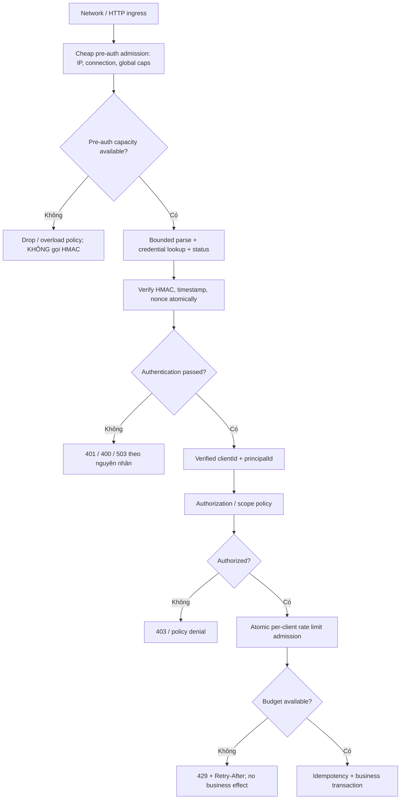

# Rate limit theo client trong hệ thống xác thực HTTP request bằng HMAC

## 1. Bối cảnh: nhiều client cùng sử dụng một API HMAC

Giả sử API nhận lệnh tạo đơn hàng từ ba đối tác:

```text
Client A (merchant-a) -- K1 / Key ID A1 --+
                      -- K2 / Key ID A2 --+-- API Gateway
Client B (merchant-b) -- K3 / Key ID B1 --+        |
Client C (merchant-c) -- K4 / Key ID C1 --+    HMAC Verifier
                                                   |
                                           Per-client limiter
                                                   |
                                               Business API
```

Client A có thể có **hai credential đang được chấp nhận** trong đợt xoay khóa. B và C là hai client độc lập. Nếu A gửi hàng nghìn request/giây, hệ thống cần bảo vệ tài nguyên mà **không vô tình lấy hết ngân sách của B và C**. Đồng thời, attacker có thể gửi hàng triệu request chứa Key ID hợp lệ nhưng **HMAC sai** để tiêu tốn CPU trước khi hệ thống biết caller thực sự là ai.

**Rate limit theo client** là cơ chế giới hạn tần suất hoặc chi phí request dựa trên **danh tính client đã được server xác minh**, theo một quota và khoảng thời gian/cơ chế tích lũy được công bố. Trong mô hình HMAC, điều quan trọng không chỉ là chọn token bucket hay sliding window, mà còn là chọn **đúng thời điểm nhận dạng client**, **đúng khóa phân vùng quota** và **đúng phạm vi nhiều server/region**.

Bài **Rate limit theo client** thuộc chương **Multi-client** của module `SECURITY_AUTHENTICATION_HMAC_REQUEST_AUTHENTICATION`. Phạm vi module là thiết kế xác thực HTTP request bằng **HMAC với shared secret**, ký canonical request gồm phương thức, URI, signed headers và/hoặc body; thực hành xác minh chữ ký, chống replay bằng timestamp/nonce, quản lý key rotation, kiểm thử proxy/gateway và phân biệt **authentication** với **authorization**. Bài này kết nối rate limiting với chuỗi kiểm tra đó, thay vì coi rate limit là một bộ đếm độc lập.

### Mục tiêu học tập

- Phân biệt **rate limit**, **quota dài hạn**, **concurrency limit**, **replay protection** và **idempotency**.
- Chỉ định quota bằng **verified client/principal ID từ server-side credential registry**, không tin Key ID hoặc `X-Client-Id` chưa được xác thực.
- Thiết kế **hai tầng bảo vệ**: chống flood trước authentication và rate limit theo identity **sau HMAC verification**.
- Hiểu token bucket, refill, burst, cửa sổ thời gian, request cost, key rotation, phân cấp quota và công bằng giữa các client.
- Thiết kế atomic/shared limiter ở nhiều JVM, nhiều region; xử lý sự cố, TTL, eviction và traffic vượt ngân sách.
- Xác định semantics của HTTP `429`, `Retry-After`, retry với timestamp/nonce/chữ ký HMAC mới và idempotency key ổn định.
- Thực hành ví dụ Java 17 và ma trận kiểm thử tích hợp gateway, timeout, concurrency, rotation và authorization.

## 2. Rate limit không phải authentication, authorization hay anti-replay

| Cơ chế | Câu hỏi nó giải quyết | Đơn vị/cơ sở |
| --- | --- | --- |
| **HMAC authentication** | Caller có biết shared secret tương ứng với credential hợp lệ, và signed request có còn nguyên vẹn không? | Exact Key ID → secret + canonical bytes + MAC. |
| **Credential lifecycle** | Credential có ACTIVE, đúng audience/route/version, chưa revoke/suspend/expire không? | Credential registry phía server. |
| **Timestamp + nonce** | Signed HTTP attempt có còn mới và chưa được chấp nhận trước đó không? | Cửa sổ thời gian và replay cache nguyên tử theo credential/nonce. |
| **Authorization** | Verified principal có quyền làm thao tác trên tài nguyên cụ thể không? | Principal, role/scope, resource ownership và policy hiện hành. |
| **Rate limit theo client** | Client đã xác minh được phép tiêu thụ bao nhiêu tài nguyên trong một khoảng thời gian? | Verified client ID, operation/cost và quota policy. |
| **Idempotency** | Nhiều HTTP attempts cùng một ý định nghiệp vụ có tạo side effect lặp không? | Verified principal + logical operation + idempotency key/fingerprint. |
| **Concurrency limit** | Một client được có bao nhiêu request hoặc job **đồng thời đang xử lý**? | Số slot/lease active, có giải phóng khi hoàn tất. |
| **Quota dài hạn** | Một client được gọi tối đa bao nhiêu lần/ngày hoặc sử dụng bao nhiêu đơn vị/tháng? | Billing/usage period, ledger hoặc counter bền vững. |

Một request có thể có HMAC **đúng**, timestamp **mới**, nonce **chưa dùng**, quyền **đầy đủ**, nhưng vẫn bị từ chối **`429 Too Many Requests`** vì client đã dùng hết rate budget. Ngược lại, request HMAC **sai** không trở thành authenticated chỉ vì token bucket còn đầy.

**Không dùng rate limiter để thay replay cache.** Giả sử client bị giới hạn 100 request/giây. Kẻ tấn công phát lại một request thanh toán hợp lệ một lần vẫn có thể gây trùng nghiệp vụ nếu nonce/idempotency bị bỏ qua. Rate limiter đếm tốc độ, **không xác nhận nonce chưa từng sử dụng**.

## 3. “Client” là danh tính nào khi có nhiều khóa?

Trong mô hình HMAC, `X-Key-Id` là **lookup hint công khai**; nó giúp server tìm đúng shared secret. Một `clientId` dùng làm khóa quota phải được xác định **sau khi** server kiểm tra credential, chữ ký và policy.

Ví dụ registry:

```text
Credential A1:
  keyId: kid_a1
  principalId: merchant-a
  verifiedClientId: integration-merchant-a
  state: ACTIVE

Credential A2:
  keyId: kid_a2
  principalId: merchant-a
  verifiedClientId: integration-merchant-a
  state: ACTIVE  # đang rotation

Credential B1:
  keyId: kid_b1
  principalId: merchant-b
  verifiedClientId: integration-merchant-b
  state: ACTIVE
```

Các chuỗi `kid_a1` ở đây là **nhãn sơ đồ**, không phải chuỗi đúng grammar Key ID của ví dụ Java ở phần dưới.

Nếu mục tiêu là quota **theo logical client**, hai Key IDs A1/A2 phải dùng **cùng bucket**:

```text
rate:v1:integration-merchant-a:POST:/v1/orders
```

Nếu dùng `rate:v1:<X-Key-Id>`, A có thể **nhân đôi ngân sách** khi rotate sang A2 hoặc phát hành thêm credential. Việc dùng Key ID làm quota namespace đôi khi là chủ ý (quota riêng từng API key), nhưng phải nêu rõ đó là **per-credential limit**, không phải **per-client limit**.

### Phân biệt principal, client, tenant và credential

| Định danh | Nguồn đáng tin | Khi nào đưa vào rate key? |
| --- | --- | --- |
| **Key ID** | Header chưa xác thực; chỉ trở thành exact credential sau lookup/MAC. | Khi API contract chủ ý giới hạn **theo từng credential**. |
| **Verified client ID** | Metadata server gắn với credential sau khi HMAC hợp lệ. | Mặc định phù hợp cho **rate limit theo client**. |
| **Verified principal ID** | Principal/identity được credential store xác nhận. | Khi nhiều integrations cùng thuộc một caller và cần chung ngân sách. |
| **Verified tenant/account ID** | Server-side tenant mapping và policy; không tin chuỗi tự khai. | Cho quota phân cấp toàn tenant, song song quota từng integration. |
| **Source IP** | Remote peer hoặc forwarding chain chỉ từ trusted ingress. | Thích hợp **tầng pre-auth**/network abuse; không thay thế client identity. |
| **Route/operation** | Route do ingress/backend xác định đáng tin. | Dùng cho ngân sách riêng theo endpoint hoặc weighted cost. |

**Không tự dùng** `X-Client-Id: merchant-b`, `X-Tenant: premium` hay `X-Rate-Plan: unlimited` từ request để cấp quota: attacker có thể sửa chúng. Kể cả khi field được HMAC ký, giá trị do client khai **chỉ đáng tin nếu chính sách server ràng buộc nó với credential đã xác minh**.

## 4. Hai tầng rate limiting: trước và sau xác thực

Nếu đợi đến lúc hoàn tất HMAC mới kiểm soát mọi lưu lượng, attacker có thể khai hàng triệu Key IDs ngẫu nhiên để gây quá tải parser, credential store, SHA-256 body hashing, HMAC và replay cache. Nhưng nếu đếm ngay theo Key ID **trước khi MAC khớp**, attacker có thể gửi request sai HMAC dùng Key ID của merchant B để **chiếm quota của B**.

Giải pháp là **hai tầng với hai nguồn identity khác nhau**:



### Tầng 1: pre-auth protection

Đặt **giới hạn sơ bộ** theo những tín hiệu sẵn có trước khi xác minh caller: số kết nối/IP, tốc độ request/IP, kích thước headers/body, global CPU budget, lookup/timeouts, body streaming limits và edge DoS protection. Dùng IP đúng trust boundary: `X-Forwarded-For` do Internet tự khai có thể bị spoof nếu gateway không strip và xác lập chain tin cậy.

**Lưu ý công bằng:** nhiều client hợp pháp có thể nằm sau **cùng NAT, proxy hoặc mobile network**. IP limit quá chặt có thể khóa cả nhóm; pre-auth policy phải là lớp chống abuse có capacity hợp lý, không thay thế identity-aware quota.

### Tầng 2: post-auth per-client budget

Chỉ sau khi credential/MAC/freshness/nonce đạt, verifier mới trả **`VerifiedClient`** chứa `clientId`, `principalId` và scope do registry xác định. Rate limiter tiêu thụ budget theo identity đó và operation, độc lập với Key ID hiện tại. Request MAC sai **không được trừ token ngân sách của merchant có Key ID bị giả mạo**.

Ở một số hệ thống, **authorization và rate limiting có thể đổi thứ tự** theo threat model. Ví dụ đếm mọi authenticated requests (kể cả unauthorized) vào budget riêng để chống brute-force business IDs. Bài chọn **authorization trước per-client business budget**, nhưng vẫn có pre-auth protection và có thể có **authenticated-abuse limiter** riêng cho request thiếu quyền. Quan trọng là mô tả rõ loại request nào được tính vào budget nào.

## 5. Rate limiting theo client và key rotation

Trong thời gian xoay secret, `merchant-a` có credential ID1/K1 và ID2/K2 cùng được phép. Client có thể đổi key giữa hai HTTP attempts:

```text
Attempt #1: X-Key-Id=ID1, HMAC(K1, ...), verifiedClient=merchant-a
Attempt #2: X-Key-Id=ID2, HMAC(K2, ...), verifiedClient=merchant-a
```

Nếu bucket key theo **`verifiedClient=merchant-a`**, cả hai request tiêu thụ **cùng budget**. Nếu bucket theo Key ID thì có hai ngân sách, và merchant có thể vượt rate limit đã công bố chỉ bằng cách tạo nhiều API keys.

API có thể cố ý cấp quota per-credential để cách ly workloads độc lập. Khi đó nên có **hai giới hạn**: bucket riêng cho credential và bucket tổng cho verified client/tenant. Không để vòng rotation vô tình tăng quota chung của khách hàng.

### Suspension/revocation và quota

- Credential **SUSPENDED/REVOKED** phải bị authentication reject, **không** được qua rate limiter chỉ vì quota còn token.
- Resume credential **không tự tạo lại một bucket client mới** nếu client identity không đổi.
- Rotation sang ID2 **không reset client quota** hoặc business idempotency state.
- Nếu account-level suspension được áp dụng, phải có **policy gate của principal/tenant**; rate limiter không thay việc chặn access.
- Đổi plan/quota phải đến từ **server-side configuration được phê duyệt**, có version và audit, không từ header client.

## 6. Chính sách quota: scope, rate, burst và cost

Một quota cần được mô tả bằng ít nhất năm thuộc tính: **subject (ai)**, **operation (làm gì)**, **rate (tốc độ bền vững)**, **burst capacity (đột biến ngắn hạn)** và **cost (mức tiêu thụ của mỗi attempt)**. Ngoài ra còn có **thời hạn hiệu lực, version chính sách và vùng áp dụng**.

Ví dụ chính sách của API:

| Scope kiểm tra | Rate | Burst | Ý nghĩa |
| --- | ---: | ---: | --- |
| Toàn hệ thống | 2.000 request/s | 4.000 | Bảo vệ năng lực chung, không thay per-client fairness. |
| Tenant merchant-a | 100 tokens/s | 200 | Tất cả integrations thuộc tenant dùng chung ngân sách. |
| Client integration-a | 10 tokens/s | 20 | Một client không chiếm hết tài nguyên của tenant. |
| Client integration-b | 5 tokens/s | 10 | Integration khác trong tenant có chính sách riêng. |
| Client integration-a, `POST /v1/payments` | 2 tokens/s | 3 | Lệnh tài chính bị giới hạn riêng. |
| Pre-auth ingress theo nguồn | Chính sách chống lạm dụng riêng | Tùy IP/NAT | Không dựa vào Key ID chưa verify. |

**Những con số chỉ là minh họa**, không phải khuyến nghị capacity chung. Giá trị thực cần dựa trên SLO, chi phí business, hành vi traffic, số client hợp lệ và khả năng hạ tầng.

### Xác định rate-limit key

```text
rate:<policyVersion>:<verifiedTenantId>:<verifiedClientId>:<operationId>
```

Key ở trên chỉ mô tả **logic phân vùng**, không phải lời khuyên ghép chuỗi tùy ý. Trong production, các thành phần có thể chứa dấu `:`, Unicode hoặc ký tự do client kiểm soát. Dùng **structured tuple/binary encoding, prefix length** hoặc quy tắc escape không nhập nhằng, và chỉ nhận **verified IDs từ server metadata**.

Một chính sách nhiều tầng có thể cần tất cả `tenantBucket`, `clientBucket`, `operationBucket` cùng được kiểm tra. Nếu yêu cầu **một admission tiêu thụ token ở tất cả bucket hoặc không bucket nào**, phải có atomic multi-key transaction/script hoặc một decision service bảo đảm nhất quán. Không thực hiện:

```text
consume tenant token -> SUCCESS
consume client token -> SUCCESS
consume route token  -> DENIED
```

rồi coi ba bước là “atomic”. Nó khiến tenant/client bị trừ token dù operation bị từ chối. Một số API **cố ý thu phí attempts trước khi xét các giới hạn khác**; khi đó đây là semantics được công bố, không phải tính nguyên tử ngẫu nhiên.

### Weighted request cost

Không phải request nào cũng cùng giá:

```text
GET /v1/orders/{id}         cost = 1
POST /v1/orders/search      cost = 2
POST /v1/reports/export     cost = 10
```

**Cost phải do server xác định** từ route/policy đáng tin. Nếu nhận `X-Request-Cost: 0` của client làm giá trị tính quota thì attacker có thể gọi request tốn tài nguyên miễn phí. Nếu cost phụ thuộc body size/số dòng, phải giới hạn đầu vào, xác minh request snapshot và kiểm soát worst-case cost, không tin body đã parse bởi một thành phần khác với phần đã ký.

Phải nói rõ các budget tính bằng **request count** hay **weighted tokens**. Một rate `10 tokens/s` với request cost 5 không có nghĩa được gọi 10 requests/s.

### Fairness và nhiều client “nóng”

Một global limit chung có thể bảo vệ CPU, nhưng không bảo đảm công bằng. Nếu merchant-a dùng hết global 2.000 request/s thì merchant-b vẫn có thể bị 429 dù quota riêng còn dư. Có thể kết hợp **per-client rate limit**, **weighted fair queueing**, priority tiers, concurrency caps và global overload control. Không hứa “mỗi client luôn được đúng quota riêng” khi tài nguyên chung đã cạn.

## 7. Thuật toán: fixed window, sliding window, token bucket và GCRA

| Thuật toán | Nguyên lý | Ưu điểm | Hạn chế cần nhớ |
| --- | --- | --- | --- |
| **Fixed window counter** | Đếm số request trong cửa sổ, ví dụ từ 10:00:00 tới 10:01:00. | Triển khai đơn giản, storage rẻ, TTL dễ hiểu. | Có thể nhận gần 2 lần quota ở ranh giới hai cửa sổ liền kề. |
| **Sliding window log** | Lưu timestamp từng request trong cửa sổ trượt. | Đếm khá chính xác, giải thích dễ. | Chi phí lưu trữ/cleanup cao khi QPS lớn. |
| **Sliding window counter** | Kết hợp cửa sổ hiện tại và trước đó với trọng số. | Ít storage hơn log, mượt hơn fixed window. | Có sai số do approximation và biên cửa sổ. |
| **Token bucket** | Tích lũy token với tốc độ `r` tới tối đa `B`; request dùng `cost`. | Hỗ trợ burst nhưng giữ average rate dài hạn. | Cần cập nhật nguyên tử và xử lý time/refill chính xác. |
| **Leaky bucket / GCRA** | Theo dõi lịch thời gian lý thuyết của lần được phép tiếp theo. | Phù hợp để làm mượt traffic, lưu ít state. | Cần hiểu tolerance, clock và retry wait semantics. |
| **Concurrency semaphore** | Giới hạn số lệnh đang chạy, cấp và trả slot/lease. | Giới hạn tải của downstream chậm hoặc job dài. | Không trực tiếp giới hạn requests/s; cần timeout/fencing để tránh mất slot. |

Bài chọn **token bucket** để minh họa rate limit theo verified client vì thể hiện trực quan **sustained rate** và **burst**.

### Công thức token bucket

Ký hiệu:

- `B`: sức chứa tối đa (burst capacity), tính bằng tokens.
- `r`: tốc độ nạp lại, tính bằng tokens/giây.
- `t_last`: mốc thời gian của lần cập nhật trước.
- `tokens_old`: số token còn lại ở `t_last`.
- `c`: request cost, số token cần tiêu thụ.

Khi request đến tại `t_now`, tính:

```text
elapsedSeconds = max(0, t_now - t_last)
refilled       = min(B, tokens_old + r * elapsedSeconds)

if refilled >= c:
    ACCEPT
    tokens_new = refilled - c
else:
    REJECT (429)
    tokens_new = refilled
```

Nếu `r > 0`, khoảng thời gian sớm nhất để đủ token là:

```text
waitSeconds = max(0, (c - refilled) / r)
```

Nếu `c > B`, request **không thể** được nhận theo bucket đó; phải từ chối theo policy thay vì báo `Retry-After` vô hạn. Khi dùng multiple buckets hoặc quota hết ngày, thời gian retry thực tế là kết quả từ **tất cả các constraint liên quan**, không chỉ phép chia của một bucket.

### Ví dụ tính bằng tay

Chọn `B=3` tokens, `r=1` token/s, mỗi request cost `c=1`; bucket bắt đầu đầy lúc 10:00:00:

| Thời điểm | Tokens ngay trước quyết định | Quyết định | Tokens sau |
| --- | ---: | --- | ---: |
| 10:00:00.000, request A | 3,0 | Accept | 2,0 |
| 10:00:00.000, request B | 2,0 | Accept | 1,0 |
| 10:00:00.000, request C | 1,0 | Accept | 0,0 |
| 10:00:00.000, request D | 0,0 | **429** | 0,0 |
| 10:00:00.500, request E | 0,5 | **429**; thiếu 0,5 token | 0,5 |
| 10:00:01.000, request F | 1,0 | Accept | 0,0 |
| 10:00:03.000, request G | 2,0 | Accept | 1,0 |

Bucket cho phép tối đa **3 request ngay lập tức** sau thời gian idle, rồi về trung bình **1 request/giây** nếu traffic tiếp diễn. Không nhầm `B=3` với `3 request/s`: tốc độ ổn định thực sự là `r=1`.

### Đồng hồ và sai số tính toán

Trong một JVM, dùng **monotonic elapsed time** (ví dụ `System.nanoTime()` cho deltas) để tránh NTP làm lùi wall clock. Khi nhiều server chia sẻ limiter, không thể so sánh trực tiếp các giá trị `nanoTime()` từ JVM khác nhau. Redis/script hoặc decision service nên lấy thời gian từ **một nguồn clock thống nhất trong storage/authority**, hoặc có quy tắc kiểm soát clock skew được kiểm thử.

Với quota chính xác, tránh dùng floating point tùy tiện nếu sai số có ý nghĩa; production có thể dùng **fixed-point integer units**, `elapsed` đã được giới hạn, saturating arithmetic và atomic state transition. Demo Java phía dưới dùng `double` cho dễ học, có nêu giới hạn rõ.

## 8. Xếp thứ tự HMAC, replay, authorization, quota và idempotency

Không có một thứ tự xử lý duy nhất phù hợp với mọi API; tuy nhiên hệ thống phải bảo đảm **không có side effect nghiệp vụ xảy ra trước khi các lớp bảo vệ bắt buộc đạt**. Bài sử dụng **thứ tự minh họa**:

```text
1) Ingress: giới hạn kích thước/connection/IP, parse HTTP an toàn
2) Tra credential theo Key ID, kiểm tra status/scope/profile
3) HMAC-SHA256 trên đúng canonical request bytes
4) Kiểm tra timestamp freshness; atomic claim nonce
5) Tạo verified principal/client/tenant từ registry
6) Authorization theo action/resource
7) Atomic rate-limit admission theo verified client + route
8) Business idempotency lookup/reserve
9) Execute business transaction hoặc trả stored result
```

### Request nhận 429 có “tiêu” nonce không?

**Có, trong profile này.** Bước claim nonce diễn ra **trước** rate-limit decision. Request HMAC hợp lệ nhưng bị 429 vẫn đã dùng nonce cho attempt đó; gửi lại nguyên request sẽ bị replay cache chặn, **không tự được phép chỉ vì bucket đã refill**.

```text
Attempt #1:
  idemKey=I1, timestamp=T1, nonce=N1, signature=S1
  HMAC/freshness/nonce=PASS; per-client rate limit=429

Attempt #2 (sau Retry-After/backoff):
  idemKey=I1, timestamp=T2, nonce=N2, signature=S2
  HMAC/freshness/nonce=PASS; per-client rate limit=ALLOW
  business layer handles I1 once
```

Không cố “trả lại nonce” khi 429 vì nó sẽ tạo khả năng phát lại request đã được nhận qua authentication. Nếu thiết kế muốn kiểm tra rate budget **trước nonce claim**, phải giải quyết attribution, race, retries và replay semantics một cách nhất quán; không được dùng `X-Key-Id` chưa xác thực để trừ quota theo khách hàng.

**Trade-off về bộ nhớ replay cache:** khi nonce được claim **trước** business rate limit, một client biết secret hợp lệ có thể liên tục gửi requests với **nonce mới** dù đã hết quota; các requests 429 vẫn tạo replay entries. Vì vậy, hệ thống phải capacity-plan nonce store theo **authenticated attempt rate**, không chỉ theo số request business được admit. Cần pre-auth/global admission cap, per-credential authenticated-abuse protection, quota chống flood và giới hạn tài nguyên replay store; nếu kho nonce không thể bảo đảm bảo vệ, endpoint nhạy cảm phải **fail closed**. Một profile khác có thể dùng **MAC + freshness → verified identity → authenticated rate limit → nonce claim → business** để giảm nonce-cache writes, nhưng phải công bố rằng một attempt bị 429 **chưa được claim nonce**, xác định lại replay/retry semantics và kiểm thử race. Không hoán đổi thứ tự chỉ để tối ưu latency mà không cập nhật contract.

### Có tính request 429 vào rate budget?

Trong **token bucket minh họa**, request thiếu token bị từ chối **không tiêu thêm token**, nhưng vẫn được đếm trong metrics `rate_limit_denied_total` và có thể tiêu pre-auth network budget. Một số sản phẩm muốn đếm **mọi attempt**, kể cả 4xx/5xx, hoặc áp dụng cost tối thiểu cho invalid/expensive requests để chống abuse. Phải công bố rõ quyết định đó.

### Retry và idempotency

Khi HTTP POST đã xử lý payment nhưng response bị mất, client retry hợp lệ sẽ dùng **idempotency key cũ**, nonce/timestamp/HMAC mới. Nếu limiter đặt **trước** idempotency lookup, retry này cũng tiêu budget và có thể nhận 429 **trước khi đọc stored outcome**. Đây là hành vi nhất quán với policy “mọi authenticated/authorized attempt tốn token”, nhưng có thể khiến client chậm nhận trạng thái đã hoàn tất.

Một API có thể dành **status lookup endpoint** chi phí thấp hoặc thiết kế reduced-cost idempotency-result lookup **sau authentication và authorization**, nhưng cần bảo vệ endpoint đó khỏi request flood và cache enumeration; không bỏ qua quota vì caller tự khai cùng `Idempotency-Key`.

### Authentication đúng nhưng authorization sai

Nếu merchant-a có credential ACTIVE và HMAC đúng, nhưng cố lấy order của merchant-b, **authorization phải từ chối**. Trong profile này, request đó không tiêu **business quota của route hợp lệ** nhưng vẫn tiêu nonce, pre-auth/network resources và có thể tiêu một authenticated-abuse quota riêng. Đừng để rate limiter trả 429 làm che đi policy sai hoặc cho phép đọc dữ liệu trái quyền.

## 9. Phản hồi HTTP khi vượt giới hạn

Sau authentication/authorization thành công, nếu per-client bucket không đủ token, API có thể trả:

```http
HTTP/1.1 429 Too Many Requests
Content-Type: application/problem+json
Cache-Control: no-store
Retry-After: 2

{"type":"about:blank","title":"Rate limit exceeded","status":429}
```

`Retry-After: 2` ở đây nghĩa là **chờ khoảng 2 giây** tính từ khi nhận phản hồi trước khi thử lại, theo hợp đồng/policy của API; đây chỉ là **giá trị minh họa**. Header `Retry-After` trong HTTP cũng có thể dùng dạng **HTTP-date**, nhưng với ví dụ client dễ diễn giải bằng delta-seconds. Không lấy `Retry-After` làm bằng chứng đến lúc đó chắc chắn được nhận: nhiều requests khác của cùng client có thể tiêu token trước.

### Những điều không nên trả ra ngoài

- Không trả Key ID/secret, expected MAC, full canonical message, nội dung credential registry hay trạng thái secret store.
- Không lộ quá nhiều chi tiết ngân sách của client khác, tenant khác hoặc global overload policy.
- Không cung cấp header `RateLimit-Remaining` dựa trên **Key ID tự khai chưa xác thực**; thông tin rate policy có thể bị dùng để enumerate credentials.
- Không cache response `429` của client A rồi trả cho client B vì URL giống nhau. Có thể dùng `Cache-Control: no-store` khi phù hợp và bảo đảm CDN không bỏ qua authentication.

Các header thông tin quota (nếu API dùng) cần có **định nghĩa version và scope** rõ: đó là quota per-client, per-route hay global? Nếu có nhiều limit cùng áp dụng, số remaining của bucket nào được chọn? **Không tự coi mọi bộ header `X-RateLimit-*` là chuẩn bắt buộc** hoặc tự hứa rằng client sẽ nhận các header này khi request chưa được xác thực.

### Hướng dẫn retry của client

Client nên có:

- **Retry deadline tổng** và số attempts tối đa; không vòng lặp vô hạn khi 429.
- **Exponential backoff + jitter**, tôn trọng `Retry-After` trong giới hạn policy.
- **Nonce mới, timestamp UTC mới và HMAC mới** cho mỗi attempt; giữ nguyên business payload và **idempotency key** nếu cùng operation.
- Cơ chế chống **retry storm** khi một nhóm workers cùng thấy 429; có thể dùng client-side queue/budget hoặc adaptive concurrency.
- Giám sát clock skew, expiration, credential suspension và signature profile. Một `401` do invalid HMAC **không được sửa bằng cách retry 429 logic**.
- Với các payment có outcome không rõ, tra cứu kết quả nghiệp vụ theo operation ID/idempotency contract thay vì tự tạo payment mới.

Đối với request phát sinh từ nhiều process cùng một client, **retry coordinator** hoặc client-side token bucket giúp giảm tải và trải đều traffic. Nhưng limiter phía client là **tối ưu hiệu năng/UX**, không phải enforcement: server vẫn phải kiểm tra authenticated quota.

## 10. Distributed rate limiter: vì sao in-memory bucket là chưa đủ?

Giả sử API có ba server replicas; mỗi replica tự cho client A bucket `B=20, r=10/s`:

```text
Replica 1: accepts 20 burst requests for client A
Replica 2: accepts 20 burst requests for client A
Replica 3: accepts 20 burst requests for client A
TOTAL:    accepts 60 burst requests, dù contract B=20 global
```

Đây là **nhân quota theo số replica**, giống vấn đề replay cache cục bộ. Sticky session không giải quyết failover, autoscaling, regional load balancing hoặc attacker chủ động thay đổi route.

### Atomic admission bằng shared store

Một cách triển khai là dùng **Redis cùng Lua script/function nguyên tử** để cập nhật token bucket của một client:

```text
KEY = structuredKey(policyScope, verifiedClientId, operation)

atomic check-and-update:
  state = GET(KEY) or FULL_BUCKET
  now = trusted/store time
  tokens = refill(state.tokens, now, rate, burst)
  if tokens >= cost:
      SET(KEY, tokens - cost, now, ttl)
      return ALLOWED + remaining
  else:
      SET(KEY, tokens, now, ttl)
      return DENIED + retryAfter
```

Đây là **pseudocode về ý nghĩa**, không phải một script Redis chạy trực tiếp. Trong production cần kiểm tra cơ chế đồng hồ, integer precision, TTL, Redis Cluster key slots, replication/failover và atomicity thực của hệ thống đã chọn.

**Quan trọng:** atomicity **trên một Redis primary** không tự động tương đương **strictly global consistency qua nhiều region** với replication bất đồng bộ. Một client gửi đồng thời vào region A/B có thể được cả hai chấp nhận trước khi dữ liệu đồng bộ. Nếu contract đòi `10/s` **toàn cầu nghiêm ngặt**, phải dùng một authority/partition nhất quán, routing theo verified client hoặc storage hỗ trợ conditional writes với consistency đủ mạnh.

### Chiến lược đa region và trade-off

| Chiến lược | Lợi ích | Rủi ro và điều kiện |
| --- | --- | --- |
| **Một shared authority** cho mỗi client/budget | Global admission dễ xác định. | Latency cross-region, availability và capacity của authority. |
| **Shard theo verified client ID**; một home region | Local traffic hiệu quả, state gắn theo owner. | Routing/failover phải chuyển ownership an toàn, không reset bucket khi đổi vùng. |
| **Regional quota budgets** (ví dụ tổng 10/s chia 5+5) | Giảm phụ thuộc cross-region. | Có thể không sử dụng hết capacity khi tải lệch; tổng quota chỉ nghiêm ngặt khi partitions không cấp vượt phần. |
| **Eventually consistent local buckets** | Low latency và tolerant partition. | Cho phép vượt quota trong cửa sổ đồng bộ; chỉ dùng khi product chấp nhận approximate limit. |
| **Durable conditional-write DB** | Có thể giữ policy/usage chính xác hơn với uniqueness/transaction. | Cần thiết kế performance, contention, clock semantics và hot-key; không mặc nhiên tối ưu cho QPS lớn. |

**Không mô tả approximate limiter là “không bao giờ vượt quá N requests”**. Mức guarantee và allowed overshoot phải được công bố: per-node, per-region hay global; strict hay eventual; xử lý outage là fail closed, fail open hay degraded.

### Fail-open hay fail-closed?

Nếu limiter store không khả dụng, hai lựa chọn thường gặp:

- **Fail closed:** từ chối hoặc trả `503`/lỗi dịch vụ cho operation nhạy cảm, tránh bỏ toàn bộ giới hạn do outage. Phù hợp khi quota là một phần kiểm soát an ninh/rủi ro.
- **Degraded/fail open có kiểm soát:** tạm nhận traffic ở mức được giới hạn bằng **emergency capacity guard** khác, được phê duyệt trong risk policy, có metrics/alert và expiry. Có thể phù hợp với endpoint đọc ít nhạy cảm mà availability là ưu tiên, **không được âm thầm chuyển sang local full bucket rồi gọi đó là quota cũ**.

Việc chọn cần dựa trên endpoint, overload risk, business impact và khả năng phục hồi. Demo Java chọn **fail closed** nếu shared quota decision không biết rõ kết quả.

### TTL, eviction và memory amplification

Nếu bucket không nhận traffic trong thời gian dài, có thể xóa state sau một idle TTL **đủ để bucket đã refill về đầy**; một bucket đầy mới sau thời gian idle là hợp lệ theo token-bucket semantics. Nhưng nếu xóa state **sớm hơn thời gian refill**, client có thể reset quota bằng cách tạo nhiều keys hoặc gây memory eviction.

Với bucket đang rỗng, thời gian nạp đầy là `B / r` giây. TTL idle nên ít nhất bao phủ thời gian cần refill về full, có margin/clock policy. Quota **dài hạn theo ngày/tháng** không thể dựa trên TTL idle của token bucket; cần ledger/counter bền vững riêng.

Một verified client ID là do registry cấp, nhưng nếu key có thêm **route/raw query/idempotency key** do client làm thay đổi tùy ý, mỗi request có thể tạo state mới và làm tràn limiter. Không dùng full URL với query ngẫu nhiên làm bucket key; chỉ dùng **operation ID đã normalize theo router tin cậy**.

## 11. Java 17: HMAC authentication rồi mới dùng quota theo verified client

Ví dụ Java 17 dưới đây là một chương trình **tự chứa** có thể lưu thành `PerClientRateLimitDemo.java`. Nó cho thấy:

1. **Provisioning giả lập** tạo Key ID/secret riêng cho từng credential. Client A có hai credentials khác nhau nhưng cùng một `verifiedClientId`; client B dùng bucket độc lập.
2. Client signer tạo **timestamp và nonce mới**, ký HMAC-SHA256 trên canonical request chứa method, target, audience, signed headers và SHA-256 body.
3. Verifier tra **đúng Key ID** trong registry, kiểm tra state/scope, MAC 32 bytes, time window và replay nonce trước khi xuất `VerifiedClient` đáng tin.
4. API handler kiểm tra **authorization**, rồi mới gọi `PerClientTokenBucket` dùng **`ConcurrentHashMap.compute`** để quyết định nguyên tử **trong một JVM**.
5. Các ca demo chứng minh **A1/A2 dùng chung bucket**, **B có bucket riêng**, request giả mạo Key ID nhưng MAC sai không lấy quota của A, replay bị chặn, retry sau refill và store lỗi phải fail closed.

**Không phải production template:** registry và replay/rate stores trong demo **chỉ là in-memory trong một JVM**, không có shared atomic state, retention cleanup, durable key lifecycle, failover hoặc điều phối đa region. `RequestSnapshot` là dữ liệu do HTTP ingress tin cậy trích từ HTTP field lines, raw target và body bytes; ứng dụng thật còn phải kiểm tra request smuggling, header folding, duplicate field lines trước merge, `Content-Encoding`, request body limits, TLS và signed payload consistency.

### Profile ký minh họa: HMAC-MULTICLIENT-V1

```http
POST /v1/orders HTTP/1.1
Host: api.example.test
Content-Type: application/json
Idempotency-Key: 550e8400-e29b-41d4-a716-446655440000
X-Key-Id: kid_AAAAAAAAAAAAAAAAAAAAAA
X-Signature-Version: hmac-multiclient-v1
X-Timestamp: 2026-11-28T10:00:00Z
X-Nonce: AAAAAAAAAAAAAAAAAAAAAAAAAAAAAAAA
X-Signature: <64 lowercase hex chars>

{"orderId":"O-42","amount":90000}
```

`kid_A...` và nonce toàn chữ A là **placeholder đúng hình thức nhưng không đủ entropy**; code sẽ sinh các giá trị ngẫu nhiên thật.

Canonical bytes được dựng từ các dòng UTF-8 nối bằng **LF (0A)**, không có LF cuối:

```text
HMAC-MULTICLIENT-V1
POST
https://api.example.test
/v1/orders
content-type:application/json
idempotency-key:550e8400-e29b-41d4-a716-446655440000
x-key-id:kid_AAAAAAAAAAAAAAAAAAAAAA
x-signature-version:hmac-multiclient-v1
x-timestamp:2026-11-28T10:00:00Z
x-nonce:AAAAAAAAAAAAAAAAAAAAAAAAAAAAAAAA
<lowercaseHex(SHA-256(bodyBytes))>
```

Dòng cuối phải **thay bằng body digest thực**, không ký dấu `<`/`>`. Hợp đồng chỉ hỗ trợ `POST /v1/orders`, audience tin cậy `https://api.example.test`, `Content-Type: application/json`, body UTF-8 JSON tối đa 1 MiB và **không hỗ trợ Content-Encoding**. Tất cả signed headers phải xuất hiện **đúng một field line**, Key ID opaque là `kid_` + canonical Base64URL no-padding của 16 random bytes, nonce là 24 byte CSPRNG encoded Base64URL no-padding (32 chars), timestamp UTC chính xác tới giây. `X-Signature` là HMAC-SHA256 đầy đủ dưới dạng **64 lowercase hex**, không ký chính field signature.

```java
import java.nio.charset.StandardCharsets;
import java.security.GeneralSecurityException;
import java.security.MessageDigest;
import java.security.SecureRandom;
import java.time.Clock;
import java.time.Duration;
import java.time.Instant;
import java.time.ZoneOffset;
import java.time.format.DateTimeParseException;
import java.time.temporal.ChronoUnit;
import java.util.ArrayList;
import java.util.Base64;
import java.util.HashMap;
import java.util.HexFormat;
import java.util.List;
import java.util.Locale;
import java.util.Map;
import java.util.Set;
import java.util.UUID;
import java.util.concurrent.ConcurrentHashMap;
import java.util.concurrent.atomic.AtomicBoolean;
import java.util.concurrent.atomic.AtomicReference;
import javax.crypto.Mac;
import javax.crypto.spec.SecretKeySpec;

public final class PerClientRateLimitDemo {
    private static final String VERSION = "hmac-multiclient-v1";
    private static final String AUDIENCE = "https://api.example.test";
    private static final String TARGET = "/v1/orders";
    private static final String TYPE = "application/json";
    private static final String OPERATION = "POST /v1/orders";
    private static final HexFormat HEX = HexFormat.of();
    private static final Duration MAX_AGE = Duration.ofSeconds(300);
    private static final Duration MAX_FUTURE = Duration.ofSeconds(30);
    private static final Duration NONCE_TTL = Duration.ofSeconds(360);
    private static final Set<String> SIGNED_NAMES = Set.of(
            "content-type", "idempotency-key", "x-key-id",
            "x-signature-version", "x-timestamp", "x-nonce",
            "x-signature");

    public record FieldLine(String name, String value) {}

    public record RequestSnapshot(
            String method, String rawTarget, String trustedAudience,
            List<FieldLine> headers, byte[] body) {
        public RequestSnapshot {
            headers = List.copyOf(headers);
            body = body == null ? null : body.clone();
        }
        @Override public byte[] body() {
            return body == null ? null : body.clone();
        }
    }

    public record ClientCredential(String keyId, byte[] secret) {
        public ClientCredential {
            secret = secret.clone();
        }
        @Override public byte[] secret() { return secret.clone(); }
    }

    // Verified identity lấy từ server metadata, KHÔNG từ HTTP caller.
    public record CredentialRecord(
            String keyId, String credentialId, String clientId,
            String principalId, byte[] secret, boolean active,
            Instant notBefore, Instant expiresAt,
            String audience, Set<String> routes, Set<String> versions) {
        public CredentialRecord {
            secret = secret.clone();
            routes = Set.copyOf(routes);
            versions = Set.copyOf(versions);
        }
        @Override public byte[] secret() { return secret.clone(); }
    }

    public record VerifiedClient(
            String clientId, String principalId, String credentialId,
            String operation, String idempotencyKey) {}

    // Khi rotation: cấp credential mới nhưng GIỮ clientId ổn định.
    public static final class Registry {
        private final ConcurrentHashMap<String, CredentialRecord> keys =
                new ConcurrentHashMap<>();

        public ClientCredential provision(
                String clientId, String principalId,
                SecureRandom random, Instant notBefore, Instant expiresAt) {
            if (clientId == null || principalId == null
                    || random == null || notBefore == null
                    || expiresAt == null
                    || !notBefore.isBefore(expiresAt)) {
                throw new IllegalArgumentException("Invalid provisioning");
            }
            for (int retry = 0; retry < 8; retry++) {
                byte[] rawId = new byte[16];
                byte[] secret = new byte[32];
                random.nextBytes(rawId);
                random.nextBytes(secret);
                String id = "kid_" + Base64.getUrlEncoder()
                        .withoutPadding().encodeToString(rawId);
                CredentialRecord record = new CredentialRecord(
                        id, id, clientId, principalId, secret, true,
                        notBefore, expiresAt, AUDIENCE,
                        Set.of(OPERATION), Set.of(VERSION));
                if (keys.putIfAbsent(id, record) == null) {
                    return new ClientCredential(id, secret);
                }
            }
            throw new IllegalStateException("Key ID collision");
        }

        public CredentialRecord exactLookup(String keyId) {
            return keyId == null ? null : keys.get(keyId);
        }
    }

    private static boolean canonicalBase64(
            String text, int expectedBytes) {
        if (text == null
                || !text.matches("[A-Za-z0-9_-]+")) {
            return false;
        }
        try {
            byte[] decoded = Base64.getUrlDecoder().decode(text);
            return decoded.length == expectedBytes
                    && text.equals(Base64.getUrlEncoder()
                            .withoutPadding().encodeToString(decoded));
        } catch (IllegalArgumentException invalid) {
            return false;
        }
    }

    private static boolean validKeyId(String keyId) {
        return keyId != null
                && keyId.matches("kid_[A-Za-z0-9_-]{22}")
                && canonicalBase64(keyId.substring(4), 16);
    }

    private static boolean validNonce(String nonce) {
        return nonce != null
                && nonce.matches("[A-Za-z0-9_-]{32}")
                && canonicalBase64(nonce, 24);
    }

    private static Instant parseTimestamp(String raw) {
        if (raw == null || !raw.matches(
                "[0-9]{4}-[0-9]{2}-[0-9]{2}T"
                + "[0-9]{2}:[0-9]{2}:[0-9]{2}Z")) {
            throw new IllegalArgumentException("Invalid UTC time format");
        }
        try {
            Instant parsed = Instant.parse(raw);
            if (parsed.getNano() != 0
                    || !parsed.toString().equals(raw)) {
                throw new IllegalArgumentException("Noncanonical time");
            }
            return parsed;
        } catch (DateTimeParseException invalid) {
            throw new IllegalArgumentException("Invalid UTC time", invalid);
        }
    }

    private static String stripOws(String value) {
        int start = 0, end = value.length();
        while (start < end && (value.charAt(start) == ' '
                || value.charAt(start) == '\t')) start++;
        while (end > start && (value.charAt(end - 1) == ' '
                || value.charAt(end - 1) == '\t')) end--;
        return value.substring(start, end);
    }

    // HTTP adapter phải giữ field lines trước khi merge duplicate.
    private static Map<String, String> parseSignedHeaders(
            List<FieldLine> rawLines) {
        Map<String, String> result = new HashMap<>();
        for (FieldLine h : rawLines) {
            if (h == null || h.name() == null || h.value() == null
                    || !h.name().matches("[A-Za-z0-9-]{1,128}")) {
                throw new IllegalArgumentException("Bad header");
            }
            String name = h.name().toLowerCase(Locale.ROOT);
            // Demo chỉ nhận những signed headers + Host.
            if (!SIGNED_NAMES.contains(name) && !"host".equals(name)) {
                throw new IllegalArgumentException("Unknown header");
            }
            String value = stripOws(h.value());
            for (int i = 0; i < value.length(); i++) {
                char ch = value.charAt(i);
                if (ch < 0x20 || ch > 0x7e) {
                    throw new IllegalArgumentException(
                            "Non-ASCII or control header value");
                }
            }
            if (SIGNED_NAMES.contains(name)
                    && result.putIfAbsent(name, value) != null) {
                throw new IllegalArgumentException(
                        "Duplicate signed header");
            }
        }
        if (!result.keySet().equals(SIGNED_NAMES)) {
            throw new IllegalArgumentException("Missing signed headers");
        }
        return Map.copyOf(result);
    }

    private static boolean validSignedValues(
            Map<String, String> f) {
        return TYPE.equals(f.get("content-type"))
                && f.get("idempotency-key").matches(
                    "[0-9a-f]{8}-[0-9a-f]{4}-4[0-9a-f]{3}-"
                    + "[89ab][0-9a-f]{3}-[0-9a-f]{12}")
                && validKeyId(f.get("x-key-id"))
                && VERSION.equals(f.get("x-signature-version"))
                && validNonce(f.get("x-nonce"))
                && f.get("x-signature").matches("[0-9a-f]{64}");
    }

    private static byte[] canonicalBytes(
            RequestSnapshot r, Map<String, String> f)
            throws GeneralSecurityException {
        String bodyDigest = HEX.formatHex(
                MessageDigest.getInstance("SHA-256").digest(r.body()));
        String canonical = String.join("\n",
                "HMAC-MULTICLIENT-V1",
                r.method(),
                AUDIENCE,
                r.rawTarget(),
                "content-type:" + f.get("content-type"),
                "idempotency-key:" + f.get("idempotency-key"),
                "x-key-id:" + f.get("x-key-id"),
                "x-signature-version:" + f.get("x-signature-version"),
                "x-timestamp:" + f.get("x-timestamp"),
                "x-nonce:" + f.get("x-nonce"),
                bodyDigest);
        return canonical.getBytes(StandardCharsets.UTF_8);
    }

    private static byte[] hmacSha256(
            byte[] secret, byte[] canonical)
            throws GeneralSecurityException {
        Mac mac = Mac.getInstance("HmacSHA256");
        mac.init(new SecretKeySpec(secret, "HmacSHA256"));
        return mac.doFinal(canonical);
    }

    // Signer: một request attempt mới có nonce và timestamp mới.
    public static RequestSnapshot sign(
            ClientCredential client, byte[] body,
            String idempotencyKey, Instant time, SecureRandom random)
            throws GeneralSecurityException {
        if (client == null || !validKeyId(client.keyId())
                || client.secret().length < 32 || random == null
                || time == null || body == null
                || body.length == 0 || body.length > 1_048_576
                || idempotencyKey == null
                || !idempotencyKey.matches(
                    "[0-9a-f]{8}-[0-9a-f]{4}-4[0-9a-f]{3}-"
                    + "[89ab][0-9a-f]{3}-[0-9a-f]{12}")) {
            throw new IllegalArgumentException("Invalid signer input");
        }
        byte[] nonceBytes = new byte[24];
        random.nextBytes(nonceBytes);
        String nonce = Base64.getUrlEncoder()
                .withoutPadding().encodeToString(nonceBytes);
        String timestamp = time.truncatedTo(
                ChronoUnit.SECONDS).toString();

        List<FieldLine> lines = new ArrayList<>(List.of(
                new FieldLine("Content-Type", TYPE),
                new FieldLine("Idempotency-Key", idempotencyKey),
                new FieldLine("X-Key-Id", client.keyId()),
                new FieldLine("X-Signature-Version", VERSION),
                new FieldLine("X-Timestamp", timestamp),
                new FieldLine("X-Nonce", nonce)));
        RequestSnapshot unsigned = new RequestSnapshot(
                "POST", TARGET, AUDIENCE, lines, body);
        Map<String, String> signed = Map.of(
                "content-type", TYPE,
                "idempotency-key", idempotencyKey,
                "x-key-id", client.keyId(),
                "x-signature-version", VERSION,
                "x-timestamp", timestamp,
                "x-nonce", nonce);
        String signature = HEX.formatHex(hmacSha256(
                client.secret(), canonicalBytes(unsigned, signed)));
        lines.add(new FieldLine("X-Signature", signature));
        return new RequestSnapshot(
                "POST", TARGET, AUDIENCE, lines, body);
    }

    private record ReplayKey(
            String credentialId, String nonce) {}

    public static final class ReplayStoreUnavailable extends Exception {
        public ReplayStoreUnavailable(String message) {
            super(message);
        }
    }

    public interface ReplayStore {
        boolean claim(
                String credentialId, String nonce, Instant now,
                Duration ttl) throws ReplayStoreUnavailable;
    }

    // Demo atomic replay store TRONG MỘT JVM, không distributed.
    public static final class LocalReplayStore implements ReplayStore {
        private final ConcurrentHashMap<ReplayKey, Instant> used =
                new ConcurrentHashMap<>();

        @Override public boolean claim(
                String credentialId, String nonce,
                Instant now, Duration ttl) {
            AtomicBoolean fresh = new AtomicBoolean(false);
            used.compute(new ReplayKey(credentialId, nonce),
                    (key, priorExpiry) -> {
                if (priorExpiry == null
                        || !priorExpiry.isAfter(now)) {
                    fresh.set(true);
                    return now.plus(ttl);
                }
                return priorExpiry;
            });
            return fresh.get();
        }
    }

    // Trả danh tính CHỈ SAU key policy, MAC, freshness và replay.
    public static final class HmacVerifier {
        public static java.util.Optional<VerifiedClient> verify(
                RequestSnapshot r, Registry registry,
                ReplayStore replay, Clock clock)
                throws GeneralSecurityException, ReplayStoreUnavailable {
            if (r == null || registry == null || replay == null
                    || clock == null || r.body() == null
                    || r.method() == null || r.rawTarget() == null
                    || r.trustedAudience() == null
                    || r.headers() == null) {
                return java.util.Optional.empty();
            }
            if (!"POST".equals(r.method())
                    || !TARGET.equals(r.rawTarget())
                    || !AUDIENCE.equals(r.trustedAudience())
                    || r.body().length == 0
                    || r.body().length > 1_048_576) {
                return java.util.Optional.empty();
            }

            Map<String, String> fields;
            Instant timestamp;
            try {
                fields = parseSignedHeaders(r.headers());
                if (!validSignedValues(fields)) {
                    return java.util.Optional.empty();
                }
                timestamp = parseTimestamp(fields.get("x-timestamp"));
            } catch (IllegalArgumentException malformed) {
                return java.util.Optional.empty();
            }

            CredentialRecord credential =
                    registry.exactLookup(fields.get("x-key-id"));
            Instant now = clock.instant();
            if (credential == null || !credential.active()
                    || !fields.get("x-key-id").equals(credential.keyId())
                    || credential.clientId() == null
                    || credential.principalId() == null
                    || !AUDIENCE.equals(credential.audience())
                    || !credential.routes().contains(OPERATION)
                    || !credential.versions().contains(VERSION)
                    || now.isBefore(credential.notBefore())
                    || !now.isBefore(credential.expiresAt())) {
                return java.util.Optional.empty();
            }
            byte[] secret = credential.secret();
            if (secret.length < 32) {
                return java.util.Optional.empty();
            }
            byte[] expected = hmacSha256(
                    secret, canonicalBytes(r, fields));
            byte[] received = HEX.parseHex(fields.get("x-signature"));
            if (expected.length != 32 || received.length != 32
                    || !MessageDigest.isEqual(expected, received)) {
                return java.util.Optional.empty();
            }
            if (timestamp.isBefore(now.minus(MAX_AGE))
                    || timestamp.isAfter(now.plus(MAX_FUTURE))) {
                return java.util.Optional.empty();
            }
            // Claim ở đây trước business quota; request 429 vẫn dùng nonce.
            if (!replay.claim(credential.credentialId(),
                    fields.get("x-nonce"), now, NONCE_TTL)) {
                return java.util.Optional.empty();
            }
            return java.util.Optional.of(new VerifiedClient(
                    credential.clientId(), credential.principalId(),
                    credential.credentialId(), OPERATION,
                    fields.get("idempotency-key")));
        }
    }

    public record RateDecision(
            boolean allowed, double remaining, long retryAfterSeconds) {}

    public static final class RateStoreUnavailable extends Exception {
        public RateStoreUnavailable(String message) { super(message); }
    }

    public interface RateBudget {
        RateDecision check(
                VerifiedClient client, int cost, Instant now)
                throws RateStoreUnavailable;
    }

    private record BucketKey(String clientId, String operation) {}
    private record BucketState(double tokens, long lastMillis) {}

    // Token bucket demo: B=3 tokens, r=1 token/s, shared theo
    // verified clientId + operation, KHÔNG theo keyId.
    public static final class PerClientTokenBucket implements RateBudget {
        private final double capacity;
        private final double refillPerSecond;
        private final ConcurrentHashMap<BucketKey, BucketState> buckets =
                new ConcurrentHashMap<>();

        public PerClientTokenBucket(
                double capacity, double refillPerSecond) {
            if (!Double.isFinite(capacity)
                    || !Double.isFinite(refillPerSecond)
                    || capacity <= 0 || refillPerSecond <= 0) {
                throw new IllegalArgumentException("Invalid rate policy");
            }
            this.capacity = capacity;
            this.refillPerSecond = refillPerSecond;
        }

        @Override public RateDecision check(
                VerifiedClient client, int cost, Instant now) {
            if (client == null || client.clientId() == null
                    || client.operation() == null || now == null
                    || cost < 1 || cost > capacity) {
                throw new IllegalArgumentException("Invalid cost/scope");
            }
            BucketKey key = new BucketKey(
                    client.clientId(), client.operation());
            long nowMillis = now.toEpochMilli();
            AtomicReference<RateDecision> result = new AtomicReference<>();

            buckets.compute(key, (k, old) -> {
                double available = capacity;
                long updatedAt = nowMillis;
                if (old != null) {
                    long elapsedMillis = Math.max(
                            0L, nowMillis - old.lastMillis());
                    available = Math.min(capacity,
                            old.tokens() + refillPerSecond
                                    * elapsedMillis / 1000.0);
                    updatedAt = Math.max(
                            nowMillis, old.lastMillis());
                }
                if (available >= cost) {
                    double left = available - cost;
                    result.set(new RateDecision(true, left, 0L));
                    return new BucketState(left, updatedAt);
                }
                double missing = cost - available;
                long seconds = Math.max(1L, (long) Math.ceil(
                        missing / refillPerSecond));
                result.set(new RateDecision(
                        false, available, seconds));
                return new BucketState(available, updatedAt);
            });
            return result.get();
        }
    }

    public record ApiResult(
            int httpStatus, String outcome, long retryAfterSeconds) {}

    // Demo application pipeline. Authorization là một policy riêng.
    public static ApiResult handle(
            RequestSnapshot request, Registry registry,
            ReplayStore replay, RateBudget budget, Clock clock) {
        final java.util.Optional<VerifiedClient> auth;
        try {
            auth = HmacVerifier.verify(
                    request, registry, replay, clock);
        } catch (ReplayStoreUnavailable | GeneralSecurityException failure) {
            return new ApiResult(503, "SECURITY_DEPENDENCY_UNAVAILABLE", 0L);
        }
        if (auth.isEmpty()) {
            return new ApiResult(401, "AUTHENTICATION_FAILED", 0L);
        }
        VerifiedClient verified = auth.get();

        // Chỉ ví dụ: policy về quyền nằm phía server.
        // Production phải kiểm tra cả resource ownership, scopes, plan...
        if (!Set.of("merchant-a", "merchant-b")
                .contains(verified.principalId())) {
            return new ApiResult(403, "AUTHORIZATION_DENIED", 0L);
        }

        final RateDecision decision;
        try {
            decision = budget.check(verified, 1, clock.instant());
        } catch (RateStoreUnavailable unavailable) {
            return new ApiResult(503, "RATE_STORE_UNAVAILABLE", 0L);
        }
        if (!decision.allowed()) {
            // HTTP adapter sẽ phát sinh Retry-After bằng seconds.
            return new ApiResult(
                    429, "RATE_LIMIT_EXCEEDED",
                    decision.retryAfterSeconds());
        }

        // Đây chỉ là admission: KHÔNG charge thẻ/tạo đơn trong demo.
        // Ở production tiếp tục business idempotency + transaction.
        return new ApiResult(200, "ADMITTED_TO_BUSINESS", 0L);
    }

    private static RequestSnapshot tamperBody(RequestSnapshot source) {
        byte[] body = source.body();
        body[body.length - 1] ^= 1; // bytes khác với signature đã ký
        return new RequestSnapshot(
                source.method(), source.rawTarget(),
                source.trustedAudience(), source.headers(), body);
    }

    private static RequestSnapshot duplicateKeyId(
            RequestSnapshot source) {
        List<FieldLine> lines = new ArrayList<>(source.headers());
        for (FieldLine h : source.headers()) {
            if (h.name().equalsIgnoreCase("X-Key-Id")) {
                lines.add(new FieldLine("x-key-id", h.value()));
                break;
            }
        }
        return new RequestSnapshot(source.method(), source.rawTarget(),
                source.trustedAudience(), lines, source.body());
    }

    private static void require(
            boolean ok, String reason) {
        if (!ok) throw new AssertionError(reason);
    }

    private static void expect(
            String caseName, ApiResult actual, int expectedHttpStatus) {
        if (actual.httpStatus() != expectedHttpStatus) {
            throw new AssertionError(caseName + ": expected "
                    + expectedHttpStatus + " but got " + actual);
        }
        System.out.println(caseName + ": " + actual);
    }

    public static void main(String[] args) throws Exception {
        SecureRandom random = new SecureRandom();
        Registry registry = new Registry();
        ReplayStore replay = new LocalReplayStore();
        RateBudget limiter = new PerClientTokenBucket(3.0, 1.0);
        Instant t0 = Instant.parse("2026-11-28T10:00:00Z");
        Clock clock0 = Clock.fixed(t0, ZoneOffset.UTC);

        ClientCredential a1 = registry.provision(
                "integration-a", "merchant-a", random,
                t0.minus(Duration.ofDays(1)),
                t0.plus(Duration.ofDays(1)));
        ClientCredential a2 = registry.provision(
                "integration-a", "merchant-a", random,
                t0.minus(Duration.ofDays(1)),
                t0.plus(Duration.ofDays(1)));
        ClientCredential b1 = registry.provision(
                "integration-b", "merchant-b", random,
                t0.minus(Duration.ofDays(1)),
                t0.plus(Duration.ofDays(1)));
        require(!a1.keyId().equals(a2.keyId()),
                "Rotation credentials have different Key IDs");

        byte[] body = (
                "{\"orderId\":\"O-42\",\"amount\":90000}")
                .getBytes(StandardCharsets.UTF_8);

        // Hai Key IDs A1/A2 cùng verifiedClientId=integration-a.
        RequestSnapshot ar1 = sign(
                a1, body, UUID.randomUUID().toString(), t0, random);
        RequestSnapshot ar2 = sign(
                a2, body, UUID.randomUUID().toString(), t0, random);
        RequestSnapshot ar3 = sign(
                a1, body, UUID.randomUUID().toString(), t0, random);
        // Đây là operation sẽ bị 429 rồi retry sau 1 giây.
        String retryOperationKey = UUID.randomUUID().toString();
        RequestSnapshot ar4 = sign(
                a2, body, retryOperationKey, t0, random);

        expect("Client A credential #1",
                handle(ar1, registry, replay, limiter, clock0), 200);
        expect("Client A credential #2 (rotation)",
                handle(ar2, registry, replay, limiter, clock0), 200);
        // Kẻ tấn công biết Key ID A1 nhưng không biết secret,
        // sửa body của signed request: authentication phải fail.
        expect("Spoofed A with invalid HMAC",
                handle(tamperBody(ar3), registry,
                        replay, limiter, clock0), 401);
        // Request MAC sai không dùng token business budget của A.
        expect("Third valid A admission",
                handle(ar3, registry, replay, limiter, clock0), 200);
        ApiResult denied = handle(
                ar4, registry, replay, limiter, clock0);
        expect("Fourth A request exceeds shared bucket", denied, 429);
        require(denied.retryAfterSeconds() == 1L,
                "A must wait one second for a token");

        // Replay của một request đã accepted bị chặn ở nonce store,
        // kể cả nếu rate limiter sau này có token.
        expect("Replay old A attempt",
                handle(ar1, registry, replay, limiter, clock0), 401);

        // B có verifiedClientId khác, không dùng token của A.
        RequestSnapshot br1 = sign(
                b1, body, UUID.randomUUID().toString(), t0, random);
        expect("Independent client B",
                handle(br1, registry, replay, limiter, clock0), 200);

        // Một giây sau, A nạp được một token, nhưng phải
        // tạo timestamp/nonce/HMAC mới cho retry cùng operation.
        Instant t1 = t0.plusSeconds(1);
        RequestSnapshot arRetry = sign(
                a2, body, retryOperationKey, t1, random);
        expect("A after one-second refill",
                handle(arRetry, registry, replay, limiter,
                        Clock.fixed(t1, ZoneOffset.UTC)), 200);

        // HMAC đúng nhưng quota store không khả dụng -> fail closed.
        RateBudget quotaUnavailable = (client, cost, now) -> {
            throw new RateStoreUnavailable("Shared quota DB unavailable");
        };
        RequestSnapshot anotherB = sign(
                b1, body, UUID.randomUUID().toString(), t1, random);
        expect("Quota storage outage",
                handle(anotherB, registry, replay, quotaUnavailable,
                        Clock.fixed(t1, ZoneOffset.UTC)), 503);

        // Duplicate signed header case-insensitive -> reject.
        RequestSnapshot duplicate = sign(
                b1, body, UUID.randomUUID().toString(), t1, random);
        expect("Duplicate X-Key-Id",
                handle(duplicateKeyId(duplicate), registry, replay,
                        limiter, Clock.fixed(t1, ZoneOffset.UTC)), 401);

        // Concurrency unit test: 12 requests vào một bucket mới,
        // cùng thời điểm; chỉ đúng 3 token được tiêu.
        PerClientTokenBucket concurrent =
                new PerClientTokenBucket(3.0, 1.0);
        VerifiedClient v = new VerifiedClient(
                "concurrent-test-client", "merchant-a",
                "test-credential", OPERATION,
                UUID.randomUUID().toString());
        int concurrency = 12;
        java.util.concurrent.CountDownLatch ready =
                new java.util.concurrent.CountDownLatch(concurrency);
        java.util.concurrent.CountDownLatch start =
                new java.util.concurrent.CountDownLatch(1);
        java.util.concurrent.ExecutorService pool =
                java.util.concurrent.Executors.newFixedThreadPool(
                        concurrency);
        java.util.concurrent.atomic.AtomicInteger passed =
                new java.util.concurrent.atomic.AtomicInteger();
        java.util.List<java.util.concurrent.Future<?>> futures =
                new java.util.ArrayList<>();
        for (int i = 0; i < concurrency; i++) {
            futures.add(pool.submit(() -> {
                ready.countDown();
                start.await();
                if (concurrent.check(v, 1, t0).allowed()) {
                    passed.incrementAndGet();
                }
                return null;
            }));
        }
        ready.await();
        start.countDown();
        for (java.util.concurrent.Future<?> future : futures) {
            future.get(); // surfacing worker exceptions
        }
        pool.shutdown();
        require(passed.get() == 3,
                "Exactly three admissions in concurrent burst");
        System.out.println("Concurrent bucket (12 callers): "
                + passed.get() + " admitted, 9 denied");
    }
}
```

### Giải thích kết quả của demo

| Tình huống | Kết quả mong đợi | Điều được chứng minh |
| --- | --- | --- |
| A dùng credential A1, request đầu | `200 ADMITTED_TO_BUSINESS` | Identity A đã được xác minh và còn quota. |
| A dùng credential A2 trong rotation | `200` | A1/A2 cùng dùng bucket `integration-a`. |
| Request khai A1 nhưng body bị sửa, HMAC không khớp | `401 AUTHENTICATION_FAILED` | Key ID tự khai không làm tiêu quota của A. |
| Request thứ ba của A | `200` | Request HMAC sai trước đó không trừ token business của A. |
| Request thứ tư của A cùng thời điểm | `429`, `Retry-After=1` | Burst capacity 3 đã hết qua hai Key IDs. |
| Gửi lại request A1 cũ | `401` | Nonce đã claim → replay bị chặn trước rate limiter. |
| Client B có credential khác, cùng lúc | `200` | B có verified client bucket độc lập. |
| A ký attempt mới sau 1 giây | `200` | Token bucket đã refill 1 token. |
| Quota store không khả dụng | `503` | Demo fail closed trước business. |
| Hai `X-Key-Id` khác case | `401` ở adapter minh họa | Không chọn ngầm một field line; sản phẩm có thể map malformed header sang 400. |
| 12 callers cạnh tranh một bucket mới (ban đầu đầy 3 token) | Chính xác 3 admissions | `compute` nguyên tử **trong một JVM**, không chứng minh distributed atomicity. |

**Cách đọc status:** Demo trả `200 ADMITTED_TO_BUSINESS` chỉ có nghĩa đã vượt qua lớp admission minh họa, **không phải đã tạo đơn hàng**. Trong ứng dụng thật, sau rate admission còn phải xử lý idempotency, transaction, side effects và phản hồi kết quả nghiệp vụ phù hợp.

**Giới hạn mã mẫu:** `PerClientTokenBucket` dùng wall-clock `Instant`, millisecond và `double`, không có idle eviction, policy version hay capacity protection; chỉ dùng để dạy thuật toán. Production cần monotonic timing hoặc time authority chung, fixed-point arithmetic, shared atomic store/failover và đo thực tế. `HmacVerifier` dùng local replay store không phù hợp đa node. Không suy ra `401` cho mọi loại authentication error; 400/401/503 cần mapping cẩn thận ở HTTP adapter.

## 12. Chống abuse và giới hạn ở từng tầng hạ tầng

Ngay cả limiter theo client được thiết kế đúng vẫn có thể bị tấn công bằng lưu lượng **trước authentication** hoặc các công việc **sau khi token được cấp**. Thiết kế an toàn cần defense in depth.

### Tình huống 1: attacker giả Key ID của client hợp lệ

```text
Attacker:
  X-Key-Id: <public Key ID of merchant-a>
  X-Signature: <invalid MAC>

Incorrect design:
  bucket[Key ID merchant-a] -= 1   <- merchant-a bị hết quota
  then verify HMAC -> reject

Correct design:
  bounded pre-auth/IP/global admission
  verify HMAC -> reject
  NEVER deduct authenticated merchant-a business budget
```

**Không để pre-auth limit keyed by unverified Key ID** trở thành một cơ chế “client lockout” mà attacker điều khiển. Có thể dùng Key ID như một **tín hiệu telemetry đã kiểm soát** khi cần điều tra, nhưng không coi nó là identity có thể trừ quota của khách hàng trong trường hợp MAC sai.

### Tình huống 2: valid client tạo rất nhiều Key IDs

Nếu server cấp 20 API keys cho cùng principal và mỗi Key ID có bucket độc lập, client có thể nhận **20 lần burst/rate** so với quota “theo client” đã quảng bá. Hạn chế tại provisioning (số keys/tenant) có ích, nhưng enforcement cốt lõi vẫn là **bucket theo stable verified client ID**. Đối với client nhiều integrations thật sự, cần khai báo rõ các subject/scopes khác nhau và ngân sách tenant tổng.

### Tình huống 3: cost asymmetry

Một request tạo báo cáo phức tạp có chi phí CPU lớn hơn một GET nhỏ. Chỉ giới hạn requests/s có thể khiến một client tiêu hết CPU bằng số request ít. Có thể dùng **weighted tokens theo operation**, concurrency cap và hàng đợi công việc. Nếu request có khối lượng thay đổi theo body, hãy kiểm tra **max cost trước khi bắt đầu side effect**, chống oversized payload và không cho client tự định cost.

### Tình huống 4: burst và connection pool

Token bucket cho phép burst B nhưng downstream DB/PSP chỉ chịu được **K công việc đồng thời**. Nếu B lớn, một client vẫn có thể tạo spike nhiều truy vấn đắt tiền trong 1 ms. Kết hợp rate bucket với **concurrency semaphore/worker queue**, timeout và circuit breaker; cần giải phóng slot ngay cả khi request fail/cancel để tránh deadlocks/leaks.

### Tình huống 5: timeout của limiter store

Quyết định `ALLOW` có thể đã được atomic store ghi nhưng API node **chưa nhận phản hồi** vì timeout:

```text
T0: client HMAC request accepted; nonce claim succeeded
T1: RATE_STORE check + deduct token sent
T2: network timeout; result UNKNOWN
T3: API fail closed, không gọi business handler
```

Không giả định token đã hay chưa bị trừ. Retry với **nonce/timestamp/HMAC mới** có thể tiêu thêm token, tùy store đã commit lần trước. Đây là trade-off availability/cost attribution cần được policy chấp nhận và quan sát. Không biến timeout thành `ALLOW` chỉ để tránh mất token khi operation nhạy cảm.

## 13. Gateway và parser: tránh attribution sai client

Trong mô hình HMAC multi-client, proxy thường là nơi nhận request đầu tiên, rate limiting có thể nằm ngay edge hoặc tại backend. Mỗi điểm đặt có ưu và nhược:

| Nơi quyết định | Ưu điểm | Điều kiện để an toàn |
| --- | --- | --- |
| **CDN / L4 / WAF trước authentication** | Chặn flood, connection exhaustion, IP abuse sớm. | Không coi Key ID hoặc `X-Client-Id` chưa được verify là client quota identity; forwarded IP phải đáng tin. |
| **API gateway thực hiện HMAC** | Biết verified client sớm, dễ gắn shared limiter và chính sách theo route. | Gateway phải có registry/key status, canonical bytes, timestamp/nonce shared store và enforcement identity đáng tin. |
| **Backend thực hiện HMAC** | Logic gần business policy, có thể dùng verified context trực tiếp. | Gateway phải giữ signed target/headers/body, không biến đổi nội dung hoặc làm mất duplicate field lines. |
| **Service mesh / sidecar** | Áp dụng distributed budget chung cho nhiều services. | Identity từ verified client phải được truyền qua authenticated channel; sidecar không tin metadata tự khai. |

### Những khác biệt có thể phá signed request hoặc quota

| Tình huống qua proxy | Rủi ro | Cách kiểm thử và bảo vệ |
| --- | --- | --- |
| HTTP/1.1 → HTTP/2 đổi `Host` thành `:authority`. | Audience/target canonical không nhất quán, lookup/route scope sai. | Dùng trusted logical audience/route, golden fixtures qua từng hop. |
| Hai field lines `X-Key-Id` / `x-key-id`. | Gateway dùng first, backend dùng last; quota gán sai client. | Reject duplicate trước merge, tên HTTP header case-insensitive. |
| Proxy lowercase **value** của Key ID. | Lookup credential khác hoặc HMAC mismatch. | Bảo toàn Key ID case-sensitive, không normalize opaque ID. |
| Gateway rewrite URL/query hoặc auto-decode path. | Client ký URI A, verifier tính URI B; rate key theo raw path biến thiên. | Ký canonical target nhất quán, còn limiter dùng **trusted route ID**. |
| Client gắn `X-Client-Id: merchant-b`. | Nếu quota key lấy trực tiếp header, client A có thể đổi budget. | Bỏ qua tự khai, verified identity từ registry đã match HMAC. |
| Client gửi `X-Forwarded-For` giả. | Pre-auth IP limit bị né hoặc NAT user bị khóa nhầm. | Ingress strip forwarded headers không tin cậy và xác định trusted proxy chain. |
| Proxy decompress hoặc parse/serialize JSON lại. | Body digest khác hoặc handler thấy bytes khác MAC đã verify. | Verify trên body snapshot đúng contract, không âm thầm mutate. |
| Gateway xác thực HMAC rồi backend nhận `X-Verified-Client` qua Internet trực tiếp. | Client có thể spoof identity để nhận plan quota cao/đọc dữ liệu. | Chặn direct backend, strip identity headers, mTLS hoặc verified internal context. |
| Edge ở region A và B dùng limiter khác nhau. | Quota toàn cục bị nhân đôi. | Global authority/routing/partition budgets hoặc mô tả limit chỉ per-region. |
| CDN cache `429`/private response theo URL cho nhiều clients. | Client B bị trả trạng thái của A; có thể lộ dữ liệu. | Vary/cache policy đúng hoặc `Cache-Control: no-store` cho responses nhạy cảm. |
| Key rotation làm thay ID1→ID2. | Bucket reset nếu quota theo Key ID. | Limit theo verified client/tenant ID ổn định, integration test qua rotation. |

Nếu gateway là nơi verify HMAC, backend phải sử dụng **verified context đáng tin** và vẫn kiểm tra authorization theo tài nguyên. Nếu backend verify, limiter theo client nên chạy **sau** backend authentication. Dù điểm đặt nào, không để một hop tự chọn danh tính/plan khác hop còn lại từ metadata client chưa được xác thực.

## 14. Quản trị quota, quyền thay đổi policy và capacity planning

### Quota là server-side policy có vòng đời

Không lưu `rate=100/s` theo `X-Rate-Limit: 100` do client gửi. Chính sách quota nên đến từ **configuration/control plane đáng tin**, với thông tin:

```text
quotaPolicy:
  policyVersion: "rate-policy-v3"
  verifiedTenantId: "tenant-merchant-a"
  verifiedClientId: "integration-a"
  trustedOperationId: "POST /v1/orders"
  maxBurstTokens: 20
  refillTokensPerSecond: 10
  costWeightsByOperation:
    "POST /v1/orders": 1
  validFromUtc: "..."
  validUntilUtc: "..."
  updatedBy: "<authorized operator>"
  approvalReference: "<change ticket>"
```

Đây là **cấu trúc minh họa**, không phải config schema bắt buộc. Quota thay đổi khi nâng plan, gặp sự cố, chuyển vùng hoặc tăng capacity; cần audit, canary và thống nhất version giữa các node. Client không tự nâng plan bằng signed header: **quyền thương mại và quota vẫn do server quyết định**.

### Thay đổi quota giữa lúc bucket chưa đầy

Giả sử client đang có `B=20`, `r=10/s`, operator giảm xuống `B=3`, `r=1/s`. Nếu node A giữ policy cũ còn node B nhận policy mới, quota sẽ không nhất quán. Có thể version hóa bucket state hoặc **cap tokens hiện có xuống capacity mới**, công bố reset/migration semantics và không cho stale caches dùng quota cũ quá lâu.

Ngược lại, tăng plan/rate **không nhất thiết** có nghĩa fill bucket ngay lập tức nếu hợp đồng quy định nạp dần. Cần đưa vào runbook điều kiện áp dụng chính sách, hiệu lực và rollback.

### Ước lượng memory và độ lớn bộ đếm

Giả sử có `N` verified clients đang hoạt động, mỗi client có `R` operation buckets:

```text
activeBucketCount ≈ N * R
```

Đây là ước lượng **số state records**, không phải byte memory chính xác. Cần đo key metadata, allocator/hash table overhead, network, replication, Redis memory fragmentation, peak concurrency, policy versions và TTL. Nếu chỉ vài client gọi 100.000 query values khác nhau, không để mỗi query value trở thành một bucket riêng.

Cleanup phải tương thích thuật toán: với token bucket, nếu bucket đã idle đủ lâu để chắc chắn refill đầy, xóa state có thể tương đương khởi tạo full; nếu cleanup sớm có thể cho nhận thêm burst trước thời hạn. Với daily quota, không được xóa counter giữa ngày chỉ vì không có traffic.

### SLO và kiểm thử hiệu năng

Rate limiter chạy trên **critical path**. Cần đo p50/p95/p99 decision latency, store timeout, hot-key contention, failover nếu có, global overshoot, quota fairness và effect của failed requests. Bảo vệ limiter store bằng connection pool, deadlines và circuit breaker **không đồng nghĩa được bỏ qua limiter** khi quá tải.

## 15. Metrics, quan sát và phản ứng khi vận hành

| Chỉ số / tín hiệu | Ý nghĩa | Lưu ý bảo mật/vận hành |
| --- | --- | --- |
| `rate_limit_admitted_total` | Số requests đã đạt authenticated rate admission. | Theo client tier/route với label cardinality kiểm soát. |
| `rate_limit_denied_total` | Số decisions 429, phân theo policy ID và operation. | Phân biệt burst bình thường và retry storm. |
| `rate_limit_remaining_tokens` | Tình trạng budget của các bucket được lấy mẫu. | Không xuất toàn bộ ID ra public metrics; tránh quá nhiều labels. |
| `rate_limit_decision_latency` | p50/p95/p99 latency và queue time của store. | Hot keys và backend unavailable có thể làm tăng latency. |
| `rate_limit_store_errors_total` | Timeout, unavailable, unknown commit result. | Cảnh báo và kiểm tra fail-closed/degraded policy. |
| `preauth_dropped_total` | Traffic bị chặn trước HMAC theo IP/global cap. | Không gán danh tính khách hàng chỉ từ Key ID tự khai. |
| `hmac_bad_mac_total` | MAC sai; không được trừ authenticated client budget. | Giám sát brute-force/key spoofing, hạn chế detail ra ngoài. |
| `hmac_replay_rejected_total` | Nonce đã dùng bị chặn trước quota. | SDK retry sai hoặc tấn công replay. |
| `verified_requests_by_client_tier` | Lưu lượng hợp lệ theo policy tier. | Dùng server metadata, không lấy header `X-Rate-Plan`. |
| `quota_policy_version_skew` | Nodes còn áp dụng policy version cũ. | Cần canary và propagation SLO. |
| `global_rate_overshoot` | Mức vượt ngân sách toàn cục so với contract. | Không gọi eventual consistency là strict global limit. |
| `idempotency_retry_after_429` | Tần suất retry cùng logical operation sau 429. | Kiểm tra client có giữ key cũ/nonce mới và không tạo side effects lặp. |

Metrics nên có **internal identifiers đã được ẩn danh**, route ID đã normalize và tenant tier với cardinality hữu hạn. Không log **raw HMAC secret, expected MAC, toàn bộ signature, body thanh toán** hoặc Key IDs/PII không cần thiết. Key ID là public identifier nhưng vẫn có thể tiết lộ khách hàng/luồng rotation.

### Phân biệt nguyên nhân của response

| Kết quả kiểm tra | Phản hồi thường gặp | Có phải rate-limit theo client? |
| --- | --- | --- |
| HTTP malformed, duplicate signed headers, body quá lớn. | `400` hoặc `413` theo API contract. | Không. |
| Credential unknown/revoked, MAC sai, timestamp sai, replay. | Authentication failure, thường `401`; store lỗi có thể `503`. | Không. |
| Authenticated principal thiếu quyền trên resource. | `403` hoặc policy-specific denial. | Không; có thể tính vào authenticated-abuse budget riêng. |
| Authenticated/authorized client hết bucket. | **`429`**, có thể kèm `Retry-After`. | **Có**. |
| Shared rate store unavailable, quyết định không chắc chắn. | `503`/lỗi dịch vụ theo fail-closed policy. | Không được “giả” thành token còn đủ. |
| Global overload hoặc edge pre-auth cap. | Có thể drop/429/503 theo tầng vận hành. | Không nhất thiết là **per-client** quota. |

Không tuyên bố “`429` luôn do client riêng” nếu API cũng có global overload/edge rate limiter. Dùng các trường mã lỗi nội bộ, dashboard được ủy quyền và logging an toàn để điều tra.

## 16. Ma trận kiểm thử per-client rate limiting với HMAC

Một test tích hợp hữu ích cần có **ít nhất hai verified clients**, **hai Key IDs cho một client** và một request signature sai. Chỉ test `GET` với `X-Client-Id` tùy ý mà không có HMAC không chứng minh được attribution đúng.

### Golden fixture cho từng attempt

```text
testClient:
  verifiedClientId
  verifiedTenantId
  verifiedPrincipalId
  credentialId / KeyId / secretBytes   # secret TEST, không phải production
  credentialState + route/audience policy

signedAttempt:
  rawMethod, rawRequestTarget
  trustedAudience
  signedHeaderFieldLines              # giữ duplicates/case
  bodyBytesHex                        # đúng snapshot bytes, không chỉ JSON object
  canonicalBytesHex
  expectedHmacHex
  issuedAtUtc
  nonce
  idempotencyKey

rateState:
  policyVersion
  bucketScope = (verifiedClientId, trustedOperationId)
  capacity, refillPerSecond, cost
  existingTokens, lastUpdatedAt
  expectedAuthVerdict, expectedRateVerdict, expectedHttpStatus
```

Với integration test, cố định server `Clock`, đưa hai requests cùng thời điểm vào **shared limiter** và đọc trạng thái sau decision. Các fixtures dùng test credentials riêng; không chép secret/tokens production vào tài liệu hoặc log.

| Ca kiểm thử | Kết quả kỳ vọng |
| --- | --- |
| Client A ký đúng HMAC, ACTIVE, timestamp fresh, nonce mới. | Có verifiedClient A; quota chỉ được tính sau authentication. |
| Client B độc lập, HMAC đúng, cùng route. | Có verifiedClient B và bucket riêng. |
| A dùng ID1/K1, rồi ID2/K2 trong rotation. | **Cùng bucket verifiedClient A**; ID2 không reset burst. |
| A có 3 tokens, gửi 3 attempts cost 1 cùng timestamp server. | Cả 3 accept, remaining=0. |
| A gửi attempt thứ 4 cùng thời điểm, nonce mới. | **429**, remaining=0; không có business side effect. |
| B gửi khi A đang 429. | B vẫn có thể accept nếu bucket B còn token và global capacity cho phép. |
| A chờ đúng 1 giây với r=1/s, ký attempt mới. | Refill thêm 1 token; attempt cost1 có thể accept. |
| A gửi lại **nguyên HTTP attempt bị 429**. | Theo profile, nonce đã claim → replay reject **trước rate check**. |
| A retry cùng logical operation với nonce/time/HMAC mới và idempotency key cũ. | HMAC/replay có thể PASS; rate bucket quyết định; idempotency ngăn duplicate effect. |
| A gửi MAC sai nhưng khai Key ID của B. | Không trừ authenticated bucket B; request bị auth reject. |
| A gửi `X-Client-Id: B` nhưng ký bằng secret của A. | Limiter vẫn gắn **A** hoặc reject unsigned/unrecognized field theo contract, không chuyển quota sang B. |
| Attacker gửi 10.000 Key IDs ngẫu nhiên và MAC sai. | Pre-auth capacity protection/rate limiting có hiệu lực; không tạo per-client business buckets vô hạn. |
| Credential bị SUSPENDED, secret còn tính MAC đúng. | Authentication reject; không được tiêu business quota hay gọi handler. |
| Credential K1 bị revoke trong rotation. | K1 không được vượt qua vì có quota; K2 áp dụng policy riêng nhưng chung verified client nếu cùng principal. |
| Client authenticated nhưng cố đọc dữ liệu tenant khác. | Authorization reject, không lấy dữ liệu; chỉ vào authenticated-abuse quota nếu policy chọn. |
| Raw target bị thay nhưng HMAC không được ký lại. | HMAC mismatch; không được gán quota bằng URL không tin cậy. |
| Signed `X-Key-Id` bị sửa sang key khác, giữ MAC. | Exact lookup/HMAC phải reject. |
| Hai `X-Key-Id` khác case trong một HTTP request. | Reject duplicate trước merge, không tự chọn first/last. |
| Header `X-Signature` sai hex/length. | Reject format; không claim nonce và không trừ authenticated client quota. |
| Timestamp quá 300s hoặc tương lai trên 30s. | Reject freshness; không tính business quota. |
| Cùng request hợp lệ được phát lại nguyên vẹn. | Atomic replay cache reject nonce trước per-client rate admission. |
| Replay cache unavailable hoặc claim outcome unknown. | **Fail closed**; không gọi limiter/business như thể authenticated. |
| Rate store unavailable trong lúc HMAC/freshness/nonce hợp lệ. | Theo demo, **503 fail closed** và không gọi business handler. |
| Rate store đã trừ token nhưng API timeout trước nhận decision. | Xử lý outcome unknown, không tự assume allow; metrics cho cost ambiguity. |
| Client authenticated đã hết quota nhưng tạo hàng triệu nonce mới. | Với profile claim-before-rate, replay cache tăng entries; kiểm tra memory/capacity guards, fail-closed và authenticated-abuse limits. |
| Hai threads trong cùng JVM tranh một bucket 3 tokens cùng thời điểm. | Exactly 3 `ALLOW`, còn lại `DENY` với atomic compute. |
| Hai JVM dùng hai `ConcurrentHashMap` độc lập. | Test phải phát hiện **quota nhân theo số JVM**, không tuyên bố global strict. |
| Hai JVM dùng shared atomic Redis decision. | Cùng client/bucket không có double spend trong phạm vi consistency đã kiểm chứng. |
| Hai regions replication bất đồng bộ cùng nhận request. | Test đo overshoot; không công bố strict global limit nếu cả hai cùng nhận vượt quota. |
| Rolling deploy thay `policyVersion` hoặc `routeId`. | Không reset bucket/namespace bất ngờ; migration policy phải được kiểm chứng. |
| Client dùng nhiều route, mỗi route có bucket riêng. | Cost được tính theo trusted route ID; không tạo bucket mới theo raw query mỗi lần. |
| Một request cost=2 với 1 token còn lại. | Deny, tính retry wait phù hợp; không đưa tokens xuống âm trong profile. |
| Một request có cost lớn hơn burst capacity. | Không thể được admit bằng bucket đó; policy xử lý rõ, không hướng dẫn retry vô hạn. |
| 100 requests rất gần biên hai fixed windows. | Với fixed window có thể vượt mục tiêu rate trong một khoảng trượt; test xác nhận giới hạn thuật toán. |
| Token bucket nhận 3 requests tức thì rồi thêm request ngay. | Burst=3 cho 3 accept, tiếp theo 429 cho đến khi refill đủ. |
| Clock JVM nhảy lùi do NTP. | Limiter không tự tăng token âm; dùng monotonic elapsed time/authority phù hợp. |
| Key rate state bị evict sau 50ms khi chưa refill đầy. | Test phát hiện bucket reset sớm và cho phép vượt burst. |
| Client idle lâu hơn `B/r`, state hết TTL và khởi tạo full. | Theo token-bucket semantics có thể tương đương refill về full. |
| Daily usage quota bị xóa vì idle bucket TTL. | Test phát hiện lỗi: daily quota cần ledger/counter riêng. |
| Global limit 1.000/s đã hết nhưng client B bucket còn. | Có thể vẫn bị overload deny; per-client budget không bảo đảm năng lực chung. |
| Client A và B cùng sau một NAT. | Không gộp authenticated buckets theo IP; pre-auth policy cần ngưỡng tránh khóa nhầm. |
| `X-Forwarded-For` client tự khai IP khác. | Ingress không dùng như nguồn tin cậy; pre-auth rules không bị bypass. |
| Proxy đổi `Host`/`:authority` khi HTTP/1.1→2. | Trusted audience/canonical target nhất quán hoặc request bị reject an toàn. |
| Gateway verify rồi backend nhận header identity giả từ Internet. | Test phát hiện spoofing; chặn direct backend và strip untrusted headers. |
| CDN cache 429 theo URL cho các clients khác nhau. | Test phát hiện false 429/data leakage; no-store/cache scope đúng. |
| Client bị 429 và cùng lúc 100 workers retry. | Backoff+jitter/queue tránh synchronized retry storm; không dựa vào retry policy như security guarantee. |
| Kết quả payment commit nhưng response mất, retry bị 429. | Không tạo payment mới; idempotency/status lookup xử lý uncertain outcome. |

### Một bộ test nhỏ với shared limiter giả lập

Ngoài `main` của Java demo, integration test tối thiểu cần đưa **cùng clientId** tới **hai instance thực**:

```text
Instance A -> rateStore.claim(client="integration-a", cost=1)
Instance B -> rateStore.claim(client="integration-a", cost=1)
At the same logical time:
    total successful deductions <= available tokens
```

Kiểm tra **state cuối** ở authority; không chỉ đếm HTTP 429, bởi một số request có thể bị 400/401 trước limiter hoặc rớt mạng sau khi token bị trừ. Nếu muốn chứng minh global limit đa region, test phải phát sinh concurrency/partition ngay giữa region, không chỉ gọi hai replicas trong một region.

### Bảng verdict theo thứ tự quyết định trong bài

| HMAC + credential | Freshness + nonce | Authorization | Rate bucket | Kết quả |
| --- | --- | --- | --- | --- |
| Fail | Không xét | Không xét | **Không tiêu budget theo client** | Authentication reject. |
| Pass | Fail | Không xét | **Không tiêu budget theo client** | Stale/replay reject. |
| Pass | Pass | Fail | Không tiêu business budget (có thể có abuse budget riêng) | Authorization reject. |
| Pass | Pass | Pass | Thiếu token | **429**, nonce đã claim. |
| Pass | Pass | Pass | Đủ token | Admission thành công, tiếp tục idempotency/transaction. |
| Pass | Pass | Pass | Store timeout/unknown | **Fail closed**, không thực thi side effect. |

## 17. Bài tập thực hành theo tình huống

### Bài tập A — Chọn đúng identity để rate-limit

Một merchant được cấp hai credentials:

```text
ID1 -> clientId="integration-a", principal="merchant-a"
ID2 -> clientId="integration-a", principal="merchant-a"
ID3 -> clientId="integration-b", principal="merchant-a"
```

Yêu cầu sản phẩm: **mỗi integration** được 10 requests/s, và **toàn merchant** tối đa 15 requests/s. Hãy:

1. Định nghĩa key của **client bucket** và **principal bucket**.
2. Giải thích vì sao ID1/ID2 phải dùng chung budget integration-a.
3. Thiết kế cách check atomic cả hai budgets hoặc nêu rõ charge-on-attempt semantics.
4. Nếu merchant rotate ID1 sang ID4, trạng thái budget nào phải được giữ?

**Đáp án định hướng:** dùng verified `clientId` cho integration bucket và verified `principalId` cho principal budget; không chia theo raw Key ID và không lấy client ID từ header.

### Bài tập B — Tính token bucket bằng tay

Bucket B=5, refill r=2 tokens/s. Ban đầu đầy. Các request:

```text
T=0.000s: cost 3
T=0.000s: cost 2
T=0.200s: cost 1
T=0.500s: cost 1
T=1.000s: cost 2
```

Hãy tính **remaining tokens** sau từng request và thời gian phải chờ cho request bị deny. Phân biệt rate `2 tokens/s` với burst `5 tokens` và cost `2`. Nếu request có cost=6, vì sao không thể chấp nhận với B=5 dù chờ rất lâu?

### Bài tập C — Key-ID spoofing làm hết quota client khác

Attacker không biết secret của merchant-b nhưng biết public Key ID B1. Họ gửi 1.000 request có `X-Key-Id: B1` và MAC sai. Hãy vẽ luồng xử lý **sai** (trừ business quota B trước HMAC) và **đúng** (pre-auth protection rồi HMAC, chỉ sau đó mới per-client rate admission). Hãy mô tả test xác nhận **remaining tokens của merchant-b không bị giảm** bởi flood giả mạo.

### Bài tập D — Retry sau 429 và chống replay

Client tạo logical payment I1:

```text
Attempt 1: idem=I1, timestamp=T1, nonce=N1, signature=S1
  -> authenticated, nonce claimed, rate=429
```

Sau `Retry-After`, client nên gửi attempt nào?

- **A:** gửi lại nguyên request `(I1,T1,N1,S1)`.
- **B:** giữ I1/body, tạo `T2,N2,S2` mới.
- **C:** sinh idempotency key I2 mới cho cùng payment.

Giải thích vì sao **B** phù hợp profile bài, còn A bị replay cache chặn và C có thể gây trùng tác động nghiệp vụ nếu request đầu đã được xử lý theo một flow khác.

### Bài tập E — Hai instance và race condition

Một limiter yêu cầu B=3 tokens/s, nhưng hai API nodes mỗi node tạo `new ConcurrentHashMap<>()` và bucket riêng. Gửi sáu requests đồng thời tới hai node. Hãy chỉ ra vì sao tất cả sáu request có thể được accept dù contract muốn **global burst 3**. Thiết kế test và hướng khắc phục bằng shared atomic store/routing, đồng thời ghi nhận failover và multi-region consistency.

### Bài tập F — Client A và B chia sẻ NAT

Hai doanh nghiệp độc lập đi qua cùng một IP public. Gateway pre-auth IP limiter bắt đầu trả 429 cho cả hai, trong khi client B có HMAC hợp lệ và chưa dùng business quota. Hãy giải thích tại sao pre-auth rate cap vẫn cần để chống abuse nhưng phải chọn **ngưỡng/điều kiện theo network risk**, không đồng nhất IP với identity. Đề xuất chỉ số giám sát false positives.

### Bài tập G — Multi-region và quota nghiêm ngặt

Hợp đồng quy định client A tối đa **100 requests/s toàn cầu**. Region APAC và EU có Redis replica **eventually consistent**, mỗi region tự kiểm tra token bucket. Attacker gửi đồng thời 100 requests vào mỗi vùng.

Hãy nêu:

1. Rủi ro khi cả hai region thấy bucket còn đầy.
2. Sự khác nhau giữa **strict global** và **approximate per-region** guarantees.
3. Hai phương án: shard client vào home region hoặc phân chia ngân sách theo region.
4. Hành vi khi home region không khả dụng: fail closed hay có degraded capacity guard, theo risk policy nào?

### Bài tập H — Weighted cost và concurrent jobs

Một endpoint export báo cáo có `cost=10` tokens, `B=20`, `r=2 tokens/s`, nhưng downstream chỉ chịu được **1 export job chạy cùng lúc**. Hãy phân tích vì sao token bucket một mình cho phép burst **hai jobs cùng lúc**; bổ sung concurrency limit/queue và cơ chế lease cleanup khi worker crash.

### Bài tập I — Gateway với signed target và trusted route

Client ký `POST /v1/orders?trace=xyz`. Gateway normalize query rồi chuyển sang backend. Rate limiter lại dùng **full raw query string** làm bucket key. Hãy phân tích hai lỗi: canonical MAC mismatch và quota cardinality explosion. Đề xuất raw target contract cho HMAC và **trusted operation ID** ổn định cho quota.

### Bài tập J — Quota store timeout sau khi token đã trừ

Rate store đã xử lý `ALLOW`, nhưng response về API gateway bị mất. Hãy quyết định:

- Gateway có được tự cho operation đi tiếp không?
- Có nên “refund token” không nếu không biết token đã ghi hay chưa?
- Lần retry cần dùng nonce/signature nào?
- Các metrics/audit nào phát hiện chi phí token không trùng với số business operations đã thực thi?

## 18. Checklist triển khai Rate limit theo client

### Nhận dạng và authentication

- [ ] Rate-limit identity được chọn **sau HMAC verification**, từ `verifiedClientId` hoặc `principalId` do registry cung cấp, không từ header chưa xác thực.
- [ ] Định nghĩa rõ **per-credential, per-integration, per-principal, per-tenant, per-operation** quota; chọn đúng scope cho sản phẩm.
- [ ] Key rotation ID1→ID2 cho cùng verified client **không reset bucket hay nhân đôi quota**.
- [ ] Không cho client nâng quota bằng `X-Rate-Plan`, `X-Client-Id` hay tenant tự khai, kể cả khi trường được signed nhưng chưa server-authorized.
- [ ] Ingress có pre-auth IP/connection/global protection, nhưng đánh giá ảnh hưởng NAT và chỉ tin forwarded IP do trusted proxy thiết lập.
- [ ] Key ID chỉ là public lookup hint; verifier tra exact credential/secret, ACTIVE/notBefore/expiry, route/audience/version và HMAC.
- [ ] Canonical request nhất quán gồm method, URI, signed headers, Key ID, timestamp, nonce và body digest; so HMAC-SHA256 byte dài cố định.
- [ ] Signed headers không thiếu/trùng; kiểm tra HTTP framing, body size/encoding và raw target trước khi route tới business handler.
- [ ] Timestamp nằm trong cửa sổ và nonce được **claim nguyên tử** trên replay cache shared với TTL đủ; rate limiter không thay anti-replay.
- [ ] Client retry sau 429 phải dùng **timestamp/nonce/HMAC mới**, cùng idempotency key/payload cho cùng logical operation.

### Quota policy và thuật toán

- [ ] Hợp đồng quota chỉ rõ **sustained rate, burst, request cost, subject, operation và phạm vi vùng**.
- [ ] Weighted cost lấy từ **trusted route/policy**, không nhận số token client tự khai.
- [ ] Lựa chọn fixed/sliding/token bucket/GCRA theo đặc tính traffic; hiểu boundary burst, accuracy và memory trade-offs.
- [ ] Token bucket cập nhật **nguyên tử per bucket**, bảo đảm không đồng thời tiêu quá số token sẵn có.
- [ ] Nếu áp dụng nhiều cấp quota, có chính sách atomic multi-bucket admission hoặc charge semantics được công bố và kiểm thử.
- [ ] Có concurrency cap/queue/circuit breaker riêng cho jobs chậm hoặc expensive endpoints.
- [ ] Clock/refill dùng monotonic deltas hoặc time authority phù hợp; tránh wall-clock rollback và numeric overflow/precision errors.
- [ ] TTL/eviction không reset token bucket **trước thời gian đủ refill**, và không thay thế daily/monthly durable usage quotas.
- [ ] Policy update/plan change có version, audit, canary và migration bucket state; không chấp nhận stale policy quá SLO.

### Distributed runtime và lỗi hạ tầng

- [ ] Định nghĩa limiter là **per-node, per-region hay global** và strict/approximate; không hứa no-overshoot nếu dùng eventual replication.
- [ ] Multi-instance dùng shared atomic store hoặc partition/routing được chứng minh; không mặc định local `ConcurrentHashMap` là global.
- [ ] Multi-region có chiến lược home-region, partition budget hoặc consistent authority theo business risk.
- [ ] Hành vi khi rate store timeout/unavailable rõ ràng: fail closed cho sensitive operations hoặc degraded policy được phê duyệt; không silent fallback.
- [ ] Redis/DB failover, replication lag, hot client IDs và store eviction được kiểm thử; không dùng TTL tùy tiện.
- [ ] Không tạo rate keys theo raw query/random nonce/idempotency key để tránh state explosion.
- [ ] Gateway/backend dùng verified identity metadata qua authenticated internal channel, chặn direct backend bypass và spoofed forwarded headers.
- [ ] CDN/gateway không trả 429/private cached response của client này cho client khác; thiết lập cache policy thích hợp.

### HTTP contract và vận hành

- [ ] Response đúng lớp lỗi: malformed, invalid HMAC, insufficient rights, `429` authenticated rate limit, `503` dependency unavailable; không trộn lẫn.
- [ ] Nếu trả `Retry-After`, công bố delta-seconds/HTTP-date và hướng dẫn backoff+jitter; không hứa chắc chắn được nhận sau thời hạn.
- [ ] Client có retry deadline, request signing mới, circuit breaker/queue và idempotency/status lookup khi business outcome không chắc chắn.
- [ ] Metrics ghi admissions, denials, latency, store failure, pre-auth drops, key rotation, policy version skew và quota overshoot với label cardinality phù hợp.
- [ ] Logs không chứa secret, expected MAC, full signature, dữ liệu thanh toán hoặc các identity mappings không được phép.
- [ ] Tests bao gồm **MAC sai spoof Key ID**, 2 keys/1 client, 2 clients độc lập, burst/refill, concurrent race, distributed multi-region, gateway parsing, cache loss, quota store outage và idempotency retry.
- [ ] Authentication, authorization, replay protection, idempotency, rate limit và global resource protection được kiểm thử **như các lớp khác nhau nhưng phối hợp**, không thay thế lẫn nhau.

## 19. Tổng kết

**Rate limit theo client** trong hệ thống HMAC nhiều khách hàng không thể chỉ là một `Map<KeyId, Counter>`. Key ID do caller gửi là **chưa được xác thực**; một client có thể có nhiều keys trong giai đoạn rotation. Vì thế, quota per-client phải được gắn với **verified client/principal identity** mà server lấy từ credential registry **sau khi đã xác minh HMAC, timestamp và nonce**.

Mô hình an toàn gồm **pre-auth protection** cho tài nguyên network/crypto, **post-auth quota theo client/tenant/operation**, chính sách token bucket với rate và burst rõ ràng, atomic admission trên phạm vi triển khai, HTTP `429` và retry có `Retry-After` phù hợp. Mọi retry cùng logical business operation cần **nonce/timestamp/chữ ký HMAC mới** nhưng **idempotency key giữ nguyên**.

**Điểm cần nhớ:** **Không trừ quota của khách hàng bằng một Key ID tự khai khi MAC chưa khớp.** Giới hạn theo **client đã được xác thực**, giữ quota ổn định qua key rotation và định nghĩa chính xác guarantee của limiter trong hệ thống phân tán. Rate limit chống lạm dụng tài nguyên; **HMAC xác thực request, nonce chống replay, authorization kiểm tra quyền và idempotency chống thực thi trùng nghiệp vụ**.
