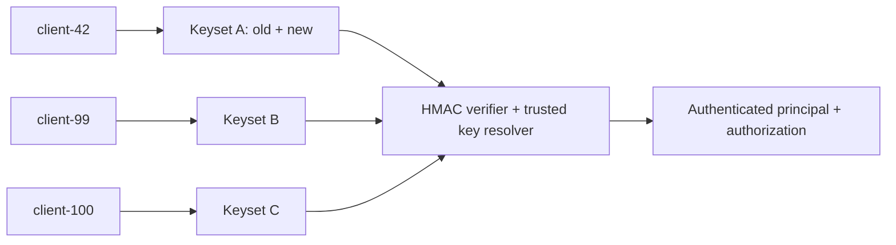
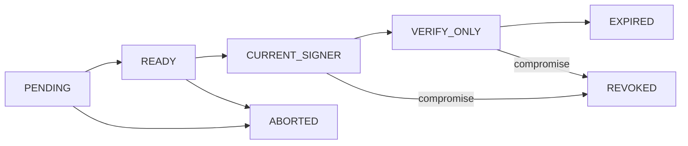
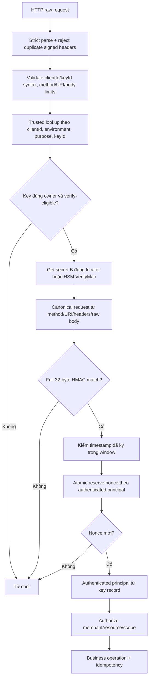
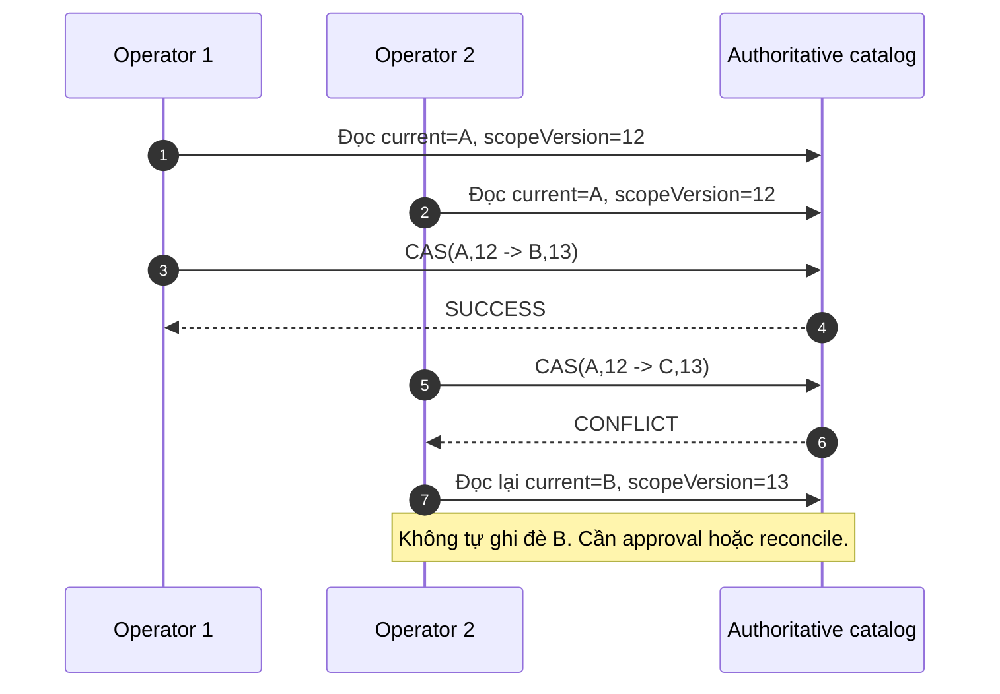

# Rotation theo client

## 1. Bối cảnh: mỗi client phải xoay khóa độc lập

Trong một hệ thống **xác thực HTTP request bằng HMAC** phục vụ nhiều đối tác, mỗi client có một hoặc nhiều **shared secret** để ký canonical request. Khi secret đến kỳ thay hoặc nghi bị lộ, ta cần **rotation theo client**: thay key material và key version của **đúng client bị ảnh hưởng** mà không đổi khóa, gián đoạn traffic hoặc mở rộng quyền của các client còn lại.

Giả sử API thanh toán có ba đối tác:

```text
Client           Current signing key     Verify-only key
----------------------------------------------------------
client-42        k-2026-11               k-2026-10
client-99        k-2026-11               (không có)
client-100       k-2026-08               k-2026-07
```

Chú ý: `client-42` và `client-99` có thể cùng **chuỗi key ID** `k-2026-11` nhưng **không được cùng raw secret** hoặc bị tra nhầm secret. Nếu ứng dụng quy định key ID duy nhất toàn cục, có thể áp đặt ràng buộc mạnh hơn; **ít nhất** bộ tra khóa cần nhận diện chính xác scope sở hữu.

Bài **“Rotation theo client”** thuộc chương **Multi-client**, trong mô-đun **`SECURITY_AUTHENTICATION_HMAC_REQUEST_AUTHENTICATION`**. Mô-đun thiết kế xác thực HTTP request bằng **HMAC với shared secret**, **canonical request gồm method, URI, headers và/hoặc body theo hợp đồng ký**, xác minh chữ ký, chống replay bằng timestamp/nonce, quản lý key rotation, kiểm thử proxy/gateway và phân biệt authentication với authorization.

**Mục tiêu học tập:**

- Giải thích vì sao không nên có **một shared secret toàn hệ thống** cho tất cả đối tác.
- Xác định **namespace và ownership** của từng key theo authenticated client, tenant, môi trường, mục đích và key version.
- Thiết kế **client-specific rotation** với trạng thái PENDING, CURRENT_SIGNER, VERIFY_ONLY, REVOKED và grace period có hạn.
- Phân biệt **key hiện được sender chọn để ký** với **key server vẫn chấp nhận verify**.
- Dùng **atomic compare-and-set/transaction**, tránh hai rotation operations cùng đổi current signing key của một client.
- Viết Java 17 và JUnit 5 cho lookup đúng scope, ký/xác minh HMAC và kiểm thử cross-client substitution.
- Áp dụng timestamp/nonce anti-replay, idempotency, authorization và quản lý bí mật xuyên key rotation.
- Lập kế hoạch rollout theo từng client, theo dõi độ trễ đồng bộ cache/multi-region và xử lý compromise.

> **Bất biến quan trọng:** Rotation của `client-42` **không** thay khóa `client-99`; một request tự khai `clientId/keyId` chỉ được xác thực bằng key version **thuộc đúng client** và còn verify-eligible, sau đó mới được gán principal và kiểm quyền nghiệp vụ.

## 2. Multi-client rotation khác rotation một secret toàn hệ thống

Với một key global, tất cả clients có thể bị gián đoạn nếu secret đổi đột ngột:

```text
BAD: global HMAC secret
  client-42  ─┐
  client-99  ─┼── shared-secret-G ── verifier
  client-100 ─┘

Leak của client-42 => attacker có khả năng giả mạo các client khác
nếu giao thức/key resolver không có cách ràng buộc riêng.
```

Thiết kế per-client:



| Chủ đề | Secret global | Rotation theo client |
| --- | --- | --- |
| Blast radius nếu secret lộ | Rất lớn | Giới hạn theo keyset của client nếu cách ly đúng |
| Lịch rotation | Đồng loạt | Theo nhu cầu từng client |
| Trạng thái key | Dễ thành một cờ toàn cục | Theo `(client, purpose, environment, version)` |
| Đo tiến độ rollout | Khó quy về bên gây lỗi | Theo từng client và key ID |
| Khả năng revoke khẩn cấp | Có thể ngắt tất cả | Có thể chặn client/key bị ảnh hưởng |
| Độ phức tạp vận hành | Ít metadata nhưng rủi ro lớn | Cần catalog, ownership, audit, cache và CAS |
| Cross-tenant authorization | Vẫn bắt buộc | Vẫn bắt buộc, tách với HMAC |

### 2.1. Có key riêng chưa đủ nếu resolver sai

Nếu hai clients có secret riêng nhưng verifier chỉ làm:

```java
// SAI: keyId có thể trùng ở hai client.
byte[] secret = secretStore.getByKeyId(keyId);
```

một lookup thiếu client scope vẫn có thể lấy sai key, gây lỗi 401 ngẫu nhiên hoặc lỗ hổng trust-boundary.

Với multi-client, resolver phải gắn **client identity + key version + environment/purpose**, rồi xác nhận **record owner** trước khi lấy secret.

### 2.2. Rotation không tự mở thêm quyền

Client được cấp key mới **không** đồng nghĩa được cấp thêm permission. `client-42` tiếp tục bị giới hạn quyền thao tác với merchant/resource thuộc client đó. Việc cấp key, đổi key hay revoke **không thay thế authorization** ở API nghiệp vụ.

## 3. Xác định danh tính, namespace và phạm vi khóa

Cần phân biệt:

| Dữ liệu | Nguồn đáng tin sau xác thực | Dùng để làm gì? |
| --- | --- | --- |
| `X-Client-Id` | Client tự khai trước HMAC; được kiểm chứng qua key ownership/MAC | Gợi ý lookup key |
| `X-Key-Id` | Client tự khai trước HMAC | Chọn version secret |
| `principalId` | Metadata của credential đã được HMAC xác minh | Danh tính authenticated |
| `tenantId` | Catalog/authorization service đã tin cậy | Phân vùng dữ liệu/quyền |
| `environment` | Cấu hình endpoint/workload, không nhận tùy tiện từ Internet | Tách staging/production |
| `purpose` | Server route/giao thức được phép | Tách PAYMENT_REQUEST, WEBHOOK, … |
| `secretLocator` | Catalog server-side/secret manager | Đọc hoặc sử dụng key material |
| `currentSigningKeyId` | Trạng thái authoritative của client keyset | Key sender nên dùng cho request mới |

Một **key ownership tuple** gợi ý:

```text
KeyLookup = (
  authenticated-client registration: clientId,
  environment: PRODUCTION,
  purpose: PAYMENT_REQUEST_AUTH,
  keyId: k-2026-11
)
```

Trong HTTP verifier, `clientId` **chưa được xác thực** vào thời điểm lookup, nhưng catalog có thể dùng nó làm **hint có giới hạn** để tìm **key ứng viên thuộc đúng client**. Chỉ sau khi HMAC khớp mới chuyển `principalId` từ record sang security context.

### 3.1. Key ID có cần unique toàn hệ thống không?

Có hai contract hợp lệ:

**Contract A — Key ID unique toàn hệ thống:** `keyId` tự định danh một key record, nhưng verifier **vẫn kiểm client/tenant ownership** đã ký.

**Contract B — Key ID unique trong một client scope:** hai clients có thể cùng `k-2026-11`. Verifier phải lookup theo `(clientId,environment,purpose,keyId)`.

Trong bài này, chọn **Contract B** để minh họa sai sót dễ gặp ở hệ thống multi-client. `clientId` và `keyId` **không phải secret**. Sự an toàn phụ thuộc key ownership, secret ngẫu nhiên và HMAC verification.

### 3.2. Không nhận arbitrary secret locator qua HTTP

Tuyệt đối không làm:

```text
GET secret(path = request.header("X-Secret-Path"))
```

Attacker có thể biến verifier thành một **confused deputy** đọc secret của tenant khác. Secret locator chỉ đến từ catalog tin cậy sau khi kiểm namespace và trạng thái.

## 4. Threat model: những lỗi đặc trưng của rotation theo client

| Mối đe dọa | Tình huống | Bất biến cần giữ |
| --- | --- | --- |
| **Cross-client key confusion** | `client-42` và `client-99` cùng key ID, resolver chỉ tra key ID | Lookup phải kiểm client ownership và scope |
| **Global rotation accident** | Operator định đổi key client-42 nhưng update tất cả clients | Mutation bắt buộc có client scope |
| **Unauthorized rotation** | Caller không có quyền với client-99 vẫn kích hoạt key cho client-99 | RBAC/ABAC theo target client |
| **Compromised old key** | Secret A bị lộ nhưng API giữ grace dài | Emergency revoke A ngay theo policy |
| **Stale cache** | Region 2 vẫn coi A active sau revoke | Revocation propagation và fail-closed contract |
| **Duplicate active keys** | Hai operators cùng rotate client-42 A→B và A→C | CAS trên đúng client keyset |
| **Key ID/secret mismatch** | Metadata B trỏ nhầm secret của A hoặc client khác | Immutable locator/version và readback/proof |
| **Nonce scope bug** | Nonce A được tái dùng sau switch sang B | Replay scope theo authenticated principal khi policy yêu cầu |
| **Idempotency scope bug** | Retry payment đổi HMAC key làm đổi business operation key | Idempotency scope ổn định theo principal |
| **Snapshot rollback** | Backup khôi phục A REVOKED thành ACTIVE | Authoritative revocation ledger và restore policy |
| **Environment confusion** | Request staging dùng production secret vì ID giống | Server-derived environment scope |
| **Scheme downgrade** | Unknown key ID khiến verifier thử legacy HMAC/short tag | Một scheme/version allowlist, fail closed |
| **Side-channel enumeration** | Public errors tiết lộ client/key tồn tại | Error contract đồng nhất, rate limits, quan sát nội bộ |
| **Client fleet lệch version** | Một số ứng dụng client-42 vẫn ký A sau cutover | Grace window, telemetry, migration plan |

**Không phải một client-specific rotation thành công** nếu request của client-42 vẫn được chấp nhận bằng key cũ **sau thời điểm revoke đã cam kết**, hoặc key mới của client-42 lại xác thực được một identity không thuộc sở hữu của nó.

## 5. Các trạng thái trong keyset của từng client

Không có bộ enum duy nhất do HTTP bắt buộc. Bài chọn một contract rõ:



| State | Sender dùng ký request mới? | Verifier chấp nhận MAC? | Ghi chú |
| --- | --- | --- | --- |
| `PENDING` | Không | Không | Key mới tạo hoặc chưa đủ điều kiện |
| `READY` | Không | **Chưa** theo contract này | Đã provision và có thể kích hoạt |
| `CURRENT_SIGNER` | Có, nếu trong sign window | Có, nếu trong verify window | Mỗi scope chỉ một current signer |
| `VERIFY_ONLY` | Client **không nên** dùng ký mới | Có đến hết grace | Client chưa nhận được lệnh cutover có thể còn ký A |
| `REVOKED` | Không | **Không** | Emergency hoặc thu hồi có chủ đích |
| `EXPIRED` | Không | Không | Hết cửa sổ verification |

Cần **hai mốc chính sách**:

```text
canSign(key, now) =
  state == CURRENT_SIGNER
  AND signFrom <= now < signUntil
  AND canVerify(key, now)

canVerify(key, now) =
  state IN (CURRENT_SIGNER, VERIFY_ONLY)
  AND verifyFrom <= now < verifyUntil
  AND NOT revoked
```

**VERIFY_ONLY không ngăn client có secret cũ tiếp tục tính HMAC mới về mặt toán học.** Nó là quy tắc sender phải đổi sang key mới, còn verifier vẫn nhận key A trong grace. Vì vậy giai đoạn grace phải **có hạn** và không dành cho key đã xác nhận compromise.

### 5.1. Chỉ một current signer cho từng client scope

Nếu scope là `(clientId,environment,purpose)`, áp dụng **tối đa một current signing key** trong scope đó. Những key khác có thể là `VERIFY_ONLY` với overlap verification.

Nếu một client dùng hai ứng dụng với **hai purpose tách biệt**, quy tắc một signer nên áp dụng cho **mỗi purpose**, không ép mọi ứng dụng chia một secret.

### 5.2. Credential mới chưa provision xong không được ACTIVE

Một record tồn tại ở catalog hoặc secret manager **không đủ** để chuyển `PENDING/READY` sang `CURRENT_SIGNER`. Cần bảo đảm key material đúng version đã lưu, caller có quyền, client nhận được key và verifier có khả năng sử dụng khi traffic chuyển đổi.

## 6. Timeline rotation độc lập: client-42 A → B

Giả sử client-42 dùng:

```text
Old A: k-2026-10
New B: k-2026-11
Other client-99: k-2026-11 (secret khác, KHÔNG đổi)
```

Một rotation planned có thể gồm:

```mermaid
sequenceDiagram
    autonumber
    participant O as Operator / rotation workflow
    participant D as Key catalog
    participant S as Secret manager
    participant C as client-42 sender fleet
    participant V as HMAC verifier fleet
    O->>D: Kiểm quyền target client-42
    O->>S: Sinh/lưu secret B với locator riêng
    O->>D: Register key B = PENDING, immutable keyId
    O->>C: Cấp B qua kênh bảo vệ, yêu cầu enrollment/ack
    C-->>O: Proof-of-possession hoặc readiness ack
    O->>D: Atomic CAS: current A -> B; A VERIFY_ONLY
    D-->>V: Invalidate/update key metadata
    O-->>C: Cutover: dùng B ký requests mới
    C->>V: POST signed với keyId B + nonce mới
    V->>V: Verify B và kiểm replay/authorization
    Note over C,V: Grace: traffic cũ A vẫn verify nếu chưa hết hạn
    O->>D: Hết grace, expire/revoke A
    D-->>V: Invalidate A ở mọi region
```

Một operator không có quyền với client-99 **không được** nhân tiện sửa keyset client-99. Sau khi chuyển A→B, số lượng active signer/verify-only keys của client-99 không đổi.

### 6.1. Kịch bản happy path

| Thời điểm | client-42 key A | client-42 key B | client-99 key |
| --- | --- | --- | --- |
| Trước rotation | CURRENT_SIGNER | Chưa có | CURRENT_SIGNER |
| Sau provisioning B | CURRENT_SIGNER | PENDING/READY | CURRENT_SIGNER |
| Sau cutover | VERIFY_ONLY | CURRENT_SIGNER | CURRENT_SIGNER |
| Hết grace | EXPIRED/REVOKED | CURRENT_SIGNER | CURRENT_SIGNER |

### 6.2. Nếu client-42 có nhiều ứng dụng/backend?

Một số pods của client-42 có thể chưa nhận B khi operator bắt đầu cutover. Server không thể cập nhật client-side processes bằng một SQL transaction. Cần có:

- Secure key distribution tới **toàn bộ sender fleet**.
- Canary test trên một tập requests/kênh enrollment.
- Marker/announcement cutover rõ ràng.
- Grace period đủ cho rollout/network queues theo policy.
- Metrics tỷ lệ key A/B trên từng vùng/client application.
- Deadline chặn A và phương án hỗ trợ client lỗi.

## 7. Catalog, ownership và current pointer theo client

Một schema minh họa có thể tách **key versions** khỏi **current signing pointer**:

```sql
-- Pseudo-SQL; kiểu thời gian, FK và constraint phụ thuộc DB.
CREATE TABLE hmac_key_version (
    client_id        VARCHAR(100) NOT NULL,
    environment      VARCHAR(40)  NOT NULL,
    purpose          VARCHAR(80)  NOT NULL,
    key_id           VARCHAR(100) NOT NULL,
    principal_id     VARCHAR(100) NOT NULL,
    tenant_id        VARCHAR(100) NOT NULL,
    algorithm        VARCHAR(40)  NOT NULL,
    state            VARCHAR(40)  NOT NULL,
    secret_locator   VARCHAR(500) NOT NULL,
    verify_from      TIMESTAMP NOT NULL,
    verify_until     TIMESTAMP NOT NULL,
    version          BIGINT NOT NULL,
    PRIMARY KEY(client_id, environment, purpose, key_id)
);

CREATE TABLE hmac_signing_scope (
    client_id          VARCHAR(100) NOT NULL,
    environment        VARCHAR(40)  NOT NULL,
    purpose            VARCHAR(80)  NOT NULL,
    current_key_id     VARCHAR(100) NOT NULL,
    scope_version      BIGINT NOT NULL,
    PRIMARY KEY(client_id, environment, purpose)
);
```

Đây là **mô hình khái niệm**, chưa phải migration production. Cần FK/composite ownership, index, state constraints, unique principals, time types, encryption policy và mô hình consistency của DB cụ thể.

**Hai điểm dữ liệu cần nhất quán:**

1. `hmac_signing_scope.current_key_id` trỏ vào **key version thuộc đúng client/scope** và đang `CURRENT_SIGNER`.
2. Một rotation transaction không tạo hai current signing keys trong một scope hoặc pointer đến key bị REVOKED/PENDING.

### 7.1. CAS thay current pointer

Giả sử scope version hiện tại bằng `12`, A là current. Chuyển sang B chỉ thành công khi trạng thái chưa bị operator khác thay đổi:

```sql
-- Trong một transaction có lock và kiểm ownership/READY B.
UPDATE hmac_signing_scope
SET current_key_id = :new_key_id,
    scope_version = scope_version + 1
WHERE client_id = :client_id
  AND environment = :environment
  AND purpose = :purpose
  AND current_key_id = :expected_old_key_id
  AND scope_version = :expected_scope_version;
```

Số row được update **phải bằng 1**. Nếu 0, có conflict hoặc scope sai; **không** tự coi là thành công. Trong transaction cần đổi state A/B với expected-version checks và áp dụng database constraints phù hợp.

### 7.2. Unique key version vs unique signer

`PRIMARY KEY(client_id, environment, purpose, key_id)` ngăn hai versions trùng ID **trong cùng scope**, nhưng **không tự** ngăn hai row có state `CURRENT_SIGNER`.

Nếu dùng status row thay vì pointer, có thể cần **partial unique index** cho current signer (nếu DB hỗ trợ) và transaction/locking khi đổi A→B. Current pointer trong một hàng authoritative giúp chuyển selection dễ atomically hơn, nhưng state của các key versions vẫn phải khớp.

### 7.3. Nếu hai clients trùng key ID

`client-42/k-2026-11` và `client-99/k-2026-11` là **hai rows khác nhau**. Không tạo `Map<String,Secret>` keyed only by key ID hoặc một cache key `"k-2026-11"` dùng chung.

## 8. Transaction boundary và secret provisioning

Rotation thay đổi **ít nhất hai nguồn trạng thái**:

- **Key catalog** trong database.
- **Secret material** trong Vault/KMS/secret manager.

Chúng thường không có chung một distributed transaction. Nếu sau khi metadata ghi `READY` mà secret store chưa có secret B, request B sẽ thất bại. Nếu secret B được ghi thành công nhưng catalog transaction rollback, có thể có **orphan secret**.

Một workflow bền vững:

```text
1. AuthZ operator với client-42
2. Claim rotationOperationId (idempotent operation)
3. Catalog INSERT B = PENDING dưới unique tuple
4. Generate 32 random secret bytes bằng CSPRNG
5. Put immutable secret B trong secret manager với trusted locator
6. Readiness check / enrollment; catalog B = READY
7. CAS current A -> B; A = VERIFY_ONLY; B = CURRENT_SIGNER
8. Sender fleet cutover + monitoring
9. Expire/revoke A sau grace và invalidate cache
```

Không tự đánh dấu `CURRENT_SIGNER` nếu không chắc bước 5 hoặc 6 đã hoàn tất.

### 8.1. Retry khi provisioning timeout

Một operator có thể gửi rotation request, server đã ghi B nhưng response bị mất. Retry **phải giữ `rotationOperationId`**, tra trạng thái của cùng operation và **không tự tạo key C mỗi lần HTTP timeout**.

Lỗi 503 từ secret manager cũng không có nghĩa put chưa xảy ra. Dùng **idempotent immutable secret write** có operation ID, versioning và reconciliation.

### 8.2. Khi client mất secret mới

Đừng thêm endpoint `GET /credentials/{keyId}/secret` có thể đọc vô hạn. Một số hệ thống chọn **one-time delivery** qua authenticated TLS channel và xác nhận possession. Nếu delivery thất lạc, có thể **revoke key B đang PENDING/READY rồi tạo key C mới**, hoặc dùng kênh authenticated re-delivery được kiểm soát với retention giới hạn. **Không hứa tuyệt đối** “client đã nhìn thấy secret đúng một lần” chỉ bằng cờ `delivered`.

## 9. Quy trình verify request khi nhiều clients cùng xoay khóa

Một API request chứa:

```http
POST /v1/payments?merchantId=m-42 HTTP/1.1
Content-Type: application/json
X-Client-Id: client-42
X-Key-Id: k-2026-11
X-Timestamp: 1795856400
X-Nonce: AAAAAAAAAAAAAAAAAAAAAA
X-Signature: <hmac-sha256-base64>

{"orderId":"O-42","amountMinor":250000,"currency":"VND"}
```

Server nên:



**Đúng:** request mang `keyId=k-2026-10` thì verifier chọn key A của **client-42** nếu A còn `VERIFY_ONLY` và chưa hết grace. Nếu A revoked, phải từ chối. Verifier **không** chuyển sang thử key B chỉ vì A không còn hợp lệ.

**Sai:** server xác thực dựa trên “key hiện active nhất” mà bỏ qua keyId đã ký, hoặc thử secret của mọi client cho đến khi một cái khớp.

### 9.1. Định danh trước và sau khi kiểm MAC

```text
Before HMAC:
  clientId = UNTRUSTED_LOOKUP_HINT
  keyId    = UNTRUSTED_LOOKUP_HINT

After HMAC + valid key state:
  principalId = AUTHENTICATED_FROM_TRUSTED_RECORD

After authorization:
  mayCreatePaymentForMerchant = true/false
```

Không để untrusted `X-Client-Id` trực tiếp cấp quyền, cũng không biến kết quả `catalog.find` thành principal nếu chưa so signature.

### 9.2. Signed key ID và client ID

`X-Client-Id` và `X-Key-Id` nên nằm trong canonical request theo contract. Nếu attacker đổi `clientId/keyId` nhưng giữ MAC cũ, expected MAC phải thay đổi hoặc resolver phải từ chối identity sai.

**Không chỉ bảo vệ body rồi bỏ qua metadata chọn khóa**. Với multi-client, ràng buộc identity/key metadata vào signed input giúp tránh ambiguous interpretation.

## 10. Golden HMAC vector: hai clients có thể trùng key ID nhưng không trùng khóa

Để kiểm kiến trúc theo client, bài dùng **ba fixture công khai**. Không dùng những raw keys/timestamp/nonce này trong production.

**Giao thức minh họa `HMAC-MULTICLIENT-V1`** có đúng **10 dòng** trong canonical message, nối bằng LF, **không có LF cuối**:

```text
HMAC-MULTICLIENT-V1
POST
/v1/payments
merchantId=<merchant-id>
content-type:application/json
client-id:<client-id>
key-id:<key-id>
x-timestamp:1795856400
x-nonce:AAAAAAAAAAAAAAAAAAAAAA
<body-sha256-lowercase-hex>
```

Contract xác định raw path `/v1/payments`, raw query `merchantId=m-42` hoặc `merchantId=m-99`, Content-Type `application/json` và SHA-256 trên **đúng raw body bytes**; không tự cho client gửi body hash để server tin.

### 10.1. client-42 — key cũ A

```text
clientId: client-42
merchant: m-42
keyId:    k-2026-10

Raw secret A (32 bytes, HEX):
00112233445566778899aabbccddeeff00112233445566778899aabbccddeeff
```

Body **56 bytes UTF-8**, không newline:

```json
{"orderId":"O-42","amountMinor":250000,"currency":"VND"}
```

SHA-256 của body:

```text
eaeb86c57439a64c80d023bc882535c45ebfcabb7617add8d2a628637faab41a
```

Canonical request **239 bytes**; Base64 Basic padded của HMAC-SHA-256 full tag:

```text
AFrMIs6At2Zyi/rLjwopxetZOkvTYBFqDx3TM5JhAr4=
```

### 10.2. client-42 — key mới B

```text
clientId: client-42
merchant: m-42
keyId:    k-2026-11

Raw secret B (32 bytes, HEX):
ffeeddccbbaa99887766554433221100ffeeddccbbaa99887766554433221100
```

Body **giống A**, canonical vẫn **239 bytes**. Expected HMAC Base64:

```text
SuKv8MPVAVBb3W1l7/MFkRRWvSyUTxKb189Ptwl0q/g=
```

Vì key ID và raw secret đều đổi, signature B khác A. Chữ ký đúng **không tự chứng minh key B đã ACTIVE** — verifier còn phải kiểm metadata state.

### 10.3. client-99 — cùng key ID text nhưng secret C riêng

```text
clientId: client-99
merchant: m-99
keyId:    k-2026-11

Raw secret C (32 bytes, HEX):
102132435465768798a9bacbdcedfe0f102132435465768798a9bacbdcedfe0f
```

Body **56 bytes UTF-8**, không newline:

```json
{"orderId":"O-99","amountMinor":250000,"currency":"VND"}
```

SHA-256 của body:

```text
da4f7bca238d4e349f4664bcfb90255256afd3f5a690610bfade335f41a37f3a
```

Canonical **239 bytes**; expected HMAC Base64:

```text
nGXaURo5r2rUemsJu9cnUNiwdqJZiPMVe00v3CUaEZ8=
```

### 10.4. Ý nghĩa của bộ vector

| Fixture | Client | Key ID | Raw secret | Expected signature |
| --- | --- | --- | --- | --- |
| A | `client-42` | `k-2026-10` | A | `AFrMIs6At2Zyi/rLjwopxetZOkvTYBFqDx3TM5JhAr4=` |
| B | `client-42` | `k-2026-11` | B | `SuKv8MPVAVBb3W1l7/MFkRRWvSyUTxKb189Ptwl0q/g=` |
| C | `client-99` | `k-2026-11` | C | `nGXaURo5r2rUemsJu9cnUNiwdqJZiPMVe00v3CUaEZ8=` |

Các tag trên **được tính độc lập từ raw key bytes và canonical bytes**. Nếu server lookup `keyId=k-2026-11` rồi lấy C khi request khai `clientId=client-42`, nó vi phạm ownership; HMAC sẽ không khớp fixture B. Nếu một lớp tự dùng metadata của C để authorize client-42, đây còn là **lỗi phân quyền**, không chỉ interoperability.

## 11. Java 17: mô hình per-client key ownership và rotation policy

Mô hình dữ liệu dưới đây không chứa raw secret trong key catalog. Nó tách **key lifecycle** khỏi **authentication request**.

```java
import java.time.Instant;
import java.util.Objects;

public final class ClientKeyPolicyV1 {
    private ClientKeyPolicyV1() {}

    public enum State {
        PENDING, READY, CURRENT_SIGNER,
        VERIFY_ONLY, REVOKED
    }

    public record KeyScope(
            String clientId, String environment,
            String purpose) {
        public KeyScope {
            Objects.requireNonNull(clientId);
            Objects.requireNonNull(environment);
            Objects.requireNonNull(purpose);
            if (!clientId.matches("[A-Za-z0-9._-]{1,80}")
                    || !environment.matches("[A-Z_]{2,32}")
                    || !purpose.matches("[A-Z_]{2,64}")) {
                throw new IllegalArgumentException("Invalid key scope");
            }
        }
    }

    public record KeyVersion(
            KeyScope scope,
            String keyId,
            String principalId,
            String tenantId,
            String secretLocator,
            State state,
            Instant verifyFrom,
            Instant verifyUntil,
            long version) {

        public KeyVersion {
            Objects.requireNonNull(scope);
            Objects.requireNonNull(keyId);
            Objects.requireNonNull(principalId);
            Objects.requireNonNull(tenantId);
            Objects.requireNonNull(secretLocator);
            Objects.requireNonNull(state);
            Objects.requireNonNull(verifyFrom);
            Objects.requireNonNull(verifyUntil);

            if (!keyId.matches("[A-Za-z0-9._-]{1,80}")
                    || principalId.isBlank() || tenantId.isBlank()
                    || secretLocator.isBlank()
                    || !verifyFrom.isBefore(verifyUntil)
                    || version < 0) {
                throw new IllegalArgumentException("Invalid key version");
            }
        }
    }

    public static boolean canVerify(
            KeyVersion key, Instant serverNow) {
        Objects.requireNonNull(key);
        Objects.requireNonNull(serverNow);
        return (key.state() == State.CURRENT_SIGNER
                 || key.state() == State.VERIFY_ONLY)
                && !serverNow.isBefore(key.verifyFrom())
                && serverNow.isBefore(key.verifyUntil());
    }

    public static boolean isCurrentSigner(
            KeyVersion key, Instant serverNow) {
        return key.state() == State.CURRENT_SIGNER
                && canVerify(key, serverNow);
    }
}
```

**Ý nghĩa:** `canVerify` kiểm key state/validity; `KeyScope` ràng buộc **client ID, environment, purpose**. `principalId` chỉ nên được tin sau khi request MAC khớp secret ứng với record đó.

Production cần additional flags như approval, signFrom/signUntil, emergency revoked version, immutable secretRef version và transition audit nếu chính sách yêu cầu; đừng suy rằng một enum đủ làm đầy đủ vòng đời.

### 11.1. Current signer nên được chọn thế nào?

Khi client backend cần ký request mới, nó phải chọn **đúng một key CURRENT_SIGNER** trong scope của mình:

```java
import java.time.Clock;
import java.time.Instant;
import java.util.List;
import java.util.Objects;

public final class ClientSigningSelectorV1 {
    private ClientSigningSelectorV1() {}

    public static ClientKeyPolicyV1.KeyVersion choose(
            ClientKeyPolicyV1.KeyScope scope,
            List<ClientKeyPolicyV1.KeyVersion> candidates,
            Clock clock) {

        Objects.requireNonNull(scope);
        Objects.requireNonNull(candidates);
        Instant now = Objects.requireNonNull(clock).instant();

        ClientKeyPolicyV1.KeyVersion found = null;
        for (var key : candidates) {
            if (key == null) {
                throw new IllegalStateException("Null catalog key");
            }
            if (!scope.equals(key.scope())
                    || !ClientKeyPolicyV1.isCurrentSigner(key, now)) {
                continue;
            }
            if (found != null) {
                throw new IllegalStateException(
                        "Two current signing keys for one client scope");
            }
            found = key;
        }

        if (found == null) {
            throw new IllegalStateException(
                    "No current signing key for this client");
        }
        return found;
    }
}
```

**Không chọn “key mới nhất theo lexicographic order”.** Key mới nhất có thể PENDING hoặc REVOKED. Không chọn VERIFY_ONLY chỉ vì CURRENT_SIGNER tạm unavailable.

## 12. Java 17: canonical request có signed client ID và key ID

Để kiểm test vector của mục 10, ví dụ V1 giới hạn method/path/query/Content-Type minh bạch; nó **không** là thư viện canonicalization tổng quát cho mọi API.

```java
import java.nio.charset.StandardCharsets;
import java.security.GeneralSecurityException;
import java.security.MessageDigest;
import java.util.Base64;
import java.util.HexFormat;
import java.util.Objects;
import javax.crypto.Mac;
import javax.crypto.spec.SecretKeySpec;

public final class MultiClientHmacV1 {
    private MultiClientHmacV1() {}

    public record Request(
            String method,
            String rawPath,
            String rawQuery,
            String contentType,
            String clientId,
            String keyId,
            String timestampSeconds,
            String nonce,
            byte[] bodyBytes) {
        public Request {
            Objects.requireNonNull(bodyBytes);
            bodyBytes = bodyBytes.clone();
        }

        @Override public byte[] bodyBytes() {
            return bodyBytes.clone();
        }
    }

    public static byte[] canonicalBytes(Request r)
            throws GeneralSecurityException {
        Objects.requireNonNull(r);

        // Hợp đồng endpoint minh họa, không tự rewrite URI.
        if (!"POST".equals(r.method())
                || !"/v1/payments".equals(r.rawPath())
                || r.rawQuery() == null
                || !r.rawQuery().matches("merchantId=m-[0-9]{1,12}")
                || !"application/json".equals(r.contentType())
                || r.clientId() == null
                || !r.clientId().matches("[A-Za-z0-9._-]{1,80}")
                || r.keyId() == null
                || !r.keyId().matches("[A-Za-z0-9._-]{1,80}")
                || r.timestampSeconds() == null
                || !r.timestampSeconds().matches(
                        "0|[1-9][0-9]{0,11}")
                || r.nonce() == null
                || !r.nonce().matches("[A-Za-z0-9_-]{22}")) {
            throw new IllegalArgumentException("Invalid signed fields");
        }

        // 128-bit nonce, Base64URL unpadded, canonical.
        final byte[] rawNonce;
        try {
            rawNonce = Base64.getUrlDecoder().decode(r.nonce());
        } catch (IllegalArgumentException malformed) {
            throw new IllegalArgumentException(
                    "Invalid nonce encoding", malformed);
        }
        if (rawNonce.length != 16
                || !Base64.getUrlEncoder().withoutPadding()
                    .encodeToString(rawNonce).equals(r.nonce())) {
            throw new IllegalArgumentException("Noncanonical nonce");
        }

        String hash = HexFormat.of().formatHex(
                MessageDigest.getInstance("SHA-256")
                    .digest(r.bodyBytes()));

        String canonical = String.join("\n",
                "HMAC-MULTICLIENT-V1",
                r.method(),
                r.rawPath(),
                r.rawQuery(),
                "content-type:" + r.contentType(),
                "client-id:" + r.clientId(),
                "key-id:" + r.keyId(),
                "x-timestamp:" + r.timestampSeconds(),
                "x-nonce:" + r.nonce(),
                hash);

        return canonical.getBytes(StandardCharsets.UTF_8);
    }

    public static byte[] hmacSha256(
            byte[] secret, byte[] canonical)
            throws GeneralSecurityException {
        Objects.requireNonNull(secret);
        Objects.requireNonNull(canonical);
        if (secret.length != 32) {
            throw new IllegalArgumentException(
                    "V1 requires 32-byte key");
        }
        Mac mac = Mac.getInstance("HmacSHA256");
        mac.init(new SecretKeySpec(secret, "HmacSHA256"));
        return mac.doFinal(canonical);
    }

    public static String sign(byte[] secret, Request r)
            throws GeneralSecurityException {
        return Base64.getEncoder().encodeToString(
                hmacSha256(secret, canonicalBytes(r)));
    }

    public static boolean matchesFullMac(
            byte[] expected, String base64Signature) {
        if (expected == null || expected.length != 32
                || base64Signature == null
                || base64Signature.length() != 44
                || !base64Signature.matches(
                        "[A-Za-z0-9+/]{43}=")) {
            return false;
        }

        final byte[] got;
        try {
            got = Base64.getDecoder().decode(base64Signature);
        } catch (IllegalArgumentException malformed) {
            return false;
        }

        boolean canonical = got.length == 32
                && Base64.getEncoder().encodeToString(got)
                        .equals(base64Signature);
        return canonical && MessageDigest.isEqual(expected, got);
    }
}
```

**Điểm bảo mật:** `MultiClientHmacV1.canonicalBytes` ký cả client ID, key ID, method, raw URI, Content-Type, timestamp, nonce và SHA-256 của body bytes. Client/server phải đồng ý một **canonical contract cụ thể**; nếu gateway đổi path/query/body sau khi client ký, chữ ký sẽ sai.

Các regex query/path ở đây cố tình chỉ chấp nhận một contract nhỏ; production cần parser xử lý percent encoding, duplicate query parameters, host/scheme khi ký, proxy trust boundary và signed header policies một cách tổng quát hơn.

### 12.1. Base64MAC và secret Base64 là hai loại encoding khác

- Secret key: raw random bytes; có thể Base64URL-encode khi provisioning, **decode lại trước HMAC**.
- HMAC tag: raw 32 bytes; trong profile này được **Base64 Basic padded** đưa lên wire.
- Nonce: raw 16 bytes; được **Base64URL không padding** đưa lên wire.

Đừng dùng `Base64.getMimeDecoder()` để bỏ qua ký tự lạ khi parse signature, hoặc dùng text Base64 của key làm raw `SecretKeySpec` bytes.

## 13. Java 17: verifier chọn secret theo đúng client scope

Định nghĩa các interface để tách **catalog, secret manager, replay store và authorization**. Đây là contract học tập; không có JDBC/Redis/KMS implementation thật trong bài này.

```java
import java.util.Optional;

public final class ClientVerifierPortsV1 {
    private ClientVerifierPortsV1() {}

    @FunctionalInterface
    public interface Catalog {
        // Đọc record theo exact tuple; environment/purpose server
        // ấn định chứ không lấy từ header.
        Optional<ClientKeyPolicyV1.KeyVersion> find(
                ClientKeyPolicyV1.KeyScope scope, String keyId);
    }

    @FunctionalInterface
    public interface SecretReader {
        // Trả byte[32] độc lập mà caller được phép zeroize.
        // Throw khi secret store unavailable; không default secret.
        byte[] readOwned(String trustedLocator);
    }

    @FunctionalInterface
    public interface ReplayStore {
        // Atomic insert-if-absent trên mọi verifier nodes.
        boolean reserveOnce(
                String authenticatedPrincipal, String nonce,
                long ttlSeconds);
    }
}
```

Verifier học tập:

```java
import java.security.GeneralSecurityException;
import java.time.Clock;
import java.time.Instant;
import java.util.Arrays;
import java.util.Optional;

public final class MultiClientVerifierV1 {
    private static final long MAX_PAST = 300L;
    private static final long MAX_FUTURE = 60L;
    private static final long NONCE_MARGIN = 60L;

    private MultiClientVerifierV1() {}

    public static Optional<String> verifyAndReserve(
            MultiClientHmacV1.Request request,
            String signatureB64,
            Clock serverClock,
            ClientVerifierPortsV1.Catalog catalog,
            ClientVerifierPortsV1.SecretReader secrets,
            ClientVerifierPortsV1.ReplayStore replay)
            throws GeneralSecurityException {

        if (request == null || serverClock == null
                || catalog == null || secrets == null
                || replay == null) {
            throw new IllegalArgumentException(
                    "Missing verifier dependency");
        }

        final byte[] canonical;
        try {
            canonical = MultiClientHmacV1.canonicalBytes(request);
        } catch (IllegalArgumentException malformed) {
            return Optional.empty();
        }

        Instant now = serverClock.instant();
        // Server ấn định scope từ route/config.
        var requestedScope = new ClientKeyPolicyV1.KeyScope(
                request.clientId(), "PRODUCTION",
                "PAYMENT_REQUEST_AUTH");

        var found = catalog.find(requestedScope, request.keyId());
        if (found.isEmpty()) return Optional.empty();

        var key = found.get();
        if (!requestedScope.equals(key.scope())
                || !request.keyId().equals(key.keyId())
                || !ClientKeyPolicyV1.canVerify(key, now)) {
            return Optional.empty();
        }

        // Key catalog dùng trusted locator; untrusted header
        // không được trực tiếp điều khiển secret-store path.
        byte[] secret = secrets.readOwned(key.secretLocator());
        if (secret == null) {
            throw new IllegalStateException(
                    "Secret store returned no secret");
        }

        final byte[] expected;
        try {
            expected = MultiClientHmacV1.hmacSha256(
                    secret, canonical);
        } finally {
            Arrays.fill(secret, (byte) 0);
        }

        if (!MultiClientHmacV1.matchesFullMac(
                expected, signatureB64)) {
            return Optional.empty();
        }

        // HMAC hợp lệ rồi mới dùng signed timestamp
        // để kiểm freshness, không dùng nó để kéo dài
        // thời gian hiệu lực của key vừa bị revoke.
        long signedAt = Long.parseLong(
                request.timestampSeconds());
        long serverNow = now.getEpochSecond();

        final long ttl;
        try {
            long min = Math.subtractExact(serverNow, MAX_PAST);
            long max = Math.addExact(serverNow, MAX_FUTURE);
            if (signedAt < min || signedAt > max) {
                return Optional.empty();
            }
            long expiry = Math.addExact(signedAt, MAX_PAST);
            ttl = Math.max(1L, Math.addExact(
                    Math.subtractExact(expiry, serverNow),
                    NONCE_MARGIN));
        } catch (ArithmeticException overflow) {
            return Optional.empty();
        }

        if (!replay.reserveOnce(
                key.principalId(), request.nonce(), ttl)) {
            return Optional.empty();
        }

        // Authenticated principal. Chưa authorize merchantId.
        return Optional.of(key.principalId());
    }
}
```

**Ranh giới của demo:**

- `KeyScope` lấy `clientId` của request làm lookup hint nhưng **environment/purpose được server ấn định**; catalog phải đảm bảo đúng owner/tenant. Trong hệ thống phức tạp cần scope theo realm, organization và trust domain thực tế.
- `KeyVersion` chứa `tenantId` do catalog tin cậy. Business authorization phải kiểm `principalId` với `merchantId` và tenant; demo chỉ trả principal.
- Verifier chỉ dùng đúng **key ID request đã ký**. Key A verify-only được nhận trong grace; key A revoked không bao giờ được nhận.
- Secret store timeout phải **fail closed**; không bắt exception rồi return principal thành công.
- `ReplayStore.reserveOnce` phải nguyên tử giữa nodes và namespace theo authenticated principal với policy một nonce/client; không dùng `HashSet` cục bộ nếu multi-node.
- Timestamp window và key validity là **hai điều kiện độc lập**.
- Header parsing, chống duplicate headers, request size limits, TLS và proxy canonical contract nằm ở HTTP adapter trước verifier.
- `Arrays.fill` là best-effort memory hygiene, không chứng minh JVM/crypto provider đã xóa mọi key copies.

### 13.1. Không dùng key mới của client-99 để cứu chữ ký client-42

Nếu request chứa:

```text
client-id:client-42
key-id:k-2026-11
```

mà client-42 key B unavailable, verifier phải **từ chối hoặc báo lỗi hạ tầng**, **không** fallback sang `client-99/k-2026-11` dù hai clients dùng cùng key ID text.

Điều này đòi hỏi catalog, key cache và secret locator **đều** giữ scope, không chỉ một tầng verifier.

## 14. Transaction/CAS khi hai rotation operations cạnh tranh trên cùng client

Giả sử two operators đồng thời muốn chuyển client-42 từ A→B và A→C:



**Bất biến được bảo vệ:** trong cùng client scope, chỉ một current signer authoritative, mọi state transitions đều có version và operator context.

### 14.1. Hai rotation ở hai client khác nhau có cần serialize toàn hệ thống?

**Không mặc định.** Rotation của client-42 và client-99 nên có thể tiến hành độc lập:

```text
scope=client-42: version 12 -> 13
scope=client-99: version  7 -> 8
```

Nếu khóa global transaction lock cho mọi client, một đối tác gặp lỗi onboarding có thể chặn rotation của hàng trăm đối tác khác. Hãy thiết kế locking/CAS **theo client scope** nhưng bảo đảm các secret manager/global quotas được kiểm soát.

### 14.2. Retry khi CAS response bị mất

Nếu DB commit chuyển B thành current nhưng operator không nhận response, retry cùng `rotationOperationId` phải đọc state authoritative:

- Nếu current đã là B do **chính operation** này chuyển, báo succeeded/idempotent.
- Nếu current thành C do operation khác, báo conflict/reconciliation.
- Không tự chuyển về A hoặc tạo thêm key D vì response bị mất.

## 15. Grace, clock skew, cache và multi-region

Một rotation per-client có thể được catalog đánh dấu hoàn tất nhưng **không áp dụng nhất quán** trên toàn fleet:

```text
Authoritative catalog:
  client-42 A VERIFY_ONLY, B CURRENT_SIGNER

Region 1 cache:
  client-42 A VERIFY_ONLY, B CURRENT_SIGNER

Region 2 stale cache:
  client-42 A CURRENT_SIGNER, B PENDING

client-99 remains unchanged across both regions
```

### 15.1. Cache key phải chứa client scope

Sai:

```text
cacheKey = "k-2026-11"
```

Đúng về mặt scope (không phải code cụ thể):

```text
cacheKey = (
  clientId, environment, purpose,
  keyId, immutable key material version
)
```

Nếu cache state không cập nhật, một node có thể từ chối B hoặc tiếp tục nhận A sau revoke. Cache được phép tồn tại theo **revocation SLA** đã công bố; nếu không thể bảo đảm SLA, cần cơ chế invalidation push, TTL ngắn hoặc read authoritative metadata cho những quyết định nhạy cảm.

### 15.2. Key validity time khác timestamp freshness

```text
Key verify policy: verifyFrom <= serverNow < verifyUntil
Request freshness: serverNow - 300 <= signedAt <= serverNow + 60
```

Timestamp `signedAt` dù HMAC đúng **không** được kéo dài quyền dùng một key đã revoked hoặc hết `verifyUntil`. Với `verifyUntil = 03:00:00Z`, server verify ở `03:00:01Z` phải từ chối key đó cho dù request ký trước 03:00 và vẫn freshness-valid.

### 15.3. Multi-region và single authority

Nếu hai regions được phép cập nhật current pointer theo eventual consistency không có strong conditional write, cùng client có thể kết thúc với hai current keys ở hai vùng. Cần **single authority, quorum/CAS hoặc cơ chế ownership/fencing** theo kiến trúc.

Không tuyên bố rotation “atomic toàn cầu” nếu chỉ có cập nhật local DB rồi async replicate.

### 15.4. Revocation propagation là một SLO, không phải suy đoán

Đo cụ thể: từ lúc admin revoke A đến lúc **mọi verifier nodes ngừng chấp nhận A** mất bao lâu? Ghi alert khi vượt ngưỡng. Không giữ “fallback A” khi metadata báo revoked; điều này vô hiệu mục đích thu hồi key bị lộ.

## 16. Replay protection xuyên rotation, không khóa theo key ID

Một client có thể retry request sau khi chuyển từ A sang B:

```text
Attempt 1:
  client-42 key=A, timestamp=T1, nonce=N1, signature=HMAC(A,...)

Attempt 2 (retry hợp lệ):
  client-42 key=B, timestamp=T2, nonce=N2, signature=HMAC(B,...)
```

**Nếu anti-replay policy là nonce chỉ dùng một lần trên authenticated principal**, replay key phải theo identity ổn định:

```text
replayKey = (
    protocolVersion,
    authenticatedPrincipalId,
    nonce
)
```

Nếu replay key chứa key ID và key A/B đều verify-eligible, cùng nonce có thể được đưa vào hai namespaces khác nhau. Điều này có thể vi phạm hợp đồng single-use per-client.

Tuy nhiên phải **có tenant/principal scope**: nonce của client-42 không được chiếm namespace và gây từ chối request hợp lệ của client-99.

### 16.1. Anti-replay không chặn key compromise

Attacker có secret A có thể tạo **nonce mới, timestamp mới và HMAC mới** khi A còn được verify. Nonce store chỉ chặn **reuse** của một nonce đã ghi, **không** phân biệt attacker có secret với sender hợp lệ.

Khi key của riêng client-42 bị compromise, cần **revoke A của client-42**, không phải reset nonce store cho toàn bộ clients.

### 16.2. TTL nonce và retention của credential khác nhau

Nonce TTL cần bao trùm khoảng còn chấp nhận timestamp + margin; key material và rotation history có thể cần retention theo nhiều ngày/tháng hoặc chính sách khác. Một ví dụ với maximum past 300s, future 60s và margin 60s:

```text
serverNow=1000
signedTimestamp=1060 (future boundary)
expiresWhen=1060+300=1360
ttl=1360-1000+60=420 seconds
```

Không đặt TTL replay bằng tuổi thọ credential hoặc grace period.

## 17. Business idempotency và quyền của client qua rotation

Giả sử `client-42` gửi `POST /v1/payments`, timeout sau khi server đã commit, rồi retry với key B.

| Thành phần | Attempt đầu (A) | Retry (B) | Lý do |
| --- | --- | --- | --- |
| Authenticated principal | `partner-42` | `partner-42` | Danh tính ổn định qua rotation |
| `X-Key-Id` | `k-2026-10` | `k-2026-11` | Key version mới |
| HMAC secret | A | B | Raw bytes khác |
| `X-Timestamp` | T1 | T2 | Mỗi attempt có thời điểm ký mới |
| `X-Nonce` | N1 | N2 | Chống replay |
| `X-Signature` | S1 | S2 | HMAC phải ký lại với key/version/attempt |
| `Idempotency-Key` | `PAY-O42` | `PAY-O42` | Cùng business intent, không tạo duplicate payment |
| Request fingerprint nghiệp vụ | F1 | F1 nếu intent không đổi | Phát hiện reuse key với payload khác |

**Idempotency key phải thuộc business scope ổn định** (ví dụ authenticated principal + operation + idempotency key), không scope theo `keyId`; nếu scope theo key version, retry sau rotation có thể tạo giao dịch thứ hai.

### 17.1. Cached result vẫn cần authentication và authorization

Một request retry có idempotency key đúng vẫn phải qua HMAC verification bằng key hiện verify-eligible, anti-replay, rồi kiểm quyền. Không được cho `client-99` đoán `PAY-O42` và đọc cached payment của client-42.

### 17.2. Authorization không được thay đổi vì client đổi secret

Nếu client-42 không có quyền truy cập `merchantId=m-99`, một request được HMAC ký bằng B vẫn bị từ chối ở business authorization. Cấp credential mới **không tự cấp thêm tenant access**.

## 18. Planned rotation, emergency compromise và rollback theo client

**Planned rotation:** key A chưa biết bị lộ; mục tiêu giảm downtime.

```text
client-42:
  A CURRENT -> B READY -> B CURRENT, A VERIFY_ONLY -> A EXPIRED

client-99:
  C CURRENT (không thay đổi)
```

**Emergency compromise:** secret A của client-42 đã lộ; mục tiêu giảm khả năng giả mạo.

```text
client-42 A -> REVOKED ngay theo policy
client-42 B/C -> provision qua kênh an toàn, activate khi đủ điều kiện
client-99 C -> giữ nguyên (trừ khi dấu hiệu blast radius rộng hơn)
```

### 18.1. Quy trình phản ứng khi một client báo lộ secret

1. Xác thực danh tính người báo cáo và quyền incident operator.
2. Xác định **client ID, key ID, môi trường, purpose** và thời điểm nghi ngờ.
3. Revoke đúng key version, invalidate cache, chặn old-key fallback.
4. Kiểm những request mới ký bằng A, các tác dụng phụ payment và dấu hiệu lạm dụng.
5. Provision key mới cho **client bị ảnh hưởng** qua kênh bảo vệ.
6. Xác nhận recipient/sender fleet đã chuyển và không còn request A.
7. Kiểm sự cố có vượt client scope không (shared identity, wrong IAM, global key copy).
8. Audit/report theo quy trình và retention phù hợp.

Không mặc nhiên rotate tất cả 500 clients chỉ vì một client bị lộ **nếu** kiến trúc chứng minh per-client isolation. Ngược lại, nếu phát hiện **global secret** hoặc shared secret manager IAM bị lộ, phạm vi ứng phó có thể phải mở rộng tương ứng.

### 18.2. Rollback chỉ khi key cũ còn được tin

Nếu B lỗi configuration nhưng A chưa compromise và policy vẫn cho phép, có thể rollback theo **CAS, audit và state transition**. Không khôi phục A đã revoke do compromise chỉ để giải quyết availability; thay bằng key C mới.

### 18.3. Đừng để backup hồi sinh key cũ

Backup restore có thể mang metadata `CURRENT_SIGNER` cũ trở lại nếu không có **authoritative revocation ledger** hoặc post-restore reconciliation. Hãy kiểm restore/failover không làm một key revoked trở thành verify-eligible.

## 19. Quan sát tiến độ theo client mà không lộ secret

Rotation theo client cần metrics **phân vùng được**, ví dụ:

```text
key_rotation_operation_total{outcome="success|failed"}
hmac_request_verify_total{key_state="current|verify_only|revoked"}
hmac_bad_mac_total{region="r1"}
key_cache_invalidation_lag_seconds
secret_store_lookup_latency_seconds
rotation_grace_remaining_seconds
```

Với client/key ID có cardinality lớn, không nhất thiết đưa raw client ID vào tất cả Prometheus labels; dùng **logs/audit có kiểm soát hoặc aggregated mapping** theo khả năng quan sát và giới hạn cardinality. Quan trọng là vẫn tra được client nào **chưa cutover**.

### 19.1. Dashboard cho rollout 500 clients

| Nhóm | Metric/quan sát | Hành động |
| --- | --- | --- |
| Chưa đến lịch | Current key còn hạn | Lên lịch rotation |
| Đã cấp key mới | B READY, chưa cutover | Kiểm delivery/enrollment |
| Đang chuyển | A verify-only, B current | Theo dõi old-key request rate |
| Quá grace | Vẫn có request A | Từ chối theo policy, liên hệ client |
| Revoked | Không có accepted A | Xác nhận qua e2e tests |
| Cache stale | Một region nhận old A lâu hơn | Alert, invalidate/quarantine verifier |
| Secret store lỗi | Lookup B thất bại | Fail closed và xử lý availability |

Đừng log raw shared secret, encoded Base64 secret, full HMAC expected hoặc toàn bộ signed request nhạy cảm. Audit transitions cần ghi operator identity, scope, old/new key ID, version, timestamps và lý do.

## 20. JUnit 5: kiểm policy, selection và client isolation

Các lớp Java ở mục trước là **ví dụ tài liệu**; test dưới đây cho thấy những trường hợp cần chạy sau khi tích hợp mã vào dự án. Không dùng production secrets.

### 20.1. Test current signer và VERIFY_ONLY cùng client

```java
import static org.junit.jupiter.api.Assertions.*;
import java.time.Clock;
import java.time.Instant;
import java.time.ZoneOffset;
import java.util.List;
import org.junit.jupiter.api.Test;

class ClientSigningSelectorV1Test {
    static final Instant NOW =
            Instant.parse("2026-11-28T00:00:00Z");
    static final Clock CLOCK =
            Clock.fixed(NOW, ZoneOffset.UTC);

    static ClientKeyPolicyV1.KeyVersion key(
            String clientId, String keyId,
            ClientKeyPolicyV1.State state,
            String principal) {

        var scope = new ClientKeyPolicyV1.KeyScope(
                clientId, "PRODUCTION", "PAYMENT_REQUEST_AUTH");

        return new ClientKeyPolicyV1.KeyVersion(
                scope, keyId, principal, "tenant-" + clientId,
                "vault://test-only/" + clientId + "/" + keyId,
                state,
                Instant.parse("2026-11-01T00:00:00Z"),
                Instant.parse("2026-12-31T00:00:00Z"),
                1L);
    }

    @Test
    void choosesNewBButStillVerifiesOldA() {
        var a = key("client-42", "k-2026-10",
                ClientKeyPolicyV1.State.VERIFY_ONLY, "partner-42");
        var b = key("client-42", "k-2026-11",
                ClientKeyPolicyV1.State.CURRENT_SIGNER, "partner-42");

        var chosen = ClientSigningSelectorV1.choose(
                b.scope(), List.of(a, b), CLOCK);

        assertEquals("k-2026-11", chosen.keyId());
        assertTrue(ClientKeyPolicyV1.canVerify(a, NOW));
        assertTrue(ClientKeyPolicyV1.canVerify(b, NOW));
    }

    @Test
    void rotationDoesNotChangeOtherClientSigner() {
        var b = key("client-42", "k-2026-11",
                ClientKeyPolicyV1.State.CURRENT_SIGNER, "partner-42");
        var c = key("client-99", "k-2026-11",
                ClientKeyPolicyV1.State.CURRENT_SIGNER, "partner-99");

        assertEquals("k-2026-11",
                ClientSigningSelectorV1.choose(
                    c.scope(), List.of(b, c), CLOCK).keyId());

        // Key có cùng keyId nhưng khác client không cùng record.
        assertNotEquals(b.scope(), c.scope());
    }

    @Test
    void rejectsTwoCurrentSignersForOneClient() {
        var a = key("client-42", "k-2026-10",
                ClientKeyPolicyV1.State.CURRENT_SIGNER, "partner-42");
        var b = key("client-42", "k-2026-11",
                ClientKeyPolicyV1.State.CURRENT_SIGNER, "partner-42");

        assertThrows(IllegalStateException.class,
                () -> ClientSigningSelectorV1.choose(
                    b.scope(), List.of(a, b), CLOCK));
    }

    @Test
    void revokedOldKeyIsNotVerifyEligible() {
        var a = key("client-42", "k-2026-10",
                ClientKeyPolicyV1.State.REVOKED, "partner-42");
        assertFalse(ClientKeyPolicyV1.canVerify(a, NOW));
    }
}
```

**Giới hạn:** selector unit test không chứng minh atomic CAS across database nodes. Cần integration concurrency test dùng DB transaction thật và nhiều worker processes.

### 20.2. Test ba golden HMAC vectors

```java
import static org.junit.jupiter.api.Assertions.*;
import java.nio.charset.StandardCharsets;
import java.util.HexFormat;
import org.junit.jupiter.api.Test;

class MultiClientHmacV1Test {
    private static MultiClientHmacV1.Request req(
            String client, String keyId,
            String merchant, String order) {

        byte[] body = (
                "{\"orderId\":\"" + order
              + "\",\"amountMinor\":250000,\"currency\":\"VND\"}"
        ).getBytes(StandardCharsets.UTF_8);

        return new MultiClientHmacV1.Request(
                "POST", "/v1/payments", "merchantId=" + merchant,
                "application/json", client, keyId,
                "1795856400", "AAAAAAAAAAAAAAAAAAAAAA",
                body);
    }

    @Test
    void threeClientsAndVersionsMatchKnownHmacTags()
            throws Exception {

        byte[] a = HexFormat.of().parseHex(
                "00112233445566778899aabbccddeeff"
              + "00112233445566778899aabbccddeeff");
        byte[] b = HexFormat.of().parseHex(
                "ffeeddccbbaa99887766554433221100"
              + "ffeeddccbbaa99887766554433221100");
        byte[] c = HexFormat.of().parseHex(
                "102132435465768798a9bacbdcedfe0f"
              + "102132435465768798a9bacbdcedfe0f");

        var ra = req("client-42", "k-2026-10", "m-42", "O-42");
        var rb = req("client-42", "k-2026-11", "m-42", "O-42");
        var rc = req("client-99", "k-2026-11", "m-99", "O-99");

        assertEquals(56, ra.bodyBytes().length);
        assertEquals(239, MultiClientHmacV1.canonicalBytes(ra).length);
        assertEquals(239, MultiClientHmacV1.canonicalBytes(rb).length);
        assertEquals(239, MultiClientHmacV1.canonicalBytes(rc).length);

        assertEquals(
                "AFrMIs6At2Zyi/rLjwopxetZOkvTYBFqDx3TM5JhAr4=",
                MultiClientHmacV1.sign(a, ra));
        assertEquals(
                "SuKv8MPVAVBb3W1l7/MFkRRWvSyUTxKb189Ptwl0q/g=",
                MultiClientHmacV1.sign(b, rb));
        assertEquals(
                "nGXaURo5r2rUemsJu9cnUNiwdqJZiPMVe00v3CUaEZ8=",
                MultiClientHmacV1.sign(c, rc));
    }

    @Test
    void wrongClientSecretNeverMatchesExpectedTag()
            throws Exception {
        byte[] c = HexFormat.of().parseHex(
                "102132435465768798a9bacbdcedfe0f"
              + "102132435465768798a9bacbdcedfe0f");
        var rb = req("client-42", "k-2026-11", "m-42", "O-42");

        String wrong = MultiClientHmacV1.sign(c, rb);

        byte[] b = HexFormat.of().parseHex(
                "ffeeddccbbaa99887766554433221100"
              + "ffeeddccbbaa99887766554433221100");
        byte[] expected = MultiClientHmacV1.hmacSha256(
                b, MultiClientHmacV1.canonicalBytes(rb));

        assertFalse(MultiClientHmacV1.matchesFullMac(
                expected, wrong));
    }
}
```

**Ghi chú:** vector sử dụng timestamp/nonce cố định và public test key nên **không** dùng để phát HTTP request production. Golden HMAC test chứng minh tính nhất quán của bytes/encoding; test freshness, replay và authorization cần fixture/time control riêng.

## 21. Ma trận test multi-client rotation và failure injection

### 21.1. Unit tests và property tests

| ID | Tình huống | Kỳ vọng |
| --- | --- | --- |
| U01 | Client-42 A VERIFY_ONLY/B CURRENT | Sender chọn B; server có thể verify A+B |
| U02 | Client-99 giữ C CURRENT khi client-42 đổi A→B | Không có mutation client-99 |
| U03 | Hai clients trùng key ID | Lookup/cache tách đúng scope |
| U04 | Two CURRENT_SIGNER trong cùng client scope | Reject config |
| U05 | Không có CURRENT_SIGNER | Fail closed, không dùng VERIFY_ONLY để ký |
| U06 | PENDING/READY key có MAC toán học đúng | Không verify business request |
| U07 | Key A REVOKED nhưng validity chưa hết | Reject |
| U08 | Key A ở chính verifyFrom | Accept theo inclusive start nếu state hợp lệ |
| U09 | Key A ở chính verifyUntil | Reject theo exclusive end |
| U10 | Client ID/key ID chứa newline, slash/path escape | Reject grammar |
| U11 | Cross-client secret locator bị tráo | Không đọc/không verify |
| U12 | HMAC trên raw body bytes khác nhau | Tag khác |
| U13 | Client ID đổi sau khi ký | Signature mismatch/lookup reject |
| U14 | Key ID đổi sau khi ký | Signature mismatch/lookup reject |
| U15 | Tag truncation 16 bytes | Reject, V1 full HMAC |
| U16 | Noncanonical Base64 Basic | Reject |
| U17 | Noncanonical Base64URL nonce | Reject |
| U18 | Cùng key ID nhưng hai secrets khác nhau | HMAC tags theo fixture khác |
| U19 | Signed timestamp sửa giữ signature | Reject |
| U20 | Method/path/query bị sửa giữ signature | Reject |

### 21.2. Integration/concurrency tests

| ID | Tình huống | Kỳ vọng |
| --- | --- | --- |
| I01 | Hai operators cùng CAS A→B và A→C trên client-42 | Chỉ một thắng; operation còn lại conflict |
| I02 | Hai clients rotate song song | Hoạt động độc lập, không global lock bất hợp lý |
| I03 | Secret B đã lưu nhưng catalog chưa READY | Không verify B sớm |
| I04 | Catalog B CURRENT nhưng region chưa đọc được B | Fail closed, rollback/reconcile theo policy |
| I05 | Client-42 chuyển sang B, client-99 dùng C cùng key ID | Không cross-client key confusion |
| I06 | Grace A chưa hết | A verify-only được chấp nhận khi HMAC/freshness đúng |
| I07 | Grace A kết thúc | A bị từ chối trên mọi nodes |
| I08 | Emergency revoke A | Invalidate A theo revocation SLA |
| I09 | Redis replay nonce store timeout | Không cho qua business |
| I10 | Nonce N1 dùng với A rồi B cùng principal | Nếu policy single-use/principal, B bị từ chối |
| I11 | Nonce giống nhau ở client-42 và client-99 | Hai principal namespaces độc lập |
| I12 | Retry payment A→B giữ idem key | Một operation, không double payment |
| I13 | Retry sau rotation đổi idem key sai | Test business unique constraint/contract phát hiện |
| I14 | HMAC B đúng nhưng client không có quyền merchant | Authorization từ chối |
| I15 | Key cache keyed chỉ theo keyId | Integration test phát hiện cross-client collision |
| I16 | HTTP gateway đổi signed URI/body | HMAC mismatch |
| I17 | Duplicate `X-Client-Id` hoặc `X-Key-Id` | Ingress từ chối, không first/last-wins |
| I18 | Key resolver timeout, secret store unavailable | Không accept signed request |
| I19 | Một region restore backup chứa A revoked | Không tái kích hoạt A |
| I20 | Timestamp/key validity tại exact boundary | Theo inclusive/exclusive contract |
| I21 | Rotation operation response bị mất sau CAS | Retry operation ID trả trạng thái cũ, không activate key khác |
| I22 | Client-99 cố tự rotate client-42 | Authorization từ chối |
| I23 | Same key ID khác environment/purpose | Không lấy secret sai trust domain |
| I24 | HSM/KMS quota giảm trong rollout nhiều client | Rate-limit provisioning, fail closed verifier |
| I25 | Client-42 chậm chuyển sang B | Metrics/alert, grace có deadline, không giữ A vô hạn |
| I26 | CI logs/snapshots có production secret | Secret scanning, incident rotation theo scope |
| I27 | Gateway verify nonce rồi backend reserve lại | Không thiết kế double-consumption |
| I28 | Two regions vừa ghi current pointer | Quorum/single authority/CAS theo architecture |
| I29 | Cache revoked key A sau SLA | Alert và deny, không fallback |
| I30 | Public auth failures dùng key unknown/revoked | Không tiết lộ chi tiết enumeration |

### 21.3. Fault injection theo từng mốc

```text
F1: Crash sau tạo rotation operation, trước khi lưu secret B
F2: Crash sau secret-store put B, trước khi update catalog
F3: Crash sau client enrollment/ack, trước CAS current pointer
F4: CAS A->B commit, response operator không nhận được
F5: Catalog B CURRENT, một region cache vẫn thấy B PENDING
F6: Client-42 secret A lộ, một verifier cache chưa nhận revoke
F7: HSM unavailable khi key B vừa được client rollout
F8: Restore catalog snapshot trước thời điểm revoke A
F9: Two rotations khác clients cùng sử dụng text key ID
F10: Gateway biến đổi request sau khi client ký
```

Mỗi bài test phải trả lời: **client nào bị ảnh hưởng**, **key nào current/verify-eligible**, **có fail open không**, **có cross-tenant leakage không**, **kết quả nghiệp vụ có bị thực hiện lại không**, và **operator dùng bước reconciliation nào**.

## 22. Runbook vận hành cho hệ thống hàng trăm clients

Một kế hoạch vận hành nên xử lý **từng client scope** thay vì một lệnh “rotate all secrets” không kiểm soát:

1. Lấy danh sách rotation candidates từ catalog theo due date/key age, **không tải raw secrets**.
2. Ưu tiên theo risk và SLA; giới hạn số clients rotation đồng thời để tránh Vault/KMS overload.
3. Với mỗi client, kiểm principal, environment/purpose, current A, owner, policy và authorization của operator.
4. Tạo rotation operation ID riêng, catalog PENDING B, sinh shared secret B với CSPRNG và lưu vào secret manager.
5. Deliver B an toàn cho **đúng client**, kiểm client fleet/enrollment/ack.
6. Prewarm/verifier readiness theo region trước khi traffic B tăng.
7. CAS current A→B chỉ trong **đúng client scope**; update A→VERIFY_ONLY theo transaction.
8. Công bố cutover và theo dõi request key A/B; client-99/khách hàng khác vẫn hoạt động bình thường.
9. Hết grace, vô hiệu A và kiểm mọi region từ chối request A.
10. Hoàn tất audit, metrics, post-rotation testing và cleanup policy.
11. Nếu phát hiện compromise, bỏ planned grace, revoke affected key ngay và đánh giá blast radius.
12. Nếu kết quả không chắc chắn do outage, **reconcile operation state**, không tự khởi tạo rotation khác mù quáng.

**Không sử dụng production secret làm dữ liệu test.** Public fixture ở mục 10 đủ cho unit tests; integration IAM/Vault/KMS phải có namespace/key riêng.

### 22.1. Checklist code review

- [ ] Rotation action bị giới hạn theo **target client/tenant/environment/purpose**.
- [ ] Client ID/key ID request là **untrusted lookup hints** trước HMAC.
- [ ] Catalog, secret locator, key cache có **ownership tuple đầy đủ**.
- [ ] Hai clients trùng key ID vẫn có raw secret riêng và không tra nhầm.
- [ ] Key mới có **key ID/version mới**, không overwrite material của A.
- [ ] Key material được provision trước activation; secret không lộ qua logs/CI.
- [ ] Current signing pointer đổi bằng **atomic CAS/transaction** theo client scope.
- [ ] Hai rotations cùng client conflict; hai clients khác nhau hoạt động độc lập.
- [ ] Client transition có readiness/ack và grace period **có deadline**.
- [ ] Key revoked không được verify, kể cả còn nằm trong cache/backup.
- [ ] Header/URI/body canonicalized theo contract và key ID/client ID được ký.
- [ ] HMAC SHA-256 full 32 bytes so bằng `MessageDigest.isEqual`.
- [ ] Timestamp/nonce mới từng HTTP attempt; replay store atomic theo authenticated principal.
- [ ] Idempotency-Key giữ ổn định cho cùng business intent khi đổi key HMAC.
- [ ] Authenticated principal được lấy từ **record đã xác minh**, không từ client header đơn thuần.
- [ ] Authorization trên merchant/resource kiểm **độc lập**.
- [ ] Proxy/gateway không thay nội dung signed request hoặc tin headers giả mạo.
- [ ] Cache invalidation, multi-region propagation và revocation SLA được đo.
- [ ] Unit tests, cross-client integration tests, concurrent CAS và failure injection có coverage.
- [ ] Debug logs không chứa raw secret hoặc full MAC/signed request nhạy cảm.

## 23. Bài tập thực hành: rotation cho 500 đối tác

Bạn quản lý API backend-to-backend phục vụ **500 đối tác**, mỗi đối tác có secret riêng, key ID và principal. Hệ thống dùng hai regions, secret manager, database key catalog, replay nonce store và payment idempotency ledger.

**Tình huống:** client-42 đang ký bằng A (`k-2026-10`), cần chuyển sang B (`k-2026-11`). Client-99 tình cờ cũng có key ID text `k-2026-11` nhưng raw secret hoàn toàn khác.

**Câu hỏi:**

1. Vì sao không nên dùng một shared secret global cho cả 500 clients?
2. Key ID có phải là credential bí mật? Việc hai clients trùng key ID có thể được phép không?
3. Nếu cho phép key ID trùng giữa clients, resolver phải lookup theo tuple nào?
4. Vì sao header `X-Client-Id` chưa chứng minh được authenticated principal?
5. Một attacker đưa `X-Secret-Path` trỏ đến secret client khác: server nên xử lý thế nào?
6. Định nghĩa CURRENT_SIGNER, VERIFY_ONLY, PENDING và REVOKED trong keyset.
7. Vì sao server có thể verify cả A/B trong grace nhưng sender chỉ nên ký bằng B?
8. Vì sao key mới đã có trong Vault chưa đủ để gọi ACTIVE?
9. Một operator chỉ có quyền với client-42 được phép rotate client-99 không?
10. Hai operators cùng rotate client-42 A→B và A→C, CAS cần hoạt động ra sao?
11. Hai operators rotate client-42 và client-99 đồng thời, có nhất thiết giữ global lock không?
12. Nếu server đã CAS A→B nhưng response về operator mất, retry rotation phải làm gì?
13. Nếu client chưa nhận B, có nên revoke A ngay trong planned rotation không?
14. Nếu A bị compromise thì có nên giữ grace dài để tránh downtime không?
15. HMAC B đúng nhưng timestamp đã hết hạn, có được chấp nhận không?
16. HMAC A đúng nhưng A đã REVOKED, có được chấp nhận không?
17. Nonce N1 dùng với A rồi được dùng lại với B cùng principal, hệ thống chống replay per-principal nên làm gì?
18. Retry payment sau rotation cần đổi những trường HMAC nào và giữ những trường nghiệp vụ nào?
19. Cache chỉ keyed by `keyId` tạo ra bug gì khi client-42 và client-99 có cùng ID?
20. Client-42 gửi request HMAC đúng tới merchant m-99 nhưng không có quyền, tầng nào từ chối?
21. Client-99 cũng dùng keyId `k-2026-11`: expected HMAC của fixture C trong bài là gì?
22. Nếu verifier region 2 chậm nhận revoke A, metric/SLO nào cần theo dõi?
23. Nếu KMS unavailable và không có cached key hợp lệ, API có được bỏ qua MAC không?
24. Viết test concurrency trên database cho hai rotations cùng client và hai rotations khác clients.
25. Thiết kế fault injection “secret B đã lưu nhưng catalog update thất bại” và cách reconcile.

**Gợi ý đáp án:**

1. Hạn chế blast radius và cho phép revoke theo client.
2. Không bí mật; có thể trùng nếu namespace, catalog và cache đúng client scope.
3. `(clientId,environment,purpose,keyId)` cùng tenant ownership đã xác minh.
4. Header chưa được kiểm HMAC, chỉ là lookup hint.
5. Từ chối; locator chỉ từ trusted catalog và IAM.
6. Current ký/verify; verify-only chỉ verify trong grace; pending không verify; revoked không verify.
7. Sender chỉ dùng một current, server overlap để không gián đoạn client rollout.
8. Cần delivery/readiness, policy, activation transaction và metadata state.
9. Không, authorization trên target client.
10. Chỉ một CAS thắng, CAS còn lại conflict/reconcile.
11. Không mặc định; có thể độc lập theo client scope.
12. Tra operation ID/state, không tự tạo key C.
13. Không nếu planned rotation và chưa có B sẵn sàng; cần grace/cutover.
14. Không nếu compromise đã được xác nhận; emergency revoke.
15. Không, request freshness độc lập với key state.
16. Không, key lifecycle từ chối trước khi chấp nhận MAC.
17. Replay store từ chối N1 nếu nonce single-use theo principal.
18. Key ID/secret, timestamp/nonce/signature đổi; giữ Idempotency-Key của intent.
19. Có thể lấy secret/state của client khác, gây HMAC mismatch hoặc trust-boundary lỗi.
20. Authorization nghiệp vụ.
21. `nGXaURo5r2rUemsJu9cnUNiwdqJZiPMVe00v3CUaEZ8=`.
22. Revocation propagation lag, stale-cache rejects/accepts và old-key traffic.
23. Không, fail closed.
24. CAS trong cùng scope chống xung đột, scopes khác không bị ghi đè.
25. Dùng PENDING/READY + cleanup/reconciliation, không ACTIVE trước readiness.

## 24. Tổng kết

**Rotation theo client** là thay credential HMAC của **một client cụ thể**, trong khi bảo toàn các client khác. Đây là khác biệt quan trọng so với việc dùng một shared secret global. Key catalog, secret manager, cache, current signing pointer và trạng thái key **đều phải có scope/ownership rõ ràng**; một key ID trùng text không được làm lẫn client hoặc tenant.

Một kế hoạch rotation an toàn gồm **provision key B riêng**, delivery qua kênh bảo vệ, kiểm readiness, **atomic CAS current A→B**, giữ A `VERIFY_ONLY` trong grace có hạn, quan sát traffic rồi revoke/expire A. Rotation cùng client phải xử lý conflict; các rotations khác clients nên độc lập nếu có thể. Khi lộ secret, revoke khẩn cấp đúng keyset và **không giữ grace cho khóa đã compromise**.

Trên từng request, verifier vẫn phải **kiểm đúng key version thuộc client, đúng policy state, HMAC đầy đủ trên canonical method/URI/headers/body, timestamp và nonce chống replay**, rồi mới thiết lập principal để kiểm **authorization**. Khi retry qua rotation, key ID/secret/signature có thể đổi, nhưng **Idempotency-Key của cùng business intent không được đổi theo key version**.

Độ an toàn trong hệ thống multi-client cần được chứng minh bằng **test vectors, kiểm thử tenant isolation, atomic CAS concurrency, cache/revocation propagation, proxy/gateway tests và incident drills**. Việc “rotate được secret” mới là bước đầu; điều quan trọng là **chỉ client cần đổi bị ảnh hưởng và mọi ranh giới bảo mật vẫn đúng**.

