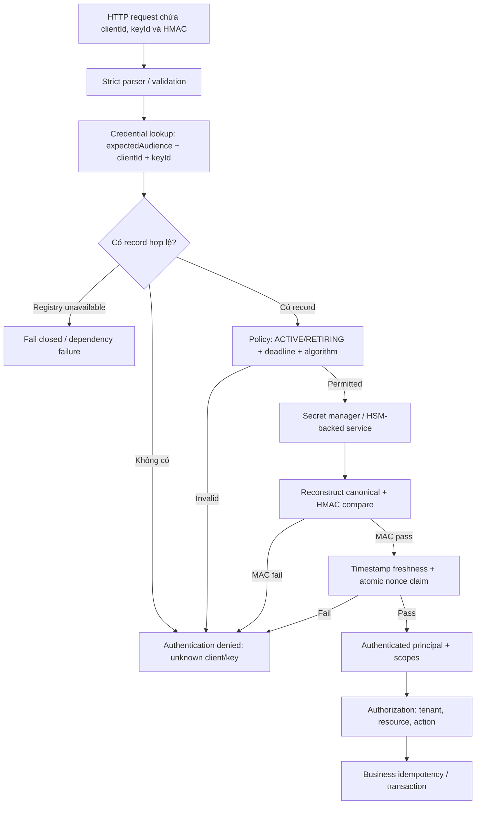
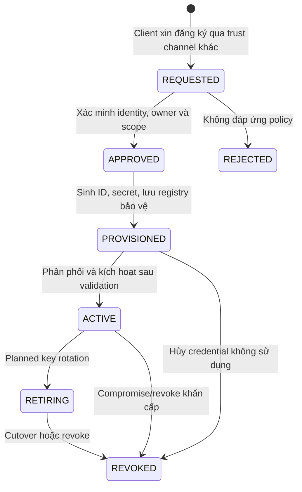

# Client chưa đăng ký trong hệ thống HMAC request authentication đa client

## Mục tiêu học tập

Chương **Multi-client** xét một HTTP API dùng **HMAC với shared secret** để xác thực nhiều ứng dụng, hệ thống nội bộ hoặc đối tác khác nhau. Bài **Client chưa đăng ký** giải quyết tình huống server nhận request có `clientId` và `keyId` do người gửi khai báo, nhưng **không tồn tại một credential record hợp lệ cho client đó** trong registry của đúng API/môi trường. Thiết kế đúng phải từ chối xác thực, không tự suy rằng request là của một client đã đăng ký, không lấy secret mặc định hoặc âm thầm cho phép client tự ghi danh chỉ vì nó gửi một chữ ký HMAC.

Bài nằm trong module `SECURITY_AUTHENTICATION_HMAC_REQUEST_AUTHENTICATION`: thiết kế xác thực HTTP request bằng HMAC với shared secret và **canonical request** có method, URI, header hoặc body theo hợp đồng ký; xác minh chữ ký, ngăn replay bằng timestamp/nonce, quản lý key rotation, kiểm thử proxy/gateway và phân biệt **authentication** với **authorization**.

Sau khi học, bạn có thể:

- Phân biệt **client chưa đăng ký**, **client đã đăng ký nhưng key ID không tồn tại**, **credential chưa kích hoạt/đã thu hồi**, **MAC sai**, **registry không khả dụng** và **principal đã xác thực nhưng thiếu quyền**.
- Giải thích vì sao `clientId`/`keyId` trong `Authorization` **chỉ là lời khai chưa được xác thực**, không phải bằng chứng một client có thật hoặc được cấp quyền.
- Thiết kế registry theo **(audience, clientId, keyId)**, cung cấp raw secret đúng record và từ chối khi không tìm thấy, thay vì dùng default/shared fallback secret.
- Định nghĩa một **HMAC-SHA256 canonical request** ràng buộc client ID, key ID, service audience, method, raw URI, body hash, Idempotency-Key, timestamp và nonce.
- Xử lý lỗi HTTP, logging/rate-limit và nguy cơ **client enumeration/timing oracle** khi kiểm tra ID không tồn tại.
- Thiết kế **enrollment/provisioning** qua trust anchor độc lập, phân biệt với việc gửi một HTTP request chưa xác thực.
- Áp dụng chính sách fail closed khi credential registry bị lỗi, đồng bộ trạng thái giữa nhiều node/region, phân quyền tenant sau khi HMAC đạt và replay protection theo principal.
- Thực hành Java 17 với client hợp lệ, client chưa đăng ký, key ID lạ, key revoked, MAC sai, header trùng, registry outage, replay và authorization sai tenant.
- Tạo bộ kiểm thử tích hợp kiểm tra cả **từ chối xác thực**, **không phát sinh business side effect**, và **không lộ thông tin về registry**.

## 1. “Client chưa đăng ký” thực chất có nghĩa gì?

### 1.1. Bối cảnh có nhiều client dùng một API

Giả sử `payments-api-prod` phục vụ ba client:

| Audience | Client ID | Key ID | Raw secret tại kho bảo vệ | Principal | Trạng thái |
| --- | --- | --- | --- | --- | --- |
| `payments-api-prod` | `merchant-a-worker` | `kid_a1` | Secret A (không công bố) | `svc-merchant-a` | ACTIVE |
| `payments-api-prod` | `merchant-b-worker` | `kid_b1` | Secret B độc lập | `svc-merchant-b` | ACTIVE |
| `payments-api-prod` | `settlement-job` | `kid_s1` | Secret S độc lập | `svc-settlement` | ACTIVE |

Một bên gửi:

```http
POST /v1/payouts?tenant=merchant-c HTTP/1.1
Host: payments.example.test
Content-Type: application/json
Authorization: HMAC-SHA256 clientId="merchant-c-worker", keyId="kid_c1", timestamp="1700000000", nonce="<nonce-base64url>", signature="<mac-base64url>"
Idempotency-Key: <operation-id-base64url>
X-Content-SHA256: <body-hash-base64url>

{"amount":120000,"currency":"VND"}
```

`merchant-c-worker` **chưa có credential record nào** trong authority của `payments-api-prod`. Dù header chứa đầy đủ các trường và một chuỗi trông giống chữ ký, server **chưa biết secret hợp lệ nào thuộc về client này** để kiểm tra MAC. Nó phải **từ chối authentication**; không được âm thầm tạo record hoặc cho request đi tiếp đến nghiệp vụ.

Các giá trị `<...>` và timestamp `1700000000` chỉ là **placeholder/test fixture**, không phải request hợp lệ ở thời điểm hiện tại. Scheme `HMAC-SHA256` là **một hợp đồng custom trong bài học**, không phải chuẩn chung mặc định của mọi HTTP server.

### 1.2. Server biết những gì trước khi verify?

Ngay khi parse request, server **chỉ biết** bên gửi đã khai:

```text
claimedClientId = "merchant-c-worker"
claimedKeyId    = "kid_c1"
claimedMAC      = "<43-char-base64url>"
claimedTime     = "1700000000"
claimedNonce    = "<22-char-base64url>"
```

Không có bằng chứng nào rằng `merchant-c-worker` thực sự đã đăng ký, nhận một secret từ tổ chức, hoặc được phép payout cho `merchant-c`. **ID là dữ liệu chưa đáng tin**, có thể do bất kỳ HTTP client nào điền.

Mô hình đúng:

```text
Untrusted HTTP bytes
    -> strict parse
    -> candidate credential lookup
    -> authoritative key record & raw secret
    -> HMAC verification + freshness + atomic replay check
    -> authenticated principal
    -> authorization for effective operation
    -> business idempotency/transaction
```

Nếu lookup trả **không có record**, chuỗi bị dừng trước bước HMAC thành công. Không có “principal mặc định” để tiếp tục.

### 1.3. “Không đăng ký” không đồng nghĩa “kẻ tấn công”

Có nhiều nguyên nhân thực tế:

- Đối tác mới chưa hoàn tất onboarding hoặc chưa được issuer cấp credential.
- Client copy nhầm `clientId`/`keyId` từ môi trường **staging** sang **production**.
- Nhập sai ID do ký tự hoa/thường, dấu gạch, whitespace hoặc encoding.
- Một key mới đã tạo ở provisioning service nhưng **chưa activate/replicate** tới verifier.
- Client cũ tiếp tục gửi sau khi toàn bộ credential bị revoke/xóa theo retention.
- Thực sự có bên ngoài đang cố giả mạo hoặc enumerating client IDs.

Server nên xử lý bảo mật **như nhau** đối với các request không được xác thực, nhưng vận hành nội bộ có thể phân loại nguyên nhân bằng log đã hạn chế quyền. Không suy luận động cơ từ một request duy nhất và cũng không hạ mức kiểm tra để “giúp đối tác mới gọi được API”.

## 2. Phân biệt chính xác các lỗi trong hệ thống multi-client

### 2.1. Một bảng phân loại cho verifier và support

| Tình huống | Registry / crypto | Kết luận đúng | Hành động |
| --- | --- | --- | --- |
| **Client chưa đăng ký** | Không có client principal/credential hợp lệ ở audience này | Chưa thể chứng minh danh tính | Từ chối authentication; hướng tới onboarding riêng, không tự cấp secret. |
| **Client có đăng ký, key ID lạ** | Client tồn tại nhưng `(audience, clientId, keyId)` không có | Chưa thể chọn secret hợp lệ | Từ chối; kiểm tra rotation/config nội bộ. |
| **Key ISSUED nhưng chưa ACTIVE** | Record có nhưng policy cấm verify | Không được sử dụng lúc này | Từ chối dù signer có raw secret. |
| **Key REVOKED hoặc expired** | Record có nhưng status/deadline không cho verify | Credential mất hiệu lực | Từ chối, không fallback secret cũ. |
| **MAC sai** | Record hợp lệ nhưng expected MAC khác supplied MAC | Không chứng minh đang nắm đúng secret/request bytes | Từ chối, không thử mọi key khác. |
| **Timestamp quá cũ/đi trước quá xa** | MAC có thể đúng, signedAt ngoài freshness | Attempt không hợp lệ về thời gian | Từ chối, không mở window vô hạn. |
| **Nonce đã claim** | MAC đúng nhưng signed attempt trùng nonce | Replay/reuse theo contract | Từ chối attempt. |
| **Registry đang lỗi/timeout** | Không xác định chắc record/status hiện hành | **Không phải bằng chứng client không tồn tại** | Fail closed, phát hiện sự cố dependency, trả lỗi vận hành theo policy. |
| **MAC đúng nhưng thiếu quyền** | Principal đã authenticated, scope/tenant không được phép | **Authorization** thất bại | Không thực thi resource; thường trả 403 theo API. |

**Quan trọng:** `UNKNOWN_CLIENT`, `UNKNOWN_KEY` và `BAD_MAC` là các lý do **nội bộ** để điều tra. Endpoint công khai có thể dùng **một thông điệp lỗi xác thực chung**, tránh biến API thành công cụ hỏi “client ID này tồn tại không?”.

### 2.2. HTTP 401 và 403 không phải điều kiện thay thế cho verifier

- **401 Unauthorized** trong HTTP semantics biểu thị request thiếu/không có credentials hợp lệ cho resource và thông thường kèm `WWW-Authenticate` challenge phù hợp với scheme. Tên 401 dễ gây nhầm, nhưng đây chủ yếu là lỗi **authentication**, không phải permission-denied business.
- **403 Forbidden** thường phù hợp khi server nhận diện principal nhưng **không cho phép** action/resource; tùy API, một server có thể dùng response khác để tránh tiết lộ sự tồn tại tài nguyên.
- **503 Service Unavailable** có thể được chọn khi registry/KMS/auth dependency đang gián đoạn; đây là **lỗi availability**, không nên cố tình báo “unknown client” như thể registry đã kết luận không tồn tại. Status cụ thể cần định nghĩa trong API policy.
- **400 Bad Request** phù hợp với HTTP framing/header grammar bị lỗi trước authentication, tùy threat model có thể áp dụng response chung cho malformed credentials.

Ví dụ custom challenge:

```http
HTTP/1.1 401 Unauthorized
WWW-Authenticate: HMAC-SHA256 realm="payments-api-prod"
Content-Type: application/problem+json

{"type":"about:blank","title":"Authentication failed","status":401}
```

`WWW-Authenticate` ở đây là minh họa scheme tùy chỉnh, **không** khiến một HTTP client mặc định tự biết ký HMAC. Không trả public:

```json
{"error":"unknown-client","clientId":"merchant-c-worker",
 "knownClients":["merchant-a-worker","merchant-b-worker"]}
```

Không lộ danh sách client, secret references, key status, expected MAC, tên tenant hoặc “cần thử key ID nào”.

### 2.3. Đừng dùng 403 trước khi có authenticated principal

Khi chưa có credential record, server chưa thể gắn một principal đã được chứng thực để nói “principal này không có quyền”. Một lỗi phổ biến:

```text
if tenantFromUrl not in clientIdString:
    return 403
else if credential unknown:
    return 401
```

Cách này vừa trộn lẫn tự khai ID với authorization, vừa có thể tiết lộ quan hệ tenant-client. Đúng hơn, chỉ kiểm tra authorization theo **principal từ credential đã xác minh** và effective tenant sau khi auth đạt.

## 3. Kiến trúc tra cứu client và credential

### 3.1. Tách client registry, credential record và secret manager



Một hệ thống có thể giữ **ClientDirectory** và **CredentialRegistry** riêng. ClientDirectory xác định client đã được cấp phép onboarding hay chưa; CredentialRegistry lưu nhiều key IDs/versions và secret references cho client. Nhưng **HMAC verifier cuối cùng vẫn cần đúng credential record đang được phép**, không chỉ có một dòng client tồn tại.

### 3.2. Dùng composite key cho từng audience

Tra cứu tối thiểu:

```text
credential = registry.lookup(
    expectedAudience,    // Từ server config/route, KHÔNG từ lời khai tin cậy.
    claimedClientId,     // Untrusted routing hint
    claimedKeyId         // Untrusted routing hint
)
```

Ví dụ:

| Audience | Client ID | Key ID | Tình huống |
| --- | --- | --- | --- |
| `payments-api-prod` | `merchant-a-worker` | `kid_primary` | Hợp lệ nếu status/MAC/policy đạt. |
| `payments-api-prod` | `merchant-b-worker` | `kid_primary` | **Cùng text key ID**, nhưng secret B và principal khác. |
| `payments-api-staging` | `merchant-a-worker` | `kid_primary` | Khác audience và có thể secret khác. |
| `payments-api-prod` | `merchant-c-worker` | `kid_primary` | Không có record ⇒ không xác thực. |

Nếu chỉ lookup bằng `keyId`, có thể chọn secret của một client khác hoặc sai môi trường. Nếu lấy audience từ một header người gửi tự khai mà không gắn vào service identity tin cậy, client staging có thể được thử ở production.

### 3.3. Ba điều kiện không bao giờ được bỏ qua

**Không có record → không có key để authenticate.**

```java
// Pseudocode
Credential credential =
        registry.lookup(audience, claimedClientId, claimedKeyId);
if (credential == null) {
    return authenticationDenied();
}
```

**Không dùng default/global fallback secret.**

```java
// SAI: một HMAC key dùng cho các client chưa được đăng ký.
byte[] secret = credential != null
        ? credential.secret()
        : DEFAULT_HMAC_SECRET;
```

Đây là lỗi nghiêm trọng: người biết default key có thể tự khai bất kỳ clientId nào rồi ký request; nếu server gắn principal từ lời khai thì thành **identity spoofing**. Dù default key chưa bị lộ, một shared key chung tạo blast radius rộng và làm mất khả năng phân quyền theo client.

**Không thử tất cả client secrets đến khi một MAC khớp.**

```text
for secret in everyRegisteredClientSecret:
    if HMAC(secret, canonical) == suppliedMac:
        accept claimedClientId
```

Thử tất cả key làm tăng CPU/DoS, mở rộng bề mặt timing/key oracle và có thể gán sai danh tính nếu MAC khớp với secret của client khác. Verifier nên **chỉ sử dụng secret record chính xác theo (audience, clientId, keyId)** và xây principal từ record đã xác minh.

### 3.4. Không có secret HMAC thì không thể “xác minh chữ ký thử”

Một số hệ thống muốn “dùng signature để nhận ra client dù chưa đăng ký”. Với shared-secret HMAC, signature không mang public key hoặc danh tính có thể xác minh độc lập. Không thể chứng minh bên gửi sở hữu một credential của hệ thống nếu **chưa có khóa đối chiếu được cấp và tin cậy**.

Có thể có các giao thức đăng ký riêng với chứng thư, workload identity, mTLS, OAuth client credentials hoặc human/admin approval, nhưng đó là **trust anchor khác**, không phải lấy một MAC không có registry record làm bằng chứng client hợp lệ.

## 4. Authorization header và hợp đồng canonical cho nhiều client

### 4.1. Scheme HMAC tùy chỉnh của bài

Định nghĩa một hợp đồng `multi-client-v1` dùng HMAC-SHA256:

```http
Authorization: HMAC-SHA256 clientId="merchant-a-worker", keyId="kid_primary", timestamp="1700000000", nonce="<22-char-base64url>", signature="<43-char-base64url>"
```

| Tham số | Cú pháp giá trị được chấp nhận | Ý nghĩa |
| --- | --- | --- |
| `clientId` | `[A-Za-z0-9_-]{1,64}` | Danh tính **được khai**, không tin trước MAC. |
| `keyId` | `[A-Za-z0-9_-]{1,64}` | ID record của client, case-sensitive. |
| `timestamp` | `[1-9][0-9]{0,11}` | Unix epoch seconds decimal canonical. |
| `nonce` | `[A-Za-z0-9_-]{22}`, canonical Base64URL 16 byte | Attempt-specific replay protection. |
| `signature` | `[A-Za-z0-9_-]{43}`, canonical Base64URL 32 byte | MAC HMAC-SHA256 trên canonical bytes. |

Các **tên** auth-params và tên scheme xử lý không phân biệt hoa/thường theo HTTP authentication syntax, còn **giá trị** client ID, key ID, nonce, signature **phân biệt hoa/thường** theo contract.

Ví dụ chỉ nhận giá trị trong quoted ASCII allowlist; không cho dấu phẩy, escape hoặc Unicode trong auth-param values. Đây là **tập con có chủ đích**, không phải parser tổng quát cho mọi HTTP authentication scheme. Nếu mở rộng grammar, phải dùng parser hỗ trợ đầy đủ và tránh `String.split(",")` tùy tiện.

### 4.2. Canonical request 12 dòng, không có chữ ký trong input

Request:

```http
POST /v1/payouts?tenant=merchant-a HTTP/1.1
Host: payments.example.test
Content-Type: application/json
Authorization: HMAC-SHA256 clientId="merchant-a-worker", keyId="kid_primary", timestamp="1700000000", nonce="<nonce>", signature="<mac>"
Idempotency-Key: <operation-id>
X-Content-SHA256: <sha256-body>

{"amount":50000,"currency":"VND"}
```

Canonical `multi-client-v1` gồm **12 dòng UTF-8**, nối LF `\n`, không có LF cuối:

```text
HMAC-SHA256
multi-client-v1
payments-api-prod
merchant-a-worker
kid_primary
POST
/v1/payouts?tenant=merchant-a
application/json
<sha256-exact-body-base64url>
<idempotency-key-base64url>
1700000000
<nonce-base64url>
```

| Dòng | Trường | Ràng buộc |
| --- | --- | --- |
| 1 | HMAC-SHA256 | Algorithm pinning, không downgrade. |
| 2 | `multi-client-v1` | Versioned canonical contract. |
| 3 | `payments-api-prod` | Audience từ server policy, chống cross-service use. |
| **4** | **`clientId`** | Ràng buộc ID client đã khai vào HMAC. |
| **5** | **`keyId`** | Ràng buộc đúng key record vào HMAC. |
| 6–7 | Method, raw request-target | Chính xác theo transport contract, chống thay resource/tenant. |
| 8–9 | Content-Type, SHA-256 exact body | Không biến đổi JSON rồi hash lại theo object. |
| 10 | Idempotency-Key | Operation identity giữ ổn định qua retry. |
| 11–12 | Timestamp, nonce | Freshness và replay protection cho signed attempt. |

Công thức:

```text
bodyHash = Base64URL_NoPadding(SHA256(exactBodyBytes))
canonical = UTF8(join("\n", twelveFields))
signature = Base64URL_NoPadding(
    HMAC-SHA256(rawSecretFor(audience, clientId, keyId), canonical)
)
```

**Không** đưa toàn bộ text `Authorization` (chứa chính `signature`) vào HMAC input vì sẽ sinh tham chiếu vòng. Parser trích các trường được ký, verifier dùng **exact method/raw URI/content type/body bytes thực nhận** và registry record tương ứng để dựng lại canonical. Header `Idempotency-Key` ảnh hưởng side effect nên **phải nằm trong canonical contract** khi được áp dụng.

### 4.3. Không dùng clientId tự khai để xác định authority

Một lỗi nguy hiểm:

```text
if request.clientId == "merchant-a-worker":
    authorize(tenant="merchant-a")
else:
    authorize(defaultTenant="merchant-b")
```

Ngay cả khi `clientId` trông giống tenant, đây vẫn là dữ liệu chưa được chứng thực. Chỉ sau khi HMAC xác minh bằng secret của record hợp lệ mới lấy `authenticatedPrincipal` và `allowedTenants` từ registry/policy:

```text
claimedClientId -> credential lookup -> valid HMAC
               -> registry.principalId -> tenant authorization
```

Một client có thể đổi tên/đổi `keyId` trong rotation mà vẫn cùng principal; **authorization không được gắn chặt vào text key ID**.

## 5. Từ chối client chưa đăng ký: thứ tự và fail-closed

### 5.1. Một trình tự xử lý rõ ràng

```text
1. HTTP adapter:
   - Reject invalid framing, duplicate Authorization, Content-Type,
     Idempotency-Key hoặc X-Content-SHA256 theo contract.
   - Giới hạn độ dài header/body và chặn injection/ambiguous parsing.

2. Strict parse:
   - Require HMAC-SHA256 scheme, đủ đúng auth-params.
   - Reject duplicate parameter names (keyId và KEYID cũng là trùng).
   - Validate clientId/keyId grammar, timestamp, nonce, signature.
   - Tất cả parsed clientId/keyId vẫn là UNTRUSTED.

3. Credential lookup:
   - Dùng expectedAudience từ server; tìm đúng (audience, clientId, keyId).
   - Không có record -> reject authentication.
   - Store unavailable -> fail closed, báo dependency failure nội bộ.

4. Credential policy:
   - Kiểm tra ACTIVE/RETIRING, notBefore/verifyUntil, algorithm/version.
   - REVOKED/expired/ISSUED -> reject.

5. Cryptography:
   - Recompute body SHA-256 trên exact bytes.
   - Rebuild canonical từ request đã nhận, trong đó có clientId/keyId.
   - HMAC-SHA256 với raw secret đúng record.
   - Strict-decode supplied MAC về 32 byte.
   - So qua MessageDigest.isEqual.

6. Attempt anti-replay:
   - Kiểm tra timestamp với server Clock.
   - Atomic claim nonce scope theo audience + authenticated principal.
   - Replay/window invalid/store unavailable -> reject.

7. Authenticated principal -> authorization -> business transaction.
```

Vị trí kiểm tra timestamp trước/sau MAC có thể thay đổi theo threat model/giới hạn tài nguyên nếu không cấp quyền trước MAC; **tuyệt đối không claim nonce hoặc tạo authenticated principal trước khi xác minh MAC**. Trong demo Java, kiểm tra freshness trước phép HMAC để giảm tính toán khi timestamp sai, nhưng không suy ra client đã đăng ký chỉ từ việc timestamp đúng.

### 5.2. Phân biệt NOT_FOUND với dependency failure

Một truy vấn registry có ít nhất ba loại kết quả:

```text
FOUND(record)
NOT_FOUND (tra thành công, chắc chắn không có credential)
UNAVAILABLE / TIMEOUT / STALE_UNTRUSTED
```

Không viết:

```java
// SAI: mọi exception được hiểu là client chưa đăng ký.
try {
    return registry.lookup(audience, clientId, keyId);
} catch (Exception ignored) {
    return null; // Không biết sự cố hay thực sự không có.
}
```

Nếu registry đang timeout, một client hợp lệ sẽ bị báo sai là unknown, đồng thời đội vận hành không nhìn thấy availability incident. Nguy hiểm hơn, một số code chuyển lỗi lookup sang fallback secret cho “dịch vụ vẫn chạy”.

Policy an toàn: **không thể chứng minh credential hợp lệ → không authenticate**. Có thể trả `503`/retryable error cho dependency outage với giới hạn backoff, nhưng **không mở đường xác thực bằng secret mặc định**. Nếu policy cho phép cache khi registry unavailable, phải có **signed/authoritative revocation state, bounded validity và rõ ràng về stale-cache risk**; đặc biệt với credential bị revoke, không chấp nhận cache cũ không đáp ứng SLA.

### 5.3. Đừng cho client tự đăng ký ở endpoint có side effect

Một lỗi bootstrap:

```text
if clientId not found:
    registry.create(clientId, keyId, secretFromRequest)
    accept(request)
```

Nó biến một HTTP request chưa được xác thực thành **provisioning authority**. Bất kỳ ai có thể gửi một secret của chính họ sẽ tự trở thành “client đăng ký” rồi gọi endpoint.

**Enrollment phải là workflow riêng**, có identity/approval độc lập. Một request HMAC bình thường chỉ được verify với credential đã được authority cấp, không tự tạo credential từ dữ liệu do request cung cấp.

## 6. Client chưa đăng ký và phòng chống enumeration, timing oracle

### 6.1. Vì sao public response không nên tiết lộ ID tồn tại?

Nếu API trả:

```text
clientId không tồn tại       -> 404 Client unknown
clientId tồn tại, keyId sai  -> 401 Unknown keyId
keyId có thật, MAC sai       -> 401 Invalid signature for known key
```

người ngoài có thể thử hàng nghìn client IDs để **liệt kê đối tác**, suy cấu trúc môi trường, trạng thái luân chuyển khóa hoặc kết hợp với metadata đã rò. Một client ID thường không phải secret, nhưng enumeration vẫn có thể hỗ trợ targeted attacks/social engineering.

Nên cân nhắc response công khai thống nhất cho các credential không xác thực:

```http
HTTP/1.1 401 Unauthorized
WWW-Authenticate: HMAC-SHA256 realm="payments-api-prod"
Cache-Control: no-store
Content-Type: application/problem+json

{"type":"about:blank","title":"Authentication failed","status":401}
```

Trong log nội bộ có quyền giới hạn, vẫn có thể ghi **loại lỗi** và correlation ID, ví dụ `NO_CREDENTIAL_RECORD` hoặc `BAD_MAC`, với chính sách tránh lộ danh sách client, raw `Authorization`, secret, expected MAC và PII. Không công khai `registry.lookup(...).toString()` trong response.

### 6.2. Timing differences có thể trở thành oracle

Khi record không tồn tại, verifier thường trả rất nhanh. Khi record tồn tại, server còn phải lấy secret, hash body và tính HMAC, nên latency có thể khác. Đối thủ đo nhiều lần có thể suy đoán một client ID hoặc key ID đang được đăng ký, tùy môi trường mạng và threat model.

**Không thể giải quyết triệt để bằng cách cố sleep một số mili giây cố định.** Hạ tầng load balancer, cache, GC, secret manager và gateway tạo nhiễu timing. Những biện pháp phù hợp gồm:

- Giới hạn số request, kích thước input, số lookup đồng thời, quota theo nguồn và bảo vệ registry.
- Không đưa lý do chính xác của unknown client/key/status lên HTTP response.
- Dùng **`MessageDigest.isEqual`** trên raw MAC bytes khi có credential hợp lệ.
- Cân nhắc **dummy HMAC với key giả độc lập cố định của server** cho đường NOT_FOUND để giảm sự khác biệt đơn giản giữa found/not-found, nếu threat model và performance review yêu cầu.
- Không để dummy HMAC dẫn đến **authentication success** và không tạo authenticated principal cho client chưa đăng ký.
- Theo dõi lỗi lookup bất thường, đặc biệt các dải ID tăng dần hoặc request tạo từ nhiều địa chỉ.

Dummy HMAC chỉ là **biện pháp giảm lộ timing trong một phạm vi hẹp**. Nó không bảo đảm constant-time toàn endpoint và có thể bị lợi dụng để tăng CPU nếu không giới hạn lưu lượng.

### 6.3. Phân biệt response công khai với chẩn đoán nội bộ

Cấu trúc phân tầng:

```text
Public HTTP verdict:
  401 Authentication failed
  403 Forbidden (principal đã được xác thực nhưng không có quyền)
  503 Authentication service unavailable (dependency outage)

Private audit/metric category:
  UNKNOWN_CLIENT
  UNKNOWN_KEY
  INACTIVE_CREDENTIAL
  REVOKED_CREDENTIAL
  BAD_MAC
  BAD_TIMESTAMP
  REPLAY_NONCE
  REGISTRY_UNAVAILABLE
  AUTHORIZATION_DENIED
```

Thậm chí category nội bộ cũng cần **scope/tracing privacy policy**. Metrics nên dùng nhóm lỗi thay vì `clientId`/`keyId` đầy đủ làm high-cardinality labels. Tránh tạo một dashboard public liệt kê tất cả khách hàng đăng ký.

## 7. Đăng ký client hợp lệ: onboarding và cấp credential tách khỏi request HMAC

### 7.1. Vì sao enrollment phải có trust anchor khác?

Một client mới **chưa có shared secret do hệ thống cấp**, nên nó không thể chứng minh quyền đăng ký bằng một HMAC trên API nghiệp vụ. Nếu API tự cấp credential khi client tự khai ID, attacker có thể đăng ký giả danh và nhận quyền.

Một enrollment workflow thường sử dụng một hoặc nhiều cơ chế độc lập:

- Human/organization approval cùng quản trị partner contract.
- Workload identity của nền tảng, mTLS với certificate đã được tin cậy hoặc OAuth/OIDC identity được cấp.
- Ticket change/approval có owner, scopes/tenants được xác định trước.
- Một kênh provisioning đã xác thực để giao secret **một lần** cho đúng client.

Các cơ chế này không nhất thiết phải dùng đồng thời; lựa chọn phụ thuộc tổ chức và threat model. **Điểm chung** là quyền đăng ký/nhận secret không được suy ra từ một request HMAC chưa xác thực.

### 7.2. Một state machine onboarding tối thiểu



`REQUESTED` hoặc `PROVISIONED` **không phải ACTIVE**. Nếu một đối tác mới được approve nhưng chưa nhận key hoặc verifier chưa sẵn sàng, request bằng `keyId` chưa được kích hoạt phải bị từ chối. Đừng cho qua chỉ vì có ticket “sắp onboard”.

### 7.3. Quy trình provision theo nguyên tắc least privilege

1. **Xác minh đối tác/workload** bằng cơ chế độc lập. Phê duyệt `audience`, `principalId`, tenant và actions; không để client tự gắn `role=admin`.
2. **Cấp `clientId`** trong namespace phù hợp, với unique ownership.
3. **Sinh `keyId` opaque** và **raw HMAC secret** độc lập bằng CSPRNG; không dùng ID hoặc text Base64URL như secret.
4. **Lưu raw secret an toàn** (secret manager, KMS/HSM-backed service hoặc storage có quyền tối thiểu). Registry ánh xạ `(audience, clientId, keyId) → secretReference + principal + scopes + status`.
5. **Giao credential qua kênh bảo vệ**, hạn chế số lần hiển thị, không log secret trong UI/gateway/CI.
6. **Kích hoạt đúng thời điểm**, đồng bộ tới các verifier; test một request ký thật trong môi trường test/canary.
7. **Thử quyền:** client hợp lệ ở tenant được phép, bị reject ở tenant khác; không cho credential chỉ vì onboarding “thành công” truy cập mọi resource.
8. **Thiết lập lifecycle:** key rotation deadline, revoke, audit, lưu vết cấu hình/approval và quy trình support.

### 7.4. Registration race và eventual consistency

Giả sử issuer vừa tạo client C ở primary registry, nhưng một region chưa nhận key:

```text
T0  Registry primary: (payments-api-prod, C, K) -> ACTIVE
T1  Gateway region A: registry revision 21 -> FOUND
T1  Gateway region B: registry revision 20 -> NOT_FOUND
T2  Client C gửi hai request qua load balancer
    -> Region A accept nếu HMAC đúng
    -> Region B reject "Authentication failed"
```

Đây có thể là vấn đề **propagation/rollout**, không phải bằng chứng client C chưa được approve hoặc attacker. Hướng đúng:

- Không phát thông báo “client ready” cho tới khi các verifier/region dự kiến **đã nhận credential** và test đạt.
- Dùng revision/generation của registry để kiểm tra đồng bộ; canary trước traffic thật.
- Phân biệt NOT_FOUND từ **authority đáng tin** với NOT_FOUND từ **stale replica không bảo đảm freshness**.
- Hạn chế negative caching cho unknown ID trong giai đoạn onboarding; TTL/invalidation hợp lý.
- Khi một region chưa sẵn sàng, có thể định tuyến tới region đã sẵn sàng theo policy hoặc trả lỗi retryable có kiểm soát; **không dùng fallback secret**.
- Với key revoke/compromise, **stale ACTIVE** nguy hiểm hơn false unknown: chọn revocation SLA và consistency phù hợp, fail closed nếu không chứng minh trạng thái.

### 7.5. Quản lý nhiều client và nhiều key IDs trong một principal

Một client được đăng ký có thể có K_old và K_new cho rotation. Client ID vẫn giữ nguyên; key ID thay đổi theo phiên bản:

```text
ClientDirectory:
  merchant-a-worker -> principal=svc-merchant-a

CredentialRegistry:
  (payments-api-prod, merchant-a-worker, K_old) -> RETIRING
  (payments-api-prod, merchant-a-worker, K_new) -> ACTIVE
```

**Không coi một key ID lạ là client mới** nếu client đã có các key khác; nhưng về authentication, request khai K_unknown vẫn phải bị từ chối. **Không thử K_old/K_new cho request tự khai K_unknown**. Để debug, client nên kiểm tra lại key ID và key status qua kênh quản trị đã xác thực.

## 8. Java 17: client đã đăng ký và chưa đăng ký qua một verifier chung

Ví dụ `MultiClientUnknownDemo.java` mô phỏng HTTP request bằng các record Java. Nó không mở socket; thay vào đó `WireRequest` giữ **danh sách field line Authorization** để phát hiện header trùng, và `Operation` giữ method/raw URI/Content-Type/body/Idempotency-Key.

Các mục tiêu chính:

- Hai clients `merchant-a-worker` và `merchant-b-worker` có thể có **cùng key ID text** `kid_shared` nhưng có **secret độc lập** và principal/tenant khác nhau.
- `merchant-c-worker` tự sinh secret, tự ký một HMAC **toán học đúng** bằng secret của chính nó, nhưng **không có registry record** ⇒ authentication bị từ chối.
- Đổi `clientId` từ A sang B và giữ signature của A phải fail, dù cả hai key ID trùng text.
- Một key bị `ISSUED`/`REVOKED` không được chấp nhận dù HMAC từ raw secret vẫn tính được.
- Lỗi registry unavailable không được chuyển sang “cho phép client lạ” hoặc default key.
- MAC đúng chỉ tạo authenticated principal để xét tenant; không tự cho phép payout ở tenant khác.
- Timestamp/nonce được kiểm tra, claim nonce chỉ sau khi MAC đúng; demo dùng RAM, **không phù hợp production**.

### 8.1. Mã Java 17 hoàn chỉnh

```java
import java.nio.charset.StandardCharsets;
import java.security.GeneralSecurityException;
import java.security.MessageDigest;
import java.security.SecureRandom;
import java.time.Clock;
import java.time.Instant;
import java.time.ZoneOffset;
import java.util.Arrays;
import java.util.Base64;
import java.util.HashMap;
import java.util.List;
import java.util.Locale;
import java.util.Map;
import java.util.Objects;
import java.util.Set;
import java.util.concurrent.ConcurrentHashMap;
import java.util.concurrent.ConcurrentMap;
import java.util.concurrent.atomic.AtomicInteger;
import java.util.regex.Matcher;
import java.util.regex.Pattern;
import javax.crypto.Mac;
import javax.crypto.spec.SecretKeySpec;

public final class MultiClientUnknownDemo {
    private static final String AUDIENCE = "payments-api-prod";
    private static final long PAST = 300L;
    private static final long FUTURE = 60L;

    private static final Pattern ID =
            Pattern.compile("[A-Za-z0-9_-]{1,64}");
    private static final Pattern EPOCH =
            Pattern.compile("[1-9][0-9]{0,11}");
    private static final Pattern TARGET =
            Pattern.compile("/v1/payouts\\?tenant=[A-Za-z0-9_-]{1,64}");

    // Chỉ nhận tập con auth-param với quoted ASCII safe values.
    private static final Pattern SCHEME = Pattern.compile(
            "(?i)^HMAC-SHA256[ \\t]+(.+)$");
    private static final Pattern PARAM = Pattern.compile(
            "^[ \\t]*([A-Za-z][A-Za-z0-9_-]*)[ \\t]*"
            + "=[ \\t]*\"([A-Za-z0-9_-]+)\"[ \\t]*$");

    private static final Base64.Encoder ENCODER =
            Base64.getUrlEncoder().withoutPadding();
    private static final Base64.Decoder DECODER =
            Base64.getUrlDecoder();

    private MultiClientUnknownDemo() {}

    enum Status { ISSUED, ACTIVE, REVOKED }
    enum Verdict {
        ACCEPTED,
        INVALID_INPUT,             // HTTP adapter/parser
        AUTHENTICATION_FAILED,     // Unknown client/key, revoked, bad MAC
        OUTSIDE_WINDOW,            // Timestamp policy
        REPLAYED,                  // Nonce already claimed
        FORBIDDEN,                 // Authenticated but no tenant permission
        DEPENDENCY_UNAVAILABLE     // Registry unavailable
    }

    record CredentialKey(
            String audience, String clientId, String keyId) {}

    record Credential(
            CredentialKey key, String principalId,
            String allowedTenant, byte[] rawSecret, Status status) {
        Credential {
            rawSecret = Objects.requireNonNull(rawSecret).clone();
        }
        @Override public byte[] rawSecret() {
            return rawSecret.clone();
        }
    }

    record Operation(
            String method, String rawTarget, String contentType,
            byte[] body, String idempotencyKey) {
        Operation {
            body = Objects.requireNonNull(body).clone();
        }
        @Override public byte[] body() {
            return body.clone();
        }
    }

    record AuthFields(
            String clientId, String keyId, String timestamp,
            String nonce, String signature) {}

    record WireRequest(
            Operation operation, List<String> authorizationHeaders,
            String bodyHashHeader) {
        WireRequest {
            authorizationHeaders =
                    List.copyOf(authorizationHeaders);
        }
    }

    static final class RegistryUnavailable
            extends RuntimeException {
        RegistryUnavailable() {
            super("Credential registry unavailable");
        }
    }

    static final class CredentialRegistry {
        private final ConcurrentMap<CredentialKey, Credential> entries =
                new ConcurrentHashMap<>();
        private volatile boolean available = true;

        void register(Credential credential) {
            if (entries.putIfAbsent(
                    credential.key(), credential) != null) {
                throw new IllegalArgumentException(
                        "Duplicate credential record");
            }
        }

        Credential lookup(CredentialKey key) {
            if (!available) {
                throw new RegistryUnavailable();
            }
            return entries.get(key);
        }

        void setAvailable(boolean next) {
            available = next;
        }
        // Demo, không có secret manager, replication, status revision.
    }

    static final class DemoNonceStore {
        private final Set<String> used =
                ConcurrentHashMap.newKeySet();

        boolean claim(String principal, String nonce) {
            return used.add(AUDIENCE + "|" + principal + "|" + nonce);
        }
        // Không có TTL/durability/failover, chỉ trong một JVM.
    }

    static byte[] randomBytes(SecureRandom random, int count) {
        byte[] result = new byte[count];
        random.nextBytes(result);
        return result;
    }

    static String freshNonce(SecureRandom random) {
        byte[] bytes = randomBytes(random, 16);
        String text = ENCODER.encodeToString(bytes);
        Arrays.fill(bytes, (byte) 0);
        return text;
    }

    static byte[] strictB64(
            String text, int expectedText, int expectedBytes) {
        if (text == null || text.length() != expectedText
                || !text.matches("[A-Za-z0-9_-]+")) {
            throw new IllegalArgumentException(
                    "Invalid Base64URL text");
        }
        byte[] decoded = DECODER.decode(text);
        if (decoded.length != expectedBytes
                || !ENCODER.encodeToString(decoded).equals(text)) {
            throw new IllegalArgumentException(
                    "Noncanonical Base64URL");
        }
        return decoded;
    }

    static void validateOperation(Operation op) {
        if (op == null || !"POST".equals(op.method())
                || op.rawTarget() == null
                || !TARGET.matcher(op.rawTarget()).matches()
                || !"application/json".equals(op.contentType())) {
            throw new IllegalArgumentException(
                    "Wrong method/URI/content type");
        }
        if (op.body().length == 0 || op.body().length > 1_048_576) {
            throw new IllegalArgumentException("Invalid body size");
        }
        strictB64(op.idempotencyKey(), 22, 16);
    }

    static AuthFields parseAuthorization(List<String> fields) {
        if (fields == null || fields.size() != 1
                || fields.get(0) == null) {
            throw new IllegalArgumentException(
                    "Exactly one Authorization field required");
        }
        String value = fields.get(0);
        if (value.length() > 512) {
            throw new IllegalArgumentException("Auth field too long");
        }
        for (int i = 0; i < value.length(); i++) {
            char c = value.charAt(i);
            if (c > 126 || (c < 32 && c != '\t')) {
                throw new IllegalArgumentException(
                        "Unsafe Authorization character");
            }
        }
        Matcher scheme = SCHEME.matcher(value);
        if (!scheme.matches()) {
            throw new IllegalArgumentException(
                    "Unsupported authentication scheme");
        }

        // Với contract này, quoted values không thể có comma/escape.
        String[] parts = scheme.group(1).split(",", -1);
        if (parts.length != 5) {
            throw new IllegalArgumentException(
                    "Exactly five auth-params required");
        }
        Map<String, String> params = new HashMap<>();
        Set<String> allowed = Set.of(
                "clientid", "keyid", "timestamp", "nonce", "signature");
        for (String part : parts) {
            Matcher param = PARAM.matcher(part);
            if (!param.matches()) {
                throw new IllegalArgumentException(
                        "Malformed auth-param");
            }
            String name =
                    param.group(1).toLowerCase(Locale.ROOT);
            if (!allowed.contains(name)
                    || params.putIfAbsent(
                            name, param.group(2)) != null) {
                throw new IllegalArgumentException(
                        "Unknown or duplicate auth-param");
            }
        }

        AuthFields auth = new AuthFields(
                params.get("clientid"),
                params.get("keyid"),
                params.get("timestamp"),
                params.get("nonce"),
                params.get("signature"));
        if (auth.clientId() == null
                || !ID.matcher(auth.clientId()).matches()
                || auth.keyId() == null
                || !ID.matcher(auth.keyId()).matches()
                || auth.timestamp() == null
                || !EPOCH.matcher(auth.timestamp()).matches()) {
            throw new IllegalArgumentException(
                    "Invalid client/key/timestamp");
        }
        strictB64(auth.nonce(), 22, 16);
        strictB64(auth.signature(), 43, 32);
        return auth;
    }

    static byte[] sha256(byte[] raw)
            throws GeneralSecurityException {
        return MessageDigest.getInstance("SHA-256").digest(raw);
    }

    static String canonical(
            Operation op, AuthFields auth, String bodyHash) {
        validateOperation(op);
        if (!ID.matcher(auth.clientId()).matches()
                || !ID.matcher(auth.keyId()).matches()
                || !EPOCH.matcher(auth.timestamp()).matches()) {
            throw new IllegalArgumentException("Bad auth fields");
        }
        strictB64(auth.nonce(), 22, 16);
        strictB64(bodyHash, 43, 32);
        return String.join("\n",
                "HMAC-SHA256",
                "multi-client-v1",
                AUDIENCE,
                auth.clientId(),  // MAC binds claimed client identity.
                auth.keyId(),     // MAC binds selected key record.
                op.method(),
                op.rawTarget(),
                op.contentType(),
                bodyHash,
                op.idempotencyKey(),
                auth.timestamp(),
                auth.nonce());
        // 12 UTF-8 lines joined with LF, no terminal LF.
    }

    static byte[] hmac(byte[] secret, String canonicalText)
            throws GeneralSecurityException {
        Mac mac = Mac.getInstance("HmacSHA256");
        mac.init(new SecretKeySpec(secret, "HmacSHA256"));
        return mac.doFinal(
                canonicalText.getBytes(StandardCharsets.UTF_8));
    }

    static String authHeader(AuthFields auth) {
        return "HMAC-SHA256 "
                + "clientId=\"" + auth.clientId() + "\", "
                + "keyId=\"" + auth.keyId() + "\", "
                + "timestamp=\"" + auth.timestamp() + "\", "
                + "nonce=\"" + auth.nonce() + "\", "
                + "signature=\"" + auth.signature() + "\"";
    }

    // Signer chỉ mô phỏng thuật toán. Client chưa đăng ký vẫn
    // TỰ tính được MAC của chính secret, nhưng verifier không tin nó.
    static WireRequest sign(
            Credential credential, Operation operation,
            Clock clock, SecureRandom random)
            throws GeneralSecurityException {
        validateOperation(operation);
        String timestamp = Long.toString(
                Instant.now(clock).getEpochSecond());
        String nonce = freshNonce(random);
        String bodyHash = ENCODER.encodeToString(
                sha256(operation.body()));

        AuthFields unsigned = new AuthFields(
                credential.key().clientId(),
                credential.key().keyId(),
                timestamp, nonce, "");
        String signature = ENCODER.encodeToString(
                hmac(credential.rawSecret(),
                        canonical(operation, unsigned, bodyHash)));
        AuthFields signed = new AuthFields(
                unsigned.clientId(), unsigned.keyId(),
                timestamp, nonce, signature);
        return new WireRequest(
                operation, List.of(authHeader(signed)), bodyHash);
    }

    static Verdict verify(
            WireRequest received, CredentialRegistry registry,
            Clock serverClock, DemoNonceStore nonces)
            throws GeneralSecurityException {
        try {
            validateOperation(received.operation());
            AuthFields auth =
                    parseAuthorization(received.authorizationHeaders());

            // clientId/keyId chưa đáng tin: chỉ dùng để lookup.
            CredentialKey lookup = new CredentialKey(
                    AUDIENCE, auth.clientId(), auth.keyId());
            Credential record = registry.lookup(lookup);
            if (record == null || record.status() != Status.ACTIVE) {
                // Không có default secret, không thử key client khác.
                return Verdict.AUTHENTICATION_FAILED;
            }

            long now = Instant.now(serverClock).getEpochSecond();
            long signedAt = Long.parseLong(auth.timestamp());
            if (signedAt < Math.subtractExact(now, PAST)
                    || signedAt > Math.addExact(now, FUTURE)) {
                return Verdict.OUTSIDE_WINDOW;
            }

            byte[] actualDigest = sha256(
                    received.operation().body());
            byte[] declaredDigest =
                    strictB64(received.bodyHashHeader(), 43, 32);
            if (!MessageDigest.isEqual(
                    actualDigest, declaredDigest)) {
                return Verdict.AUTHENTICATION_FAILED;
            }

            String expectedBodyHash =
                    ENCODER.encodeToString(actualDigest);
            byte[] expectedMac = hmac(
                    record.rawSecret(),
                    canonical(received.operation(),
                            auth, expectedBodyHash));
            byte[] suppliedMac =
                    strictB64(auth.signature(), 43, 32);
            if (!MessageDigest.isEqual(expectedMac, suppliedMac)) {
                return Verdict.AUTHENTICATION_FAILED;
            }

            // Chỉ MAC hợp lệ mới tạo principal và claim nonce.
            if (!nonces.claim(record.principalId(), auth.nonce())) {
                return Verdict.REPLAYED;
            }

            String rawTarget = received.operation().rawTarget();
            String tenant = rawTarget.substring(
                    rawTarget.indexOf("tenant=") + "tenant=".length());
            if (!record.allowedTenant().equals(tenant)) {
                return Verdict.FORBIDDEN;
            }
            return Verdict.ACCEPTED;
        } catch (RegistryUnavailable ex) {
            // KHÔNG giả là unknown client, KHÔNG fallback.
            return Verdict.DEPENDENCY_UNAVAILABLE;
        } catch (IllegalArgumentException | ArithmeticException ex) {
            return Verdict.INVALID_INPUT;
        }
    }

    static Verdict handle(
            WireRequest received, CredentialRegistry registry,
            Clock clock, DemoNonceStore nonceStore,
            AtomicInteger demoPayoutCount)
            throws GeneralSecurityException {
        Verdict verdict = verify(
                received, registry, clock, nonceStore);
        if (verdict == Verdict.ACCEPTED) {
            // Chỉ mô phỏng side effect, KHÔNG có idempotency store.
            demoPayoutCount.incrementAndGet();
        }
        return verdict;
    }

    static Clock at(long timestamp) {
        return Clock.fixed(
                Instant.ofEpochSecond(timestamp), ZoneOffset.UTC);
    }

    static Credential sample(
            SecureRandom random, String client, String keyId,
            String principal, String tenant, Status status) {
        return new Credential(
                new CredentialKey(AUDIENCE, client, keyId),
                principal, tenant, randomBytes(random, 32), status);
    }

    public static void main(String[] args)
            throws GeneralSecurityException {
        long t0 = 1_700_000_000L; // Test fixture, không phải hiện tại.
        SecureRandom random = new SecureRandom();
        Clock clock = at(t0);
        CredentialRegistry registry = new CredentialRegistry();
        DemoNonceStore nonces = new DemoNonceStore();
        AtomicInteger payoutCount = new AtomicInteger();

        // Hai registered clients dùng CÙNG text keyId nhưng secret khác.
        Credential clientA = sample(random,
                "merchant-a-worker", "kid_shared",
                "svc-merchant-a", "merchant-a", Status.ACTIVE);
        Credential clientB = sample(random,
                "merchant-b-worker", "kid_shared",
                "svc-merchant-b", "merchant-b", Status.ACTIVE);
        registry.register(clientA);
        registry.register(clientB);

        Operation operationA = new Operation(
                "POST", "/v1/payouts?tenant=merchant-a",
                "application/json",
                "{\"amount\":50000,\"currency\":\"VND\"}"
                        .getBytes(StandardCharsets.UTF_8),
                freshNonce(random));

        WireRequest validA =
                sign(clientA, operationA, clock, random);
        System.out.println("Registered client A: "
                + handle(validA, registry, clock, nonces, payoutCount));

        // Client B có cùng keyId text nhưng secret/principal/tenant khác.
        Operation ownOperationB = new Operation(
                "POST", "/v1/payouts?tenant=merchant-b",
                "application/json", operationA.body(), freshNonce(random));
        WireRequest validB = sign(clientB, ownOperationB, clock, random);
        System.out.println("Registered client B: "
                + verify(validB, registry, clock, nonces));

        // HMAC do chính client C tạo có thể đúng về toán học,
        // nhưng C chưa được issuer đăng ký -> không thể authenticated.
        Credential clientCUnregistered = sample(random,
                "merchant-c-worker", "kid_c1",
                "svc-merchant-c", "merchant-c", Status.ACTIVE);
        WireRequest unknown =
                sign(clientCUnregistered, operationA, clock, random);
        int countBeforeUnknown = payoutCount.get();
        System.out.println("Unregistered client C: "
                + handle(unknown, registry,
                        clock, nonces, payoutCount));
        System.out.println("Unknown client caused no payout: "
                + (payoutCount.get() == countBeforeUnknown));

        // Một client registered nhưng khai keyId không có trong registry.
        WireRequest unknownKey = new WireRequest(
                operationA,
                List.of(validA.authorizationHeaders().get(0)
                        .replace("keyId=\"kid_shared\"",
                                 "keyId=\"kid_missing\"")),
                validA.bodyHashHeader());
        System.out.println("Unknown keyId for A: "
                + verify(unknownKey, registry, clock, nonces));

        // Cả A và B có cùng keyId text. Sửa clientId mà giữ
        // signature A không được phép thành credential B.
        WireRequest changedClient = new WireRequest(
                operationA,
                List.of(validA.authorizationHeaders().get(0)
                        .replace("clientId=\"merchant-a-worker\"",
                                 "clientId=\"merchant-b-worker\"")),
                validA.bodyHashHeader());
        System.out.println("Changed claimed clientId: "
                + verify(changedClient, registry, clock, nonces));

        Credential revoked = sample(random,
                "blocked-worker", "kid_blocked",
                "svc-blocked", "merchant-a", Status.REVOKED);
        registry.register(revoked);
        System.out.println("Revoked credential: "
                + verify(sign(revoked, operationA, clock, random),
                        registry, clock, nonces));

        // Same signed attempt với cùng nonce bị replay.
        System.out.println("Replay registered attempt: "
                + verify(validA, registry, clock, nonces));

        // Client A ký hợp lệ nhưng request tới tenant B ngoài quyền.
        Operation operationB = new Operation(
                operationA.method(),
                "/v1/payouts?tenant=merchant-b",
                operationA.contentType(), operationA.body(),
                operationA.idempotencyKey());
        System.out.println("Valid MAC, tenant forbidden: "
                + verify(sign(clientA, operationB, clock, random),
                        registry, clock, nonces));

        // Hai Authorization fields gây ambiguity.
        WireRequest duplicateHeader = new WireRequest(
                operationA,
                List.of(validA.authorizationHeaders().get(0),
                        validA.authorizationHeaders().get(0)),
                validA.bodyHashHeader());
        System.out.println("Duplicate Authorization: "
                + verify(duplicateHeader, registry, clock, nonces));

        WireRequest duplicateParam = new WireRequest(
                operationA, List.of(validA.authorizationHeaders().get(0)
                        + ", CLIENTID=\"merchant-a-worker\""),
                validA.bodyHashHeader());
        System.out.println("Duplicate auth-param: "
                + verify(duplicateParam, registry, clock, nonces));

        WireRequest tooOld = sign(
                clientA, operationA, at(t0 - 400), random);
        System.out.println("Expired timestamp: "
                + verify(tooOld, registry, clock, nonces));

        // Không coi registry outage là unknown client.
        WireRequest duringOutage =
                sign(clientA, operationA, clock, random);
        registry.setAvailable(false);
        System.out.println("Registry outage: "
                + verify(duringOutage, registry, clock, nonces));
        registry.setAvailable(true);
        System.out.println("After registry recovery: "
                + verify(duringOutage, registry, clock, nonces));

        System.out.println("Mock payout count (A only): "
                + payoutCount.get());
    }
}
```

Kết quả kỳ vọng (raw secrets/nonce thực được sinh ngẫu nhiên):

```text
Registered client A: ACCEPTED
Registered client B: ACCEPTED
Unregistered client C: AUTHENTICATION_FAILED
Unknown client caused no payout: true
Unknown keyId for A: AUTHENTICATION_FAILED
Changed claimed clientId: AUTHENTICATION_FAILED
Revoked credential: AUTHENTICATION_FAILED
Replay registered attempt: REPLAYED
Valid MAC, tenant forbidden: FORBIDDEN
Duplicate Authorization: INVALID_INPUT
Duplicate auth-param: INVALID_INPUT
Expired timestamp: OUTSIDE_WINDOW
Registry outage: DEPENDENCY_UNAVAILABLE
After registry recovery: ACCEPTED
Mock payout count (A only): 1
```

### 8.2. Vì sao client chưa đăng ký không thể “tự chứng minh” bằng HMAC?

Đoạn này là trọng tâm:

```java
CredentialKey lookup = new CredentialKey(
        AUDIENCE, auth.clientId(), auth.keyId());
Credential record = registry.lookup(lookup);
if (record == null || record.status() != Status.ACTIVE) {
    return Verdict.AUTHENTICATION_FAILED;
}
```

Client C tự biết secret C và tính `HMAC(S_C, M)` đúng theo toán học. Nhưng authority **chưa từng cấp/đăng ký S_C** cho danh tính C. Server không thể biến một chữ ký tự tạo thành bằng chứng C thuộc hệ thống. Nó cũng không được dùng default secret, đọc raw secret do request gửi hoặc tự create registry record.

### 8.3. Key ID trùng text nhưng identity khác phải độc lập

Hai record:

```text
(payments-api-prod, merchant-a-worker, kid_shared) -> rawSecret A
(payments-api-prod, merchant-b-worker, kid_shared) -> rawSecret B
```

Một request ký bằng A nhưng sửa `clientId` thành B sẽ tra **secret B**; canonical chứa **clientId B**, nên expected MAC khác MAC cũ và verification fail. Nếu secret A và B bị cấp trùng do lỗi, việc **ký clientId trong canonical** vẫn ràng buộc identity, nhưng **không bù được nguy cơ dùng lại shared secret**; cần cấp raw secret độc lập.

### 8.4. Response nội bộ của demo khác HTTP production

Enum `Verdict` phục vụ bài học để dễ quan sát. Trong hệ thống public, các lỗi `AUTHENTICATION_FAILED` nên được map thành response thống nhất; không lộ cụ thể unknown client hay unknown key. `DEPENDENCY_UNAVAILABLE` phải dẫn tới alert vận hành và status thích hợp (ví dụ 503), **không cho phép request đi tiếp**.

`DemoNonceStore` không có TTL, persistence hoặc tính nhất quán xuyên node; `CredentialRegistry` không có secret manager/key rotation lifecycle/replication. Mã chưa có HTTP framing validation, duplicate non-Authorization headers, principal role scopes động hoặc transactional idempotency. `handle` chỉ tăng một **counter mô phỏng** khi accepted, không đại diện cho payment API an toàn.

Không được biến `ACCEPTED` thành một payout thực tế nếu chưa có **atomic idempotency store**, authorization nghiệp vụ đầy đủ, kiểm soát transaction và downstream side effects.

## 9. Multi-client: proxy/gateway và ranh giới tin cậy

### 9.1. Không chấp nhận client identity do proxy hoặc người gọi tự khai

Một HTTP gateway có thể chuyển identity đã xác thực tới backend bằng một header nội bộ:

```http
X-Authenticated-Principal: svc-merchant-a
X-Verified-Key-Id: kid_shared
```

Nếu gateway **chưa verify HMAC**, hoặc backend tin header này trực tiếp từ internet, bất kỳ ai cũng có thể gửi `X-Authenticated-Principal: svc-merchant-a` để giả mạo. Cần chọn mô hình:

- **Edge verifier:** gateway strict-parse `Authorization`, lookup `(audience, clientId, keyId)`, kiểm tra MAC/timestamp/nonce, tạo principal từ record, sau đó xóa header nội bộ do internet gửi và phát metadata đã xác minh qua kênh chống giả mạo (mTLS hoặc kết nối nội bộ có xác thực/toàn vẹn).
- **Backend verifier:** gateway chuyển **signed raw request data** hoặc trusted original metadata nguyên vẹn, không tự thay `Authorization` thành Bearer/Basic rồi mong backend xác minh HMAC gốc.
- **Delegation/translation:** nếu edge đổi HMAC thành một internal credential/token, phải định nghĩa một **giao thức riêng** với audience/principal binding, TTL, permissions, audit và proof of origin. Không tự coi chuỗi `clientId` từ header ban đầu là đã xác thực.

Đặc biệt, **client chưa đăng ký không thể trở thành client đã đăng ký bằng cách thêm `X-Client-Id`**. Các header do user kiểm soát chỉ là dữ liệu đầu vào cho verifier; không có quyền bổ sung record hoặc xác thực.

### 9.2. Cùng một URI có thể bị hiểu khác giữa gateway và backend

Giả sử signer ký:

```text
POST /public/v1/payouts?tenant=merchant-a
Body bytes B1, Content-Type application/json
```

Gateway lại chuyển:

```text
POST /internal/v1/payouts?tenant=merchant-a
Body bytes B2 sau transformation
```

Nếu verifier ở backend tính HMAC trên `/internal/...` và B2 thì MAC mismatch, **dù credential có tồn tại**. Không được chẩn đoán nhầm mọi MAC mismatch thành “client chưa đăng ký” hoặc cấp một secret mới để chữa lỗi canonicalization.

Ngược lại, nếu gateway xác minh raw URI gốc nhưng backend thực thi **tenant khác** do route transformation, authentication thành công không bảo đảm **authorization cho effective tenant**. Backend cần ràng buộc identity và effective operation vào trust boundary đã kiểm tra.

### 9.3. Unknown-client flood phải bị chặn trước đường crypto tốn kém

Hàng trăm nghìn request với random `clientId` có thể gây:

- Registry cache misses, query load, connection pool exhaustion.
- Secret manager/KMS lookup quá mức nếu hệ thống truy vấn không kiểm soát.
- Tracing/logging cardinality cực cao.
- Tăng CPU nếu dùng dummy HMAC không rate-limit.
- Lấp đầy nonce store nếu server claim nonce **trước MAC**, kể cả khi client không tồn tại.

Cách kiểm soát:

```text
Edge limits:
    request/header/body sizes
    per-source / per-network / API route rate limit
    max concurrent auth lookups + timeouts
    allowed authentication scheme + strict grammar

Credential lookup:
    bounded cache for negative results, với TTL phù hợp onboarding
    bulkheads/circuit breaker cho registry
    no KMS lookup for non-existent record
    no global fallback key, no full-registry scan

Replay store:
    claim nonce only AFTER successful MAC with registered credential

Observability:
    aggregate unknown-client rate; sample logs
    do not create a time series per arbitrary claimed clientId
```

Không được dùng “lọc clientId không có trong known list” như cơ chế bảo mật duy nhất: danh sách có thể stale, và phải giữ được khả năng provisioning hợp lệ. Registry authoritative và credential policy mới quyết định.

## 10. Replay, retry, key rotation và client chưa đăng ký

### 10.1. Client chưa được xác thực thì không có nonce identity đáng tin

Nonce store nên scope theo **authenticated principal**, ví dụ:

```text
nonceScope = (expectedAudience, credentialRecord.principalId, nonce)
```

Nếu request của client chưa đăng ký đã bị từ chối tại lookup, server không có principal hợp lệ để claim nonce. Nếu dùng raw `clientId` do bên ngoài tự khai làm nonce namespace, attacker có thể tạo vô số key giả làm tăng bộ nhớ hoặc tạo xung đột theo ID nạn nhân.

Cùng lý do, **không đưa request unknown-client vào business idempotency store** chỉ vì nó có `Idempotency-Key`. Operation key chỉ có nghĩa trong **namespace của một principal đã authenticated**; trước đó nó vẫn là dữ liệu chưa đáng tin.

### 10.2. Khi một client vừa được onboard rồi retry

Giả sử:

```text
T1: C chưa được issuer đăng ký.
    Request #1 claim clientId=C, keyId=K -> 401.
    Không có business commit.

T2: Issuer phê duyệt C và provision credential mới K_new/S_new.

T3: Client gửi request #2:
    clientId=C, keyId=K_new,
    timestamp mới, nonce mới,
    MAC mới tính bằng S_new.
```

Request #1 **không tự chuyển thành hợp lệ** chỉ vì sau đó registry đã có client C. Nó chưa bao giờ được xác thực, không nên được queue để replay mù quáng khi client được cấp secret. Client phải thực hiện một **signed attempt mới** theo contract và authorization hiện tại.

Nếu request #1 ban đầu thật ra do client khác đã được xác thực nhưng một vùng registry lag gây false unknown, cần giải quyết sự cố consistency; **không giả định** rằng request đã commit hay chưa nếu hệ thống có dấu hiệu mất đồng bộ. Với API có side effect, kiểm tra operation status và idempotency ở nguồn authoritative.

### 10.3. Rotation: client tồn tại nhưng key ID lạ

Trong planned rotation:

```text
Client C đã đăng ký:
  K_old / S_old -> RETIRING, tới cutover
  K_new / S_new -> ISSUED hoặc ACTIVE
```

Nếu một verifier chưa nhận K_new, request `clientId=C, keyId=K_new` có thể bị phân loại nội bộ như `UNKNOWN_KEY`. Đây không phải lý do bật K_new bằng cách **bỏ kiểm tra policy** hoặc thử tất cả secret của C. K_new chỉ được chấp nhận khi record **đã được authority activate và phân phối** tới verifier theo kế hoạch.

Khi retry sau rotation:

- Chọn key ID và secret tương ứng **đang được phép ký**.
- Giữ nguyên Idempotency-Key cho **cùng logical operation**, nếu API hỗ trợ.
- Tạo timestamp/nonce mới, ký lại canonical với key ID mới.
- Business idempotency namespace nên dựa trên **principal/audience/operation key ổn định**, không gắn chặt vào key ID.
- Kiểm tra authorization tại attempt hiện tại, cả khi trả stored result từ trước.

### 10.4. Credential status và client registration là hai tầng khác

Một client có thể **đã đăng ký**, nhưng toàn bộ key đều `REVOKED`. Điều đó **không tạo ra quyền gọi API** chỉ vì `ClientDirectory.exists(clientId)` trả true. Trong một số hệ thống, client record còn lưu để audit sau khi credentials bị thu hồi; verifier phải kiểm tra **credential được phép và MAC đúng**.

Ngược lại, client chưa đăng ký có thể gửi `keyId` trùng với một record của client khác; điều đó không cấp identity cho nó. Trong registry composite, `(audience, C_unknown, K_existing)` vẫn không có record và request bị reject.

## 11. Hướng dẫn troubleshooting và vận hành onboarding

### 11.1. Tình huống đối tác báo “đã nhận secret nhưng luôn 401”

Một runbook không tiết lộ secret có thể đi theo thứ tự:

```text
RUNBOOK: HMAC client onboarding 401

1. Xác minh API endpoint/audience:
   - Production hay staging? Host/route nào?
   - Gateway verify ở đâu? Có proxy rewrite không?

2. Xác minh provisioning CHỈ trên quản trị đã xác thực:
   - Client ID / principal ownership / approval.
   - Credential key ID trong đúng audience.
   - Status ISSUED/ACTIVE/RETIRING/REVOKED?
   - notBefore, verifyUntil, policy revision.

3. Xác minh propagation:
   - Tất cả verifier regions có record chưa?
   - Negative cache có đang giữ NOT_FOUND cũ không?
   - Secret reference/version nào được phép tải?

4. Xác minh signer:
   - Client đang dùng đúng cặp keyId + raw secret?
   - Secret được decode Base64URL thành bytes, không dùng text Base64 làm key?
   - Canonical contract version/algorithm có giống server?
   - Signed method, raw target, Content-Type, body hash, timestamp/nonce
     và Idempotency-Key có chính xác không?

5. Xác minh crypto và replay:
   - MAC Base64URL 43 ký tự, strict decode?
   - Server clock/skew và nonce reuse?
   - Có tự retry nguyên Authorization cũ không?

6. Xác minh authz:
   - Client được cấp scope/action/tenant đích chưa?
   - Effective resource có khác ký sau gateway rewrite không?

7. Không bao giờ:
   - Yêu cầu đối tác gửi raw secret qua ticket/chat.
   - Đăng ký client tự động khi request đang 401.
   - Bỏ MAC/nonce/credential status để "mở đường" thử.
```

Một log nội bộ tốt có thể ghi `correlationId`, `route/audience`, `registryRevision`, `errorCategory` và fingerprint đã được redacted của client ID theo policy. **Không cần log expected MAC hoặc toàn bộ Authorization** để điều tra.

### 11.2. Khi registry báo NOT_FOUND nhưng issuer xác nhận đã provision

Các giả thuyết cần kiểm tra:

| Giả thuyết | Dấu hiệu | Xử lý |
| --- | --- | --- |
| Sai audience | Client dùng key staging cho prod | Sửa cấu hình đích và provision đúng environment; không sửa canonical tùy tiện. |
| Sai ký tự value ID | `merchant-A` khác `merchant-a` | Giữ exact case; kiểm tra SDK config, không lowercase ngầm. |
| Key chưa ACTIVE | Record ISSUED/PENDING | Hoàn tất activation theo workflow, không bypass status. |
| Region registry stale | Revision thấp hơn authority | Chờ/định tuyến/repair propagation theo policy, không dùng fallback. |
| Negative cache stale | NOT_FOUND được cache trước khi provision | Invalidate/TTL đúng, kiểm thử onboarding readiness. |
| Wrong secret bytes | MAC sai dù record tồn tại | Decode đúng raw secret, so test vectors **không lộ secret**. |
| Gateway sửa header/URI/body | MAC hoặc scheme không khớp | Sửa điểm verify/forwarding contract. |
| Credential đã revoke | MAC đúng toán học nhưng không allowed | Không tự re-activate; cấp credential mới theo policy. |
| Issuer cấp nhầm principal | Record có nhưng tenant/permission sai | Fix enrollment/policy có audit; không tin tenant tự khai. |

Trong hệ thống nhiều node, **false unknown** là lỗi availability. Nhưng “chữa” bằng cách accept unknown ID là lỗi **authentication** nghiêm trọng hơn.

### 11.3. Telemetry cần có nhưng không được phơi bày danh sách client

| Tín hiệu đề xuất | Mục tiêu |
| --- | --- |
| `hmac_auth_attempt_total{outcome="success|failed"}` | Theo dõi xu hướng xác thực. |
| `hmac_auth_failure_total{category="unknown|bad_mac|revoked|replay"}` | Chẩn đoán nội bộ mà không lộ ID. |
| `hmac_registry_lookup_total{result="found|not_found|unavailable"}` | Phát hiện lỗi dependency và unknown-client flood. |
| `hmac_registry_revision` theo verifier | Tìm node/region chưa nhận client mới. |
| `hmac_onboarding_activation_lag_seconds` | Đo thời gian từ provision tới readiness. |
| `hmac_nonce_claim_failure_total` | Phát hiện replay hoặc nonce store lỗi. |
| `hmac_authz_denied_total{route=...}` | Phân biệt authorization với authentication. |
| `hmac_key_rotation_status` | Theo dõi key ACTIVATE/RETIRING/REVOKED. |

Tên metrics minh họa, không phải contract API bắt buộc. Không gắn ID tùy ý từ request chưa authenticated làm label, vì sẽ gây **cardinality explosion** và leak metadata. Log suppression/rate limiting phải giữ được bằng chứng điều tra cơ bản khi có brute-force flood.

## 12. Threat model: đường lách lỗi unknown-client

| Đường tấn công/sai lầm | Tình huống | Phòng vệ |
| --- | --- | --- |
| **Default secret fallback** | Không tìm thấy client thì verifier dùng key chung. | Không có record → reject, tuyệt đối không fallback. |
| **Dynamic self-registration** | Request mang secret tự khai được thêm vào registry. | Provision qua workflow độc lập, duyệt identity/scopes. |
| **Client ID spoofing** | Header khai client A nhưng dùng secret B. | Composite lookup, signed clientId, secret đúng record. |
| **Key ID collision** | Client A/B cùng text keyId | Lookup gồm audience/clientId/keyId. |
| **Cross-environment credential use** | Client staging gọi production | Audience binding, registry tách môi trường và secret. |
| **Enumeration** | Tấn công đo khác biệt unknown client/key/MAC fail. | Public errors thống nhất, rate limit, timing review. |
| **CPU/registry exhaustion** | Nhiều ID giả tạo lookup/KMS/dummy MAC | Input limits, bounded lookups, rate controls và bulkhead. |
| **Nonce-store DoS** | Claim nonce cho mọi ID chưa xác thực | Chỉ claim sau MAC đúng trên record hợp lệ. |
| **Registration race** | Primary biết client mới nhưng region chưa biết | Readiness gates, revisions, cache invalidation. |
| **Stale-revocation accept** | Region giữ ACTIVE sau khi authority revoke | Revocation propagation, fail closed theo threat model. |
| **Malformed Authorization** | Duplicate fields/params khiến proxy/backend chọn khác | Strict parse, reject ambiguity. |
| **Header principal spoofing** | `X-Authenticated-Principal` do internet gửi | Strip/untrust external headers, trusted delegation. |
| **Gateway URI rewrite** | MAC đúng trên target A, backend thực thi B | Signed request/effective operation binding. |
| **Weak/shared secret** | Nhiều client chung raw secret hoặc secret dễ đoán | CSPRNG độc lập, rotation, secret manager, unique mapping. |
| **Algorithm downgrade** | Client chọn SHA-1/none hoặc thử nhiều schemes | Pin HMAC-SHA256/version, no fallback. |
| **Authorization confusion** | Client có MAC đúng, truy cập tenant khác | Policy từ authenticated principal, không từ claimed ID. |
| **Replay/retry confusion** | Client resend signed attempt hoặc tạo operation ID mới | Atomic nonce claim, stable business Idempotency-Key. |
| **Registry outage fail-open** | Timeout lookup được biến thành allow-default | Distinguish NOT_FOUND/UNAVAILABLE, fail closed. |

### 12.1. Ba ranh giới không thể trộn lẫn

```text
Boundary A: "Credential có tồn tại trong authority không?"
    -> Registered? Correct audience/clientId/keyId and status?

Boundary B: "Request có thực sự được ký bằng secret của credential không?"
    -> Exact canonical HMAC, timestamp freshness, nonce claim.

Boundary C: "Principal đã xác thực có được làm việc đó không?"
    -> Scope, tenant, effective resource, action and policy.
```

**Không có A** thì không thể khẳng định B bằng credential của hệ thống. **Có A nhưng B sai** thì không có authenticated principal. **A và B đúng nhưng C sai** vẫn phải từ chối side effect. Idempotency đảm bảo một operation không bị thực hiện trùng khi có nhiều attempt hợp lệ, **không sửa được A, B hoặc C**.

## 13. Ma trận kiểm thử client chưa đăng ký

Bộ kiểm thử cần bao trùm **parser**, **credential registry**, **HMAC**, **nonce/timestamp**, **authorization** và **business side effect**, không chỉ assert status code. Các test về registry unavailable/replication nên là integration hoặc fault-injection test, không thể kết luận từ một `HashMap` in-memory.

| Test case | Đầu vào/điều kiện | Kết quả mong đợi |
| --- | --- | --- |
| Client A đã đăng ký | Credential ACTIVE, secret A, canonical đúng | Authenticate thành principal A; tiếp tục authz. |
| Client B đã đăng ký | Key ID text trùng A, secret B khác | Lookup đúng B, không lẫn principal A. |
| **Client C chưa đăng ký** | Tự khai clientId/keyId, tự ký bằng secret C | Reject authentication; **không phát sinh business effect**. |
| Client C biết clientId A | Khai ID A nhưng ký bằng secret C | HMAC fail bằng secret A, không authenticate A. |
| Client C biết keyId A | Khai ID C + keyId A | Composite lookup không có record; reject. |
| Client A khai key ID không tồn tại | `(audience,A,K_unknown)` | Reject; không thử K_old hoặc K_new ngẫu nhiên. |
| Client A thiếu key ID | Authorization không có `keyId` | Reject parse; không fallback default key. |
| Client A có key ISSUED | MAC toán học đúng nhưng key chưa activate | Reject theo credential policy. |
| Client A có key REVOKED | MAC toán học đúng từ old secret | Reject; không hồi sinh key. |
| Key hết notAfter | Credential còn record nhưng ngoài thời hạn | Reject trước business execution. |
| Client ID khác case | `Merchant-A` thay `merchant-a` | Khác ID theo contract; không lowercase value. |
| Tên auth-param khác case | `CLIENTID` / `KEYID` | Parser nhận tên, giữ nguyên value. |
| Tên auth-param lặp | `clientId=A, CLIENTID=B` | Reject duplicate theo case-insensitive name. |
| Duplicate Authorization field | Hai field lines | Reject, không chọn first/last. |
| Authorization scheme khác | `Bearer` hoặc `Basic` | Reject ở HMAC endpoint, không fallback. |
| Auth-param lạ | `algorithm=none` / `scope=admin` | Reject theo contract, không nâng quyền. |
| Giá trị header chứa CR/LF | Header injection/obs-fold ngoài policy | Reject ở HTTP adapter/parser. |
| Client ID vượt 64 ký tự | Long string, regex fail | Reject trước registry lookup. |
| MAC encoding sai | Base64URL padding, noncanonical text, wrong length | Reject, không so MAC text thiếu kiểm soát. |
| Thay clientId sau ký | Giữ chữ ký A, đổi ID thành B | Reject, dù cùng key ID text. |
| Thay keyId sau ký | Giữ MAC cũ, chỉ sửa keyId | Reject HMAC/key selection. |
| Body bị thay sau ký | JSON whitespace/byte khác | Reject digest/HMAC. |
| URI hoặc query bị thay | Tenant/method/raw target khác | Reject HMAC/canonical contract. |
| Audience sai | Staging key dùng gọi prod | Không tìm đúng credential hoặc MAC mismatch. |
| Valid MAC, tenant không được phép | Principal A gọi tenant B | Authorization deny; không tạo payout B. |
| Replay attempt hợp lệ | Dùng lại cùng MAC/timestamp/nonce | Reject nonce đã claim. |
| Unknown client replay | C gửi nhiều lần MAC tự tính | Không claim nonce của principal không tồn tại; reject và rate-limit. |
| Timestamp quá cũ | HMAC có thể đúng | Reject freshness, không tăng window. |
| Timestamp quá xa trong tương lai | HMAC có thể đúng | Reject freshness. |
| Nonce store unavailable | Registered client có MAC đúng | Fail closed, không bypass replay. |
| Registry NOT_FOUND từ authority | Đã tra thành công, không có record | Authentication failed; không default secret. |
| Registry TIMEOUT | Không phân biệt được tồn tại | Fail closed, báo dependency unavailable phù hợp. |
| Negative cache stale | Client vừa provision nhưng cache giữ NOT_FOUND | Kiểm tra invalidation/TTL, không cho phép unknown. |
| Verifier region stale | Primary ACTIVE, replica chưa biết key | Gate rollout/route phù hợp, không accept thiếu record. |
| Revocation replication stale | Region B còn ACTIVE sau revoke | Không accept revoked key theo revocation SLA. |
| Unknown client flood | Nhiều clientId ngẫu nhiên | Bounded resource usage, rate-limit, metrics không nổ cardinality. |
| Error enumeration | Thử known vs unknown IDs | Public response không lộ danh sách/status chính xác. |
| Proxy inject principal | User gửi `X-Authenticated-Principal` | Backend không tin metadata từ user, chỉ trusted delegation. |
| Proxy rewrite request | Signed external target khác internal target | Verify đúng trust boundary hoặc reject MAC. |
| POST retry sau lost response | Same operation key, new nonce/HMAC | Không commit side effect hai lần. |
| Key rotation và retry | K_old → K_new, cùng principal/operation | Authentication đúng key, business dedup không scope theo keyId. |
| Trả stored result cho client khác | Cùng Idempotency-Key nhưng principal khác | Không được đọc cached outcome của người khác. |

### 13.1. Bộ test vector giữa các SDK

Một nhóm vector bằng **secret giả** nên gồm:

1. Audience và hai cặp `(clientId, keyId)` với key ID text trùng nhau nhưng **hai raw secrets độc lập**.
2. Client chưa đăng ký C có một secret giả tự sinh, **không được provision** vào registry.
3. Method/raw request-target, Content-Type, exact body bytes và body SHA-256 Base64URL.
4. Idempotency-Key, timestamp, nonce và canonical `multi-client-v1` đúng 12 dòng UTF-8, LF không LF cuối.
5. Expected raw HMAC-SHA256 32 bytes và Base64URL 43 ký tự cho mỗi registered client.
6. Negative vector đổi clientId/keyId nhưng giữ signature và vector unknown client có **MAC tự tính toán học đúng**.
7. Registry status snapshot (ACTIVE/ISSUED/REVOKED), expected public/internal verdicts, timestamp window và nonce claim result.
8. Test case same client/key dùng ở **audience khác** để chứng minh cross-service isolation.

Các vector không được chứa secret production, thông tin thanh toán thật, PII hoặc expected MAC từ môi trường live. Chúng dùng để tìm lỗi byte/encoding giữa Java, Go, Node.js và gateway SDK, không phải kho secret vận hành.

### 13.2. Kiểm thử phản ứng với lỗi vận hành

Trong staging, mô phỏng:

```text
Scenario: onboarding lỡ bỏ qua region B

- Issuer cấp client C, K_new, S_new ở primary registry.
- Region A có registry revision mới -> HMAC C đạt.
- Region B chưa có record -> C nhận authentication failure.
- Không tự cho C qua tại B.
- Operator đồng bộ/route đúng, test negative không làm sai key status.

Scenario: registry không kết nối được

- Registered A gửi request mới có HMAC thật.
- Registry lookup trả TIMEOUT/UNAVAILABLE.
- Server không dùng default key, không accept request.
- Dependency alert được ghi, không tuyên bố A chưa đăng ký.

Scenario: attacker dùng client ID của A

- Client X không có secret A, gửi clientId=A và keyId của A.
- Verifier lookup đúng A, nhưng MAC không khớp.
- Không gắn principal A, không claim nonce, không tạo payout.
```

Các bài test cần kiểm tra **thực thi side effect**: tổng số payout/order/message sau request rejected phải bằng trước đó, không chỉ response có lỗi.

## 14. Bài thực hành từng bước

Hãy xây dựng mô hình API `POST /v1/payouts?tenant={tenantId}` có ba clients A/B/C:

1. **Định nghĩa client registry:** lưu `(audience, clientId, keyId)`, authenticated principal, secret reference, status và scopes/allowed tenants. Ghi rõ namespace trường `clientId` và `keyId`.
2. **Cấp credential cho A/B:** mỗi client có secret 32 byte CSPRNG riêng; cố tình cho cả hai key ID text `kid_shared` để kiểm tra composite lookup. Không đăng ký C.
3. **Tách workflow onboarding:** client C chỉ có thể đăng ký khi một trust anchor độc lập/owner approval xác nhận danh tính; không cho endpoint payout auto-issue key.
4. **Viết parser Authorization:** require một field, một scheme `HMAC-SHA256`, đúng năm auth-params, reject trùng/unknown/invalid chars, giữ giá trị client ID và key ID case-sensitive.
5. **Dựng canonical:** `multi-client-v1` 12 dòng có audience, clientId, keyId, method/raw URI, content type, SHA-256 body, Idempotency-Key, timestamp và nonce.
6. **Tạo signer:** dùng `javax.crypto.Mac` với raw secret, SHA-256 trên exact body bytes và Base64URL không padding. Không nhúng raw secret vào `keyId`.
7. **Viết verifier:** lookup chính xác composite key, policy ACTIVE/deadline, tự dựng canonical, strict-decode MAC 32 byte và so bằng `MessageDigest.isEqual`. Không có record thì authentication failed.
8. **Thử client C:** tự tạo một HMAC-SHA256 bằng secret C chưa được cấp. Xác nhận request fail và không thay đổi database/counter nghiệp vụ.
9. **Thử giả mạo:** đổi A thành B trên Authorization nhưng giữ signature A; vì cả hai có cùng key ID text, lỗi này phải được MAC và composite lookup phát hiện.
10. **Thử revoked/issued key:** có record nhưng không được verify. Không cho tồn tại secret trong registry là đồng nghĩa được chấp nhận.
11. **Thêm anti-replay:** timestamp Unix seconds, nonce 16 byte CSPRNG, atomic nonce claim theo `(audience, authenticatedPrincipal, nonce)`; không claim nonce khi C chưa đăng ký.
12. **Phân biệt lỗi:** unknown client, unknown key, invalid MAC dùng response public phù hợp; lỗi registry timeout trả dependency failure và fail closed; authz denied sau MAC đúng.
13. **Thử duplicate header/param:** hai Authorization fields, `clientId` và `CLIENTID` lặp; cả hai bị reject trước registry lookup.
14. **Mô phỏng onboarding C:** issuer phê duyệt và provision C qua channel độc lập; region A/B đồng bộ rồi C có thể gửi **signed attempt mới**. Không replay tự động request cũ bị reject.
15. **Thử gateway:** header stripping, Bearer plugin, raw path rewrite và các header principal nội bộ do attacker tự gửi.
16. **Thử rotation:** A có K_old/K_new; key ID lạ không tự fallback; status REVOKED phải thắng MAC đúng. Idempotency giữ theo principal khi retry đổi key.
17. **Thử tải lớn:** gửi nhiều client IDs giả; đo lookup latency, CPU, rate limit, negative cache và metrics cardinality; không ghi secret/raw Authorization.
18. **Viết runbook:** tách người có quyền phê duyệt onboarding với verifier, cách tra policy revisions và xử lý false unknown không làm mất an toàn.

**Câu hỏi tự đánh giá:**

- Vì sao một client tự tạo HMAC hợp lệ với secret của chính nó vẫn có thể bị xem là chưa đăng ký?
- `clientId` trong Authorization có phải một authenticated principal ngay khi được parse không?
- Nếu hai clients có cùng `keyId` nhưng secrets khác nhau, verifier nên lookup theo những trường nào?
- Tại sao unknown client không được fallback sang shared default secret?
- Vì sao “thử tất cả secrets” là cách xác thực sai dù cuối cùng tìm thấy một MAC khớp?
- Client đã được approve trong onboarding nhưng key chưa ACTIVE có được gọi API nghiệp vụ chưa?
- Tại sao registry timeout không nên bị nuốt thành NOT_FOUND, càng không được chấp nhận request?
- Vì sao public response phân biệt rõ unknown client, unknown key và MAC sai có thể tạo enumeration oracle?
- Vì sao nonce của request unknown client không nên được claim như nonce của principal đã authenticated?
- Một request có HMAC hợp lệ sau onboarding có tự động được quyền thao tác với tenant khác không?
- Khi region A có client C còn B chưa có, đó là vấn đề mật mã hay provisioning consistency?
- Retry POST sau mất response dùng Idempotency-Key và nonce như thế nào nếu client vừa rotate key?

## 15. Tài liệu tham khảo

- **RFC 2104 — HMAC: Keyed-Hashing for Message Authentication:** HMAC và shared secret; không có public key xác minh độc lập cho HMAC.
- **RFC 4231 — Identifiers and Test Vectors for HMAC-SHA Algorithms:** HMAC-SHA256 test vectors.
- **RFC 4648 — The Base16, Base32, and Base64 Data Encodings:** Base64URL không padding cho nonce, body hash và MAC; đây là encoding, không phải encryption.
- **RFC 9110 — HTTP Semantics:** Authorization, WWW-Authenticate, 401, 403, HTTP method/URI semantics và request fields.
- **RFC 9421 — HTTP Message Signatures:** giao thức chữ ký HTTP chuẩn hóa **khác** custom `multi-client-v1` của bài; không tự coi tương thích.
- **NIST SP 800-57 Part 1 — Recommendation for Key Management:** key lifecycle, cấp phát, lưu trữ, rotation và revocation.
- **OWASP Authentication Cheat Sheet:** generic authentication failures, rate limiting và bảo vệ quy trình xác thực.
- **OWASP Secrets Management Cheat Sheet:** cấp shared secret, phân phối, bảo vệ, rotation và revoke.
- **Java SE 17 API — `javax.crypto.Mac`, `javax.crypto.spec.SecretKeySpec`, `java.security.MessageDigest`, `java.security.SecureRandom`, `java.time.Clock`, `java.util.Base64`:** các primitive dùng trong signer/verifier/test.
- **Tài liệu hệ thống credential registry, API gateway và secret manager đang dùng:** semantics enrollment/readiness, multi-region replication, key status, header forwarding và outage handling có thể khác giữa các nền tảng.

## 16. Kết luận

**Client chưa đăng ký** là trường hợp bên gửi **chưa có credential record được authority cấp và cho phép trong đúng audience**, nên HMAC request authentication **không thể chứng minh danh tính của họ**, bất kể header trông hợp lệ hay họ tự tạo được một MAC bằng secret riêng. `clientId` và `keyId` chỉ là **lookup hints chưa đáng tin** trước khi server tra đúng `(audience, clientId, keyId)` và kiểm tra MAC.

Hệ thống nhiều client phải **từ chối an toàn khi không tìm thấy record**, không có default key, không fallback qua secrets của clients khác, không tự đăng ký khi nhận request nghiệp vụ và không coi registry outage là quyền được bypass. Enrollment phải dùng trust anchor riêng; gateway và các region phải giữ đúng credential policy/identity; timestamp/nonce chống replay và Idempotency-Key chống duplicate operation sau khi authentication đạt. Cuối cùng, **HMAC hợp lệ chứng minh credential và request bytes, không tự cấp quyền**: authorization vẫn phải kiểm tra authenticated principal, tenant, resource và action trước mọi side effect.


