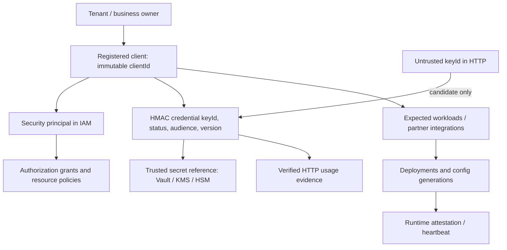
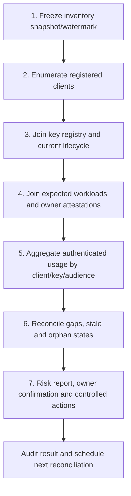

# Kiểm kê client trong hệ thống xác thực HTTP request bằng HMAC đa khách hàng

## 1. Vì sao “Kiểm kê client” là một kiểm soát bảo mật, không chỉ là danh sách ứng dụng?

Module `SECURITY_AUTHENTICATION_HMAC_REQUEST_AUTHENTICATION` hướng dẫn thiết kế xác thực HTTP request dựa trên **HMAC với shared secret** và **canonical request** gồm method, URI, signed headers hoặc body theo hợp đồng ký. Người học thực hành xác minh chữ ký, chống replay bằng timestamp/nonce, quản lý key rotation, kiểm thử qua proxy/gateway và **phân biệt authentication với authorization**.

Khi một API chỉ có một client, đội vận hành đôi khi chỉ nhớ một `keyId` hoặc một cấu hình môi trường. Khi hệ thống phục vụ **hàng trăm hoặc hàng nghìn clients**, mỗi client có nhiều keys, workloads, regions, owners, audiences và lịch cập nhật khác nhau, cách làm đó không còn đủ an toàn.

Chủ đề **“Kiểm kê client”** thuộc chương **“Multi-client”** trả lời câu hỏi:

> Làm thế nào chứng minh được **những logical clients nào đã được đăng ký, sở hữu credentials nào, đang được triển khai ở đâu, đã thực sự xác thực ra sao, còn ai phụ trách, và credential nào cần rotate, revoke hoặc điều tra** mà không làm lộ shared secret hay gán nhầm danh tính từ một HTTP request chưa được xác minh?

Hãy tưởng tượng hệ thống thanh toán có ba client đã đăng ký:

```text
Client A: cli_checkout_42
  principal: service:merchant-42-checkout
  ownerTenant: t-42
  prod key: kid_m42_checkout_v8 ACTIVE
  old key:  kid_m42_checkout_v7 VERIFY_ONLY
  workloads: checkout API x24 replicas, DR standby x4

Client B: cli_reconcile_42
  principal: service:merchant-42-reconciliation
  ownerTenant: t-42
  prod key: kid_m42_recon_v3 ACTIVE
  workloads: nightly batch x5, weekly backfill x1

Client C: cli_partner_99
  principal: service:merchant-99-partner
  ownerTenant: t-99
  prod key: kid_m99_partner_v2 ACTIVE
  workloads: external partner connector, unknown instance count
```

Một request đến:

```http
POST /v1/tenants/t-99/payments HTTP/1.1
Host: api.example.test
Content-Type: application/json
X-HMAC-Key-Id: kid_m42_checkout_v8
X-HMAC-Timestamp: 1796083200
X-HMAC-Nonce: 7d46b2dd65d618a32ba74de99da88d80
X-HMAC-Signature: <test-placeholder>

{"amountMinor":125000,"currency":"VND"}
```

**Không thể** nhìn `X-HMAC-Key-Id` rồi kết luận “Client A đã gọi API”: attacker có thể sao chép một key ID thật và gửi chữ ký giả. Phải exact-lookup key ID, xác minh HMAC bằng secret record đáng tin, kiểm tra clock/nonce/key-client status rồi mới ghi nhận **authenticated usage** cho client A. Và ngay cả khi client A ký đúng, nó chưa chắc **được phép** tạo payment trong tenant `t-99`.

### Mục tiêu học tập

Sau bài này, bạn có thể:

1. Phân biệt **registered client**, **HMAC credential**, **deployment/workload**, **principal**, **tenant**, **key version** và **observed request**.
2. Thiết kế nguồn dữ liệu đáng tin cho inventory, không coi một header/key ID chưa verify là bằng chứng client tồn tại hoặc đang dùng.
3. Xây dựng hệ thống đối chiếu **client registry ↔ credential registry ↔ workload inventory ↔ authenticated usage**.
4. Phân loại clients active, dormant, unmanaged, orphaned, pending onboarding, suspended và keys quá hạn/không owner.
5. Đặt các trường audit, owner, environment, audience, expiry, rotation due, last verified use và policy revision phù hợp.
6. Thiết kế quy trình periodic reconciliation, gap alerts, owner attestation, deprovisioning và key rotation.
7. Dùng SQL và Java 17+ để tạo inventory report **không tải/lộ raw shared secret**.
8. Xử lý proxy/gateway, multiple regions, replay store, client-to-key mapping và quyền resource khi thu thập evidence.
9. Kiểm thử độ bao phủ và tính toàn vẹn inventory dưới key compromise, client disable, network outage, stale cache và migration.

**Phạm vi:** Bài tập trung vào *quản lý và quan sát clients sử dụng HMAC request authentication*. Đây không phải bài về bán hàng CRM, browser cookie inventory hay định danh người dùng cuối. Các ví dụ về database/Java chỉ minh họa kiến trúc, không là một sản phẩm inventory hoàn chỉnh.

## 2. Mô hình đối tượng: đừng đếm key IDs thành số clients

Một hệ thống multi-client có nhiều loại đối tượng, với các quan hệ khác nhau:



### 2.1 Những đối tượng phải được định danh riêng

| Đối tượng | Ví dụ | Quy tắc danh tính |
| --- | --- | --- |
| **Registered client** | `cli_checkout_42` | Logical application/partner được control plane đăng ký; **không phải** một process hay HTTP header. |
| **Client owner** | Security owner + team/tenant `t-42` | Người/tổ chức chịu trách nhiệm lifecycle, đáp ứng incident và phê duyệt secret. |
| **Security principal** | `service:merchant-42-checkout` | Identity dùng cho authorization/audit **sau khi authentication pass**. |
| **HMAC credential** | `kid_m42_checkout_v8` | Một key ID và **một** raw secret/key handle riêng, algorithm/version/audience/status. |
| **Secret reference** | `vault://payments/prod/hmac/...` | Trusted pointer, không phải secret plaintext; chỉ service được phép đọc. |
| **Workload** | `checkout-api` hoặc `settlement-cron` | Thực thể vận hành mong đợi dùng credential/client này. |
| **Deployment instance** | `vn-prod/pod-028` | Phiên bản chạy thực tế; ephemeral và có thể thay đổi thường xuyên. |
| **Config generation** | `cfg-129` | Bằng chứng workload đã nhận profile/secret mới (cần integrity). |
| **Verified usage** | `clientId+keyId+audience+timestamp` đã pass full pipeline | Evidence kỹ thuật client **được authenticated** ở một request, không nhất thiết đã được authorized. |
| **Resource tenant** | `t-99` từ path/DB | Tài nguyên được yêu cầu, **khác owner tenant** và cần authorization riêng. |

Ví dụ client A có hai keys v7/v8. **Một client, hai credentials**. Client A có 28 pods và vài batch jobs: **một client, nhiều instances**. Cùng tenant `t-42` có checkout và reconciliation apps: **hai clients, hai principals và keys độc lập**, dù owner tenant giống nhau.

**Sai:** `COUNT(DISTINCT key_id)` làm số lượng clients, `COUNT(DISTINCT IP)` làm số clients, `COUNT(X-HMAC-Key-Id)` làm số clients active.

**Đúng:** Số registered clients lấy từ **trusted client directory**; số credentials từ key registry; số workloads từ **deployment/owner inventory**; số authenticated clients active từ usage **đã qua xác minh**.

### 2.2 Cardinality và ownership bất biến

```text
Tenant 1 -> N RegisteredClient
RegisteredClient 1 -> N HmacCredential
RegisteredClient 1 -> N ExpectedWorkload
ExpectedWorkload 1 -> N DeploymentInstance
HmacCredential 1 -> N authenticated attempts over time
HmacCredential -> exactly one immutable owner clientId
```

Không chia sẻ **raw HMAC secret** giữa clients độc lập nếu muốn phân biệt signer bằng mật mã. Nếu client A và B biết cùng secret S, A có thể ký bằng key ID của B khi biết định dạng và key ID; hệ thống không thể dựa vào HMAC để chứng minh ai thực sự tính MAC. Điều đó phá attribution, giới hạn revoke và inventory theo client.

### 2.3 Logical clients khác workload instances

Một Kubernetes pod không mặc định là một client. Nếu 1.000 pods dùng chung một credential cấp cho một logical service, inventory có thể hiện:

```text
registered clients: 1
active credential versions: 2
expected workload types: 3
running instances: 1000
distinct authenticated key IDs over 24h: 1
```

Để giảm blast radius, có tổ chức cấp credential **mỗi workload** hoặc **mỗi partner integration**. Khi đó logical client boundary sẽ thay đổi theo chính sách, nhưng phải **quy định tường minh**; không suy cardinality từ pods.

## 3. “Kiểm kê client” gồm ba lớp: nguồn sự thật, trạng thái mong đợi, bằng chứng quan sát

Chỉ xem bảng keys thường không phát hiện được workload chạy bằng secret cũ hoặc một partner không còn owner.

### 3.1 Lớp 1 — Registered inventory (nguồn sự thật về quyền sở hữu)

Được quản lý bởi client registry/credential control plane:

```text
clientId, principalId, administrativeOwner, ownerTenantId
clientStatus, environment, allowedAudiences
keyId, secretRef, canonicalVersion, algorithm, keyStatus
issuedAt, verifyNotBefore, verifyUntil, revocationState
keyRevision, clientRevision, managementAuditReference
```

Đây là record có thể xác thực và chỉnh sửa **chỉ qua control plane được authorization**. Nó trả lời “key nào *được cấp* cho client nào” và “hiện nay *được phép verify* không”, **không chứng minh** một workload thực sự đang dùng key.

### 3.2 Lớp 2 — Expected deployment inventory (những workload phải tồn tại)

Nguồn thường là deployment registry/CMDB có quyền kiểm soát, CI/CD attestation, owner xác nhận, partner onboarding, scheduled jobs và DR runbook.

```text
clientId, workloadId, environment, region
deploymentKind, ownerTeam, deploymentRevision
expectedKeyFamily / approved primary key version
configurationGeneration, lastAttestedAt
activationSchedule, nextExpectedUseAt, availabilityState
```

Không cần thu thập raw secret hay secret-environment contents. Có thể ghi **secret handle reference/class**, nhưng không đọc giá trị `getEncoded()` để lập inventory.

### 3.3 Lớp 3 — Observed usage (bằng chứng hoạt động)

Có nhiều mức tin cậy:

| Evidence | Có thể kết luận? | Không thể kết luận? |
| --- | --- | --- |
| HTTP request khai `X-HMAC-Key-Id` | Một request không tin cậy **claim** key ID nào đó | Client sở hữu key đã gọi, hoặc key đang được dùng thật. |
| Registry `key.status=ACTIVE` | Key được policy cho phép verify (nếu snapshot current) | Client đang thực sự gửi traffic. |
| Config report `primaryKey=v8` từ channel authenticated | Workload đã nhận/khai áp dụng config v8 | Request v8 chắc chắn đã pass HMAC qua mọi gateway. |
| HMAC tag match nhưng timestamp expired | Bên gửi có thể sở hữu material tương ứng nếu key uncompromised, nhưng request **chưa được accept** | Đã authenticated thành công hoặc đã gọi business. |
| MAC + timestamp + nonce + key/client current PASS | Một request đã vượt authentication admission | Đã được authorization trên tài nguyên hoặc business commit. |
| Authz PASS, business operation committed | Principal được phép và effect được ghi nhận theo transaction | Không nhất thiết response đã đến client; retry có thể xảy ra. |
| Partner owner attestation đã ký/phê duyệt | Owner xác nhận inventory theo quy trình | Không thay proof của actual HMAC request/secret freshness. |

Trong bài, **`lastAuthenticatedAt` phải chỉ được cập nhật từ event mà verifier xác nhận đầy đủ HMAC, freshness, nonce và current key/client**, không phải từ một header claim trước MAC hoặc một 401/403 giả. Một authentication pass dẫn tới authorization denial vẫn là **authenticated usage**, nhưng không phải successful business operation.

### 3.4 Kiểm kê không đồng nghĩa chỉ quan sát traffic

Một client **chưa từng xuất hiện trong log** có thể là:

- Client mới provision đang `STAGED`, chưa thực thi lần đầu;
- Cron job chạy mỗi tháng;
- DR standby chỉ được kích hoạt khi outage;
- Partner đang tạm nghỉ theo hợp đồng;
- Workload đã chết và key chưa được revoke;
- Pipeline metrics bị lỗi, gateway mới không gửi event;
- Client đã chuyển sang service khác ngoài vùng quan sát.

Vì vậy **không có event không đủ để kết luận client đã chết**. Cần phân biệt **dormant có lý do/owner** với **orphan không owner**, và đối chiếu lịch sử, kế hoạch sử dụng, attestation và retention.

## 4. Chuẩn định danh client và key inventory

### 4.1 Client ID là định danh hệ thống, không phải dữ liệu tự khai

Ví dụ:

```text
clientId = cli_checkout_42
keyId    = kid_m42_checkout_v8
```

`clientId` phải được cấp trong quy trình onboarding được phê duyệt; `keyId` được cấp riêng khi tạo credential. Cả hai nên ổn định, unique và không tái sử dụng sau khi xóa mềm/hết hạn.

Một key ID có thể mang tên gợi ý của client/phiên bản, nhưng **không dùng `keyId.split("_")` hay `split(":")` để suy client owner**. Trusted registry phải có ánh xạ exact:

```text
HTTP keyId (untrusted)
  -> exact keyId lookup in controlled registry
  -> immutable keyRecord.clientId
  -> exact lookup client directory
  -> HMAC verification using the mapped secret
  -> authenticated client identity
```

`keyId` không phải secret, không phải tenant grant, không phải token cấp quyền. Đừng chuyển raw key ID thành path `vault/clients/<keyId>` do attacker có thể điều khiển path/namespace.

### 4.2 Đặt client boundary trước khi cấp credential

Một câu hỏi quan trọng: **một partner có 5 services sẽ có 1 client hay 5 clients?**

Gợi ý lựa chọn:

- Nếu các services có **cùng owner, cùng mức đặc quyền, cùng lifecycle** và một sự cố có thể thu hồi cả nhóm, một logical client có nhiều workloads là một cấu trúc có thể chấp nhận.
- Nếu services có **quyền truy cập, rủi ro hoặc owner** khác nhau, tách registered clients và keys sẽ giúp least privilege, audit, rate limit và incident containment.
- Nếu partner chia raw secret giữa unrelated applications, inventory có thể ghi chính xác “đã đăng ký 2 clients” nhưng **không chứng minh cryptographically** application nào đã gửi request.

Không có “số client chuẩn” áp dụng cho mọi mô hình. Điều cần nhất quán là một client identity phản ánh **trust, ownership và quyền quản trị thực tế**.

### 4.3 Environment và audience là thuộc tính bắt buộc

Không trộn:

```text
cli_checkout_42 + payments-api/prod + kid_v8_prod
cli_checkout_42 + payments-api/staging + kid_v8_staging
```

Nếu cùng client logical tồn tại ở hai môi trường, inventory phải tách key/audience/secret material theo môi trường và policy. Một key staging **không được** xác thực ở production, kể cả nếu client khai Host production hoặc gateway rewrite domain.

**Audience pinning** từ trusted key metadata và service configuration làm giảm rủi ro cross-service reuse. Một inventory không có audience/environment sẽ khó phát hiện key prod bị dùng ở sandbox, hoặc key sandbox cấp quá rộng quyền.

## 5. Những trường inventory tối thiểu cần giữ và lý do

Một bảng tổng hợp nên phục vụ các câu hỏi vận hành thực tế: ai sở hữu, còn dùng không, sử dụng thế nào, khi nào rotate, ai duyệt và có được revoke ngay không?

### 5.1 Client-level fields

| Field | Kiểu/giá trị gợi ý | Ý nghĩa |
| --- | --- | --- |
| `clientId` | Unique stable ASCII ID | Khóa chính của logical client, không tái sử dụng. |
| `principalId` | IAM principal | Danh tính cho authz sau HMAC. |
| `ownerTenantId` | Administrative tenant | Tổ chức/chủ quản lý, không tự là resource grant. |
| `ownerTeam` / `securityContact` | Internal team/approved channel | Ai phản hồi incident, approve rotation/disable. |
| `clientStatus` | `ONBOARDING/ENABLED/SUSPENDED/DECOMMISSIONED` | Lifecycle client; disable có thể chặn mọi keys. |
| `allowedAudiences` | Server-side allowlist | Vùng dịch vụ/môi trường mà client được đăng ký. |
| `registeredAt` / `updatedAt` | Trusted server time | Audit onboarding và cập nhật. |
| `clientRevision` | Monotonic counter | Cache consistency, optimistic locking. |
| `lastAttestedAt` | Owner-confirmed date | Inventory ownership còn được xác nhận không. |
| `nextAttestationDueAt` | Policy-based date | Lập lịch kiểm kê định kỳ. |
| `dataClassification` | Internal/partner restricted | Giới hạn ai được xem inventory và export. |

### 5.2 Credential-level fields

| Field | Ví dụ | Vì sao cần? |
| --- | --- | --- |
| `keyId` | `kid_m42_checkout_v8` | Exact selector, unique, historical tombstone. |
| `clientId` | `cli_checkout_42` | Immutable owner binding. |
| `secretRef` | `vault://.../v8` | Trusted reference, **không** secret raw/Base64. |
| `algorithm` | `HmacSHA256` | Chặn downgrade/key purpose confusion. |
| `canonicalVersion` | `HMAC-REQUEST/INVENTORY-V1` | Client/server ký đúng hợp đồng byte-level. |
| `audience` | `payments-api/prod` | Chặn cross-service/cross-env acceptance. |
| `keyStatus` | `STAGED/ACTIVE/VERIFY_ONLY/REVOKED` | Rotation/verification eligibility. |
| `verifyNotBefore` / `verifyUntil` | UTC instants | Window hiệu lực; biên `[notBefore,until)`. |
| `issuedAt` / `revokedAt` | UTC instants | Provenance/incident audit. |
| `keyRevision` | Monotonic integer | Cache invalidation và event ordering. |
| `rotationGroupId` | `rg_checkout_42` | Phân biệt key versions trong cùng rollout. |
| `lastAuthenticatedAt` | Aggregated verified time | Evidence sử dụng, **không dựa raw claim**. |
| `lastAttemptObservedAt` | Optional untrusted trace | Phân biệt claim attempts và verified usage. |
| `credentialRiskFlags` | `OVERDUE/UNOWNED/STAGING_IN_PROD` | Derived từ facts/policy, không client tự chỉnh. |

`lastAuthenticatedAt` nên cập nhật theo **validated security event stream** hoặc rolling aggregation, không nhất thiết update credential row trên mỗi request (sẽ gây write hotspots). Có thể dùng minute/hour buckets, watermark và retention thay vì log mọi request vĩnh viễn.

### 5.3 Workload- và rollout-level fields

```text
clientId
workloadId
environment
region
ownerTeam
deploymentKind               = api / cron / serverless / partner / DR
artifactOrSdkVersion
expectedSchedule             = always-on / weekly / monthly / standby
configGeneration
approvedSigningKeyId
secretHandleLocationClass    = vault / OS-keystore / HSM / managed
lastTrustedAttestationAt
lastVerifiedUsageAt
nextExpectedUsageAt
retirementDeadline
```

**Không** lưu raw shared secret trong inventory, không đưa `SecretKey.getEncoded()` vào dashboard, không ghi `Authorization` hay full `X-HMAC-Signature` trong event. HMAC signatures bị lộ có thể bị replay trong cửa sổ freshness nếu nonce chưa reserve hoặc shared store sai.

### 5.4 Field provenance là phần của chất lượng inventory

Mỗi giá trị quan trọng nên biết **ai/nguồn nào đã khẳng định**:

| Nguồn | Ví dụ | Độ tin cậy |
| --- | --- | --- |
| Security registry | `keyId→clientId, keyStatus, audience` | Authoritative cho credential ownership/policy nếu read consistency đạt. |
| Client/IAM directory | `principalId, enabled, ownerTenant` | Authoritative cho client identity/grants metadata. |
| CI/CD attestation | `workloadId, configGeneration` | Đáng tin nếu agent/build identity đã xác minh. |
| Partner owner approval | `nextExpectedUseAt`, contact | Nghiệp vụ có chủ thể xác nhận; không thay runtime proof. |
| Authenticated HMAC gateway event | `verifiedClientId, verifiedKeyId, audience` | Evidence cho một request admission đã pass. |
| Raw HTTP header | `claimedKeyId` | **Untrusted**, không dùng chứng minh client active. |
| IP/User-Agent | Network observation | Có thể NAT/proxy/spoof, không là client identity đáng tin. |

Khi bất đồng nguồn, không tự lấy dữ liệu “mới nhất” bất kể xuất xứ. Ví dụ một header `X-Client-Id=cli_admin` đến lúc 12:00 mới hơn bản ghi IAM 11:59, nhưng nó **không có quyền overwrite identity trusted**.

## 6. Quy trình kiểm kê từ đầu đến cuối

Một lần kiểm kê định kỳ có thể được chạy mỗi ngày/tuần theo mức rủi ro, đồng thời có event-driven reconciliation khi cấp, rotate hoặc revoke key.

### 6.1 Quy trình bảy bước



**Bước 1 — Chốt snapshot và phạm vi.**

Xác định environment, audience, server time, read consistency, retention và watermark. Đặt `snapshotAt`, `usageCompleteThrough` và `sourceRevision` để so sánh dữ liệu không cùng độ trễ. Đừng kết luận “không sử dụng” nếu usage pipeline mới ingest dữ liệu đến hôm qua.

**Bước 2 — Liệt kê registered clients.**

Lấy `clientId`, owner/principal/status/revision từ authoritative client directory. Không tự tạo client từ raw keyId lạ trong access logs.

**Bước 3 — Join credentials.**

Với từng client, liệt kê keys active, verify-only, staged, revoked, expiry và canonical/audience. Đánh dấu key ID trùng, material reuse, secretRef không tồn tại, revoked key vẫn có verified usage sau deadline, hoặc ACTIVE key của client DISABLED.

**Bước 4 — Join expected workloads.**

Lấy deployment/cron/serverless/partner/DR inventory, config generations/owners, ngày dự kiến chạy và trạng thái đã nhận secret. Các clients không có workload có thể là pending, dormant hoặc orphan — cần phân loại, không tự revoke.

**Bước 5 — Join authenticated usage.**

Tổng hợp các events **đã qua HMAC, freshness, nonce, key/client status** theo `clientId, keyId, audience`. Tách `authzDenied`/business commit khỏi authn; phân biệt verified usage với unverified attempts. Chỉ nhóm theo key/owner sau verification.

**Bước 6 — Reconcile.**

Phát hiện chênh lệch có ý nghĩa, ví dụ workload khai v8 nhưng verified requests vẫn toàn v7, key revoked còn traffic, client không có owner, key không ai chịu trách nhiệm, hoặc dùng sai audience.

**Bước 7 — Owner review và hành động có kiểm soát.**

Gửi report có mức rủi ro, evidence, deadline và owner. Actions như revoke/delete/rotate/disable **phải đi qua control plane đã xác thực, authorization, audit và approval**; inventory job **không** được tự revoke trên một raw metric thiếu dữ liệu.

### 6.2 Inventory snapshot không được thay thế online verifier

Một inventory report có thể chốt lúc 09:00, nhưng key bị revoke lúc 09:05. **Online HMAC verifier phải kiểm tra state hiện tại** theo revocation SLO; không lấy báo cáo 09:00 rồi chấp nhận request vì khi đó key còn ACTIVE.

Ngược lại, inventory có thể hợp thức hóa quy trình quản lý bằng các cảnh báo từ event streams và revision reconciliation. Hai mục đích khác nhau:

```text
Inventory = coverage, ownership, lifecycle oversight, evidence.
Verifier  = security decision for THIS request NOW.
```

## 7. Phân loại client và credential gap đúng ngữ nghĩa

### 7.1 Phân loại ở client-level

| Nhãn kiểm kê | Điều kiện (minh họa) | Hành động |
| --- | --- | --- |
| **REGISTERED_ACTIVE** | Client ENABLED, có owner, key hợp lệ và authenticated traffic trong expected window | Theo dõi rotation/attestation. |
| **REGISTERED_DORMANT** | Client ENABLED, không traffic nhưng schedule/owner xác nhận tạm nghỉ | Không tự coi là orphan; lên review. |
| **PENDING_ONBOARDING** | Client/key chưa ACTIVE, provisioning chưa hoàn tất | Không tạo credentials tùy tiện; theo dõi blockers. |
| **UNOWNED_CLIENT** | Owner/contact không tồn tại hoặc không còn hợp lệ | Escalate, hạn chế management operations, xử lý deprovision theo policy. |
| **DISABLED_WITH_ACTIVE_KEYS** | Client DISABLED nhưng credential rows ACTIVE | Key không được verify; sửa control-plane consistency. |
| **UNEXPECTED_VERIFIED_USAGE** | Verified request có workload/region/version ngoài approved plan | Điều tra nguồn thực/possible key sharing; không tự gán sang workload. |
| **MISSING_EXPECTED_USAGE** | Workload theo lịch phải gọi nhưng không có verified event ở window có đủ data | Kiểm tra pipeline/availability/config; chưa đủ để kết luận key không cần. |
| **DECOMMISSION_PENDING** | Client không còn business owner/use case, keys vẫn tồn tại | Approval, revoke, cleanup, tombstone/audit. |
| **REVOKED_BUT_OBSERVED** | Usage được ghi **sau** revocation admission cut-off | Incident: cache stale, bypass, event ordering hoặc data quality. |

### 7.2 Phân loại credential-level

| Credential finding | Ý nghĩa/rủi ro |
| --- | --- |
| `KEY_EXPIRING_SOON` | `verifyUntil` gần, client rollout/new key chưa được xác nhận. |
| `KEY_OVERDUE_ROTATION` | Raw signing secret giữ quá policy; tăng blast radius và thời gian tồn tại. |
| `KEY_WITHOUT_CLIENT` | Vi phạm FK/integrity; không chọn fallback owner. |
| `KEY_OUTSIDE_ALLOWED_AUDIENCE` | Credential nằm sai environment/service policy; chặn xác minh cross-env. |
| `DUPLICATE_SECRET_MATERIAL` | Hai clients có thể impersonate nhau nếu cùng raw secret. |
| `ORPHANED_SECRET_REF` | Secret store có material không được record nào dùng hoặc record trỏ secret thiếu. |
| `VERIFY_ONLY_TOO_LONG` | Key cũ còn được chấp nhận quá grace/approved retirement. |
| `CLIENT_DISABLED_BUT_KEY_ACTIVE` | DB status không tự đảm bảo key được deny; verifier phải xét client. |
| `VERIFIED_OLD_KEY_AFTER_CUTOVER` | Có signer chưa nâng cấp, replay/in-flight hoặc unknown workload. |
| `REGISTRY_USAGE_INCONSISTENCY` | Verified event cho key không tồn tại hoặc mapping owner bị thay. |

Một finding được coi là **rủi ro cần điều tra**, không phải kết luận đã xảy ra breach. Ví dụ verified old key traffic có thể là queue in-flight hợp lệ trong grace; duplicate material là kết luận chỉ khi có bằng chứng ở provisioning/secret manager (không đọc secrets hàng loạt để so).

### 7.3 Đừng dùng ngưỡng “không dùng 30 ngày” cho mọi workload

Một số clients chạy 24/7, một số monthly batch, một số chỉ hoạt động trong disaster recovery. Các ngưỡng phải phụ thuộc **expectedSchedule** và business criticality.

```text
online API expected every 10 minutes
    no verified traffic 2 hours -> investigate

monthly settlement expected at month-end
    no verified traffic 2 days mid-month -> normal

DR standby expected to stay idle
    no business traffic 90 days -> normal,
    but attestation/credential health test overdue -> investigate
```

Một key không có verified traffic **không được** hiểu là “safe to delete”; secret có thể đang dùng trong một workload bị mất visibility hoặc sắp được kích hoạt. Cần owner attestation và retention policy trước decommission.

## 8. Key rotation theo từng client: inventory là điều kiện tiên quyết

Khi hệ thống có hàng nghìn clients, rotation không thể “đổi mọi keys cùng lúc” nếu partner releases/regions/workload cycles khác nhau. Inventory tạo **đối tượng rollout có trách nhiệm**.

### 8.1 Thứ tự rotation an toàn

```text
1. Verify client owner and approved audience.
2. Inventory all expected workloads/cohorts using old key v7.
3. Provision fresh secret S8 with NEW keyId v8; trusted mapping.
4. Server receives v8 in all verifier regions, can verify it.
5. Distribute S8 securely to authorized client workloads.
6. Canary selected cohorts; observe authenticated v8 requests.
7. Progressively switch to v8 across workloads.
8. Confirm no active legitimate v7 signers, including batch/DR.
9. Old v7 moves to bounded VERIFY_ONLY grace if uncompromised.
10. Revoke/expire v7; invalidate caches; cleanup old material.
11. Update inventory with evidence, audit and next rotation due.
```

Một client có thể có **hai keys ACTIVE** trong khoảng overlap nếu policy server cho phép và client cohorts khác nhau đang ký bằng v7/v8. Nhưng mỗi request phải khai một `keyId` và server verify bằng **đúng một secret** theo metadata — không thử keys theo thứ tự khi signature mismatch.

### 8.2 Inventory giúp tránh decommission sai

Giả sử dashboard nói 98% requests của client A dùng v8. Nhưng 2% còn lại đến từ cron worker chạy mỗi 48 giờ. Nếu vừa revoke v7, batch có thể dừng. Inventory cần biết:

- `workloadId` nào còn phát hành v7;
- ai có quyền cập nhật secret trên workload đó;
- khi nào nó chạy lần tiếp theo;
- config generation có được xác nhận từ kênh tin cậy không;
- request nào đã HMAC-verified thật bằng v8;
- có pending retries/in-flight requests ký v7 không.

**Không lấy số phần trăm requests làm coverage về số workloads.** Một API nhiều lưu lượng có thể che khuất một batch cực kỳ quan trọng.

### 8.3 Compromise làm thay đổi ưu tiên

Nếu S7 bị lộ, inventory giúp xác định **affected clients/workloads** và ai phải được cảnh báo. Tuy nhiên không giữ v7 ACTIVE/VERIFY_ONLY vô hạn để chờ một partner chưa nâng cấp: attacker biết S7 có thể tự ký timestamp/nonce mới, nên phải **emergency revoke** theo incident policy, thậm chí chấp nhận downtime.

Nếu cùng secret S7 từng được cấp cho hai clients, cần coi cả hai bị ảnh hưởng; không chỉ đổi một key ID rồi tin rằng client còn lại an toàn.

## 9. HMAC canonical contract cho ví dụ đa client: INVENTORY-V1

Để kiểm tra danh tính được ghi vào inventory **đến từ một request xác thực thật**, bài định nghĩa hợp đồng minh họa `HMAC-REQUEST/INVENTORY-V1`. Nó không phải chuẩn HTTP HMAC phổ quát; SDK và verifier cần dùng chính xác một byte contract và independent golden vectors.

### 9.1 Wire request

```http
POST /v1/tenants/t-42/payments?mode=instant HTTP/1.1
Host: payments.example.test
Content-Type: application/json
Idempotency-Key: m42-payment-00017
X-HMAC-Key-Id: kid_m42_checkout_v8
X-HMAC-Timestamp: 1796083200
X-HMAC-Nonce: 7d46b2dd65d618a32ba74de99da88d80
X-HMAC-Signature: <base64-standard-padded-full-tag>

{"amountMinor":125000,"currency":"VND"}
```

`1796083200` là timestamp fixture cho `2026-12-01T00:00:00Z`, không phải giá trị hợp lệ mặc định cho request ở thời điểm khác. `X-HMAC-Signature` là placeholder, không phải tag có thể verify; body được định nghĩa là **raw bytes UTF-8 của JSON trên, không có final LF**.

### 9.2 Các quy tắc

| Thành phần | Quy tắc minh họa |
| --- | --- |
| Method | `POST` thực nhận, không method override. |
| Raw target | Origin-form `/v1/tenants/t-42/payments?mode=instant`, không tự sort query/decode. |
| Audience | `payments-api/prod` từ trusted service config/key metadata, không lấy Host tự khai. |
| Content-Type | Một header chính xác `application/json`; reject duplicate. |
| Idempotency-Key | Một header `[A-Za-z0-9._:-]{8,128}`, ổn định qua retry cùng business intent. |
| Key ID | `[A-Za-z0-9._:-]{1,96}`, một signed selector; key ID **không** phải client ID. |
| Timestamp | Unix epoch seconds canonical ASCII, signed. |
| Nonce | 16 random bytes (128-bit) encode lowercase hex 32 chars, signed. |
| Raw body | SHA-256(raw application body bytes) sau HTTP framing, trước transform; ví dụ cấm Content-Encoding. |
| Canonical serialization | **12 dòng** UTF-8 nối LF `0x0A`, không final LF. |
| Signature | Full 32-byte HmacSHA256 tag, Base64 standard padded 44 chars, strict decode. |
| Replay scope | `(authenticatedClientId, audience, nonce)`, atomic shared store xuyên keys của client. |
| Business idempotency | `(authenticatedClientId, audience, idempotencyKey)` + fingerprint method/target/content-type/body. |
| Authentication evidence | Chỉ emit accepted event khi MAC, clock, nonce và key/client-current pass. |

### 9.3 Canonical request chính xác 12 dòng

```text
HMAC-REQUEST/INVENTORY-V1
HMAC-SHA256
POST
/v1/tenants/t-42/payments?mode=instant
audience:payments-api/prod
content-type:application/json
idempotency-key:m42-payment-00017
x-hmac-key-id:kid_m42_checkout_v8
x-hmac-timestamp:1796083200
x-hmac-nonce:7d46b2dd65d618a32ba74de99da88d80
body-size:<actual-raw-body-byte-count>
body-sha256:<sha256-lowercase-hex-of-raw-body>
```

Hai placeholder `<...>` phải được thay bằng số byte và digest thật trước khi ký. **Không ký raw `X-HMAC-Signature`**, vì nó là kết quả HMAC và sẽ tạo phụ thuộc vòng.

```text
client:
    serialize/freeze exact body bytes
    compute SHA-256(body)
    canonical = UTF8(joinLF(12 lines, no final LF))
    tag = HMAC_SHA256(S8, canonical)
    signature = Base64.standard.padded(tag)

server:
    parse HTTP strictly, reject duplicate signed headers
    exact lookup keyId -> trusted key metadata -> secretRef
    derive canonical from ACTUAL request bytes
    compare full HMAC tag timing-safe
    check freshness, nonce, current key/client status
    emit authenticated inventory usage event
    authorize actual action and resource
```

Để inventory không nhiễm request giả, **event phải được tạo sau full authentication admission**, không tạo từ một request có keyId thật nhưng signature invalid. Nếu chính secret bị compromise, HMAC đúng không chứng minh người gọi là workload owner gốc; inventory event chứng minh **credential đã được sử dụng**, cần phối hợp điều tra nguồn mạng/device attestation.

### 9.4 Không tự suy clientId từ key ID đã ký

Một request ký `x-hmac-key-id:kid_m42_checkout_v8` chỉ chứng minh signer biết secret được registry map tới key này (nếu secret không lộ). Nó **không tự chứng minh** một claim `clientId=cli_admin` trên header là đúng. Inventory phải lấy `clientId` từ trusted metadata **sau khi xác thực**, không từ prefix key ID hoặc `X-Client-Id` tự khai.

Tương tự, cùng một key có thể được dùng để ký target tenant `t-99`; HMAC vẫn hợp lệ nhưng authorization phải từ chối nếu principal thuộc `t-42` không có quyền. Inventory có thể ghi **authentication pass / authorization denied** để hỗ trợ incident detection, nhưng không tăng “successful business operation” count.

## 10. Thiết kế schema lưu inventory với các ràng buộc dữ liệu

Một registry đủ tin cậy cần biết các bản ghi đến từ **control plane được phân quyền**. Các bảng ví dụ PostgreSQL dưới đây mô tả quan hệ, không thay thế migration production, IAM policy, encryption-at-rest hay kiểm tra integration.

### 10.1 Registered clients và HMAC credentials

```sql
CREATE TABLE registered_clients (
    client_id             VARCHAR(96) PRIMARY KEY,
    principal_id          VARCHAR(128) NOT NULL,
    owner_tenant_id       VARCHAR(96) NOT NULL,
    owner_team            VARCHAR(128) NOT NULL,
    security_contact_ref  VARCHAR(256) NOT NULL,
    client_status         VARCHAR(32) NOT NULL
                          CHECK (client_status IN (
                              'ONBOARDING','ENABLED',
                              'SUSPENDED','DECOMMISSIONED')),
    revision              BIGINT NOT NULL CHECK (revision >= 1),
    registered_at         TIMESTAMPTZ NOT NULL,
    updated_at            TIMESTAMPTZ NOT NULL,
    last_attested_at      TIMESTAMPTZ,
    next_attestation_due  TIMESTAMPTZ
);

CREATE TABLE hmac_credentials (
    key_id                VARCHAR(96) PRIMARY KEY,
    client_id             VARCHAR(96) NOT NULL
                          REFERENCES registered_clients(client_id),
    key_version           INTEGER NOT NULL CHECK (key_version >= 1),
    secret_ref            VARCHAR(256) NOT NULL UNIQUE,
    algorithm             VARCHAR(32) NOT NULL
                          CHECK (algorithm = 'HmacSHA256'),
    canonical_version     VARCHAR(64) NOT NULL
                          CHECK (canonical_version =
                                 'HMAC-REQUEST/INVENTORY-V1'),
    audience              VARCHAR(128) NOT NULL,
    key_status            VARCHAR(24) NOT NULL
                          CHECK (key_status IN
                                 ('STAGED','ACTIVE',
                                  'VERIFY_ONLY','REVOKED')),
    verify_not_before     TIMESTAMPTZ NOT NULL,
    verify_until          TIMESTAMPTZ NOT NULL,
    issued_at             TIMESTAMPTZ NOT NULL,
    revoked_at            TIMESTAMPTZ,
    revision              BIGINT NOT NULL CHECK (revision >= 1),
    updated_at            TIMESTAMPTZ NOT NULL,
    rotation_group_id     VARCHAR(96),
    UNIQUE (client_id, key_version),
    CHECK (verify_not_before < verify_until),
    CHECK (key_status <> 'REVOKED' OR revoked_at IS NOT NULL)
);

CREATE INDEX idx_credentials_owner
    ON hmac_credentials (client_id);

CREATE INDEX idx_credentials_audience_status
    ON hmac_credentials (audience, key_status);
```

**Bất biến ngoài SQL CHECK:**

- `key_id` phải **never-reused**, kể cả sau decommission; tombstones/audit là quan trọng.
- `client_id` của một key, `algorithm`, `canonical_version`, `audience`, material identity và binding `secret_ref` phải được **ghim theo credential**; không cho update tùy ý để chuyển key sang client mới.
- Có một `key_id` không chứng minh secret đã được provision cho đúng client. Management workflow phải có approval và delivery attestation.
- `UNIQUE(secret_ref)` ngăn reuse cùng reference, nhưng **không phát hiện** hai provider references chứa cùng raw secret. Secret generation phải độc lập.
- Foreign key giữ client tồn tại ở DB, nhưng nếu directory/IAM khác nguồn, phải có reconciliation và consistency policy.
- `client_status=SUSPENDED` hoặc `DECOMMISSIONED` khiến verifier **không được** coi client là ENABLED, dù key row còn ACTIVE.
- Một key `ACTIVE` vẫn hết hiệu lực tại `verify_until`; **EXPIRED** có thể là trạng thái derived từ server time.

### 10.2 Expected workloads/instances là bảng tách riêng

```sql
CREATE TABLE expected_client_workloads (
    workload_id            VARCHAR(128) PRIMARY KEY,
    client_id              VARCHAR(96) NOT NULL
                           REFERENCES registered_clients(client_id),
    environment            VARCHAR(32) NOT NULL,
    region                 VARCHAR(64) NOT NULL,
    deployment_kind        VARCHAR(32) NOT NULL,
    owner_team             VARCHAR(128) NOT NULL,
    expected_schedule      VARCHAR(64) NOT NULL,
    approved_primary_key   VARCHAR(96),
    config_generation      BIGINT,
    next_expected_use_at   TIMESTAMPTZ,
    last_trusted_attest_at TIMESTAMPTZ,
    workload_status        VARCHAR(24) NOT NULL
                           CHECK (workload_status IN (
                               'ACTIVE','STANDBY',
                               'MAINTENANCE','RETIRED')),
    FOREIGN KEY (approved_primary_key)
        REFERENCES hmac_credentials(key_id)
);

CREATE INDEX idx_workload_client
    ON expected_client_workloads (client_id);
```

**Cảnh báo về referential integrity:** FK `approved_primary_key` chỉ kiểm tra key ID **tồn tại**, chưa đảm bảo key đó **thuộc cùng client** hoặc đúng audience/environment. Trong production, dùng composite ownership constraint, FK composite tương ứng hoặc application transactional validation có audit.

Nếu có 200 pods cùng một workload, không cần lưu 200 raw secret copies để kiểm kê. Một inventory workload row có thể gắn deployment metadata và một aggregation về instances; instance-level health cần nguồn attestation riêng, retention và quyền truy cập phù hợp.

### 10.3 Authenticated usage chỉ được nhập qua trusted verifier pipeline

Lưu **aggregated evidence**, không lưu raw `Authorization` hoặc body:

```sql
CREATE TABLE hmac_verified_usage_hourly (
    bucket_start          TIMESTAMPTZ NOT NULL,
    client_id             VARCHAR(96) NOT NULL,
    key_id                VARCHAR(96) NOT NULL,
    audience              VARCHAR(128) NOT NULL,
    ingress_region        VARCHAR(64) NOT NULL,
    verified_count        BIGINT NOT NULL CHECK (verified_count >= 0),
    authz_denied_count    BIGINT NOT NULL CHECK (authz_denied_count >= 0),
    last_authenticated_at TIMESTAMPTZ NOT NULL,
    ingestion_watermark   TIMESTAMPTZ NOT NULL,
    PRIMARY KEY (
        bucket_start, client_id, key_id, audience, ingress_region
    )
);
```

Trong production:

- Chỉ **trusted HMAC verifier** emit `AuthenticationAdmitted` sau **MAC + freshness + nonce + current key/client** pass. Một raw HTTP gateway log chưa đủ.
- Event cần có `eventId`/request correlation để consumer deduplicate. Nếu at-least-once delivery, không được cộng `verified_count` nhiều lần khi replay event.
- `clientId`/`keyId` đến từ **trusted metadata đã verify**, không do client gửi và được gán lại tùy ý.
- `ingress_region` cần integrity/provenance từ platform, không dùng header `X-Region` của client.
- Event time được server xác định; phân biệt `eventAt`, `ingestedAt` và **watermark** để không coi thiếu telemetry là no traffic.
- Không tự suy số workload instances từ `verified_count`: một credential có thể được nhiều pods/partner dùng.
- Khi key/client bị disable sau admission, đã accepted event của quá khứ vẫn là lịch sử hợp lệ, **không** được dùng để hồi sinh status.

### 10.4 SQL truy vấn kiểm kê bằng metadata trusted

Một truy vấn liệt kê clients và số keys theo trạng thái:

```sql
SELECT
    c.client_id,
    c.owner_team,
    c.client_status,
    c.revision AS client_revision,
    COUNT(k.key_id) AS total_key_records,
    COUNT(*) FILTER (WHERE k.key_status = 'ACTIVE')
        AS active_key_records,
    COUNT(*) FILTER (WHERE k.key_status = 'VERIFY_ONLY')
        AS verify_only_key_records,
    COUNT(*) FILTER (
        WHERE k.key_status IN ('ACTIVE','VERIFY_ONLY')
          AND k.verify_until <= CURRENT_TIMESTAMP
    ) AS expired_key_records
FROM registered_clients c
LEFT JOIN hmac_credentials k
    ON k.client_id = c.client_id
GROUP BY
    c.client_id,
    c.owner_team,
    c.client_status,
    c.revision
ORDER BY c.client_id;
```

**Cẩn thận:** `active_key_records` đếm **persisted status**, không phải keys có thể verify *ngay bây giờ*. Eligibility còn xét `verify_not_before/verify_until`, client status, audience, current revision và secret availability. Báo cáo nên đặt tên field đúng semantics để không khiến operator xem count đó là số keys đang an toàn.

Tìm keys sắp hết hạn trong 14 ngày (mốc ví dụ):

```sql
SELECT
    k.key_id,
    k.client_id,
    k.audience,
    k.key_status,
    k.verify_until,
    c.owner_team,
    c.security_contact_ref
FROM hmac_credentials k
JOIN registered_clients c
    ON c.client_id = k.client_id
WHERE k.key_status IN ('ACTIVE','VERIFY_ONLY')
  AND k.verify_until >= CURRENT_TIMESTAMP
  AND k.verify_until < CURRENT_TIMESTAMP + INTERVAL '14 days'
ORDER BY k.verify_until ASC, k.key_id ASC;
```

Một query này **không được tự revoke key**. Nó tạo evidence để owner rollout/rotate. Time bounds phải dùng đồng hồ trusted và snapshot timestamp cụ thể để report reproducible; replica lag có thể làm finding lệch.

### 10.5 Không lưu secret trong inventory để “kiểm tra trùng”

Đừng tạo cột:

```sql
-- KHÔNG khuyến nghị:
ALTER TABLE hmac_credentials ADD COLUMN raw_secret_base64 TEXT;
```

`Base64` chỉ encoding. Người có quyền SELECT hoặc export inventory sẽ có khả năng tạo HMAC cho clients. Trường `secret_ref` cần quyền đọc phù hợp và redaction trong exports; một managed secret store có thể giữ encrypted secret/wrapped DEK trong vùng bảo vệ riêng.

Nếu cần phát hiện secret material reuse, việc kiểm soát tốt hơn là provisioning sinh key độc lập với CSPRNG, quản lý non-exportable key handles khi phù hợp và audit issuance policy. Không nên giải mã hàng loạt raw production secrets chỉ để lập một bảng so sánh.

## 11. Java 17+: mô hình hóa dữ liệu kiểm kê từ các nguồn đáng tin

Các class sau là **ví dụ Java 17 thuần**, không kết nối DB/Vault. Một production system có thể dùng records/entities/DTO khác, nhưng phải giữ **nguồn dữ liệu và độ tin cậy rõ ràng**.

### 11.1 Types: `RegisteredClient`, `KeyRecord`, `Workload` và `VerifiedUsage`

```java
import java.time.Instant;
import java.util.List;
import java.util.Objects;
import java.util.Set;

public final class ClientInventoryModelV1 {
    private ClientInventoryModelV1() {}

    public enum ClientStatus {
        ONBOARDING, ENABLED, SUSPENDED, DECOMMISSIONED
    }

    public enum KeyStatus {
        STAGED, ACTIVE, VERIFY_ONLY, REVOKED
    }

    public enum WorkloadStatus {
        ACTIVE, STANDBY, MAINTENANCE, RETIRED
    }

    public record RegisteredClient(
            String clientId,
            String principalId,
            String ownerTenantId,
            String ownerTeam,
            ClientStatus status,
            long revision,
            Instant lastAttestedAt) {

        public RegisteredClient {
            Objects.requireNonNull(clientId);
            Objects.requireNonNull(principalId);
            Objects.requireNonNull(ownerTenantId);
            Objects.requireNonNull(ownerTeam);
            Objects.requireNonNull(status);
            if (clientId.isBlank() || principalId.isBlank()
                    || ownerTenantId.isBlank() || revision < 1) {
                throw new IllegalArgumentException(
                        "Invalid trusted client record");
            }
        }
    }

    public record KeyRecord(
            String keyId,
            String clientId,
            String audience,
            String algorithm,
            String canonicalVersion,
            KeyStatus status,
            Instant verifyNotBefore,
            Instant verifyUntil,
            long revision) {

        public KeyRecord {
            Objects.requireNonNull(keyId);
            Objects.requireNonNull(clientId);
            Objects.requireNonNull(audience);
            Objects.requireNonNull(algorithm);
            Objects.requireNonNull(canonicalVersion);
            Objects.requireNonNull(status);
            Objects.requireNonNull(verifyNotBefore);
            Objects.requireNonNull(verifyUntil);

            if (!keyId.matches("[A-Za-z0-9._:-]{1,96}")
                    || !"HmacSHA256".equals(algorithm)
                    || !"HMAC-REQUEST/INVENTORY-V1"
                          .equals(canonicalVersion)
                    || !verifyNotBefore.isBefore(verifyUntil)
                    || revision < 1) {
                throw new IllegalArgumentException(
                        "Invalid trusted key record");
            }
        }

        public boolean eligibleAt(Instant now) {
            return (status == KeyStatus.ACTIVE
                    || status == KeyStatus.VERIFY_ONLY)
                    && !now.isBefore(verifyNotBefore)
                    && now.isBefore(verifyUntil);
        }
    }

    public record Workload(
            String workloadId,
            String clientId,
            String environment,
            String region,
            WorkloadStatus status,
            String approvedPrimaryKeyId,
            Instant nextExpectedUseAt,
            Instant lastTrustedAttestationAt) {

        public Workload {
            Objects.requireNonNull(workloadId);
            Objects.requireNonNull(clientId);
            Objects.requireNonNull(environment);
            Objects.requireNonNull(region);
            Objects.requireNonNull(status);
        }
    }

    /**
     * MUST come only from a trusted admission event aggregator.
     * Event itself was emitted AFTER HMAC/freshness/nonce/key status PASS.
     */
    public record VerifiedUsage(
            String clientId,
            String keyId,
            String audience,
            long admittedCount,
            Instant lastAuthenticatedAt) {

        public VerifiedUsage {
            Objects.requireNonNull(clientId);
            Objects.requireNonNull(keyId);
            Objects.requireNonNull(audience);
            Objects.requireNonNull(lastAuthenticatedAt);
            if (admittedCount <= 0) {
                throw new IllegalArgumentException(
                        "Expected positive verified usage count");
            }
        }
    }

    public record InventorySnapshot(
            Instant snapshotAt,
            Instant usageCompleteThrough,
            List<RegisteredClient> clients,
            List<KeyRecord> keys,
            List<Workload> expectedWorkloads,
            List<VerifiedUsage> verifiedUsage) {

        public InventorySnapshot {
            Objects.requireNonNull(snapshotAt);
            Objects.requireNonNull(usageCompleteThrough);
            clients = List.copyOf(clients);
            keys = List.copyOf(keys);
            expectedWorkloads = List.copyOf(expectedWorkloads);
            verifiedUsage = List.copyOf(verifiedUsage);

            if (usageCompleteThrough.isAfter(snapshotAt)) {
                throw new IllegalArgumentException(
                        "Usage watermark cannot be after snapshot");
            }
        }
    }
}
```

**Không có raw secret bytes trong model.** `KeyRecord` cố ý không chứa `secretRef` trong reporting DTO vì báo cáo không cần gọi KMS. Online verifier phải giữ key/secretRef metadata ở service có quyền phù hợp, nhưng report consumer chỉ cần ID, audience, status/revision và hash/pseudonym khi policy yêu cầu.

### 11.2 Vì sao `VerifiedUsage` không thể tạo tùy ý?

Record là dữ liệu có thể new bằng Java constructor. Vì vậy type này **không tự xác thực provenance**. Production nên chỉ cho một trusted ingestion adapter **đã xác minh nguồn event** tạo/cấp phát usage evidence. Nếu một HTTP controller mở endpoint:

```http
POST /inventory/usage
{"clientId":"cli_checkout_42","keyId":"kid_v8","count":1000000}
```

rồi tăng dashboard mà không authentication/authorization, attacker có thể làm giả adoption và che giấu key cũ. Không nhận metrics do client tự báo như verified facts.

**Phân biệt:** Một signed attestation/heartbeat của workload có thể làm bằng chứng cấu hình nó đã nhận, **không giống** verifier event cho một HTTP request thành công. Dùng đúng kiểu evidence, provenance và cách gắn nguồn.

## 12. Java 17+: đối chiếu inventory, tìm orphan/overdue mà không decrypt secret

Lớp `ClientInventoryReconcilerV1` minh họa một **báo cáo read-only**. Nó kiểm tra ownership, client status, key expiry, workload declaration và usage inconsistencies. Nó **không revoke credential**, **không sửa IAM** và **không quyết định quyền của HTTP request**.

### 12.1 `ClientInventoryReconcilerV1`

```java
import java.time.Duration;
import java.time.Instant;
import java.util.ArrayList;
import java.util.HashMap;
import java.util.HashSet;
import java.util.List;
import java.util.Map;
import java.util.Objects;
import java.util.Set;

public final class ClientInventoryReconcilerV1 {
    private ClientInventoryReconcilerV1() {}

    public enum Severity { INFO, REVIEW, HIGH, CRITICAL }

    public record Finding(
            String code,
            Severity severity,
            String clientId,
            String keyId,
            String detail) {}

    public record Report(
            Instant snapshotAt,
            Instant usageCompleteThrough,
            int registeredClients,
            int registeredKeys,
            int expectedWorkloads,
            List<Finding> findings) {

        public Report {
            findings = List.copyOf(findings);
        }
    }

    /**
     * Trusted inputs only. The producer of verifiedUsage must have
     * attested that these requests passed full authentication.
     */
    public static Report reconcile(
            ClientInventoryModelV1.InventorySnapshot snap,
            String targetAudience) {

        Objects.requireNonNull(snap);
        Objects.requireNonNull(targetAudience);

        Instant now = snap.snapshotAt();
        Instant usageThrough = snap.usageCompleteThrough();

        // Report is incomplete if the usage pipeline is too far behind.
        // Do not turn missing telemetry into "the client is dormant".
        boolean usageFresh = !usageThrough.isBefore(
                now.minus(Duration.ofHours(2)));

        Map<String, ClientInventoryModelV1.RegisteredClient>
                clientsById = new HashMap<>();
        Map<String, ClientInventoryModelV1.KeyRecord>
                keysById = new HashMap<>();

        List<Finding> findings = new ArrayList<>();

        for (var client : snap.clients()) {
            if (clientsById.putIfAbsent(
                    client.clientId(), client) != null) {
                findings.add(new Finding(
                        "DUPLICATE_CLIENT_ID", Severity.CRITICAL,
                        client.clientId(), "", "Registry conflict"));
            }
            if (client.ownerTeam().isBlank()) {
                findings.add(new Finding(
                        "CLIENT_WITHOUT_OWNER", Severity.HIGH,
                        client.clientId(), "", "No accountable team"));
            }
        }

        for (var key : snap.keys()) {
            if (keysById.putIfAbsent(key.keyId(), key) != null) {
                findings.add(new Finding(
                        "DUPLICATE_KEY_ID", Severity.CRITICAL,
                        key.clientId(), key.keyId(),
                        "Ambiguous key selector"));
            }

            var owner = clientsById.get(key.clientId());
            if (owner == null) {
                findings.add(new Finding(
                        "KEY_WITHOUT_CLIENT", Severity.CRITICAL,
                        key.clientId(), key.keyId(),
                        "Credential owner missing"));
            } else if (owner.status()
                    != ClientInventoryModelV1.ClientStatus.ENABLED
                    && key.status()
                    == ClientInventoryModelV1.KeyStatus.ACTIVE) {
                findings.add(new Finding(
                        "DISABLED_CLIENT_ACTIVE_KEY", Severity.HIGH,
                        owner.clientId(), key.keyId(),
                        "Credential active but client not enabled"));
            }

            if (!targetAudience.equals(key.audience())
                    && (key.status()
                        == ClientInventoryModelV1.KeyStatus.ACTIVE
                        || key.status()
                        == ClientInventoryModelV1.KeyStatus.VERIFY_ONLY)) {
                // Informational only in a multi-audience registry;
                // could be expected if targetAudience is only one scope.
                findings.add(new Finding(
                        "OUT_OF_SCOPE_AUDIENCE", Severity.INFO,
                        key.clientId(), key.keyId(),
                        "Key belongs to another audience"));
            }

            if ((key.status()
                    == ClientInventoryModelV1.KeyStatus.ACTIVE
                    || key.status()
                    == ClientInventoryModelV1.KeyStatus.VERIFY_ONLY)
                    && !key.eligibleAt(now)) {
                findings.add(new Finding(
                        "INELIGIBLE_KEY_STATE", Severity.REVIEW,
                        key.clientId(), key.keyId(),
                        "Status permits verify but time does not"));
            }

            if (key.status()
                    == ClientInventoryModelV1.KeyStatus.ACTIVE
                    && !key.verifyUntil().isAfter(
                            now.plus(Duration.ofDays(14)))) {
                findings.add(new Finding(
                        "KEY_EXPIRING_SOON", Severity.REVIEW,
                        key.clientId(), key.keyId(),
                        "Rotation deadline within policy horizon"));
            }
        }

        // Expected workloads are not proof of actual HMAC usage.
        Set<String> clientsWithDeclaredWorkload = new HashSet<>();
        for (var workload : snap.expectedWorkloads()) {
            clientsWithDeclaredWorkload.add(workload.clientId());
            if (!clientsById.containsKey(workload.clientId())) {
                findings.add(new Finding(
                        "WORKLOAD_WITHOUT_CLIENT", Severity.HIGH,
                        workload.clientId(),
                        workload.approvedPrimaryKeyId(),
                        workload.workloadId()));
            }

            String approved = workload.approvedPrimaryKeyId();
            if (approved != null && !approved.isBlank()) {
                var key = keysById.get(approved);
                if (key == null || !key.clientId()
                        .equals(workload.clientId())) {
                    findings.add(new Finding(
                            "WORKLOAD_WRONG_KEY_OWNER",
                            Severity.HIGH,
                            workload.clientId(), approved,
                            workload.workloadId()));
                }
            }
        }

        // Separate validated usage evidence from untrusted key claims.
        Set<String> clientsWithVerifiedUsage = new HashSet<>();
        for (var usage : snap.verifiedUsage()) {
            clientsWithVerifiedUsage.add(usage.clientId());

            var client = clientsById.get(usage.clientId());
            var key = keysById.get(usage.keyId());

            if (client == null || key == null
                    || !key.clientId().equals(usage.clientId())
                    || !key.audience().equals(usage.audience())) {
                findings.add(new Finding(
                        "VERIFIED_USAGE_MAPPING_CONFLICT",
                        Severity.CRITICAL,
                        usage.clientId(), usage.keyId(),
                        "Verified event and registry disagree"));
            }

            if (usage.lastAuthenticatedAt().isAfter(
                    usageThrough)) {
                findings.add(new Finding(
                        "USAGE_AFTER_WATERMARK",
                        Severity.HIGH,
                        usage.clientId(), usage.keyId(),
                        "Event time beyond completed window"));
            }
        }

        if (!usageFresh) {
            findings.add(new Finding(
                    "USAGE_PIPELINE_STALE", Severity.HIGH,
                    "", "", "Do not infer dormancy"));
        }

        for (var client : snap.clients()) {
            if (client.status()
                    == ClientInventoryModelV1.ClientStatus.ENABLED
                    && !clientsWithDeclaredWorkload.contains(
                            client.clientId())) {
                findings.add(new Finding(
                        "NO_DECLARED_WORKLOAD", Severity.REVIEW,
                        client.clientId(), "",
                        "Require owner attestation"));
            }

            if (usageFresh
                    && client.status()
                    == ClientInventoryModelV1.ClientStatus.ENABLED
                    && !clientsWithVerifiedUsage.contains(
                            client.clientId())) {
                findings.add(new Finding(
                        "NO_VERIFIED_USAGE_IN_WINDOW",
                        Severity.INFO,
                        client.clientId(), "",
                        "Check expected schedule before action"));
            }
        }

        return new Report(
                now, usageThrough, snap.clients().size(),
                snap.keys().size(), snap.expectedWorkloads().size(),
                findings);
    }
}
```

### 12.2 Tại sao report chỉ đưa ra finding, không gọi `revoke()`?

Một key bị đánh dấu `NO_VERIFIED_USAGE_IN_WINDOW` có thể thuộc workload chạy vào cuối tháng. Nếu report tự revoke mà không hỏi owner, nó có thể gây **mất availability** trong lần chạy kế tiếp. Ngoài ra, usage pipeline có thể lag, mất event hoặc không bao phủ toàn bộ gateways.

**Quy tắc:** Reconciler chỉ **read/analyze**; các hành động làm thay đổi security state phải qua **management plane đã xác thực, authorization, approval, audit, CAS revision và propagation SLO**.

Các threshold (usage watermark 2h, key expiring 14d) là **ví dụ cấu hình** trong Java. Production nên externalize thành policy theo audience/client criticality, với review tests; không hardcode một ngưỡng cho batch monthly và API 24/7.

### 12.3 Những giới hạn cần nói rõ của code

- `Map.putIfAbsent` phát hiện duplicate IDs **trong snapshot**, nhưng production phải có **database unique constraint** và allocation policy never-reused.
- `OUT_OF_SCOPE_AUDIENCE` không tự là lỗi: nếu report đang xét prod mà registry có staging records, kết quả cần filter scope hoặc ghi INFO. Không tự revoke staging key.
- `usage.lastAuthenticatedAt > usageCompleteThrough` có thể là ingestion semantics mismatch, clock skew hoặc corrupted event; report chỉ đánh dấu, không tuyên bố attack đã xảy ra.
- `NO_VERIFIED_USAGE_IN_WINDOW` chỉ xét có hay không một event trong snapshot cung cấp; nó **không biết workload schedule**, nên không tự gán key `DORMANT`.
- `client.ownerTeam().isBlank()` là heuristic tối thiểu, không kiểm tra team/contact còn tồn tại; production phải join owner directory và attestation.
- Không dựa `authz denied count` để suy authentication fail; một request có thể **HMAC pass, replay pass nhưng authorization deny**.
- Code không có method tạo authenticated principal. Đó là trách nhiệm **online verifier**, không thuộc inventory process.
- Nếu snapshot bị thiếu một nguồn, không được tạo “bản báo cáo hoàn chỉnh” và đẩy tự động hóa destructive action.
- `Report` không chứa raw shared secret, wrapped DEK, full Authorization header, signature hoặc HTTP body.

### 12.4 Ví dụ tiêu thụ report an toàn

```java
var report = ClientInventoryReconcilerV1.reconcile(
        trustedSnapshot,
        "payments-api/prod");

for (var finding : report.findings()) {
    // Xuất mã finding, client/key IDs theo data access policy.
    // Không ghi secretRef/secret bytes/full HTTP signature.
    publishRedactedFinding(
            finding.code(),
            finding.severity(),
            finding.clientId(),
            finding.keyId());
}

// Important: never auto-revoke just because no verified use
// appears in a limited or delayed telemetry snapshot.
```

`trustedSnapshot`/`publishRedactedFinding` là adapters khái niệm; JDK không cung cấp chúng. Reporting system cần phân quyền truy cập theo tenant/team, audit exports và ngăn một partner xem inventory/keys của partner khác.

## 13. Từ HTTP HMAC admission tới authenticated inventory event

### 13.1 Bắt đầu ở ranh giới HTTP tin cậy

Nếu gateway là verifier:

```text
Incoming request
   |
   v
Strict HTTP ingress parser
   - reject ambiguous Content-Length/Transfer-Encoding framing
   - exactly one each of signed headers, no case duplicate
   - enforce method/raw target/Content-Type/body limits
   |
   v
Untrusted keyId -> exact trusted registry record
   - key status, client enabled, audience, version, secretRef
   |
   v
Load ONLY matching secret -> server canonical request
   |
   v
HMAC-SHA256 full tag compare + strict encoding
   |
   v
Timestamp freshness + clock health + current key/client
   |
   v
Atomic nonce reservation in shared replay store
   |
   v
Authentication ADMITTED
   - derive verifiedClientId and verifiedKeyId
   - emit trusted usage event (deduplicable)
   |
   v
Authorization actual action+resource
   |
   v
Business/idempotency workflow
```

Nếu HTTP stack gộp duplicate headers, tầng ingress phải phát hiện trước khi mất occurrences. Không lấy `X-Original-URI` do client tự cung cấp làm raw target; nếu gateway rewrite path trước backend verify, cần bảo toàn signed bytes với provenance đáng tin hoặc verify trước rewrite. HTTP/2 `:path`/`:authority` cũng cần interop tests.

### 13.2 Server pipeline pseudocode

```java
// PSEUDOCODE: service types below are application-defined.
ValidatedRequest req = ingress.parseStrict(http);

String untrustedKeyId = req.uniqueHeader("X-HMAC-Key-Id");
KeyRecord key = keyRegistry.exactLookup(untrustedKeyId);
if (key == null || !key.mayVerifyNow()
        || !"HmacSHA256".equals(key.algorithm())
        || !"HMAC-REQUEST/INVENTORY-V1"
            .equals(key.canonicalVersion())
        || !"payments-api/prod".equals(key.audience())) {
    rejectAuthenticationGeneric();
    return;
}

ClientRecord client = clientDirectory.exactLookup(key.clientId());
if (client == null || !client.enabled()) {
    rejectAuthenticationGeneric();
    return;
}

// Trusted secretRef, never derive path from untrusted wire keyId.
SecretKey trustedHmacKey = secretProvider.getTrusted(
        key.secretReference());

byte[] canonical = canonicalizer.inventoryV1(
        req, key); // EXACT 12 lines, raw target/body, no final LF.

if (!hmacVerifier.fullSha256TagMatchesConstantTime(
        trustedHmacKey, canonical, req.signature())) {
    rejectAuthenticationGeneric();
    return;
}

Instant admissionNow = clock.instant();
if (!clockHealth.isHealthy()
        || !freshness.accepts(req.signedTimestamp(), admissionNow)
        || !keyRegistry.stillCurrentAndVerifiable(key)
        || !clientDirectory.stillCurrentAndEnabled(client)) {
    rejectAuthenticationOrUnavailable();
    return;
}

NonceDecision nonce = nonceStore.atomicReserve(
        client.clientId(), key.audience(),
        req.signedNonce(), nonceRetentionTtl);
if (nonce != NonceDecision.INSERTED) {
    rejectReplayOrUnavailable();
    return;
}

Principal principal = identityFactory.fromVerified(key, client);

// Evidence comes from TRUSTED RECORDS after full authentication.
// Separate async telemetry from core replay/authorization decisions.
auditPipeline.enqueueAuthenticatedUsage(
        requestId,
        principal.clientId(),
        key.keyId(),
        key.audience(),
        key.revision(),
        admissionNow);

if (!authorization.canCreatePayment(
        principal, req.actualTenant(), req.actualResource())) {
    rejectForbidden();
    return;
}

businessIdempotency.executeOrReturnExisting(
        principal, req.signedIdempotencyKey(),
        req.actualAction(), req.actualResource(),
        req.rawBodyBytes());
```

**Lưu ý về audit delivery:** `enqueueAuthenticatedUsage` ở đây chỉ mô tả việc **tạo sự kiện từ ranh giới verifier đáng tin**, không phải giả định event bus không bao giờ mất dữ liệu. Nếu telemetry không phải điều kiện admission theo policy, outage có thể làm **inventory incomplete** nhưng **không được** làm verifier bỏ HMAC/nonce/authorization. Nếu compliance bắt buộc durable security audit trước accept, thiết kế transaction/outbox hoặc fail-closed riêng phải được nêu trong policy. Không lấy “inventory event queue đang lỗi” làm lý do tự động cấp quyền hoặc bỏ replay checks.

### 13.3 Khi nào cập nhật lastAuthenticatedAt?

Bảng:

| Mốc xử lý | Có nên cập nhật `lastAuthenticatedAt`? | Vì sao |
| --- | --- | --- |
| Header `keyId` được parse | **Không** | Chỉ là untrusted selector. |
| Registry tìm thấy key record | **Không** | Attacker có thể biết một key ID thật. |
| HMAC sai | **Không** | Không chứng minh possession của secret. |
| HMAC pass nhưng timestamp quá cũ | **Không** theo định nghĩa admission trong bài | Request không được authenticated đầy đủ theo policy. |
| HMAC pass nhưng nonce duplicate | **Không** cho một admission mới | Replay không được chấp nhận. |
| HMAC + freshness + atomic nonce + key/client current PASS | **Có** | Authenticated request đã được admit. |
| Authorization deny sau admission | **Có**, nhưng `authzDenied` tách riêng | Credential đã xác thực, quyền resource không đủ. |
| Business commit fail sau admission | **Có** | Authn pass nhưng nghiệp vụ chưa commit. |

Tất cả phải dùng **server-side timestamps** và nguồn đầy đủ. Một attack khiến `keyId=known-client` xuất hiện hàng nghìn lần với MAC sai **không được** biến client đó thành “đang hoạt động liên tục” trong inventory.

### 13.4 Đừng suy workload identity chỉ từ HMAC key

Nếu 10 pods cùng giữ một raw HMAC secret của client `cli_checkout_42`, verifier chỉ chứng minh **một bên biết secret**; không thể xác định pod 03 hay pod 07 đã ký chỉ bằng HMAC tag.

Để làm inventory instance-level cần bằng chứng bổ sung:

- mTLS workload identity (nếu trust model thiết kế), service-mesh attestation;
- runtime/deployment inventory được ký hoặc phân quyền;
- platform metadata/provenance do ingress gán, không từ client header tùy ý;
- separate keys per workload nếu yêu cầu cryptographic attribution ở mức workload;
- hạn chế quyền xem endpoint/location/owner metadata.

Không lấy `X-Instance-Id` do client gửi, IP NAT hoặc `User-Agent` làm cryptographic proof của một pod. Một verified HMAC event là evidence **key/client usage**, không mặc nhiên là **workload instance proof**.

## 14. Cô lập nhiều clients: authentication, replay, quota và authorization

Một inventory chính xác giúp quan sát mọi client, nhưng **không** tự làm hệ thống multi-tenant an toàn. Online verifier phải giữ ranh giới giữa những credentials và quyền của từng client.

### 14.1 Một client đúng, một key đúng và một principal đúng

```text
Request keyId=kid_m42_checkout_v8
  -> trusted key record owner=cli_checkout_42
  -> trusted client directory principal=service:merchant-42-checkout
  -> HMAC verified with secret belonging to that exact key
  -> full freshness and atomic nonce
  -> authentication PASS for that principal
  -> authorize(createPayment, actualTenant=t-99, resource=...)
  -> DENY unless principal has a valid grant
```

Nếu client của `t-42` tự ký request truy cập `t-99`, chữ ký có thể **hợp lệ** vì nó sở hữu secret. **HMAC bảo vệ tính toàn vẹn request được ký, không chứng minh request được phép.** Inventory có thể giữ owner tenant để gắn trách nhiệm, nhưng không dùng `ownerTenantId` làm bypass authorization.

### 14.2 Replay scope theo client/principal, không theo user-controlled key

Bài chọn:

```text
replay domain = (authenticatedClientId, audience, nonce)
```

Điều này có nghĩa:

- Cùng client `cli_checkout_42` rotate v7→v8 nhưng tái dùng nonce N sẽ bị chặn trong cùng namespace.
- Hai clients độc lập của cùng tenant, dù ngẫu nhiên sinh cùng nonce, không chặn chéo nếu scope theo `clientId`.
- Một key dùng sai audience sẽ bị từ chối trước khi xét nonce domain khác.
- Raw `X-Client-Id` hoặc query `tenant` chưa được xác thực không thể thay đổi nonce namespace.

Khi key versions của một client có **nhiều principals** theo legacy migration, phải làm rõ replay identity policy và tránh namespace split. Nếu sử dụng `(principalId, audience, nonce)` thay vì `clientId`, ghi vào contract và test trên client aliases; không tự chọn theo prefix keyId.

### 14.3 Nonce TTL phải phủ freshness window

Ví dụ timestamp policy:

```text
serverNow - 300 <= signedEpochSeconds <= serverNow + 30
```

Nếu sai số server clock tối đa ±5s và margin 20s, một lựa chọn bảo thủ minh họa:

```text
nonceRetention >= 300 + 30 + 2*5 + 20 = 360 seconds
```

Nonce store phải reserve bằng thao tác nguyên tử, ví dụ Redis `SET key 1 NX EX 360` trong cùng replay domain. Không dùng `GET` rồi `SET` riêng biệt; nếu Redis timeout/unknown outcome, **fail-closed**. Không reset nonce store khi rotation hay client inventory rescan. Hai regions có independent nonce stores sẽ có nguy cơ duplicate admission ngay cả khi inventory hiện “mỗi client chỉ một record”.

### 14.4 Rate limiting và quota không được nhầm credential với client

Một số quota cần scope khác nhau:

| Loại quota | Scope phù hợp | Lưu ý |
| --- | --- | --- |
| Chống flood trước authentication | Network edge/route/IP fingerprint có giới hạn và privacy policy | IP có NAT/proxy, không là principal chắc chắn. |
| Failed HMAC lookups | Ingress/global bounded budget, validated key selector khi phù hợp | Attacker tự chọn keyId: tránh làm nạn nhân bị khóa chỉ vì bị khai keyId. |
| Authenticated per-client requests | Verified `clientId + audience` | Rotation v7→v8 không reset client quota. |
| Per-key operational load | Verified `keyId` | Dùng để phát hiện key old usage/compromise; không thay per-client quota. |
| Resource-sensitive business quota | Principal + actual tenant/action/resource | Phải authorization và accounting riêng. |
| Vault/KMS decrypt budget | Workload identity + key service policy | Chống DoS bằng hàng loạt request MAC sai. |

Nếu quota chỉ dựa `(keyId, requestsPerMinute)`, client có thể tăng throughput bằng cách rotate hoặc sở hữu nhiều keys; user business quota không nên tự tăng theo số credentials. Ngược lại, rate-limit dựa raw keyId chưa xác thực có thể bị attacker dùng để **khóa hoạt động của nạn nhân**. Cần phân biệt pre-auth abuse controls và post-auth verified client quota.

### 14.5 Idempotency không thay anti-replay và inventory không thay idempotency

Một payment intent có hai attempts:

```text
Attempt A:
    client=cli_checkout_42, keyId=v7, nonce=N7
    Idempotency-Key=I, body=B

Attempt B after client key rollout:
    client=cli_checkout_42, keyId=v8, nonce=N8 (new)
    Idempotency-Key=I, body=B (same business intent)
```

HMAC và replay có thể PASS cả hai vì N7 ≠ N8. Server cần durable business idempotency theo:

```text
(authenticatedClientId, audience, Idempotency-Key)
+ fingerprint(method, rawTarget, contentType, rawBody)
```

**Không** đưa `keyId` vào scope idempotency nếu muốn v7/v8 là cùng business intent. Nếu retry bị timeout sau commit, phải tìm lại committed outcome/reconcile thay vì tạo payment thứ hai. Inventory ghi số authenticated attempts; nó **không phải** sổ cái nghiệp vụ chứng minh số effects.

## 15. Vận hành: dashboard, owner attestation, rủi ro và incident response

### 15.1 Dashboard nên trả lời câu hỏi nào?

Một dashboard hữu ích có thể nhóm theo `clientId` đã đăng ký, `ownerTeam`, `audience` và **key status**:

| Câu hỏi | Nguồn dữ liệu | Hành động |
| --- | --- | --- |
| Có bao nhiêu registered clients ENABLED? | Trusted client directory | Kiểm tra owner/attestation. |
| Client nào không có owner hợp lệ? | Owner directory + client inventory | Owner remediation, không tự gán người nhận. |
| Bao nhiêu keys ACTIVE nhưng verifyUntil đã qua? | Credential metadata + server snapshot time | Sửa lifecycle/status/retire policy. |
| Key cũ VERIFY_ONLY đã vượt grace? | Key status + rotation audit | Escalate/revoke theo approved security policy. |
| Workload nào chưa nhận secret v8? | Authenticated config attestation + fleet inventory | Canary/cutover coordination. |
| Client nào verified v7 sau cutover? | Trusted verified usage + cutover record | Phân biệt in-flight, batch, unauthorized unknown usage. |
| Client nào không có traffic? | Verified usage + watermark + expected schedule | Owner review; không auto-disable. |
| Credential prod có audience staging? | Trusted registry + service policy | Chặn cross-env misuse và sửa provisioning. |
| Có usage sau revoke admission cut-off? | Security audit/key revisions + verified events | Incident response, kiểm tra cache/replicas. |
| Gateway nào bị mất telemetry? | Heartbeat/watermark/ingestion health | Không kết luận no usage từ vùng thiếu dữ liệu. |

Bảo vệ dashboard bằng **RBAC/ABAC theo tenant/team**; partner A không được xem danh sách keys, volumes, regions, contacts hoặc expiry của partner B. Key ID không phải password, nhưng metadata có thể nhạy cảm về hệ thống.

### 15.2 Báo cáo inventory cần watermark và confidence

Ví dụ một report:

```text
ReportId               = inv-payments-prod-2026-12-01
RegistrySnapshotAt     = 2026-12-01T03:00:00Z
RegistryRevision       = 4901
UsageCompleteThrough   = 2026-12-01T02:57:00Z
IngestionRegions       = vn, sg, eu
MissingRegions         = none
ClientDirectoryHealthy = true
KeyRegistryHealthy     = true

REGISTERED_CLIENTS        = 415
ENABLED_CLIENTS           = 387
ACTIVE_KEY_RECORDS        = 462
VERIFIED_CLIENTS_24H      = 340
DORMANT_CANDIDATES        = 17 (owner review required)
UNOWNED_CLIENTS           = 3  (high)
EXPIRING_KEYS_14D         = 11 (review)
UNKNOWN_WORKLOAD_ROLLOUT = 5  (needs attestation)
```

**Tất cả giá trị là dữ liệu giả định**, không phải thống kê của hệ thống thực. Report phải chỉ ra **phạm vi** (audience, time window, regions, nguồn dữ liệu) và **độ đầy đủ** của event ingestion; không tuyên bố 340/387 clients “đang hoạt động” nếu nhiều clients expected monthly jobs.

### 15.3 Owner attestation định kỳ

Một vòng kiểm kê nên có ít nhất ba câu hỏi cho owner:

1. Client này còn business purpose chính đáng không? Ai chịu trách nhiệm và có đường liên hệ incident?
2. Các credentials còn được cấp đúng audience, environment, privilege và expiry không? Có workload/partner nào không còn nằm trong inventory?
3. Các workloads nào thực sự ký request, config revision hiện tại và kế hoạch rotation/retirement ra sao?

Attestation cần actor/approval, date, evidence, exception deadline và audit event. Không tự giả định approval vì owner không trả lời; có thể escalations/tạm hạn chế theo policy. Trước khi revoke một client ít traffic cần xem criticality, next expected use, DR plans và replacement credential availability.

### 15.4 Event-driven kiểm kê song song với periodic scan

Các event đáng lưu:

```text
ClientRegistered
ClientEnabled / ClientSuspended / ClientDecommissioned
CredentialStaged
CredentialActivated
CredentialVerifyOnly
CredentialRevoked
CredentialExpiredDerived
CredentialOwnerAttested
WorkloadRegistered / WorkloadRetired
WorkloadConfigGenerationAttested
HmacAuthenticationAdmitted
HmacAuthenticationRejectedAggregated
AuthorizationDeniedAggregated
CredentialMappingIntegrityAlert
```

Management-plane events phải có `eventId`, actor, previous/new revision, trusted timestamp và causal correlation. **Không** nhét raw secret vào event payload. Các event có thể đến out of order và at least once; consumer cần dedup/idempotency và reconcile với authoritative snapshot, không overwrite `REVOKED` bằng `ACTIVE` vì message chậm.

### 15.5 Incident response khi inventory phát hiện bất thường

Giả sử báo cáo thấy key `kid_m42_checkout_v7` được HMAC-verified sau thời điểm revoke.

1. Đối chiếu source event, `eventAt`, `ingestedAt` và watermark; tránh false positive do event đến trễ nhưng **được admit trước** revoke.
2. Kiểm tra authoritative key status/revision tại decision time, proxy/gateway, client status và region nào admit.
3. Xác định replay store/clock/key cache có stale hoặc fail-open; nếu compromised secret, attacker có thể ký mới.
4. Ngừng admission key đã revoke, invalidate caches, cô lập gateway không chứng minh revocation freshness.
5. Điều tra business effects/authorization outcomes — **MAC pass** không bằng quyền hợp lệ, và HTTP 500 không chứng minh không có commit.
6. Tìm workloads/owners còn S7; cấp **fresh S8 keyId mới** qua secure channel nếu cần; không tái dùng secret.
7. Ghi incident timeline, trusted audit snapshots, revisions và event correlation, không export plaintext secret.
8. Cập nhật reconciler rule, integration tests và owner attestation; kiểm tra các aliases/other keys cùng client.

**Không** dùng inventory finding để tự mở `VERIFY_ONLY` cho revoked key. Khi key đã lộ, không có grace “an toàn tuyệt đối”: attacker biết secret cũng có thể ký timestamp/nonce mới.

## 16. Ma trận kiểm thử kiểm kê multi-client

Kiểm thử theo bốn lớp: **(a) metadata/ownership**, **(b) trusted event provenance**, **(c) reconciliation/rollout**, **(d) HTTP HMAC/replay/authorization**. Với mỗi case, cần kiểm tra **finding**, **trạng thái authenticated principal**, **nonce reservation**, **business side effect** và **audit** theo ngữ cảnh; không chỉ đếm hàng SQL.

| Case | Tình huống | Kết quả kỳ vọng |
| --- | --- | --- |
| I01 | Hai clients có hai `clientId` unique nhưng cùng tenant. | Inventory đếm hai logical clients, không gộp theo tenant. |
| I02 | Một client có key v7/v8 cùng lúc trong rotation. | Một client, hai credential records, unique key IDs. |
| I03 | Một client có 30 pods cùng key. | Một client, một key, 30 instances theo deployment source. |
| I04 | Hai keys có cùng keyId nhưng owners khác trong import. | Unique constraint/reconciler báo critical, không chấp nhận ambiguous identity. |
| I05 | Key record không có client owner hợp lệ. | `KEY_WITHOUT_CLIENT` + integrity alert, không tự tạo implicit client. |
| I06 | Client owner team rỗng hoặc contact không còn tồn tại. | Owner remediation/attestation, không tự cấp owner. |
| I07 | Key ID đã revoked được cấp lại cho một client mới. | Never-reuse/tombstone policy ngăn identity confusion. |
| I08 | Client A và B được cấp cùng raw secret S. | Provisioning test phát hiện impersonation risk, rotate/reissue. |
| I09 | Client A gửi `X-HMAC-Key-Id` của B, MAC giả. | Không tạo authenticated usage cho B. |
| I10 | Client B biết đúng secret nhưng gọi tenant của A trái quyền. | Authn pass, authz deny; inventory không coi business success. |
| I11 | Request chỉ có key ID đúng nhưng timestamp sai. | Không tăng `lastAuthenticatedAt` admitted count. |
| I12 | Request MAC đúng nhưng nonce đã reserve. | Reject replay; không ghi một admission mới. |
| I13 | Request MAC đúng, timestamp/nonce/key current pass, authz deny. | Ghi authenticated usage + authzDenied riêng. |
| I14 | Request HMAC pass nhưng client disabled sau recheck. | Không tạo authenticated principal/event accepted. |
| I15 | Key ACTIVE nhưng verifyUntil đã qua. | Online reject; report finding INELIGIBLE. |
| I16 | Key STAGED nhưng raw secret đã được provision. | Không verify, không xem credential là active usage. |
| I17 | Key VERIFY_ONLY còn request in-flight hợp lệ trong grace. | Có thể admission theo policy; flag migration theo cutover evidence. |
| I18 | Key REVOKED, client tự ký timestamp trước revokedAt. | Reject regardless timestamp. |
| I19 | Verified usage event có keyId trùng nhưng clientId sai trusted binding. | CRITICAL mapping conflict, không tự sửa registry theo event. |
| I20 | Event ingestion bị lặp do at-least-once delivery. | Dedup `eventId`, không tăng verified count hai lần. |
| I21 | Event đến trễ với `eventAt` trước revoke nhưng `ingestedAt` sau revoke. | Phân biệt event time/processing time, tránh false post-revoke finding. |
| I22 | Region B mất telemetry nhưng vẫn phục vụ request hợp lệ. | Usage watermark báo incomplete; không gắn nhãn dormant toàn region. |
| I23 | UsageCompleteThrough sau snapshotAt. | Reject snapshot/watermark inconsistency. |
| I24 | Attacker gửi triệu raw key IDs giả. | Không tạo clients, không thổi adoption metrics/labels. |
| I25 | Partner gửi `X-Client-Id=cli_admin` nhưng HMAC key thuộc client khác. | Không dùng claim làm principal/owner, có policy reject. |
| I26 | Duplicate `X-HMAC-Key-Id` headers khác case. | Ingress reject trước exact registry lookup. |
| I27 | Key ID có Unicode confusable/CRLF/trailing whitespace. | Syntax reject, không normalize thành key hợp lệ khác. |
| I28 | Client key staging thử authenticate ở production. | Audience metadata mismatch, không verified usage prod. |
| I29 | Workload được cấu hình `approvedPrimaryKeyId` thuộc client khác. | WORKLOAD_WRONG_KEY_OWNER finding, không tự gán quyền. |
| I30 | Workload `ACTIVE` nhưng không có client record. | WORKLOAD_WITHOUT_CLIENT finding, escalation. |
| I31 | Workload monthly batch không có HTTP activity trong 20 ngày. | Không auto dormant/revoke; xét nextExpectedUseAt. |
| I32 | DR standby chưa từng gửi production business traffic. | Vẫn giữ inventory/attestation, không suy orphan. |
| I33 | API 24/7 không có verified traffic 4 giờ, telemetry complete. | Incident/availability finding theo workload schedule. |
| I34 | HMAC verified v8 xuất hiện, nhưng client config attestation vẫn v7. | Investigate provenance/config drift; không auto overwrite. |
| I35 | Config generation 128 stale đến sau 129. | Control plane không hạ primary key âm thầm. |
| I36 | Client v8 canary chưa được server region B provision. | Readiness fail, pause rollout; không thử v7 thay v8. |
| I37 | Client A verified v7 sau cutover, batch B chưa được cập nhật. | Flag old key cohort; không revoke mù nếu không compromised. |
| I38 | v7 bị compromise trong overlap, partner còn offline. | Emergency revoke theo policy, ưu tiên security hơn grace. |
| I39 | KMS KEK rewrap nhưng raw HMAC secret S7 vẫn lộ. | Không coi là signing key rotation; revoke/reissue. |
| I40 | Client v7→v8 retry payment với same intent ID và body. | Authn attempts mới, business result dedup xuyên key versions. |
| I41 | Idempotency store dùng `keyId` làm namespace. | Test phát hiện duplicate effect khi v7/v8, sửa domain. |
| I42 | Client retry tạo nonce mới nhưng `Idempotency-Key` mới. | Test phát hiện business duplicate risk, không coi nonce là idempotency. |
| I43 | Two clients cùng tenant có same nonce random. | Scope client+audience tách, không false replay nếu đúng policy. |
| I44 | Cùng client v7 và v8 dùng cùng nonce. | Replay store chung reject duplicate xuyên key versions. |
| I45 | Nonce store Redis timeout/unknown result. | Fail-closed, không tạo authenticated usage admission. |
| I46 | Redis stores ở hai regions độc lập cùng reserve nonce. | Integration phát hiện double admission, yêu cầu consistency. |
| I47 | Nonce TTL < freshness acceptance lifetime. | Test phát hiện replay gap trước rollout/revoke. |
| I48 | Gateway decode `%2F` thành slash trước backend verifier. | Canonical mismatch/reject, không thử nhiều URI variants. |
| I49 | Proxy gộp hai signed `Content-Type` headers. | Reject ambiguous framing/headers, không first/last-wins. |
| I50 | Client JSON body reserialize sau HMAC signing. | Digest mismatch; authenticated usage không được ghi. |
| I51 | HTTP/2 `:path` chuyển raw target sai ở ingress khác. | Integration test phát hiện byte mismatch; fix trust boundary. |
| I52 | Gateway chấp nhận `X-Verified-Principal` từ Internet. | Strip/overwrite; không inject principal từ untrusted header. |
| I53 | Usage event producer có quyền tạo client registry rows. | IAM test phát hiện quyền quá rộng; tách data/control planes. |
| I54 | Báo cáo inventory export lộ raw secret/Base64 secret. | Security test/scan chặn; rotate nếu leak. |
| I55 | Dashboard cho partner A xem keys/owners/usage của partner B. | RBAC/ABAC deny cross-tenant inventory disclosure. |
| I56 | Untrusted key ID dùng làm metric label không giới hạn. | Cardinality DoS test; bucket/redact/rate-limit. |
| I57 | `KeyRecord` missing key revision, cache vẫn ACTIVE sau revoke. | Integrity/revocation SLO finding, online fail-closed. |
| I58 | Restore backup cũ làm REVOKED trở lại ACTIVE. | Reconcile authoritative revoke log trước traffic. |
| I59 | Metadata owner chuyển client A→B nhưng A còn giữ secret. | Reject owner mutation; revoke/reissue material, audit. |
| I60 | SecretRef trỏ missing Vault record. | Fail-closed online, inventory alerts; không dùng default key. |
| I61 | KMS outage khiến reports không lấy client usage. | Không bypass online authentication; telemetry incompleteness ghi rõ. |
| I62 | Client đã DECOMMISSIONED nhưng active key vẫn tồn tại. | Finding, lifecycle cleanup theo approval, online client status deny. |
| I63 | Client còn enabled nhưng không có declared workload. | Owner review; không tự xóa chỉ từ thiếu row. |
| I64 | Authenticated request ở region không thuộc expected deployment. | Investigate possible key copying/compromised workload; không chắc attacker. |
| I65 | Raw IP/`User-Agent` được dùng xác định pod signer. | Test chặn unsupported attribution; cần workload attestation/per-workload keys. |
| I66 | Reports combine registry 03:00 with usage watermark 02:00. | Đánh dấu window/incomplete, không báo no-usage như sự thật. |
| I67 | `AUTHZ_DENIED` sau authn pass được tính là authn failure. | Metric contract test phân tách authentication vs authorization. |
| I68 | Business HTTP 500 sau DB commit, client retry. | Inventory có authn event, idempotency/reconciliation riêng ngăn double effect. |
| I69 | Reconciler auto-revoke clients “idle” khi nguồn telemetry down. | Test chặn destructive automation, yêu cầu approval. |
| I70 | Golden vectors Java/Go/Node cho INVENTORY-V1 cùng test secret. | 12 canonical lines, body hash, full MAC, key owner nhất quán. |
| I71 | Audit event revoked đến sau activated event dù phát trước. | Consumer dedup/order by revision, không hồi sinh key. |
| I72 | Key material được chia sẻ giữa unrelated clients qua local backup. | Incident inventory khoanh vùng mọi owners và rotate. |
| I73 | HMAC v8 đúng nhưng client disabled giữa body stream. | Verify-time recheck từ chối admission sau disable. |
| I74 | Workload owner attestation nói đã xóa S7, DR image còn chứa S7. | Inventory cross-check artifacts, cleanup trước retirement. |
| I75 | Client onboarding có key STAGED, không có verified usage. | Normal pending state, không gắn dormant hoặc orphan sai. |

### 16.1 Golden vector phải chứng minh cả identity và request bytes

Một fixture hữu ích:

```text
Registry:
  clientId = cli_checkout_42
  principalId = service:merchant-42-checkout
  ownerTenant = t-42
  keyId = kid_m42_checkout_v8
  algorithm = HmacSHA256
  canonicalVersion = HMAC-REQUEST/INVENTORY-V1
  audience = payments-api/prod
  keyStatus = ACTIVE
  secret = exact_test_only_32_random_bytes

Request:
  method = POST
  rawTarget = /v1/tenants/t-42/payments?mode=instant
  contentType = application/json
  idempotencyKey = m42-payment-00017
  timestamp = 1796083200
  nonce = 7d46b2dd65d618a32ba74de99da88d80
  body = exact_UTF8_JSON_bytes_without_final_LF

Crypto:
  canonical = exactly_12_UTF8_LF_lines_no_final_LF
  digest = lowercase_hex_SHA256(body)
  expectedTag = HMAC_SHA256(testSecret, canonical)
  signature = standard_padded_base64(expectedTag)

Expected:
  clientSelector = trusted keyId lookup
  authenticatedClient = cli_checkout_42 after MAC/time/nonce
  authenticatedUsage = one event, deduplicated
  authorizedResource = evaluated independently
```

`exact_test_only...` là mô tả fixture, **không phải numeric vector đã tính**. Test suite thật phải lưu SHA-256/MAC/encoded signature cụ thể, tính **độc lập** với SDK/verifier đang test. Không dùng một hàm canonical builder chung cho client/server rồi coi khớp là chứng minh interoperability.

### 16.2 Property-based và failure-injection tests

Các tính chất quan trọng:

```text
For every unverified input:
    NO trusted "client active" usage event is produced.

For every accepted event:
    source is a trusted verifier,
    clientId maps to exactly one credential owner,
    keyId is the exact verified selector,
    audience is server-pinned,
    MAC/freshness/nonce/current key state PASSED.

For every registry inconsistency:
    online verifier FAILS CLOSED;
    reconciler emits a non-destructive finding.

For every usage pipeline outage:
    report indicates incomplete watermark/coverage;
    lack of events is NOT proof of dormancy.

For every HMAC-valid but unauthorized request:
    authenticated usage may be recorded;
    no business resource mutation occurs.

For every v7/v8 retry of same intent:
    keyId/nonce may differ;
    clientId + idempotencyKey remains same business domain.
```

Để test timing/replay/rotation, dùng `Clock.fixed`, Redis thật hoặc test container tương đương, injected faults và multiple concurrent senders. Hãy kiểm tra **số business effects** cuối cùng, không chỉ response status.

## 17. Case study: hệ thống có 600 credentials nhưng không ai biết còn bao nhiêu clients

Một công ty có API HMAC cho nhiều đối tác. Trong database tồn tại **600 key rows** và dashboard đang báo “600 active clients”. Tuy nhiên:

- Một logical partner `cli_checkout_42` có ba key versions, trong đó v6 đã revoked, v7 VERIFY_ONLY và v8 ACTIVE.
- Một batch service `cli_reconcile_42` chạy mỗi 45 ngày nhưng không xuất hiện request trong 30 ngày gần nhất.
- Hai clients `cli_partner_10` và `cli_partner_11` được cấp cùng shared secret trong một lần onboarding cũ.
- Một partner đã chấm dứt hợp đồng nhưng key của họ vẫn ACTIVE vì không có owner contact.
- Gateway report `X-HMAC-Key-Id` **trước** khi verify; attacker gửi hàng chục nghìn requests giả dùng key ID của partner lớn.
- Region B bị mất kết nối telemetry 6 giờ; report dựa trên event log và coi hàng trăm clients không còn traffic.
- Client A có một DR standby còn giữ secret S7, nhưng rollout record chỉ liệt kê pods đang chạy.
- Security admin revoke key v7, nhưng cache gateway B vẫn ACTIVE và nhận một request signed bằng S7.
- Backend tin `X-Verified-Client` từ client Internet; một request signed hợp lệ cho tenant `t-42` được route sang tenant `t-99` mà không kiểm tra grant.
- Retry qua key v7/v8 dùng `(keyId, idempotencyKey)` làm namespace và tạo payment intent trùng.

### 17.1 Chẩn đoán chính xác số lượng

**600 key rows không đồng nghĩa 600 clients.** Để trả lời số registered clients, phải `COUNT(DISTINCT registered_clients.client_id)` từ directory authoritative, sau đó xác định keys theo `client_id`. Để trả lời “đang hoạt động”, cần định nghĩa observation window và verified admission evidence với watermark/coverage đầy đủ.

Một key v6 REVOKED không được tính thành credential có thể verify; v7 VERIFY_ONLY chỉ cho grace có deadline; v8 ACTIVE có thể đã provision nhưng không có workload thực tế ký. Inventory phải phản ánh đúng từng trạng thái.

### 17.2 Những sai lầm và cách sửa

| Sai lầm | Vì sao sai? | Cách sửa |
| --- | --- | --- |
| Đếm key IDs làm số clients | 1 client có nhiều key versions | Lấy số client từ registered directory; join credentials 1:N. |
| Đếm raw keyId claims làm active clients | Attacker biết key IDs có thể tạo giả traffic | Chỉ dùng full HMAC-authenticated usage event. |
| Không có traffic 30 ngày → revoke | Batch/DR expected schedule dài hơn | Owner attestation + schedule + telemetry watermark. |
| Hai clients chia raw secret | Không phân biệt được cryptographic signer | Cấp secrets độc lập, revoke/reissue, kiểm tra provisioning. |
| Key active nhưng owner mất | Không ai chịu trách nhiệm rotation/incident | Escalate/controlled decommission theo policy. |
| Region B mất telemetry → báo không active | Thiếu dữ liệu không bằng không hoạt động | Health/watermark, report INCOMPLETE. |
| Gateway vẫn cache ACTIVE sau revoke | Revocation SLO/consistency bị phá | Authoritative recheck, invalidation, fail-closed. |
| Tin `X-Verified-Client` từ Internet | Identity spoofing | Strip/overwrite, protected context và backend authz. |
| Owner tenant giống resource tenant → allow | Ownership không là grant | Authorization principal/action/actual resource. |
| Idempotency scope chứa `keyId` | Retry xuyên rotation tạo hai intents | Scope theo authenticated client, audience và intent key. |

### 17.3 Kế hoạch khắc phục khả thi

**Giai đoạn 1 — Khoanh vùng và bảo toàn evidence:**

1. Tạm ngừng destructive inventory automation và xác minh nguồn dữ liệu authoritative.
2. Chốt snapshot/watermark theo region, xác định khoảng 6 giờ không có telemetry B.
3. Bảo vệ client/key mappings, audit status changes và event IDs, **không xuất raw secrets**.
4. Kiểm tra v7 cache-revocation gap và business effects, xử lý như security incident nếu accept sau cut-off.
5. Khi phát hiện shared secret giữa clients, rotate/revoke affected keys và giới hạn traffic theo incident policy.

**Giai đoạn 2 — Khôi phục data model và attribution:**

1. Tạo/kiểm chứng client registry unique IDs, principal/ownerTenant/ownerTeam/contact.
2. Khóa immutable keyId→clientId/secretRef/algorithm/version/audience; giữ historical tombstone.
3. Inventory workloads bao gồm API, batch, DR, serverless, external partners; collect trusted attestation.
4. Chỉ phát `AuthenticationAdmitted` sau HMAC/clock/nonce/key-client-current pass; dedup event IDs.
5. Thiết kế watermark/ingress coverage và reporting RBAC theo owners.

**Giai đoạn 3 — Vận hành có kiểm soát:**

1. Review clients không owner, scheduled dormant, key VERIFY_ONLY quá hạn và audience mismatches.
2. Dùng server-first canary rollout key mới cho từng client; không share secrets hoặc scan keys khi MAC sai.
3. Test replay scope xuyên key versions và durable idempotency theo client ID.
4. Gắn authorization theo actual resource sau HMAC; strip forged internal headers ở gateway.
5. Chạy định kỳ reconciliation và owner attestation, audit findings/approvals/deadlines.

### 17.4 Kết quả mong muốn

Sau khắc phục, tổ chức có thể phát biểu:

```text
"Trong audience payments-api/prod, tại snapshot S,
có N registered logical clients được quản lý bởi owner xác định;
mỗi client có key records đúng ownership/metadata;
mọi instance/workload trọng yếu có deployment attestation
hoặc exception được phê duyệt;
usage đã verified đến watermark W từ tất cả ingress regions;
những clients không có traffic được phân loại theo schedule,
không suy 'orphan' chỉ từ log trống;
keys revoked/expired không được chấp nhận; các findings
đều có owner, severity, deadline và evidence."
```

Đó là một **kết luận kiểm kê có phạm vi và bằng chứng**, khác với “database có 600 keys, nên có 600 clients”.

## 18. Bài tập thực hành và tổng kết

### Bài tập 1 — Phân loại một inventory

Giả sử snapshot `2026-12-01T03:00:00Z`:

| Client | Key | Status | Workload | Verified usage | Owner |
| --- | --- | --- | --- | --- | --- |
| `cli_checkout_42` | v8 | ACTIVE | Online API mỗi phút | 2 phút trước | Có |
| `cli_checkout_42` | v7 | VERIFY_ONLY | Không còn declared workload | 2 ngày trước | Có |
| `cli_reconcile_42` | v3 | ACTIVE | Batch mỗi 45 ngày | 20 ngày trước | Có |
| `cli_partner_99` | v2 | ACTIVE | External connector | Không có event 60 ngày | Không xác nhận |
| `cli_dr_77` | v1 | ACTIVE | DR standby | Chưa có business usage | Có |

Hãy trả lời:

1. Có bao nhiêu **registered logical clients**, bao nhiêu **credential rows**?
2. Có thể kết luận `cli_reconcile_42` inactive không?
3. Client nào cần owner attestation gấp?
4. Key v7 VERIFY_ONLY có cần revoke ngay không, hay phải xét deadline/in-flight/revocation policy?
5. Bằng chứng nào cho thấy `cli_dr_77` vẫn là workload hợp lệ dù chưa có authenticated business request?
6. Nếu event pipeline vùng A mất 3 giờ, report nào phải chuyển thành **INCOMPLETE**?

**Gợi ý:** Có bốn registered clients trong bảng và năm credential rows. Không kết luận batch dormant chỉ từ 20 ngày không usage nếu schedule 45 ngày. Partner thiếu owner cần escalation. v7 retirement phải xét approved grace; DR standby cần attestation/health probe thích hợp.

### Bài tập 2 — Viết bộ test cho reconciler

Dựng `ClientInventoryModelV1.InventorySnapshot` từ test fixtures với:

```text
clients:
    C1 = ENABLED, owner valid
    C2 = SUSPENDED, owner valid
    C3 = ENABLED, ownerTeam=""

keys:
    K1 -> C1, ACTIVE, verifyUntil far in future
    K2 -> C2, ACTIVE, verifyUntil far in future
    K3 -> missing client C9, ACTIVE

workloads:
    W1 -> C1, approved K1
    W2 -> C2, approved K1   // WRONG KEY OWNER

verifiedUsage:
    U1 -> C1, K1, audience=payments-api/prod
    U2 -> C2, K1, audience=payments-api/prod  // MAPPING CONFLICT
```

Mong đợi findings:

```text
CLIENT_WITHOUT_OWNER (C3)
DISABLED_CLIENT_ACTIVE_KEY (C2/K2)
KEY_WITHOUT_CLIENT (C9/K3)
WORKLOAD_WRONG_KEY_OWNER (C2/W2/K1)
VERIFIED_USAGE_MAPPING_CONFLICT (C2/K1)
NO_DECLARED_WORKLOAD (C3)
```

Thử thêm một snapshot với `usageCompleteThrough` trễ 24 giờ. `NO_VERIFIED_USAGE_IN_WINDOW` không nên được coi kết luận hoạt động của client trong thời gian telemetry thiếu; cần `USAGE_PIPELINE_STALE` để báo “data incomplete”.

### Bài tập 3 — Xác định ranh giới security

Một HTTP request khai key ID của client A và `X-Client-Id` của client B. Hãy viết các assertions:

```text
assert rawKeyIdClaim != authenticatedIdentity
assert keyRegistry.exactLookup(keyId).clientId == trustedOwner
assert HMAC_INVALID => NO_AUTHENTICATED_USAGE
assert KEY_REVOKED => NO_AUTHENTICATED_USAGE
assert CLIENT_DISABLED => NO_AUTHENTICATED_USAGE
assert REPLAY_NONCE => NO_NEW_AUTHENTICATED_USAGE
assert HMAC_VALID_AND_REPLAY_OK => VERIFIED_USAGE_FOR_TRUSTED_OWNER
assert AUTHORIZATION_DENIED => NO_BUSINESS_SIDE_EFFECT
assert UNKNOWN_KEY_ID => NO_IMPLICIT_CLIENT_CREATED
```

Hãy giải thích vì sao một event `HMAC_VALID_AND_REPLAY_OK` vẫn không cho biết **pod/thiết bị nào** đã ký nếu nhiều instances chia cùng raw secret.

### Câu hỏi tự kiểm tra

1. Vì sao `COUNT(DISTINCT keyId)` không phải số registered clients?
2. Client logical khác deployment instance và IAM principal thế nào?
3. Vì sao owner tenant của client không tự là quyền trên resource tenant?
4. Key ID chưa được verify có thể dùng để chứng minh client active không?
5. Thế nào là trusted `AuthenticationAdmitted` event và nó nên xuất hiện ở bước nào?
6. Vì sao raw `User-Agent`/IP không chứng minh pod signer?
7. Tại sao client có nhiều keys khi key rotation nhưng một key không nên đổi owner?
8. Hai clients dùng chung raw secret gây rủi ro gì cho inventory và attribution?
9. Bạn sẽ tách key inventory, workload inventory và verified usage như thế nào?
10. `UsageCompleteThrough` và `snapshotAt` giúp tránh kết luận sai gì?
11. Khi event pipeline down, có được auto-revoke clients không có events không?
12. Tại sao cron monthly hoặc DR standby cần expected schedule/attestation riêng?
13. `keyStatus=ACTIVE` có nghĩa key chắc chắn đang được workload dùng không?
14. Một key ACTIVE nhưng đã `verifyUntil` có được verify không?
15. Khi client DISABLED nhưng key ACTIVE, verifier nên làm gì?
16. Vì sao `secretRef` đến từ trusted registry chứ không từ HTTP selector?
17. Trong INVENTORY-V1, những fields nào được ký vào canonical?
18. Vì sao signature text không xuất hiện trong canonical?
19. Vì sao không thử secrets của nhiều clients khi MAC mismatch?
20. Vì sao nonce replay scope theo `(clientId,audience,nonce)` phù hợp khi rotate?
21. Tại sao nonce TTL không được suy từ key metadata cache TTL?
22. Idempotency scope nên chứa keyId hay clientId khi một client có v7/v8?
23. Cách phân biệt authenticated usage, authorization denial và business commit?
24. Owner attestation nên yêu cầu bằng chứng nào ngoài traffic log?
25. Nêu một ví dụ metric label cardinality DoS nếu dùng raw key IDs.
26. Những rủi ro gì khi cho partner A xem inventory của partner B?
27. Vì sao event bus out-of-order có thể hồi sinh key revoked nếu consumer làm sai?
28. Trong báo cáo kiểm kê, thông tin gì chứng minh đủ coverage trên mọi regions?
29. Gateway rewrite `%2F` thành `/` gây vấn đề gì với HMAC raw target?
30. Một finding `VERIFIED_USAGE_MAPPING_CONFLICT` cần xử lý ra sao mà không đổi mapping tự động?

**Ghi nhớ:** **Kiểm kê client** trong hệ thống **multi-client HMAC request authentication** phải quản lý **logical clients, trusted credential ownership, workloads, config generations và verified usage evidence** như những thực thể riêng. **Key ID trên HTTP chỉ là untrusted selector**, không thể dùng làm danh tính hay thống kê client active trước khi **full HMAC + freshness + nonce + current key/client** pass. Một inventory có giá trị phải có **owner, audience, trạng thái/expiry/revision, lịch workload, nguồn chứng cứ, snapshot/watermark/coverage và quy trình reconciliation có audit**. Nó hỗ trợ phát hiện keys orphan/stale/compromised, triển khai rotation theo cohort và thu hồi đúng người, nhưng **không thay online verifier, replay guard, idempotency hay authorization theo actual resource**. Khi dữ liệu thiếu, báo **INCOMPLETE**, không tự kết luận client đã chết; khi secret lộ hoặc key revoked, phải kiểm soát admission **fail-closed**, không vì availability mà dùng default key, thử fallback hoặc mở lại credential cũ.


