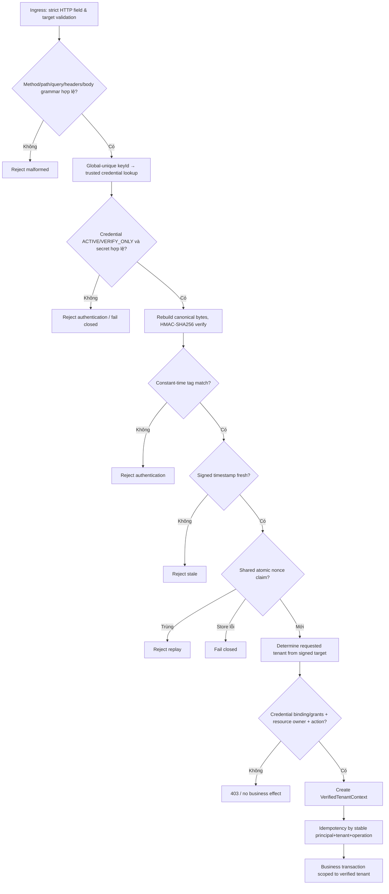
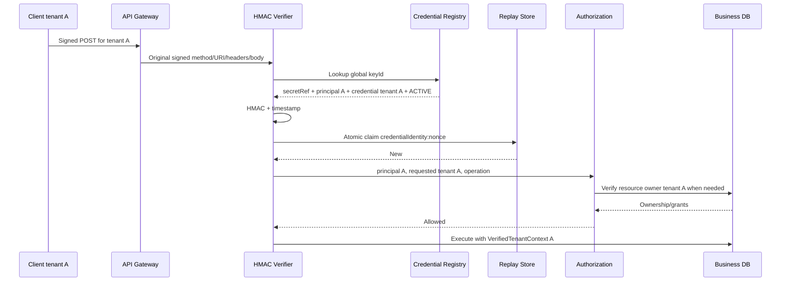
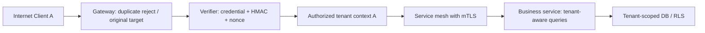

# Tenant trong authentication HMAC: ràng buộc danh tính, khóa ký và ranh giới dữ liệu đa khách hàng

> **Chương:** Multi-tenant  
> **Bài học:** Tenant trong authentication  
> **Module:** `SECURITY_AUTHENTICATION_HMAC_REQUEST_AUTHENTICATION` — xác thực HTTP request bằng HMAC với shared secret và canonical request bảo vệ method, URI, header hoặc body theo hợp đồng ký. Bài này tập trung vào **tenant identity ở bước authentication**: cách gắn credential với tenant, cách bảo vệ tenant trong signed request, chống nhầm danh tính/định tuyến xuyên tenant, xử lý replay/idempotency, key rotation, proxy/gateway và phân biệt xác thực với phân quyền.

## 1. Bài toán: cùng một API phục vụ nhiều tenant

Một dịch vụ thanh toán SaaS phục vụ hai merchant:

```text
Tenant merchant-a                      Tenant merchant-b
  principal service-a                    principal service-b
  keyId merchant-a-k1                    keyId merchant-b-k1
  shared secret K_A                      shared secret K_B
  payment/order data A                   payment/order data B
            \                                 /
             \                               /
              +-------- api.example.test ---+
```

Client của merchant A gửi:

```http
POST /v1/tenants/merchant-a/payments?orderId=42 HTTP/1.1
Host: api.example.test
Content-Type: application/json
X-Tenant-Id: merchant-a
X-Key-Id: merchant-a-k1
X-Timestamp: 1767225600
X-Nonce: 87a3d56ea72d40af89f5b68cb3e831d4
Idempotency-Key: order42-payment
X-Signature: v1=<BASE64URL_HMAC_SHA256_TAG>

{"amount":100000,"currency":"VND"}
```

Điều gì xảy ra nếu caller thay `merchant-a` bằng `merchant-b` trong path, header hoặc query? Nếu verifier chỉ kiểm `HMAC(K_A, body)` và backend dùng `X-Tenant-Id` làm tenant context, một client hợp lệ của tenant A có thể tạo/đọc dữ liệu tenant B — **cross-tenant authorization bypass** hay một dạng *confused deputy*.

Để tránh, hệ thống phải trả lời **ba câu khác nhau**:

1. **Ai đang chứng minh sở hữu secret?** Key ID tra tới một **credential** trong registry đáng tin; HMAC chứng minh possession của secret tương ứng.
2. **Request đang yêu cầu thao tác trong tenant nào?** Tenant đích được xác định từ route/authority/resource theo contract, được **ràng buộc vào HMAC signing input** để không bị sửa sau khi ký.
3. **Credential/principal đó có được thao tác trong tenant đích không?** Đây là **authorization**, phải kiểm bằng policy/membership/resource ownership tin cậy; không được suy từ tên tenant do caller tự khai.

**Bất biến:** Một signature đúng không tự động cho phép tác động đến bất kỳ tenant nào. Một tenant ID được ký cũng **không tự nó chứng minh** caller có quyền đối với tenant đó. Nó chỉ chứng minh người giữ secret **đã ký chính giá trị đó**.

### Kết quả học tập

Sau bài này, người học có thể:

- Phân biệt tenant, principal, credential, key ID, requested tenant và resource owner.
- Thiết kế mapping `keyId → authenticated credential → principal / tenant grants`.
- Ký method, authority, path, query, tenant header và body để chặn sửa target.
- Định nghĩa **tenant context** đáng tin qua gateway và backend.
- Chống duplicate headers, host rewrite, parser differential và tenant parameter spoofing.
- Cô lập replay store, idempotency store, quotas, secret lifecycle và authorization theo scope.
- Thiết kế mô hình single-tenant credential và multi-tenant principal, cùng ưu/nhược.
- Thực hành verifier Java 17+ có test tenant mismatch, replay, rotation, bad HMAC, revoked key và store outage.
- Tạo ma trận kiểm thử nhiều tenant/multi-region qua proxy/gateway và database.

## 2. Ngôn ngữ chung: tenant ≠ principal ≠ credential

| Thuật ngữ | Ý nghĩa | Ví dụ | Ai là nguồn tin cậy? |
| --- | --- | --- | --- |
| **Tenant** | Security/data boundary cho một tổ chức/khách hàng, thường có tài nguyên và chính sách riêng. | `merchant-a` | Tenant directory / authoritative control plane. |
| **Principal** | Thực thể đã được xác thực: service account, client application hoặc user. | `integration-123` | Credential registry sau HMAC thành công. |
| **Credential** | Một phương tiện chứng minh danh tính, gồm key ID, secret reference, lifecycle state, owner. | `cred-9f...` | Registry/secret manager có kiểm soát. |
| **Key ID** | Opaque selector do caller đưa để verifier tìm credential. | `merchant-a-k1` | Input **chưa tin cậy** cho lookup; không phải secret. |
| **Shared secret** | Bytes khóa dùng cho HMAC. | `K_A` | Phía client được cấp và server secret manager. |
| **Requested tenant** | Tenant mà HTTP request muốn thao tác. | `merchant-b` trong path/header. | **Untrusted claim** cho đến khi được ký và kiểm quyền. |
| **Tenant membership/grant** | Quan hệ cho phép principal thực hiện action/resource trong tenant. | `integration-123 → merchant-a:payments.write` | Authorization service/policy database. |
| **Resource owner** | Tenant thật của order/payment theo business database. | `order-42.tenantId=merchant-a` | Dữ liệu business authoritative, không chỉ query string. |
| **Verified tenant context** | Tenant đã được xác định và kiểm soát tại trust boundary. | `VerifiedContext(merchant-a, principal-A, ...)` | Kết quả **sau** authentication và authorization. |

### Ví dụ về bốn giá trị khác nhau

```text
Header X-Key-Id:         merchant-a-k1      // caller khai
Header X-Tenant-Id:      merchant-b         // caller khai
Path:                    /v1/tenants/merchant-b/payments
Registry key lookup:     principal=merchant-A, tenant=merchant-a
Business orderId=42:     owner=merchant-a
```

Ngay cả khi người giữ K_A chủ động ký request tới merchant-b, hệ thống vẫn phải **deny cross-tenant** vì credential/principal không có quyền với merchant-b. Không được để việc “đã xác minh HMAC” biến dữ liệu `X-Tenant-Id` thành một quyết định cấp quyền.

### Tenant authentication vs tenant authorization

Một số tài liệu gọi việc gán tenant cho principal là *tenant authentication*. Cụ thể hơn:

- **Authentication:** Xác minh key ID và possession của shared secret; trả về principal/credential ID đáng tin.
- **Tenant binding:** Kiểm tenant đích trong request khớp với credential scope hoặc grants, và bảo vệ tenant claim trong chữ ký.
- **Authorization:** Kiểm action/role/resource ownership với tenant đã chọn, bao gồm các policy có thể thay đổi sau khi cấp credential.

Trong mô hình **một credential chỉ thuộc một tenant**, mismatch tenant có thể bị từ chối rất sớm bằng policy. Trong mô hình **một principal có quyền nhiều tenant**, không thể chỉ so `requestedTenant == credential.tenant`; phải truy vấn **tenant grants** theo principal, action và resource.

## 3. Ba mô hình gán credential cho tenant

### 3.1. Mô hình A — Một credential cho một tenant (khuyến nghị dễ vận hành)

```text
cred-A1 → keyId=ka-1, principal=service-A, tenant=merchant-a
cred-B1 → keyId=kb-1, principal=service-B, tenant=merchant-b
```

Ưu điểm:

- Secret bị lộ chỉ ảnh hưởng **một tenant/credential scope** nếu authorization được thực thi đúng.
- Registry tra được principal và tenant cố định ngay sau HMAC.
- Replay namespace và rate limits có thể scope theo stable credential identity.
- Rotation/revoke theo tenant độc lập; audit dễ phân biệt.

Nhược điểm: Một integration phục vụ 100 tenants có thể phải quản lý nhiều credentials, provisioning và rotation nhiều hơn.

### 3.2. Mô hình B — Một principal có nhiều credentials, mỗi credential chỉ một tenant

```text
principal=integration-P
    cred-P-A → merchant-a, K_A
    cred-P-B → merchant-b, K_B
```

Có thể phù hợp cho partner/SaaS integration. Principal chung nhưng secret của A và B khác nhau. Khi `cred-P-A` bị lộ, chỉ credential A được thu hồi; có thể giữ credential B đang ACTIVE.

**Đừng dựa vào principal ID duy nhất** để chọn tenant khi principal đa tenant; phải dùng **credential binding và requested resource/grants**.

### 3.3. Mô hình C — Một credential được phép dùng cho nhiều tenants

```text
credential=partner-global-k1
principal=integration-P
allowedTenants={merchant-a, merchant-b}
```

Có thể có lý do kinh doanh để dùng credential này, nhưng blast radius lớn: ai có shared key có thể ký request cho bất kỳ tenant nào trong allowed scope. Cần:

- Authenticated principal và **grants động** cho từng tenant/action/resource.
- Tenant target nằm trong signed components, **không dùng unsigned X-Tenant-Id**.
- Revocation, auditing và rate limiting được thiết kế trên credential **và tenant**.
- Replay nonce namespace không chỉ dựa vào `requestedTenant`; một signing attempt phải có identity duy nhất dù caller đổi tenant.
- Dễ cắt quyền từng tenant mà không cần thu hồi toàn key, nếu grants đủ mạnh.

**Bài thực hành Java ở dưới chọn mô hình A**, giúp minh họa rõ việc ràng buộc credential với tenant. Khi mở rộng sang C, thay chính sách so tenant bằng authorized membership/grant, **không** bỏ ký tenant.

### Ma trận so sánh

| Mô hình | Key material | Blast radius khi secret lộ | Complexity | Quy tắc quyết định |
| --- | --- | --- | --- | --- |
| A: per-tenant credential | Mỗi tenant một key | Thường nhỏ nếu authz đúng | Thấp-vừa | Credential tenant phải khớp requested tenant. |
| B: partner nhiều per-tenant credentials | Mỗi tenant một key, chung principal có thể có | Cô lập theo từng key | Vừa | Dùng credential binding + tenant action policy. |
| C: credential đa tenant | Một key cho tập tenants | Toàn bộ grants của key | Cao | Verify HMAC → grants theo principal/tenant/action/resource. |

## 4. Chọn nguồn tenant cho request: path, host, header hay token?

Một API có thể biểu diễn tenant bằng nhiều nơi:

| Vị trí | Ví dụ | Rủi ro chính |
| --- | --- | --- |
| Path | `/v1/tenants/merchant-a/payments` | Proxy rewrite/percent-encoding/path confusion; resource owner phải được xác minh. |
| Host/subdomain | `merchant-a.api.example.test` | Host/`:authority` spoofing, reverse proxy mapping và custom domains. |
| Header | `X-Tenant-Id: merchant-a` | Caller dễ sửa nếu không ký; duplicate/normalization. |
| Query | `?tenant=merchant-a` | Parameter pollution, duplicate keys, percent-encoding. |
| JSON body | `{"tenantId":"merchant-a"}` | Business parser có thể đọc khác verifier; body phải được ký. |
| Registry/default tenant | `credential.tenantId` | Hợp lý cho key chỉ thuộc một tenant, nhưng không được bỏ qua target resource mismatch. |

**Không tự cho phép tất cả cùng lúc mà không có precedence rule.** Nếu path nói A, header nói B và body nói C, chọn “cái cuối” là cách tạo ambiguity.

### Hợp đồng của bài

Ví dụ `TENANT-HMAC-V1` yêu cầu:

```text
Path:              /v1/tenants/{tenant}/payments
X-Tenant-Id:       {tenant}
Credential scope:  record.tenantId = {tenant}
Authority:         api.example.test
```

Nếu **path tenant** và **header tenant** khác, request bị từ chối theo policy; nếu chúng giống nhau nhưng credential thuộc tenant khác, request bị từ chối sau khi xác thực. Body có thể chứa order/payment fields, nhưng không được làm override tenant context đã được xác minh.

Với resource tồn tại (ví dụ `GET /orders/{id}`), cần kiểm `order.ownerTenantId` trong database, không chỉ tin path `/tenants/A`.

## 5. Hợp đồng HMAC phải ký tenant target, không chỉ body

Thiết kế minh họa: 

```http
POST /v1/tenants/merchant-a/payments?orderId=42 HTTP/1.1
Host: api.example.test
Content-Type: application/json
X-Tenant-Id: merchant-a
X-Key-Id: merchant-a-k1
X-Timestamp: 1767225600
X-Nonce: 87a3d56ea72d40af89f5b68cb3e831d4
Idempotency-Key: order42-payment
X-Signature: v1=<BASE64URL_NO_PADDING_TAG>

{"amount":100000,"currency":"VND"}
```

**Đây là request fixture, tag chưa được tính**. Timestamp/nonce cố định để minh họa và không dùng lại trong production.

### 5.1. Byte-level canonical request

Với chính xác raw body ở ví dụ, signing input của bài có các dòng sau, nối bằng LF `\n` và **không có newline cuối**:

```text
POST
api.example.test
/v1/tenants/merchant-a/payments
orderId=42
content-type:application/json
idempotency-key:order42-payment
x-key-id:merchant-a-k1
x-nonce:87a3d56ea72d40af89f5b68cb3e831d4
x-tenant-id:merchant-a
x-timestamp:1767225600
content-type;idempotency-key;x-key-id;x-nonce;x-tenant-id;x-timestamp
<SHA256_HEX_OF_EXACT_RAW_BODY_BYTES>
```

```text
bytesToSign =
    UTF8("HMAC-SHA256/TENANT-HMAC-V1\n" + canonicalRequest)

rawTag =
    HMAC-SHA256(secretForExactlySelectedKeyId, bytesToSign)

X-Signature =
    "v1=" + Base64URLNoPadding(rawTag)
```

Full HMAC-SHA256 output 32 byte được Base64URL không padding thành **43 ký tự**, nên toàn `X-Signature` value dài 46 ký tự gồm `v1=`.

Trong hợp đồng này:

- Method, authority, **path chứa tenant**, query, **X-Tenant-Id**, key ID, nonce, timestamp, idempotency key và body digest đều có mặt trong signature.
- `signedHeaders` là danh sách cố định, không cho client bỏ tùy ý `x-tenant-id` hoặc `x-nonce`.
- HMAC tag không ký chính nó.
- Raw body hash dùng SHA-256 hex lowercase trên **chính bytes nhận được**, không dùng object sau khi parse/serialize lại.
- URI/query fixture có định dạng cố định để tránh mơ hồ; production cần canonicalizer cho percent-encoding, duplicate keys và path normalization.
- Mỗi security header là **đúng một field**, reject duplicate kể cả tên khác case trước framework coalesce.
- Không “chuẩn hóa” tenant bằng cách silent lowercase/trim Unicode khác nhau ở các tầng; grammar của ví dụ chỉ chấp nhận ASCII lowercase slug.

### 5.2. Vì sao ký tenant hai lần (trong path và header)?

Đây là một **chủ ý giao thức của ví dụ**, không bắt buộc cho mọi thiết kế. Path tenant phục vụ routing/resource; header giúp middleware truyền tenant intent tường minh. Việc ký **cả hai** và yêu cầu chúng bằng nhau làm:

- Proxy không thể thay một trong hai mà không làm HMAC sai.
- Verifier không thể chọn tenant A trong khi business layer chọn tenant B dựa trên một field khác.
- Cross-language clients có dữ liệu rõ để đối chiếu.

Mặt trái là thêm một trường có thể gây mismatch nếu gateway tự thêm/sửa. Một API production có thể **chỉ dùng path tenant**, miễn là mọi lớp tin cùng nguồn và HMAC bảo vệ đúng target. Không nên thêm field dư rồi xử lý bằng precedence mơ hồ.

### 5.3. Tenant header không được trở thành một “admin override”

**Sai:**

```java
String tenant = request.getHeader("X-Tenant-Id");
database.setTenant(tenant);
paymentService.createPayment(requestBody);
```

Code trên **không xác minh** tenant header được HMAC ký, có khớp path/resource hay có được principal cấp quyền không.

**Đúng về nguyên tắc:**

```text
trustedCredential = verifyHmacAndRegistry(request)
requestedTenant   = validateSignedTenantAgainstTarget(request)
verifiedTenant    = authorizeTenantBinding(
                      trustedCredential.principal,
                      requestedTenant,
                      operation,
                      resourceOwner
                    )
businessService.execute(VerifiedContext(...))
```

Chỉ một `VerifiedContext` được tạo bởi lớp tin cậy mới có quyền đặt tenant context cho downstream.

## 6. Threat model đa tenant: attacker có những quyền gì?

### 6.1. Client A hợp lệ nhưng tò mò về tenant B

Attacker **biết K_A** vì là client thật của A. Họ có thể tự ký bất kỳ canonical request nào bằng K_A, bao gồm request tự khai tenant B. Không thể coi “HMAC hợp lệ” là lớp chống tenant traversal.

```text
Attacker K_A:
  signs path=/v1/tenants/merchant-b/payments
  signs X-Tenant-Id=merchant-b
  HMAC(K_A, bytesToSign) matches
  registry(keyId=A-k1) -> tenant=merchant-a
  policy -> FORBIDDEN, no business effect
```

**Phải có tenant binding/authorization check sau khi HMAC đúng**.

### 6.2. Proxy/middleware thay tenant sau khi ký

Nếu gateway rewrite path từ A sang B, HMAC ở downstream sẽ fail **nếu verify trên target đúng như contract**. Nhưng nếu gateway verify trước rewrite rồi backend lại lấy tenant từ một `X-Tenant-Id` không đáng tin, có thể xảy ra **split-trust**.

Kiểm soát:

- Chọn **một trust boundary** xác định canonical request và tenant target.
- Gateway có thể verify và chuyển **verified tenant context** qua kênh nội bộ được bảo vệ (mTLS/service identity, strip untrusted headers).
- Backend không cho raw client `X-Tenant-Id` override tenant đã xác minh.
- Nếu backend verify HMAC, phải có original target đáng tin hoặc không rewrite covered components trước verify.

### 6.3. Hai tenants dùng cùng key ID

```text
tenant A: keyId = integration-k1
tenant B: keyId = integration-k1
```

Nếu registry lookup chỉ theo `keyId` và cho phép trùng, server có thể chọn secret hoặc principal không đúng. Hai thiết kế an toàn có thể chọn:

1. **Global-unique opaque key ID**: một `keyId` ánh xạ duy nhất tới credential record; đơn giản nhất cho public HMAC API.
2. **Composite key lookup** `(trustedTenantScope, keyId)`: chỉ khi tenant scope đã được xác lập đủ tin cậy và thiết kế routing/authorization không tạo vòng phụ thuộc. Cần tránh lấy raw unsigned tenant header làm selector có thể định tuyến tùy ý đến secrets của tenant khác.

**Demo chọn key ID global-unique**, còn `tenantId` nằm trong record do registry trả về.

### 6.4. Tenant slug và Unicode/normalization

Các chuỗi như `Merchant-A`, `merchant-a`, ký tự Unicode giống chữ Latin, percent-encoded path hoặc trailing spaces có thể được router, proxy và application diễn giải khác nhau.

Trong ví dụ:

```text
tenantSlug = [a-z0-9](?:[a-z0-9-]{0,30}[a-z0-9])?
```

Đây là grammar **ASCII lowercase**, tối đa 32 ký tự, không dấu gạch ngang ở đầu/cuối. Một tenant có display name Unicode vẫn có thể có **opaque stable tenant ID** riêng; không dùng display name làm khóa bảo mật khi normalization giữa tầng khác nhau.

### 6.5. Tham số tenant bị lặp

```http
X-Tenant-Id: merchant-a
x-tenant-id: merchant-b
```

Tên field HTTP không phân biệt case, nên đây là **hai occurrences của một field**. Nếu gateway chọn first và backend chọn last, hai tầng có thể xác minh/ghi dữ liệu trong hai tenants khác nhau. Từ chối ngay tại ingress **trước khi** framework gộp.

### 6.6. Thay tenant qua body

Nếu request body chứa `"tenantId":"merchant-b"` nhưng path/header tenant A, API phải có policy:

- Reject body tenant nếu field không được contract cho phép, hoặc
- Kiểm field body trùng **verified tenant**, nếu schema cần giữ field đó.

Một JSON parser có thể đọc duplicate keys khác nhau:

```json
{"tenantId":"merchant-a","tenantId":"merchant-b"}
```

Không dùng JSON body parser không thống nhất với verifier/authorization để quyết định tenant. Reject duplicate schema keys nếu semantics/contract không quy định rõ, và ký đúng raw bytes.

## 7. Credential registry: nguồn sự thật của tenant và principal

Mô hình table logic:

| credentialId | keyId | principalId | tenantId | secretRef | state | revision |
| --- | --- | --- | --- | --- | --- | --- |
| `cred-A-1` | `merchant-a-k1` | `service-A` | `merchant-a` | `kv/.../merchant-a-k1` | ACTIVE | 7 |
| `cred-A-2` | `merchant-a-k2` | `service-A` | `merchant-a` | `kv/.../merchant-a-k2` | PREPARED | 1 |
| `cred-B-1` | `merchant-b-k1` | `service-B` | `merchant-b` | `kv/.../merchant-b-k1` | ACTIVE | 4 |

**Quan trọng:**

- Header `X-Key-Id` là **untrusted selector**. Verifier chỉ lookup bằng grammar giới hạn, không coi chuỗi tên khóa chứng minh tenant.
- Principal/tenant binding, key state và secretRef đến từ **control plane** có phân quyền.
- Không nối raw keyId/tenant header thành Vault path. Registry phải trỏ tới path đã được provisioning, theo least privilege.
- Mỗi key ID đại diện đúng **một** secret version/credential. Không thử secrets của tenant khác khi HMAC mismatch.
- Khi rotate k1→k2 trong tenant A, principal/tenant binding có thể giữ nguyên, nhưng **credential identity** mới.
- REVOKED state phải chặn requests mới ngay cả khi secret trong Vault/cache vẫn còn.

### PostgreSQL schema minh họa

```sql
CREATE TABLE hmac_credentials (
    credential_id VARCHAR(128) PRIMARY KEY,
    key_id VARCHAR(128) NOT NULL UNIQUE,
    principal_id VARCHAR(128) NOT NULL,
    tenant_id VARCHAR(128) NOT NULL,
    secret_ref VARCHAR(512) NOT NULL,
    state VARCHAR(32) NOT NULL,
    revision BIGINT NOT NULL DEFAULT 0,
    created_at TIMESTAMPTZ NOT NULL DEFAULT clock_timestamp(),

    CONSTRAINT ck_hmac_credential_state CHECK (
        state IN ('PREPARED','ACTIVE','VERIFY_ONLY','REVOKED')
    )
);

CREATE INDEX idx_hmac_credential_tenant
    ON hmac_credentials (tenant_id, state);
```

Sự tồn tại của `tenant_id` trong registry **không** loại bỏ authorization theo resource/operation. Khi credential của tenant A bị cấp sai quyền cross-tenant, HMAC vẫn đúng; application phải kiểm grants, ownership và resource scope riêng.

### Policy cho multi-tenant principal

Một bảng grants độc lập:

```sql
CREATE TABLE principal_tenant_grants (
    principal_id VARCHAR(128) NOT NULL,
    tenant_id VARCHAR(128) NOT NULL,
    action VARCHAR(128) NOT NULL,
    permitted BOOLEAN NOT NULL,
    revision BIGINT NOT NULL DEFAULT 0,
    PRIMARY KEY (principal_id, tenant_id, action)
);
```

Ví dụ principal có thể có quyền `payments.read` trên tenant A nhưng không có `payments.write`; grant phải được kiểm theo **operation thực nhận và tài nguyên thực**, không theo client-chosen scope tự do.

## 8. Pipeline verifier an toàn trong hệ thống multi-tenant



**Thứ tự có thể thay đổi chút theo policy:** Có hệ thống kiểm tenant membership sau HMAC nhưng trước nonce claim để tránh tiêu thụ nonce cho request đã xác thực nhưng bị cấm; điều quan trọng là **không có request chưa vượt đủ các lớp** được chạy nghiệp vụ, không check idempotency cache để bypass authentication/authorization và không claim nonce trước HMAC hợp lệ.

### 8.1. Sơ đồ trách nhiệm qua các service



Nếu path tenant B nhưng credential tenant A, HMAC có thể **vẫn đúng** nếu client A tự ký cho B. Đó là lý do kết quả `FORBIDDEN` là một policy decision sau authentication, không phải “HMAC bị hỏng”.

## 9. Tenant context: đối tượng đáng tin thay vì một String từ header

Anti-pattern thường gặp:

```java
String tenant = request.getHeader("X-Tenant-Id");
TenantContext.setTenant(tenant);
try {
    return paymentService.create(...);
} finally {
    TenantContext.clear();
}
```

Dù `finally` giúp tránh rò `ThreadLocal` qua request tiếp theo, **tenant context đã được tạo từ untrusted header**. Nếu middleware chỉ dùng `tenant` để chọn DB schema, caller A có thể định tuyến vào schema B.

### Thiết kế đúng về trách nhiệm

```java
record VerifiedTenantContext(
        String principalId,
        String credentialId,
        String tenantId,
        String action,
        long credentialRevision) {}

VerifiedTenantContext verifyAndAuthorize(
        IncomingHttpRequest rawRequest) {
    // 1. Strict parsing from authenticated trust boundary.
    // 2. HMAC/freshness/nonce checks.
    // 3. Tenant binding, grants and resource owner checks.
    // 4. Return immutable context; NEVER caller-supplied context.
    throw new UnsupportedOperationException("Contract sketch");
}
```

Đây là **interface sketch**, không phải code chạy độc lập. Point là construction của `VerifiedTenantContext` chỉ nằm sau security checks. Trong implementation thật có thể dùng constructor/private factory/package boundary và internal identity attestation để ngăn caller tự dựng context.

### Thread-local và async

Nếu framework dùng `ThreadLocal` cho tenant context:

- Luôn clear trong `finally`.
- Không truyền implicit thread-local qua async thread pools mà không có context propagation an toàn.
- Không coi MDC logging field là authorization context.
- Với reactive pipelines, dùng framework request context/coroutine context có quy tắc riêng.
- Đừng lấy tenant từ global mutable singleton “currentTenant”; concurrency sẽ gây cross-request leakage.

### Trusted header giữa gateway và backend

```http
X-Verified-Tenant: merchant-a
X-Verified-Principal: service-A
```

Hai header này chỉ có ý nghĩa khi **gateway được tin cậy và backend không bị client gọi trực tiếp**. Gateway phải strip các header trùng tên từ Internet, set lại sau khi verify, bảo vệ kênh bằng mTLS/service identity hoặc signed internal assertion có audience/expiry/nonce phù hợp. Backend **không được** tin client-supplied fields giống như trusted internal identity.

## 10. Authorization: ràng buộc tenant đến tận business resource

Giả sử merchant A biết order ID của merchant B: `orderId=42`. Cùng một numeric ID có thể tồn tại ở nhiều tenants. Câu SQL sau rất nguy hiểm:

```sql
-- SAI nếu order IDs không được bảo vệ/tra theo tenant.
SELECT * FROM orders WHERE order_id = :orderId;
```

Nên đưa tenant đã verified vào predicate:

```sql
SELECT order_id, tenant_id, status
FROM orders
WHERE tenant_id = :verifiedTenant
  AND order_id = :orderId;
```

Với thay đổi trạng thái:

```sql
UPDATE payments
SET status = 'CAPTURED'
WHERE tenant_id = :verifiedTenant
  AND payment_id = :paymentId
  AND status = 'AUTHORIZED';
```

Đừng tra bản ghi theo ID rồi kiểm tenant quá muộn nếu trong lúc đó đã chạy side effect, emit event hoặc log dữ liệu cho caller.

### 10.1. PostgreSQL Row-Level Security (RLS)

RLS có thể là **defense in depth**:

```sql
ALTER TABLE payments ENABLE ROW LEVEL SECURITY;
ALTER TABLE payments FORCE ROW LEVEL SECURITY;

CREATE POLICY payments_tenant_isolation
ON payments
USING (
    tenant_id = current_setting('app.tenant_id', true)
)
WITH CHECK (
    tenant_id = current_setting('app.tenant_id', true)
);
```

**Nhưng** RLS không thay authentication/authorization:

- `app.tenant_id` chỉ được set từ **VerifiedTenantContext** sau khi đã authorize.
- Với connection pool, dùng `SET LOCAL` **trong transaction** và cleanup đúng, tránh tenant A còn trong connection của tenant B.
- Database roles/table owner/superuser/BYPASSRLS/security-definer có quy tắc riêng; phải cấu hình và test thực tế.
- Nếu attacker có SQL injection hoặc quyền `SET` runtime config, RLS dùng custom setting không nên được xem là kiểm soát duy nhất.
- Resource owner và action grants vẫn phải kiểm độc lập.
- Một service-to-service call phải truyền authenticated tenant context qua kênh đáng tin, không tự mở RLS bằng raw header.

### 10.2. Shared table, schema-per-tenant, database-per-tenant

| Mô hình lưu trữ | Cách cô lập | Rủi ro authn/authz quan trọng |
| --- | --- | --- |
| Shared tables + `tenant_id` | Predicates/RLS, indices composite. | Thiếu tenant predicate gây rò dữ liệu; policy phải bắt buộc. |
| Schema per tenant | Select schema/search path theo verified tenant. | Schema name từ raw header, connection pool search_path leak. |
| DB per tenant | Connection routing từ verified tenant. | Chọn DB theo untrusted tenant header, registry routing lỗi, credential reuse. |

**HMAC không thay database isolation**; một request có signature đúng có thể dẫn tới truy vấn sai tenant nếu business layer mất verified context.

## 11. Replay database và namespace trong multi-tenant

Replay protection chặn request đã ký bị gửi lại **nguyên signing attempt**. Ví dụ signed timestamp và 128-bit nonce:

```http
X-Timestamp: 1767225600
X-Nonce: 87a3d56ea72d40af89f5b68cb3e831d4
```

Server chấp nhận freshness:

\[
N-P \le T \le N+F
\]

Trong đó `N` là server time, `P` past window, `F` future window. Một nonce đã claim cần giữ đến ít nhất:

\[
\mathrm{expiresAt} = T + P + \mathrm{margin}
\]

### 11.1. Khóa replay store đề xuất

```text
replayKey = (stableCredentialIdentity, nonce)
```

Ví dụ:

```text
(cred-A-1, N1) = already claimed
(cred-B-1, N1) = different credential / independent nonce domain
```

Trong mô hình mỗi credential thuộc một tenant, stable credential identity có thể đã ngầm ràng buộc tenant. Nếu credential **multi-tenant**, không nên chỉ dùng `(requestedTenant, nonce)`: một attempt có thể được ký lại/sửa target trong các tình huống khác; namespace theo credential identity bảo vệ giả định **nonce dùng một lần cho credential**.

Có thể bổ sung issuer/environment/domain separator vào replay key, nhưng phải chốt **scope thống nhất trong mọi verifier/gateway**. Nếu hai regions có replay stores không phối hợp, cùng request có thể được claim hai lần.

### 11.2. Không dùng raw key ID hoặc tenant tự khai làm toàn bộ trust boundary

```text
BAD:
  nonceKey = request.header("X-Tenant-Id") + ":" + nonce
  -> untrusted namespace selector, có thể bị đổi nếu không ký.

BETTER:
  nonceKey = credential.immutableId + ":" + nonce
  -> identity từ registry sau HMAC verification.
```

**Nhưng:** Bản thân replay key có nguồn gốc đáng tin không loại bỏ tenant authorization hoặc requirement tenant được ký.

### 11.3. Replay store lỗi có được chạy business không?

Không. Khi endpoint bắt buộc anti-replay, lỗi timeout/unavailable/ambiguous claim phải **fail closed**. Không fallback qua per-pod `ConcurrentHashMap` nếu app có nhiều instances hoặc regions.

## 12. Idempotency trong multi-tenant: cùng key, khác tenant

Idempotency-Key bảo vệ **business intent** qua retries. Giả sử:

```text
Tenant A / order 42:
  Idempotency-Key = order42-payment

Tenant B / order 42:
  Idempotency-Key = order42-payment
```

Hai strings giống nhau nhưng là **hai ý định nghiệp vụ độc lập**. Nếu chỉ key global theo `Idempotency-Key`, tenant A có thể va chạm record của tenant B, gây từ chối hoặc rò cached response.

**Scope đề xuất:**

```text
(principalId, verifiedTenantId, logicalOperation, idempotencyKey)
```

Kèm business fingerprint bao gồm tenant, operation, path/query/body/chính các tham số ảnh hưởng nghiệp vụ. Một attempt mới cùng business intent có **timestamp, nonce, signature mới**, nhưng **giữ Idempotency-Key**.

| Tình huống | Hành vi đúng |
| --- | --- |
| Tenant A lần đầu POST `order42-payment`. | Atomic reserve owner cho A. |
| A retry nonce mới, HMAC đúng, cùng body. | Return A outcome; không tạo payment hai lần. |
| B dùng cùng raw idempotency key trên order riêng. | Namespace B độc lập; không thấy response A. |
| A gửi cùng key nhưng khác amount. | Fingerprint conflict; không tạo effect mới. |
| A rotate credential k1→k2, cùng stable principal và tenant. | Cùng idempotency record; không tạo payment khác. |
| Caller B chưa authenticated biết idempotency key A. | Không lookup/trả cache response; authn/authz trước. |
| Store unavailable, không thể reserve atomically. | Fail closed, không “cứ xử lý rồi cache sau”. |

### Database uniqueness

```sql
CREATE TABLE tenant_idempotency (
    principal_id VARCHAR(128) NOT NULL,
    tenant_id VARCHAR(128) NOT NULL,
    operation_id VARCHAR(128) NOT NULL,
    idempotency_key VARCHAR(128) NOT NULL,
    fingerprint_sha256 CHAR(64) NOT NULL,
    state VARCHAR(32) NOT NULL,
    business_ref VARCHAR(128),
    created_at TIMESTAMPTZ NOT NULL DEFAULT clock_timestamp(),
    PRIMARY KEY (
        principal_id, tenant_id, operation_id, idempotency_key
    )
);
```

Unique constraint và atomic reservation phải có **trước** side effect. Nếu payment DB và idempotency store ở transaction khác, còn cần recovery/reconciliation (external PSP key, outbox/unique business constraint) để tránh duplicate khi crash giữa commit và response persistence. **HMAC + replay + idempotency không tự cung cấp distributed exactly-once.**

## 13. Key rotation, credential deletion và tenant isolation

Giả sử tenant A có:

```text
merchant-a-k1 -> principal A, tenant A, K_A1, state VERIFY_ONLY
merchant-a-k2 -> principal A, tenant A, K_A2, state ACTIVE
merchant-b-k1 -> principal B, tenant B, K_B1, state ACTIVE
```

Khi K_A1 bị nghi lộ:

- Revoke `merchant-a-k1` trong registry và phân phối trạng thái tới mọi verifier.
- Không revoke `merchant-b-k1` nếu không có bằng chứng liên quan.
- Không cho K_A1 verify nữa dù Vault/cache vẫn chứa material.
- Client A ký bằng K_A2 với timestamp/nonce/HMAC tag mới.
- Replay store giữ nonce của K_A1 đến expiry theo freshness; không xóa sớm.
- Idempotency history của A **không** được xóa vì key ID đổi: payment đã tạo dưới k1 vẫn phải nhận ra khi retry dưới k2.
- Khi k1 bị purge, giữ tombstone/non-reuse key ID và audit phù hợp.

### Tenant reassignment có nguy hiểm không?

Một credential `cred-A-1` ban đầu gắn tenant A. Nếu admin sửa trực tiếp `tenant_id=A → B` mà giữ cùng shared secret, người đã được cấp K_A có thể bất ngờ được quyền ký request tenant B. Đây là **permission escalation qua credential migration**.

**Chính sách khuyến nghị:** Coi tenant binding của credential là **bất biến**, hoặc thực hiện quy trình reissue/reprovision credential mới với secret mới và authorization approval rõ. Không “move tenant” chỉ bằng một SQL UPDATE khi principal/grants thay đổi.

### Key ID trùng sau deletion

Không tái cấp một key ID đã dùng cho tenant khác nếu registry thiết kế global-unique. Tombstone giúp ngăn resurrection, audit confusion và cached lookup nhầm principal.

## 14. Proxy/gateway, service mesh và tenant context



Một proxy có thể:

- Rewrite `/public/tenants/A/...` thành `/internal/...`.
- Sửa `Host`/`:authority` trong HTTP/1.1↔HTTP/2.
- Thêm `X-Forwarded-Host`, `X-Original-URI`, `X-Tenant-Id`.
- Thay `Content-Type`, giải nén body hoặc serialize lại JSON.
- Coalesce duplicate headers trước khi backend nhìn thấy.

**Không ký raw HTTP framing**, nhưng phải ràng buộc semantic components đã thỏa thuận vào HMAC. Nếu gateway verify trước rewrite, backend chỉ được dựa vào **verified context qua trust channel**; nếu backend verify sau rewrite, phải có original signed target đáng tin.

### Hai mẫu triển khai

**Mẫu 1 — Gateway là verifier duy nhất:**

```text
Internet request
  → Gateway validates exact fields and HMAC
  → Gateway claims nonce atomically
  → Gateway authorizes tenant binding or securely asserts principal+target
  → Backend validates trusted assertion + business authorization
  → DB access scoped to verified tenant
```

Gateway phải strip các internal identity headers do Internet gửi, và backend phải ngăn đường truy cập trực tiếp bypass gateway.

**Mẫu 2 — Service tự verify:**

```text
Internet request
  → Gateway preserves signed target/headers/body
  → Service validates HMAC+timestamp+nonce
  → Service resolves requested tenant and authorization
  → Business uses verified context
```

Không cho gateway claim nonce rồi service **claim lại như request mới**, vì request hợp lệ sẽ bị từ chối giả. Nếu có nhiều điểm xác minh, định nghĩa delegation và claim ownership rõ.

### Custom domains

Tenant A có thể sở hữu `a.customer.example` còn tenant B có `b.customer.example`. Với hostname dùng làm tenant selector:

- Map **hostname đã xác minh** đến tenant bằng registry/domain ownership đáng tin.
- Kiểm TLS/SNI/Host/`:authority` consistency theo trust model, không suy tenant chỉ từ `X-Forwarded-Host` Internet-supplied.
- Canonical HMAC phải ràng buộc authority/tenant target và chống host confusion.
- Không cho DNS/certificate/custom domain remapping tự cấp lại quyền của credential A trên tenant B.

## 15. Khi lỗi: tenant mismatch là 401 hay 403?

Không có một mapping HTTP status tuyệt đối cho mọi API; contract phải phân biệt security outcomes.

| Tình huống | Kết quả nội bộ | Response tham khảo |
| --- | --- | --- |
| Request malformed, duplicate `X-Tenant-Id`, tenant slug sai. | `BAD_REQUEST`. | 400 hoặc 4xx phù hợp. |
| Không có key ID/secret đúng, tag sai, key revoked. | `UNAUTHENTICATED`. | 401 theo scheme contract. |
| Chữ ký đúng, requested tenant khác tenant mà credential được cấp. | `FORBIDDEN` hoặc masked not-found. | 403/404 theo privacy policy, không tạo side effect. |
| Chữ ký đúng, tenant đúng nhưng principal thiếu `payments.write`. | `FORBIDDEN`. | 403. |
| Path tenant và signed header tenant khác nhau. | `TENANT_CONFLICT` / malformed policy. | 400/409, không thực thi. |
| Authenticated đúng tenant nhưng resource thuộc tenant khác. | `FORBIDDEN` hoặc not-found masking. | 403/404, không tiết lộ resource. |
| Timestamp hết hạn. | `STALE`. | Authentication/freshness error. |
| Nonce đã dùng. | `REPLAY`. | Reject, không duplicate side effect. |
| Credential/nonce registry unavailable. | `UNAVAILABLE`. | 503, fail closed. |
| Idempotency key conflict. | `IDEMPOTENCY_CONFLICT`. | 409 theo API contract. |

**Không xây error oracle:** Caller tenant A không nên phân biệt được rõ “tenant B tồn tại và có payment 42” với “tenant B không tồn tại” nếu policy không cho phép. Có thể dùng generic errors bên ngoài, logs nội bộ có phân loại để chẩn đoán.

## 16. Quan sát, quota và abuse prevention trong multi-tenant

Các metrics hữu ích:

| Metric | Điều cần phát hiện |
| --- | --- |
| `hmac_auth_success_total` | Tổng số request có HMAC đúng theo credential class. |
| `credential_tenant_mismatch_total` | Credential A ký đúng nhưng yêu cầu tenant B. |
| `tenant_header_path_mismatch_total` | Header/path không nhất quán. |
| `hmac_invalid_signature_total` | Wrong key/transport/canonicalization bugs. |
| `tenant_authorization_denied_total` | Principal thiếu quyền action/resource. |
| `tenant_replay_rejected_total` | Nonce lặp theo stable credential identity. |
| `tenant_idempotency_replayed_total` | Retry same business intent trong cùng tenant. |
| `credential_lookup_unavailable_total` | Registry/secret manager unavailable. |
| `tenant_context_missing_total` | Downstream request không có verified tenant context. |
| `tenant_context_leak_suspected_total` | Async/thread-local/connection-pool tenant leakage. |
| `tenant_key_rotation_lag_seconds` | Client/server còn dùng state cũ trong rotation. |
| `tenant_rate_limited_total` | Một tenant/client gây tải vượt budget. |

### Rate limit theo nguồn đáng tin

Trước authentication, chỉ có các tín hiệu **untrusted** như IP, malformed key ID, claimed tenant; có thể rate limit theo ingress/IP/anonymous buckets để giảm abuse.

Sau khi HMAC và tenant binding đạt, áp rate limits theo `principal/credential/verifiedTenantId`. **Không** để attacker khai `X-Tenant-Id=merchant-b` khiến quota của tenant B bị trừ trước khi xác minh — đó là **quota exhaustion cross-tenant**.

### Logging

- Không log shared secret, Vault token, full HMAC signature hoặc request body nhạy cảm.
- Key ID có thể dùng trong audit hạn chế, tránh làm label high cardinality/khai thác enumeration.
- Log verified principal/tenant **chỉ sau** authentication; phân biệt với claimed tenant input.
- Include correlation ID, credential revision, authn/tenant binding/authz/replay decision, gateway route.
- Không đưa raw tenant header vào mọi log như thể nó là danh tính đã xác thực.

---

## 17. Java 17+: mô phỏng tenant binding trong verifier HMAC

Ví dụ sau có thể chạy offline với **JDK 17+**, chỉ dùng standard library. Nó tách rõ:

1. `X-Key-Id` là selector tới một credential global-unique trong trusted registry.
2. Credential ánh xạ tới `credentialId`, `principalId`, `tenantId`, shared key và state.
3. HMAC ký **path tenant** và `X-Tenant-Id`; payload/metadata khác cũng nằm trong canonical input.
4. Verifier kiểm đúng tag, timestamp và nonce, sau đó đối chiếu **signed tenant intent** với credential tenant binding.
5. Chỉ khi tất cả pass, verifier tạo `VerifiedTenantContext` để business dùng.
6. Replay key theo **stable credential identity**, không theo raw tenant header.
7. Idempotency scope minh họa khác nhau cho A/B nhưng không đổi khi rotate K1→K2 trong A.
8. Credential bị thu hồi, lỗi registry/replay store đều **fail closed**.
9. Dùng concurrency test bảo đảm hai attempts **cùng nonce của một credential** chỉ có một request được chấp nhận trong một JVM.

### 17.1. Phạm vi của code

Chương trình **không phải HTTP server**. Class `Request` giả lập những trường đã được HTTP adapter lấy từ wire, và method/authority/query/Content-Type cố định để tránh nhầm với một canonicalizer tổng quát. Trong production:

- Adapter phải cung cấp đầy đủ header occurrences để reject duplicate trước khi merge.
- Path/raw query phải tuân theo URI canonicalization policy chuẩn hóa rõ.
- Credential/nonce stores phải dùng database/store **chia sẻ, bền vững và đủ consistency**.
- Bước `TenantPolicy` phải tra grants, action và **business resource owner** thực sự.
- Không chuyển `VerifiedTenantContext` xuống backend bằng một header Internet caller có thể tự đặt.
- Idempotency phải atomic với workflow và recovery/transaction thật; code chỉ minh họa scope.
- Test keys/epoch timestamps/nonce ở đây chỉ phục vụ test, tuyệt đối không dùng production.

### 17.2. Mã Java hoàn chỉnh

```java
import java.nio.charset.StandardCharsets;
import java.security.GeneralSecurityException;
import java.security.MessageDigest;
import java.time.Clock;
import java.time.Instant;
import java.time.ZoneOffset;
import java.util.ArrayList;
import java.util.Base64;
import java.util.HexFormat;
import java.util.List;
import java.util.Map;
import java.util.Objects;
import java.util.concurrent.Callable;
import java.util.concurrent.ConcurrentHashMap;
import java.util.concurrent.CountDownLatch;
import java.util.concurrent.ExecutorService;
import java.util.concurrent.Executors;
import java.util.concurrent.Future;
import java.util.concurrent.TimeUnit;
import java.util.concurrent.atomic.AtomicBoolean;
import java.util.regex.Matcher;
import java.util.regex.Pattern;
import javax.crypto.Mac;
import javax.crypto.spec.SecretKeySpec;

public final class MultiTenantHmacDemo {
    private static final HexFormat HEX = HexFormat.of();
    private static final long PAST = 300L;
    private static final long FUTURE = 300L;
    private static final long NONCE_MARGIN = 60L;
    private static final String PREFIX =
            "HMAC-SHA256/TENANT-HMAC-V1\n";
    private static final String SIGNED_NAMES =
            "content-type;idempotency-key;x-key-id;"
            + "x-nonce;x-tenant-id;x-timestamp";
    private static final String TENANT_SLUG =
            "[a-z0-9](?:[a-z0-9-]{0,30}[a-z0-9])?";
    private static final Pattern TENANT_PATH =
            Pattern.compile(
                "^/v1/tenants/(" + TENANT_SLUG + ")/payments$");

    private MultiTenantHmacDemo() {}

    enum State { ACTIVE, VERIFY_ONLY, REVOKED }

    enum Decision {
        ACCEPT, BAD_REQUEST, UNAUTHENTICATED, STALE,
        REPLAY, FORBIDDEN, UNAVAILABLE
    }

    // Global-unique key ID -> exactly one trusted credential.
    record Credential(
            String credentialId,
            String keyId,
            String principalId,
            String tenantId,
            byte[] secret,
            State state) {
        Credential {
            Objects.requireNonNull(credentialId);
            Objects.requireNonNull(keyId);
            Objects.requireNonNull(principalId);
            Objects.requireNonNull(tenantId);
            Objects.requireNonNull(secret);
            Objects.requireNonNull(state);
            secret = secret.clone();
        }

        @Override
        public byte[] secret() {
            return secret.clone();
        }
    }

    interface CredentialRegistry {
        Credential get(String keyId);
    }

    static final class InMemoryRegistry
            implements CredentialRegistry {
        private final ConcurrentHashMap<String, Credential> rows =
                new ConcurrentHashMap<>();
        volatile boolean unavailable;

        void put(Credential credential) {
            rows.put(credential.keyId(), credential);
        }

        @Override
        public Credential get(String keyId) {
            if (unavailable) {
                throw new IllegalStateException(
                    "Credential registry unavailable");
            }
            return rows.get(keyId);
        }
    }

    // Model của HTTP adapter sau khi đã reject duplicate headers.
    record Request(
            String method,
            String authority,
            String rawPath,
            String rawQuery,
            String contentType,
            String tenantHeader,
            String keyId,
            String timestamp,
            String nonce,
            String idempotencyKey,
            byte[] rawBody,
            String signature) {
        Request {
            Objects.requireNonNull(method);
            Objects.requireNonNull(authority);
            Objects.requireNonNull(rawPath);
            Objects.requireNonNull(rawQuery);
            Objects.requireNonNull(contentType);
            Objects.requireNonNull(tenantHeader);
            Objects.requireNonNull(keyId);
            Objects.requireNonNull(timestamp);
            Objects.requireNonNull(nonce);
            Objects.requireNonNull(idempotencyKey);
            Objects.requireNonNull(rawBody);
            Objects.requireNonNull(signature);
            rawBody = rawBody.clone();
        }

        @Override
        public byte[] rawBody() {
            return rawBody.clone();
        }
    }

    record VerifiedTenantContext(
            String principalId,
            String credentialId,
            String tenantId,
            String operation) {}

    record Result(Decision decision, VerifiedTenantContext context) {}

    record BusinessIntentKey(
            String principalId,
            String tenantId,
            String operation,
            String idempotencyKey) {}

    interface NonceStore {
        boolean claim(String scopedNonce, long expiresAt, long now);
    }

    // CHỈ atomic trong 1 JVM; không thay DB/Redis shared replay store.
    static final class LocalNonceStore implements NonceStore {
        private final ConcurrentHashMap<String, Long> used =
                new ConcurrentHashMap<>();

        @Override
        public boolean claim(
                String scopedNonce, long expiresAt, long now) {
            if (expiresAt <= now) {
                throw new IllegalStateException(
                    "Invalid nonce expiration");
            }
            AtomicBoolean claimed = new AtomicBoolean(false);
            used.compute(scopedNonce, (ignored, oldExpiry) -> {
                if (oldExpiry == null || oldExpiry <= now) {
                    claimed.set(true);
                    return expiresAt;
                }
                return oldExpiry;
            });
            return claimed.get();
        }
    }

    interface TenantPolicy {
        boolean mayCreatePayment(
                Credential credential, String targetTenant);
    }

    // Single-tenant-credential policy for this teaching example.
    static final class SingleTenantPolicy implements TenantPolicy {
        @Override
        public boolean mayCreatePayment(
                Credential credential, String targetTenant) {
            return credential.tenantId().equals(targetTenant);
        }
    }

    private static Result reject(Decision decision) {
        return new Result(decision, null);
    }

    private static String pathTenant(String path) {
        Matcher m = TENANT_PATH.matcher(path);
        if (!m.matches()) {
            throw new IllegalArgumentException(
                "Unsupported tenant resource path");
        }
        return m.group(1);
    }

    private static void validate(Request r) {
        if (!"POST".equals(r.method())
                || !"api.example.test".equals(r.authority())
                || !"orderId=42".equals(r.rawQuery())
                || !"application/json".equals(r.contentType())
                || !r.tenantHeader().matches(TENANT_SLUG)
                || !r.keyId().matches("[A-Za-z0-9._-]{1,64}")
                || !r.timestamp().matches("[1-9][0-9]{9,10}")
                || !r.nonce().matches("[0-9a-f]{32}")
                || !r.idempotencyKey()
                    .matches("[A-Za-z0-9._-]{1,64}")
                || r.rawBody().length > 64 * 1024) {
            throw new IllegalArgumentException(
                "Bad TENANT-HMAC-V1 request grammar");
        }
        pathTenant(r.rawPath());
    }

    private static String canonical(Request r)
            throws GeneralSecurityException {
        validate(r);
        byte[] digest = MessageDigest
                .getInstance("SHA-256").digest(r.rawBody());

        return String.join("\n",
                r.method(),
                r.authority(),
                r.rawPath(),
                r.rawQuery(),
                "content-type:" + r.contentType(),
                "idempotency-key:" + r.idempotencyKey(),
                "x-key-id:" + r.keyId(),
                "x-nonce:" + r.nonce(),
                "x-tenant-id:" + r.tenantHeader(),
                "x-timestamp:" + r.timestamp(),
                SIGNED_NAMES,
                HEX.formatHex(digest));
    }

    private static byte[] tag(
            Request r, byte[] secret)
            throws GeneralSecurityException {
        if (secret.length != 32) {
            throw new IllegalStateException(
                "Invalid registered secret length");
        }
        Mac mac = Mac.getInstance("HmacSHA256");
        mac.init(new SecretKeySpec(secret, "HmacSHA256"));
        byte[] input = (PREFIX + canonical(r))
                .getBytes(StandardCharsets.UTF_8);
        return mac.doFinal(input);
    }

    private static String encodeTag(byte[] rawTag) {
        if (rawTag.length != 32) {
            throw new IllegalArgumentException(
                "Expected full HMAC-SHA256 tag");
        }
        return "v1=" + Base64.getUrlEncoder()
                .withoutPadding().encodeToString(rawTag);
    }

    private static byte[] decodeTag(String value) {
        if (!value.matches("v1=[A-Za-z0-9_-]{43}")) {
            throw new IllegalArgumentException(
                "Invalid HMAC signature grammar");
        }
        String b64 = value.substring(3);
        byte[] rawTag = Base64.getUrlDecoder().decode(b64);
        if (rawTag.length != 32
                || !b64.equals(Base64.getUrlEncoder()
                    .withoutPadding().encodeToString(rawTag))) {
            throw new IllegalArgumentException(
                "Noncanonical Base64URL signature");
        }
        return rawTag;
    }

    private static Request copy(
            Request r, String rawPath, String tenantHeader,
            byte[] rawBody, String signature) {
        return new Request(
                r.method(), r.authority(), rawPath, r.rawQuery(),
                r.contentType(), tenantHeader, r.keyId(),
                r.timestamp(), r.nonce(), r.idempotencyKey(),
                rawBody, signature);
    }

    static Request unsigned(
            String pathTenant, String headerTenant,
            String keyId, String timestamp, String nonce,
            String idempotencyKey, String json) {
        return new Request(
                "POST", "api.example.test",
                "/v1/tenants/" + pathTenant + "/payments",
                "orderId=42", "application/json",
                headerTenant, keyId, timestamp, nonce,
                idempotencyKey,
                json.getBytes(StandardCharsets.UTF_8), "");
    }

    static Request sign(Request unsigned, byte[] clientKey)
            throws GeneralSecurityException {
        return copy(
                unsigned, unsigned.rawPath(),
                unsigned.tenantHeader(), unsigned.rawBody(),
                encodeTag(tag(unsigned, clientKey)));
    }

    static Result verify(
            Request request,
            CredentialRegistry registry,
            NonceStore replay,
            TenantPolicy tenantPolicy,
            Clock clock) {
        try {
            validate(request);
            byte[] suppliedTag = decodeTag(request.signature());

            Credential credential = registry.get(request.keyId());
            if (credential == null
                    || credential.state() == State.REVOKED
                    || !credential.keyId().equals(request.keyId())) {
                return reject(Decision.UNAUTHENTICATED);
            }

            byte[] expectedTag =
                    tag(request, credential.secret());
            if (!MessageDigest.isEqual(expectedTag, suppliedTag)) {
                return reject(Decision.UNAUTHENTICATED);
            }

            long timestamp = Long.parseLong(request.timestamp());
            long now = clock.instant().getEpochSecond();
            if (timestamp < now - PAST
                    || timestamp > now + FUTURE) {
                return reject(Decision.STALE);
            }

            // Tenant path/header mismatch is a contract violation.
            // Check AFTER HMAC so an attacker cannot use unsigned
            // claimed tenant to choose another secret.
            String tenantFromSignedPath =
                    pathTenant(request.rawPath());
            if (!tenantFromSignedPath.equals(
                    request.tenantHeader())) {
                return reject(Decision.BAD_REQUEST);
            }

            // Namespace from AUTHENTICATED credential identity,
            // NOT caller's X-Tenant-Id header alone.
            String nonceKey = credential.credentialId() + ":"
                    + request.nonce();
            long expiresAt = Math.addExact(
                    Math.addExact(timestamp, PAST), NONCE_MARGIN);
            if (!replay.claim(nonceKey, expiresAt, now)) {
                return reject(Decision.REPLAY);
            }

            if (!tenantPolicy.mayCreatePayment(
                    credential, tenantFromSignedPath)) {
                return reject(Decision.FORBIDDEN);
            }

            // Business layer must separately check action and
            // actual resource ownership; see lesson explanation.
            VerifiedTenantContext verified =
                    new VerifiedTenantContext(
                        credential.principalId(),
                        credential.credentialId(),
                        tenantFromSignedPath,
                        "POST:/v1/tenants/{tenant}/payments");
            return new Result(Decision.ACCEPT, verified);
        } catch (IllegalArgumentException malformed) {
            return reject(Decision.BAD_REQUEST);
        } catch (GeneralSecurityException cryptoFailure) {
            return reject(Decision.UNAVAILABLE);
        } catch (RuntimeException storeFailure) {
            return reject(Decision.UNAVAILABLE); // Fail closed.
        }
    }

    private static BusinessIntentKey scope(
            VerifiedTenantContext ctx, String idempotencyKey) {
        return new BusinessIntentKey(
                ctx.principalId(), ctx.tenantId(),
                ctx.operation(), idempotencyKey);
    }

    private static void check(
            boolean yes, String message) {
        if (!yes) {
            throw new AssertionError(message);
        }
    }

    private static void expect(
            Result result, Decision wanted) {
        check(result.decision() == wanted,
                "Expected " + wanted
                + " but got " + result.decision());
        if (wanted != Decision.ACCEPT) {
            check(result.context() == null,
                    "Unverified request leaked tenant context");
        }
    }

    public static void main(String[] args) throws Exception {
        // PUBLIC test key bytes; NEVER provision them to real tenants.
        byte[] keyA1 = HEX.parseHex(
                "000102030405060708090a0b0c0d0e0f"
              + "101112131415161718191a1b1c1d1e1f");
        byte[] keyA2 = HEX.parseHex(
                "f0e0d0c0b0a090807060504030201000"
              + "ffeeddccbbaa99887766554433221100");
        byte[] keyB1 = HEX.parseHex(
                "101112131415161718191a1b1c1d1e1f"
              + "202122232425262728292a2b2c2d2e2f");

        Credential a1 = new Credential(
                "cred-A-1", "merchant-a-k1",
                "service-A", "merchant-a", keyA1,
                State.VERIFY_ONLY);
        Credential a2 = new Credential(
                "cred-A-2", "merchant-a-k2",
                "service-A", "merchant-a", keyA2,
                State.ACTIVE);
        Credential b1 = new Credential(
                "cred-B-1", "merchant-b-k1",
                "service-B", "merchant-b", keyB1,
                State.ACTIVE);

        InMemoryRegistry registry = new InMemoryRegistry();
        registry.put(a1);
        registry.put(a2);
        registry.put(b1);
        TenantPolicy policy = new SingleTenantPolicy();
        Clock fixed = Clock.fixed(
                Instant.ofEpochSecond(1767225600L),
                ZoneOffset.UTC);
        String json =
                "{\"amount\":100000,\"currency\":\"VND\"}";
        String idKey = "order42-payment";
        String t = "1767225600";

        Request requestA = sign(unsigned(
                "merchant-a", "merchant-a",
                "merchant-a-k1", t,
                "aaaaaaaaaaaaaaaaaaaaaaaaaaaaaaaa",
                idKey, json), keyA1);
        Request requestB = sign(unsigned(
                "merchant-b", "merchant-b",
                "merchant-b-k1", t,
                "aaaaaaaaaaaaaaaaaaaaaaaaaaaaaaaa",
                idKey, json), keyB1);

        LocalNonceStore replay = new LocalNonceStore();
        Result acceptedA = verify(
                requestA, registry, replay, policy, fixed);
        expect(acceptedA, Decision.ACCEPT);
        expect(verify(requestA, registry, replay, policy, fixed),
                Decision.REPLAY);

        // Same nonce text is not cross-tenant replay when it
        // belongs to a different credential identity.
        Result acceptedB = verify(
                requestB, registry, replay, policy, fixed);
        expect(acceptedB, Decision.ACCEPT);
        check(!acceptedA.context().tenantId().equals(
                acceptedB.context().tenantId()),
                "Tenant context improperly shared");

        BusinessIntentKey scopeA =
                scope(acceptedA.context(), idKey);
        BusinessIntentKey scopeB =
                scope(acceptedB.context(), idKey);
        check(!scopeA.equals(scopeB),
                "Different tenants must have distinct idem scopes");

        // Tamper X-Tenant-Id after signing: HMAC must fail.
        Request changedTenantHeader = copy(
                requestA, requestA.rawPath(),
                "merchant-b", requestA.rawBody(),
                requestA.signature());
        expect(verify(changedTenantHeader, registry,
                new LocalNonceStore(), policy, fixed),
                Decision.UNAUTHENTICATED);

        // Tamper path after signing: HMAC must fail as well.
        Request changedTenantPath = copy(
                requestA,
                "/v1/tenants/merchant-b/payments",
                requestA.tenantHeader(), requestA.rawBody(),
                requestA.signature());
        expect(verify(changedTenantPath, registry,
                new LocalNonceStore(), policy, fixed),
                Decision.UNAUTHENTICATED);

        // Tenant mismatch can be a correctly SIGNED request.
        // HMAC alone is insufficient to authorize tenant B.
        Request explicitlyTargetB = sign(unsigned(
                "merchant-b", "merchant-b",
                "merchant-a-k1", t,
                "bbbbbbbbbbbbbbbbbbbbbbbbbbbbbbbb",
                idKey, json), keyA1);
        expect(verify(explicitlyTargetB, registry,
                new LocalNonceStore(), policy, fixed),
                Decision.FORBIDDEN);

        // Path/header disagreement, signed with correct K_A.
        Request inconsistentTenant = sign(unsigned(
                "merchant-a", "merchant-b",
                "merchant-a-k1", t,
                "cccccccccccccccccccccccccccccccc",
                idKey, json), keyA1);
        expect(verify(inconsistentTenant, registry,
                new LocalNonceStore(), policy, fixed),
                Decision.BAD_REQUEST);

        // Same key ID A but signed with B's secret: not valid.
        Request wrongSecret = sign(unsigned(
                "merchant-a", "merchant-a",
                "merchant-a-k1", t,
                "dddddddddddddddddddddddddddddddd",
                idKey, json), keyB1);
        expect(verify(wrongSecret, registry,
                new LocalNonceStore(), policy, fixed),
                Decision.UNAUTHENTICATED);

        // Modify business body while retaining old HMAC.
        Request tamperedAmount = copy(
                requestA, requestA.rawPath(),
                requestA.tenantHeader(),
                "{\"amount\":900000}".getBytes(
                    StandardCharsets.UTF_8),
                requestA.signature());
        expect(verify(tamperedAmount, registry,
                new LocalNonceStore(), policy, fixed),
                Decision.UNAUTHENTICATED);

        // Rotation from A-k1 to A-k2:
        // principal/tenant and idempotency scope remain stable.
        Request rotatedA = sign(unsigned(
                "merchant-a", "merchant-a",
                "merchant-a-k2", t,
                "eeeeeeeeeeeeeeeeeeeeeeeeeeeeeeee",
                idKey, json), keyA2);
        Result acceptedA2 = verify(
                rotatedA, registry, replay, policy, fixed);
        expect(acceptedA2, Decision.ACCEPT);
        BusinessIntentKey scopeA2 =
                scope(acceptedA2.context(), idKey);
        check(scopeA.equals(scopeA2),
                "Rotation must not reset business idempotency");

        // Revoking A-k1 must not revoke B or A-k2.
        registry.put(new Credential(
                a1.credentialId(), a1.keyId(),
                a1.principalId(), a1.tenantId(),
                keyA1, State.REVOKED));
        expect(verify(requestA, registry,
                new LocalNonceStore(), policy, fixed),
                Decision.UNAUTHENTICATED);
        expect(verify(rotatedA, registry,
                new LocalNonceStore(), policy, fixed),
                Decision.ACCEPT);
        expect(verify(requestB, registry,
                new LocalNonceStore(), policy, fixed),
                Decision.ACCEPT);

        // Still correctly signed, but older than freshness P.
        Request stale = sign(unsigned(
                "merchant-a", "merchant-a",
                "merchant-a-k2", "1767225299",
                "ffffffffffffffffffffffffffffffff",
                idKey, json), keyA2);
        expect(verify(stale, registry,
                new LocalNonceStore(), policy, fixed),
                Decision.STALE);

        Request missingTenant = sign(unsigned(
                "merchant-a", "merchant-a",
                "merchant-a-k2", t,
                "11111111111111111111111111111111",
                idKey, json), keyA2);
        Request badTenant = copy(
                missingTenant, missingTenant.rawPath(),
                "", missingTenant.rawBody(),
                missingTenant.signature());
        expect(verify(badTenant, registry,
                new LocalNonceStore(), policy, fixed),
                Decision.BAD_REQUEST);

        // No access to credential registry => no acceptance.
        registry.unavailable = true;
        expect(verify(rotatedA, registry,
                new LocalNonceStore(), policy, fixed),
                Decision.UNAVAILABLE);
        registry.unavailable = false;

        // Shared nonce store outage => no acceptance.
        NonceStore brokenReplay = (key, expiry, now) -> {
            throw new IllegalStateException("Replay store down");
        };
        expect(verify(rotatedA, registry,
                brokenReplay, policy, fixed),
                Decision.UNAVAILABLE);

        // Two concurrently verified copies of SAME signed attempt:
        // one accept and one replay in this ONE-JVM demo.
        Request race = sign(unsigned(
                "merchant-a", "merchant-a",
                "merchant-a-k2", t,
                "22222222222222222222222222222222",
                "order-race", json), keyA2);
        LocalNonceStore raceReplay = new LocalNonceStore();
        ExecutorService pool = Executors.newFixedThreadPool(2);
        CountDownLatch ready = new CountDownLatch(2);
        CountDownLatch go = new CountDownLatch(1);
        Callable<Decision> task = () -> {
            ready.countDown();
            go.await();
            return verify(race, registry, raceReplay,
                    policy, fixed).decision();
        };
        try {
            Future<Decision> f1 = pool.submit(task);
            Future<Decision> f2 = pool.submit(task);
            check(ready.await(5, TimeUnit.SECONDS),
                    "Workers did not get ready");
            go.countDown();
            Decision d1 = f1.get(5, TimeUnit.SECONDS);
            Decision d2 = f2.get(5, TimeUnit.SECONDS);
            check(
                (d1 == Decision.ACCEPT && d2 == Decision.REPLAY)
                || (d2 == Decision.ACCEPT && d1 == Decision.REPLAY),
                "Atomic nonce claim broken");
        } finally {
            go.countDown();
            pool.shutdownNow();
        }

        System.out.println(
            "PASS: tenant binding / HMAC / replay / isolation");
    }
}
```

Chép khối Java vào file tên `MultiTenantHmacDemo.java` trên máy thực hành JDK 17+ và chạy:

```bash
javac MultiTenantHmacDemo.java
java MultiTenantHmacDemo
```

Kết quả kỳ vọng **nếu thực sự chạy và các assertions đạt**:

```text
PASS: tenant binding / HMAC / replay / isolation
```

**Lưu ý kiểm chứng:** Đây là nội dung minh họa để người học biên dịch; bước viết Markdown không phải vòng build/Content QA. Ví dụ không chứa secret production, không gửi request HTTP thật và không xác minh các đặc tính distributed consistency.

### 17.3. Đọc kết quả: điều gì thật sự được chứng minh?

| Test trong demo | Chứng minh | Không chứng minh |
| --- | --- | --- |
| A và B ký với credential/tenant riêng. | Principal/tenant context độc lập sau HMAC. | Multi-cluster authz/RLS thật. |
| A sửa tenant header nhưng giữ signature. | Signed tenant value không thể tự sửa mà giữ tag. | Body parser/proxy mismatch ở hệ thống thật. |
| A **tự ký** request đến B. | HMAC có thể pass, **policy vẫn FORBIDDEN**. | Quyền của principal đa tenant khi có grants động. |
| Path và header không trùng dù ký đúng. | API phải reject contract ambiguity. | Tất cả chuẩn hóa URI ngoài fixture. |
| A dùng B secret. | Key selector phải chỉ tới đúng key material. | Rò secret qua Vault/caches. |
| A rotate k1→k2. | Business idempotency scope có thể ổn định theo principal/tenant. | Exactly-once payment khi có PSP/network crash. |
| A-k1 revoked. | Registry state có thể chặn credential dù secret cũ còn. | Revoke propagation tức thời giữa regions. |
| Replay atomic qua hai threads. | Một JVM không accept hai lần cùng credential+nonce. | Redis/DB failover, partitions hoặc đa region. |

### 17.4. Nâng cấp `TenantPolicy` cho multi-tenant principal

Một service integration có thể có grants:

```text
principal integration-P:
  merchant-a : payments.write = ALLOW
  merchant-b : payments.read  = ALLOW
  merchant-b : payments.write = DENY
```

Một policy nâng cấp nên kiểm:

```java
boolean mayCreatePayment(
        Credential credential, String targetTenant) {
    // Trusted grants database or policy engine:
    // hasGrant(principal, tenant, "payments.write")
    // AND target resource belongs to tenant.
    throw new UnsupportedOperationException("Policy sketch");
}
```

Không dùng một boolean client gửi như `admin=true` hoặc `tenant=merchant-b` để mở quyền. Khi grants thay đổi sau khi credential được cấp, policy phải phản ánh trạng thái **hiện tại** và có consistency/SLA tương ứng.

## 18. Ma trận kiểm thử multi-tenant HMAC (70 tình huống)

Các tình huống cần chạy ở unit signer/verifier, registry integration, replay/idempotency DB, HTTP gateway và test nhiều instances/regions. Chỉ dùng fixture secret public, không dùng khóa production.

| # | Tình huống | Kết quả mong đợi |
| --- | --- | --- |
| 1 | Tenant A có K_A, HMAC đúng và target A. | Authentication đạt, tenant binding/action policy pass. |
| 2 | Tenant B có K_B, HMAC đúng và target B. | Authentication đạt, context tenant B. |
| 3 | A và B dùng cùng raw Idempotency-Key. | Hai namespace business độc lập. |
| 4 | A và B dùng cùng nonce text nhưng khác credentials. | Không nhầm replay giữa credentials. |
| 5 | Replay nguyên signed attempt A. | Replay store từ chối. |
| 6 | A sửa `X-Tenant-Id=A→B` sau signing. | HMAC mismatch. |
| 7 | A sửa path `tenants/A→tenants/B` sau signing. | HMAC mismatch. |
| 8 | A sửa method `POST→DELETE`. | Reject contract/HMAC. |
| 9 | A sửa query `orderId=42→99`. | Reject HMAC. |
| 10 | A sửa body amount, giữ tag. | HMAC mismatch. |
| 11 | A sửa Content-Type, giữ tag. | HMAC mismatch. |
| 12 | A sửa key ID, giữ tag. | HMAC mismatch hoặc key lookup sai. |
| 13 | A tự ký target B bằng chính K_A. | HMAC đúng nhưng tenant binding **FORBIDDEN**. |
| 14 | Path tenant A, header tenant B, được ký đúng. | Reject mismatch trước business. |
| 15 | Body tenant B nhưng path/header A. | Reject hoặc check body tenant trùng verified context. |
| 16 | JSON duplicate `tenantId` keys. | Reject ambiguity theo schema/parser policy. |
| 17 | `X-Tenant-Id` thiếu. | Reject malformed/contract. |
| 18 | Hai `X-Tenant-Id` occurrences. | Reject duplicate tại ingress. |
| 19 | `X-Tenant-Id` tên field khác case. | Field name case-insensitive; cùng một field được đọc. |
| 20 | `X-Tenant-Id` có Unicode homoglyph. | Reject strict ASCII slug, không nhầm tenant. |
| 21 | Tenant slug có uppercase/trailing space/dấu gạch ở đầu. | Reject grammar nếu contract chỉ lowercase ASCII. |
| 22 | Path percent-encoded slash/.. traversal. | Reject ambiguous route hoặc canonicalize nhất quán. |
| 23 | Query duplicate `orderId`. | Reject/normalize theo contract đã ký, không parser split. |
| 24 | Key ID global-unique lookup. | Tra chính xác một credential/principal. |
| 25 | Key ID trùng ở registry. | Unique constraint chặn provisioning. |
| 26 | Caller tạo key ID không có trong registry. | Reject authn; không xây Vault path tùy ý. |
| 27 | K_A ký bằng K_B nhưng khai keyId A. | Reject authentication, không thử B fallback. |
| 28 | Credential A bị revoked, secret vẫn ở Vault. | Reject authentication. |
| 29 | A rotate k1→k2, cùng principal/tenant. | Key binding đúng, idempotency scope không đổi. |
| 30 | A bị compromise, B credential riêng. | Có thể revoke A riêng, B không bị ảnh hưởng theo policy. |
| 31 | Revoke event A chưa đến region B. | Test phát hiện stale acceptance; cần fencing/cô lập. |
| 32 | Credential A được “move” sang tenant B mà không reissue. | Reject migration/authorization review. |
| 33 | Principal P có grants A-write, B-read nhưng không B-write. | B payment POST bị từ chối. |
| 34 | Principal P mất grant B-read sau phát hành key. | Authorization mới phải phản ánh deny. |
| 35 | Tenant A gắn resource ID của B. | Business owner check từ chối. |
| 36 | SQL query thiếu tenant predicate. | Integration security test fail. |
| 37 | Shared-table RLS bật nhưng app set tenant từ raw header. | Security test phát hiện bypass; phải dùng verified tenant. |
| 38 | Connection pool tái sử dụng connection A→B. | Không giữ `SET LOCAL`/search path cũ. |
| 39 | Async task mất verified tenant context. | Reject/propagate an toàn, không default tenant. |
| 40 | ThreadLocal tenant không clear. | Test phát hiện context leak giữa requests. |
| 41 | Gateway strip signed tenant header. | Reject, không suy tenant từ untrusted fallback. |
| 42 | Gateway rewrite signed authority/path. | Verifier mismatch hoặc dùng secure original-target contract. |
| 43 | HTTP/1.1→HTTP/2, names lower-case. | Canonical semantics vẫn khớp. |
| 44 | Gateway tự set `X-Verified-Tenant` sau HMAC. | Backend chỉ tin assertion qua authenticated internal channel. |
| 45 | Internet caller gửi `X-Verified-Tenant=B`. | Gateway strip, không override trusted context. |
| 46 | Backend bị gọi thẳng bỏ gateway. | Service auth/mTLS/network policy chặn bypass. |
| 47 | Custom domain A bị map sang tenant B sai. | Test mapping/cert/authority reject; không route business B. |
| 48 | `X-Forwarded-Host` do caller tự khai. | Không được quyết định trusted tenant. |
| 49 | Header duplicate `X-Key-Id`/`X-Nonce`. | Reject before coalescing. |
| 50 | HMAC sai nhưng nonce mới. | Không claim nonce trước signature check. |
| 51 | Timestamp stale nhưng tag đúng. | Reject freshness. |
| 52 | Timestamp/nonce bị sửa nhưng tag giữ nguyên. | HMAC mismatch. |
| 53 | Nonce store outage. | Fail closed, không thực thi business. |
| 54 | Two pods dùng per-process replay maps. | Cross-node replay test phát hiện double accept. |
| 55 | Multi-region eventual replay replication. | Strong claim/routing hoặc fail closed, không double accept. |
| 56 | Replay key chỉ gồm requested tenant/nonce. | Test phát hiện namespace do caller điều khiển. |
| 57 | POST A retry nonce mới, same idem key/body. | Return business outcome cũ, không tạo P2. |
| 58 | POST A retry nhưng amount khác, same idem key. | Fingerprint conflict. |
| 59 | POST B cùng idem key như A. | B không được đọc cached outcome A. |
| 60 | Lookup idempotency cache trước HMAC/authorization. | Security test fail; có nguy cơ rò dữ liệu. |
| 61 | Idempotency DB unavailable. | Fail closed, không tạo effect không kiểm soát. |
| 62 | Credential registry unavailable. | Fail closed; không tự accept keyID có vẻ hợp lệ. |
| 63 | Secret manager trả secret không khớp key ID. | Reject; không thử secret tenant khác. |
| 64 | Gateway rate limit theo raw tenant B trước authn. | Test phát hiện quota exhaustion cross-tenant. |
| 65 | Rate limit sau authn theo verified tenant A. | Tính quota đúng tenant/principal đã xác minh. |
| 66 | Logging claimed tenant như verified tenant. | Audit test phát hiện sai provenance. |
| 67 | Admin tenant A cố rotate/revoke credential B. | Admin authorization deny. |
| 68 | Tenant B request có HMAC đúng nhưng thiếu resource permission. | 403/404 theo contract, không side effect. |
| 69 | Credential B keyId bị cấp lại sau PURGED ở tenant A. | Tombstone/global uniqueness chặn reuse. |
| 70 | Proxy/body parser hiểu khác verifier về bytes/JSON fields. | Reject ambiguity, không execute khác signed intent. |

### Những assertions cần đo, không chỉ kiểm status code

- Mỗi request thành công tạo **VerifiedTenantContext** từ credential/principal đáng tin, không dựa raw header.
- Cross-tenant request được ký **đúng** bằng key A vẫn không được thao tác B nếu không có grant.
- Database/service không phát sinh đọc/ghi dữ liệu tenant B khi request A bị deny.
- Trùng field tên khác case bị reject trước parser/framework làm mất occurrences.
- Một nonce chưa dùng trong credential A không làm false-replay ở credential B; nhưng một nonce A đã claim không được accept lần hai ở node khác.
- Signature luôn bảo vệ tenant target và các thành phần method/URI/header/body theo contract.
- Key rotation của cùng principal/tenant không làm reset idempotency.
- Một lỗi store/credential/authorization không tạo business effect hoặc leak cached response.
- Context qua async/thread-local/connection pool không lưu tenant trước đó.
- No trusted tenant headers được phép đi từ Internet vào backend mà không xác thực kênh.

## 19. Runbook triển khai tenant authentication trên API gateway

### Giai đoạn A — Chốt thiết kế

1. Chọn một tenant selector chính: path/authority/credential, hoặc định nghĩa rõ sự nhất quán nếu dùng nhiều.
2. Chốt `tenantId` canonical (opaque stable ID/strict slug), case policy, URL normalization và duplicate handling.
3. Chốt mô hình credential per-tenant hay multi-tenant partner với grants rõ.
4. Đưa tenant selector/target resource vào signed components của HMAC.
5. Chọn global-unique `keyId` và immutable credential identity; secretRef không từ raw client input.
6. Tách authentication, replay, authorization, idempotency và business routing.
7. Thiết kế error masking để caller không enumerate tenants/resources.
8. Chọn consistency model cho credential revoke, grants update và nonce claim multi-region.

### Giai đoạn B — Provision và tích hợp

1. Sinh per-tenant shared secrets bằng CSPRNG, cấp qua channel tin cậy.
2. Lưu secrets trong Vault/secret manager với ACL least privilege và audit.
3. Đăng ký keyId → principal/tenant/status/secretRef trong trusted registry.
4. Client SDK ký frozen method/authority/path/query/headers/body; nonce mới mỗi attempt.
5. Gateway reject duplicate headers và preserve verified target/identity.
6. Backend dùng `VerifiedTenantContext`, kiểm resource owner và truy vấn có tenant predicate/RLS.
7. Idempotency store có composite key gồm verified tenant; record retention theo business SLA.

### Giai đoạn C — Kiểm thử và cutover

1. Golden HMAC vectors cho tenant A và B, so byte-level canonical request giữa client/gateway/service.
2. Thử ký đúng B bằng secret A: **HMAC đúng về key A nhưng tenant authorization phải deny**.
3. Thử header/path không đồng nhất, duplicate headers, alternate Unicode/path encodings.
4. Thử HTTP/1.1/HTTP/2, proxy rewrite, custom-domain mapping, redirects.
5. Thử concurrent nonce claim nhiều pods và multi-region failure.
6. Thử DB row ownership, RLS, connection pool và async context propagation.
7. Thử rotation/revoke A không ảnh hưởng B, retry POST A qua k1→k2 không duplicate.
8. Alert khi thấy tenant mismatch tăng bất thường hoặc service nhận request thiếu context.

### Giai đoạn D — Vận hành

- Audit credential grants/rotations/revokes theo tenant và principal.
- Kiểm mapping custom domains, tenant reassignment và service-to-service identity.
- Giám sát cross-tenant deny, missing tenant context, DB policy bypass và key lookup failures.
- Khi có incident ở tenant A, giới hạn blast radius bằng revoke A, không mở quyền B để khắc phục.
- Không tắt HMAC/body signature/replay checks để giải quyết mismatch proxy; phải sửa trust boundary.

## 20. Anti-patterns thường gặp

| Anti-pattern | Rủi ro | Cách thay thế |
| --- | --- | --- |
| “Chữ ký hợp lệ thì tenant nào cũng được.” | Credential A có thể ký target B. | Tenant authorization theo credential/principal/action/resource. |
| Header `X-Tenant-Id` tự trở thành `TenantContext`. | Cross-tenant spoofing/SQL routing. | Chỉ tạo verified tenant context sau HMAC + authz. |
| Ký body nhưng không ký path/header tenant. | Attacker/proxy sửa target khi tag vẫn đúng. | Ký method, authority, target, tenant header và body theo contract. |
| Chọn secret bằng raw tenant header + key ID. | Tenant-controlled secret lookup, key collision. | Global-unique key ID và trusted registry. |
| Hai clients dùng cùng global key ID. | Principal confusion/cache collision. | Unique credential selector hoặc composite trusted scope. |
| Cho key A fallback thử key B khi signature sai. | Credential confusion/downgrade. | Chỉ một key ID → đúng một secret. |
| Dùng display name Unicode làm tenant security ID. | Normalization/homoglyph mismatch. | Opaque stable tenant ID và strict grammar. |
| Gateway verify A nhưng backend route theo header B. | Split-trust và confused deputy. | Authenticated internal assertion; source of truth duy nhất. |
| Dùng connection pool với tenant schema còn dư. | Cross-request data leak. | Transaction-scoped context + cleanup + tests. |
| Coi RLS là authn/authz duy nhất. | Misconfiguration/SQL injection/session control. | HMAC, grants, tenant-scoped queries và RLS defense in depth. |
| Replay key chỉ gồm nonce toàn cục. | False collision giữa credentials độc lập. | Namespace theo stable credential ID. |
| Replay key chỉ gồm unsigned tenant. | Caller chọn namespace để bypass. | Key theo authenticated credential identity. |
| Idempotency record toàn cục theo key string. | Collision/leak giữa tenants. | Scope principal+verified tenant+operation+key. |
| Key rotation xóa history idempotency. | POST retry có thể tạo payment trùng. | Stable principal/tenant business intent. |
| Quota theo raw X-Tenant-Id trước authentication. | Tenant A có thể đốt quota B. | Unauthenticated bucket trước, verified tenant bucket sau. |
| Đưa trusted principal header từ Internet qua gateway. | Authentication bypass backend. | Strip/overwrite, internal mTLS/service assertion. |
| Logs dùng claimed tenant như verified tenant. | Audit sai identity, khó điều tra. | Gắn provenance rõ và chỉ log verified context sau authn. |
| Tắt tenant authz vì “đã có Vault/HMAC”. | Vault bảo vệ secret, không phân quyền resource. | Tách từng lớp bảo vệ. |

## 21. Bài tập thực hành

### Bài tập A — Threat model cho hai merchants

Với A và B có secrets riêng, lập sơ đồ keyId → credential → principal → tenant, request target → resource owner. Cho client A tự ký request đọc order thuộc B.

**Tiêu chí đạt:** HMAC có thể đúng nhưng tenant authorization deny; không có truy vấn business leak thông tin B.

### Bài tập B — Thiết kế canonical tenant binding

Định nghĩa signing contract cho:

```http
POST /v1/tenants/merchant-a/payments?orderId=42
X-Tenant-Id: merchant-a
X-Key-Id: merchant-a-k1
```

Ghi byte-level canonical input, quy tắc duplicate header, percent-encoding, Unicode slug, timestamp/nonce và body digest. So golden fixtures qua Java với một signer độc lập.

**Tiêu chí đạt:** Sửa bất kỳ target tenant component nào mà không ký lại đều HMAC mismatch; signed path/header disagreement bị reject.

### Bài tập C — Authorization multi-tenant partner

Thiết kế principal P có quyền A:payments.write, B:payments.read nhưng không B:payments.write. Một credential có thể dùng cho nhiều tenant theo policy.

**Tiêu chí đạt:** Tenant vẫn được ký; action/grants/resource owner kiểm sau HMAC; P không được tạo payment trong B.

### Bài tập D — Cross-tenant replay và idempotency

Gửi hai requests từ A và B với nonce text giống nhau nhưng credential IDs khác. Sau đó retry POST A bằng key mới trong rotation, giữ Idempotency-Key và business intent.

**Tiêu chí đạt:** Không false replay giữa credentials; cùng credential+nonce bị reject; retry A không tạo payment thứ hai; B không đọc cached A outcome.

### Bài tập E — Gateway tenant context

Cho gateway verify HMAC rồi rewrite `/v1/tenants/A` thành internal route `/payments`. Thiết kế internal assertion chứa verified principal/tenant/operation với mTLS hoặc signed internal token, chống client spoofing.

**Tiêu chí đạt:** Backend không tin raw `X-Verified-Tenant` từ Internet, kiểm quyền trên verified context và resource ownership.

### Bài tập F — Database isolation

Trên PostgreSQL shared-table, viết tenant predicates/RLS có transaction-scoped tenant setting. Giả lập connection pool request A rồi B và SQL query thiếu tenant predicate.

**Tiêu chí đạt:** Không có leak A↔B; database role và `SET LOCAL` được kiểm; application authorization không phụ thuộc hoàn toàn vào RLS.

### Bài tập G — Credential compromise và rotation

K_A1 bị lộ, phải revoke trong khi B vẫn hoạt động. Provision K_A2 với secret mới và thử retry một payment đã commit dưới A1.

**Tiêu chí đạt:** A1 không được authenticate sau revoke, B không bị revoke oan, A2 có tenant binding đúng, idempotency bảo toàn, không bypass qua gateway/cache.

## 22. Câu hỏi tự kiểm tra

**Câu 1.** Tenant ID được HMAC ký có chứng minh caller được quyền trên tenant đó không?

*Đáp án:* Không. Nó chứng minh người giữ key đã ký giá trị tenant. Quyền còn phụ thuộc credential binding, principal grants, action và resource owner.

**Câu 2.** Vì sao không lấy `X-Tenant-Id` làm tenant context ngay khi nhận HTTP request?

*Đáp án:* Caller tự kiểm soát header, có thể spoof tenant khác. Phải xác minh HMAC, tenant target và authorization rồi mới tạo verified context.

**Câu 3.** Key ID có phải shared secret không?

*Đáp án:* Không. Nó chỉ chọn credential record; possession of secret được chứng minh bằng HMAC và credential state.

**Câu 4.** Ưu điểm của mỗi tenant một shared key là gì?

*Đáp án:* Blast radius nhỏ hơn, secret rotation/revoke/audit theo tenant độc lập và ánh xạ identity rõ hơn; vẫn cần authorization.

**Câu 5.** Một partner có thể có một principal trên nhiều tenants không?

*Đáp án:* Có. Nhưng phải có grants theo tenant/action/resource và signing contract bảo vệ target tenant. Không suy toàn quyền từ HMAC credential chung.

**Câu 6.** Khi client A tự ký request cho tenant B bằng K_A, HMAC có thể đúng không?

*Đáp án:* Có, vì client A sở hữu K_A. Verifier phải tiếp tục kiểm tenant binding/grants và từ chối nếu A không có quyền B.

**Câu 7.** Vì sao path tenant và `X-Tenant-Id` phải đồng nhất nếu contract yêu cầu cả hai?

*Đáp án:* Để proxy, verifier và business không chọn hai tenants khác nhau; signed disagreement phải bị reject.

**Câu 8.** Nếu gateway đổi `Host` hoặc URI sau client signing thì sao?

*Đáp án:* Signature mismatch nếu covered; phải verify tại trust boundary đúng hoặc chuyển target gốc qua channel bảo vệ. Không loại bỏ signed URI để dễ pass.

**Câu 9.** Hai `X-Tenant-Id` fields khác case có được chọn một không?

*Đáp án:* Không với contract một field; tên header case-insensitive và duplicate phải bị reject trước khi framework merge.

**Câu 10.** Vì sao registry key ID global-unique hữu ích?

*Đáp án:* Một selector chỉ tới một credential, tránh nhầm secret/principal và không phải dựa vào tenant input chưa tin cậy để tìm key.

**Câu 11.** Có được tìm secret bằng `kv/data/` + raw tenant/key ID do caller gửi không?

*Đáp án:* Không. Tra trusted registry tới secretRef cố định và dùng Vault ACL least privilege.

**Câu 12.** Replay key nên theo `(tenantHeader, nonce)` hay `(credentialIdentity, nonce)`?

*Đáp án:* Thường theo stable credential identity sau authentication. Tenant header do caller đưa không nên tự chọn replay namespace; policy nonce một lần áp theo credential.

**Câu 13.** Vì sao cùng nonce text giữa A và B không nhất thiết là replay?

*Đáp án:* Nonce có thể dùng một lần trong namespace **credential riêng**. Hai credentials độc lập có thể sinh trùng text mà không phải gửi lại cùng signed attempt.

**Câu 14.** Idempotency store có nên key chỉ bằng `Idempotency-Key` không?

*Đáp án:* Không trong multi-tenant API; tenant khác có thể cùng key string. Scope theo principal, verified tenant, operation và idempotency key, kèm fingerprint.

**Câu 15.** Khi rotate key A-k1→A-k2, idempotency record cũ có cần xóa không?

*Đáp án:* Không. Cùng principal/tenant/business intent cần trả về kết quả đã commit dù credential ký thay đổi.

**Câu 16.** Vì sao RLS không thay thế HMAC và authorization?

*Đáp án:* RLS là hàng rào dữ liệu, không chứng minh credential holder và không quyết định mọi action/resource grants; cấu hình session roles và SQL injection còn có thể làm sai isolation.

**Câu 17.** Nếu request tenant B có HMAC đúng nhưng order thuộc tenant A, có được xử lý không?

*Đáp án:* Không theo chính sách cô lập. Business phải kiểm resource owner trong nguồn dữ liệu đáng tin trước đọc/ghi/side effect.

**Câu 18.** Khi shared nonce store unavailable, có nên dùng local map riêng từng pod không?

*Đáp án:* Không với hệ thống multi-instance cần chống replay toàn cluster. Phải fail closed hoặc có shared atomic authority tương đương.

**Câu 19.** Gateway có thể chuyển verified tenant sang backend bằng raw header không?

*Đáp án:* Chỉ khi gateway strip header do caller gửi và kênh nội bộ được xác thực/bảo vệ, backend ngăn bypass và kiểm quyền thêm. Một header tên giống trusted không tự đáng tin.

**Câu 20.** Tenant bị rò khóa có cần revoke mọi khách hàng khác không?

*Đáp án:* Không mặc định. Với per-tenant credentials, revoke key bị ảnh hưởng và điều tra blast radius; tenants khác được giữ nguyên nếu không có bằng chứng lộ/cấu hình chung.

**Câu 21.** Vì sao quota theo raw tenant header trước HMAC là rủi ro?

*Đáp án:* Caller A có thể gắn tên B để tiêu hao quota B. Trước authentication áp anonymous/IP control; sau authentication dùng verified tenant.

**Câu 22.** Authentication đúng có tự đủ quyền xóa credential tenant khác không?

*Đáp án:* Không. Admin operations phải có authentication và authorization riêng theo tenant/credential, có approval/audit thích hợp.

---

## Tài liệu tham khảo

- [RFC 2104 — HMAC: Keyed-Hashing for Message Authentication](https://www.rfc-editor.org/rfc/rfc2104): nền tảng HMAC và shared secret, không tự quy định tenant authorization.
- [RFC 4231 — HMAC-SHA-224/256/384/512 Test Vectors](https://www.rfc-editor.org/rfc/rfc4231): test vectors xác nhận implementation HMAC-SHA256.
- [RFC 9110 — HTTP Semantics](https://www.rfc-editor.org/rfc/rfc9110): method, header semantics, authentication và authorization.
- [RFC 9113 — HTTP/2](https://www.rfc-editor.org/rfc/rfc9113): header names, pseudo-headers `:authority` và HTTP request mapping.
- [RFC 3986 — URI Generic Syntax](https://www.rfc-editor.org/rfc/rfc3986): authority/path/query/percent-encoding.
- [RFC 4648 — Base16, Base32, Base64 Data Encodings](https://www.rfc-editor.org/rfc/rfc4648): Base64URL và canonical encoding.
- [RFC 9421 — HTTP Message Signatures](https://www.rfc-editor.org/rfc/rfc9421): chuẩn HTTP signing với covered components, **khác** custom `TENANT-HMAC-V1` trong bài.
- [OWASP — Authorization Cheat Sheet](https://cheatsheetseries.owasp.org/cheatsheets/Authorization_Cheat_Sheet.html): least privilege, deny-by-default, authorization ở từng resource/action.
- [OWASP — API Security Top 10 (Broken Object Level Authorization)](https://owasp.org/API-Security/editions/2023/en/0xa1-broken-object-level-authorization/): rủi ro truy cập resource ID không thuộc tenant.
- [HashiCorp Vault — Policies](https://developer.hashicorp.com/vault/docs/concepts/policies): giới hạn quyền secret lookup theo workload/tenant.
- [PostgreSQL — Row Security Policies](https://www.postgresql.org/docs/current/ddl-rowsecurity.html): RLS defense in depth theo verified tenant context.
- [PostgreSQL — INSERT / ON CONFLICT](https://www.postgresql.org/docs/current/sql-insert.html): atomic idempotency reservation/unique constraints.
- [Oracle Java SE 17 — `javax.crypto.Mac`](https://docs.oracle.com/en/java/javase/17/docs/api/java.base/javax/crypto/Mac.html): HmacSHA256 trên raw secret bytes.
- [Oracle Java SE 17 — `MessageDigest`](https://docs.oracle.com/en/java/javase/17/docs/api/java.base/java/security/MessageDigest.html): SHA-256 body hash và so tag raw bytes.
- [Oracle Java SE 17 — `ConcurrentHashMap`](https://docs.oracle.com/en/java/javase/17/docs/api/java.base/java/util/concurrent/ConcurrentHashMap.html): atomic nonce claim trong demo **một JVM**, không thay distributed store.
- [Oracle Java SE 17 — `Clock`](https://docs.oracle.com/en/java/javase/17/docs/api/java.base/java/time/Clock.html): test signed timestamp freshness với đồng hồ UTC cố định.

**Ghi nhớ:** **Tenant trong authentication không phải một chuỗi header để caller tự chọn quyền.** Hãy ánh xạ key ID đến **credential/principal đáng tin**, ràng buộc requested tenant với **method/authority/path/query/tenant header/body đã ký**, kiểm credential binding hoặc grants theo action và **resource owner**, rồi mới tạo **VerifiedTenantContext** cho backend. Replay namespace theo **stable credential identity**, idempotency scope theo **principal + verified tenant + operation + business key**, không theo raw tenant header hay keyId đơn lẻ. Key rotation/revoke, gateway rewrite, caching và database isolation đều phải bảo toàn trust boundary. **HMAC chứng minh secret possession; tenant binding và authorization quyết định phạm vi được phép** — thiếu lớp nào cũng có thể gây rò dữ liệu xuyên tenant.
