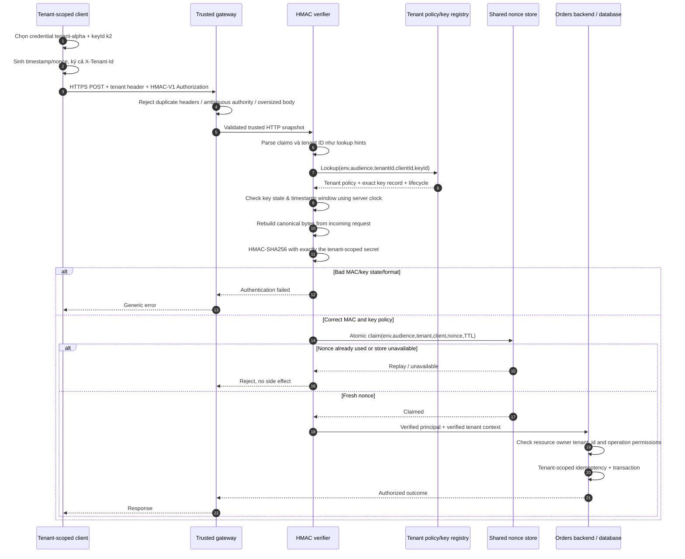
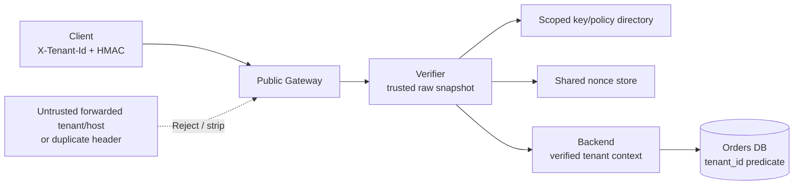

# Secret theo tenant trong hệ thống Multi-tenant HMAC Request Authentication

## Mục tiêu học tập

Sau khi hoàn thành bài, bạn có thể:

- Giải thích **secret theo tenant** là mô hình cô lập HMAC shared secret theo **ranh giới tenant**, không dùng một khóa chung cho mọi khách hàng thuê chung hạ tầng.
- Phân biệt rõ **tenant**, **client**, **principal**, **key ID**, **secret material**, **resource owner** và **audience**; biết trường hợp nhiều client cùng tenant và một integration có quyền phục vụ nhiều tenant.
- Thiết kế bản ghi khóa có định danh **`(environment, audience, tenantId, clientId, keyId)`** và tránh key confusion khi hai tenant dùng cùng chuỗi `clientId` hoặc `keyId`.
- Giải thích tại sao `X-Tenant-Id` trong request **chưa đáng tin trước HMAC**, nhưng vẫn có thể dùng làm **candidate lookup hint** có giới hạn; chỉ tin tenant đã ràng buộc với key record **sau khi HMAC khớp**.
- Đưa **tenant ID** vào canonical request được ký cùng method, raw URI, public Host, headers, body SHA-256, client/key ID, timestamp và nonce để ngăn attacker sửa tenant trong quá trình chuyển tiếp.
- Viết ví dụ Java 17 dùng JCA `Mac`, `SecretKeySpec`, `MessageDigest.isEqual`, tenant-scoped key directory, policy registry và nonce store; kiểm thử cross-tenant tampering, same-ID collision, key rotation và replay.
- Chọn **nonce namespace** và **idempotency scope** có tenant, nhưng không tự tách nonce theo key version khi luân chuyển khóa trong cùng tenant/client.
- Xác định nơi kiểm tra **authorization theo tenant và quyền sở hữu tài nguyên**, kể cả khi credential HMAC đúng; nhận diện nguy cơ **confused deputy**, proxy/gateway rewrite, cache stale, secret injection quá quyền và multi-region failover.

**Phạm vi module:** Chương **Multi-tenant**, chủ đề trực tiếp **Secret theo tenant**, thuộc `SECURITY_AUTHENTICATION_HMAC_REQUEST_AUTHENTICATION`. Module dạy thiết kế xác thực HTTP request bằng **HMAC với shared secret và canonical request** gồm method, URI, header hoặc body theo hợp đồng ký; người học thực hành xác minh chữ ký, timestamp/nonce chống replay, quản lý key rotation, kiểm thử proxy/gateway, và phân biệt xác thực với phân quyền.

> Các tên `HMAC-V1`, `hmac-tenant-secret-v1`, `X-Tenant-Id`, đường dẫn API và con số giới hạn dưới đây tạo thành **hợp đồng minh họa tự định nghĩa**, không phải chuẩn HMAC authentication áp dụng cho mọi API. Mọi bên ký/xác minh phải thống nhất chính xác wire format, bytes của canonical request và quy tắc tenant ownership trước khi dùng.

## 1. Vì sao mô hình multi-tenant cần secret riêng?

Một `orders-api` phục vụ nhiều doanh nghiệp thuê chung một deployment và cơ sở dữ liệu phân vùng logic. Mỗi tenant có request từ đối tác tích hợp, mỗi request được ký HMAC-SHA256.

Giả sử:

```text
                       Shared infrastructure
Tenant "tenant-alpha" ─┐
  Client "integrator-7" ├──> API Gateway ──> HMAC Verifier ──> Orders Service
  Secret K_alpha       │                           │                 │
                       │                           │                 └─ DB row tenant_id
Tenant "tenant-beta"  ─┤                           │
  Client "integrator-7" ┘                           └─ Tenant-scoped key directory
  Secret K_beta
```

Hai tenant cùng có một tên client tích hợp `integrator-7` và cùng dùng chuỗi `keyId="k1"`, nhưng **`K_alpha` và `K_beta` bắt buộc là hai secret material độc lập** theo profile.

Nếu hệ thống sử dụng **một global secret** cho tất cả tenant, khi tenant alpha làm lộ khóa, attacker có thể tạo HMAC hợp lệ cho payload mang tên tenant beta **nếu server chỉ dựa trên cùng khóa đó**. Chỉ thêm `tenantId` vào thông điệp ký **không cứu được** mô hình key chung: ai biết global secret đều ký được mọi giá trị tenant ID.

### Hai mục tiêu độc lập

1. **Cryptographic isolation:** không thể dùng key của tenant A để tạo signature hợp lệ với key record của tenant B.
2. **Authorization isolation:** ngay cả khi request có signature đúng cho tenant B, backend vẫn phải xác minh principal có quyền trên **đúng order/resource/operation**, không chỉ thấy chuỗi tenant B trong header.

**HMAC authentication chứng minh khả năng dùng secret tương ứng**, không tự chứng minh quyền sở hữu tài nguyên database hoặc quyền của một role. Secret theo tenant **giảm blast radius**, chứ không thay thế authorization.

## 2. Tenant, client, principal và secret: sáu khái niệm khác nhau

| Khái niệm | Ví dụ | Bản chất | Được tin khi nào? |
|---|---|---|---|
| **Tenant ID** | `tenant-alpha` | Phân vùng tổ chức/dữ liệu, có chính sách | Header ban đầu chỉ là claim; sau HMAC + binding mới tạo verified tenant context |
| **Client ID** | `integrator-7` | Định danh chương trình tích hợp trong tenant | Ban đầu là lookup hint, sau HMAC mới được gắn với key record |
| **Key ID** | `k1` | Phiên bản khóa trong namespace | Chỉ dùng tìm candidate trước HMAC |
| **Secret material** | 32 raw random bytes | Shared HMAC key bí mật | Chỉ trusted signer/verifier/KMS được dùng |
| **Authenticated principal** | `svc:alpha:integrator7` | Danh tính tin cậy rút từ key record đã verify | Sau MAC đúng và replay gate |
| **Resource owner** | `orders.tenant_id = tenant-alpha` | Tenant thực sự sở hữu record DB | Nguồn đáng tin là data/access layer, không phải header |

Một ứng dụng có thể là **một client của nhiều tenant**, nhưng chỉ khi issuer **chủ động cấp credential phù hợp cho từng tenant**. Nếu cùng một principal toàn cục được phép ở nhiều tenant, phải có mô hình **delegation/entitlement có kiểm toán**, không suy ra từ việc caller gõ `X-Tenant-Id: tenant-beta`.

### Không đồng nhất tenant với client

- **Một tenant nhiều client:** tenant alpha có `web-portal`, `batch-worker`, `external-partner`. Tốt nhất mỗi client có key record/secret riêng để có thể revoke và audit từng caller; “một secret cho cả tenant” khiến khó phân biệt ai đã ký.
- **Một client nhiều tenant:** `integrator-7` phục vụ alpha và beta. Mỗi quan hệ client–tenant có thể được cấp secret riêng, với principal hoặc policy delegation riêng. Không mặc nhiên tái sử dụng `K_alpha` để ký request beta.
- **Một tenant nhiều key versions:** trong rotation alpha có `k1` verify-only, `k2` active; vẫn là cùng tenant nhưng **hai secret** khác nhau.

**Quyết định lab:** dùng **secret riêng cho từng `(tenantId, clientId, keyId)` trong environment/audience đã cố định**. Đây là dạng per-tenant isolation có khả năng revoke chi tiết tới từng client. Những mô hình khác có thể hợp lệ, nhưng phải chứng minh được ranh giới cô lập tương đương.

## 3. Thiết kế TenantKeyRef và policy registry

Không lookup khóa chỉ bằng `keyId`. Namespace của bài:

```text
TenantKeyRef = (
    environment,
    audience,
    tenantId,
    clientId,
    keyId
)

TenantPolicyRef = (
    environment,
    audience,
    tenantId
)
```

Ví dụ ba bản ghi:

```text
(production, orders-api, tenant-alpha, integrator-7, k1)
    -> K_alpha_k1  // VERIFY_ONLY, còn hạn hữu hạn

(production, orders-api, tenant-alpha, integrator-7, k2)
    -> K_alpha_k2  // ACTIVE, secret mới

(production, orders-api, tenant-beta, integrator-7, k1)
    -> K_beta_k1   // ACTIVE, secret KHÁC K_alpha_k1
```

**Đúng scope:** tenant alpha có `k1` và tenant beta cũng có `k1`, nhưng `K_alpha_k1 != K_beta_k1`. Đừng xây `Map<keyId, secret>` hoặc bảng có unique constraint chỉ trên `key_id` khi ID không globally unique.

### Một cấu trúc dữ liệu nguồn tin cậy

```yaml
# Mô tả policy, KHÔNG chứa HMAC secret thật.
environment: production
audience: orders-api
tenantId: tenant-alpha
policyRevision: alpha-r12
enabled: true
maxClockSkewSeconds: 30
maxRawBodyBytes: 4096
allowedPrincipals:
  - "svc:alpha:integrator7"
keyReferences:
  - clientId: integrator-7
    keyId: k1
    state: VERIFY_ONLY
  - clientId: integrator-7
    keyId: k2
    state: ACTIVE
```

Secret bytes được lưu tách trong **secret manager/KMS/HSM hoặc mounted secret** với ACL tương ứng. Key record có immutable `TenantKeyRef`, principal/owner, lifecycle state, effective interval, verify deadline và secret reference.

### Untrusted lookup không được biến thành quyền

Trước khi so MAC, cả `tenantId` và `clientId` đều do caller tự khai. Có thể dùng chúng để **tra một candidate record trong registry được provision trước**, nếu:

1. Grammar và độ dài field bị giới hạn.
2. `environment`/`audience` do **server** xác lập.
3. Không dùng `tenantId`/`keyId` tạo tùy ý KMS secret path, file path, SQL string hoặc tenant role.
4. Candidate lookup không kích hoạt side effect, grant hay quota deduction cho tenant được khai.
5. Sau lookup, **HMAC phải bao phủ chính tenant ID đã khai** và verifier phải gắn identity với owner của record được chọn.
6. Backend còn phải kiểm tra quyền trên resource thật.

Như vậy request mang `tenant-beta` không thể được xác thực bằng key alpha. Đây là **lookup dựa trên claim để chọn phép kiểm chứng**, không phải việc tin claim như danh tính.

## 4. Một secret toàn cục, một secret/tenant hay một secret/client-tenant?

Ba lựa chọn cần cân nhắc:

| Thiết kế | Phạm vi lộ khi một secret bị compromise | Khả năng truy vết, revoke | Đánh giá |
|---|---|---|---|
| **Global shared HMAC secret** | Có thể ảnh hưởng mọi tenant dùng key đó | Rất khó revoke riêng | Tránh trong API multi-tenant |
| **Một secret riêng/tenant** | Cô lập giữa các tenant nếu kiểm soát đúng | Mọi client trong tenant chia secret, khó phân biệt caller | Tốt hơn global, nhưng thiếu granularity nội tenant |
| **Secret riêng/(tenant,client,key version)** | Chủ yếu trong tenant + client bị lộ | Audit/revoke tới từng integration; rotation độc lập | **Mẫu của bài** |
| **Non-exportable key theo tenant/client trong HSM/KMS** | Có thể giảm phạm vi xuất plaintext, còn phụ thuộc access policy | Provider-managed key version/revoke/audit | Phù hợp nếu provider hỗ trợ MAC/sign/verify đúng hợp đồng |

Đừng giải quyết tenant separation bằng một prefix đơn giản:

```java
// SAI nếu tenantId chỉ là prefix, nhưng mọi tenant dùng cùng master K:
String keyId = tenantId + ":k1";
byte[] sharedKey = globalHmacSecret;
```

Ký thêm chuỗi tenant bằng **cùng K** chỉ làm thông điệp phân biệt nhau; **không tạo cryptographic key isolation** nếu mọi tenant đều được cấp K. Một mô hình KDF per-tenant từ master có thể tạo các subkeys thực sự khác nhau **nếu được thiết kế đúng** (domain separation, secret master không cấp cho tenants, lifecycle), nhưng cần threat model riêng: lộ master sẽ ảnh hưởng nhiều tenant, rotation/revocation phức tạp. Lab này chọn **keys ngẫu nhiên độc lập**, không tự triển khai KDF.

## 5. Hợp đồng HTTP: tenant ID phải được HMAC ký

Mỗi client gửi đúng **một** `Authorization` chứa `client` và `keyid`; tenant nằm trong một header riêng `X-Tenant-Id`. Hợp đồng quy định rõ cardinality và representation của tất cả trường.

```http
POST /v1/orders HTTP/1.1
Host: api.example.test
Content-Type: application/json
X-Tenant-Id: tenant-alpha
Idempotency-Key: create-alpha-001
Authorization: HMAC-V1 client="integrator-7", keyid="k2", ts="<epoch-seconds>", nonce="<22-char-base64url>", sig="<43-char-base64url>"

{"orderId":"A-42","amountMinor":120000,"currency":"VND"}
```

Các chuỗi `<...>` chỉ là **placeholder**, không phải test vector có chữ ký hợp lệ. Phải thống nhất bytes của body, ở ví dụ **UTF-8 và không newline cuối**.

### Canonical text của `hmac-tenant-secret-v1`

```text
hmac-tenant-secret-v1
POST
/v1/orders
host:api.example.test
content-type:application/json
x-tenant-id:tenant-alpha
idempotency-key:create-alpha-001
environment:production
audience:orders-api
auth-scheme:hmac-v1
client:integrator-7
keyid:k2
ts:<epoch-seconds>
nonce:<22-char-base64url>
body-sha256:<base64url-sha256-of-exact-raw-body>
```

**Byte-level agreement:**

- Nối các dòng bằng một byte **LF 0x0A**, **không thêm LF cuối**; encode UTF-8 không BOM.
- Field labels cố định chữ thường; **giá trị `tenantId`/`clientId`/`keyId` phân biệt case**, không tự lowercase/trim ngoài grammar.
- `POST`, raw request-target `/v1/orders`, public Host, Content-Type, `X-Tenant-Id` và Idempotency-Key lấy từ **trusted HTTP snapshot**.
- `environment` và `audience` là cấu hình/route server đáng tin đã được client provision cùng protocol, không cho caller thay bằng `X-Environment`.
- `body-sha256` tính **trên exact raw body bytes** mà HTTP adapter chuyển tới business handler sau framing; không parse JSON rồi serialize lại trước hash.
- `client`/`keyid`/`ts`/`nonce` từ Authorization đã được parse strict; `keyId` và tenant ID đều nằm trong dữ liệu được ký.
- `sig` **không nằm trong canonical text**, vì nó chính là HMAC tag đang tính.
- HMAC-SHA256 tạo **32 raw bytes** → Base64URL không padding **43 ký tự**. Nonce 16 bytes CSPRNG → Base64URL không padding **22 ký tự**.

Công thức:

```text
digest = SHA256(exactRawBodyBytes)
M = UTF8(joinWithLF(fixedCanonicalLines))
tag = HMAC-SHA256(secretForExactTenantKeyRef, M)
sig = Base64URL_NoPadding(tag)
```

### Vì sao phải ký `X-Tenant-Id` nếu đã lookup key theo tenant?

Hai ràng buộc bổ sung cho nhau:

1. Lookup đúng `TenantKeyRef` quyết định **secret nào** được dùng để xác minh.
2. Canonical text ký cả `x-tenant-id:...`, xác lập **request thực sự yêu cầu tenant nào**.

Nếu attacker thay `X-Tenant-Id: tenant-alpha` thành `tenant-beta` nhưng giữ chữ ký cũ, server sẽ lookup key beta và dựng một canonical khác; tag không khớp. Nếu attacker biết key beta và ký lại, đây là **credential khác**; còn phải qua authorization và quyền trên tài nguyên beta.

**Sai nghiêm trọng:** server xác minh MAC với key alpha nhưng backend lại xử lý resource beta lấy từ một field khác, không được ký hoặc không thuộc authenticated context. Đây là một dạng **cross-tenant confused-deputy**.

## 6. Parsing tenant header và Authorization không được nhập nhằng

Trong HTTP, tên header là case-insensitive; nhưng **giá trị tenant ID** theo profile này là case-sensitive. `tenant-alpha` và `TENANT-ALPHA` không đồng nghĩa trừ khi issuer đã định nghĩa normalization rõ cho cả provisioning, signing và lookup.

### Quy tắc parser của profile

| Trường | Grammar/validation |
|---|---|
| `Authorization` | **Đúng một header occurrence**, không gộp hai values |
| Authentication scheme | `HMAC-V1`; tên scheme case-insensitive, version fixed |
| Auth-param | `client,keyid,ts,nonce,sig` đúng một mỗi tên; name case-insensitive, value case-sensitive |
| Thứ tự/quoted syntax | Profile cố định 5 quoted params, dấu phẩy + một space; không escaped quotes |
| `X-Tenant-Id` | **Đúng một header occurrence**, ASCII `[A-Za-z0-9][A-Za-z0-9._-]{0,63}` |
| `Idempotency-Key` | **Đúng một header occurrence**, ASCII allowlist và length |
| `Host`/`:authority` | Public authority được kiểm chứng tại trusted ingress, reject conflict |
| `Content-Type` | `application/json` theo profile, không duplicate hoặc normalize nhập nhằng |
| `nonce` | Base64URL không padding 22 chars, decode **16 raw bytes**, re-encode canonical |
| `sig` | Base64URL không padding 43 chars, decode **32 raw bytes**, re-encode canonical |
| `ts` | Unix epoch seconds decimal, strict format, signed, cửa sổ thời gian theo policy |

Không dùng `String.split(",")` bừa bãi để parse HTTP auth-param tổng quát. Mã Java sẽ dùng **strict full-match** cho **một serialization hạn chế**; nó không tuyên bố tất cả biểu diễn hợp lệ theo HTTP authentication đều có thứ tự này.

### Một số input cần từ chối

```http
# Duplicate tenant headers, có thể bị gateway/backend chọn khác nhau:
X-Tenant-Id: tenant-alpha
X-Tenant-Id: tenant-beta

# Không được tự chọn tenant tùy ý từ query:
POST /v1/orders?tenant=tenant-beta HTTP/1.1

# Auth-param duplicate hoặc thêm field đổi policy:
Authorization: HMAC-V1 client="integrator-7", keyid="k1", KEYID="k2", ...

# Client cố xin một secret source:
X-Secret-Path: /run/secrets/tenant-beta.key

# Client cố tự khai danh tính đã verify:
X-Authenticated-Tenant: tenant-beta
```

Đây là các ví dụ **không đầy đủ cố ý** cho kịch bản negative testing, không phải HTTP requests hợp lệ. Không nhận `X-Secret-Path`, `X-Authenticated-Tenant` hoặc `X-Verified-Principal` từ Internet như nguồn quyết định key hoặc quyền.

## 7. Thứ tự xử lý xác thực tenant có an toàn



### Ranh giới tin cậy ở từng giai đoạn

**Trước MAC:**

- `tenantId`, `clientId`, `keyId` là **candidate lookup inputs**, không phải authenticated principal.
- Chỉ được dùng `environment`/`audience` từ trusted server context.
- Có thể validate grammar, global body/URL/header limits và **lọc theo tenant policy candidate**, nhưng không được cho caller nhận đặc quyền hoặc trừ quota của tenant người khác.
- Secret được lookup từ key registry/KMS đã provision, **không** lấy từ request.

**Sau MAC đúng:**

- Key record đã được HMAC ràng buộc với tenant/client/key ID, principal của record mới được coi là authenticated.
- Shared nonce claim atomic phải thành công; nếu chưa, không chạy side effect.
- Chỉ lúc này mới cho backend xử lý **verifiedTenantId** cùng principal và ràng buộc resource ownership.
- Idempotency/authorization dựa trên server-issued context qua một hop nội bộ được bảo vệ; không tin header `X-Verified-Tenant` của caller.

### Câu hỏi quan trọng: có được tạo verified tenant chỉ từ HMAC?

Có thể **xác thực mối liên hệ credential–tenant** từ một key record do issuer quản lý, nhưng kết luận đó chỉ là:

> “Request này được ký bởi một bên có quyền dùng key record đã provision cho tenant alpha/client integrator-7.”

Nó **không** mặc nhiên là “principal được phép đọc mọi order của tenant alpha, sửa giá tiền, thay chủ sở hữu hay truy cập sub-tenant”. Đó là **authorization** cần kiểm tra riêng.

## 8. Secret injection, least privilege và blast radius

Key record cho tenant beta không được làm lộ secret alpha qua một ứng dụng/mount quá quyền.

### Các mẫu injection

| Mẫu | Điểm mạnh | Rủi ro / việc phải chứng minh |
|---|---|---|
| Secret manager SDK pull theo `TenantKeyRef` allowlist | Workload identity, IAM, audit, version | Không dùng tenant từ HTTP làm arbitrary secret path; giới hạn rate/permission, cache/revoke |
| File/volume mount chỉ keys của workload/tenant cần phục vụ | Đơn giản, không nhúng secret vào image | Runtime access, root/node compromise, permissions, refresh semantics |
| Sidecar/agent lấy secret và dựng registry | Tập trung policy/rotation | Agent có quyền cao; metadata/key mismatch, log và refresh race |
| KMS/HSM non-exportable HMAC key | Có thể không đưa raw secret vào JVM khi provider hỗ trợ verify | Hạn chế API/algorithm, latency/quota, quyền remote VerifyMac, client signing compatibility |

### Chống request-controlled secret injection

**Sai:**

```java
// Sai: keyId/tenantId là input chưa xác thực từ Internet.
Path file = Path.of("/secrets/" + tenantHeader + "/" + keyId + ".bin");
byte[] secret = Files.readAllBytes(file);
```

Ngoài path traversal và DoS, cách này bỏ qua owner, audience, key lifecycle. **Regex không đủ biến untrusted tenant ID thành đường dẫn được phép.**

**Đúng theo thiết kế:**

```text
TenantKeyRef(production, orders-api, tenant-alpha, integrator-7, k2)
  -> registry entry previously provisioned and access-controlled
  -> secretRef opaque from trusted config
  -> keyState ACTIVE, principal svc:alpha:integrator7

Missing exact TenantKeyRef -> reject.
No filesystem scan; no "try tenant-beta key" fallback.
```

Nếu một verifier dùng chung cho nhiều tenant và cần giữ rất nhiều secrets, hãy coi nó là **high-value trusted component**: workload có thể đọc những keys mà nó phục vụ, vì vậy phải giảm blast radius bằng tenant partition/sharding, workload identity least privilege, KMS authorization, audit và kiến trúc phù hợp. **Per-tenant key material không tự bảo vệ trước attacker chiếm toàn bộ verifier có quyền đọc tất cả secrets.**

### Secret ở client và key rotation

Client cần nhận K cho **đúng tenant** qua provisioning channel an toàn. Không gửi shared secret trong mỗi HTTP request hoặc logs. Khi rotate k1→k2 trong tenant alpha, cấp **secret mới + key ID mới**; không làm thay secret của tenant beta và không đổi owner/principal ngoài policy.

## 9. Java 17 — xác minh HMAC bằng secret đúng tenant

Bộ mã dưới đây dùng **ba key records** để kiểm chứng isolation:

- `tenant-alpha / integrator-7 / k1`: `VERIFY_ONLY`, trước hard deadline.
- `tenant-alpha / integrator-7 / k2`: `ACTIVE`, secret mới.
- `tenant-beta / integrator-7 / k1`: `ACTIVE`, **cùng clientId và keyId string** với alpha/k1 nhưng secret khác.

Policy alpha cho timestamp `±30s`, body `4096 bytes`; beta `±300s`, body `16384 bytes`. Cryptographic profile vẫn giống nhau, không cho tenant chọn `alg=none` hoặc bỏ signed tenant header.

**Phạm vi demo:** key/policy registry và nonce store in-memory chỉ là fixture trong một JVM. Chúng **không** cung cấp phân quyền DB, KMS thật, TTL hoặc distributed replay consistency.

### 9.1. Mã Java độc lập, có thể đặt trong `TenantScopedHmacV1.java`

```java
import java.nio.charset.StandardCharsets;
import java.security.GeneralSecurityException;
import java.security.MessageDigest;
import java.security.SecureRandom;
import java.time.Clock;
import java.time.Instant;
import java.time.ZoneOffset;
import java.util.Arrays;
import java.util.Base64;
import java.util.Map;
import java.util.Optional;
import java.util.Set;
import java.util.concurrent.ConcurrentHashMap;
import java.util.regex.Matcher;
import java.util.regex.Pattern;
import javax.crypto.Mac;
import javax.crypto.spec.SecretKeySpec;

public final class TenantScopedHmacV1 {
    private static final String PROFILE = "hmac-tenant-secret-v1";
    private static final String ENV = "production";
    private static final String AUDIENCE = "orders-api";
    private static final String HOST = "api.example.test";
    private static final String TARGET = "/v1/orders";
    private static final String TYPE = "application/json";
    private static final int MAX_SKEW = 300;
    private static final int GLOBAL_MAX_BODY = 16 * 1024;
    // Covers ±300s even if one tenant's window changes at runtime.
    private static final long NONCE_TTL_SECONDS = 605L;
    private static final long MAX_EPOCH = 253402300799L;

    private static final Base64.Encoder B64 =
            Base64.getUrlEncoder().withoutPadding();
    private static final Pattern ID =
            Pattern.compile("[A-Za-z0-9][A-Za-z0-9._-]{0,63}");
    private static final Pattern IDEMPOTENCY =
            Pattern.compile("[A-Za-z0-9][A-Za-z0-9._-]{0,79}");
    private static final Pattern EPOCH =
            Pattern.compile("[1-9][0-9]{0,11}");
    private static final Pattern NONCE =
            Pattern.compile("[A-Za-z0-9_-]{22}");
    private static final Pattern TAG =
            Pattern.compile("[A-Za-z0-9_-]{43}");
    // Exactly five quoted auth-params, in fixed order for THIS profile.
    // Only scheme and PARAMETER NAMES are case-insensitive.
    private static final Pattern AUTH = Pattern.compile(
            "(?i:HMAC-V1) (?i:client)=\"([A-Za-z0-9][A-Za-z0-9._-]{0,63})\", " +
            "(?i:keyid)=\"([A-Za-z0-9][A-Za-z0-9._-]{0,63})\", " +
            "(?i:ts)=\"([1-9][0-9]{0,11})\", " +
            "(?i:nonce)=\"([A-Za-z0-9_-]{22})\", " +
            "(?i:sig)=\"([A-Za-z0-9_-]{43})\"");

    private TenantScopedHmacV1() {}

    public record TenantPolicyRef(
            String environment, String audience, String tenantId) {}

    public record TenantKeyRef(
            String environment, String audience, String tenantId,
            String clientId, String keyId) {}

    public enum KeyState { PREPARED, ACTIVE, VERIFY_ONLY, REVOKED }

    public record TenantPolicy(
            TenantPolicyRef ref, String revision, boolean enabled,
            int maxSkewSeconds, int maxBodyBytes,
            Set<String> allowedPrincipals) {

        public TenantPolicy {
            if (ref == null || revision == null || revision.isBlank() ||
                    maxSkewSeconds <= 0 || maxSkewSeconds > MAX_SKEW ||
                    maxBodyBytes <= 0 || maxBodyBytes > GLOBAL_MAX_BODY ||
                    allowedPrincipals == null ||
                    allowedPrincipals.isEmpty()) {
                throw new IllegalArgumentException("Invalid tenant policy");
            }
            allowedPrincipals = Set.copyOf(allowedPrincipals);
        }
    }

    public record KeyRecord(
            TenantKeyRef ref, String principal, KeyState state,
            Instant notBefore, Instant verifyUntil, byte[] secret) {

        public KeyRecord {
            if (ref == null || principal == null || principal.isBlank() ||
                    state == null || notBefore == null ||
                    verifyUntil == null ||
                    !notBefore.isBefore(verifyUntil) ||
                    secret == null || secret.length != 32) {
                throw new IllegalArgumentException("Invalid key record");
            }
            secret = secret.clone();
        }

        @Override
        public byte[] secret() {
            return secret.clone();
        }

        public boolean mayVerify(Instant now) {
            return (state == KeyState.ACTIVE ||
                    state == KeyState.VERIFY_ONLY) &&
                    !now.isBefore(notBefore) &&
                    now.isBefore(verifyUntil);
        }
    }

    public record Claims(
            String clientId, String keyId, String timestamp, String nonce) {}

    public record Parsed(Claims claims, byte[] receivedTag) {}

    // Built only by a trusted HTTP adapter after header/framing checks.
    public record Request(
            String method, String rawTarget, String publicHost,
            String contentType, String tenantHeader,
            String idempotencyKey, byte[] rawBody) {

        public Request {
            if (rawBody == null) {
                throw new IllegalArgumentException("Missing body");
            }
            rawBody = rawBody.clone();
        }

        @Override
        public byte[] rawBody() {
            return rawBody.clone();
        }
    }

    public record VerifiedTenantContext(
            String tenantId, String principal, String clientId) {}

    public enum Outcome {
        AUTHENTICATED, AUTH_FAILED, REPLAY, TENANT_POLICY_DENIED
    }

    public record Result(
            Outcome outcome, VerifiedTenantContext context) {}

    public interface PolicyStore {
        Optional<TenantPolicy> find(TenantPolicyRef ref);
    }

    public interface KeyDirectory {
        Optional<KeyRecord> find(TenantKeyRef ref);
    }

    public interface NonceStore {
        // Production: atomic, shared, expiry and consistency guaranteed.
        // No keyId: same client+tenant nonce survives key rotation.
        boolean claim(TenantPolicyRef tenant,
                      String authenticatedClientId,
                      String nonce, long ttlSeconds);
    }

    public static String freshNonce(SecureRandom rng) {
        byte[] raw = new byte[16];
        rng.nextBytes(raw);
        return B64.encodeToString(raw);
    }

    private static byte[] strictDecode(
            String text, Pattern grammar, int expectedLength) {
        if (text == null || !grammar.matcher(text).matches()) {
            throw new IllegalArgumentException("Invalid Base64URL grammar");
        }
        final byte[] raw;
        try {
            raw = Base64.getUrlDecoder().decode(text);
        } catch (IllegalArgumentException invalid) {
            throw new IllegalArgumentException("Invalid Base64URL");
        }
        if (raw.length != expectedLength ||
                !B64.encodeToString(raw).equals(text)) {
            throw new IllegalArgumentException("Noncanonical Base64URL");
        }
        return raw;
    }

    private static long epochSeconds(String value) {
        if (value == null || !EPOCH.matcher(value).matches()) {
            throw new IllegalArgumentException("Bad timestamp format");
        }
        long epoch = Long.parseLong(value);
        if (epoch > MAX_EPOCH) {
            throw new IllegalArgumentException("Timestamp out of range");
        }
        return epoch;
    }

    private static void validateClaims(Claims c) {
        if (c == null || c.clientId() == null ||
                !ID.matcher(c.clientId()).matches() ||
                c.keyId() == null || !ID.matcher(c.keyId()).matches()) {
            throw new IllegalArgumentException("Bad client or key ID");
        }
        epochSeconds(c.timestamp());
        strictDecode(c.nonce(), NONCE, 16);
    }

    private static void validateRequest(Request r) {
        if (r == null || !"POST".equals(r.method()) ||
                !TARGET.equals(r.rawTarget()) ||
                !HOST.equals(r.publicHost()) ||
                !TYPE.equals(r.contentType()) ||
                r.tenantHeader() == null ||
                !ID.matcher(r.tenantHeader()).matches() ||
                r.idempotencyKey() == null ||
                !IDEMPOTENCY.matcher(r.idempotencyKey()).matches() ||
                r.rawBody().length == 0 ||
                r.rawBody().length > GLOBAL_MAX_BODY) {
            throw new IllegalArgumentException("Invalid request");
        }
    }

    public static Parsed parseAuthorization(String header) {
        // The HTTP adapter MUST reject duplicate Authorization headers.
        if (header == null || header.length() > 512) {
            throw new IllegalArgumentException("Bad Authorization");
        }
        Matcher match = AUTH.matcher(header);
        if (!match.matches()) {
            throw new IllegalArgumentException("Bad auth-param format");
        }
        Claims c = new Claims(match.group(1), match.group(2),
                              match.group(3), match.group(4));
        validateClaims(c);
        return new Parsed(c, strictDecode(match.group(5), TAG, 32));
    }

    // The same exact canonical profile must be used by client and server.
    public static byte[] canonicalBytes(Request r, Claims c)
            throws GeneralSecurityException {
        validateRequest(r);
        validateClaims(c);
        byte[] bodyHash = MessageDigest.getInstance("SHA-256")
                .digest(r.rawBody());
        String canonical = String.join("\n",
                PROFILE,
                "POST",
                TARGET,
                "host:" + r.publicHost(),
                "content-type:" + r.contentType(),
                "x-tenant-id:" + r.tenantHeader(),
                "idempotency-key:" + r.idempotencyKey(),
                "environment:" + ENV,
                "audience:" + AUDIENCE,
                "auth-scheme:hmac-v1",
                "client:" + c.clientId(),
                "keyid:" + c.keyId(),
                "ts:" + c.timestamp(),
                "nonce:" + c.nonce(),
                "body-sha256:" + B64.encodeToString(bodyHash));
        return canonical.getBytes(StandardCharsets.UTF_8);
    }

    private static byte[] computeTag(
            byte[] temporaryKey, Request r, Claims c)
            throws GeneralSecurityException {
        try {
            Mac mac = Mac.getInstance("HmacSHA256");
            mac.init(new SecretKeySpec(temporaryKey, "HmacSHA256"));
            return mac.doFinal(canonicalBytes(r, c));
        } finally {
            // Best-effort cleanup of this copy, not all JCA/JVM copies.
            Arrays.fill(temporaryKey, (byte) 0);
        }
    }

    // TEST SIGNER ONLY: simulates already provisioned client credentials.
    // Production SDK must check active signing key and current timestamp.
    public static String signFixture(
            KeyRecord signer, Request r, Claims c)
            throws GeneralSecurityException {
        if (signer == null || !signer.ref().tenantId().equals(r.tenantHeader()) ||
                !signer.ref().clientId().equals(c.clientId()) ||
                !signer.ref().keyId().equals(c.keyId())) {
            throw new IllegalArgumentException("Fixture has wrong owner");
        }
        String signature = B64.encodeToString(
                computeTag(signer.secret(), r, c));
        return "HMAC-V1 client=\"" + c.clientId() +
                "\", keyid=\"" + c.keyId() +
                "\", ts=\"" + c.timestamp() +
                "\", nonce=\"" + c.nonce() +
                "\", sig=\"" + signature + "\"";
    }

    public static Result verify(
            Request received, String authHeader, Clock serverClock,
            PolicyStore policies, KeyDirectory keys, NonceStore nonces)
            throws GeneralSecurityException {
        final Parsed parsed;
        try {
            parsed = parseAuthorization(authHeader);
            validateRequest(received);
        } catch (IllegalArgumentException badRequest) {
            return new Result(Outcome.AUTH_FAILED, null);
        }

        // All three are UNTRUSTED lookup hints before MAC.
        TenantPolicyRef policyRef = new TenantPolicyRef(
                ENV, AUDIENCE, received.tenantHeader());
        TenantKeyRef keyRef = new TenantKeyRef(
                ENV, AUDIENCE, received.tenantHeader(),
                parsed.claims().clientId(), parsed.claims().keyId());

        Optional<TenantPolicy> maybePolicy = policies.find(policyRef);
        Optional<KeyRecord> maybeKey = keys.find(keyRef);
        if (maybePolicy.isEmpty() || maybeKey.isEmpty()) {
            return new Result(Outcome.AUTH_FAILED, null);
        }

        TenantPolicy policy = maybePolicy.get();
        KeyRecord key = maybeKey.get();
        Instant serverNow = serverClock.instant();

        // Policy/key metadata comes from TRUSTED registries.
        if (!policyRef.equals(policy.ref()) || !keyRef.equals(key.ref()) ||
                !key.mayVerify(serverNow) || !policy.enabled()) {
            return new Result(Outcome.AUTH_FAILED, null);
        }

        // A candidate tenant policy may constrain resources before MAC,
        // but cannot create authenticated tenant identity or grant rights.
        long t = epochSeconds(parsed.claims().timestamp());
        long nowSeconds = serverNow.getEpochSecond();
        if (nowSeconds < 0 || nowSeconds > MAX_EPOCH ||
                t - nowSeconds < -policy.maxSkewSeconds() ||
                t - nowSeconds > policy.maxSkewSeconds() ||
                received.rawBody().length > policy.maxBodyBytes()) {
            return new Result(Outcome.AUTH_FAILED, null);
        }

        // One exact scoped secret, no fallback or try-all.
        byte[] expected = computeTag(
                key.secret(), received, parsed.claims());
        if (!MessageDigest.isEqual(expected, parsed.receivedTag())) {
            return new Result(Outcome.AUTH_FAILED, null);
        }

        // KeyRef has now proved tenant/client relation by HMAC.
        // Replay namespace includes tenant + authenticated client,
        // but NOT keyId: it persists across rotation within a tenant.
        final boolean fresh;
        try {
            fresh = nonces.claim(
                    policyRef, key.ref().clientId(),
                    parsed.claims().nonce(), NONCE_TTL_SECONDS);
        } catch (RuntimeException storeFailure) {
            return new Result(Outcome.AUTH_FAILED, null); // Fail closed.
        }
        if (!fresh) return new Result(Outcome.REPLAY, null);

        if (!policy.allowedPrincipals().contains(key.principal())) {
            return new Result(Outcome.TENANT_POLICY_DENIED, null);
        }

        VerifiedTenantContext ctx = new VerifiedTenantContext(
                key.ref().tenantId(), key.principal(), key.ref().clientId());
        // This is authentication/tenant entitlement, NOT order-row authz.
        return new Result(Outcome.AUTHENTICATED, ctx);
    }

    private static void require(Outcome actual, Outcome expected) {
        if (actual != expected) {
            throw new AssertionError(
                    "Expected " + expected + ", got " + actual);
        }
    }

    public static void main(String[] args)
            throws GeneralSecurityException {
        Instant now = Instant.parse("2026-11-28T00:00:00Z");
        Clock clock = Clock.fixed(now, ZoneOffset.UTC);
        SecureRandom rng = new SecureRandom();

        TenantPolicyRef alpha =
                new TenantPolicyRef(ENV, AUDIENCE, "tenant-alpha");
        TenantPolicyRef beta =
                new TenantPolicyRef(ENV, AUDIENCE, "tenant-beta");
        TenantPolicy alphaPolicy = new TenantPolicy(
                alpha, "alpha-r12", true, 30, 4096,
                Set.of("svc:alpha:integrator7"));
        TenantPolicy betaPolicy = new TenantPolicy(
                beta, "beta-r3", true, 300, 16384,
                Set.of("svc:beta:integrator7"));
        PolicyStore policyStore = ref -> Optional.ofNullable(
                Map.of(alpha, alphaPolicy, beta, betaPolicy).get(ref));

        // The same clientId and keyId strings exist in BOTH tenants.
        TenantKeyRef alphaK1 = new TenantKeyRef(
                ENV, AUDIENCE, "tenant-alpha", "integrator-7", "k1");
        TenantKeyRef alphaK2 = new TenantKeyRef(
                ENV, AUDIENCE, "tenant-alpha", "integrator-7", "k2");
        TenantKeyRef betaK1 = new TenantKeyRef(
                ENV, AUDIENCE, "tenant-beta", "integrator-7", "k1");

        byte[] rawAlphaOld = new byte[32];
        byte[] rawAlphaNew = new byte[32];
        byte[] rawBeta = new byte[32];
        rng.nextBytes(rawAlphaOld);
        rng.nextBytes(rawAlphaNew);
        rng.nextBytes(rawBeta);
        KeyRecord oldAlpha = new KeyRecord(
                alphaK1, "svc:alpha:integrator7",
                KeyState.VERIFY_ONLY,
                now.minusSeconds(86400), now.plusSeconds(120),
                rawAlphaOld);
        KeyRecord currentAlpha = new KeyRecord(
                alphaK2, "svc:alpha:integrator7",
                KeyState.ACTIVE,
                now.minusSeconds(60), now.plusSeconds(3600),
                rawAlphaNew);
        KeyRecord currentBeta = new KeyRecord(
                betaK1, "svc:beta:integrator7",
                KeyState.ACTIVE,
                now.minusSeconds(60), now.plusSeconds(3600),
                rawBeta);
        Arrays.fill(rawAlphaOld, (byte) 0);
        Arrays.fill(rawAlphaNew, (byte) 0);
        Arrays.fill(rawBeta, (byte) 0);

        KeyDirectory directory = ref -> Optional.ofNullable(
                Map.of(alphaK1, oldAlpha, alphaK2, currentAlpha,
                       betaK1, currentBeta).get(ref));

        // TEST ONLY: process-local; no TTL or distributed atomicity.
        Set<String> seen = ConcurrentHashMap.newKeySet();
        NonceStore nonceStore = (tenantRef, clientId, nonce, ttl) ->
                seen.add(tenantRef.toString() + "|" + clientId + "|" + nonce);

        Request requestA = new Request(
                "POST", TARGET, HOST, TYPE, "tenant-alpha",
                "create-alpha-001",
                "{\"orderId\":\"A-42\",\"amountMinor\":120000}"
                        .getBytes(StandardCharsets.UTF_8));
        Request requestB = new Request(
                "POST", TARGET, HOST, TYPE, "tenant-beta",
                "create-beta-001",
                "{\"orderId\":\"B-21\",\"amountMinor\":250000}"
                        .getBytes(StandardCharsets.UTF_8));

        // A signed attempt from alpha/k1 arrives during overlap.
        Claims claimAOld = new Claims(
                "integrator-7", "k1",
                Long.toString(now.getEpochSecond()), freshNonce(rng));
        String headerAOld = signFixture(oldAlpha, requestA, claimAOld);
        Result acceptedA = verify(
                requestA, headerAOld, clock,
                policyStore, directory, nonceStore);
        require(acceptedA.outcome(), Outcome.AUTHENTICATED);
        if (!"tenant-alpha".equals(acceptedA.context().tenantId())) {
            throw new AssertionError("Wrong verified tenant");
        }

        // A replay of exactly the same signed request is rejected.
        require(verify(requestA, headerAOld, clock,
                policyStore, directory, nonceStore).outcome(),
                Outcome.REPLAY);

        // Rotation inside alpha must NOT reset alpha/client's nonce.
        Claims reusedInAlphaK2 = new Claims(
                "integrator-7", "k2",
                claimAOld.timestamp(), claimAOld.nonce());
        String headerAlphaK2Reuse = signFixture(
                currentAlpha, requestA, reusedInAlphaK2);
        require(verify(requestA, headerAlphaK2Reuse, clock,
                policyStore, directory, nonceStore).outcome(),
                Outcome.REPLAY);

        // Beta has a SEPARATE replay namespace: the same nonce text
        // does not let alpha preempt a valid beta-signed request.
        Claims claimB = new Claims(
                "integrator-7", "k1",
                Long.toString(now.getEpochSecond()), claimAOld.nonce());
        String headerB = signFixture(currentBeta, requestB, claimB);
        Result acceptedB = verify(
                requestB, headerB, clock,
                policyStore, directory, nonceStore);
        require(acceptedB.outcome(), Outcome.AUTHENTICATED);
        if (!"tenant-beta".equals(acceptedB.context().tenantId())) {
            throw new AssertionError("Wrong beta tenant");
        }

        // A NEW alpha MAC with an UNCLAIMED nonce cannot authenticate
        // an otherwise identical HTTP request relabeled to tenant-beta.
        Claims alphaFresh = new Claims(
                "integrator-7", "k1",
                claimAOld.timestamp(), freshNonce(rng));
        String signedForAlpha = signFixture(
                oldAlpha, requestA, alphaFresh);
        Request relabeledTenant = new Request(
                requestA.method(), requestA.rawTarget(),
                requestA.publicHost(), requestA.contentType(),
                "tenant-beta", requestA.idempotencyKey(),
                requestA.rawBody());
        require(verify(relabeledTenant, signedForAlpha, clock,
                policyStore, directory, nonceStore).outcome(),
                Outcome.AUTH_FAILED);

        // Two tenants have different freshness policies.
        Claims staleAlpha = new Claims(
                "integrator-7", "k2",
                Long.toString(now.minusSeconds(60).getEpochSecond()),
                freshNonce(rng));
        String staleAlphaHeader = signFixture(
                currentAlpha, requestA, staleAlpha);
        require(verify(requestA, staleAlphaHeader, clock,
                policyStore, directory, nonceStore).outcome(),
                Outcome.AUTH_FAILED);

        Claims olderBeta = new Claims(
                "integrator-7", "k1",
                Long.toString(now.minusSeconds(60).getEpochSecond()),
                freshNonce(rng));
        String olderBetaHeader = signFixture(
                currentBeta, requestB, olderBeta);
        require(verify(requestB, olderBetaHeader, clock,
                policyStore, directory, nonceStore).outcome(),
                Outcome.AUTHENTICATED);

        // Expired/revoked alpha key is never accepted, even with a
        // mathematically correct MAC and a fresh nonce.
        KeyRecord revokedAlpha = new KeyRecord(
                alphaK1, "svc:alpha:integrator7",
                KeyState.REVOKED, now.minusSeconds(86400),
                now.plusSeconds(120), oldAlpha.secret());
        KeyDirectory afterRevoke = ref -> Optional.ofNullable(
                Map.of(alphaK1, revokedAlpha, alphaK2, currentAlpha,
                       betaK1, currentBeta).get(ref));
        Claims revokedProbe = new Claims(
                "integrator-7", "k1",
                claimAOld.timestamp(), freshNonce(rng));
        String revokedProbeHeader = signFixture(
                oldAlpha, requestA, revokedProbe);
        require(verify(requestA, revokedProbeHeader, clock,
                policyStore, afterRevoke, nonceStore).outcome(),
                Outcome.AUTH_FAILED);

        // Tenant entitlement policy is checked only AFTER MAC + nonce.
        TenantPolicy betaRestricted = new TenantPolicy(
                beta, "beta-r4", true, 300, 16384,
                Set.of("svc:other-approved-client"));
        PolicyStore deniedBeta = ref -> Optional.ofNullable(
                Map.of(alpha, alphaPolicy,
                       beta, betaRestricted).get(ref));
        Claims unauthorizedBeta = new Claims(
                "integrator-7", "k1",
                Long.toString(now.getEpochSecond()), freshNonce(rng));
        String unauthorizedHeader = signFixture(
                currentBeta, requestB, unauthorizedBeta);
        require(verify(requestB, unauthorizedHeader, clock,
                deniedBeta, directory, nonceStore).outcome(),
                Outcome.TENANT_POLICY_DENIED);

        System.out.println("Tenant-scoped HMAC secret isolation: PASS");
    }
}
```

### 9.2. Các bảo đảm mà ví dụ thực sự kiểm tra

- Cùng `clientId="integrator-7"` và `keyId="k1"` trong alpha/beta **không làm chung secret**, vì `TenantKeyRef` mang tenant ID đầy đủ.
- `Request.tenantHeader` là candidate lookup input và được ký thành dòng `x-tenant-id:...`; đổi tenant nhưng giữ tag alpha **không thể xác thực thành beta**.
- `TenantPolicy` thuộc server registry, có max skew/body và tập principal được phép; client **không thể gửi policyRevision cũ** để xin quay về quyền rộng hơn.
- `VERIFY_ONLY` ở alpha/k1 vẫn có thể **verify** trước hard deadline nhưng không phải quyền để client SDK tiếp tục **sign request mới**. `signFixture` chỉ là test fixture cho request đã ký.
- `MessageDigest.isEqual` so hai **raw 32-byte HMAC tags**, không dùng `String.equals` để so chữ ký.
- `NonceStore.claim` nhận namespace tenant + authenticated client, **không có keyId**, nên nonce đã dùng ở alpha/k1 tiếp tục bị chặn dưới alpha/k2. Cùng nonce text ở **beta** là namespace khác, không gây cross-tenant preemption.
- `Outcome.AUTHENTICATED` chỉ chứng minh credential→tenant/principal policy; **chưa kiểm tra order thuộc tenant nào trong DB**.
- Mẫu `ConcurrentHashMap` là một test stub: **không có TTL, durability hoặc atomicity liên tiến trình**. Không áp dụng trực tiếp cho production.
- Secret fixture lấy từ `SecureRandom`, clone/clear temporary arrays; không có secret plaintext thực hardcode hoặc in ra log.

### 9.3. Giới hạn của code cần được xử lý ngoài lớp HMAC

**HTTP adapter:** phải reject duplicate `X-Tenant-Id` và Authorization, Host/`:authority` conflict, method override, raw URI/query không thuộc profile, duplicate signed headers, compression/transfer framing ambiguity, body vượt global limits, proxy rewrites ngoài hợp đồng.

**Key management:** phải dùng secret manager/KMS/provider có audit, tenant-scoped access, lifecycle ACTIVE/VERIFY_ONLY/REVOKED, hard verification deadlines và cache invalidation; `Map.of` không thể hiện key lifecycle hoặc state propagation đa replica.

**Nonce store:** cần atomic insert-if-absent, TTL đúng, shared consistency/durability qua toàn vùng route; cache local trong `main` chỉ để mô phỏng logic.

**Backend:** phải kiểm tra route/action/scope, tenant ownership của resource và xử lý transaction/idempotency, không tin một `tenantId` từ HTTP chưa xác thực. Nếu key principal được phép trong tenant alpha nhưng order có `tenant_id=tenant-beta` ở DB, authorization **phải deny**.

## 10. Tenant-scoped nonce, replay và Idempotency-Key

### Nonce scope cần tenant nhưng không chứa key version

Đối với bài:

```text
ReplayKey = (
    environment,
    audience,
    authenticatedTenantId,
    authenticatedClientId,
    canonicalNonce
)
```

**Tại sao cần tenant?** Nếu cùng `clientId` làm việc cho cả alpha và beta, một nonce được chấp nhận ở alpha **không nên** làm beta bị từ chối vô cớ. Đây là một dạng tenant isolation và tránh **cross-tenant nonce preemption**.

**Tại sao không cần keyId?** Trong một tenant/client, quá trình k1→k2 không được reset khả năng replay bằng cách tạo namespace khác. Nếu một nonce N đã claim cho alpha/k1, request mới được ký lại bằng alpha/k2 nhưng giữ N vẫn bị reject theo profile.

### Timestamp window và TTL của nonce store

Với timestamp `t` và cửa sổ `±W`:

\[
now-W \le t \le now+W
\]

Timestamp đó có thể được chấp nhận từ `now=t-W` đến `now=t+W`: tổng **`2W`**. Nếu nonce được claim gần biên sớm và chỉ lưu `W`, record có thể bị xóa khi signature vẫn ở trong freshness window.

Lab dùng global `W_{\max}=300s`, TTL cố định `605s` (2×300+5) cho **tất cả tenants**. Điều này giúp retention đủ rộng ngay cả khi policy W của alpha tăng từ 30s lên 300s trong lúc request còn hợp lệ. Với hệ thống thật cần xét clock drift, TTL precision, failover, replication và chính sách thay đổi policy window.

Redis minh họa:

```redis
SET replay:<encoded-env-audience-tenant-client>:<nonce> 1 NX EX 605
```

`SET NX EX` phải là **một thao tác atomic** trong domain consistency đã chọn. Nếu nhiều Redis primary/region nhận cùng nonce mà không bảo đảm unique claim toàn cục, có thể có hai request cùng được chấp nhận. Nên dùng length-prefix/structured encoding cho tuple, không nối các giá trị có separator nhập nhằng; tenant/client ID cần grammar hẹp.

**Không claim nonce trước khi HMAC khớp.** Nếu attacker chưa biết secret nhưng chỉ cần khai `tenant-alpha` rồi ghi nonce vào store, họ có thể làm chiếm nonce của tenant đó bằng các request MAC sai.

### Idempotency scope khác nonce scope

```text
IdempotencyRef = (
    environment,
    audience,
    verifiedTenantId,
    authenticatedPrincipal,
    operation,
    idempotencyKey
)
```

**Nonce** thay đổi theo **HTTP attempt**. **Idempotency-Key** giữ nguyên qua retry của **một logical operation**.

Ví dụ:

```text
Tenant alpha, logical operation "create-order-A-42":
  Idempotency-Key = create-alpha-001   // giữ nguyên qua retries

Attempt 1:
  tenant=alpha, keyId=k1, nonce=N1, ts=T1, sig=S1

Attempt 2 (sau timeout/rotation):
  tenant=alpha, keyId=k2, nonce=N2, ts=T2, sig=S2

Tenant beta có thể tình cờ dùng cùng chuỗi "create-alpha-001",
nhưng KHÔNG được chung một idempotency ledger record với alpha.
```

Nếu ledger dùng **chỉ** `Idempotency-Key` mà bỏ tenant/principal, tenant A có thể gây **conflict cho B** hoặc nhận nhầm kết quả của B. Fingerprint nghiệp vụ phải bao phủ operation, tenant đã xác minh và payload theo hợp đồng, không dùng nonce/keyId làm thành phần khiến retry sau rotation bị xem là operation mới.

## 11. Authorization theo tenant: chống confused deputy

HMAC chỉ chứng minh caller có thể dùng tenant credential. Có ít nhất **ba nguồn thông tin** về tenant:

1. **Tenant claim**: `X-Tenant-Id` do client gửi; đã được bảo vệ bởi HMAC nếu signature hợp lệ.
2. **Credential owner tenant**: `TenantKeyRef.tenantId` và policy/issuer mapping do server quản lý.
3. **Actual resource tenant**: `orders.tenant_id` trong DB, hoặc record owner lấy từ trusted data access layer.

Phải kiểm tra sự nhất quán:

```text
request.signedTenantId == verifiedCredentialTenantId
verifiedPrincipal is permitted(operation, verifiedCredentialTenantId)
databaseResource.tenant_id == verifiedCredentialTenantId
```

Chữ ký hợp lệ **không đủ** để trả một row của tenant khác nếu tầng repository quên predicate tenant.

### Anti-pattern: lấy order theo ID rồi mới xem header

```sql
-- SAI trong multi-tenant API:
SELECT id, tenant_id, amount_minor
FROM orders
WHERE id = :order_id;
```

Nếu mã ứng dụng trả row ngay, tenant alpha có thể đọc order beta khi đoán `order_id`. Ngay cả khi sau đó có so sánh tenant trong một nhánh code, một path phụ/log/cache có thể đã rò dữ liệu.

### Mẫu query cô lập tenant

```sql
-- Chỉ dùng tenant_id từ VerifiedTenantContext, không dùng raw request header.
SELECT id, tenant_id, amount_minor
FROM orders
WHERE id = :order_id
  AND tenant_id = :verified_tenant_id;
```

Khi mutate:

```sql
UPDATE orders
SET amount_minor = :new_amount
WHERE id = :order_id
  AND tenant_id = :verified_tenant_id
  AND status = 'DRAFT';
```

Tuy nhiên, thêm `tenant_id` vào SQL **vẫn chưa chứng minh principal được phép sửa amount**: backend cần permission check action/role và business invariants. Với database Row-Level Security (RLS), bảo đảm session tenant context **do server đặt sau auth**, được reset đúng connection/transaction; không lấy `tenant_id` từ SQL session variable do caller tùy ý thiết lập.

### Cache và event bus cũng phải phân vùng tenant

- Cache key chỉ dùng `orderId` có thể làm alpha nhận cached response của beta nếu ID trùng/không global; cân nhắc `(tenantId, orderId, representation)`.
- Queue event nên có tenant context đáng tin, ký/bảo vệ hop nội bộ và consumer xác nhận resource owner.
- Log/tracing, search index, object storage và backup cũng cần tenant separation; không chỉ HMAC middleware và SQL.
- Một background job hoặc internal microservice bỏ qua HMAC gateway không được tự lấy tenant claim từ header giả thay cho trusted service identity/authorization.

## 12. Key rotation, revocation và chuyển tenant

### Rotation độc lập cho từng tenant

Khi alpha rotate `K_alpha_k1 → K_alpha_k2`:

- Cấp **secret mới độc lập**, `keyId=k2` dưới **alpha**, không ảnh hưởng key beta.
- Provision đúng key ref trên các verifier trước khi client alpha chuyển ký.
- Chuyển alpha/k1 sang `VERIFY_ONLY` với hard `verifyUntil`; alpha/k2 `ACTIVE`.
- Nonce namespace vẫn **alpha + integrator-7**, không tách theo k1/k2.
- Sau hard deadline hoặc emergency revoke, alpha/k1 phải bị reject ở **mọi replica**, dù HMAC còn toán học đúng.
- Beta/k1 giữ nguyên theo owner riêng; **đừng revoke nhầm mọi bản ghi có keyId="k1"**.

### Chuyển client từ tenant alpha sang beta không phải rotation bình thường

Giả sử một integration hết hợp đồng với alpha rồi ký cho beta. Không chuyển `TenantKeyRef.tenantId` của key alpha thành beta, không clone K_alpha sang B. Cần:

1. Thu hồi/quản lý credential alpha theo quyết định truy cập.
2. Xác minh hợp đồng/quyền mới trên beta.
3. Cấp **beta-specific secret/key record** và principal/delegation phù hợp.
4. Không chuyển idempotency histories hoặc ownership DB rows trừ khi có data migration được phê duyệt.
5. Audit cả hai tenant với separation, không công bố private metadata của tenant này cho tenant kia.

Nếu một client được ủy quyền phục vụ nhiều tenant đồng thời, cấp các **tenant-specific signing credentials** hoặc dùng mô hình delegation có hạn mức, có thể kiểm chứng và phân quyền server-side. Đừng cho cùng một secret toàn cục tự ký mọi tenant chỉ vì ứng dụng có “admin” trong tên.

### Revocation và cache ở multi-region

Một replica còn cache alpha/k1 VERIFY_ONLY sau khi issuer đã REVOKED là đường bypass, nhất là khi key cũ bị lộ. Cần versioned key state, short-lived cache hoặc revocation push/fencing, readiness/quarantine node stale và fail-closed nếu không xác định được state. **Key expiration theo server clock** giúp chặn sau hard deadline nhưng **không đảm bảo revoke sớm đồng loạt** nếu cache không đồng bộ.

## 13. Proxy/gateway: rủi ro tenant bị hiểu khác nhau



| Tình huống | Nguy cơ cross-tenant | Hành vi đúng |
|---|---|---|
| Hai `X-Tenant-Id` headers | Gateway ký/lookup alpha, handler chọn beta | Reject duplicate, kể cả khác casing của header name |
| Gateway tự thêm tenant header | Tenant được ký khác tenant backend dùng | Chỉ dùng một trusted verified snapshot, không rewrite sau MAC |
| `Authorization` bị strip | Mất client/key ID/nonce/signature | Reject hoặc verify tại edge trước khi strip với context được bảo vệ |
| Hai Authorization headers | Verifier chọn first, backend chọn last | Reject ingress |
| `Host`/HTTP2 `:authority` mâu thuẫn | Chọn audience/route khác nhau | Reject ambiguity, trusted public authority |
| `X-Forwarded-Host` do client giả | Tự chọn service/key scope | Strip/overwrite tại ingress tin cậy |
| URL/query rewrite | Verifier ký endpoint A nhưng backend làm B | Signed raw target và executed route phải thống nhất |
| JSON body reserialization | SHA-256 raw bytes đổi | Không sửa body sau ký; chốt representation |
| Header `X-Authenticated-Tenant` tự khai | Bypass HMAC bằng forged internal context | Strip external copy; tạo sau MAC và bảo vệ hop |
| Redirect sang origin khác | Credential tenant bị gửi sang API khác | Không forward Authorization cross-origin |
| Cache không có tenant trong key | Tenant A nhận dữ liệu B | Tenant-aware cache keys và backend authz |
| Backend có endpoint bypass gateway | Caller có thể giả verified tenant | Chặn internal path hoặc xác thực nội bộ/mTLS |
| Verifier cache key stale | Tenant đã revoke vẫn có thể verify | Invalidation, revoke barrier, hard expiry |

**Ranh giới thiết yếu:** verifier tạo `VerifiedTenantContext` sau MAC, không cho backend tự đọc lại `X-Tenant-Id` untrusted rồi thay thế. Context truyền qua mTLS/trusted network hoặc một cơ chế service identity được bảo vệ; không mặc nhiên tin bất kỳ header nội bộ nào chỉ vì có tiền tố `X-Internal-`.

### Một lỗi đặc biệt: reverse proxy route theo tenant khác signer

Nếu gateway route dữ liệu theo hostname tenant nhưng HMAC verifier tra key theo `X-Tenant-Id`, attacker có thể kích hoạt **route/tenant confusion** nếu hai giá trị này không cùng một hợp đồng. Phải thống nhất nguồn tenant thực sự, hoặc yêu cầu **cả hostname/routing tenant và signed tenant ID khớp**. Không cho chỉ một trong hai lớp quyết định đơn phương rồi backend hoạt động theo lớp khác.

## 14. Chính sách theo tenant, quota và observability

Trong hệ thống nhiều tenant, một tenant không được làm cạn resource budget hoặc biết secrets của tenant khác chỉ bằng cách khai ID của họ.

### Trước authentication: controls theo hạ tầng

- Global/IP/source controls: connection limits, TLS, request body size, header limits, parsing budget, key lookup rate, request timeouts.
- **Không** trừ quota tenant alpha dựa trên raw `X-Tenant-Id: tenant-alpha` với một HMAC ngẫu nhiên, vì kẻ tấn công có thể gây denial-of-service cho alpha.
- Không cho fake tenant ID ưu tiên queue hoặc được bypass global rate limiting.

### Sau authentication: tenant/client controls

- Per-tenant quota theo **verifiedTenantId** và action/budget; per-client subquota theo **authenticatedClientId/principal**.
- Quota store nếu chia nhiều replicas phải có shared/consistent semantics; bộ đếm local trên mỗi replica có thể nhân quota lên theo số node.
- Rate limiting không thay nonce store; HMAC pass và quota còn vẫn có thể là replay của request nguyên vẹn.
- Accounting/billing không nên đếm double nếu request được retry sau timeout; công bố semantics tính theo signed HTTP attempts hay logical operations.

### Metrics và logging gợi ý

| Metric | Điều quan sát được | Giới hạn bảo mật |
|---|---|---|
| `tenant_key_not_found` | KeyRef sai/không provision | Public error không tiết lộ tenant existence |
| `tenant_mac_mismatch` | Wrong key, tenant tamper, canonical drift | Không log expected HMAC/key bytes |
| `tenant_policy_denied` | Principal không thuộc allowed set | Audit theo tenant đáng tin |
| `tenant_nonce_replay` | Same nonce trong tenant/client | Không dùng key ID làm namespace |
| `tenant_key_state_rejected` | Revoked/expired/verify-only policy | Giám sát rotation |
| `tenant_quota_exceeded` | Verified tenant quá hạn mức | Không tính caller chưa auth |
| `tenant_cross_resource_denied` | Resource DB owner khác verified tenant | Theo dõi nguy cơ truy cập chéo |
| `tenant_policy_cache_age` | Replica dùng policy phiên bản cũ | Canary/revoke propagation |
| `secret_manager_denied` | Workload đòi key ngoài scope | Điều tra IAM/access policy |

Tenant ID không nhất thiết là secret nhưng là metadata nhạy cảm về khách hàng. Hạn chế log labels high-cardinality, phân quyền người xem logs và tuyệt đối không log raw shared secret, full Authorization, nonce store keys có client metadata quá mức hoặc body chứa PII.

### HTTP error surface

- `401 Unauthorized` với `WWW-Authenticate` phù hợp khi thiếu credential, sai HMAC, key không tồn tại/revoked hoặc timestamp policy reject.
- `403 Forbidden` nếu đã xác thực nhưng principal không được thực hiện action/tenant/resource.
- `409 Conflict` có thể dùng cho Idempotency-Key trùng nhưng fingerprint khác theo API contract.
- `429 Too Many Requests` khi verified tenant/client vượt quota.
- `503 Service Unavailable` có thể dùng khi policy/key/nonce store không hoạt động, **vẫn phải fail closed trước side effect**.

Không phân biệt công khai chi tiết key của tenant khác có tồn tại hay không; các lỗi theo owner/candidate lookup cần tránh trở thành enumeration oracle.

## 15. Ma trận kiểm thử Secret theo tenant

| Kịch bản | Thao tác | Kết quả kỳ vọng |
|---|---|---|
| Alpha valid | HMAC K_alpha_k2, tenant-alpha, nonce mới | Xác thực thành alpha |
| Beta valid | HMAC K_beta_k1, tenant-beta, nonce mới | Xác thực thành beta |
| Same client/key ID | Cả alpha/beta dùng `integrator-7/k1` | Key material vẫn khác và lookup không nhầm |
| Alpha→Beta tenant edit | Thay `X-Tenant-Id` trong request alpha, giữ tag | HMAC mismatch |
| Alpha dùng secret beta | Claim alpha nhưng MAC tính bằng K_beta | HMAC mismatch |
| Beta dùng secret alpha | Claim beta nhưng MAC tính bằng K_alpha | HMAC mismatch |
| Unknown tenant | Tenant không có policy/key record | Reject, không fallback |
| Unknown client | Khai client ID không provision cho tenant | Reject |
| Unknown key ID | `keyid=k999` | Reject, không try-all |
| Same key ID ở sandbox/prod | Nhầm environment | Reject scoped lookup |
| Same key ID ở orders/refunds | Nhầm audience | Reject scoped lookup |
| Duplicate tenant header | Hai `X-Tenant-Id` values | Reject ingress |
| Duplicate Authorization | Hai Authorization occurrences | Reject ingress |
| Duplicate keyid auth-param | `keyid=k1, KEYID=k2` | Reject strict parser |
| Wrong tenant casing | `Tenant-Alpha` không phải `tenant-alpha` | Không normalize tùy tiện, scoped lookup fail |
| Noncanonical nonce | Base64URL pad bits khác, padded, length sai | Reject parser |
| Invalid HMAC length | Tag không đúng 32 raw bytes | Reject |
| Tenant ID omitted from canonical | Tamper tenant header giữ tag | Negative test phát hiện bug thiết kế |
| Tenant body 4097 bytes | Alpha maxBody=4096 | Reject theo policy alpha |
| Beta body 4097 bytes | Beta maxBody=16384 | Có thể xác thực |
| Global oversized body | >16384 bytes | Reject ingress/global guard |
| Alpha stale signed timestamp | t=now−60, alpha W=30 | Reject |
| Beta timestamp now−60 | Beta W=300 | Có thể pass |
| Timestamp off by 1s | Biên W±1 | Theo policy timestamp |
| Alpha k1 VERIFY_ONLY | Request còn hạn, MAC đúng | Verify có kiểm soát |
| Alpha k1 REVOKED | MAC đúng, nonce mới | Reject trước claim |
| Key rotation alpha | K1→K2 | Không đổi secret/policy của beta |
| Nonce replay alpha/k1 | Gửi request nguyên lần hai | Atomic claim reject |
| Nonce reused alpha/k2 | Re-sign cùng N với K2 | Reject trong cùng tenant/client |
| Nonce reused beta | Beta độc lập dùng N của alpha | Không bị alpha preempt |
| Nonce store outage | Unknown claim outcome | Fail closed |
| Two-region split | Same tenant+nonce đến hai regions | Tối đa một claim nếu consistency đủ, nếu không quarantine |
| Tenant policy disabled | Policy server `enabled=false` | Reject |
| Valid MAC, disallowed principal | Key record principal không thuộc tenant policy | Policy deny |
| Valid MAC, wrong resource owner | Order row thuộc tenant khác | Backend authorization deny |
| Valid MAC, role disallowed | Principal không có quyền sửa order | Backend authorization deny |
| Raw `X-Authenticated-Tenant` forged | Client khai đã verify | Strip/reject, không bypass |
| Host/:authority mismatch | Proxy route khác verifier | Reject ambiguity |
| Path/query rewrite | Backend thực thi target khác signed target | MAC mismatch/reject |
| JSON reserialization | Byte digest bị đổi | HMAC mismatch |
| Policy cache stale | Node còn entitlement đã revoke | Invalidation/quarantine/fail closed |
| Secret manager wrong scope | Tenant alpha workload đọc beta key trái phép | Deny IAM + alert |
| Restore old key directory | Revoked key hồi sinh | Versioned/tombstoned state, reconcile |
| Retry alpha k1→k2 | Same logical order, nonce/tag mới | Idempotency ledger không tạo trùng |
| Same Idempotency-Key alpha/beta | Hai tenants dùng cùng chuỗi | Không chia sẻ ledger record |
| Tenant switch without provisioning | Client alpha tự đổi tenant beta | Reject, không “di chuyển” credential |
| Database tenant predicate missing | Query chỉ theo orderId, thiếu điều kiện tenant_id | Kiểm thử phát hiện data leak |
| Backend bypass gateway | Direct request giả verified tenant | Deny internal request |
| Key compromise alpha | Attacker có K_alpha | Không được ký beta; revoke alpha key sớm |

### Test phải cô lập đúng nguyên nhân

Khi kiểm thử **cross-tenant tampering**, dùng một request có MAC đúng cho alpha, **nonce chưa claim** và sửa chỉ tenant header sang beta. Nếu fail vì nonce replay hay expiry trước khi so MAC, test chưa chứng minh được isolation.

Khi kiểm thử **nonce namespace**, ký lại bằng K2 cho **cùng tenant/client** và cố ý dùng nonce đã claim bằng K1. Kiểm tra store không có `keyId` trong tuple. Sau đó dùng cùng nonce text ở tenant beta với signature thật của beta; hành vi chấp nhận là đúng theo **namespace tenant độc lập**.

Khi kiểm thử **resource authorization**, phải dùng request có **HMAC hợp lệ** và verified tenant context, sau đó truy cập resource được xác định thuộc tenant khác trong DB. Một kết quả 401 do MAC sai **không thể chứng minh** authorization lớp business hoạt động.

### Bốn tầng kiểm thử

1. **Unit:** strict parser, canonical bytes, tenant/client/key ID case sensitivity, scoped lookup, HMAC, nonce/signature encoding, clock policy.
2. **Integration:** tenant policy/key directory, secret manager/IAM, atomic nonce store, idempotency ledger, tenant-aware database queries và quota.
3. **E2E:** HTTPS client → proxy/gateway → verifier → backend/database; kiểm tra raw authority/target/headers/body, verified context và row ownership.
4. **Chaos:** clock skew, stale key/policy caches, KMS outage, nonce store failover, network partition, revoked key tại một vùng và restore backup.

**Mục tiêu STEP 4:** biên soạn bài học và ví dụ kỹ thuật; không khẳng định những bài test Java/KMS/Redis/DB đã được thực thi hay hệ thống đã được audit production.

## 16. Bài tập thực hành: Orders API với hai tenant, khóa HMAC độc lập

**Tình huống:** Một `orders-api` chạy sau gateway và ba Java verifier replicas. `tenant-alpha` và `tenant-beta` đều có client `integrator-7` với `keyId=k1`; mỗi tenant có secret riêng. Alpha chuẩn bị rotate k1→k2. Database có bảng orders lưu `tenant_id`; nonce store và idempotency ledger dùng chung hạ tầng nhưng phân vùng logic theo tenant.

Hãy thiết kế và chứng minh:

1. **Namespace của khóa:** tạo `TenantKeyRef(env,audience,tenantId,clientId,keyId)` cho alpha/k1, alpha/k2, beta/k1; bảo đảm ba secret bytes độc lập, không dùng global key.
2. **Provisioning:** cấp secret từ secret manager/KMS qua workload identity và allowlisted refs, không lấy tenant/client/key ID từ HTTP nối thành arbitrary file path. Audit ai có thể đọc tenant alpha/beta keys.
3. **Chốt HMAC protocol:** `Authorization: HMAC-V1` đúng năm parameters, signed `X-Tenant-Id`, method/raw target/public Host, Content-Type, Idempotency-Key, timestamp/nonce, SHA-256 body, LF/UTF-8.
4. **Viết Java verifier:** strict parser, candidate lookup có tenant, HMAC-SHA256 bằng đúng scoped secret, full-tag compare qua `MessageDigest.isEqual`; không try-all keys.
5. **Chứng minh isolation:** cùng chuỗi clientId/keyId không làm dùng chung key; sửa tenant alpha→beta giữ signature phải reject; đổi raw tenant header case cũng không được tự normalize.
6. **Timestamp/nonce:** alpha W=30, beta W=300; nonce store atomic có scope tenant+client, không chứa keyId; fixed TTL ≥ `2×MAX_W+margin`.
7. **Key rotation:** alpha k1 verify-only có deadline, alpha k2 active; beta k1 unaffected. Khi alpha k1 revoked, mọi replica reject nó nhưng beta vẫn verify.
8. **Authorization:** sau HMAC, tạo `VerifiedTenantContext`; backend query order với predicate `tenant_id=:verifiedTenant` và kiểm tra action/role/resource owner.
9. **Idempotency:** cùng Idempotency-Key ở alpha/beta không xung đột; alpha retry k1→k2 với nonce mới chỉ tạo một order.
10. **Proxy/gateway:** duplicate `X-Tenant-Id`, Host/`:authority`, URL rewrite, JSON reserialization, forged internal tenant header và cross-origin redirect.
11. **Multi-region:** test nonce store split-brain, key-state stale, policy revoke, secret-manager outage và fail-closed trước khi side effect xảy ra.
12. **Kiểm toán:** log category và request trace ID nhưng không log raw secret/expected MAC; metrics cho key rotation, cross-tenant deny, resource authorization và tenant-specific quota.

**Tiêu chí hoàn thành:** chứng minh rõ chuỗi **untrusted tenant/client/key lookup hints → exact tenant-scoped secret → server canonical request ký tenant ID → HMAC verified → shared nonce claim trong tenant namespace → verified tenant+principal context → resource/tenant authorization → idempotency/business commit**. Không có đường nào secret của alpha được server chấp nhận như beta, không có query/cache bỏ tenant owner, và không có key rotation/reset nonce gây replay hoặc lẫn quyền giữa hai tenant.

---

## Ghi nhớ

Trong chương **Multi-tenant** của `SECURITY_AUTHENTICATION_HMAC_REQUEST_AUTHENTICATION`, **Secret theo tenant** là cách **cô lập HMAC key material theo tenant**, tốt hơn nữa là theo **tenant + client + key version**. Các field `tenantId`/`clientId`/`keyId` trên HTTP trước HMAC chỉ là **lookup hints chưa đáng tin**. Verifier phải tra **đúng `TenantKeyRef`**, tái dựng canonical bytes từ request thực nhận **có signed tenant ID**, kiểm tra HMAC-SHA256 với đúng key, claim nonce atomic theo **tenant + authenticated client** (không reset theo keyId) rồi tạo `VerifiedTenantContext` từ bản ghi khóa đã xác minh. Ngay cả khi authentication thành công, backend vẫn phải **kiểm tra quyền và resource owner/tenant trong database**, cùng idempotency, rotation/revocation, secret injection, cache/quota và proxy/gateway nhất quán để ngăn mọi đường truy cập chéo tenant.
