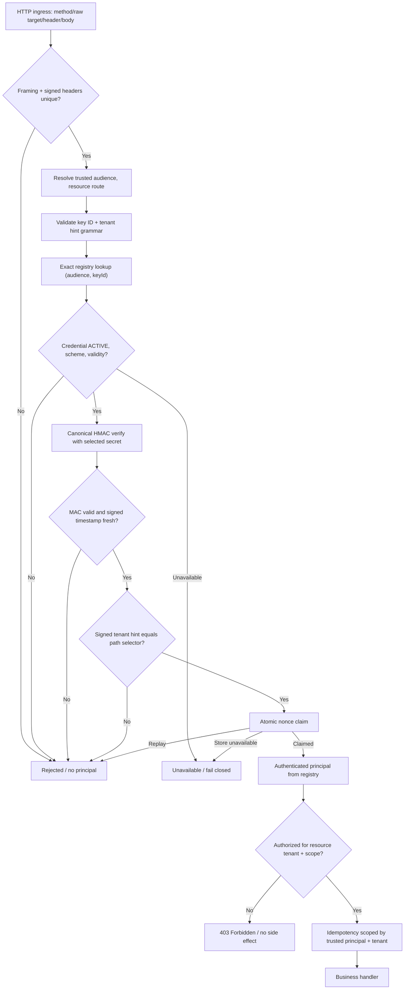

# Key ID theo tenant trong xác thực HTTP request bằng HMAC

Trong một nền tảng SaaS, đối tác ký HTTP request bằng HMAC để gọi API cho nhiều tenant. Header `X-Key-Id` giúp server **tra đúng shared secret**, nhưng không chứng minh đối tác có quyền với tenant mà request đang nhắm tới. Nếu server lấy tenant từ prefix của Key ID hoặc từ `X-Tenant-Id` rồi coi đó là danh tính đã xác thực, hệ thống có thể mắc lỗi truy cập chéo tenant dù HMAC tính đúng.

**Key ID theo tenant** là cách tổ chức **credential namespace và policy binding**: mỗi credential được cấp cho một client, tenant và audience cụ thể; server tra một credential đúng, xác minh HMAC/timestamp/nonce rồi mới tạo authenticated principal từ registry. **Authorization** tiếp tục kiểm tra principal ấy có quyền trên **tenant thực sự sở hữu resource** hay không.

Bài thuộc chương **Multi-tenant**, chủ đề **Key ID theo tenant**, module `SECURITY_AUTHENTICATION_HMAC_REQUEST_AUTHENTICATION`. Module hướng dẫn xác thực HTTP request bằng HMAC với shared secret và canonical request ký method, URI, header hoặc body; xác minh chữ ký, chống replay bằng timestamp/nonce, quản lý rotation, kiểm thử proxy/gateway, phân biệt authentication và authorization. Trọng tâm bài này là **chặn tenant confusion, cross-tenant replay, cache collision và BOLA/IDOR**. Các field và format bên dưới là **hợp đồng minh họa V2**, không phải một tiêu chuẩn áp dụng cho mọi HMAC API.

## 1. Mục tiêu học tập

Sau bài học, bạn có thể:

1. Phân biệt Key ID, secret, client ID, tenant hint, credential tenant, resource tenant, authenticated principal, audience và authorization scope.
2. So sánh namespace **`(trustedAudience,keyId)`** với **`(trustedAudience,tenantNamespace,keyId)`**, nêu điều kiện sử dụng an toàn.
3. Giải thích vì sao tenant trong path/header/host là **request selection context**, không phải bằng chứng sở hữu tenant.
4. Đưa Key ID, audience, tenant hint, raw target, method, signed headers, timestamp, nonce và body digest vào canonical HMAC bytes theo contract.
5. Tra một credential chính xác; kiểm ACTIVE, audience, scheme và expiry; tách authentication khỏi authorization theo tenant/resource.
6. Thiết kế namespace cho credential cache, nonce, idempotency, rate limits và audit để không rò dữ liệu chéo tenant.
7. Kiểm thử key rotation/revocation theo tenant, gateway/proxy rewrite, nhiều region, unavailable dependencies và concurrent replay.
8. Đọc/chạy ví dụ **Java 17** tự chứa với HMAC-SHA256, tenant isolation, idempotency và negative tests.

## 2. Tình huống: một client tích hợp hai tenant độc lập

Giả sử `integration-7` được hai khách hàng ủy quyền:

```text
Trusted audience: orders-api-prod

clientId = integration-7
  |
  +-- tenant-42
  |     keyId = t42-k202611
  |     secret = Secret A
  |     scopes = orders:create
  |
  +-- tenant-99
        keyId = t99-k202611
        secret = Secret B (độc lập với A)
        scopes = orders:create
```

**Cùng client ID không đồng nghĩa cùng tenant.** Mỗi credential đại diện cho phạm vi riêng; registry phải lưu tenant mapping độc lập và dùng secret riêng cho từng credential/trust domain.

Request tới tenant 42:

```http
POST /v1/tenants/tenant-42/orders?channel=partner HTTP/1.1
Host: api.example.test
Content-Type: application/json
X-Key-Id: t42-k202611
X-Tenant-Id: tenant-42
X-Timestamp: 2026-11-28T03:00:00Z
X-Nonce: T6sPvlJXvxAbNR24Z4XAbg
Idempotency-Key: 3e97fc94-8a32-4e02-9411-b89e88fe2cb6
X-Signature: v2=<BASE64_HMAC_SHA256>

{"sku":"BK-42","quantity":2}
```

`<BASE64_HMAC_SHA256>` là **placeholder**, không phải MAC hợp lệ. Để tạo chữ ký thật, client cần đúng secret A và canonical request phù hợp.

Bốn trường hợp phải phân biệt:

| Tình huống | HMAC | Quyết định đúng |
| --- | --- | --- |
| Credential tenant 42 ký request tenant 42 bằng secret A. | Đúng nếu dữ liệu chuẩn. | Authentication pass; authorization cho resource tenant42 nếu có scope. |
| Attacker đổi path tenant42 → tenant99 mà giữ MAC cũ. | Sai vì target được ký. | **401 authentication failure** theo contract. |
| Client thật biết secret A, **tự ký lại** request mới tới tenant99. | Có thể **đúng** dưới credential tenant42. | Authentication có thể pass nhưng **403 authorization** vì resource tenant99. |
| Client sửa `X-Key-Id` A → B nhưng giữ signature A. | Sai dưới secret/canonical B. | Từ chối, không thử A fallback. |

**HMAC đúng không có nghĩa tenant được phép.** Cần policy trên resource tenant **sau** authentication, kể cả khi tenant hint được ký.

## 3. Bốn loại tenant và mức tin cậy

| Loại tenant | Ví dụ | Nguồn | Ý nghĩa |
| --- | --- | --- | --- |
| **Claimed/requested tenant** | `X-Tenant-Id: tenant-99` | Header client khai. | Dữ liệu chưa tin; có thể là signed claim nhưng không tự cấp quyền. |
| **Resource tenant** | `/tenants/tenant-99/orders` hoặc owner tenant của order DB. | Router/DB thực thi resource thật. | Đối tượng **cần authorization**. |
| **Credential tenant** | `tenant-42` gắn với Key ID A. | Credential registry server kiểm soát. | Mapping principal **sau HMAC thành công**. |
| **Authorized effective tenant** | `tenant-42` sau policy allow. | Kết quả policy giữa principal và resource. | Chỉ tồn tại sau kiểm quyền thành công. |

**Audience** (`orders-api-prod`) là đích dịch vụ/môi trường mà key được phép gọi, **không phải tenant**. Credential có thể được cấp riêng cho billing/orders hoặc sandbox/production.

### Tenant trong URL có đáng tin không?

HTTP path là thứ caller yêu cầu, không phải bằng chứng caller sở hữu tenant ấy. Router có thể parse `tenant-99` một cách chính xác nhưng không được tự coi caller là principal tenant99. Với endpoint có object ID như `GET /orders/123`, resource tenant phải lấy từ **owner record trong DB** hoặc một nguồn dữ liệu tin cậy; không chỉ lấy `X-Tenant-Id` từ request để quyết định quyền.

### Header tenant đã ký vẫn chưa phải authorization

Chữ ký chứng minh bên có secret đã đồng ý với **chuỗi giá trị** tenant trong canonical request. Nó **không chứng minh** secret ấy có quyền với tenant đó. Client được cấp secret A của tenant42 có thể tự ký literal `tenant-99` thành một MAC đúng cho request mới. Vì vậy cần **ràng buộc credential tenant, requested tenant và actual resource tenant** bằng policy.

### Một client có thể được ủy quyền nhiều tenant

Nếu business model cho phép delegation xuyên tenant, không được hard-code `principal.tenantId == resourceTenant` cho mọi trường hợp. Hãy dùng **authorization service/ACL/delegation grant tin cậy**, với allowed tenants, operation, resource, expiry và revocation. Ví dụ ở bài dùng **one-credential-one-tenant** để làm rõ ranh giới; production mở rộng policy khi có ủy quyền chính thức.

## 4. Thiết kế namespace Key ID

### Phương án A: Key ID duy nhất trong trusted audience

```text
lookupKey = (trustedAudience, keyId)
record = registry.find(lookupKey)
```

| Audience | Key ID | Tenant | Secret |
| --- | --- | --- | --- |
| `orders-api-prod` | `t42-k202611` | tenant-42 | A |
| `orders-api-prod` | `t99-k202611` | tenant-99 | B |
| `orders-api-prod` | `t42-k202702` | tenant-42 | C |
| `orders-api-sandbox` | `t42-k202611` | tenant-42 | D riêng |

Trong **cùng audience**, mọi tenant chia sẻ namespace Key ID duy nhất. Verifier **không cần tenant hint để tìm key** trước HMAC. Nó tra exact one credential và biết tenant mapping từ registry sau khi xác thực. Đây là lựa chọn thường đơn giản và ít gây ambiguity cho API nhiều tenant.

Key ID nên là identifier opaque, không chứa tenant/client/scope trong ý nghĩa chính thức. Ví dụ có `t42` chỉ để học dễ hiểu; **không parse prefix làm principal**.

### Phương án B: Key ID chỉ duy nhất trong tenant namespace

```text
lookupKey = (trustedAudience, resolvedTenantNamespace, keyId)
```

Hai tenants có thể dùng cùng value `keyId=k-001` nhưng dưới hai namespace độc lập. Khi thiết kế B, phải bảo đảm:

1. Namespace tenant được lấy từ **trusted routing policy** hoặc chỉ dùng như **untrusted lookup hint** nếu ban đầu do caller khai; **không tạo principal ngay**.
2. Tenant selector và Key ID phải được **ràng buộc trong canonical HMAC** và mapping credential phải đúng.
3. Sau MAC, principal lấy từ registry; authorization vẫn kiểm **actual resource tenant** và các delegation grants hợp lệ.
4. Cache, nonce, revoke, audit và rate limit dùng đúng namespace, hoặc dùng **credentialId nội bộ duy nhất** để tránh collision.
5. Không tìm kiếm thử tenant khác nếu lookup/MAC fail; không “scan mọi tenant để tìm secret khớp”.
6. Proxy phải có hợp đồng rõ về tenant hostname/authority, route và caller-supplied forwarded headers.

**Lưu ý:** `Host` hoặc HTTP/2 `:authority` vẫn là thông tin client gửi nhưng ingress có thể kiểm tra rồi dùng làm **trusted routing decision**. Điều đó không tạo quyền tenant. `X-Forwarded-Host` hoặc `X-Original-URI` từ Internet không tự đáng tin; chỉ tin giá trị được ingress/trusted proxy xác minh và ghi đè.

### Lựa chọn và lỗi thiết kế cần tránh

```java
// SAI: chưa verify HMAC đã coi tenant do client gửi là principal.
String claimedTenant = request.header("X-Tenant-Id");
Credential c = registry.find(claimedTenant, request.header("X-Key-Id"));
securityContext.setTenant(claimedTenant); // TENANT SPOOFING
```

Registry trả về credential chỉ là **một ứng viên để verify**, không phải giấy phép mở DB tenant, ghi order hoặc cấp principal. Nếu dùng phương án B với tenant hint do caller khai, phải ghi rõ **đây chỉ là selector chưa tin**, kiểm chữ ký/binding và resource policy trước side effect.

## 5. Credential registry và bất biến tenant isolation

Một record minh họa:

| Field | Ý nghĩa |
| --- | --- |
| `audience` | Service/environment được verifier xác nhận. |
| `keyId` | Định danh chính xác **một credential version** trong namespace. |
| `credentialId` | ID nội bộ opaque để audit/cache/replay nếu cần. |
| `clientId` | Ứng dụng sở hữu key (có thể chung cho nhiều tenants). |
| `tenantId` | Tenant gắn với credential từ registry, không parse Key ID. |
| `scheme` | Phiên bản và thuật toán ký được phép. |
| `state` | PROVISIONED/ACTIVE/REVOKED/EXPIRED theo policy. |
| `validFrom/validUntil` | Khoảng `[from,until)` từ đồng hồ server. |
| `secretRef` | Tham chiếu nội bộ tới shared secret/vault/HSM. |
| `scopes` | Entitlements ban đầu; authorization vẫn kiểm resource. |
| `revision` | Version cho cache consistency/rotation/revocation. |

DDL minh họa cho phương án A:

```sql
CREATE TABLE hmac_credentials (
    audience      VARCHAR(80) NOT NULL,
    key_id        VARCHAR(64) NOT NULL,
    credential_id VARCHAR(64) NOT NULL,
    client_id     VARCHAR(80) NOT NULL,
    tenant_id     VARCHAR(80) NOT NULL,
    scheme        VARCHAR(40) NOT NULL,
    state         VARCHAR(24) NOT NULL,
    valid_from    TIMESTAMP NOT NULL,
    valid_until   TIMESTAMP NOT NULL,
    secret_ref    VARCHAR(240) NOT NULL,
    revision      BIGINT NOT NULL,
    PRIMARY KEY (audience, key_id),
    UNIQUE (credential_id)
);
```

Schema thực còn cần constraints, concurrency control, tombstones và ACL. Nếu dùng phương án B thì uniqueness phải là `(audience, tenant_namespace, key_id)`; **không** vô tình giữ cache key chỉ bằng key ID.

### Các bất biến không được phá

- Không cấp cùng tuple lookup cho hai credentials/tenant khác nhau.
- Không recycle Key ID đã revoke cho secret mới trong cùng namespace; giữ tombstone theo policy.
- Secret **độc lập** theo credential/trust domain. **Ký Key ID không tạo cách ly** nếu hai tenants được phát cùng bytes secret.
- Không lấy algorithm/scope/tenant từ suffix của Key ID; tất cả từ registry/policy.
- Credential chỉ eligible khi ACTIVE, đúng trusted audience/scheme, trong validity và client/tenant vẫn enabled.
- Không tạo principal từ header client; chỉ tạo sau HMAC, timestamp và nonce đều pass.
- Credential bị revoke và policy propagation phải được áp nhất quán trên các gateway trong SLA.


## 6. Hợp đồng canonical HMAC phải ký tenant context

Trong module này, HMAC xác minh rằng request được ký bằng shared secret đúng credential và các thành phần trong **canonical request** không bị sửa. Đối với multi-tenant, phần dữ liệu được ký nên ràng buộc:

- **Key ID**: credential version cụ thể, không phải principal.
- **Trusted audience**: ví dụ `orders-api-prod`, do verifier xác định từ route được kiểm soát.
- **Method/raw target**: bao gồm **resource tenant** trong path và query nếu contract sử dụng.
- **X-Tenant-Id**: tenant hint do client khai, được ký nhưng vẫn cần kiểm authorization.
- **Timestamp/nonce**: bảo vệ freshness/replay, không tự cấp quyền tenant.
- **Signed Content-Type/Idempotency-Key/body digest**: chống thay nội dung hoặc intent trong khi giữ MAC.

Hợp đồng minh họa `HMAC-SHA256-V2`:

| Thành phần | Quy tắc V2 dùng trong ví dụ |
| --- | --- |
| Scheme | Dòng đầu `HMAC-SHA256-V2`, JCA `HmacSHA256`. |
| Audience | `orders-api-prod` từ trusted verifier, **được ký**. |
| Method | `POST`, đúng case. |
| Raw target | `/v1/tenants/tenant-42/orders?channel=partner`, không tự normalize thêm. |
| `Content-Type` | Đúng một `application/json`. |
| `X-Key-Id` | ASCII lowercase `[a-z0-9][a-z0-9._-]{0,63}`. |
| `X-Tenant-Id` | ASCII lowercase tenant name `[a-z0-9][a-z0-9-]{0,31}`. |
| `X-Timestamp` | UTC `YYYY-MM-DDTHH:mm:ssZ`, fresh ±300 giây. |
| `X-Nonce` | Random 16 byte Base64URL unpadded, 22 ký tự. |
| `Idempotency-Key` | UUID lowercase canonical; cùng business intent giữ nguyên. |
| Body | SHA-256 trên **raw body bytes**, hex lowercase. |
| Content-Encoding | V2 demo không chấp nhận. |
| Canonical encoding | UTF-8, LF giữa dòng, **không LF cuối**. |
| Signature | `v2=` + Base64 chuẩn có padding của full HMAC-SHA256 **32 bytes**. |

Ví dụ canonical string:

```text
HMAC-SHA256-V2
orders-api-prod
POST
/v1/tenants/tenant-42/orders?channel=partner
content-type:application/json
x-key-id:t42-k202611
x-tenant-id:tenant-42
x-timestamp:2026-11-28T03:00:00Z
x-nonce:T6sPvlJXvxAbNR24Z4XAbg
idempotency-key:3e97fc94-8a32-4e02-9411-b89e88fe2cb6
sha256:<LOWERCASE_SHA256_HEX_RAW_BODY>
```

Digest `<LOWERCASE_SHA256_HEX_RAW_BODY>` là placeholder. Cả signer và verifier phải tính SHA-256 từ **bytes body gửi/nhận thực tế**, không tái serialize JSON để cố làm chữ ký khớp.

\[
\begin{aligned}
D &= \operatorname{SHA256}(\mathrm{rawBodyBytes}), \\
C &= \operatorname{UTF8}(\mathrm{canonicalFieldsWithHexDigest}(D)),\\
T &= \operatorname{HMAC}_{\mathrm{SHA256}}(K_{\mathrm{keyId}}, C),\\
S &= \texttt{v2=}\Vert\operatorname{Base64}_{\mathrm{padded}}(T).
\end{aligned}
\]

**Header `X-Signature` không tự được đưa vào canonical request** để tránh vòng lặp; còn tenant hint, target và Key ID **đều phải được ràng buộc** theo contract.

### Hai loại tấn công cần test riêng

| Hành động | MAC | Kết quả bắt buộc |
| --- | --- | --- |
| Attacker đổi `X-Tenant-Id: tenant-42` thành `tenant-99` và giữ signature A. | Không khớp. | Reject authentication; không phát hành principal. |
| Attacker đổi URI sang `/tenants/tenant-99/orders` và giữ signature A. | Không khớp. | Reject authentication. |
| Attacker đổi Key ID A thành B nhưng giữ signature A. | Không khớp dưới canonical/secret B. | Reject; không fallback secret A. |
| Client có **secret A hợp lệ** và tự ký **request mới** nhắm tenant99. | Có thể khớp secret A. | Authenticated as tenant42; **authorization reject 403** đối với tenant99. |
| Client ký path tenant42 nhưng header tenant99. | HMAC có thể đúng nếu tự ký cả hai. | Reject mismatch tenant selectors, không tự chọn first/last. |
| Client có secret thuộc tenant99 nhưng gửi `X-Client-Id: admin`. | Có thể khớp secret B. | Chỉ principal B từ registry, không nâng quyền theo header. |

**Ký tenant ID không thay thế authorization.** MAC ràng buộc lời khai của caller; quyền trên tenant là quyết định của server.

### Raw target và proxy rewrite

Nếu gateway nhận `/external/tenant-42/orders` nhưng backend xử lý `/v1/tenants/tenant-42/orders`, phải chọn **một trust boundary** để verify trước rewrite hoặc truyền trusted original target/effective route mapping được bảo vệ. Không chấp nhận `X-Original-URI` do client tự gửi để “giải thích” chữ ký.

Không thử nhiều phiên bản path/case/URL decode/query sort/JSON whitespace đến khi MAC khớp. Nếu thay đổi canonicalization, cần contract/version mới và test migration có kiểm soát.

## 7. Quy trình xác minh và kiểm quyền tenant



**Thứ tự bảo vệ quan trọng:**

1. HTTP adapter chặn các **security headers bị lặp**, CRLF, request smuggling, raw path/query ambiguity và body quá giới hạn. Một `RequestView` đơn giản không tự phát hiện được duplicate sau khi framework đã gộp headers.
2. Verifier xác định **trusted audience** từ deployment/route đã validate; không lấy từ `X-Audience` client.
3. `X-Key-Id` là **lookup hint chưa xác thực**. Chọn đúng một credential trong registry; không “thử đến khi HMAC khớp”.
4. Credential phải ACTIVE, audience/scheme/validity đúng. Nếu key không tồn tại hoặc REVOKED, không cấp principal.
5. MAC phải đúng trên canonical fields đã ký, tag decode Base64 strict và raw full tag so bằng `MessageDigest.isEqual`.
6. Signed timestamp nằm trong freshness window, signed nonce được claim atomically sau MAC thành công.
7. Tenant hint/path khác nhau phải bị từ chối theo contract. Nhưng kể cả khớp **tenant99**, credential tenant42 vẫn có thể authenticate; **authorization** phải phát hiện mismatch và chặn.
8. Backend đọc tenant/resource owner **thực sự** khi authorization; không chỉ nhìn hint hoặc prefix của Key ID.
9. Business/idempotency chạy **sau** authentication và authorization; không trả cached response cross tenant khi chưa kiểm quyền.

### Authentication, authorization và business cùng nhìn tenant khác nhau

Ví dụ client được xác thực là `integration-7 / tenant-42` nhưng gửi request ký hợp lệ cho `tenant-99`. Verifier có thể trả:

```text
Authenticated(
  clientId = integration-7,
  tenantId = tenant-42,
  keyId = t42-k202611,
  scheme = HMAC-SHA256-V2
)
```

Tầng authorization phải so `principal.tenantId` với **resourceTenant=tenant-99** hoặc kiểm delegation grant tin cậy. Nếu không được phép, trả `403` và **không truy cập dữ liệu tenant99**, không tạo order, không đọc idempotency response tenant99.

Trường hợp resource được biểu diễn bằng object ID không chứa tenant, phải tra **owner thật** ở database và kiểm BOLA/IDOR, kể cả khi caller khai `X-Tenant-Id` trùng principal.

## 8. Namespace của credential cache, nonce và idempotency

Không chỉ registry cần phân tách tenant. Các kho phụ trợ cũng có thể tạo **cross-tenant collision** nếu dùng key không đầy đủ.

| Kho/khái niệm | Scope đề xuất | Rủi ro khi scope sai |
| --- | --- | --- |
| Credential lookup kiểu A | `(trustedAudience,keyId)` | Cùng ID ở sandbox/prod chọn nhầm secret. |
| Credential lookup kiểu B | `(audience,tenantNamespace,keyId)` | Hai tenants có Key ID trùng đọc nhầm record. |
| Credential positive/negative cache | Đúng tuple lookup + revision/state/expiry. | Cached ACTIVE sau revoke hoặc key khác tenant. |
| Nonce replay store | `(audience,credentialIdentity,nonce)` hoặc principal sau HMAC theo contract. | Replay bị lọt hoặc nonce collision giữa credentials. |
| Idempotency store | `(audience,authenticatedClientId,authenticatedTenantId,Idempotency-Key)`. | Đọc nhầm cached response hoặc tạo duplicate sau rotation. |
| Authorization cache | Principal, actual resource tenant, action, policy version. | Reuse một quyết định `ALLOW` cho tenant khác. |
| Per-tenant quota sau auth | Verified client/tenant/route. | Tenant này tiêu quota tenant khác hoặc bypass. |
| Audit/metrics | Route code, outcome, masked tenant/credential alias có ACL. | Lộ danh sách tenants hoặc high-cardinality flood. |

### Namespace của nonce

Có thể dùng:

```text
replay:v2:<trustedAudience>:<credentialId>:<nonce>
```

`credentialId` là ID nội bộ duy nhất trong trust domain. Nếu dùng Key ID theo tenant-local namespace, **không** dùng `replay:<keyId>:<nonce>` vì có thể đụng giữa tenants.

Một contract khác có thể dùng `(authenticatedPrincipal,nonce)` để bảo đảm không tái sử dụng nonce **xuyên rotation**. Đây là lựa chọn threat model; cần đảm bảo đã verify HMAC rồi mới dùng principal để claim. Không lấy tenant header client khai làm replay namespace “đáng tin” trước authentication.

Với freshness `now - 300s ≤ signedTimestamp ≤ now + 300s`, giữ nonce đến ít nhất:

```text
nonceExpiresAt = signedTimestamp + allowedPastSeconds + safetyMarginSeconds
```

Timestamp ở tương lai có thể được nhận từ `T - 300s` đến `T + 300s`. TTL chỉ 300 giây từ lần claim **có thể hết trước khi signature hết fresh**. Claim cần atomic trên topology phù hợp và fail closed khi store không sẵn sàng.

### Scope idempotency theo tenant đã xác thực

Đối tác `integration-7` dùng cùng chuỗi Idempotency-Key K ở hai tenants:

```text
(orders-api-prod, integration-7, tenant-42, K) -> order-101
(orders-api-prod, integration-7, tenant-99, K) -> order-202
```

Kết quả **độc lập** vì tenant khác. Nhưng khi tenant42 rotate `t42-k202611` → `t42-k202702` rồi retry intent K, scope **không** thay đổi chỉ do Key ID đổi, nên phải trả lại `order-101` nếu fingerprint giống và authorization đạt.

Request fingerprint có thể gồm method, canonical resource target, media type và SHA-256(raw body), **không gồm Key ID, signature hoặc nonce**. Hệ thống thật cần unique constraint, transaction/outbox và recovery; một in-memory `HashMap` chỉ có tính minh họa.

**Không được trả cached response trước authn/authz.** Nếu caller tenant42 gửi K của tenant99, HMAC của caller có thể đúng nhưng quyền tenant99 vẫn không có.

## 9. Rotation, revocation và tenant offboarding

Multi-tenant là một trục độc lập với credential lifecycle. Ví dụ:

```text
clientId = integration-7

Tenant 42:
  t42-k202611 = ACTIVE -> REVOKED
  t42-k202702 = ACTIVE (new secret, same principal tenant42)

Tenant 99:
  t99-k202611 = ACTIVE (unaffected)
```

| Quyết định | Phạm vi | Test bắt buộc |
| --- | --- | --- |
| Revoke `t42-k202611` | Một credential tenant42. | A fail, B tenant42 còn ACTIVE, tenant99 không bị chặn. |
| Disable tenant42 | Mọi credentials/grants của tenant42 theo policy. | Key cũ/mới thuộc tenant42 fail; tenant99 không bị ảnh hưởng nếu policy không mở rộng. |
| Disable toàn client integration-7 | Mọi credentials của client ở nhiều tenants. | Cả tenant42 và tenant99 bị chặn. |
| Thu hồi scope `orders:create` | Authorization của action/resource. | Authentication có thể pass; tạo order phải 403. |
| Rotation tenant42 | Key ID mới + secret mới độc lập, overlap có thời hạn. | Client signer chọn pair nguyên tử; retry cùng intent không tạo trùng. |
| Credential tenant42 bị compromise | Thu hồi khẩn cấp đúng phạm vi. | Timestamp/nonce mới **không thể cứu key đã revoke**. |

**Không “chuyển” một credential đang ACTIVE sang tenant khác bằng cách sửa field `tenantId`.** Nếu cần thay ownership/delegation, hãy provision credential mới với scope/audience thích hợp, revoke cái cũ và audit migration. Recycle Key ID hoặc secret làm cache/audit/replay namespace nhập nhằng.

### Tenant-level cache invalidation và enforcement SLA

Trong cluster, gateway A có cache `t42-k202611=ACTIVE` còn gateway B đã nhận `REVOKED`. Update registry **không đồng nghĩa** mọi gateway thực thi ngay. Cần bounded TTL, invalidation/revision, watermark/reconciliation và **revocation enforcement SLA có đo**. Test key bị revoke ở **tất cả gateway**, không chỉ một node.

Nếu registry hoặc secret manager unavailable, verifier không được fallback sang Key ID khác, tenant khác hoặc unauthenticated access. Một policy cache offline có thể được thiết kế cho threat model cụ thể nhưng phải được phân tích rủi ro revoke/consistency và không tự nhận “fail closed” nếu vẫn chấp nhận stale ACTIVE ngoài giới hạn.


## 10. Java 17: Key ID theo tenant, HMAC và cross-tenant authorization

Chương trình sau là một **demo Java 17 tự chứa**, không yêu cầu Spring/Redis/framework. Nó mô phỏng **namespace Key ID duy nhất trong audience**, với hai tenants có thể sử dụng **cùng clientId nhưng credentials và secret độc lập**.

Demo có:

- `CredentialRegistry` tra đúng một `(trustedAudience,keyId)`; không lookup theo `X-Tenant-Id` do caller tự khai.
- `Credential` chứa tenant, client, audience, scheme, state, validity, scopes và revision từ nguồn tin cậy.
- `SignedRequest` chứa `X-Tenant-Id`, Key ID, raw target, timestamp, nonce, signed Idempotency-Key và raw body; HTTP ingress **giả định đã chặn duplicate headers/framing sai**.
- HMAC-SHA256 V2 theo canonical contract ở phần 6; so raw bytes bằng `MessageDigest.isEqual`, **không thử secret khác**.
- `Authenticated` chỉ được phát khi MAC, freshness, tenant selector consistency và nonce đều đạt; principal lấy từ registry.
- `Gateway` kiểm **resource tenant từ path** với authenticated principal, và scope `orders:create` **sau** authentication.
- `IdempotentOrders` dùng scope `(audience,clientId,tenantId,idempotencyKey)`, vì Key ID có thể thay trong rotation.
- Negative tests: cross-tenant valid MAC nhưng `403`, thay tenant header/path giữ chữ ký, mixed pair, duplicate Key ID, revoked key, tenant suspend, client disable, registry/nonce outage, concurrent replay.
- `LocalNonceStore` và `IdempotentOrders` chỉ atomic **trong một JVM**; hệ phân tán cần shared store/transaction.

### Mã nguồn hoàn chỉnh

Lưu thành `TenantKeyIdHmacDemo.java`:

```java
import java.nio.charset.StandardCharsets;
import java.security.GeneralSecurityException;
import java.security.MessageDigest;
import java.security.SecureRandom;
import java.time.Clock;
import java.time.Instant;
import java.time.ZoneOffset;
import java.time.format.DateTimeParseException;
import java.util.Arrays;
import java.util.Base64;
import java.util.HashMap;
import java.util.HashSet;
import java.util.HexFormat;
import java.util.Map;
import java.util.Set;
import java.util.UUID;
import java.util.concurrent.Callable;
import java.util.concurrent.CountDownLatch;
import java.util.concurrent.ExecutorService;
import java.util.concurrent.Executors;
import java.util.concurrent.Future;
import java.util.regex.Matcher;
import java.util.regex.Pattern;
import javax.crypto.Mac;
import javax.crypto.spec.SecretKeySpec;

public final class TenantKeyIdHmacDemo {
    private static final String SCHEME = "HMAC-SHA256-V2";
    private static final String AUDIENCE = "orders-api-prod";
    private static final String SANDBOX = "orders-api-sandbox";
    private static final String CONTENT_TYPE = "application/json";
    private static final String SIGNATURE_PREFIX = "v2=";
    private static final long WINDOW_SECONDS = 300;
    private static final long NONCE_MARGIN_SECONDS = 30;

    private static final Pattern RESOURCE_TARGET = Pattern.compile(
            "^/v1/tenants/([a-z0-9][a-z0-9-]{0,31})"
                    + "/orders\\?channel=partner$");

    private TenantKeyIdHmacDemo() {}

    public enum KeyState { ACTIVE, REVOKED }

    public enum AuthStatus {
        AUTHENTICATED, BAD_REQUEST, INVALID_CREDENTIAL,
        INVALID_SIGNATURE, NOT_FRESH, TENANT_SELECTOR_MISMATCH,
        NONCE_REPLAY, UNAVAILABLE
    }

    public record Principal(
            String clientId, String tenantId, Set<String> scopes) {
        public Principal {
            scopes = Set.copyOf(scopes);
        }
    }

    public record AuthResult(
            AuthStatus status, Principal principal,
            String credentialId) {
        public AuthResult {
            if ((status == AuthStatus.AUTHENTICATED)
                    != (principal != null && credentialId != null)) {
                throw new IllegalArgumentException(
                        "Principal may exist only after authentication");
            }
        }
        public static AuthResult deny(AuthStatus reason) {
            return new AuthResult(reason, null, null);
        }
        public static AuthResult allow(
                Principal principal, String credentialId) {
            return new AuthResult(
                    AuthStatus.AUTHENTICATED, principal, credentialId);
        }
    }

    public record Credential(
            String keyId, String clientId, String tenantId,
            String audience, String scheme, KeyState state,
            Instant validFrom, Instant validUntil,
            long revision, byte[] secret, Set<String> scopes) {
        public Credential {
            if (state == KeyState.ACTIVE
                    && (secret == null || secret.length < 32)) {
                throw new IllegalArgumentException(
                        "Demo ACTIVE key must contain 32+ bytes");
            }
            secret = secret == null ? null : secret.clone();
            scopes = Set.copyOf(scopes);
        }
        @Override
        public byte[] secret() {
            return secret == null ? null : secret.clone();
        }
        @Override
        public String toString() {
            return "Credential[REDACTED]";
        }
        Credential revokedCopy() {
            return new Credential(
                    keyId, clientId, tenantId, audience, scheme,
                    KeyState.REVOKED, validFrom, validUntil,
                    revision + 1, null, scopes);
        }
    }

    public record SigningCredential(String keyId, byte[] secret) {
        public SigningCredential {
            secret = secret.clone();
        }
        @Override
        public byte[] secret() {
            return secret.clone();
        }
        @Override
        public String toString() {
            return "SigningCredential[REDACTED]";
        }
    }

    public record SignedRequest(
            String method, String rawTarget, String contentType,
            boolean contentEncodingPresent, String keyId,
            String tenantHint, String timestamp, String nonce,
            String idempotencyKey, byte[] rawBody, String signature) {
        public SignedRequest {
            if (rawBody != null) {
                rawBody = rawBody.clone();
            }
        }
        @Override
        public byte[] rawBody() {
            return rawBody == null ? null : rawBody.clone();
        }
        @Override
        public String toString() {
            return "SignedRequest[REDACTED]";
        }
    }

    public record RegistryKey(String audience, String keyId) {}

    public static class RegistryUnavailable extends Exception {}
    public static class NonceUnavailable extends Exception {}

    public interface CredentialRegistry {
        Credential find(String audience, String keyId)
                throws RegistryUnavailable;
        boolean isEnabled(String clientId, String tenantId)
                throws RegistryUnavailable;
    }

    /** Registry giả lập, không có phân tán và không cache stale. */
    public static final class LocalRegistry
            implements CredentialRegistry {
        private final Map<RegistryKey, Credential> records =
                new HashMap<>();
        private final Set<String> disabledClients = new HashSet<>();
        private final Set<String> disabledTenants = new HashSet<>();
        private boolean online = true;
        private int lookupCount = 0;

        public synchronized void register(Credential c) {
            RegistryKey key = new RegistryKey(c.audience(), c.keyId());
            if (records.containsKey(key)) {
                throw new IllegalStateException(
                        "Duplicate Key ID in an audience");
            }
            records.put(key, c);
        }

        public synchronized void revoke(
                String audience, String keyId) {
            RegistryKey key = new RegistryKey(audience, keyId);
            Credential old = records.get(key);
            if (old == null) {
                throw new IllegalArgumentException("Unknown key");
            }
            if (old.state() == KeyState.REVOKED) {
                return;
            }
            records.put(key, old.revokedCopy());
        }

        public synchronized void disableTenant(String tenantId) {
            disabledTenants.add(tenantId);
        }

        public synchronized void disableClient(String clientId) {
            disabledClients.add(clientId);
        }

        public synchronized void setOnline(boolean online) {
            this.online = online;
        }

        @Override
        public synchronized Credential find(
                String audience, String keyId)
                throws RegistryUnavailable {
            lookupCount++;
            if (!online) {
                throw new RegistryUnavailable();
            }
            return records.get(new RegistryKey(audience, keyId));
        }

        @Override
        public synchronized boolean isEnabled(
                String clientId, String tenantId)
                throws RegistryUnavailable {
            if (!online) {
                throw new RegistryUnavailable();
            }
            return !disabledClients.contains(clientId)
                    && !disabledTenants.contains(tenantId);
        }

        public synchronized int lookups() {
            return lookupCount;
        }
    }

    public interface NonceStore {
        boolean claim(String key, Instant expiresAt, Instant now)
                throws NonceUnavailable;
    }

    /** synchronized chỉ atomic trong một JVM demo. */
    public static final class LocalNonceStore
            implements NonceStore {
        private final Map<String, Instant> claimed = new HashMap<>();

        @Override
        public synchronized boolean claim(
                String key, Instant expiresAt, Instant now) {
            claimed.entrySet().removeIf(
                    entry -> !entry.getValue().isAfter(now));
            if (!expiresAt.isAfter(now) || claimed.containsKey(key)) {
                return false;
            }
            claimed.put(key, expiresAt);
            return true;
        }
    }

    private static boolean validKeyId(String keyId) {
        return keyId != null
                && keyId.matches("[a-z0-9][a-z0-9._-]{0,63}");
    }

    private static boolean validTenantId(String tenantId) {
        return tenantId != null
                && tenantId.matches("[a-z0-9][a-z0-9-]{0,31}");
    }

    private static String resourceTenant(String rawTarget) {
        if (rawTarget == null) {
            return null;
        }
        Matcher matcher = RESOURCE_TARGET.matcher(rawTarget);
        return matcher.matches() ? matcher.group(1) : null;
    }

    private static boolean validIdempotencyKey(String key) {
        if (key == null || key.length() != 36) {
            return false;
        }
        try {
            return UUID.fromString(key).toString().equals(key);
        } catch (IllegalArgumentException malformed) {
            return false;
        }
    }

    private static String newNonce(SecureRandom random) {
        byte[] bytes = new byte[16];
        random.nextBytes(bytes);
        return Base64.getUrlEncoder().withoutPadding()
                .encodeToString(bytes);
    }

    private static boolean validNonce(String nonce) {
        if (nonce == null || nonce.length() != 22) {
            return false;
        }
        try {
            byte[] bytes = Base64.getUrlDecoder().decode(nonce);
            return bytes.length == 16
                    && Base64.getUrlEncoder().withoutPadding()
                            .encodeToString(bytes).equals(nonce);
        } catch (IllegalArgumentException malformed) {
            return false;
        }
    }

    private static Instant parseTimestamp(String timestamp) {
        if (timestamp == null || !timestamp.matches(
                "[0-9]{4}-[0-9]{2}-[0-9]{2}T"
                + "[0-9]{2}:[0-9]{2}:[0-9]{2}Z")) {
            throw new IllegalArgumentException("Invalid timestamp");
        }
        try {
            Instant value = Instant.parse(timestamp);
            if (!value.toString().equals(timestamp)) {
                throw new IllegalArgumentException(
                        "Timestamp is not canonical");
            }
            return value;
        } catch (DateTimeParseException malformed) {
            throw new IllegalArgumentException(
                    "Timestamp could not be parsed", malformed);
        }
    }

    private static boolean validShape(SignedRequest r) {
        if (r == null || !"POST".equals(r.method())
                || resourceTenant(r.rawTarget()) == null
                || !CONTENT_TYPE.equals(r.contentType())
                || r.contentEncodingPresent()
                || !validKeyId(r.keyId())
                || !validTenantId(r.tenantHint())
                || !validNonce(r.nonce())
                || !validIdempotencyKey(r.idempotencyKey())
                || r.rawBody() == null
                || r.rawBody().length > 8192) {
            return false;
        }
        try {
            parseTimestamp(r.timestamp());
            return true;
        } catch (IllegalArgumentException invalid) {
            return false;
        }
    }

    private static String sha256Hex(byte[] rawBody)
            throws GeneralSecurityException {
        return HexFormat.of().formatHex(
                MessageDigest.getInstance("SHA-256").digest(rawBody));
    }

    private static byte[] canonicalBytes(
            String audience, SignedRequest r)
            throws GeneralSecurityException {
        String canonical = String.join("\n",
                SCHEME, audience, r.method(), r.rawTarget(),
                "content-type:" + r.contentType(),
                "x-key-id:" + r.keyId(),
                "x-tenant-id:" + r.tenantHint(),
                "x-timestamp:" + r.timestamp(),
                "x-nonce:" + r.nonce(),
                "idempotency-key:" + r.idempotencyKey(),
                "sha256:" + sha256Hex(r.rawBody()));
        return canonical.getBytes(StandardCharsets.UTF_8);
    }

    private static byte[] hmac(byte[] secret, byte[] canonical)
            throws GeneralSecurityException {
        // 32-byte secret là policy cấp key của demo, không phải
        // giới hạn bắt buộc do mọi JCA provider áp đặt.
        if (secret == null || secret.length < 32) {
            throw new GeneralSecurityException(
                    "Invalid HMAC key provisioning");
        }
        Mac mac = Mac.getInstance("HmacSHA256");
        mac.init(new SecretKeySpec(secret, "HmacSHA256"));
        return mac.doFinal(canonical);
    }

    private static byte[] decodeTag(String signature) {
        if (signature == null || signature.length() != 47
                || !signature.startsWith(SIGNATURE_PREFIX)) {
            return null;
        }
        String encoded = signature.substring(
                SIGNATURE_PREFIX.length());
        if (!encoded.matches("[A-Za-z0-9+/]{43}=")) {
            return null;
        }
        try {
            byte[] raw = Base64.getDecoder().decode(encoded);
            return raw.length == 32
                    && Base64.getEncoder().encodeToString(raw)
                            .equals(encoded) ? raw : null;
        } catch (IllegalArgumentException invalid) {
            return null;
        }
    }

    /**
     * Signer tạo test fixture. Đưa cùng một snapshot keyId+secret
     * vào header và phép HMAC, không đọc hai config fields rời.
     */
    public static SignedRequest signForTest(
            SigningCredential pair, String target, String tenantHint,
            String timestamp, String nonce, String intent, byte[] body)
            throws GeneralSecurityException {
        SignedRequest unsigned = new SignedRequest(
                "POST", target, CONTENT_TYPE, false, pair.keyId(),
                tenantHint, timestamp, nonce, intent, body, null);
        if (!validShape(unsigned)) {
            throw new IllegalArgumentException("Invalid fixture");
        }
        byte[] secretCopy = pair.secret();
        try {
            String signature = SIGNATURE_PREFIX
                    + Base64.getEncoder().encodeToString(
                        hmac(secretCopy, canonicalBytes(
                                AUDIENCE, unsigned)));
            return new SignedRequest(
                    unsigned.method(), unsigned.rawTarget(),
                    unsigned.contentType(), false, unsigned.keyId(),
                    unsigned.tenantHint(), unsigned.timestamp(),
                    unsigned.nonce(), unsigned.idempotencyKey(),
                    unsigned.rawBody(), signature);
        } finally {
            Arrays.fill(secretCopy, (byte) 0); // Best effort.
        }
    }

    public static final class Verifier {
        private final String trustedAudience;
        private final CredentialRegistry registry;
        private final NonceStore nonces;
        private final Clock clock;

        public Verifier(
                String trustedAudience, CredentialRegistry registry,
                NonceStore nonces, Clock clock) {
            this.trustedAudience = trustedAudience;
            this.registry = registry;
            this.nonces = nonces;
            this.clock = clock;
        }

        public AuthResult authenticate(SignedRequest request) {
            if (!validShape(request)) {
                return AuthResult.deny(AuthStatus.BAD_REQUEST);
            }

            Credential credential;
            Instant now = clock.instant();
            try {
                // Key ID is a lookup hint, NOT an authenticated tenant.
                // Do NOT use request.tenantHint() for this lookup.
                credential = registry.find(
                        trustedAudience, request.keyId());
                if (credential == null
                        || credential.state() != KeyState.ACTIVE
                        || !SCHEME.equals(credential.scheme())
                        || !trustedAudience.equals(
                                credential.audience())
                        || !request.keyId().equals(credential.keyId())
                        || now.isBefore(credential.validFrom())
                        || !now.isBefore(credential.validUntil())
                        || !registry.isEnabled(
                                credential.clientId(),
                                credential.tenantId())) {
                    return AuthResult.deny(
                            AuthStatus.INVALID_CREDENTIAL);
                }
            } catch (RegistryUnavailable unavailable) {
                return AuthResult.deny(AuthStatus.UNAVAILABLE);
            }

            byte[] supplied = decodeTag(request.signature());
            if (supplied == null) {
                return AuthResult.deny(AuthStatus.INVALID_SIGNATURE);
            }

            byte[] secretCopy = credential.secret();
            try {
                byte[] expected = hmac(secretCopy,
                        canonicalBytes(trustedAudience, request));
                if (!MessageDigest.isEqual(expected, supplied)) {
                    // Never try another credential or tenant.
                    return AuthResult.deny(
                            AuthStatus.INVALID_SIGNATURE);
                }
            } catch (GeneralSecurityException cryptoUnavailable) {
                return AuthResult.deny(AuthStatus.UNAVAILABLE);
            } finally {
                if (secretCopy != null) {
                    Arrays.fill(secretCopy, (byte) 0);
                }
            }

            Instant signedTime = parseTimestamp(request.timestamp());
            if (signedTime.isBefore(
                        now.minusSeconds(WINDOW_SECONDS))
                    || signedTime.isAfter(
                        now.plusSeconds(WINDOW_SECONDS))) {
                return AuthResult.deny(AuthStatus.NOT_FRESH);
            }

            // Both values have valid grammar; after verified MAC
            // require two client-supplied selectors to be consistent.
            if (!request.tenantHint().equals(
                    resourceTenant(request.rawTarget()))) {
                return AuthResult.deny(
                        AuthStatus.TENANT_SELECTOR_MISMATCH);
            }

            // Scope replay by trusted audience + globally unique keyId.
            // Tenant-local key IDs would require credentialId/namespace.
            String replayKey = "replay:v2:" + trustedAudience
                    + ":" + credential.keyId() + ":"
                    + request.nonce();
            Instant expires = signedTime.plusSeconds(
                    WINDOW_SECONDS + NONCE_MARGIN_SECONDS);
            try {
                if (!nonces.claim(replayKey, expires, now)) {
                    return AuthResult.deny(AuthStatus.NONCE_REPLAY);
                }
            } catch (NonceUnavailable unavailable) {
                return AuthResult.deny(AuthStatus.UNAVAILABLE);
            }

            // Publish identity ONLY after signature/freshness/replay.
            return AuthResult.allow(
                    new Principal(
                            credential.clientId(),
                            credential.tenantId(),
                            credential.scopes()),
                    credential.keyId());
        }
    }

    public record Response(int status, String body, boolean reused) {}

    public record IntentScope(
            String audience, String clientId,
            String tenantId, String idempotencyKey) {}

    private record Saved(String fingerprint, Response result) {}

    /**
     * Educational only: no durability or transaction across JVMs.
     */
    public static final class IdempotentOrders {
        private final Map<IntentScope, Saved> completed =
                new HashMap<>();
        private int committed = 0;

        public synchronized Response create(
                String audience, Principal principal, SignedRequest r) {
            IntentScope scope = new IntentScope(
                    audience, principal.clientId(),
                    principal.tenantId(), r.idempotencyKey());
            String fingerprint;
            try {
                fingerprint = String.join("\n",
                        r.method(), r.rawTarget(),
                        r.contentType(), sha256Hex(r.rawBody()));
            } catch (GeneralSecurityException unavailable) {
                throw new IllegalStateException(
                        "Digest provider unavailable");
            }
            Saved previous = completed.get(scope);
            if (previous != null) {
                if (!previous.fingerprint().equals(fingerprint)) {
                    return new Response(
                            409, "{\"error\":\"intent_conflict\"}", false);
                }
                return new Response(
                        previous.result().status(),
                        previous.result().body(), true);
            }

            int id = ++committed;
            Response created = new Response(
                    201, "{\"orderId\":" + id + "}", false);
            completed.put(scope, new Saved(fingerprint, created));
            return created;
        }

        public synchronized int committed() {
            return committed;
        }
    }

    public static final class Gateway {
        private final String trustedAudience;
        private final Verifier verifier;
        private final IdempotentOrders orders;

        public Gateway(String trustedAudience,
                Verifier verifier, IdempotentOrders orders) {
            this.trustedAudience = trustedAudience;
            this.verifier = verifier;
            this.orders = orders;
        }

        public Response handle(SignedRequest request) {
            AuthResult auth = verifier.authenticate(request);
            if (auth.status() != AuthStatus.AUTHENTICATED) {
                int status = auth.status() == AuthStatus.UNAVAILABLE
                        ? 503
                        : (auth.status() == AuthStatus.BAD_REQUEST
                                || auth.status()
                                    == AuthStatus.TENANT_SELECTOR_MISMATCH)
                            ? 400 : 401;
                return new Response(
                        status,
                        "{\"error\":\"authentication_failed\"}", false);
            }

            // REAL resource tenant is parsed from the route, not
            // inferred from the keyId or a client identity header.
            String requestedTenant =
                    resourceTenant(request.rawTarget());
            Principal principal = auth.principal();
            if (!principal.tenantId().equals(requestedTenant)
                    || !principal.scopes().contains("orders:create")) {
                return new Response(
                        403, "{\"error\":\"forbidden\"}", false);
            }

            // Only after authn/authz, access tenant-scoped cached result.
            return orders.create(
                    trustedAudience, principal, request);
        }
    }

    private static void expectStatus(
            int status, Response response, String scenario) {
        if (response.status() != status) {
            throw new AssertionError(scenario + ": expected "
                    + status + ", got " + response.status());
        }
    }

    private static SignedRequest request(
            SigningCredential pair, String tenant,
            String timestamp, String nonce, String intent, byte[] body)
            throws GeneralSecurityException {
        String target = "/v1/tenants/" + tenant
                + "/orders?channel=partner";
        return signForTest(
                pair, target, tenant, timestamp, nonce, intent, body);
    }

    public static void main(String[] args) throws Exception {
        // FAKE test keys, independently provisioned per credential.
        byte[] secret42 = new byte[32];
        byte[] secret42New = new byte[32];
        byte[] secret99 = new byte[32];
        byte[] secretReadOnly = new byte[32];
        Arrays.fill(secret42, (byte) 0x41);
        Arrays.fill(secret42New, (byte) 0x42);
        Arrays.fill(secret99, (byte) 0x63);
        Arrays.fill(secretReadOnly, (byte) 0x64);

        SigningCredential pair42 = new SigningCredential(
                "t42-k202611", secret42);
        SigningCredential pair42New = new SigningCredential(
                "t42-k202702", secret42New);
        SigningCredential pair99 = new SigningCredential(
                "t99-k202611", secret99);
        SigningCredential pairReadOnly = new SigningCredential(
                "t42-readonly", secretReadOnly);

        Instant from = Instant.parse("2026-01-01T00:00:00Z");
        Instant until = Instant.parse("2028-01-01T00:00:00Z");
        String client = "integration-7";
        Credential key42 = new Credential(
                pair42.keyId(), client, "tenant-42",
                AUDIENCE, SCHEME, KeyState.ACTIVE,
                from, until, 1L, secret42,
                Set.of("orders:create"));
        Credential key42New = new Credential(
                pair42New.keyId(), client, "tenant-42",
                AUDIENCE, SCHEME, KeyState.ACTIVE,
                from, until, 1L, secret42New,
                Set.of("orders:create"));
        Credential key99 = new Credential(
                pair99.keyId(), client, "tenant-99",
                AUDIENCE, SCHEME, KeyState.ACTIVE,
                from, until, 1L, secret99,
                Set.of("orders:create"));
        Credential readOnly = new Credential(
                pairReadOnly.keyId(), client, "tenant-42",
                AUDIENCE, SCHEME, KeyState.ACTIVE,
                from, until, 1L, secretReadOnly,
                Set.of("orders:read"));

        LocalRegistry registry = new LocalRegistry();
        registry.register(key42);
        registry.register(key42New);
        registry.register(key99);
        registry.register(readOnly);
        Clock clock = Clock.fixed(
                Instant.parse("2026-11-28T03:00:30Z"),
                ZoneOffset.UTC);
        SecureRandom random = new SecureRandom();
        LocalNonceStore nonces = new LocalNonceStore();
        IdempotentOrders orders = new IdempotentOrders();
        Verifier verifier = new Verifier(
                AUDIENCE, registry, nonces, clock);
        Gateway gateway = new Gateway(AUDIENCE, verifier, orders);

        String timestamp = "2026-11-28T03:00:00Z";
        byte[] body = "{\"sku\":\"BK-42\",\"quantity\":2}"
                .getBytes(StandardCharsets.UTF_8);
        String intent = UUID.randomUUID().toString();

        // Tenant42: one business commit.
        SignedRequest first42 = request(
                pair42, "tenant-42", timestamp,
                newNonce(random), intent, body);
        Response r42 = gateway.handle(first42);
        expectStatus(201, r42, "tenant42 initial");
        if (r42.reused() || orders.committed() != 1) {
            throw new AssertionError("Tenant42 initial commit");
        }

        // Replaying the SAME signed request cannot bypass nonce check.
        expectStatus(401,
                gateway.handle(first42), "same request replay");

        // Fresh attempt with SAME intent in tenant42: reused result.
        SignedRequest retry42 = request(
                pair42, "tenant-42", timestamp,
                newNonce(random), intent, body);
        Response reused42 = gateway.handle(retry42);
        expectStatus(201, reused42, "tenant42 retry");
        if (!reused42.reused() || orders.committed() != 1) {
            throw new AssertionError("Idempotency scope within tenant42");
        }

        // SAME clientId and SAME intent string, but DIFFERENT tenant:
        // must be a separate business result with no data disclosure.
        SignedRequest first99 = request(
                pair99, "tenant-99", timestamp,
                newNonce(random), intent, body);
        Response r99 = gateway.handle(first99);
        expectStatus(201, r99, "tenant99 separate scope");
        if (r99.reused()
                || r99.body().equals(r42.body())
                || orders.committed() != 2) {
            throw new AssertionError("Cross-tenant cached response leak");
        }

        // Key42 can correctly HMAC-sign a NEW request to tenant99.
        // Authentication may succeed, but authorization must return 403.
        SignedRequest unauthorized = request(
                pair42, "tenant-99", timestamp,
                newNonce(random), intent, body);
        expectStatus(403, gateway.handle(unauthorized),
                "valid HMAC but wrong resource tenant");
        if (orders.committed() != 2) {
            throw new AssertionError("Unauthorized business side effect");
        }

        // Consistent signed tenant header and path is also required.
        SignedRequest inconsistent = signForTest(
                pair42,
                "/v1/tenants/tenant-99/orders?channel=partner",
                "tenant-42", timestamp, newNonce(random), intent, body);
        expectStatus(400, gateway.handle(inconsistent),
                "signed path/hint mismatch");

        // Tamper signed tenant header but keep original MAC.
        SignedRequest changedHint = new SignedRequest(
                first42.method(), first42.rawTarget(),
                first42.contentType(), false, first42.keyId(),
                "tenant-99", first42.timestamp(), first42.nonce(),
                first42.idempotencyKey(), first42.rawBody(),
                first42.signature());
        expectStatus(401, gateway.handle(changedHint),
                "tampered signed tenant hint");

        // Tamper signed path only; retain signed header/MAC.
        SignedRequest changedPath = new SignedRequest(
                first42.method(),
                "/v1/tenants/tenant-99/orders?channel=partner",
                first42.contentType(), false, first42.keyId(),
                first42.tenantHint(), first42.timestamp(),
                first42.nonce(), first42.idempotencyKey(),
                first42.rawBody(), first42.signature());
        expectStatus(401, gateway.handle(changedPath),
                "tampered signed resource target");

        // Swap key ID but keep old signature: no secret fallback.
        SignedRequest swappedId = new SignedRequest(
                first42.method(), first42.rawTarget(),
                first42.contentType(), false, pair99.keyId(),
                first42.tenantHint(), first42.timestamp(),
                first42.nonce(), first42.idempotencyKey(),
                first42.rawBody(), first42.signature());
        expectStatus(401, gateway.handle(swappedId),
                "swapped Key ID");

        // Client signing under ID99 but using secret42 must fail.
        SigningCredential wrongPair = new SigningCredential(
                pair99.keyId(), secret42);
        SignedRequest mixedPair = request(
                wrongPair, "tenant-99", timestamp,
                newNonce(random), intent, body);
        expectStatus(401, gateway.handle(mixedPair),
                "mixed Key ID and secret");

        // Malformed Key ID is rejected BEFORE touching registry.
        SignedRequest malformedId = new SignedRequest(
                first42.method(), first42.rawTarget(),
                first42.contentType(), false, "../tenant-root",
                first42.tenantHint(), first42.timestamp(),
                newNonce(random), first42.idempotencyKey(),
                first42.rawBody(), first42.signature());
        int lookupsBefore = registry.lookups();
        expectStatus(400, gateway.handle(malformedId),
                "malformed Key ID");
        if (registry.lookups() != lookupsBefore) {
            throw new AssertionError("Bad ID entered credential registry");
        }

        // Duplicate Key ID in the same audience is forbidden even
        // if a new record would claim a different tenant.
        try {
            registry.register(new Credential(
                    pair42.keyId(), "another-client", "tenant-99",
                    AUDIENCE, SCHEME, KeyState.ACTIVE,
                    from, until, 1L, secret99,
                    Set.of("orders:create")));
            throw new AssertionError("Duplicate namespace accepted");
        } catch (IllegalStateException expected) {
            // Unique (trustedAudience, keyId) enforced.
        }

        // A credential with only orders:read cannot create an order.
        SignedRequest readonlyRequest = request(
                pairReadOnly, "tenant-42", timestamp,
                newNonce(random), UUID.randomUUID().toString(), body);
        expectStatus(403, gateway.handle(readonlyRequest),
                "authenticated but missing action scope");

        // Tenant42 rotates A to A2, but same intent must reuse order.
        SignedRequest rotated = request(
                pair42New, "tenant-42", timestamp,
                newNonce(random), intent, body);
        Response afterRotation = gateway.handle(rotated);
        expectStatus(201, afterRotation, "rotation within tenant42");
        if (!afterRotation.reused()
                || !afterRotation.body().equals(r42.body())
                || orders.committed() != 2) {
            throw new AssertionError("Rotation changed tenant intent");
        }

        // Two threads replay SAME signed request: only one accepted.
        SignedRequest race = request(
                pair42New, "tenant-42", timestamp,
                newNonce(random), intent, body);
        CountDownLatch start = new CountDownLatch(1);
        ExecutorService pool = Executors.newFixedThreadPool(2);
        Callable<Response> action = () -> {
            start.await();
            return gateway.handle(race);
        };
        try {
            Future<Response> f1 = pool.submit(action);
            Future<Response> f2 = pool.submit(action);
            start.countDown();
            Response x = f1.get();
            Response y = f2.get();
            int ok = (x.status() == 201 ? 1 : 0)
                    + (y.status() == 201 ? 1 : 0);
            int replay = (x.status() == 401 ? 1 : 0)
                    + (y.status() == 401 ? 1 : 0);
            if (ok != 1 || replay != 1) {
                throw new AssertionError("Atomic nonce claim failed");
            }
        } finally {
            pool.shutdownNow();
        }
        if (orders.committed() != 2) {
            throw new AssertionError("Race created duplicate order");
        }

        // Revoking old tenant42 key must not revoke new key or tenant99.
        registry.revoke(AUDIENCE, pair42.keyId());
        SignedRequest revokedAttempt = request(
                pair42, "tenant-42", timestamp,
                newNonce(random), intent, body);
        expectStatus(401, gateway.handle(revokedAttempt),
                "revoked old tenant42 credential");

        SignedRequest still42 = request(
                pair42New, "tenant-42", timestamp,
                newNonce(random), intent, body);
        expectStatus(201, gateway.handle(still42),
                "tenant42 new key remains active");

        SignedRequest still99 = request(
                pair99, "tenant-99", timestamp,
                newNonce(random), intent, body);
        expectStatus(201, gateway.handle(still99),
                "tenant99 unaffected by tenant42 revoke");

        // Registry outage: no fallback to a neighboring tenant key.
        registry.setOnline(false);
        SignedRequest whenOffline = request(
                pair42New, "tenant-42", timestamp,
                newNonce(random), intent, body);
        expectStatus(503, gateway.handle(whenOffline),
                "registry unavailable");
        registry.setOnline(true);

        // Replay store outage also fails closed, after correct HMAC.
        NonceStore noStore = (key, expiresAt, now) -> {
            throw new NonceUnavailable();
        };
        Gateway nonceDown = new Gateway(AUDIENCE,
                new Verifier(AUDIENCE, registry, noStore, clock), orders);
        SignedRequest noNonce = request(
                pair42New, "tenant-42", timestamp,
                newNonce(random), intent, body);
        expectStatus(503, nonceDown.handle(noNonce),
                "nonce store unavailable");

        SignedRequest tooOld = request(
                pair42New, "tenant-42",
                "2026-11-28T02:55:29Z",
                newNonce(random), intent, body);
        expectStatus(401, gateway.handle(tooOld), "expired timestamp");

        // Disable tenant42: all tenant42 keys blocked, tenant99 stays.
        registry.disableTenant("tenant-42");
        SignedRequest disabled42 = request(
                pair42New, "tenant-42", timestamp,
                newNonce(random), intent, body);
        expectStatus(401, gateway.handle(disabled42),
                "tenant-level disable");
        SignedRequest active99 = request(
                pair99, "tenant-99", timestamp,
                newNonce(random), intent, body);
        expectStatus(201, gateway.handle(active99),
                "other tenant remains active");

        // Disable the WHOLE client integration-7: tenant99 now blocked.
        registry.disableClient(client);
        SignedRequest blocked99 = request(
                pair99, "tenant-99", timestamp,
                newNonce(random), intent, body);
        expectStatus(401, gateway.handle(blocked99),
                "client-level disable across tenants");

        if (orders.committed() != 2) {
            throw new AssertionError("Cross-tenant isolation violated");
        }
        System.out.println(
                "Multi-tenant HMAC key lookup, tenant authorization, "
                + "rotation and replay checks passed.");
        System.out.println("Orders committed = "
                + orders.committed());
    }
}
```

### Chạy và kiểm tra đầu ra

```text
javac TenantKeyIdHmacDemo.java
java TenantKeyIdHmacDemo
```

Nếu mọi assertion đều đúng, kết quả **dự kiến**:

```text
Multi-tenant HMAC key lookup, tenant authorization, rotation and replay checks passed.
Orders committed = 2
```

Hai order được tạo bởi cùng `clientId=integration-7` nhưng ở **hai tenant khác nhau** với cùng chuỗi Idempotency-Key. Những attempts retry trong tenant42 (cả trước và sau key rotation) chỉ dùng **một** business result; signed request cũ bị replay, cross-tenant POST bị 403, wrong secret và revoked key bị chặn.

**Trong STEP 4, code chỉ được soạn và đọc lại, không biên dịch/chạy;** người học cần chạy trong sandbox JDK 17 và viết integration test qua HTTP thật. Mã **không** bảo đảm cache consistency đa region, không chặn duplicate headers trên wire, không có secret manager hay distributed nonce store. Trình tự revocation không bảo đảm chặn request đã authenticated trước khi policy thay đổi; cần in-flight contract và point-of-use authorization nếu nghiệp vụ yêu cầu.

### Một số câu hỏi kiểm tra sau demo

- Tại sao request **ký hợp lệ bằng secret tenant42** vẫn nhận `403` khi target tenant99? Vì authentication xác định tenant42, không cấp quyền cho resource tenant99.
- Vì sao cùng Idempotency-Key và cùng client ID có **hai order**? Vì idempotency scope chứa **authenticated tenant ID**.
- Vì sao retry tenant42 bằng Key ID mới chỉ trả result cũ? Vì Key ID là **credential version**, không phải business intent namespace.
- Vì sao đổi `X-Tenant-Id` trong request cũ không thể sử dụng lại signature? Vì tenant hint là field **được ký**.
- Vì sao revoke key tenant42 cũ không chặn tenant99? Vì revocation áp vào một credential version; client-level disable là quyết định khác.
- Vì sao demo dùng `synchronized` vẫn chưa đủ production? Vì nhiều gateways/JVMs không chia sẻ `HashMap` và không có durable transaction.


## 11. Proxy/gateway và dữ liệu tenant qua các lớp

Một request có thể đi qua:

```text
Client
  → CDN / TLS terminator
  → API Gateway (virtual host + HMAC verifier)
  → Service mesh
  → Backend (authorization + resource owner lookup)
  → Shared-schema DB / Database-per-tenant
```

Tên tenant có thể xuất hiện đồng thời trong host, path, `X-Tenant-Id`, request body, routing context và bản ghi resource. **Không cho client quyết định lớp nào sẽ được tin** bằng cách thêm header.

| Tình huống | Rủi ro | Kiểm soát/kiểm thử |
| --- | --- | --- |
| Client gửi `X-Forwarded-Host: tenant99.example`. | Chọn namespace/route từ header giả. | Chỉ tin forwarded headers do trusted proxy được cấu hình ghi đè. |
| Host/`:authority` có tenant nhưng ingress không validate. | Host injection/chọn sai routing context. | Virtual host allowlist và TLS/authority policy; authorization vẫn riêng. |
| HTTP/1.1 `X-Key-Id` đổi thành HTTP/2 `x-key-id`. | Lowercase **tên field** là bình thường. | Canonical lowercase tên, giữ nguyên **value**. |
| Proxy đổi value `X-Tenant-Id: tenant-42` thành `Tenant-42`. | Value đã ký bị thay. | Không normalize value ngoài contract; reject. |
| Hai `X-Key-Id`/`X-Tenant-Id` khác casing tên. | Framework chọn first/last/merge. | Reject duplicate security header **trước merge**. |
| Proxy rewrite path sau verify. | Backend xử lý resource tenant khác signed target. | Verify trước rewrite hoặc trusted effective route mapping. |
| Path có `%2F`, dot segments hoặc double decoding. | Parser disagreement, tenant confusion. | Strict raw target contract, không thử normalization cho MAC khớp. |
| Backend tin `X-Authenticated-Tenant` từ Internet. | Identity spoofing/bypass revocation. | Strip header ngoài; protected security context, mTLS/verified assertion. |
| Backend có route bypass gateway. | Bỏ qua HMAC/nonce/authn. | Network policy chặn bypass hoặc kiểm lại đúng trust boundary. |
| Registry cache key chỉ có `keyId` trong thiết kế B. | Collision giữa tenants có ID trùng. | Tuple namespace đủ hoặc credentialId globally unique. |

### BOLA/IDOR khi resource không chứa tenant

Request `GET /orders/123` không có tenant trong path, nhưng order 123 có owner tenant99. Nếu principal đã authenticated thuộc tenant42 thì không thể lấy `X-Tenant-Id: tenant-42` làm lý do cho phép đọc order 123. Resource owner phải được tra từ DB, hoặc một chính sách delegation tin cậy xác nhận quyền.

Ví dụ query minh họa:

```sql
SELECT id, status, total
FROM orders
WHERE id = :requestedOrderId
  AND tenant_id = :authorizedTenantId;
```

`authorizedTenantId` là giá trị đã được authorization của server chấp nhận, **không phải header client tự khai**. Với shared-schema DB có thể bổ sung row-level security nếu DB hỗ trợ; với database-per-tenant phải chọn connection **sau authorization** thay vì chỉ parse tenant hint.

### Backend có cần verify HMAC lần hai?

Có thể thiết kế **gateway authentication một lần** rồi truyền trusted principal qua mạng nội bộ đã bảo vệ; backend vẫn authorize. Hoặc backend có thể recheck policy trước business side effect khi cần bảo đảm revoke in-flight mạnh hơn. Nhưng không được **claim cùng nonce hai lần vô thức** ở gateway/backend và tự gây false replay. Cần quy định ownership của nonce claim và cách vận chuyển bằng chứng đã xác minh.

## 12. Kế hoạch kiểm thử nhiều lớp

| Lớp | Mục tiêu | Bằng chứng cần có |
| --- | --- | --- |
| Parser/ingress | Header uniqueness, grammar, HTTP/1.1/2, URI framing, body bounds. | Invalid input reject trước lookup, không side effect. |
| Credential registry | Key ID collision, tenant mapping, audience, expiry/revoke. | Exact lookup, không thử tenant/key khác. |
| Cryptography | Canonical tenant/Key ID/raw target/body và full HMAC. | Byte-for-byte vector, tampering đều fail. |
| Freshness/replay | Signed timestamp, atomic nonce, namespace. | Cùng signed request chỉ tối đa một accept. |
| Principal creation | Client/tenant lấy từ trusted registry. | Không parse Key ID/prefix/header thành principal. |
| Authorization | Resource tenant owner, scope, delegation. | Cross-tenant access reject 403, không có DB effect. |
| Idempotency | Scope theo authenticated tenant; rotation không thay intent. | Same tenant/intent một commit, khác tenant độc lập. |
| Gateway/multi-region | Route rewrite, bypass, revocation/cache consistency. | Đúng policy trên mọi node theo enforcement SLA. |
| Observability | Không log secret/PII; phân loại outage và authn fail. | Sanitized audit, alert đúng nguyên nhân. |

### Test vector dành cho client/server đa ngôn ngữ

```text
vectorId       = tenant42-create-v2
audience       = orders-api-prod
keyId          = t42-k202611
tenantHint     = tenant-42
rawTarget      = /v1/tenants/tenant-42/orders?channel=partner
method         = POST
contentType    = application/json
timestamp      = 2026-11-28T03:00:00Z
nonce          = <BASE64URL_OF_16_FAKE_BYTES>
idempotencyKey = <CANONICAL_UUID>
bodyHex        = <HEX_OF_RAW_JSON_BYTES>
bodySha256     = <EXPECTED_64_LOWERCASE_HEX>
canonicalHex   = <EXPECTED_UTF8_CANONICAL_BYTES>
hmacHex        = <EXPECTED_32_BYTE_HMAC_TAG>
signature      = v2=<EXPECTED_PADDED_BASE64>
```

Dùng **secret giả cố định** để tạo vector byte-for-byte, không dùng secret production. Các placeholder cần được thay bằng giá trị thật tương ứng trước khi chạy. Kiểm thử không được so signature cứng với nonce/timestamp thay đổi ngẫu nhiên.

### Bằng chứng không có cross-tenant side effect

1. Ghi số orders, owner tenant, idempotency records và outbox events trước test.
2. Dùng credential tenant42 **ký hợp lệ request mới** nhắm tenant99.
3. Assert authentication nhận principal tenant42; authorization từ chối vì resource tenant99.
4. Assert **không có dữ liệu tenant99 bị đọc hoặc ghi**; không tạo order, không publish outbox, không gọi payment provider.
5. Gửi một request hợp lệ tenant99 ngay sau đó để chắc chắn nonce/cache/rate limit không chặn nhầm tenant99.
6. Lặp với object IDs thuộc tenant99 để kiểm BOLA/IDOR ngay cả khi tenant hint trùng principal tenant42.


## 13. Ma trận kiểm thử Key ID theo tenant

Các ca dùng **fake credentials**: Key A gắn tenant42, Key B gắn tenant99, Key C là key rotation mới của tenant42; một `clientId=integration-7` có thể được cấp cả A/B. Với mỗi test cần xác nhận **authn result, principal, authz decision và business effect count**.

| ID | Tình huống | Kỳ vọng |
| --- | --- | --- |
| `TEN-01` | Key A ACTIVE ký tenant42, full HMAC và nonce đúng. | Authenticated tenant42; authorization theo scope. |
| `TEN-02` | Key B ACTIVE ký tenant99, HMAC và nonce đúng. | Authenticated tenant99, không lẫn tenant42. |
| `TEN-03` | Hai keys có cùng client ID nhưng khác tenant. | Principal tenant đến từ credential riêng. |
| `TEN-04` | Key A ký **request mới hợp lệ** nhắm tenant99. | MAC có thể pass, nhưng authorization 403. |
| `TEN-05` | Đổi raw path tenant42 → tenant99, giữ chữ ký A. | MAC mismatch, không principal. |
| `TEN-06` | Đổi `X-Tenant-Id` 42 → 99, giữ chữ ký A. | MAC mismatch. |
| `TEN-07` | Ký đúng header tenant42, raw path tenant99. | Tenant selector mismatch, reject theo contract. |
| `TEN-08` | Đổi Key ID A → B nhưng giữ signature A. | Reject, không thử secret khác. |
| `TEN-09` | Khai Key ID B nhưng ký bằng secret A. | Reject signature, sửa SDK snapshot. |
| `TEN-10` | Key ID missing/unknown. | Reject, không scan mọi tenant để tìm secret. |
| `TEN-11` | Key ID uppercase, Unicode confusable, slash/colon hoặc quá dài. | Reject grammar trước lookup. |
| `TEN-12` | Hai `X-Key-Id` khác casing tên trong một request. | Ingress reject duplicate, không first/last. |
| `TEN-13` | Hai `X-Tenant-Id` hoặc `X-Signature`. | Ingress reject duplicate, không merge value. |
| `TEN-14` | Cùng Key ID cho hai tenants trong **thiết kế A**. | Registry uniqueness reject collision. |
| `TEN-15` | Cùng Key ID cho hai tenants trong **thiết kế B**. | Namespace tuple tách chính xác hai credentials. |
| `TEN-16` | Thiết kế B nhưng cache key chỉ bằng Key ID. | Test fail; sửa cache scope/credential ID. |
| `TEN-17` | Credential tenant42 bị REVOKED. | Reject dù MAC đúng và nonce mới. |
| `TEN-18` | Credential hết hạn đúng `validUntil` exclusive. | Reject, không cấp principal. |
| `TEN-19` | Tenant42 disabled, A/C vẫn ACTIVE. | A/C bị chặn; tenant99 không bị ảnh hưởng theo policy. |
| `TEN-20` | Toàn client `integration-7` disabled. | Keys của cả tenant42/99 bị chặn. |
| `TEN-21` | Credential tenant42 chỉ có `orders:read`. | Authn có thể pass, POST tạo order 403. |
| `TEN-22` | Header `X-Client-Id: admin` hoặc `X-Role: superuser`. | Không suy principal/quyền từ headers. |
| `TEN-23` | Object order123 có owner tenant99; principal tenant42. | Chặn BOLA/IDOR theo DB owner. |
| `TEN-24` | A/C cùng tenant42 trong rotation overlap. | Cùng tenant principal, secrets độc lập, scopes đúng. |
| `TEN-25` | Revoke A sau cutover sang C. | A reject, C pass, tenant99 unaffected. |
| `TEN-26` | Retry same intent K dưới C sau commit dưới A. | Result reuse, không duplicate. |
| `TEN-27` | Same K, same client ID nhưng request tenant99. | Idempotency scope độc lập; không lộ result tenant42. |
| `TEN-28` | Same K trong tenant42, body khác nhưng HMAC hợp lệ. | `409` conflict, không business effect mới. |
| `TEN-29` | Replay nguyên signed request A. | Nonce replay reject, không dùng cached response bypass authn. |
| `TEN-30` | Hai gateways nhận cùng signed request đồng thời. | Shared nonce store cho tối đa một claim. |
| `TEN-31` | Hai credentials thuộc khác tenant dùng chung secret bytes. | Provisioning isolation/security test fail. |
| `TEN-32` | Timestamp ngoài cửa sổ nhưng MAC đúng. | Reject freshness. |
| `TEN-33` | Nonce store timeout/outage. | Fail closed, thường 5xx; không business effect. |
| `TEN-34` | Registry/secret manager unavailable. | Fail closed, không fallback sang tenant khác. |
| `TEN-35` | Proxy lowercase tên `X-Key-Id`/`X-Tenant-Id`. | Vẫn hợp lệ nếu giữ nguyên values. |
| `TEN-36` | Proxy thay signed tenant value hoặc raw URI. | MAC mismatch/route policy reject. |
| `TEN-37` | Client giả `X-Forwarded-Host` để chọn tenant99. | Không tin header ngoài; routing policy chặn. |
| `TEN-38` | Host routing tenant42 nhưng credential tenant99. | Authorization/tenant binding từ chối resource tenant42. |
| `TEN-39` | Gateway verify tenant42, backend rewrite xử lý tenant99. | Test fail nếu không bảo vệ effective route. |
| `TEN-40` | Revoke A, gateway khác còn cache ACTIVE. | Phát hiện stale acceptance và đo enforcement SLA. |
| `TEN-41` | REVOKED revision mới tới trước ACTIVE revision cũ. | Monotonic revision; không resurrect key. |
| `TEN-42` | Gateway restart/cache cũ/region partition. | Reconcile/fail closed theo consistency policy. |
| `TEN-43` | Attacker spam random Key IDs/tenant hints. | Input cap, rate limit, bounded cache/metric labels. |
| `TEN-44` | API nói “tenant99 key exists nhưng MAC sai”. | Leak test fail, response authentication chung. |
| `TEN-45` | Audit có shared secret/full signature/body PII. | Security test fail; allowlist ngay tại nguồn. |
| `TEN-46` | Authz cache dùng ALLOW tenant99 cho tenant42. | Test fail; authorization cache phải có resource tenant. |
| `TEN-47` | Delegation tới tenant99 được cấp theo policy tin cậy. | Allow **chỉ** operation/resource/tenant trong grant. |
| `TEN-48` | Delegation grant bị revoke nhưng cache còn ALLOW. | Enforcement theo policy/revocation consistency, không dùng stale vô hạn. |

**Không được kết luận production PASS từ unit tests của demo Java.** Những ca duplicate headers, tenant-host routing, BOLA/IDOR, cache stale và multi-region replay cần kiểm thử **HTTP ingress, shared stores, business DB và proxy thật**.

### Phân biệt lỗi bên ngoài và reason nội bộ

| Internal outcome | HTTP gợi ý theo contract |
| --- | --- |
| Missing/malformed/duplicate headers | `400` hoặc authentication error chung, theo API policy. |
| Unknown/revoked/wrong-audience credential | Authentication failed, thường `401`; hạn chế key enumeration. |
| HMAC invalid, timestamp stale, nonce replay | Authentication failed; không cấp principal. |
| HMAC đúng nhưng không có quyền với tenant/resource | Thường `403`, hoặc cách che resource existence theo policy. |
| Registry, secret manager, nonce store unavailable | Thường `503`, **fail closed** và alert. |
| Same Idempotency-Key, different request fingerprint | `409` theo hợp đồng nghiệp vụ. |

Đây là các response minh họa; với `401 Unauthorized` cần tuân thủ HTTP authentication challenge/`WWW-Authenticate` phù hợp với scheme được định nghĩa. Không tiết lộ “Key ID thuộc tenant99 tồn tại” qua error text hoặc timing dễ nhận diện.


## 14. Multi-region, fault injection và chính sách nhất quán

Ví dụ topology thử nghiệm:

```text
Synthetic client signers
  tenant42: key A/C       tenant99: key B
            |
    TLS ingress / load balancer
        /                  \
  Gateway G1            Gateway G2
  region-one            region-two
        \                  /
    Trusted credential registry + secret manager
           Shared nonce claim service
     Business DB + idempotency + outbox
```

### Kịch bản kiểm chứng tối thiểu

1. Provision **fake credentials** A/B/C với secret độc lập và mapping đúng tenant/client, tất cả cùng trusted audience sản phẩm thử nghiệm.
2. Dùng HMAC thật để gửi request tenant42 và tenant99 qua **cả G1/G2**. So actual principal, tenant ID, resource owner và side-effect counters.
3. Thử **cross-tenant request mới có MAC hợp lệ** bằng key tenant42 nhưng target tenant99. Assert `403` ở từng gateway, **không** đọc/ghi row thuộc tenant99.
4. Thử replay nguyên một signed request tới G1 và G2 đồng thời. Shared nonce store phải chỉ claim tối đa một lần theo đúng namespace; kiểm failover và atomicity.
5. Activate C cho tenant42; giữ A/C trong overlap có giới hạn. Retry cùng intent qua A/C không tạo duplicate; tenant99 vẫn độc lập.
6. Revoke A, ghi **registry commit timestamp/revision**, đưa negative probes đến tất cả nodes. Đo **last acceptance / first denial** của mỗi gateway.
7. Inject mất invalidation event, event đảo thứ tự, cache stale, restart, registry outage, nonce outage, replica lag và clock skew.
8. Kiểm rằng tenant99 vẫn hoạt động khi chỉ tenant42 key A bị revoke; chặn toàn client là **một chính sách riêng**.
9. Sau mỗi failure, đối chiếu DB owner, order count, idempotency record, outbox/provider calls chứ không chỉ HTTP status.
10. Báo `NOT_COVERED` cho vùng/đường ingress chưa được kiểm thay vì tự tuyên bố mọi tenant đã cách ly an toàn.

### Các điểm tiêm lỗi có giá trị

| Điểm lỗi | Tín hiệu | Invariant cần kiểm |
| --- | --- | --- |
| Registry commit revoked A nhưng G2 cache ACTIVE. | G2 có thể chấp nhận key cũ. | Revoke propagation SLA, cache invalidation/strong read policy. |
| Event ACTIVE revision 100 tới sau REVOKED revision 101. | Stale event có thể “hồi sinh” key. | Apply monotonic revision, reconcile từ registry. |
| Tenant42 cache key bị eviction nhầm tenant99 key. | Wrong credential/secret mapping. | Cache key đủ namespace, positive/negative cache boundaries. |
| Secret manager unavailable đúng lúc rotate. | Không lấy được secret C. | Fail closed, không thử key A/B để cứu request C. |
| Nonce claim thành công nhưng response store bị mất. | Trạng thái attempt không chắc chắn. | Fail closed/replay semantics, không xóa nonce để retry mù. |
| Idempotency commit xong nhưng HTTP response mất. | Client retry bằng key C. | Một business commit, không nhân đôi khi Key ID đổi. |
| Gateway verify tenant42, backend đổi DB context sang tenant99. | HMAC pass nhưng business side effect sai tenant. | Tenant owner/authorization at point of use chặn. |
| Delegation grant revoke trong khi request in-flight. | Authn pass nhưng quyền đã thay. | Quy tắc in-flight và authorization policy consistency. |

### Giới hạn “thu hồi tức thời”

Registry cập nhật `REVOKED` không làm mọi cache gateway lập tức biến mất. Nếu policy yêu cầu không chấp nhận từ mốc commit, cần cơ chế nhất quán đủ mạnh/denylist tin cậy và có thể phải đánh đổi availability. Nếu policy cho bounded propagation, phải **công bố/đo giới hạn** và có mitigation cho key compromise khẩn cấp. Một final read trong verifier giúp giảm race nhưng **không loại bỏ revoke ngay sau checkpoint**; giao dịch nhạy cảm có thể cần kiểm policy ở **point of use**.

## 15. Audit, monitoring, rate limit và quyền riêng tư

Key ID **không phải secret**, nhưng có thể làm lộ tên khách hàng, tenant ID và lịch key rotation. Khi dùng multi-tenant, log và telemetry còn có thể trở thành **kênh dò danh sách tenants**.

| Metric/audit field | Dùng để làm gì? | Lưu ý |
| --- | --- | --- |
| `authentication_result_total{reason,route}` | Tách invalid signature, replay, credential policy, outage. | Labels có giá trị hữu hạn; không đưa raw Key ID/tenant vào high-cardinality labels. |
| `credential_lookup_latency_ms` | Kiểm sự cố vault/cache/registry. | Group theo service/region, không raw credential. |
| `credential_revocation_enforcement_lag_ms` | Đo delay key revoked ngừng được chấp nhận. | Cần probe và registry revision evidence. |
| `tenant_authz_denied_total` | Phát hiện cross-tenant attempts. | Group được phép, tránh lộ tenant riêng tư. |
| `nonce_claim_result_total` | Theo dõi inserted/replay/unavailable. | Không ghi raw nonce hoặc full replay key. |
| `idempotency_conflict_total` | Quan sát mismatch intent/fingerprint. | Không log raw body hoặc Idempotency-Key không cần thiết. |
| `tenant_route_mismatch_total` | Theo dõi hint/path/authority không nhất quán. | Không echo raw attacker input thành log injection. |
| `credential_cache_revision_skew` | Xác định replica/gateway còn snapshot stale. | Alert theo enforcement SLA. |

### Audit record an toàn

```json
{
  "requestId": "srv-req-1042",
  "audience": "orders-api-prod",
  "routeCode": "orders.create",
  "credentialRef": "audit-fp-v1:masked",
  "principalTenantRef": "tenant-pseudonym",
  "requestedResourceTenantRef": "resource-tenant-pseudonym",
  "authOutcome": "AUTHENTICATED",
  "authorizationOutcome": "DENIED_TENANT_BOUNDARY",
  "policyVersion": "HMAC-SHA256-V2",
  "elapsedMs": 5
}
```

Đây là event **giả minh họa**, không phải response HTTP. Không log secret, toàn canonical bytes, full signature, raw body, raw nonce hoặc headers chứa token. Nếu cần liên kết sự kiện credential/tenant, dùng **pseudonym/HMAC fingerprint bằng audit key riêng** có ACL/retention, không SHA-256 trần trên ID dễ đoán rồi công khai kết quả. Audit key phải khác client shared secrets.

### Rate limiting trước và sau authentication

- **Trước HMAC:** giới hạn theo IP, trusted network identity, route, connection và tín hiệu ingress phù hợp. Đừng coi `X-Tenant-Id` chưa xác thực là tenant được phép sử dụng quota; attacker có thể dùng hint giả để đẩy chi phí lên tenant nạn nhân.
- **Sau HMAC:** có thể áp quota theo **authenticated principal/tenant** từ registry và route đã authorize. Trường hợp client dùng nhiều credentials cho cùng tenant cần policy cộng gộp đúng để không bypass quota bằng rotation.
- **Lookup abuse:** giới hạn Key ID length/grammar, cache bounded, xử lý unknown IDs/rate limit, tránh phản hồi cho attacker biết key nào tồn tại.
- **Response nội bộ/ngoài:** phân biệt lỗi registry unavailable với unknown/revoked credential trong telemetry, nhưng response ra ngoài không tiết lộ cross-tenant existence/state không cần thiết.

## 16. Runbook xử lý sự cố Key ID và tenant isolation

### Sự cố A — Request tenant42 nhận dữ liệu tenant99

1. **Contain** endpoint/credential gây ảnh hưởng theo incident authority; ngừng luồng rò dữ liệu, bảo toàn bằng chứng tối thiểu có ACL.
2. Xác định request ID, route, credential fingerprint, authenticated tenant và **actual resource owner tenant** theo trusted DB/audit. Không paste shared secret vào ticket.
3. Kiểm tra Key ID lookup namespace, cache keys, routing context, header duplication, signed target, backend identity propagation và authorization cache.
4. Phân loại: MAC verification sai, trusted principal sai, authorization bỏ qua resource owner, database context injection hay idempotency cached response leak.
5. Kiểm tra phạm vi side effects/dữ liệu đã đọc, business ledger/outbox và delegation grants thực tế.
6. Revoke/rotate compromised credential khi có dấu hiệu secret lộ, sửa authorization/data access code, thêm regression test theo tenant boundary.
7. Xác minh lại toàn bộ gateway/region, test object ID thuộc tenant khác và theo dõi incidents với privacy controls.

### Sự cố B — Key ID thuộc tenant42 lại được tìm thấy trong tenant99

1. Kiểm registry đang dùng thiết kế A hay B; so uniqueness constraint và query pattern với contract.
2. Rà cache key: có thiếu audience, tenant namespace hoặc credential identity không?
3. Kiểm trường hợp Key ID **bị recycle** hoặc dùng lại secret A/B; đối chiếu revision/state và provisioning logs đã lọc.
4. Kiểm whether tenant selector đến từ client header chưa được trusted routing policy xác minh.
5. Tạm fail closed khi không thể xác nhận credential mapping; **không thử nhiều keys** để giữ availability.
6. Sửa indexing, invalidation và test có hai tenants trùng Key ID value trong thiết kế B (hoặc test collision phải reject trong A).

### Sự cố C — Tenant-level revoke làm ngừng client ở tenant khác

1. Xác định control-plane thao tác là **credential revoke**, **tenant disable** hay **client disable**; các phạm vi này khác nhau.
2. Kiểm transaction/update WHERE clause, event key, cache namespace và fan-out tới gateway.
3. Đối chiếu trạng thái credential ở tenant còn được phép, kiểm rollback chỉ khi key chưa revoked/compromised và policy cho phép.
4. Thêm test “tenant42 disabled nhưng tenant99 vẫn hoạt động” và test “client disabled thì cả hai tenant fail”.
5. Xác thực không có dữ liệu tenant bị trộn khi khôi phục, không hồi sinh revoked secret hoặc xóa nonce store toàn hệ thống.

### Bằng chứng tối thiểu khi đóng sự cố

```text
Incident ID: <APPROVED_ID>
Affected audience: <TRUSTED_SERVICE>
Credential reference: <PSEUDONYM>
Authenticated tenant: <AUDIT_TENANT_REF>
Actual resource tenant: <AUDIT_RESOURCE_REF>
Registry revision and status: <VALUE>
Verifier decision: <AUTHN_RESULT>
Authorization decision: <AUTHZ_RESULT>
Business effect count/transaction IDs: <EVIDENCE>
Gateway instances covered: <LIST>
Revocation propagation evidence: <TIMESTAMPS_OR_NOT_COVERED>
Residual risk and follow-up tests: <APPROVED_NOTES>
```

Không dùng raw secret, full MAC, raw PII hoặc password làm bằng chứng thông thường. Những nội dung đặc biệt nhạy cảm chỉ được xử lý trong kho forensic được phê duyệt.

## 17. Bài tập tình huống

### Bài 1 — Tenant prefix trong Key ID

Developer đọc `X-Key-Id: t99-k202611` rồi thiết lập `tenantId=tenant-99` trước khi kiểm MAC. Sai ở đâu?

**Gợi ý:** Key ID là input chưa xác thực và không mang quyền theo prefix. Tra credential rồi xác minh HMAC/freshness/nonce, lấy principal tenant từ registry, sau đó authorize resource.

### Bài 2 — Tenant hint đã được ký

Credential của tenant42 ký request mới với `X-Tenant-Id: tenant-99` và path tenant99. HMAC đúng. Có cho tạo đơn tenant99?

**Gợi ý:** Không theo one-credential-one-tenant contract. Ký header chứng minh chủ secret A đã khai tenant99, **không chứng minh quyền tenant99**. Authorization từ chối 403 nếu không có delegation grant tin cậy.

### Bài 3 — Hai tenants dùng cùng Key ID

Registry cho phép `keyId=abc` ở tenant42 và tenant99. Cache chỉ key theo `abc`. Rủi ro?

**Gợi ý:** Credential/secret và principal dễ bị chọn nhầm. Với thiết kế B phải cache theo tuple audience + tenant namespace + Key ID hoặc credential ID duy nhất; với thiết kế A phải cấm collision ngay ở registry.

### Bài 4 — Secret reuse giữa tenants

Tenant42 và tenant99 có Key ID riêng, canonical request có signed tenant ID, nhưng secret bytes giống nhau. Chủ secret tenant42 có tự ký request cho Key ID tenant99 không?

**Gợi ý:** Có thể, vì cùng secret có thể tính MAC trên một canonical string **mới** có Key ID tenant99. Ký Key ID chỉ chống sửa signature cũ; cần key material độc lập theo trust domain.

### Bài 5 — Hai nguồn tenant trái nhau

HTTP path chứa tenant42, `X-Tenant-Id` chứa tenant99; caller ký cả hai bằng key tenant42. Hệ thống chọn tenant trong header vì “đã được ký”. Đúng không?

**Gợi ý:** Không. Signed value không tự định nghĩa resource authority. Hợp đồng V2 yêu cầu header/path nhất quán; reject mismatch. Resource owner thực tế vẫn phải authorize.

### Bài 6 — Idempotency xuyên tenant

Cùng client ID dùng cùng Idempotency-Key K để tạo order ở tenant42 và tenant99. Store scope chỉ `(clientId,K)`. Hậu quả?

**Gợi ý:** Có thể trả order của tenant42 cho request tenant99 hoặc chặn nhầm intent. Scope phải chứa **authenticated tenant** (và audience/policy), kiểm fingerprint và authorization trước cached response.

### Bài 7 — Rotation một tenant

Credential A của tenant42 bị revoke, key C tenant42 còn ACTIVE, tenant99 dùng key B. Gateway vô tình chặn cả B vì cache key theo clientId. Cần sửa gì?

**Gợi ý:** Revoke theo credential scope; tenant disable và client disable là quyết định khác. Cache/revocation events phải mang credential identity/tenant namespace chính xác, không chặn theo client trừ khi client-level policy yêu cầu.

### Bài 8 — Nonce và Key ID trùng giữa tenants

Trong thiết kế B, hai tenants có `keyId=k-001`. Store dùng `replay:k-001:nonce`. Có thể tạo false replay hoặc bypass?

**Gợi ý:** Có. Namespace nonce phải ràng buộc đúng credential identity/audience/tenant namespace sau lookup. Atomic shared claim và TTL theo freshness window vẫn cần thiết.

### Bài 9 — Gateway xác thực nhưng backend rewrite resource

Gateway xác minh signature cho `/tenants/tenant-42/orders`, backend bị cấu hình route sang tenant99. MAC đúng ở gateway, có được commit vào tenant99 không?

**Gợi ý:** Không. Đây là trust-boundary/resource-binding failure. Authorization phải kiểm tenant sở hữu resource tại point of use; gateway/backend cần trusted route mapping.

### Bài 10 — Quota dựa tenant hint chưa xác thực

Một attacker gửi hàng nghìn invalid HMAC requests với `X-Tenant-Id: tenant-42` khiến quota tenant42 cạn. Chỗ nào sai?

**Gợi ý:** Quota theo tenant đã xác thực không thể tính từ header chưa tin. Dùng ingress/IP/network rate limit trước HMAC; chỉ tính tenant quota từ principal sau authentication.

### Bài 11 — Delegation thực sự hợp lệ

Client thuộc tenant42 có một grant được cấp phép cho phép đọc một loại report của tenant99, nhưng không được tạo order. Cần policy gì?

**Gợi ý:** Authorization xét grant từ nguồn tin cậy theo **resource owner tenant, action, resource, expiry/revocation**; không chỉ equality tenant và cũng không coi signed tenant hint là grant.

### Bài 12 — Báo cáo “không có cross-tenant leak”

Unit tests Java đều PASS nhưng proxy thật chưa kiểm duplicate headers và backend không có test object ownership. Có đủ bằng chứng để báo production PASS?

**Gợi ý:** Chưa. Ghi `NOT_COVERED` cho HTTP ingress và BOLA/IDOR, chạy integration test với actual gateway, DB owner và side effects.

## 18. Checklist triển khai và kết luận

Trước khi đưa **Key ID theo tenant** vào production:

- [ ] Xác định namespace Key ID chính thức: `(trustedAudience,keyId)` hoặc `(audience,tenantNamespace,keyId)` và uniqueness constraint rõ.
- [ ] Key ID chỉ là **untrusted lookup hint**; không phải secret, authenticated client ID, principal tenant hoặc quyền truy cập.
- [ ] Registry gắn mỗi credential version với **client, tenant, audience, scheme, state, validity, scopes và secret độc lập**.
- [ ] Không parse prefix Key ID để cấp tenant/scope; không recycle Key ID đã revoked.
- [ ] HTTP ingress reject duplicate `X-Key-Id`/`X-Tenant-Id`/signature/timestamp/nonce; validate header grammar và raw target ambiguity.
- [ ] Trusted audience và route được xác định bởi ingress policy, không dùng `X-Forwarded-Host` do Internet khai.
- [ ] Canonical request ký Key ID, tenant hint, audience, method/raw URI, signed headers, body digest, timestamp/nonce và Idempotency-Key nếu dùng.
- [ ] HMAC-SHA256 full tag được decode strict và so trên bytes thích hợp; verifier chỉ chọn **một credential**, không fallback secret/tenant/version.
- [ ] Credential phải ACTIVE/đúng audience/scheme/validity; secret manager/registry unavailable phải **fail closed**.
- [ ] Principal chỉ được tạo từ trusted registry sau HMAC + freshness + nonce; không từ tenant header hoặc Key ID.
- [ ] Signed tenant hint và path selector phải nhất quán theo contract; **consistency không thay cho authorization**.
- [ ] Tầng authorization kiểm **resource owner tenant thực tế**, action, scopes và delegation grants từ nguồn tin cậy.
- [ ] Với object-ID APIs, kiểm BOLA/IDOR bằng DB owner/row policy, không chỉ tenant được client khai.
- [ ] Credential cache/nonce store dùng đúng namespace; tránh collision khi Key ID có thể lặp trong tenant-local design.
- [ ] Nonce claim atomically trên topology, sau MAC; TTL giữ qua signed timestamp window.
- [ ] Idempotency store scope theo **authenticated client + tenant + audience + intent**, không theo Key ID/nonce/signature.
- [ ] Cached idempotency result chỉ được truy cập **sau authentication và authorization**.
- [ ] Rotation cấp Key ID mới + secret mới độc lập; overlap/revoke không vô tình cấp quyền tenant khác.
- [ ] Phân biệt credential revoke, tenant disable và client disable; theo dõi revocation enforcement SLA trên mọi gateway.
- [ ] Proxy giữ signed field values và trusted effective target; backend không tin client-supplied identity headers và không bị bypass.
- [ ] Quota pre-auth không dựa vào tenant hint chưa xác minh; post-auth quota dùng trusted principal/tenant.
- [ ] Audit/metrics không log shared secret, full signature, raw body/PII hoặc Key ID/tenant định danh không cần thiết.
- [ ] Test cross-tenant signed requests **có MAC đúng**, tampering giữ MAC, Key ID collision, duplicate HTTP headers, BOLA/IDOR, replay, multi-region caches, outage và rotation.
- [ ] Kiểm business DB/outbox/side effects, không chỉ HTTP status; báo `PASS/FAIL/NOT_COVERED` theo tầng đã thử.

**Kết luận:** **Key ID theo tenant là bài toán ranh giới danh tính và tài nguyên, không chỉ là cách đặt tên khóa.** Trong HMAC request authentication, Key ID chọn một credential ứng viên, còn shared secret và canonical request chứng minh integrity/possession; timestamp và nonce chống phát lại. **Tenant đã được xác thực phải đến từ registry**, và **quyền trên resource tenant thực tế phải do authorization quyết định**. Để tránh cross-tenant leakage, toàn bộ registry, cache, nonce, idempotency, proxy route, backend data access, rotation/revocation và audit phải thống nhất với namespace/trust model ấy. Một request có MAC hợp lệ nhưng vượt tenant boundary **vẫn phải bị chặn**.
