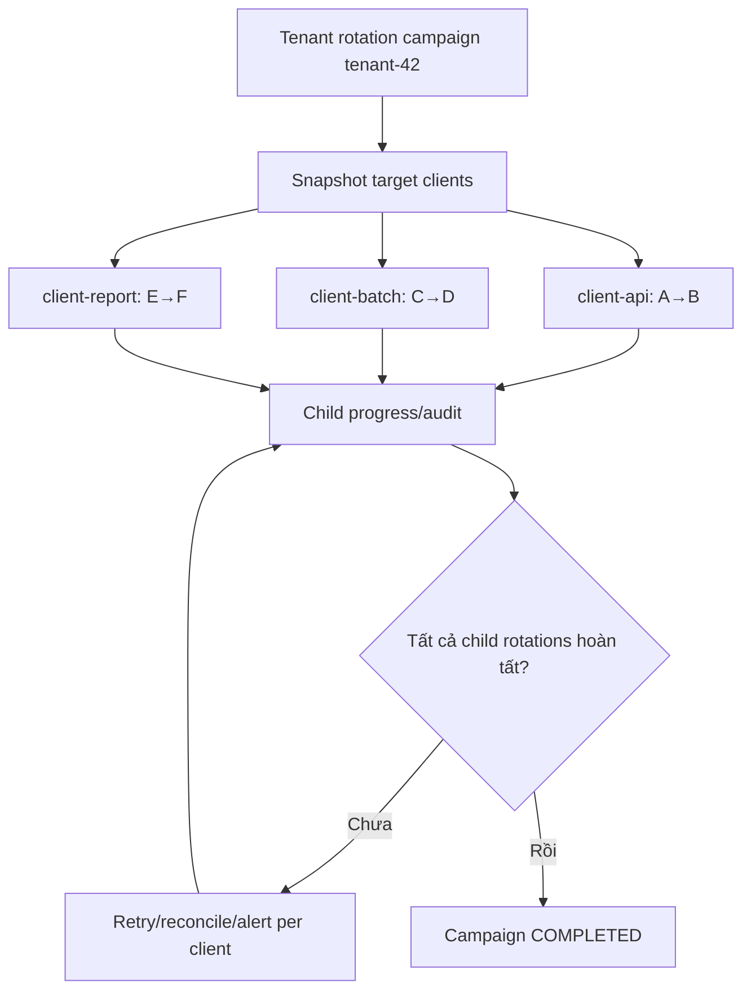
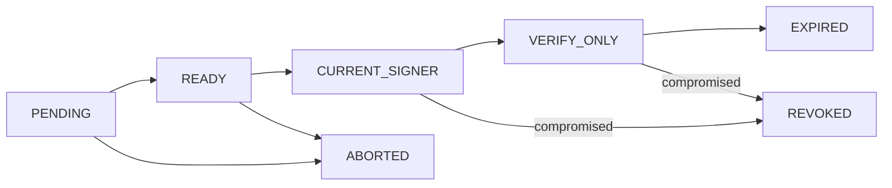

# Tenant rotation

## 1. Tenant rotation trong hệ thống HMAC là gì?

Một nền tảng API **multi-tenant** có thể phục vụ nhiều tổ chức độc lập trên cùng cụm gateway, verifier, database và secret manager. Mỗi tenant có thể đăng ký **nhiều client applications**; từng application ký HTTP request bằng **shared secret của riêng credential**.

**Tenant rotation** là quy trình **thay/thu hồi các HMAC credential thuộc một tenant theo chính sách tập trung**, đồng thời giữ nguyên keysets và quyền của những tenant không nằm trong phạm vi chiến dịch.

```text
Nền tảng HMAC API
|
+-- tenant-42 (tổ chức A)
|   |
|   +-- client-api     -> k-2026-10 (VERIFY_ONLY)
|   |                  -> k-2026-11 (CURRENT_SIGNER)
|   |
|   +-- client-batch   -> k-2026-10 (VERIFY_ONLY)
|                      -> k-2026-11 (CURRENT_SIGNER)
|
+-- tenant-99 (tổ chức B)
    |
    +-- client-api     -> k-2026-11 (CURRENT_SIGNER, KEY KHÁC)
```

Ở ví dụ này, **tenant-42** đang xoay khóa cho hai client, còn **tenant-99** không thay đổi. Hai tenant thậm chí dùng chung chuỗi `client-api` và `k-2026-11`, nhưng **không được dùng nhầm key material, identity hoặc quyền** của nhau.

Bài **“Tenant rotation”**, thuộc chương **Multi-tenant** của mô-đun **`SECURITY_AUTHENTICATION_HMAC_REQUEST_AUTHENTICATION`**, hướng tới thiết kế xác thực HTTP request bằng HMAC với shared secret và canonical request gồm phương thức, URI, headers hoặc body theo hợp đồng ký; xác minh chữ ký, chống replay bằng timestamp/nonce, quản lý key rotation, kiểm thử proxy/gateway và phân biệt xác thực với phân quyền.

**Mục tiêu học tập:**

- Phân biệt **tenant**, **client**, **credential**, **key version**, **authenticated principal** và **business resource**.
- Nhận diện vì sao **tenant-wide rotation campaign** không đồng nghĩa với một shared secret dùng cho mọi client trong tenant.
- Thiết kế namespace/key resolver theo `(tenantId, clientId, environment, purpose, keyId)`, chống cross-tenant key confusion.
- Ràng buộc tenant identity, client ID và key ID vào **canonical request đã ký**.
- Điều phối nhiều child rotations an toàn: provisioning, proof-of-possession, cutover, grace, revoke và rollback.
- Bảo vệ **atomic state transition trong từng keyset** và quản lý trạng thái chiến dịch nhiều client.
- Kiểm thử Java 17, HMAC SHA-256, timestamp/nonce, cache, multi-region, gateway, IAM và authorization.
- Xây dựng runbook cho planned rotation và emergency tenant compromise.

**Bất biến cao nhất:** rotation của tenant-42 **không được** sử dụng khóa của tenant-99, sửa keyset của tenant-99 hoặc cấp quyền đọc resource tenant-99 cho một principal đã được xác thực ở tenant-42.

## 2. Phân biệt tenant, client, keyset và principal

Các khái niệm này thường bị gộp vào từ “customer”, tạo lỗi thiết kế:

| Khái niệm | Ví dụ | Ý nghĩa |
| --- | --- | --- |
| Tenant | `tenant-42` | Phạm vi tổ chức, isolation và chính sách |
| Client/application | `client-api` | Một sender được tenant đăng ký |
| Credential | `tenant-42/client-api/k-2026-11` | Một phiên bản shared secret và metadata |
| Keyset | Danh sách A/B của `client-api` | Các key versions trong cùng sender scope |
| Principal | `svc-payments-42` | Danh tính được xác nhận sau kiểm HMAC |
| Business resource | `merchantId=m-42` | Tài nguyên được kiểm authorization |
| Rotation campaign | `rot-tenant-42-2026-11` | Một yêu cầu điều phối thay nhiều credentials |
| Child rotation | `client-api:A→B` | Một state transition của một keyset |

Một tenant **có thể có nhiều client**, và một tên client bên ngoài **có thể trùng** giữa các tenants. Vì vậy, một `clientId` không mặc nhiên định danh duy nhất một principal trên toàn bộ nền tảng.

### 2.1. “Tenant rotation” có hai kiến trúc khác nhau

**Mô hình A: per-client secret trong mỗi tenant (mặc định bài này).**

```text
tenant-42/client-api    -> secret-A, secret-B
tenant-42/client-batch  -> secret-C, secret-D
tenant-99/client-api    -> secret-E
```

Chiến dịch tenant-42 cần **nhiều child rotations**. Đây là lựa chọn nên ưu tiên nếu các clients cần identity, audit và khả năng thu hồi độc lập.

**Mô hình B: đúng một tenant-level caller/credential.**

Nếu cả tenant chỉ có một gateway/backend sender đáng tin ký cho toàn tổ chức, có thể có một keyset cấp tenant. Tuy nhiên đó là **một principal được phép ký thay tenant** với quyền hạn rõ; không phải mặc định phát cùng raw secret cho nhiều clients độc lập.

Nếu nhiều ứng dụng cùng biết **một tenant-wide secret**, bất kỳ ứng dụng bị lộ secret nào cũng có thể tạo MAC thay ứng dụng khác nếu authorization không có cơ chế bổ sung. Phạm vi lộ lên đến **cả tenant**. Phải có threat model và giới hạn quyền tương ứng.

### 2.2. Tenant ID trong request chưa phải danh tính đã xác thực

```http
X-Tenant-Id: tenant-42
X-Client-Id: client-api
X-Key-Id: k-2026-11
```

Ba header này **đều do caller khai** và **chưa được tin** trước khi MAC khớp. Chúng chỉ giúp giới hạn key lookup. Verifier cần key record của đúng tenant/client và chỉ thiết lập authenticated principal sau khi kiểm đầy đủ signature.

## 3. Threat model riêng của tenant rotation

Một số rủi ro tăng mạnh khi nhiều tenant chia sẻ hạ tầng:

| Mối đe dọa | Tình huống | Hàng rào bảo vệ |
| --- | --- | --- |
| **Cross-tenant key lookup** | Hai tenants cùng `client-api/k-2026-11` | Scope đầy đủ trong catalog và cache |
| **Tenant spoofing** | Caller thay `X-Tenant-Id` sau khi ký | Bind tenant ID vào canonical MAC và kiểm record ownership |
| **Tenant routing confusion** | Header nói tenant-42, path là tenant-99 | Từ chối mismatch trước business operation |
| **Global key reuse** | Một secret được cấp cho tất cả tenants | Mỗi credential key material độc lập |
| **Cross-tenant operator action** | Admin tenant-42 rotate key tenant-99 | RBAC/ABAC theo target tenant |
| **Campaign mass failure** | Đổi mọi child key ngay lập tức | Canary, quotas, retry, grace, staged rollout |
| **Mixed-tenant cache collision** | Cache keyed chỉ bằng `keyId` | Namespace tenant/client/purpose/key version |
| **Stale revoke** | Region còn chấp nhận secret lộ | Revocation SLA, invalidation hoặc stronger checks |
| **KMS confused deputy** | Secret locator lấy trực tiếp từ tenant header | Trusted catalog + IAM scoped reads |
| **Replica race** | Hai regions kích hoạt hai current keys cùng scope | Conditional update, fencing/single authority |
| **Tenant membership drift** | Client mới đăng ký khi campaign đang chạy | Snapshot + event handling/late-join policy |
| **Replay cross-key** | Cùng nonce dùng lại với key B sau A | Replay scope theo stable authenticated identity |
| **Idempotency cross-key** | Retry sau rotation thành operation mới | Business idempotency không scope theo key ID |
| **Tenant data leakage** | HMAC tenant-42 hợp lệ nhưng đọc merchant tenant-99 | Business authorization sau authentication |
| **Backup restores old key** | Snapshot khôi phục revoked key là active | Authoritative revocation ledger/reconciliation |

Một secret HMAC bị lộ vẫn có thể ký **request mới** với timestamp và nonce chưa dùng. Replay protection không cứu được key compromise; phải **revoke key đó** theo policy.

## 4. Mô hình tenant scope cần ràng buộc những gì?

Trong bài, chọn **namespace rõ ràng**:

```text
KeyScope = (
    tenantId,
    clientId,
    environment,
    purpose
)

KeyVersion = (
    KeyScope,
    keyId,
    immutableSecretReference,
    principalId,
    state,
    verifyWindow,
    version
)
```

Ví dụ:

```text
(tenant-42, client-api, PRODUCTION, PAYMENT_REQUEST_AUTH, k-2026-11)
(tenant-42, client-batch, PRODUCTION, PAYMENT_REQUEST_AUTH, k-2026-11)
(tenant-99, client-api, PRODUCTION, PAYMENT_REQUEST_AUTH, k-2026-11)
```

**Ba tuples khác nhau** dù key ID có thể trùng. Catalog phải trả **record sở hữu đúng scope**, không dùng key ID riêng lẻ làm authority.

### 4.1. Client ID chỉ unique trong tenant

Nếu sản phẩm quy định `clientId` global-unique thì metadata có thể rút gọn về mặt indexing, nhưng verifier **vẫn phải kiểm** key record thuộc đúng tenant và purpose của request.

Không dùng `Map<String, byte[]> secretByKeyId` cho nhiều tenants. Một cache đúng phải có ít nhất:

```text
cacheKey = (tenantId, clientId, environment,
            purpose, keyId, immutableKeyVersion)
```

### 4.2. Environment và purpose do server quyết định

Ví dụ endpoint payment production cần:

```text
environment = PRODUCTION
purpose = PAYMENT_REQUEST_AUTH
```

Không cho client tự đặt `X-Environment: staging` rồi khiến production verifier tìm khóa staging, hoặc `X-Purpose: admin` để tra secret dùng cho nhiệm vụ khác. Những scope đó lấy từ **server route/service config đã tin**.

### 4.3. Tenant từ URL hoặc Host có tự đáng tin không?

URL/path/host mà caller chọn **vẫn là dữ liệu client điều khiển**. Tuy nhiên có thể dùng chúng làm **routing input** nếu HTTP stack/gateway phân tích đúng và verifier **ràng buộc path/host đã canonicalize với tenant ID đã ký và owner của key**.

Quy trình:

```text
Public route /v1/tenants/tenant-42/payments
  -> extract routeTenantId = tenant-42
  -> require X-Tenant-Id = tenant-42
  -> find candidate key under tenant-42/client-api
  -> verify HMAC signs path + tenantId + clientId + keyId
  -> establish principal from trusted key record
  -> authorize resource ownership in tenant-42
```

Đừng coi việc route match là **đã xác thực tenant**; route chỉ chọn target, MAC và authorization mới bảo đảm danh tính/được phép thao tác.

## 5. Tenant-wide campaign không đồng nghĩa một transaction toàn tenant

Có thể có 100 clients trong tenant-42. Một chiến dịch thay key cần xử lý **100 child rotations**, mỗi cái có sender rollout, secret delivery, approval và grace riêng.



**Bất biến:** trong **mỗi client scope**, current signer được chuyển **atomic**; nhưng **không thể tự hứa có một transaction nguyên tử** cho toàn bộ tenant, tất cả secret stores, sender applications và hai regions.

Nếu yêu cầu “mọi client phải ngừng key cũ tại cùng một thời điểm” là bắt buộc, cần một **tenant policy barrier** authoritative (ví dụ tenant-wide minimum accepted key epoch / explicit revoke set) và chuẩn bị rủi ro availability. Đó là một chính sách khác, phải thiết kế/test riêng.

### 5.1. Campaign state và child state là hai thứ khác nhau

| Campaign state | Ý nghĩa |
| --- | --- |
| `PLANNED` | Đã nhận yêu cầu, chưa thực hiện |
| `PREPARING` | Lấy snapshot clients và provision key versions |
| `ROLLING_OUT` | Một số clients đã cutover |
| `GRACE` | Current key mới chạy, old keys được verify theo policy |
| `PARTIAL_FAILED` | Một số child operations lỗi, cần reconcile |
| `COMPLETED` | Tất cả target clients hoàn tất theo exit criteria |
| `CANCELLED` | Không tạo thêm child actions; các child đã kích hoạt cần chính sách riêng |
| `EMERGENCY_REVOKE` | Ưu tiên vô hiệu key bị compromise |

Một campaign `COMPLETED` **không chứng minh** tất cả nodes đều nhận revocation nếu chưa có acceptance/propagation tests. Nên có exit criteria rõ về caches, telemetry và chính sách grace.

### 5.2. Chọn target clients theo snapshot hay động?

Nếu campaign chọn các client đang ACTIVE tại thời điểm bắt đầu:

```text
snapshot at T0: client-api, client-batch
T1: tenant-42 đăng ký client-new
```

Cần chính sách cho **late joiners**:

- Client-new chỉ được provision **key thuộc policy/epoch mới**.
- Hoặc thêm một child rotation cho nó vào campaign, có kiểm soát.
- Không vô tình cho client-new nhận “secret cũ” vì catalog mặc định trỏ tenant-wide key cũ.

Nên lưu **campaign membership snapshot, generation/epoch và events sau T0** để reconcile.

## 6. Key version lifecycle trong từng tenant-client scope

Profile minh họa:



| Key state | Được sender chọn ký request mới? | Verifier dùng key đó để accept? |
| --- | --- | --- |
| `PENDING` | Không | Không |
| `READY` | Không | Không theo profile này |
| `CURRENT_SIGNER` | Có nếu valid | Có nếu valid |
| `VERIFY_ONLY` | Không theo signing policy | Có trong grace window |
| `EXPIRED` | Không | Không |
| `REVOKED` | Không | **Không**, kể cả trong grace |

### 6.1. Current signing key và verify-eligible key khác nhau

Trong cutover:

```text
tenant-42/client-api
  k-2026-11 -> CURRENT_SIGNER
  k-2026-10 -> VERIFY_ONLY

new signing selection: k-2026-11
accepted for verification (grace): k-2026-10, k-2026-11
```

`VERIFY_ONLY` **không ngăn** người biết secret cũ tự tính MAC mới trong khi server còn cho verify. Vì vậy grace phải giới hạn và **không phù hợp** khi key cũ xác nhận bị lộ.

### 6.2. Key window và request freshness là hai điều kiện riêng

```text
key eligible:   verifyFrom <= serverNow < verifyUntil
request fresh:  serverNow - 300 <= signedTimestamp <= serverNow + 60
```

Đừng đánh giá hiệu lực key bằng signed timestamp. Kể cả MAC đúng và request còn freshness-valid, một key **đã REVOKED hoặc qua verifyUntil** vẫn bị từ chối tại thời điểm verifier ra quyết định.

## 7. Quy trình planned tenant rotation: khóa cũ A → khóa mới B

Ví dụ tenant-42 có hai clients `client-api` và `client-batch`. Mỗi client được cấp **secret mới riêng**:

```text
tenant-42/client-api:
  A = k-2026-10  -> VERIFY_ONLY
  B = k-2026-11  -> CURRENT_SIGNER

tenant-42/client-batch:
  C = k-2026-10  -> VERIFY_ONLY
  D = k-2026-11  -> CURRENT_SIGNER

tenant-99/client-api:
  E = k-2026-11  -> CURRENT_SIGNER (không đổi)
```

Một kế hoạch an toàn:

1. **Authorize operator** được phép thao tác trên `tenant-42`, không được target tenant-99.
2. Tạo `rotationCampaignId` ổn định; snapshot danh sách client/scopes.
3. Với **từng child scope**, tạo key ID/version mới và **raw secret 32 byte từ CSPRNG**.
4. Lưu secret B/D trong secret manager với **trusted tenant-scoped locator**.
5. Ghi key catalog ở `PENDING/READY`; không ACTIVE trước khi material/readiness hợp lệ.
6. Deliver secret đến **đúng sender** của child scope qua kênh bảo vệ, kiểm enrollment hoặc acknowledgement.
7. Prewarm/verifier readiness theo region, kiểm HMAC golden/canary signatures.
8. **Atomic CAS** cho từng child current signer A→B, C→D; chuyển old key sang VERIFY_ONLY.
9. Client apps lần lượt ký request mới bằng B/D; server chấp nhận old keys trong grace có deadline.
10. Theo dõi old-key request rate, bad MAC và key lookup errors theo tenant/client.
11. Hết grace, expire/revoke A/C và invalidate caches ở mọi verifier nodes.
12. Reconcile campaign child states; chỉ đánh dấu COMPLETED khi exit criteria đạt.

### 7.1. Vì sao không “rotate tất cả cùng lúc” bằng một UPDATE?

```sql
-- ANTI-PATTERN: cập nhật mù quáng toàn bộ bảng.
UPDATE hmac_key_version
SET state = 'REVOKED'
WHERE state = 'CURRENT_SIGNER';
```

Thiếu `tenant_id`, `environment`, `purpose` và `key version` sẽ revoke **mọi tenant**, có thể làm sập API toàn hệ thống.

Ngay cả khi `WHERE tenant_id='tenant-42'`, revoke toàn bộ old key trước khi apps nhận secret mới vẫn có thể gây downtime lớn. Hãy dùng **staged child operations** và tenant-specific policy rõ.

### 7.2. Không ghi đè secret trong cùng key ID

Nếu client-api dùng A mà server thay bytes của A bằng B dưới cùng `keyId`, sender chưa nhận B vẫn ký A, HMAC mismatch. Đúng là **key ID/version mới, immutable secret locator và timeline chuyển đổi**.

### 7.3. Readiness không có nghĩa mọi sender đã chuyển

Ngay khi key B đã được provision trên server, một vài client workers có thể vẫn dùng A. Cần grace và telemetry; không giả định catalog CAS đồng thời cập nhật được tất cả sender processes bên ngoài.

## 8. Tenant-specific catalog và authoritative current pointer

Một thiết kế quan hệ tách **key version** khỏi **current selection**:

```sql
-- Pseudo-SQL; chọn kiểu dữ liệu/migration theo DB thực tế.
CREATE TABLE tenant_hmac_key_version (
    tenant_id        VARCHAR(100) NOT NULL,
    client_id        VARCHAR(100) NOT NULL,
    environment      VARCHAR(40)  NOT NULL,
    purpose          VARCHAR(80)  NOT NULL,
    key_id           VARCHAR(100) NOT NULL,
    principal_id     VARCHAR(100) NOT NULL,
    algorithm        VARCHAR(40)  NOT NULL,
    state            VARCHAR(40)  NOT NULL,
    secret_locator   VARCHAR(500) NOT NULL,
    verify_from      TIMESTAMP NOT NULL,
    verify_until     TIMESTAMP NOT NULL,
    version          BIGINT NOT NULL,
    PRIMARY KEY (
        tenant_id, client_id, environment, purpose, key_id)
);

CREATE TABLE tenant_hmac_signing_scope (
    tenant_id        VARCHAR(100) NOT NULL,
    client_id        VARCHAR(100) NOT NULL,
    environment      VARCHAR(40)  NOT NULL,
    purpose          VARCHAR(80)  NOT NULL,
    current_key_id   VARCHAR(100) NOT NULL,
    scope_version    BIGINT NOT NULL,
    PRIMARY KEY (tenant_id, client_id, environment, purpose)
);
```

**Production cần thêm** foreign keys/composite ownership, tenant membership checks, indexes, algorithm constraints, UTC time types, audit/outbox, secret reference version, revocation ledger, transaction isolation và authorization cho admin operations.

**Không** lưu raw shared secret plaintext ở catalog. Dùng secret reference hoặc crypto-service MAC handle.

### 8.1. Bất biến catalog

Với mỗi `(tenantId,clientId,environment,purpose)`:

- Tối đa **một authoritative current signing pointer**.
- Pointer trỏ đúng `keyId` thuộc scope và `CURRENT_SIGNER`, còn đủ điều kiện verify.
- Các `VERIFY_ONLY` keys có grace deadline rõ.
- `PENDING/READY/REVOKED` không được verify production request.
- Key material theo version **không bị thay trong cùng key ID**.
- Campaign state không được coi là source of truth thay key catalog/secret store.

### 8.2. CAS cho từng scope, không khóa toàn bộ tenants

Ví dụ update khi expected current A và expected scope version 12:

```sql
UPDATE tenant_hmac_signing_scope
SET current_key_id = :new_key_id,
    scope_version = scope_version + 1
WHERE tenant_id = :tenant_id
  AND client_id = :client_id
  AND environment = :environment
  AND purpose = :purpose
  AND current_key_id = :expected_old_key_id
  AND scope_version = :expected_version;
```

Nếu updated rows = **0**, phải kiểm conflict/reconciliation, không retry bằng **last-write-wins**.

Mutation cần diễn ra trong transaction cùng việc đổi trạng thái old/new key hoặc cơ chế current-pointer authoritative có consistency tương đương. **CAS trên scope tenant-42/client-api** không được vô tình khóa/đổi `tenant-99/client-api`.

### 8.3. Concurrent campaigns trong một tenant

Giả sử operator P và Q cùng tạo campaigns:

```text
P: tenant-42/client-api A -> B, expected scopeVersion=12
Q: tenant-42/client-api A -> C, expected scopeVersion=12
```

Chỉ một CAS thắng. Operation thua **không tự hồi phục bằng cách ghi đè** key đã được công bố. Cần đọc lại current pointer và chọn abort/reconcile/approval.

Hai child rotations **khác client scopes** có thể chạy đồng thời nếu backend/secret manager quotas cho phép. Không nhất thiết dùng global lock cho toàn campaign.

## 9. Transaction boundary giữa database, secret manager và sender

Một rotation child liên quan ít nhất:

```text
Catalog metadata DB
   |
   +-- secret manager/KMS/HSM
   |
   +-- external client application(s)
   |
   +-- verifier caches (multiple regions)
   |
   +-- rotation campaign/audit ledger
```

Một SQL transaction **không** bao trùm secret manager, người nhận key hay cache của mọi region.

### 9.1. Các failure points

| Điểm lỗi | Trạng thái quan sát | Cách khôi phục |
| --- | --- | --- |
| Crash sau PENDING insert, trước secret put | Catalog có key không có material | Retry idempotent hoặc cleanup/FAILED |
| Secret put thành công, catalog update fail | Orphan secret B | Reconcile theo operation ID/trusted locator |
| Secret delivered, ack mất | Không rõ client đã nhận | Challenge/reenrollment/reissue policy |
| CAS commit, response mất | Không rõ cutover thắng chưa | Tra current pointer + operation journal |
| B CURRENT trên catalog, cache region chưa cập nhật | Region reject B | Retry/fail closed, invalidate/prewarm |
| A REVOKED, cache node stale | Node có nguy cơ accept A | Strong invalidate/fencing/quarantine theo SLA |
| Campaign cancel sau vài child cutovers | Tenant ở trạng thái hỗn hợp | Giữ completed child state, không rollback mù quáng |

### 9.2. Idempotency của rotation operation

Dùng `rotationCampaignId` cho chiến dịch và `childRotationId` cho mỗi scope:

```text
campaignId = rot-tenant-42-202611
childId    = rot-tenant-42-202611:client-api

Unique(tenantId, campaignId)
Unique(tenantId, childId)
```

Khi HTTP control-plane API timeout, retry **cùng operation ID** để đọc trạng thái và tiếp tục bước idempotent. Không tự sinh key C/D mới mỗi lần retry nếu key B đã được provision.

Đối với secret delivery thất lạc, không nên cho GET plaintext secret vô hạn; có thể dùng escrow có kiểm soát/hạn hoặc revoke pending key và tạo mới.

### 9.3. Không có “all-or-nothing” mặc định cho một tenant campaign

Khi 100 clients đã rotate 99 thành công, 1 thất bại, rollback toàn bộ có thể **gây nhiều rủi ro hơn**. Một lựa chọn là trạng thái `PARTIAL_FAILED`, ghi rõ child nào chưa cutover và tiếp tục/reconcile riêng.

Nếu compliance đòi tenant-wide cutoff đồng thời, cần **tenant-wide authoritative deny-before epoch** hoặc revoke list có consistency phù hợp, cùng kế hoạch availability; không suy luận khả năng đó chỉ từ campaign flag.

## 10. Secret storage và quyền quản trị đa tenant

### 10.1. Mỗi credential nên có secret material riêng

**Khuyến nghị mặc định:** raw HMAC key của `tenant-42/client-api` khác hoàn toàn `tenant-42/client-batch` và `tenant-99/client-api`.

```text
vault://production/tenant-42/client-api/k-2026-11   -> random key B
vault://production/tenant-42/client-batch/k-2026-11 -> random key C
vault://production/tenant-99/client-api/k-2026-11   -> random key D
```

Những paths chỉ là **ví dụ secret references**, không phải chuỗi user được phép đưa trực tiếp vào API đọc secret. Catalog server-side phải tạo/duyệt locator; IAM workload identity giới hạn truy cập.

### 10.2. Có nên sinh HMAC keys từ một tenant master key?

Có thể tồn tại thiết kế derivation qua **HKDF với context/salt/info được phân tách**, nhưng đó là **một giao thức/kiến trúc cần threat model riêng**. Nếu tenant master bị lộ, nhiều derived child keys có thể bị ảnh hưởng; quyền xoay độc lập client trở nên khó.

Không tự lấy `HMAC(tenantRoot, clientId)` rồi coi là mô hình chuẩn mà không đánh giá key separation, lifecycle và khả năng revoke. **Để học multi-tenant isolation rõ nhất, bài dùng key bytes độc lập do CSPRNG sinh cho từng credential version.**

### 10.3. Operator RBAC/ABAC

Một admin tenant-42 có thể yêu cầu rotation các clients của tenant-42 **trong quyền được cấp**, không được rotate tenant-99 dù biết key IDs.

Ví dụ:

```text
operatorPrincipal = admin-tenant-42
targetTenant      = tenant-99

authorize(operation=ROTATE_HMAC_CREDENTIAL,
          actor=admin-tenant-42,
          resource=tenant-99)
  -> DENY
```

Phải kiểm authorization **trước khi sinh secret hoặc tạo child job**, không chỉ kiểm trong UI nút bấm.

### 10.4. IAM của secret manager

- Provisioning workload chỉ được `create/rotate` key thuộc approved tenant scope.
- Verifier workload chỉ được read/use secrets cần cho service, không được export toàn bộ tenant keys ra logs.
- Analytics/support không được đọc raw key.
- CI unit tests dùng **public fixtures**, không dùng production credentials.
- Secret manager/Vault/KMS phải audit mọi key access và rotation.
- Nếu HSM giữ non-exportable HMAC secret, cần giải thích **bên sender nhận được cùng key bằng cách nào**; non-exportable server-generated key không tự xuất hiện trong client.

## 11. Ràng buộc tenant identity vào canonical HMAC request

Nếu chỉ ký body mà không ký tenant/path/credential metadata, một request có thể bị chuyển giữa tenants hoặc clients có cùng định danh ngoài ý muốn.

Profile minh họa:

```http
POST /v1/tenants/tenant-42/payments?merchantId=m-42 HTTP/1.1
Content-Type: application/json
X-Tenant-Id: tenant-42
X-Client-Id: client-api
X-Key-Id: k-2026-11
X-Timestamp: 1795856400
X-Nonce: AAAAAAAAAAAAAAAAAAAAAA
X-Signature: <base64-hmac-sha256>

{"orderId":"O-42","amountMinor":250000,"currency":"VND"}
```

Các phần được ký:

```text
HMAC-TENANT-ROTATION-V1
POST
/v1/tenants/tenant-42/payments
merchantId=m-42
content-type:application/json
tenant-id:tenant-42
client-id:client-api
key-id:k-2026-11
x-timestamp:1795856400
x-nonce:AAAAAAAAAAAAAAAAAAAAAA
<hex-lowercase-SHA256(raw-body-bytes)>
```

**Chính xác 11 dòng**, nối bằng LF (`\n`), **không có LF cuối**. Đây là **hợp đồng riêng được công bố**, không phải canonical format tự động của HTTP.

### 11.1. Tenant ID xuất hiện hai nơi có ý nghĩa gì?

- `/v1/tenants/tenant-42/payments`: URL target chứa tenant route.
- `X-Tenant-Id: tenant-42`: signed metadata để chọn credential realm.

Server yêu cầu **route tenant ID và signed tenant ID khớp nhau**. Nếu đổi route sang tenant-99 mà giữ MAC cũ, canonical bytes sẽ khác. Nếu đổi cả route/header và ký lại bằng key tenant-42, catalog của tenant-99 không được dùng key tenant-42; sau khi xác thực vẫn phải kiểm quyền tenant/resource.

### 11.2. Không ký nguyên header Signature

HMAC tag là **output**, không đưa `X-Signature` vào chính message dùng tính tag. Nhưng phải ràng buộc **tenant ID, client ID, key ID, method, raw target, signed headers, timestamp/nonce và raw body hash** theo contract.

### 11.3. Proxy/gateway là trust boundary

Nếu gateway rewrite path từ `/v1/tenants/tenant-42/payments` thành `/internal/payments` **trước khi backend verify**, backend cần nguồn metadata về **public raw path đáng tin** từ gateway hoặc verify tại ingress trước khi rewrite.

Không dùng `X-Original-URI` hay `X-Authenticated-Tenant` từ Internet làm nguồn “đã verify” nếu gateway chưa xóa/re-sign/bảo vệ nó.

## 12. Golden HMAC vectors cho hai tenants

Để kiểm tra byte chính tắc và tenant isolation, dùng **bốn fixture key công khai, chỉ dành cho unit test**. **Không dùng keys/timestamp/nonce này trong production.**

**Chung:**

```text
Algorithm:         HmacSHA256
Signature format:  Base64 Basic, padded, 44 ASCII chars
Timestamp:         1795856400 (fixed fixture)
Nonce:             AAAAAAAAAAAAAAAAAAAAAA
Content-Type:      application/json
Canonical:         11 LF-delimited lines, no trailing LF
Body bytes:        UTF-8 exactly 56 bytes (no final newline)
```

Body của tenant-42:

```json
{"orderId":"O-42","amountMinor":250000,"currency":"VND"}
```

SHA-256 body lowercase hex:

```text
eaeb86c57439a64c80d023bc882535c45ebfcabb7617add8d2a628637faab41a
```

Body của tenant-99:

```json
{"orderId":"O-99","amountMinor":250000,"currency":"VND"}
```

SHA-256 body lowercase hex:

```text
da4f7bca238d4e349f4664bcfb90255256afd3f5a690610bfade335f41a37f3a
```

### 12.1. tenant-42 / client-api / old key A

```text
Tenant:     tenant-42
Client:     client-api
Key ID:     k-2026-10
Merchant:   m-42
Body order: O-42

Secret A (32 raw bytes HEX):
00112233445566778899aabbccddeeff00112233445566778899aabbccddeeff

Canonical bytes: 282
Full tag hex:
6718ac6164015a69b8e8549c1c1e162496940a66932cdecb2ef5965c8bf18544

Full tag Base64 Basic padded:
ZxisYWQBWmm46FScHB4WJJaUCmaTLN7LLvWWXIvxhUQ=
```

### 12.2. tenant-42 / client-api / new key B

```text
Tenant:     tenant-42
Client:     client-api
Key ID:     k-2026-11
Merchant:   m-42
Body order: O-42

Secret B (32 raw bytes HEX):
ffeeddccbbaa99887766554433221100ffeeddccbbaa99887766554433221100

Canonical bytes: 282
Full tag hex:
2731856a02a470b5756b276600f1cb3207f41b2221c6286f32b95ebbec759a14

Full tag Base64 Basic padded:
JzGFagKkcLV1aydmAPHLMgf0GyIhxihvMrleu+x1mhQ=
```

### 12.3. tenant-42 / client-batch / new key C

```text
Tenant:     tenant-42
Client:     client-batch
Key ID:     k-2026-11
Merchant:   m-42
Body order: O-42

Secret C (32 raw bytes HEX):
102132435465768798a9bacbdcedfe0f102132435465768798a9bacbdcedfe0f

Canonical bytes: 284
Full tag hex:
bb04d67b03f2ba9a2932e71e5e2a9ee156f5aa606ef5b762c6420eb45f9b66dd

Full tag Base64 Basic padded:
uwTWewPyupopMuceXiqe4Vb1qmBu9bdixkIOtF+bZt0=
```

### 12.4. tenant-99 / client-api / key D với cùng text key ID

```text
Tenant:     tenant-99
Client:     client-api
Key ID:     k-2026-11
Merchant:   m-99
Body order: O-99

Secret D (32 raw bytes HEX):
0123456789abcdef0123456789abcdef0123456789abcdef0123456789abcdef

Canonical bytes: 282
Full tag hex:
a7f7552b4a1bcb484ff9ad3da43c6c3e7bff3e34c2eb912b404815743c0a9387

Full tag Base64 Basic padded:
p/dVK0oby0hP+a09pDxsPnv/PjTC65ErQEgVdDwKk4c=
```

**Cô lập lỗi secret lookup:** nếu dùng **secret B của tenant-42** với **canonical request tenant-99/client-api**, expected tag test-only sẽ là:

```text
grbB1PEKJg3qZtEoBBopDmvcwMXUiYS36HsjtgqJID8=
```

Giá trị này **khác** signature D và phải bị từ chối bởi tenant-99 verifier. Thực tế, resolver chuẩn **không được cấp B cho tenant-99 ngay từ đầu**.

### 12.5. Ý nghĩa của vectors

| Fixture | Tenant | Client | Key ID | Canonical length | HMAC Base64 |
| --- | --- | --- | --- | ---: | --- |
| A | `tenant-42` | `client-api` | `k-2026-10` | 282 | `ZxisYWQBWmm46FScHB4WJJaUCmaTLN7LLvWWXIvxhUQ=` |
| B | `tenant-42` | `client-api` | `k-2026-11` | 282 | `JzGFagKkcLV1aydmAPHLMgf0GyIhxihvMrleu+x1mhQ=` |
| C | `tenant-42` | `client-batch` | `k-2026-11` | 284 | `uwTWewPyupopMuceXiqe4Vb1qmBu9bdixkIOtF+bZt0=` |
| D | `tenant-99` | `client-api` | `k-2026-11` | 282 | `p/dVK0oby0hP+a09pDxsPnv/PjTC65ErQEgVdDwKk4c=` |

Các vectors được **tính độc lập** từ raw byte arrays và chuỗi canonical. Chúng chứng minh tính tất định của MAC và giúp phát hiện sai key/encoding; **không tự chứng minh** freshness, key activation, replay protection hoặc quyền merchant.

## 13. Java 17: record scope, key version và chính sách verify

Mỗi credential cần mang **tenant scope** trong kiểu dữ liệu, không chỉ mang key ID rời rạc:

```java
import java.time.Instant;
import java.util.Objects;

public final class TenantCredentialPolicyV1 {
    private TenantCredentialPolicyV1() {}

    public enum KeyState {
        PENDING, READY, CURRENT_SIGNER,
        VERIFY_ONLY, REVOKED
    }

    public record Scope(
            String tenantId, String clientId,
            String environment, String purpose) {

        public Scope {
            Objects.requireNonNull(tenantId);
            Objects.requireNonNull(clientId);
            Objects.requireNonNull(environment);
            Objects.requireNonNull(purpose);

            if (!tenantId.matches("tenant-[0-9]{1,12}")
                    || !clientId.matches("[A-Za-z0-9._-]{1,80}")
                    || !"PRODUCTION".equals(environment)
                    || !"PAYMENT_REQUEST_AUTH".equals(purpose)) {
                throw new IllegalArgumentException(
                        "Invalid tenant credential scope");
            }
        }
    }

    public record KeyVersion(
            Scope scope,
            String keyId,
            String authenticatedPrincipal,
            String trustedSecretLocator,
            KeyState state,
            Instant verifyFrom,
            Instant verifyUntil,
            long version) {

        public KeyVersion {
            Objects.requireNonNull(scope);
            Objects.requireNonNull(keyId);
            Objects.requireNonNull(authenticatedPrincipal);
            Objects.requireNonNull(trustedSecretLocator);
            Objects.requireNonNull(state);
            Objects.requireNonNull(verifyFrom);
            Objects.requireNonNull(verifyUntil);

            if (!keyId.matches("[A-Za-z0-9._-]{1,80}")
                    || authenticatedPrincipal.isBlank()
                    || trustedSecretLocator.isBlank()
                    || !verifyFrom.isBefore(verifyUntil)
                    || version < 0) {
                throw new IllegalArgumentException(
                        "Invalid key metadata");
            }
        }
    }

    public static boolean canVerify(
            KeyVersion key, Instant serverNow) {
        Objects.requireNonNull(key);
        Objects.requireNonNull(serverNow);
        return (key.state() == KeyState.CURRENT_SIGNER
                    || key.state() == KeyState.VERIFY_ONLY)
                && !serverNow.isBefore(key.verifyFrom())
                && serverNow.isBefore(key.verifyUntil());
    }

    public static boolean isCurrentSigner(
            KeyVersion key, Instant serverNow) {
        return key.state() == KeyState.CURRENT_SIGNER
                && canVerify(key, serverNow);
    }
}
```

### 13.1. Dùng server clock, không dùng signed timestamp để kéo dài tuổi key

`canVerify` nhận `Instant serverNow`. Timestamp của request sẽ được kiểm **ở bước freshness riêng**. Dù request có HMAC hợp lệ với một timestamp cũ, nó không làm key đã revoked/expired có hiệu lực lại.

### 13.2. Không dùng raw tenant ID làm key vật lý

`Scope` chỉ cung cấp **metadata được kiểm cú pháp**. Việc tra secret material phải đi qua trusted catalog và IAM. Nếu ghép `tenantId + "/keys/" + keyId` để tự truy cập Vault mà không kiểm owner, attacker có thể khai tenant khác và biến verifier thành confused deputy.

### 13.3. Selector cho một current signer

```java
import java.time.Clock;
import java.util.List;
import java.util.Objects;

public final class TenantSignerSelectionV1 {
    private TenantSignerSelectionV1() {}

    public static TenantCredentialPolicyV1.KeyVersion choose(
            TenantCredentialPolicyV1.Scope expectedScope,
            List<TenantCredentialPolicyV1.KeyVersion> candidates,
            Clock clock) {

        Objects.requireNonNull(expectedScope);
        Objects.requireNonNull(candidates);
        var now = Objects.requireNonNull(clock).instant();

        TenantCredentialPolicyV1.KeyVersion found = null;

        for (var candidate : candidates) {
            if (candidate == null) {
                throw new IllegalStateException(
                        "Invalid catalog candidate");
            }

            if (!expectedScope.equals(candidate.scope())
                    || !TenantCredentialPolicyV1.isCurrentSigner(
                            candidate, now)) {
                continue;
            }

            if (found != null) {
                throw new IllegalStateException(
                        "Multiple current signers in one tenant scope");
            }
            found = candidate;
        }

        if (found == null) {
            throw new IllegalStateException(
                    "No current signer in requested tenant scope");
        }
        return found;
    }
}
```

Nếu tenant-42 đang đổi key mà tenant-99 vẫn dùng key ID cùng tên, selector của tenant-42 **không bao giờ** chọn record của tenant-99. Một current key trong mỗi scope là invariant của policy này; hệ thống cho nhiều active signing keys phải định nghĩa selector riêng thay vì chọn tùy tiện.

## 14. Java 17: canonical request với tenant ID được bảo vệ

Profile `HMAC-TENANT-ROTATION-V1` dùng đúng 11 dòng. Ví dụ triển khai kiểm một endpoint minh họa, **không phải thư viện canonicalization chung cho mọi URI**.

```java
import java.nio.charset.StandardCharsets;
import java.security.GeneralSecurityException;
import java.security.MessageDigest;
import java.util.Base64;
import java.util.HexFormat;
import java.util.Objects;
import javax.crypto.Mac;
import javax.crypto.spec.SecretKeySpec;

public final class TenantHmacV1 {
    private TenantHmacV1() {}

    public record Request(
            String tenantId,
            String clientId,
            String keyId,
            String method,
            String publicRawPath,
            String rawQuery,
            String contentType,
            String timestampSeconds,
            String nonce,
            byte[] rawBody) {

        public Request {
            Objects.requireNonNull(rawBody);
            rawBody = rawBody.clone();
        }

        @Override public byte[] rawBody() {
            return rawBody.clone();
        }
    }

    public static byte[] canonicalBytes(Request r)
            throws GeneralSecurityException {

        Objects.requireNonNull(r);
        if (r.tenantId() == null
                || !r.tenantId().matches("tenant-[0-9]{1,12}")
                || r.clientId() == null
                || !r.clientId().matches("[A-Za-z0-9._-]{1,80}")
                || r.keyId() == null
                || !r.keyId().matches("[A-Za-z0-9._-]{1,80}")
                || !"POST".equals(r.method())
                || !("/v1/tenants/" + r.tenantId()
                        + "/payments").equals(r.publicRawPath())
                || r.rawQuery() == null
                || !r.rawQuery().matches("merchantId=m-[0-9]{1,12}")
                || !"application/json".equals(r.contentType())
                || r.timestampSeconds() == null
                || !r.timestampSeconds().matches(
                        "0|[1-9][0-9]{0,11}")
                || r.nonce() == null
                || !r.nonce().matches("[A-Za-z0-9_-]{22}")) {
            throw new IllegalArgumentException(
                    "Invalid signed request fields");
        }

        byte[] nonceRaw;
        try {
            nonceRaw = Base64.getUrlDecoder()
                    .decode(r.nonce());
        } catch (IllegalArgumentException invalid) {
            throw new IllegalArgumentException(
                    "Invalid nonce encoding", invalid);
        }

        if (nonceRaw.length != 16
                || !Base64.getUrlEncoder().withoutPadding()
                    .encodeToString(nonceRaw).equals(r.nonce())) {
            throw new IllegalArgumentException(
                    "Noncanonical nonce");
        }

        String bodyDigest = HexFormat.of().formatHex(
                MessageDigest.getInstance("SHA-256")
                        .digest(r.rawBody()));

        String canonical = String.join("\n",
                "HMAC-TENANT-ROTATION-V1",
                r.method(),
                r.publicRawPath(),
                r.rawQuery(),
                "content-type:" + r.contentType(),
                "tenant-id:" + r.tenantId(),
                "client-id:" + r.clientId(),
                "key-id:" + r.keyId(),
                "x-timestamp:" + r.timestampSeconds(),
                "x-nonce:" + r.nonce(),
                bodyDigest);

        return canonical.getBytes(StandardCharsets.UTF_8);
    }

    public static byte[] hmacSha256(
            byte[] rawSecret,
            byte[] canonicalBytes)
            throws GeneralSecurityException {

        Objects.requireNonNull(rawSecret);
        Objects.requireNonNull(canonicalBytes);

        if (rawSecret.length != 32) {
            throw new IllegalArgumentException(
                    "V1 requires 32-byte HMAC secret");
        }

        Mac mac = Mac.getInstance("HmacSHA256");
        mac.init(new SecretKeySpec(
                rawSecret, "HmacSHA256"));
        return mac.doFinal(canonicalBytes);
    }

    public static String sign(
            byte[] rawSecret, Request request)
            throws GeneralSecurityException {

        return Base64.getEncoder().encodeToString(
                hmacSha256(rawSecret, canonicalBytes(request)));
    }

    public static boolean matchesFullTag(
            byte[] expected,
            String suppliedBase64) {

        if (expected == null || expected.length != 32
                || suppliedBase64 == null
                || !suppliedBase64.matches(
                        "[A-Za-z0-9+/]{43}=")) {
            return false;
        }

        final byte[] supplied;
        try {
            supplied = Base64.getDecoder().decode(suppliedBase64);
        } catch (IllegalArgumentException malformed) {
            return false;
        }

        // Decode + re-encode để bảo đảm đúng profile
        // Base64 Basic padded canonical.
        if (supplied.length != 32
                || !Base64.getEncoder()
                    .encodeToString(supplied)
                    .equals(suppliedBase64)) {
            return false;
        }

        return MessageDigest.isEqual(expected, supplied);
    }
}
```

### 14.1. Ranh giới trách nhiệm của class

- `TenantHmacV1` không parse HTTP wire framing; ingress phải **reject duplicate signed headers**, CRLF/header smuggling, noncanonical public path/query và body size overflow.
- `publicRawPath` của `Request` phải đến từ **request target thực nhận** hoặc metadata đã được gateway bảo vệ, không phải một header giả mạo.
- `tenantId` của request phải khớp tenant route; trong profile này, `canonicalBytes` kiểm bằng so sánh với path cố định.
- `HmacSHA256` dùng raw secret **32 byte**, không dùng các ký tự của text Base64 secret làm key.
- `matchesFullTag` chỉ nhận **full 32-byte HMAC SHA-256** đã encode bằng Base64 Basic padded chính tắc; không chấp nhận Base64URL/MIME/truncated tag.
- Khi server nhận request có body bytes khác client đã ký, SHA-256 body khác và MAC phải sai.

**Sang phần tiếp theo**, verifier dùng catalog theo tenant scope, key policy và replay store để quyết định request có thực sự được xác thực hay không.


## 15. Java 17: verifier tra đúng tenant key rồi xác minh HMAC

Một verifier multi-tenant **không được** chọn key bằng `keyId` đơn lẻ, hoặc tự lấy secret của một tenant khác để “thử lại nếu chữ ký sai”.

Ports cho ví dụ:

```java
import java.util.Optional;

public final class TenantVerifierPortsV1 {
    private TenantVerifierPortsV1() {}

    @FunctionalInterface
    public interface Catalog {
        // Lookup theo exact scope và keyId, không có global fallback.
        Optional<TenantCredentialPolicyV1.KeyVersion> find(
                TenantCredentialPolicyV1.Scope scope,
                String keyId);
    }

    @FunctionalInterface
    public interface SecretStore {
        // Return owned raw 32-byte key. Throw khi unavailable.
        // Locator phải đến từ catalog đã tin, không từ HTTP.
        byte[] readOwned(String trustedSecretLocator);
    }

    @FunctionalInterface
    public interface ReplayStore {
        // Atomic insert-if-absent trên tất cả verifier nodes.
        boolean reserveOnce(String tenantId,
                String authenticatedPrincipal,
                String nonce, long ttlSeconds);
    }
}
```

Verifier kiểm HMAC, key state, freshness và nonce:

```java
import java.security.GeneralSecurityException;
import java.time.Clock;
import java.time.Instant;
import java.util.Arrays;
import java.util.Optional;

public final class TenantVerifierV1 {
    private static final long MAX_PAST_SECONDS = 300;
    private static final long MAX_FUTURE_SECONDS = 60;
    private static final long NONCE_MARGIN_SECONDS = 60;

    private TenantVerifierV1() {}

    public record AuthContext(
            String tenantId,
            String authenticatedPrincipal,
            String keyId) {}

    public static Optional<AuthContext> verifyAndReserve(
            TenantHmacV1.Request req,
            String suppliedSignatureB64,
            Clock clock,
            TenantVerifierPortsV1.Catalog catalog,
            TenantVerifierPortsV1.SecretStore secrets,
            TenantVerifierPortsV1.ReplayStore replay)
            throws GeneralSecurityException {

        if (req == null || clock == null
                || catalog == null || secrets == null
                || replay == null) {
            throw new IllegalArgumentException(
                    "Missing verifier dependency");
        }

        // HTTP adapter phải lấy signed fields từ request thực nhận,
        // reject duplicate/malformed headers trước khi gọi đây.
        final byte[] canonical;
        try {
            canonical = TenantHmacV1.canonicalBytes(req);
        } catch (IllegalArgumentException malformed) {
            return Optional.empty();
        }

        Instant now = clock.instant();
        // Tenant ID đến từ route đã kiểm và signed header
        // phải trùng route qua canonicalBytes().
        // Environment/purpose là server-derived constants.
        var scope = new TenantCredentialPolicyV1.Scope(
                req.tenantId(), req.clientId(),
                "PRODUCTION", "PAYMENT_REQUEST_AUTH");

        var candidate = catalog.find(scope, req.keyId());
        if (candidate.isEmpty()) return Optional.empty();

        var key = candidate.get();
        if (!scope.equals(key.scope())
                || !req.keyId().equals(key.keyId())
                || !TenantCredentialPolicyV1.canVerify(
                        key, now)) {
            return Optional.empty();
        }

        // Key material độc lập của đúng tenant/client/key version.
        byte[] secret = secrets.readOwned(
                key.trustedSecretLocator());
        if (secret == null) {
            throw new IllegalStateException(
                    "Secret backend returned no key");
        }

        final byte[] expectedTag;
        try {
            expectedTag = TenantHmacV1.hmacSha256(
                    secret, canonical);
        } finally {
            // Best-effort zeroization; JVM có thể giữ copies.
            Arrays.fill(secret, (byte) 0);
        }

        if (!TenantHmacV1.matchesFullTag(
                expectedTag, suppliedSignatureB64)) {
            return Optional.empty();
        }

        // Timestamp đã được đưa vào MAC. Không dùng nó làm
        // server clock để kéo dài key verifyUntil/revocation.
        long signedSeconds = Long.parseLong(
                req.timestampSeconds());
        long nowSeconds = now.getEpochSecond();

        final long ttlSeconds;
        try {
            long earliest = Math.subtractExact(
                    nowSeconds, MAX_PAST_SECONDS);
            long latest = Math.addExact(
                    nowSeconds, MAX_FUTURE_SECONDS);

            if (signedSeconds < earliest
                    || signedSeconds > latest) {
                return Optional.empty();
            }

            long signedExpires = Math.addExact(
                    signedSeconds, MAX_PAST_SECONDS);
            ttlSeconds = Math.max(1L, Math.addExact(
                    Math.subtractExact(signedExpires, nowSeconds),
                    NONCE_MARGIN_SECONDS));
        } catch (ArithmeticException invalidTime) {
            return Optional.empty();
        }

        if (!replay.reserveOnce(scope.tenantId(),
                key.authenticatedPrincipal(),
                req.nonce(), ttlSeconds)) {
            return Optional.empty();
        }

        // Chỉ sau HMAC/freshness/replay mới trả principal.
        // Authorization merchant/resource là bước SAU.
        return Optional.of(new AuthContext(
                scope.tenantId(),
                key.authenticatedPrincipal(),
                req.keyId()));
    }
}
```

### 15.1. Vì sao không cho keyId lựa chọn key ở tenant bất kỳ?

Với request `tenant-42/client-api/k-2026-11`, catalog phải trả **key B của tenant-42**, không trả D của tenant-99. Nếu key B không có hoặc secret store đang lỗi, request **bị từ chối hoặc fail closed**, không thử các key cùng tên ở nơi khác.

Đó là lý do method `Catalog.find` nhận **Scope + keyId**, không nhận `String keyId` đơn lẻ.

### 15.2. Tại sao trả AuthContext chứa tenant ID?

Một principal ID có thể là chuỗi opaque hoặc có namespace riêng. Security context nên mang **tenant ID đã được xác thực cùng principal** để tầng sau có đủ dữ liệu cho tenant authorization, audit và replay namespace.

Không dùng `req.tenantId()` như authenticated tenant chỉ vì nó xuất hiện trong header; chỉ sau khi `verifyAndReserve` thành công mới được công bố context.

### 15.3. Các giới hạn cố ý của demo

- Input `TenantHmacV1.Request` phải được xây dựng bởi **HTTP adapter đáng tin**, giữ public raw path/URI/header/body chính xác.
- Server và gateway phải từ chối **duplicate `X-Tenant-Id`, `X-Client-Id`, `X-Key-Id`, `X-Timestamp`, `X-Nonce` hoặc signature headers**.
- `Scope` được đóng chặt với `PRODUCTION/PAYMENT_REQUEST_AUTH`; hệ thống nhiều purpose cần map policy từ route, không nhận tự do từ Internet.
- `KeyVersion` chỉ minh họa state; production cần revocation ledger và cache-consistency contract.
- Secret store/hệ thống MAC lỗi phải **throw/fail closed**, không return default secret hay accept.
- `ReplayStore` phải **atomic** và dùng chung giữa nodes/regions theo consistency policy.
- `AuthContext` không cấp quyền payment: authorization phải kiểm merchant thuộc tenant và principal có scope phù hợp.

## 16. Java 17 + JUnit 5: kiểm golden vectors đa tenant

Unit tests cần cố định raw bytes, body và canonical contract. Không dùng secret production và không phụ thuộc thời gian hệ thống.

```java
import static org.junit.jupiter.api.Assertions.*;
import java.nio.charset.StandardCharsets;
import java.util.HexFormat;
import org.junit.jupiter.api.Test;

class TenantHmacGoldenV1Test {
    static TenantHmacV1.Request request(
            String tenantId,
            String clientId,
            String keyId,
            String merchantId,
            String orderId) {

        byte[] body = (
                "{\"orderId\":\"" + orderId
              + "\",\"amountMinor\":250000,"
              + "\"currency\":\"VND\"}"
        ).getBytes(StandardCharsets.UTF_8);

        return new TenantHmacV1.Request(
                tenantId, clientId, keyId,
                "POST",
                "/v1/tenants/" + tenantId + "/payments",
                "merchantId=" + merchantId,
                "application/json",
                "1795856400",
                "AAAAAAAAAAAAAAAAAAAAAA",
                body);
    }

    static byte[] secret(String hex) {
        return HexFormat.of().parseHex(hex);
    }

    @Test
    void sameClientGetsDifferentTagAfterRotation()
            throws Exception {

        var oldReq = request(
                "tenant-42", "client-api",
                "k-2026-10", "m-42", "O-42");
        var newReq = request(
                "tenant-42", "client-api",
                "k-2026-11", "m-42", "O-42");

        byte[] keyA = secret(
                "00112233445566778899aabbccddeeff"
              + "00112233445566778899aabbccddeeff");

        byte[] keyB = secret(
                "ffeeddccbbaa99887766554433221100"
              + "ffeeddccbbaa99887766554433221100");

        assertEquals(56, oldReq.rawBody().length);
        assertEquals(282, TenantHmacV1.canonicalBytes(
                oldReq).length);
        assertEquals(282, TenantHmacV1.canonicalBytes(
                newReq).length);

        assertEquals(
                "ZxisYWQBWmm46FScHB4WJJaUCmaTLN7LLvWWXIvxhUQ=",
                TenantHmacV1.sign(keyA, oldReq));

        assertEquals(
                "JzGFagKkcLV1aydmAPHLMgf0GyIhxihvMrleu+x1mhQ=",
                TenantHmacV1.sign(keyB, newReq));
    }

    @Test
    void sameTextKeyIdIsSafeOnlyWithScopedKeyLookup()
            throws Exception {

        var batchReq = request(
                "tenant-42", "client-batch",
                "k-2026-11", "m-42", "O-42");
        var tenant99Req = request(
                "tenant-99", "client-api",
                "k-2026-11", "m-99", "O-99");

        byte[] keyC = secret(
                "102132435465768798a9bacbdcedfe0f"
              + "102132435465768798a9bacbdcedfe0f");
        byte[] keyD = secret(
                "0123456789abcdef0123456789abcdef"
              + "0123456789abcdef0123456789abcdef");

        assertEquals(284,
                TenantHmacV1.canonicalBytes(batchReq).length);
        assertEquals(282,
                TenantHmacV1.canonicalBytes(tenant99Req).length);

        assertEquals(
                "uwTWewPyupopMuceXiqe4Vb1qmBu9bdixkIOtF+bZt0=",
                TenantHmacV1.sign(keyC, batchReq));
        assertEquals(
                "p/dVK0oby0hP+a09pDxsPnv/PjTC65ErQEgVdDwKk4c=",
                TenantHmacV1.sign(keyD, tenant99Req));
    }

    @Test
    void foreignTenantSecretCannotReplaceOwnKey()
            throws Exception {

        var tenant99Req = request(
                "tenant-99", "client-api",
                "k-2026-11", "m-99", "O-99");

        byte[] foreignB = secret(
                "ffeeddccbbaa99887766554433221100"
              + "ffeeddccbbaa99887766554433221100");
        byte[] tenantD = secret(
                "0123456789abcdef0123456789abcdef"
              + "0123456789abcdef0123456789abcdef");

        byte[] canonical = TenantHmacV1
                .canonicalBytes(tenant99Req);
        byte[] expectedD = TenantHmacV1
                .hmacSha256(tenantD, canonical);

        assertEquals(
                "grbB1PEKJg3qZtEoBBopDmvcwMXUiYS36HsjtgqJID8=",
                TenantHmacV1.sign(foreignB, tenant99Req));

        assertFalse(TenantHmacV1.matchesFullTag(
                expectedD,
                TenantHmacV1.sign(foreignB, tenant99Req)));
    }
}
```

**Giới hạn:** test HMAC thuần chỉ chứng minh bytes/algorithm/encoding. Nó **không chứng minh** catalog thật có tenant isolation hoặc secret manager IAM đúng; những điều đó cần integration tests.

### 16.1. Test tampering tenant ID

Một request đã ký với:

```text
/v1/tenants/tenant-42/payments
tenant-id:tenant-42
```

bị đổi cả path và header sang `tenant-99` **nhưng giữ signature cũ** phải bị từ chối. Nếu attacker có secret của tenant-42, họ có thể tính lại MAC cho nội dung mới, nhưng **resolver của tenant-99 không được trả key tenant-42**; authorization tiếp tục giới hạn resource ownership.

## 17. JUnit 5: kiểm đúng tenant scope và state

Đây là unit test cho code policy/selector, chưa phải database transaction test.

```java
import static org.junit.jupiter.api.Assertions.*;
import java.time.Clock;
import java.time.Instant;
import java.time.ZoneOffset;
import java.util.List;
import java.util.Optional;
import java.util.concurrent.atomic.AtomicInteger;
import org.junit.jupiter.api.Test;

class TenantCredentialPolicyV1Test {
    static final Instant NOW =
            Instant.parse("2026-11-28T00:00:00Z");

    static final Clock FIXED =
            Clock.fixed(NOW, ZoneOffset.UTC);

    static TenantCredentialPolicyV1.KeyVersion key(
            String tenantId, String clientId,
            String keyId,
            TenantCredentialPolicyV1.KeyState state) {

        var scope = new TenantCredentialPolicyV1.Scope(
                tenantId, clientId,
                "PRODUCTION", "PAYMENT_REQUEST_AUTH");

        return new TenantCredentialPolicyV1.KeyVersion(
                scope, keyId,
                "principal-" + tenantId + "-" + clientId,
                "vault://test-only/" + tenantId
                        + "/" + clientId + "/" + keyId,
                state,
                Instant.parse("2026-11-01T00:00:00Z"),
                Instant.parse("2026-12-15T00:00:00Z"),
                1L);
    }

    @Test
    void rotationSelectsOnlyOwnTenantCurrentKey() {
        var old42 = key(
                "tenant-42", "client-api", "k-2026-10",
                TenantCredentialPolicyV1.KeyState.VERIFY_ONLY);

        var new42 = key(
                "tenant-42", "client-api", "k-2026-11",
                TenantCredentialPolicyV1.KeyState.CURRENT_SIGNER);

        var other99 = key(
                "tenant-99", "client-api", "k-2026-11",
                TenantCredentialPolicyV1.KeyState.CURRENT_SIGNER);

        var selected = TenantSignerSelectionV1.choose(
                new42.scope(),
                List.of(old42, new42, other99), FIXED);

        assertEquals("tenant-42",
                selected.scope().tenantId());
        assertEquals("k-2026-11", selected.keyId());

        assertTrue(TenantCredentialPolicyV1.canVerify(
                old42, NOW));
        assertTrue(TenantCredentialPolicyV1.canVerify(
                other99, NOW));
    }

    @Test
    void revokedKeyCannotVerifyEvenIfWithinTime() {
        var revoked = key(
                "tenant-42", "client-api", "k-2026-10",
                TenantCredentialPolicyV1.KeyState.REVOKED);

        assertFalse(TenantCredentialPolicyV1.canVerify(
                revoked, NOW));
    }

    @Test
    void twoCurrentSignersInSameScopeFailClosed() {
        var a = key(
                "tenant-42", "client-api", "k-2026-10",
                TenantCredentialPolicyV1.KeyState.CURRENT_SIGNER);
        var b = key(
                "tenant-42", "client-api", "k-2026-11",
                TenantCredentialPolicyV1.KeyState.CURRENT_SIGNER);

        assertThrows(IllegalStateException.class,
                () -> TenantSignerSelectionV1.choose(
                    a.scope(), List.of(a, b), FIXED));
    }

    @Test
    void wrongTenantCatalogRecordMustBeRejected() {
        var foreign = key(
                "tenant-99", "client-api", "k-2026-11",
                TenantCredentialPolicyV1.KeyState.CURRENT_SIGNER);
        var requested = new TenantCredentialPolicyV1.Scope(
                "tenant-42", "client-api", "PRODUCTION",
                "PAYMENT_REQUEST_AUTH");

        // Catalog giả cố ý trả record từ tenant khác.
        TenantVerifierPortsV1.Catalog catalog =
                (scope, keyId) -> Optional.of(foreign);

        var found = catalog.find(requested, "k-2026-11");
        assertTrue(found.isPresent());

        assertNotEquals(requested, found.orElseThrow().scope());
        // Verifier phải reject trước SecretStore.readOwned().
    }
}
```

Đặc biệt với test `wrongTenantCatalogRecordMustBeRejected`, cần có **integration test thực tế** gọi `TenantVerifierV1.verifyAndReserve` và xác nhận **secret store chưa bị gọi**, thay vì chỉ kiểm record scope không bằng nhau.

### 17.1. Test input lỗi và negative security paths

Thêm cases:

- `X-Tenant-Id` không trùng public URL path.
- Cùng `clientId/keyId` nhưng tenant khác trả record khác.
- Key `PENDING/READY/REVOKED` có MAC toán học đúng vẫn phải reject.
- Tenant-42 key ID không tồn tại: **không fallback** sang tenant-99.
- `X-Tenant-Id` bị sửa nhưng giữ chữ ký.
- Base64 HMAC thiếu padding hoặc là truncated tag.
- Timestamp hết hạn hoặc ở future vượt policy.
- Nonce Base64URL sai canonical format.
- Replay đã lưu cùng nonce/tenant/principal.
- HTTP adapter nhận duplicate signed headers.
- Secret store timeout, catalog outage hoặc replay store outage.

## 18. Nonce replay scope phải có tenant ID

Trong hệ thống multi-tenant, cùng một principal ID dạng ngắn (ví dụ `svc-api`) có thể xuất hiện ở hai tenants. Nếu replay cache chỉ keyed bằng `nonce` hoặc `principalId + nonce` mà principal không global-unique, request tenant-42 có thể vô tình chặn tenant-99.

Ví dụ replay identity:

```text
ReplayKey = (
    "HMAC-TENANT-ROTATION-V1",
    authenticatedTenantId,
    authenticatedPrincipalId,
    nonce
)
```

**Không** cần thêm key ID nếu policy yêu cầu nonce **single-use xuyên rotation** của cùng principal trong cùng tenant; nếu thêm key ID, nonce có thể được dùng lại khi chuyển A→B.

### 18.1. TTL replay cần tính theo timestamp window

Với past window 300 giây, future skew 60 giây và safety margin 60 giây:

```text
serverNow=1000
signedTimestamp=1060 (future boundary)
last acceptable time=1360
remaining=360
TTL=420 seconds
```

Không dùng TTL bằng “thời gian sống của tenant credential” (có thể hàng tháng) hoặc bằng tenant campaign deadline. Nonce TTL là để chặn **request replay trong cửa sổ timestamp**.

### 18.2. Vì sao reserve nonce sau HMAC?

Nếu kẻ tấn công chỉ biết tenant ID/client ID/nonce nhưng không biết secret, họ vẫn có thể gửi request giả nhằm chiếm chỗ nonce nếu server reserve trước khi so MAC.

Thứ tự:

```text
strict parse/format + optional timestamp precheck
  -> lookup key candidate trong đúng tenant
  -> compute and compare HMAC
  -> validate timestamp freshness
  -> atomic reserve nonce under authenticated tenant/principal
  -> expose authenticated context
  -> authorize resource
```

**Không** ghi nonce hay tạo business side effect cho request chưa chứng minh nắm secret.

### 18.3. Clock skew và nhiều regions

Replay store phải dùng **atomic insert-if-absent** và consistency phù hợp giữa các verifier regions. Local in-memory maps không đủ trong cluster nhận cùng signed request. Nếu Redis/DB failover làm mất nonce state sớm, replay có thể đi qua dù HMAC đúng; policy tác vụ nhạy cảm phải **fail closed** khi không bảo đảm được replay uniqueness.

## 19. Tenant rotation và business idempotency

Giả sử tenant-42/client-api thực hiện một payment, bị timeout, rồi retry sau khi key A→B.

| Trường | Attempt A | Retry B | Ý nghĩa |
| --- | --- | --- | --- |
| Tenant | `tenant-42` | `tenant-42` | Business owner ổn định |
| Authenticated principal | `svc-payments-42` | `svc-payments-42` | Danh tính vẫn như cũ |
| Key ID | `k-2026-10` | `k-2026-11` | Rotation version |
| HMAC key bytes | Secret A | Secret B | Material độc lập |
| Timestamp | T1 | T2 | Mới cho từng attempt |
| Nonce | N1 | N2 | Mới cho từng attempt |
| Signature | HMAC(A,C1) | HMAC(B,C2) | Tính lại |
| Idempotency-Key | `PAY-O42` | `PAY-O42` | Giữ nguyên cùng business intent |
| Merchant | `m-42` | `m-42` | Resource không đổi |

**Business idempotency scope** nên gắn với **tenant + authenticated principal/operation + Idempotency-Key**, hoặc scope chính thức của API; **không scope theo key ID**. Nếu retry đổi credential mà tạo transaction mới, rotation đã làm hỏng bảo đảm idempotency.

### 19.1. Cached response không vượt qua authentication/authorization

Tenant-99 không được dùng một `Idempotency-Key` đoán được của tenant-42 để đọc cached payment. Dù idempotency hit, hệ thống vẫn phải **xác thực caller** và **ủy quyền đọc kết quả** trong tenant scope trước khi trả response.

### 19.2. HMAC và idempotency không thay thế nhau

- **HMAC** chứng minh bên gửi biết secret và toàn vẹn dữ liệu đã ký.
- **Timestamp/nonce** giới hạn replay cùng HTTP attempt.
- **Idempotency** tránh tác dụng phụ lặp cho cùng business intent.
- **Authorization** giới hạn principal trên tenant/merchant/resource.

Không coi HMAC đúng là quyền tạo payment cho merchant thuộc tenant khác.

## 20. Tenant migration, đổi ownership và sự khác biệt với rotation

Một tình huống dễ nhầm:

```text
Client client-api chuyển từ tenant-42 sang tenant-99
```

Đây có thể là **tenant migration/ownership transfer**, không chỉ đơn giản là rotation key cùng tenant.

Những câu hỏi bắt buộc:

- Client identity có tiếp tục đại diện cùng business principal không?
- Có thể chuyển secret cũ sang tenant mới không? **Không nên mặc định**, vì secret cũ thuộc trust domain cũ.
- Những business resources nào được chuyển? Ai cấp quyền?
- Nonce, idempotency ledger, audit logs của tenant cũ có còn áp dụng?
- Gateway routing/hostname/public path có thay đổi không?
- Có cần cấp **credential mới trong tenant đích** và revoke credential ở tenant nguồn?

**Khuyến nghị thiết kế:** coi ownership transfer là workflow riêng có authorization và audit; thường **cấp key mới cho tenant đích**, xác minh đúng principal/resource, tránh copy raw secret cũ qua tenant boundary chỉ vì cùng client ID text.

### 20.1. Tenant suspension và tenant-wide emergency revoke

Một tenant có thể bị tạm đình chỉ vì abuse/compliance. Nếu policy yêu cầu **toàn bộ tenant bị chặn ngay**, từng child rotation chưa chắc đủ nhanh. Có thể cần một **tenant-level authoritative deny/suspension check** trước khi accept một principal của tenant đó.

```text
HMAC valid using key B
tenant state = SUSPENDED
-> authentication may be cryptographically valid
-> platform policy/business authorization DENIES operation
```

Không ghi đè secret global hoặc xóa hàng nghìn records mù quáng để biểu diễn tenant suspension. Thiết kế phải rõ **suspension policy** so với **credential revoke policy** và mức nhất quán cần đạt.

### 20.2. Tenant master key và nhiều derived keys

Nếu kiến trúc có tenant root key sinh các child HMAC keys, compromise tenant root có thể làm lộ quyền tạo nhiều child credentials. Khi đó tenant rotation có thể là **xoay root + rederive tất cả child keys**, rủi ro cao hơn so với per-client independent CSPRNG keys.

Không trộn mô hình này vào example per-client keys mà không nêu rõ blast radius, key derivation contract và provisioning API.

## 21. Gateway, HTTP/2, reverse proxy và signed tenant identity

HMAC đúng secret vẫn có thể fail khi proxy làm thay đổi request trước verifier:

```text
Client signer
    |
    v
CDN / WAF
    |
    v
API Gateway (public path: /v1/tenants/tenant-42/payments)
    |
    +-- verifies HMAC here? --> trusted identity assertion
    |
    v
Backend (internal path: /payments)
```

### 21.1. Chọn ranh giới verify

**Phương án A — Verify ở gateway** trước rewrite: gateway dựng canonical request theo public URI/body/signed headers và so HMAC; backend tin **một identity assertion nội bộ đã được bảo vệ**, không tin header giả mạo của Internet.

**Phương án B — Verify ở backend**: gateway phải chuyển metadata public request target một cách **xác thực và không thể bị client tự giả mạo**; backend không lấy `X-Original-URI` client tự gửi như sự thật.

### 21.2. Duplicate headers và tenant ambiguity

Các input sau cần bị từ chối ở HTTP adapter:

```http
X-Tenant-Id: tenant-42
x-tenant-id: tenant-99
```

```http
X-Client-Id: client-api
X-Client-Id: client-batch
```

```http
X-Key-Id: k-2026-10
X-Key-Id: k-2026-11
```

Tên field HTTP case-insensitive. Đừng cho gateway chọn first value còn backend chọn last value; một lớp có thể verify tenant-42 trong khi lớp khác xử lý tenant-99. Phải kiểm **đúng một giá trị theo contract** và không dùng header merging ngầm định.

### 21.3. HTTP/2 lowercases field names, không lowercases values

Trong HTTP/2, tên field thường ở dạng lowercase; verifier phải nhận diện đúng `x-tenant-id`/`x-client-id`. Nhưng **client/key IDs và Base64 signature values** có thể case-sensitive; không lowercase toàn bộ value.

### 21.4. Double verification và double nonce reservation

Nếu gateway vừa verify+reserve nonce rồi backend lại chạy cùng verifier với replay store chung, request hợp lệ sẽ bị đánh dấu replay ở backend. Cần có **một authentication boundary rõ** hoặc proof internal được backend tin sau khi gateway xác minh; tránh hai nơi **consume cùng nonce** không có phối hợp.

## 22. Cache, multi-region và revocation SLO

### 22.1. Cache ownership key không đủ nếu state stale

```text
Cache key đúng:
  (tenant-42, client-api, PRODUCTION,
   PAYMENT_REQUEST_AUTH, k-2026-11, immutableVersion)

Nhưng cache value:
  state=READY (cũ)
  khi catalog đã CURRENT_SIGNER
```

Một region có thể từ chối key B hợp lệ. Ngược lại, cache giữ A `VERIFY_ONLY` sau khi catalog đã revoke A có thể cho request nguy hiểm đi qua.

Cần versioning, short TTL, invalidation event và policy **fail closed** khi không xác minh được key state đủ mới.

### 22.2. Cross-tenant cache pollution

Nếu cache chỉ keyed bằng `keyId=k-2026-11`, request tenant-99 có thể nhận secret B của tenant-42. HMAC mismatch chỉ là biểu hiện nhẹ hơn; nếu identity mapping cũng nhầm, có thể tạo cross-tenant authorization flaw.

Test phải kiểm **tất cả cache layers**: metadata cache, secret material cache, KMS reference cache, signer-side cache và gateway policy cache.

### 22.3. Multi-region campaign không có global atomicity mặc định

Một campaign có thể đang `ROLLING_OUT` trong region A nhưng region B chưa prewarm key B. Cần:

- Quy định writer/authority cho current pointer và revocation.
- Phân phối secret/key metadata trước khi client traffic tăng.
- Quản lý region-specific readiness.
- Đo propagation lag per tenant/child key.
- Đặt revocation SLO cho trường hợp compromised key.
- Không cho outdated replicas override authoritative newer version.

Không nói “revoke ngay lập tức” nếu cache TTL 30 phút và không có invalidation/fencing.

### 22.4. KMS/Vault outage

Khi secret store unavailable và không có key material hợp lệ trong cache:

```text
cannot verify MAC
-> do not issue authenticated principal
-> no business operation
```

Một policy cho phép cache failover phải ghi rõ giới hạn staleness/revocation risk. Không dùng default key hay bỏ qua HMAC để tránh 5xx.

## 23. Planned campaign và incident response theo tenant

### 23.1. Planned rotation

```text
tenant-42:
  child client-api   A -> B (grace 24h theo policy)
  child client-batch C -> D (grace 12h theo policy)

tenant-99:
  no action
```

Các grace durations ở đây chỉ là **ví dụ lựa chọn vận hành**, không phải chuẩn chung hay bảo đảm chống replay. Thời gian phải dựa trên rollout, network delays, partner SLA và mức nhạy cảm của operation.

### 23.2. Emergency compromise của một client

Nếu chỉ `tenant-42/client-api` lộ key A, có thể revoke A của child đó, để `tenant-42/client-batch` và tenant-99 hoạt động bình thường — **nếu** secret material/IAM được cách ly đúng và không có dấu hiệu xâm nhập rộng hơn.

### 23.3. Compromise toàn tenant

Nếu attacker chiếm quyền root IAM/Vault partition của tenant-42, có thể phải revoke **nhiều credentials** trong tenant-42, vô hiệu access paths, kiểm toàn bộ key material đã bị đọc và cấp lại qua kênh mới.

Không mặc định dùng grace dài cho key xác nhận compromised. Nếu cần tenant-wide deny authoritative, kích hoạt theo incident runbook trước khi lần lượt provision child credentials mới.

### 23.4. Rollback có giới hạn

Nếu B lỗi configuration nhưng A chưa compromise và policy vẫn cho phép, có thể rollback A theo **CAS, audit và phối hợp sender**. Không hồi sinh key A đã bị revoke vì compromise; hãy cấp key C mới.

### 23.5. Backup không được hồi sinh credential

Restore catalog snapshot cũ có thể đưa `REVOKED` về `CURRENT_SIGNER`. Cần authoritative revocation ledger, post-restore reconciliation và integration tests bảo đảm restore/failover không vô tình chấp nhận compromised keys.

## 24. Monitoring và audit theo tenant

Một campaign nhiều clients phải có khả năng trả lời **ai chưa chuyển, key nào còn được dùng và tenant khác có bị ảnh hưởng không**.

Các tín hiệu có thể ghi:

| Metric/audit | Mục tiêu |
| --- | --- |
| `tenant_rotation_campaigns_total` | Campaign được tạo/completed/partial_failed |
| `tenant_rotation_children_pending` | Số child scopes chưa cutover |
| `hmac_verify_by_key_state_total` | Current/verify-only/revoked attempts |
| `hmac_bad_mac_total` | Signature mismatch trước/sau rotation |
| `hmac_unknown_key_total` | Key lookup failure theo route/service |
| `secret_store_lookup_latency` | KMS/Vault latency/availability |
| `key_cache_invalidation_lag_seconds` | Stale cache/revocation SLA |
| `old_key_traffic_rate` | Clients còn ký A trong grace |
| `replay_reject_total` | Nonce reuse theo region |
| `tenant_authorization_denied_total` | Cross-tenant access attempts |
| `rotation_cas_conflict_total` | Concurrent changes trong cùng scope |

**Cardinality và privacy:** không nhất thiết đưa raw tenantId/clientId làm Prometheus labels trên mọi request nếu số tenants rất lớn. Dùng aggregated metrics, audit logs có quyền hạn và mapping opaque IDs theo policy.

**Không log:** raw HMAC secrets, Base64/hex secrets, full expected MAC, secret manager tokens hay toàn bộ signed requests có thể còn replay-valid.

### 24.1. Audit event của rotation

Một record minh họa:

```json
{
  "operationId": "rot-tenant-42-202611",
  "tenantId": "tenant-42",
  "clientId": "client-api",
  "oldKeyId": "k-2026-10",
  "newKeyId": "k-2026-11",
  "oldState": "CURRENT_SIGNER",
  "newState": "CURRENT_SIGNER",
  "scopeVersionBefore": 12,
  "scopeVersionAfter": 13,
  "outcome": "CUTOVER_COMMITTED"
}
```

Không chứa secret material. Event này cũng không chứng minh mọi sender đã chuyển hoặc mọi region đã invalidated cache; cần metrics/ack độc lập.

## 25. Ma trận kiểm thử multi-tenant rotation

### 25.1. Unit tests cho scope, canonical và key policy

| ID | Kịch bản | Kỳ vọng |
| --- | --- | --- |
| U01 | Tenant-42/client-api old VERIFY_ONLY/new CURRENT | Selector chọn new; verifier có thể dùng old trong grace |
| U02 | Tenant-99/client-api dùng cùng key ID text | Không trùng key record/secret của tenant-42 |
| U03 | Tenant-42/client-batch có cùng key ID new | Scope có client ID, không trùng client-api |
| U04 | Hai CURRENT_SIGNER trong một scope | Fail closed, không chọn ngẫu nhiên |
| U05 | Không có CURRENT_SIGNER | Không dùng VERIFY_ONLY để ký request mới |
| U06 | PENDING/READY key có MAC toán học đúng | Không verify business request |
| U07 | REVOKED key vẫn trong verify time window | Không verify |
| U08 | `serverNow == verifyFrom` | Theo policy inclusive start |
| U09 | `serverNow == verifyUntil` | Reject exclusive end |
| U10 | Tenant header không khớp public path | Reject |
| U11 | Tenant ID thay trong canonical | MAC đổi hoặc lookup reject |
| U12 | Client ID thay nhưng key ID giữ | MAC đổi hoặc lookup reject |
| U13 | Key ID thay sau khi ký | MAC đổi hoặc lookup reject |
| U14 | Body bytes hoặc raw query thay | MAC mismatch |
| U15 | Base64 Basic signature sai padding | Reject |
| U16 | Truncated 16-byte HMAC tag | Reject |
| U17 | Noncanonical Base64URL nonce | Reject |
| U18 | Timestamp/nonce sửa giữ signature | MAC mismatch |
| U19 | Golden vectors A/B/C/D | Expected Base64 tags khớp |
| U20 | Foreign secret B ký tenant-99 | Không khớp MAC expected của key D |
| U21 | Scope khác environment/purpose | Không lookup được key |
| U22 | Key resolver trả metadata scope khác | Reject trước secret read |

### 25.2. Integration/security tests cho workflow và tenant isolation

| ID | Kịch bản | Kỳ vọng |
| --- | --- | --- |
| I01 | Admin tenant-42 rotate tenant-99 | Authorization deny trước key generation |
| I02 | Campaign tenant-42 và tenant-99 song song | Độc lập, không global state overwrite |
| I03 | Hai campaigns cùng tenant/client scope | Một CAS thắng, cái còn lại conflict |
| I04 | Hai child rotations khác client cùng tenant | Không overwrite nhau |
| I05 | Campaign snapshot rồi client mới join | Late-join policy được áp dụng |
| I06 | Secret B lưu thành công, catalog update fail | Orphan reconciliation, chưa ACTIVE |
| I07 | Catalog READY nhưng secret B chưa tồn tại | Không activate/verify B |
| I08 | Delivery response mất | Idempotent operation, không expose GET secret vô hạn |
| I09 | CAS cutover commit nhưng response mất | Retry operation ID đọc lại authoritative state |
| I10 | Region 2 chưa đọc được key mới B | Fail closed, rollout/prewarm xử lý |
| I11 | Region 2 vẫn verify A đã revoked | Test phát hiện vi phạm revocation SLA |
| I12 | Cache keyed chỉ theo key ID | Test phát hiện cross-tenant contamination |
| I13 | Tenant-42 valid MAC nhưng merchant tenant-99 | Authorization deny |
| I14 | Tenant ID header và public route khác | HTTP adapter từ chối |
| I15 | Duplicate Tenant/Client/Key headers | Từ chối không first/last wins |
| I16 | Gateway rewrite signed URL/body | MAC fail nếu contract không hỗ trợ |
| I17 | Gateway verify rồi backend reserve nonce lần hai | Test phát hiện double-consumption |
| I18 | Replay N1 key A rồi key B cùng principal | Reject khi nonce policy single-use xuyên rotation |
| I19 | Nonce N1 dùng ở hai principals khác nhau | Không collision nếu replay scope đúng |
| I20 | Retry payment A→B cùng Idempotency-Key | Một business operation |
| I21 | Tenant-99 dùng Idempotency-Key tenant-42 | Không đọc result tenant-42 |
| I22 | KMS/Vault unavailable | Không bypass HMAC |
| I23 | Replay store unavailable/timeout | Không thực hiện business |
| I24 | Backup restore stale key A revoked | Không tái kích hoạt A |
| I25 | Tenant-42 emergency suspension | Tenant-wide policy deny theo SLO |
| I26 | Cross-tenant secret manager IAM read | IAM từ chối khi không có quyền |
| I27 | HSM quota trong campaign 100 clients | Throttling/retry có kiểm soát, không fail open |
| I28 | Clock skew ở mốc verifyUntil | Theo server clock/consistency policy |
| I29 | Tenant migration giữ client ID text | New tenant ownership/key enrollment, không tái dùng key cũ mặc nhiên |
| I30 | Old A traffic sau grace deadline | Không chấp nhận, alert/hỗ trợ client |

### 25.3. Fault injection theo từng giai đoạn

```text
F1. Sau ghi campaign, trước khi snapshot clients
F2. Sau insert PENDING B, trước secret-store put
F3. Sau secret-store put, trước catalog READY
F4. Sau delivery B, trước client acknowledgement
F5. Sau ack, trước CAS cutover
F6. Sau CAS commit, trước trả response tới operator
F7. Cache region B chưa nhận state CURRENT_SIGNER
F8. Emergency revoke A, một node dùng metadata stale
F9. Restore snapshot trước revoke
F10. Client mới join giữa chiến dịch
F11. Two tenants share clientId/keyId text in cache
F12. Gateway rewrite tenant route sau khi client ký
```

Với mỗi fault, xác nhận: **tenant nào bị ảnh hưởng**, **key nào verify-eligible**, có fail open không, có rò secret/key giữa tenants không, tác dụng phụ nghiệp vụ có nhân đôi không và campaign có thể reconcile thế nào.

## 26. Runbook vận hành tenant rotation

Một runbook cho tenant có hàng chục hoặc hàng trăm clients:

1. **Xác nhận quyền operator** với target tenant, environment và purpose.
2. Tạo `rotationCampaignId` idempotent; ghi lý do, deadline và approval.
3. Snapshot child client scopes; định nghĩa late-join policy và rate limits.
4. Kiểm current signer, key owners, secret manager readiness, Vault/KMS quotas và IAM.
5. Provision **key material mới độc lập cho từng child**; lưu secret và metadata PENDING/READY.
6. Delivery qua kênh bảo vệ cho từng client sender; thu acknowledgement hoặc enrollment proof.
7. Kiểm canary HMAC trước cutover, prewarm verifier fleets và tenant-specific caches.
8. Thực hiện CAS current A→B **theo từng scope**, old key VERIFY_ONLY với grace deadline.
9. Theo dõi key A/B traffic, bad MAC, replay, authorization errors và region parity.
10. Reconcile child scopes lỗi, không rollback các child thành công một cách mù quáng.
11. Hết grace, expire/revoke old keys và kiểm **mọi region từ chối** request ký bằng A.
12. Kiểm tenant-99 và các tenants ngoài campaign **không bị đổi state**.
13. Xác nhận no open child rotation, no stale cache vi phạm SLA, audit đầy đủ rồi mark COMPLETED.
14. Nếu phát hiện compromise, chuyển sang **emergency revoke** thay vì giữ planned grace.
15. Lưu tài liệu incident/rollback/troubleshooting **không chứa raw secret**.

### 26.1. Checklist code review

- [ ] Key catalog có scope `tenantId, clientId, environment, purpose, keyId`.
- [ ] Sender độc lập có key material riêng; không một tenant-global secret mặc định.
- [ ] `X-Tenant-Id`/`X-Client-Id`/`X-Key-Id` là untrusted lookup hints trước HMAC.
- [ ] Signed canonical request ràng buộc public path/tenant ID/client ID/key ID và raw body hash.
- [ ] Tenant header, route tenant và trusted key record owner **phải khớp**.
- [ ] Current key pointer/CAS được cập nhật **theo child client scope**.
- [ ] Campaign trạng thái nhiều clients không bị nhầm với một transaction toàn tenant.
- [ ] Client mới join khi campaign đang chạy có chính sách key epoch rõ.
- [ ] Secret lookup dùng trusted catalog locator và IAM theo tenant scope.
- [ ] Cache không keyed chỉ theo key ID; có immutable version/revocation staleness checks.
- [ ] Planned grace có deadline; compromised key được revoke khẩn cấp.
- [ ] Không có fallback secret hoặc legacy HMAC algorithm khi key lookup fail.
- [ ] Full HMAC-SHA-256 tag 32 bytes và Base64 Basic canonical, so bằng `MessageDigest.isEqual`.
- [ ] Timestamp và nonce được ký; nonce atomic theo tenant/authenticated principal.
- [ ] Key rotation không đổi business Idempotency-Key cho cùng intent.
- [ ] Authorization merchant/resource kiểm độc lập và không rò cross-tenant cached result.
- [ ] Gateway không tin client-supplied identity assertion hoặc public raw URI giả mạo.
- [ ] Unit golden vectors, tenant isolation, CAS concurrency, multi-region revocation và failure tests đều có.
- [ ] Log/audit không tiết lộ raw secrets, Base64 secret hoặc expected HMAC đầy đủ.

## 27. Bài tập thực hành: rotation tenant-42 trong nền tảng 500 tenants

Bạn quản trị API thanh toán có **500 tenants**. Mỗi tenant có 3–50 client applications. Hạ tầng dùng hai regions, gateway, secret manager, key catalog, replay store và payment idempotency ledger.

Tình huống: tenant-42 chuẩn bị rotation trong khi tenant-99 không thay đổi; cả hai đều có client tên `client-api` và key ID text `k-2026-11`.

**Câu hỏi:**

1. Tenant khác client như thế nào? Vì sao một tenant có thể cần nhiều child rotations?
2. Vì sao không phát cùng HMAC secret cho mọi client trong tenant-42?
3. Hai tenants có thể dùng cùng chuỗi `clientId/keyId` không? Resolver cần khóa tra nào?
4. Một request tự khai `X-Tenant-Id: tenant-42` có chứng minh tenant identity chưa?
5. Vì sao phải ký cả tenant ID và public request path?
6. Nếu path là tenant-99 nhưng header tenant-42, verifier nên làm gì?
7. Có nên cho `X-Secret-Path` từ Internet điều khiển Vault lookup không?
8. `CURRENT_SIGNER` khác `VERIFY_ONLY` ra sao?
9. Vì sao một secret có trong Vault không có nghĩa nó đã ACTIVE?
10. Rotation campaign 100 clients có thể hoàn tất trong một transaction SQL duy nhất không?
11. Nếu 99 child rotations thành công và 1 thất bại, có nên rollback tất cả không?
12. Client mới join tenant giữa campaign phải tuân theo policy nào?
13. Hai operators cùng CAS current A→B/C cho một client, kết quả hợp lệ là gì?
14. Hai tenants rotate song song có cần một global lock không?
15. Nếu secret B đã lưu nhưng catalog update thất bại, xử lý orphan thế nào?
16. Nếu operator retry request sau timeout, vì sao cần rotationOperationId?
17. Grace có nên áp dụng cho key xác nhận compromised không?
18. Key A bị revoke nhưng cache còn state VERIFY_ONLY, nguy cơ gì?
19. Full tag HMAC-SHA-256 có bao nhiêu byte? Base64 Basic padded bao nhiêu chars?
20. Nếu client-42 dùng key A rồi B, nonce replay key nên chứa key ID không?
21. Replay store có chặn attacker đã có secret tạo request với nonce mới không?
22. Retry payment qua rotation cần đổi các trường authentication nào và giữ business key nào?
23. HMAC của tenant-42 hợp lệ nhưng merchant thuộc tenant-99; tầng nào từ chối?
24. HMAC golden tag của tenant-99/client-api/key D trong ví dụ là gì?
25. HTTP/2 lowercase header names có làm lowercase tenant/key IDs không?
26. Gateway rewrite path sau signing: nên verify ở đâu hoặc chuyển metadata ra sao?
27. Tenant root key khác per-client random keys về blast radius thế nào?
28. Nếu tenant-42 bị suspend, có cần chờ từng child key expire mới ngăn operation không?
29. Integration test nào chứng minh tenant-99 không bị thay đổi sau campaign tenant-42?
30. Trong restore backup, làm sao ngăn revoked key A được đánh dấu CURRENT trở lại?

### Gợi ý đáp án

1. Tenant là trust/ownership domain; client là sender; mỗi client có keyset riêng.
2. Secret chung làm một client compromise lan ra cả tenant.
3. Có nếu namespace hỗ trợ; lookup theo tenant/client/environment/purpose/keyId.
4. Chưa; header chỉ là lookup hint trước MAC.
5. Ràng buộc identity và target vào MAC, chống substitution.
6. Reject mismatch theo contract.
7. Không; chỉ dùng trusted catalog/secret manager policy.
8. Current ký/verify; verify-only chỉ verify trong grace.
9. Cần metadata READY/activation, validity và readiness.
10. Không bao trùm client apps, secret store và regions.
11. Không mặc định; reconcile theo từng child, campaign PARTIAL_FAILED.
12. Late-join policy/epoch mới hoặc child rotation bổ sung.
13. Một CAS thành công; cái còn lại conflict.
14. Không mặc định; nên scope locks theo tenant/client, quản lý quotas riêng.
15. Reconciliation/idempotent put và cleanup, không ACTIVE.
16. Tránh tạo key mới liên tục hoặc ghi đè state sau commit.
17. Không; emergency revoke theo policy.
18. Node có thể accept key lộ, vi phạm revocation SLO.
19. 32 bytes, 44 ký tự Base64 Basic padded.
20. Không nếu policy nonce single-use theo tenant/principal xuyên key rotation.
21. Không; attacker có secret tạo MAC mới với nonce mới.
22. Key ID/secret/timestamp/nonce/signature đổi; giữ Idempotency-Key cho cùng intent.
23. Business authorization, không phải parser HMAC.
24. `p/dVK0oby0hP+a09pDxsPnv/PjTC65ErQEgVdDwKk4c=`.
25. Không; field names case-insensitive, values theo contract.
26. Verify trước rewrite hoặc dùng protected metadata từ gateway.
27. Root compromise ảnh hưởng nhiều derived credentials; per-client key giới hạn phạm vi.
28. Có thể dùng tenant-wide authoritative deny/suspension policy riêng.
29. So authoritative key catalog/status và HMAC acceptance tenant-99 trước/sau.
30. Revocation ledger/reconciliation và post-restore tests.

## 28. Tổng kết

**Tenant rotation** là điều phối thay HMAC credentials **trong một tenant**, không phải thay một global secret cho toàn hệ thống. Trong mô hình nhiều client mỗi tenant, campaign cần quản lý **nhiều child rotations**: mỗi client có key material/key ID mới, current selection riêng, grace và revocation lifecycle có kiểm soát. Rotation tenant-42 **không được** ảnh hưởng tenant-99 dù hai tenants dùng cùng text `clientId/keyId`.

Một thiết kế đáng tin cậy cần **tenant-aware key catalog/secret manager/cache**, quyền operator theo tenant, current pointer với atomic CAS, reconciliation giữa DB và Vault/KMS, chiến lược late-join, multi-region propagation và revocation SLO. Không nhầm campaign state với transaction nguyên tử trên toàn tenant hoặc với quyền truy cập nghiệp vụ.

Trên mỗi HTTP request, verifier phải ràng buộc **tenant ID + client ID + key ID + method + public URI + signed headers + body bytes** vào canonical HMAC; chọn đúng secret của tenant/client, so full HMAC-SHA-256, kiểm timestamp/nonce atomic rồi mới thiết lập authenticated tenant/principal. **Authorization và business idempotency** tiếp tục độc lập với key rotation.

Bằng chứng kỹ thuật không chỉ là một MAC đúng: cần **golden vectors, test cross-tenant key confusion, concurrency CAS, replay/idempotency, gateway ambiguity, cache/revoke propagation và incident drills**. Những phép thử ấy bảo đảm việc thay khóa của một tenant vẫn giữ nguyên các ranh giới bảo mật của toàn nền tảng.


