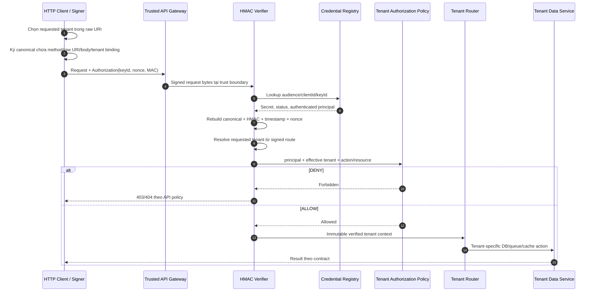

# Tenant routing trong HMAC request authentication đa tenant

## Mục tiêu học tập

Trong chương **Multi-tenant**, **Tenant routing** là cách xác định request HTTP phải được chuyển tới *tenant context*, tài nguyên, dịch vụ, database/schema hoặc partition nào. Khi API xác thực request bằng HMAC, một nguyên tắc đặc biệt quan trọng là: **tenant được client yêu cầu trong path/query/hostname không tự chứng minh rằng client có quyền trên tenant đó**. Chữ ký HMAC ràng buộc nội dung request với một credential; **authorization phải kiểm tra tenant đích thực tế** so với principal/permission đã xác thực.

Bài thuộc module `SECURITY_AUTHENTICATION_HMAC_REQUEST_AUTHENTICATION`: thiết kế xác thực HTTP request bằng **HMAC với shared secret** và canonical request chứa method, URI, header hoặc body theo hợp đồng ký; xác minh chữ ký, chống replay bằng timestamp/nonce, quản lý key rotation, kiểm thử proxy/gateway và phân biệt **authentication** với **authorization**.

Sau bài, người học có thể:

- Phân biệt **requested tenant**, **authenticated principal**, **authorized tenant**, **effective tenant** và **physical routing destination**.
- Định nghĩa thứ tự *parse → credential lookup → HMAC verification → replay checks → resolve effective tenant → authorize → route → business transaction*, không dùng lời khai `tenantId` để cấp quyền.
- Thiết kế tenant routing qua **path, query, subdomain, header** hoặc một định tuyến **theo principal**, với quy tắc canonicalization và ambiguity rõ ràng.
- Ràng buộc route/tenant vào chữ ký HMAC mà không cho phép gateway/proxy rewrite tạo ra tenant confusion, host header spoofing hoặc HTTP request smuggling.
- Kiểm tra membership, scope, resource ownership và cross-tenant isolation, kể cả với **principal được cấp quyền vào nhiều tenant**.
- Phân biệt tenant ID với `clientId`/`keyId`: một client có thể có quyền nhiều tenant, và nhiều client có thể cùng thuộc một tenant theo chính sách.
- Bảo đảm cache, data access, job queue, event processing, trace và downstream HTTP client **không đánh mất tenant context** sau khi HMAC verification thành công.
- Xử lý timestamp/nonce, key rotation và Idempotency-Key với namespace phù hợp để tránh replay, collision và double business effect giữa tenant.
- Thực hành **Java 17** minh họa signer/verifier/router, chặn MAC sai, tenant ngoài quyền, route rewrite, client tự khai header giả, replay, key rotation và idempotency.
- Xây dựng bộ test gồm positive, negative, multi-node và gateway scenarios.

## 1. Tenant routing thực chất là gì?

### 1.1. Một hệ thống có nhiều tenant

Giả sử `payments-api-prod` phục vụ các tổ chức `merchant-a` và `merchant-b`. Mỗi tenant có bộ tài nguyên và ranh giới truy cập riêng.

```text
Client signer
    |
    v
POST /v1/payouts?tenant=merchant-a
Authorization: HMAC-SHA256 clientId=..., keyId=..., MAC=...
    |
    v
API gateway / HMAC verifier
    |
    v
Authenticated principal = svc-settlement-robot
    |
    +-- tenant permission? --> merchant-a: payouts:create
    |
    v
Tenant router --> tenant A's business scope --> data partition A
```

Nếu client chỉ được cấp quyền tại `merchant-a` nhưng tự ký một request có `tenant=merchant-b`, HMAC **có thể vẫn đúng**: client thật đang ký **một request không được phép**. Server phải từ chối `merchant-b` theo authorization, chứ không coi HMAC là tấm vé vào mọi tenant.

### 1.2. Năm khái niệm dễ bị trộn lẫn

| Khái niệm | Lấy từ đâu? | Có đáng tin ngay khi nhận request không? | Vai trò |
| --- | --- | --- | --- |
| **Requested tenant** | `/tenants/{id}`, `?tenant=`, hostname hoặc header | **Không** | Tenant mà caller muốn thao tác. |
| **Claimed client ID** | `Authorization.clientId` | **Không** | Gợi ý tra credential, không phải principal. |
| **Authenticated principal** | Credential registry record **sau verify HMAC** | Có theo mức assurance của cơ chế xác thực | Chủ thể có credential dùng ký request. |
| **Authorized tenant** | Tenant membership/scopes/ABAC policy của principal | Có sau policy evaluation đáng tin | Tenant mà principal có quyền thực hiện action cụ thể. |
| **Effective tenant** | Tenant đã resolve/validate để backend thực thi | Chỉ có sau validation và authz | Context cuối cùng dùng cho DB/cache/queue/downstream. |
| **Physical destination** | Router mapping từ tenant đã được chấp nhận | Không được suy từ input thô | Cluster, schema, shard, topic hoặc service xử lý tenant. |

Cần có invariant:

```text
effectiveTenant == requestedTenant đã được resolve theo route contract
AND authorization(principal, effectiveTenant, action, resource) == ALLOW
AND downstream uses the same effectiveTenant
```

Nếu request có nhiều nguồn chỉ tenant và chúng **không tương đương**, phải **reject ambiguity**; không tùy tiện chọn nguồn “ưu tiên” không được ký.

### 1.3. Route tenant khác credential owner

Có những quan hệ phổ biến:

- Một `clientId` chỉ phục vụ một tenant.
- Một service principal hỗ trợ **nhiều tenant** nhưng có scope khác nhau cho từng action.
- Nhiều clients dùng chung tenant, ví dụ worker đồng bộ và service tạo báo cáo.
- Một client rotate nhiều `keyId` theo thời gian; **tenant permission không được gắn cứng vào text keyId** nếu quyền thuộc principal.
- Một tenant có thể đổi cluster/shard mà vẫn giữ stable tenant ID.

Do đó, **không viết** `tenant = clientId` hoặc `tenant = keyId` như một quy tắc mặc định. Chỉ khi tổ chức đã định nghĩa mapping một-một bất biến và có authorization rõ thì mới áp dụng quy tắc tương đương, được kiểm thử trên mọi route.

## 2. Các kiểu xác định tenant và những rủi ro

### 2.1. Tenant trong path

Ví dụ:

```http
POST /v1/tenants/merchant-a/payouts HTTP/1.1
Authorization: HMAC-SHA256 ...
```

Ưu điểm: URL biểu thị resource rõ ràng, dễ nhìn vào contract, tự nhiên cho REST. Rủi ro:

- `/v1/tenants/merchant-a/../merchant-b` hoặc URL percent-encoding khác nhau có thể được proxy/backend canonicalize không giống nhau.
- Router có thể lấy tenant từ path segment **trước** HMAC và bỏ qua authorization.
- Backend đôi khi dùng resource ID từ body/query làm tenant thực, không khớp path.

Phải định nghĩa raw request-target nào được ký, quy tắc percent-decoding, **dot-segment normalization**, path separators và các path patterns hợp lệ. Trong hợp đồng giáo dục dưới đây, dùng allowlist và tránh normalization nhập nhằng.

### 2.2. Tenant trong query

Ví dụ:

```http
POST /v1/payouts?tenant=merchant-a HTTP/1.1
Authorization: HMAC-SHA256 ...
```

Ưu điểm: minh họa dễ, route nghiệp vụ ổn định. Rủi ro:

- `?tenant=merchant-a&tenant=merchant-b`: component đầu tiên và component cuối có thể chọn hai tenant khác nhau.
- Query key `Tenant`/`tenant` hoặc percent-encoding có thể được xử lý khác.
- Reordering query parameters có thể đổi canonical bytes nếu client/server không cùng hợp đồng.
- Gateway rewrite `/external?...` thành `/internal?...`.

Trong ví dụ bài này, chỉ nhận **một tham số query tên `tenant`**, exact raw target theo pattern, không cho duplicate hoặc additional parameters. Hệ thống có nhiều query params phải định nghĩa canonicalization đầy đủ: thứ tự, duplicates, encoding và các ký tự reserved.

### 2.3. Tenant trong hostname/subdomain

Ví dụ:

```http
POST /v1/payouts HTTP/1.1
Host: merchant-a.api.example.test
Authorization: HMAC-SHA256 ...
```

Rủi ro **host header poisoning** nếu router tin raw `Host` từ client mà chưa xác thực authority, hoặc gateway rewrite Host mà verifier backend nhìn thông tin khác. HTTP/2 sử dụng `:authority`, và proxy có thể thêm `Forwarded` / `X-Forwarded-Host`.

Nếu chọn mô hình này:

- Pin và validate effective authority/host theo **trusted ingress**; không tin `X-Forwarded-Host` từ internet.
- Kiểm tra SNI/TLS route nếu có, danh sách domain hợp lệ, chống domain confusion.
- **Ký host/authority** hoặc một tenant/audience binding xác định tương đương; **không ký mỗi path rồi dùng host chưa được ký để đổi tenant**.
- Chỉ cho trusted gateway cung cấp original authority thông qua metadata có xác thực/toàn vẹn.
- Host không phải bằng chứng caller có quyền trên tenant đó.

### 2.4. Tenant trong custom header

Ví dụ:

```http
X-Tenant-Id: merchant-a
```

Header phù hợp khi không muốn URI chứa tenant, nhưng dễ bị bỏ sót khỏi canonical HMAC. Nếu `X-Tenant-Id` ảnh hưởng route hoặc tenant DB, **nó phải được ký hoặc được lấy từ thông tin đã được xác minh qua trust boundary**.

Các lỗi:

```text
Authorization HMAC ký method + URI + body,
nhưng KHÔNG ký X-Tenant-Id.

Attacker/intermediary thay:
  X-Tenant-Id: merchant-a -> merchant-b
MAC vẫn toán học đúng nếu header đó không nằm trong canonical.
```

Có thể dùng header, nhưng phải quy định tên/giá trị normalized, loại bỏ duplicate, kiểm tra case và thứ tự canonical. Không cho cả `X-Tenant-Id` và query tenant có quyền quyết định độc lập nếu không có quy tắc đồng nhất/ràng buộc rõ.

### 2.5. Tenant được suy từ principal

Một số endpoint không nhận tenant trong request mà dùng tenant mặc định từ credential principal. Điều này có thể đơn giản cho client **chỉ thuộc một tenant**, nhưng với principal đa tenant cần giải quyết chọn tenant nào và hành động đó có được policy cho phép hay không.

Sai:

```text
if principal has many tenants:
    choose first tenant in database
```

Một service account có thể được cấp nhiều tenant với các quyền khác nhau; việc chọn “tenant đầu tiên” khiến cùng request không có semantics ổn định. Cần contract explicit route, delegated tenant claim đã kiểm chứng, hoặc endpoint scoped theo principal được định nghĩa rõ.

## 3. Trust boundary: ai được quyết định tenant?

### 3.1. Phân biệt nhận dữ liệu và quyết định quyền

HTTP adapter có thể parse tenant **trước khi HMAC** để phân luồng giao thông/rate-limit, nhưng mọi giá trị đó **chưa được chứng thực**. Không được dùng nó để:

- Gắn authenticated tenant principal.
- Bỏ qua credential lookup hay chọn một raw secret dùng chung cho tenant.
- Tự query/export dữ liệu tenant.
- Đưa vào `ThreadLocal` rồi cho business code dùng trước authorization.
- Truy cập secret manager hoặc tenant DB theo một path do user cung cấp mà không validate.

Sau MAC, server lấy **authenticated principal** từ credential registry và kiểm tra action/resource của **effective tenant** đã resolve. Chỉ khi ALLOW mới route vào backend tenant tương ứng.

### 3.2. Quy trình chuẩn hóa đường đi request



Điểm then chốt: **router không được tự suy lại tenant từ một nguồn chưa được MAC bảo vệ** sau khi authorization đã ALLOW. Nếu gateway và backend có hai cách resolve tenant khác nhau, cần một contract duy nhất bảo vệ dữ liệu nguồn và effective operation.

### 3.3. Tenant confusion và IDOR/BOLA

*Insecure Direct Object Reference* / *Broken Object Level Authorization* có thể xảy ra dù HMAC đúng.

Ví dụ client có quyền tenant A:

```http
GET /v1/tenants/merchant-a/reports/report-991 HTTP/1.1
Authorization: HMAC-SHA256 ... (MAC đúng)
```

Nếu `report-991` thật ra thuộc tenant B nhưng backend chỉ kiểm tra permission của path tenant A, nó có thể trả dữ liệu B. Vì vậy:

- Kiểm tra tenant của **resource thực**, không chỉ tenant segment trong URL.
- Data access phải lọc `tenant_id = authorizedTenantId`; resource ID có thể trùng hoặc đoán được xuyên tenant.
- Route context không thay thế row-level/object-level authorization.
- Nếu một principal có quyền tenant A và B, vẫn phải xác định **action** và **resource ownership** theo tenant đang được yêu cầu.

Không nên chỉ dùng `WHERE id = :resourceId` nếu ID không globally unique hoặc không kèm kiểm tra tenant ownership.

## 4. Credential registry và tenant authorization trong HMAC

### 4.1. Composite lookup không dựa vào tenant do user khai

Một model:

```text
CredentialRecord {
  audience       = payments-api-prod
  clientId       = settlement-worker
  keyId          = kid_2026_11
  principalId    = svc-settlement
  secretRef      = secret-manager://payments/...
  status         = ACTIVE
  algorithm      = HmacSHA256
  canonicalVer   = tenant-routing-v1
}

TenantPermission {
  principalId    = svc-settlement
  tenantId       = merchant-a
  action         = payouts:create
  effect         = ALLOW
}
```

Tra credential theo `(expectedAudience, claimedClientId, claimedKeyId)`. **Không đưa tenant tự khai làm thứ duy nhất xác định principal/secret**, vì có thể khiến tenant routing trở thành identity selector để giả mạo. Có hệ thống dùng credential namespace theo tenant, nhưng vẫn phải gắn tenant vào credential record và xác minh claim bằng policy sau MAC; không coi `tenantId` từ URL là authority.

### 4.2. Khi principal thuộc nhiều tenant

Ví dụ:

| Principal | Tenant | Scope | Kết quả đối với `POST /payouts` |
| --- | --- | --- | --- |
| `svc-settlement` | `merchant-a` | `payouts:create` | ALLOW |
| `svc-settlement` | `merchant-b` | `reports:read` | DENY payout |
| `svc-merchant-c` | `merchant-c` | `payouts:create` | ALLOW cho C |
| `svc-merchant-c` | `merchant-a` | Không có | DENY |

Cùng credential của `svc-settlement` có thể ký **cả hai** request `merchant-a` và `merchant-b` với MAC hợp lệ. Nhưng policy chỉ cho payout ở A. HMAC không mã hóa scopes vào chữ ký theo cách tự cấp quyền; entitlement phải được lấy từ authority.

### 4.3. Không tin scope/tenant do client tự gửi trong Authorization

Giả sử user thêm:

```http
Authorization: HMAC-SHA256 clientId="settlement-worker", keyId="kid_2026_11", scope="admin", tenant="merchant-b", ...
```

Ngay cả nếu client nắm secret và ký được các trường này, nó **có thể tự chọn text scope/tenant**. Server phải kiểm tra chúng **có nằm trong policy được cấp hay không**. “Đã ký” chứng minh nguồn gốc và toàn vẹn claim **theo credential**, không phải chứng minh claim được tổ chức **ủy quyền**.

### 4.4. Cross-tenant credential collision

Hai tenants có thể có `keyId` trùng văn bản. Trong hệ thống multi-client/multi-tenant, không được lookup chỉ bằng `keyId`. Tùy model có thể dùng `(audience, clientId, keyId)` và ràng buộc principal, hoặc namespace nội bộ bổ sung tenant đã xác thực. Nhưng không bao giờ gán client B vào principal A do collision key ID.

Key ID nên là opaque public identifier **độc lập với raw shared secret**; tuyệt đối không dùng `Base64(secret)` làm key ID để “dễ định tuyến tenant” vì logs/header có thể lộ khóa HMAC.

## 5. Canonical request bảo vệ tenant routing

### 5.1. Contract giáo dục `tenant-routing-v1`

Để minh họa end-to-end, bài dùng **một cách duy nhất** để chỉ tenant: query `?tenant=...`. Quy định:

- Method chính xác `POST`, URI chính xác `/v1/payouts?tenant=<slug>`, slug là ASCII `[a-z0-9-]{1,32}`.
- Không nhận query duplicate, parameter không được nhận dạng, percent-encoding hoặc fragment trong raw target. Đây là tập con chặt cho bài học; API thật cần canonicalization đầy đủ nếu phải nhận URL phong phú.
- Content-Type chính xác `application/json`; body là **exact byte sequence** được signer gửi và verifier nhận.
- `Authorization` custom scheme `HMAC-SHA256` có `clientId`, `keyId`, `timestamp`, `nonce` và `signature`, đã được parse nghiêm ngặt, chặn duplicates/unknown auth-params.
- `Idempotency-Key` là Base64URL không padding của 16 byte ngẫu nhiên, **ổn định trong cùng một logical operation**.
- Timestamp Unix epoch seconds, nonce 16 byte CSPRNG mỗi signed attempt, signature HMAC-SHA256 raw 32 byte → Base64URL không padding.
- Audience lấy từ cấu hình trusted verifier `payments-api-prod`, không lấy từ Host/header tùy ý.
- Request dùng một tenant **được đọc từ raw target đã ký**, không có `X-Tenant-Id` bổ sung độc lập trong contract.

Ví dụ HTTP:

```http
POST /v1/payouts?tenant=merchant-a HTTP/1.1
Host: api.example.test
Content-Type: application/json
Authorization: HMAC-SHA256 clientId="settlement-worker", keyId="kid_2026_11", timestamp="<epoch-seconds>", nonce="<nonce>", signature="<signature>"
Idempotency-Key: <operation-id>
X-Content-SHA256: <body-digest>

{"amount":120000,"currency":"VND"}
```

Các trường `<...>` là placeholder. Đây là một **scheme riêng của bài** chứ không phải mặc định của HTTP/RFC 9421. Trong production phải công bố chính xác quy tắc giao thức, không cho SDK tự đoán.

### 5.2. Canonical 12 dòng, có tenant binding qua URI

```text
HMAC-SHA256
tenant-routing-v1
payments-api-prod
settlement-worker
kid_2026_11
POST
/v1/payouts?tenant=merchant-a
application/json
<sha256-exact-body-base64url>
<idempotency-key>
<timestamp-epoch-seconds>
<nonce-base64url>
```

| Dòng | Trường | Ý nghĩa |
| --- | --- | --- |
| 1 | Algorithm `HMAC-SHA256` | Pin thuật toán; không downgrade. |
| 2 | Canonical version | Chống nhầm hợp đồng giữa SDK/gateway/backend. |
| 3 | Audience | Đích service tin cậy, chống cross-environment credential use. |
| 4 | Client ID | Ràng buộc declared client với MAC. |
| 5 | Key ID | Ràng buộc selected credential record với MAC. |
| 6 | HTTP method | Bảo vệ thao tác create, không đổi từ GET sang POST. |
| **7** | **Raw URI/query** | **`tenant=merchant-a` được ký; sửa sang B làm MAC không khớp.** |
| 8–9 | Content-Type và body SHA-256 | Bảo vệ exact body bytes. |
| 10 | Idempotency-Key | Giữ ổn định khi retry cùng business operation. |
| 11–12 | Timestamp/nonce | Freshness và chống replay. |

Cách tính:

```text
bodyHash = Base64URL_NoPadding(SHA256(exactBodyBytes))
canonical = join(LF, twelveFields)  # UTF-8, no final LF
macBytes = HMAC-SHA256(rawSharedSecretForKeyId, UTF8(canonical))
signature = Base64URL_NoPadding(macBytes)  # raw MAC 32 bytes -> 43 chars
```

**Không chỉ ký text tenant mà bỏ raw URI/method/body:** routing còn phụ thuộc action/resource. Hợp đồng này bảo vệ tenant **thông qua exact raw request-target**. Nếu dùng Host hoặc `X-Tenant-Id` để chọn tenant mà không có trong canonical/trusted context, hợp đồng **không bảo vệ** nguồn đó; phải bổ sung hợp đồng khác, không âm thầm reuse chữ ký.

### 5.3. Ví dụ tấn công đổi tenant sau ký

```text
Original:
  path = /v1/payouts?tenant=merchant-a
  MAC_A = HMAC(secret, canonical(..., path A, body A))

Attacker/proxy changes only:
  path = /v1/payouts?tenant=merchant-b
  MAC = MAC_A (unchanged)

Verifier:
  expected = HMAC(secret, canonical(..., path B, body A))
  expected != MAC_A -> reject.
```

Tính chất này chỉ được giữ nếu verifier thực sự dựng canonical từ **URI dùng làm nguồn quyết định routing**. Nếu verifier ký/check tenant A nhưng router lại chọn B qua một header ngoài canonical, MAC đúng **không đủ** để chặn tấn công tenant confusion.

### 5.4. Verify HMAC chưa phải quyết định tenant authorization

Một principal có secret hợp lệ có thể tự tạo `MAC_B = HMAC(secret, canonical(..., path B, body B))` cho tenant B; chữ ký **đúng** về toán học. Vì vậy phải có bước:

```text
requested = resolveTenantFromSignedTarget(request.rawTarget)
principal = credentialRecord.principal AFTER valid HMAC
if not policy.allows(principal, requested, "payouts:create"):
    reject authorization
else:
    route to trustedTenantMapping[requested]
```

Không dùng `keyId` làm tenant ID. Không tự cấp quyền chỉ vì cả requested tenant và client ID đều là chuỗi ASCII hợp lệ.

## 6. Gateway/proxy: giữ đúng requested và effective tenant

### 6.1. Rewrite path có thể làm MAC fail dù tenant không đổi

```text
Client ký:
  POST /public/v1/payouts?tenant=merchant-a

Gateway đổi:
  POST /internal/v1/payouts?tenant=merchant-a

Backend verify trên /internal/v1/... -> khác canonical, BAD_MAC.
```

Đây là vấn đề **trust boundary**, không phải raw secret sai. Chọn một kiến trúc rõ:

1. **HMAC verifier ở gateway trước rewrite**: gateway kiểm tra request/nonce/key status, resolve tenant, authorize hoặc truyền principal + signed operation context nội bộ đáng tin; backend **không** tin user-supplied `X-Verified-Tenant`.
2. **Verifier ở backend**: gateway phải bảo toàn những signed fields gốc hoặc chuyển original raw target/authority theo metadata nội bộ **được bảo vệ chống giả mạo**. Không lấy `X-Original-URI` / `Forwarded` trực tiếp từ internet.
3. **Delegation protocol riêng**: gateway cấp internal assertion gắn principal + effective tenant + audience + action + expiry và kênh tin cậy; không giả vờ rằng Bearer/forwarded header là MAC gốc.

Phải kiểm thử cả trạng thái redirect, HTTP/1.1 Host và HTTP/2 `:authority`, reverse proxy normalization, Content-Encoding, body streaming và duplicate headers theo thực tế.

### 6.2. Client tự khai `X-Authenticated-Tenant`

Sai:

```http
POST /v1/payouts?tenant=merchant-a HTTP/1.1
X-Authenticated-Tenant: merchant-b
Authorization: HMAC-SHA256 ... signed for merchant-a
```

Nếu backend ưu tiên header `X-Authenticated-Tenant`, attacker có thể kích hoạt tenant B khi HMAC chỉ ràng buộc tenant A. Gateway/backend cần strip mọi header identity/tenant nội bộ do internet gửi, thiết lập context mới **chỉ sau** xác thực và authorization, và bảo vệ đường truyền/metadata nội bộ.

Một request có cả `tenant` trong URI và header có giá trị khác phải bị reject theo contract bài này. Không để proxy chọn A và backend chọn B.

### 6.3. Tenant mapping không được xây từ raw user input thành đường dẫn hệ thống

Không làm:

```java
// SAI: tenant là chuỗi chưa validate; nguy cơ path traversal / injection.
Path tenantDir = Path.of("/data/tenants/" + request.tenant());
Connection conn = openJdbc("jdbc:postgresql://" + request.tenant());
```

Đúng hơn là ánh xạ **tenant đã authorize** qua registry/cấu hình đáng tin:

```text
tenantRouter.resolve("merchant-a") -> TrustedTenantRoute(
    dataSourceRef="ds-tenant-17",
    region="ap-southeast-1",
    policyRevision=83
)
```

Không cho raw tenant ID từ URI trở thành SQL identifier, filesystem path, object storage bucket hay internal service URL không validate. Tenant routing registry cần quyền quản trị và policy riêng, có thể thay đổi vị trí vật lý mà không cần thay raw tenant ID trong chữ ký.

## 7. Tenant context phải được giữ xuyên các lớp dữ liệu

### 7.1. Ràng buộc tenant vào database và resource ownership

Giả sử HMAC verifier đã xác thực `svc-settlement` và policy cho payout tại `merchant-a`. Sau đó backend gọi:

```sql
-- SAI: resourceId có thể tồn tại trong tenant khác.
SELECT * FROM payouts WHERE payout_id = :payout_id;
```

Đúng hơn, query phải **gắn tenant đã authorize**:

```sql
-- Minh họa; giá trị :tenant_id đến từ VerifiedTenantContext.
SELECT payout_id, amount, status
FROM payouts
WHERE tenant_id = :authorized_tenant_id
  AND payout_id = :payout_id;
```

Với `UPDATE`/`DELETE`, điều kiện tenant cũng phải có; kiểm tra ảnh hưởng số dòng và use-case authorization. Có thể dùng row-level security (RLS), database role, schema-per-tenant hoặc database-per-tenant **như lớp phòng vệ bổ sung**, nhưng app vẫn cần truyền context chính xác.

Nếu mô hình resource ID globally unique, cũng không được bỏ kiểm tra object ownership: một ID đúng format không chứng minh quyền truy cập.

### 7.2. Tenant context immutable, không cho downstream tự ghi đè

Một object nội bộ tốt:

```java
record VerifiedTenantContext(
        String audience,
        String authenticatedPrincipal,
        String tenantId,
        String action,
        String routeRevision) {}
```

Object này nên được tạo **chỉ sau** khi HMAC và authorization đạt. Đừng truyền thẳng `X-Tenant-Id` chưa được ký vào `ThreadLocal` hoặc lấy tenant từ bất kỳ URL/header mới nào ở business layer rồi ghi đè context.

Nếu dùng `ThreadLocal` để phục vụ framework cũ, phải xóa trong `finally` khi trả thread về pool. Với async/reactive execution, **ThreadLocal có thể mất hoặc rò giữa tasks**; ưu tiên explicit context passing hoặc context propagation được framework bảo vệ. Không tin tenant trong trace baggage mà client tự gửi.

### 7.3. Cache và idempotency phải có namespace tenant

Cache sai:

```text
cacheKey = "payout:" + payoutId
```

Nếu `payoutId` trùng giữa tenant A và B, server có thể trả payload A cho B. Cần:

```text
cacheKey = (authorizedTenant, resourceType, resourceId, scope/version)
```

Một key như `(tenant, payoutId)` chưa đủ cho mọi cache: còn ACL, representation/visibility, locale hoặc policy revision nếu response phụ thuộc quyền. Tránh lưu một response nhạy cảm có `Cache-Control` sai trong shared HTTP cache; `Authorization` có semantics cache riêng theo RFC 9110/9111. Không dựa vào Vary của một **header tenant không được ký** như lớp authorization.

Idempotency tương tự:

```text
idempotencyLookupKey = (
    expectedAudience, authenticatedPrincipal, effectiveTenant, operationId
)
fingerprint = SHA256(method || rawTarget || bodyHash || semanticFields)
```

Đây chỉ là mô hình minh họa. Nếu cùng principal có quyền nhiều tenant, đưa effective tenant vào namespace tránh collision và lộ kết quả chéo tenant. Trường `operationId` phải **được bảo vệ bằng HMAC** và giữ nguyên qua retry cùng logical operation. Nonce thì **mới theo từng signed attempt**; không dùng nonce làm Idempotency-Key.

### 7.4. Job queue và event consumer không được tự tin tenant ID

Ví dụ:

```text
HMAC verifier -> queue "create payout" -> worker -> tenant DB
```

Nếu queue payload chỉ chứa `{"tenantId":"merchant-b","payoutId":"..."}` mà không có trusted context/capability binding, worker có thể xử lý tenant khác với tenant đã authorize. Cần:

- Producer được xác thực và authorize, đẩy **effective tenant** từ context đáng tin.
- Transport, queue ACL và message signing/integrity hoặc kênh nội bộ tin cậy tùy threat model.
- Worker xác minh message origin, policy và tenant/resource binding cần thiết; nhất là khi task chạy chậm và quyền có thể thay đổi.
- Idempotency theo tenant/operation ở phía consumer nếu side effect có thể được gửi lại.
- Không lấy tenant từ thông tin do người dùng tự do sửa, như `traceId` hoặc message header không được bảo vệ.

### 7.5. Tenant affinity không phải quyền truy cập

Load balancer có thể chọn cluster theo tenant để tối ưu hiệu năng. Nhưng một route tới cluster A **không chứng minh** principal có quyền tenant A. Tách:
- **Routing decision**: tenant A được xử lý ở vùng/DB nào?
- **Authorization decision**: principal này được làm action trên tenant A không?

Nếu tenant đang migrate từ DB-1 sang DB-2, mapping phải được cập nhật qua registry đáng tin có revision. Client vẫn ký logical tenant ID A; không nên để client tự chọn DB-2 qua header rồi qua mặt policy.

## 8. Timestamp/nonce, rotation và replay xuyên tenant

### 8.1. Chống replay không được nhầm với tenant routing

Chữ ký HMAC chỉ chứng minh request bytes khớp credential. Nếu attacker ghi lại nguyên request còn trong cửa sổ timestamp, MAC vẫn có thể hợp lệ. Chọn freshness:

```text
serverNow - P <= signedTimestamp <= serverNow + F
P = 300 seconds
F = 60 seconds
```

Nonce 16 byte CSPRNG phải được claim **nguyên tử** trong replay store dùng chung. Một phạm vi phù hợp khi contract yêu cầu nonce duy nhất **trên toàn principal** là:

```text
replayKey = (expectedAudience, authenticatedPrincipalId, nonce)
```

Khi principal có quyền nhiều tenant, scope **chỉ theo tenant** có thể cho cùng nonce đi qua hai tenant. Nếu đã ký raw tenant trong canonical, hai attempts khác nhau phải được ký lại khi đổi tenant; tuy nhiên để chặn client reuse nonce hoặc mix-up khi nhiều key IDs, nên dùng principal-scoped nonce. Lựa chọn khác chỉ hợp lệ nếu protocol nêu rõ uniqueness domain, threat model và toàn bộ SDK/verifier tuân cùng quy tắc.

### 8.2. TTL nonce khác TTL idempotency

Với policy trên, một timestamp t có thể hợp lệ từ `t-F` tới `t+P`. Nếu nonce được claim sớm ở `t-F`, cần nhớ đến `t+P`: ít nhất `P+F = 360 giây` cộng safety margin, ví dụ **370 giây**. TTL không được rút ngắn chỉ vì signer đổi tenant, key rotation hoặc user logout.

Business idempotency có thể giữ operation record lâu hơn đáng kể (theo hợp đồng API), vì retry sau lost response có thể xảy ra khi nonce/Timestamp attempt đầu hết hạn. **Không dùng nonce store thay cho business idempotency**.

### 8.3. Rotation không được làm mất principal/tenant binding

Ví dụ:

```text
Credential K_old -> principal svc-settlement, tenant A: payouts:create
Credential K_new -> principal svc-settlement, tenant A: payouts:create
```

Retry cùng operation sau rotation:

```text
Attempt 1: keyId=K_old, timestamp=T1, nonce=N1, opId=OP-42, tenant=A
Attempt 2: keyId=K_new, timestamp=T2, nonce=N2, opId=OP-42, tenant=A
```

Cần giữ cùng logical operation/tenant/body; HMAC phải được tính lại trên key ID, timestamp và nonce mới. Idempotency namespace nên dựa trên **authenticated principal và tenant**, không dùng key ID làm partition riêng khiến K_new tạo effect lần hai.

Nếu attempt 2 bất ngờ đổi tenant sang B nhưng vẫn dùng OP-42, hệ thống không được tùy tiện lấy result A trả cho B. Với namespace per-tenant, đó là **operation khác theo chính sách**; với namespace per-principal toàn cục, fingerprint conflict phải ngăn B thay thế A. Cần định nghĩa chính xác semantic behavior của API.

### 8.4. Khóa HMAC bị revoke không được phép định tuyến tenant

Một key `REVOKED` có thể vẫn tạo MAC đúng toán học bằng raw secret cũ. Verifier phải reject trước authorization và routing. Không “cho qua key cũ vào read-only tenant” trừ khi đó là policy được phát hành minh bạch với credential còn hợp lệ; khi key đã nghi compromise, phải revoke theo incident response.

Trong planned rotation có thể dùng grace period verify-only cho key cũ với deadline hữu hạn. Policy trạng thái/expiry được tính theo **server time**, không dựa vào `timestamp` do client tự ký. Bản backup registry cũ không được tự đưa key đã revoke trở lại ACTIVE.

## 9. Java 17: mô phỏng HMAC verifier và tenant router

Ví dụ `TenantRoutingHmacDemo.java` dùng JDK 17, không cần framework. Nó tập trung vào ranh giới **MAC hợp lệ ≠ có quyền tenant**, và quy tắc **route theo verified context**.

### 9.1. Những hành vi ví dụ cần chứng minh

1. Client `settlement-worker` có quyền `payouts:create` tại `merchant-a`, nhưng **không** có quyền cùng action tại `merchant-b`.
2. `merchant-b-worker` được provision với secret độc lập; keyId có thể **trùng text** `kid_2026_11` mà không làm lẫn hai client.
3. Signer dùng key `settlement-worker` tạo MAC hợp lệ cho tenant A → routing tới backend A.
4. **Sửa `tenant=merchant-a` thành `tenant=merchant-b` sau ký** → MAC sai, dù cùng endpoint.
5. **Tự ký request mới cho tenant B** bằng đúng secret của settlement-worker → HMAC đúng nhưng **FORBIDDEN** vì thiếu quyền.
6. Request tự gửi `X-Verified-Tenant: merchant-b` bị reject trước khi backend dùng header đó để đổi tenant.
7. **Replay nguyên signed attempt** bị reject bằng nonce store theo principal.
8. Tenant `merchant-orphan` được policy ALLOW trong fixture nhưng **không có route mapping** → fail closed, không dùng default tenant backend.
9. K_new được cấp cho cùng principal và keyId khác, vẫn chỉ có quyền tenant A; K_old bị revoke không còn được verify.
10. Registry outage từ chối authentication và được phân biệt với `UNKNOWN_KEY` trong chẩn đoán.
11. Idempotency-Key của một logical operation giữ nguyên khi retry chuyển từ K_old sang K_new; business transaction **chưa được mô phỏng**.

### 9.2. Mô hình bảo mật trong demo

```text
HTTP WireRequest
  | strict parser (không tin Header do client gắn)
  v
AuthFields(clientId,keyId,timestamp,nonce,signature)
  | registry lookup by (trusted audience, clientId, keyId)
  v
Credential(PRINCIPAL, rawSecret, status)
  | exact canonical HMAC-SHA256, timestamp, nonce claim
  v
AuthenticatedPrincipal
  | parse tenant from SIGNED rawTarget
  | policy authorize(action=payouts:create, tenant)
  v
VerifiedTenantContext
  | trusted tenant routing table
  v
Trusted destination (cluster/schema ref)
```

Verifier chỉ xử lý một bản Java `WireRequest` đã được HTTP adapter chuẩn hóa. Trong production, phải kiểm tra framing, transfer/content encoding, duplicate `Host`/`Authorization`/`Idempotency-Key`, request smuggling và raw URI semantics trước khi tạo object này. Demo có validator phụ để phát hiện duplicate Authorization và header `X-Verified-Tenant` tự khai.

### 9.3. Mã Java 17 hoàn chỉnh

```java
import java.nio.charset.StandardCharsets;
import java.security.GeneralSecurityException;
import java.security.MessageDigest;
import java.security.SecureRandom;
import java.time.Clock;
import java.time.Instant;
import java.time.ZoneOffset;
import java.util.Arrays;
import java.util.Base64;
import java.util.HashMap;
import java.util.List;
import java.util.Locale;
import java.util.Map;
import java.util.Objects;
import java.util.Set;
import java.util.concurrent.ConcurrentHashMap;
import java.util.concurrent.ConcurrentMap;
import java.util.regex.Matcher;
import java.util.regex.Pattern;
import javax.crypto.Mac;
import javax.crypto.spec.SecretKeySpec;

public final class TenantRoutingHmacDemo {
    private static final String AUDIENCE = "payments-api-prod";
    private static final long PAST = 300L;
    private static final long FUTURE = 60L;

    private static final Pattern IDENTIFIER =
            Pattern.compile("[A-Za-z0-9_-]{1,64}");
    private static final Pattern EPOCH =
            Pattern.compile("[1-9][0-9]{0,11}");
    private static final Pattern RAW_TARGET =
            Pattern.compile("/v1/payouts\\?tenant=([a-z0-9-]{1,32})");

    // Tập con auth-param an toàn cho đúng hợp đồng giáo dục này.
    private static final Pattern AUTH_SCHEME = Pattern.compile(
            "(?i)^HMAC-SHA256[ \\t]+(.+)$");
    private static final Pattern AUTH_PARAM = Pattern.compile(
            "^[ \\t]*([A-Za-z][A-Za-z0-9_-]*)[ \\t]*"
            + "=[ \\t]*\"([A-Za-z0-9_-]+)\"[ \\t]*$");

    private static final Base64.Encoder ENCODE =
            Base64.getUrlEncoder().withoutPadding();
    private static final Base64.Decoder DECODE =
            Base64.getUrlDecoder();

    private TenantRoutingHmacDemo() {}

    enum Verdict {
        ACCEPTED, INVALID_INPUT, UNKNOWN_CREDENTIAL, INVALID_MAC,
        OUTSIDE_WINDOW, REPLAYED, FORBIDDEN,
        ROUTE_UNAVAILABLE, DEPENDENCY_UNAVAILABLE
    }

    record KeyRef(String audience, String clientId, String keyId) {}

    record Credential(
            KeyRef ref, String principal, byte[] rawSecret,
            boolean active) {
        Credential {
            rawSecret = Objects.requireNonNull(rawSecret).clone();
        }
        @Override public byte[] rawSecret() {
            return rawSecret.clone();
        }
        Credential revoked() {
            return new Credential(ref, principal, rawSecret, false);
        }
    }

    record Operation(
            String method, String rawTarget, String contentType,
            byte[] body, String operationId) {
        Operation {
            body = Objects.requireNonNull(body).clone();
        }
        @Override public byte[] body() {
            return body.clone();
        }
    }

    record AuthFields(
            String clientId, String keyId, String timestamp,
            String nonce, String signature) {}

    record WireRequest(
            Operation operation, List<String> authorizationFields,
            String declaredBodyHash,
            Map<String, String> untrustedExtraHeaders) {
        WireRequest {
            authorizationFields = List.copyOf(
                    Objects.requireNonNull(authorizationFields));
            untrustedExtraHeaders = Map.copyOf(
                    Objects.requireNonNull(untrustedExtraHeaders));
        }
    }

    record VerifiedTenantContext(
            String audience, String principal,
            String tenantId, String action, String backendRef) {}

    record Result(Verdict verdict, VerifiedTenantContext context) {
        static Result deny(Verdict reason) {
            return new Result(reason, null);
        }
    }

    static final class RegistryUnavailable
            extends RuntimeException {}

    static final class CredentialRegistry {
        private final ConcurrentMap<KeyRef, Credential> entries =
                new ConcurrentHashMap<>();
        private volatile boolean available = true;

        void register(Credential credential) {
            if (entries.putIfAbsent(
                    credential.ref(), credential) != null) {
                throw new IllegalArgumentException(
                        "Duplicate credential record");
            }
        }

        Credential lookup(KeyRef ref) {
            if (!available) {
                throw new RegistryUnavailable();
            }
            return entries.get(ref);
        }

        void revoke(KeyRef ref) {
            entries.computeIfPresent(ref, (ignored, old) ->
                    old.revoked());
        }

        void setAvailable(boolean next) {
            available = next;
        }
    }

    static final class TenantPolicy {
        // Chỉ mô phỏng một ACL ở một JVM. Production dùng authority
        // có principal, action, resource và revision đáng tin.
        private final Set<String> grants =
                ConcurrentHashMap.newKeySet();

        void grant(String principal, String tenant, String action) {
            grants.add(principal + "|" + tenant + "|" + action);
        }

        boolean allows(
                String principal, String tenant, String action) {
            return grants.contains(
                    principal + "|" + tenant + "|" + action);
        }
    }

    static final class TenantRouter {
        // Map này là dữ liệu CẤU HÌNH đáng tin, không lấy từ header.
        private final Map<String, String> backends = new HashMap<>();

        void map(String tenant, String destination) {
            backends.put(tenant, destination);
        }

        String backendFor(String tenant) {
            return backends.get(tenant);
        }
    }

    static final class DemoNonceStore {
        // Không có TTL/persistence/multi-node; chỉ để minh họa.
        private final Set<String> used =
                ConcurrentHashMap.newKeySet();

        boolean claim(
                String audience, String principal, String nonce) {
            return used.add(audience + "|" + principal + "|" + nonce);
        }
    }

    static byte[] randomBytes(SecureRandom rng, int length) {
        byte[] result = new byte[length];
        rng.nextBytes(result);
        return result;
    }

    static String token(SecureRandom rng) {
        byte[] bytes = randomBytes(rng, 16);
        String value = ENCODE.encodeToString(bytes);
        Arrays.fill(bytes, (byte) 0);
        return value;
    }

    static byte[] strictBase64Url(
            String text, int expectedText, int expectedBytes) {
        if (text == null || text.length() != expectedText
                || !text.matches("[A-Za-z0-9_-]+")) {
            throw new IllegalArgumentException(
                    "Invalid Base64URL syntax");
        }
        byte[] bytes = DECODE.decode(text);
        if (bytes.length != expectedBytes
                || !ENCODE.encodeToString(bytes).equals(text)) {
            throw new IllegalArgumentException(
                    "Noncanonical Base64URL");
        }
        return bytes;
    }

    static String requestedTenant(String rawTarget) {
        if (rawTarget == null) {
            throw new IllegalArgumentException("Missing raw target");
        }
        Matcher matcher = RAW_TARGET.matcher(rawTarget);
        if (!matcher.matches()) {
            throw new IllegalArgumentException(
                    "Ambiguous or unsupported tenant route");
        }
        return matcher.group(1);
    }

    static void validateOperation(Operation op) {
        if (op == null || !"POST".equals(op.method())
                || !"application/json".equals(op.contentType())
                || op.body().length == 0
                || op.body().length > 1_048_576) {
            throw new IllegalArgumentException("Invalid operation");
        }
        requestedTenant(op.rawTarget());
        strictBase64Url(op.operationId(), 22, 16);
    }

    static AuthFields parseAuth(List<String> headerLines) {
        if (headerLines == null || headerLines.size() != 1
                || headerLines.get(0) == null) {
            throw new IllegalArgumentException(
                    "Exactly one Authorization field required");
        }
        String value = headerLines.get(0);
        if (value.length() > 512) {
            throw new IllegalArgumentException("Authorization too long");
        }
        for (int i = 0; i < value.length(); i++) {
            char c = value.charAt(i);
            if (c > 126 || (c < 32 && c != '\t')) {
                throw new IllegalArgumentException(
                        "Unsafe Authorization character");
            }
        }
        Matcher scheme = AUTH_SCHEME.matcher(value);
        if (!scheme.matches()) {
            throw new IllegalArgumentException(
                    "Wrong authentication scheme");
        }
        String[] parts = scheme.group(1).split(",", -1);
        if (parts.length != 5) {
            throw new IllegalArgumentException("Five params required");
        }
        Map<String, String> params = new HashMap<>();
        Set<String> allowed = Set.of(
                "clientid", "keyid", "timestamp", "nonce", "signature");
        for (String part : parts) {
            Matcher m = AUTH_PARAM.matcher(part);
            if (!m.matches()) {
                throw new IllegalArgumentException("Malformed auth-param");
            }
            String name = m.group(1).toLowerCase(Locale.ROOT);
            if (!allowed.contains(name)
                    || params.putIfAbsent(name, m.group(2)) != null) {
                throw new IllegalArgumentException(
                        "Unknown/duplicate auth-param");
            }
        }
        AuthFields auth = new AuthFields(
                params.get("clientid"), params.get("keyid"),
                params.get("timestamp"), params.get("nonce"),
                params.get("signature"));
        if (auth.clientId() == null || auth.keyId() == null
                || !IDENTIFIER.matcher(auth.clientId()).matches()
                || !IDENTIFIER.matcher(auth.keyId()).matches()
                || auth.timestamp() == null
                || !EPOCH.matcher(auth.timestamp()).matches()) {
            throw new IllegalArgumentException(
                    "Invalid client/key/timestamp");
        }
        strictBase64Url(auth.nonce(), 22, 16);
        strictBase64Url(auth.signature(), 43, 32);
        return auth;
    }

    static String authorization(AuthFields auth) {
        return "HMAC-SHA256 "
                + "clientId=\"" + auth.clientId() + "\", "
                + "keyId=\"" + auth.keyId() + "\", "
                + "timestamp=\"" + auth.timestamp() + "\", "
                + "nonce=\"" + auth.nonce() + "\", "
                + "signature=\"" + auth.signature() + "\"";
    }

    static void rejectExternalTenantClaims(
            Map<String, String> extra) {
        for (String header : extra.keySet()) {
            if (header.equalsIgnoreCase("X-Tenant-Id")
                    || header.equalsIgnoreCase("X-Verified-Tenant")
                    || header.equalsIgnoreCase(
                            "X-Authenticated-Principal")) {
                throw new IllegalArgumentException(
                        "Untrusted tenant/principal header");
            }
        }
    }

    static byte[] sha256(byte[] data)
            throws GeneralSecurityException {
        return MessageDigest.getInstance("SHA-256").digest(data);
    }

    static String canonical(
            Operation operation, AuthFields auth, String bodyHash) {
        validateOperation(operation);
        if (auth == null || auth.clientId() == null
                || auth.keyId() == null
                || !IDENTIFIER.matcher(auth.clientId()).matches()
                || !IDENTIFIER.matcher(auth.keyId()).matches()
                || !EPOCH.matcher(auth.timestamp()).matches()) {
            throw new IllegalArgumentException("Invalid auth fields");
        }
        strictBase64Url(auth.nonce(), 22, 16);
        strictBase64Url(bodyHash, 43, 32);
        return String.join("\n",
                "HMAC-SHA256",
                "tenant-routing-v1",
                AUDIENCE,
                auth.clientId(),
                auth.keyId(),
                operation.method(),
                operation.rawTarget(), // Chứa tenant được ký.
                operation.contentType(),
                bodyHash,
                operation.operationId(),
                auth.timestamp(),
                auth.nonce());
        // 12 dòng UTF-8; LF; không LF cuối.
    }

    static byte[] hmac(
            byte[] rawSecret, String canonicalText)
            throws GeneralSecurityException {
        Mac mac = Mac.getInstance("HmacSHA256");
        mac.init(new SecretKeySpec(rawSecret, "HmacSHA256"));
        return mac.doFinal(
                canonicalText.getBytes(StandardCharsets.UTF_8));
    }

    static WireRequest sign(
            Credential credential, Operation operation,
            Clock clock, SecureRandom rng)
            throws GeneralSecurityException {
        validateOperation(operation);
        String timestamp =
                Long.toString(Instant.now(clock).getEpochSecond());
        String nonce = token(rng);
        String hash = ENCODE.encodeToString(
                sha256(operation.body()));
        AuthFields unsigned = new AuthFields(
                credential.ref().clientId(),
                credential.ref().keyId(),
                timestamp, nonce, "");
        String signature = ENCODE.encodeToString(
                hmac(credential.rawSecret(),
                        canonical(operation, unsigned, hash)));
        AuthFields signed = new AuthFields(
                unsigned.clientId(), unsigned.keyId(),
                timestamp, nonce, signature);
        return new WireRequest(
                operation, List.of(authorization(signed)),
                hash, Map.of());
    }

    static Result verifyAndRoute(
            WireRequest request, CredentialRegistry registry,
            TenantPolicy policy, TenantRouter router,
            DemoNonceStore nonceStore, Clock serverClock)
            throws GeneralSecurityException {
        try {
            if (request == null) {
                throw new IllegalArgumentException("Missing request");
            }
            validateOperation(request.operation());
            rejectExternalTenantClaims(
                    request.untrustedExtraHeaders());
            AuthFields auth =
                    parseAuth(request.authorizationFields());

            // clientId/keyId chỉ là hints cho đến khi MAC đúng.
            KeyRef ref = new KeyRef(
                    AUDIENCE, auth.clientId(), auth.keyId());
            Credential credential = registry.lookup(ref);
            if (credential == null || !credential.active()) {
                return Result.deny(Verdict.UNKNOWN_CREDENTIAL);
            }

            long now =
                    Instant.now(serverClock).getEpochSecond();
            long timestamp = Long.parseLong(auth.timestamp());
            if (timestamp < Math.subtractExact(now, PAST)
                    || timestamp > Math.addExact(now, FUTURE)) {
                return Result.deny(Verdict.OUTSIDE_WINDOW);
            }

            byte[] bodyDigest = sha256(request.operation().body());
            byte[] suppliedDigest = strictBase64Url(
                    request.declaredBodyHash(), 43, 32);
            if (!MessageDigest.isEqual(bodyDigest, suppliedDigest)) {
                return Result.deny(Verdict.INVALID_MAC);
            }

            byte[] suppliedMac = strictBase64Url(
                    auth.signature(), 43, 32);
            byte[] expectedMac = hmac(
                    credential.rawSecret(),
                    canonical(request.operation(), auth,
                            ENCODE.encodeToString(bodyDigest)));
            if (!MessageDigest.isEqual(expectedMac, suppliedMac)) {
                return Result.deny(Verdict.INVALID_MAC);
            }

            // Claim chỉ sau MAC, theo principal đã được xác thực.
            if (!nonceStore.claim(
                    AUDIENCE, credential.principal(), auth.nonce())) {
                return Result.deny(Verdict.REPLAYED);
            }

            // Tenant được resolve từ CHÍNH rawTarget đã có trong MAC.
            String tenant =
                    requestedTenant(request.operation().rawTarget());
            String action = "payouts:create";
            if (!policy.allows(
                    credential.principal(), tenant, action)) {
                return Result.deny(Verdict.FORBIDDEN);
            }

            // Không dùng default backend khi thiếu trusted route.
            String backend = router.backendFor(tenant);
            if (backend == null) {
                return Result.deny(Verdict.ROUTE_UNAVAILABLE);
            }

            VerifiedTenantContext context =
                    new VerifiedTenantContext(
                            AUDIENCE, credential.principal(),
                            tenant, action, backend);
            return new Result(Verdict.ACCEPTED, context);
        } catch (RegistryUnavailable ex) {
            return Result.deny(Verdict.DEPENDENCY_UNAVAILABLE);
        } catch (IllegalArgumentException | ArithmeticException ex) {
            return Result.deny(Verdict.INVALID_INPUT);
        }
    }

    static Credential credential(
            SecureRandom rng, String clientId, String keyId,
            String principal) {
        return new Credential(
                new KeyRef(AUDIENCE, clientId, keyId),
                principal, randomBytes(rng, 32), true);
    }

    static Operation withTenant(Operation original, String tenant) {
        return new Operation(
                original.method(),
                "/v1/payouts?tenant=" + tenant,
                original.contentType(),
                original.body(),
                original.operationId());
    }

    static Clock at(long epochSecond) {
        return Clock.fixed(
                Instant.ofEpochSecond(epochSecond), ZoneOffset.UTC);
    }

    static void show(
            String name, WireRequest request,
            CredentialRegistry registry, TenantPolicy policy,
            TenantRouter router, DemoNonceStore nonces, Clock clock)
            throws GeneralSecurityException {
        Result result = verifyAndRoute(
                request, registry, policy, router, nonces, clock);
        System.out.println(name + ": " + result.verdict());
        if (result.context() != null) {
            System.out.println("  Verified tenant: "
                    + result.context().tenantId());
            System.out.println("  Trusted backend: "
                    + result.context().backendRef());
        }
    }

    public static void main(String[] args)
            throws GeneralSecurityException {
        final long t0 = 1_700_000_000L; // Fixture, không phải giờ hiện tại.
        SecureRandom rng = new SecureRandom();
        Clock clock = at(t0);
        CredentialRegistry registry = new CredentialRegistry();
        TenantPolicy policy = new TenantPolicy();
        TenantRouter router = new TenantRouter();
        DemoNonceStore nonces = new DemoNonceStore();

        Credential settlement = credential(
                rng, "settlement-worker", "kid_2026_11",
                "svc-settlement");
        Credential merchantB = credential(
                rng, "merchant-b-worker", "kid_2026_11",
                "svc-merchant-b");
        registry.register(settlement);
        registry.register(merchantB);

        policy.grant(
                "svc-settlement", "merchant-a", "payouts:create");
        policy.grant(
                "svc-settlement", "merchant-orphan", "payouts:create");
        policy.grant(
                "svc-merchant-b", "merchant-b", "payouts:create");

        router.map("merchant-a", "ds-tenant-17");
        router.map("merchant-b", "ds-tenant-21");

        Operation opA = new Operation(
                "POST", "/v1/payouts?tenant=merchant-a",
                "application/json",
                "{\"amount\":120000,\"currency\":\"VND\"}"
                        .getBytes(StandardCharsets.UTF_8),
                token(rng));
        WireRequest validA = sign(settlement, opA, clock, rng);

        show("Valid A", validA,
                registry, policy, router, nonces, clock);

        // Thay tenant sau ký, giữ nguyên Authorization và MAC.
        WireRequest changedTenant = new WireRequest(
                withTenant(opA, "merchant-b"),
                validA.authorizationFields(),
                validA.declaredBodyHash(), Map.of());
        show("Tampered tenant after signing", changedTenant,
                registry, policy, router, nonces, clock);

        // Ký ĐÚNG bằng S_settlement cho tenant B;
        // authentication có thể pass nhưng authorization phải deny.
        WireRequest validMacWrongTenant = sign(
                settlement, withTenant(opA, "merchant-b"), clock, rng);
        show("Valid MAC, unauthorized tenant",
                validMacWrongTenant,
                registry, policy, router, nonces, clock);

        // Caller cố thêm header nội bộ giả.
        WireRequest forgedHeader = new WireRequest(
                opA, validA.authorizationFields(),
                validA.declaredBodyHash(),
                Map.of("X-Verified-Tenant", "merchant-b"));
        show("Forged internal tenant header", forgedHeader,
                registry, policy, router, nonces, clock);

        // Client B với text keyId trùng client settlement
        // nhưng raw secret/principal khác.
        WireRequest validB = sign(
                merchantB, withTenant(opA, "merchant-b"), clock, rng);
        show("Valid B with same keyId text", validB,
                registry, policy, router, nonces, clock);

        show("Replay valid A", validA,
                registry, policy, router, nonces, clock);

        WireRequest noRoute = sign(
                settlement, withTenant(opA, "merchant-orphan"),
                clock, rng);
        show("Authorized tenant but no physical route", noRoute,
                registry, policy, router, nonces, clock);

        // Không thử fallback sang client A khi key lookup không có.
        Credential unregistered = credential(
                rng, "unknown-worker", "kid_unknown",
                "svc-unknown");
        WireRequest unknown = sign(
                unregistered, opA, clock, rng);
        show("Unknown credential", unknown,
                registry, policy, router, nonces, clock);

        // Khác NOT_FOUND: registry bị lỗi không được fail open.
        WireRequest duringOutage = sign(
                settlement, opA, clock, rng);
        registry.setAvailable(false);
        show("Credential registry outage", duringOutage,
                registry, policy, router, nonces, clock);
        registry.setAvailable(true);
        show("Recovered registry", duringOutage,
                registry, policy, router, nonces, clock);

        // Rotation sang K_new: principal/tenant policy giữ nguyên.
        Credential rotated = credential(
                rng, "settlement-worker", "kid_2026_12",
                "svc-settlement");
        registry.register(rotated);
        WireRequest signedByNewKey = sign(
                rotated, opA, clock, rng);
        show("Rotated key, same tenant", signedByNewKey,
                registry, policy, router, nonces, clock);
        System.out.println("Idempotency-Key unchanged: "
                + opA.operationId().equals(
                        signedByNewKey.operation().operationId()));

        registry.revoke(settlement.ref());
        WireRequest oldRevoked = sign(
                settlement, opA, clock, rng);
        show("Revoked old key", oldRevoked,
                registry, policy, router, nonces, clock);
    }
}
```

Kết quả kỳ vọng (chỉ output giải thích; raw secrets và nonce thực đều ngẫu nhiên):

```text
Valid A: ACCEPTED
  Verified tenant: merchant-a
  Trusted backend: ds-tenant-17
Tampered tenant after signing: INVALID_MAC
Valid MAC, unauthorized tenant: FORBIDDEN
Forged internal tenant header: INVALID_INPUT
Valid B with same keyId text: ACCEPTED
  Verified tenant: merchant-b
  Trusted backend: ds-tenant-21
Replay valid A: REPLAYED
Authorized tenant but no physical route: ROUTE_UNAVAILABLE
Unknown credential: UNKNOWN_CREDENTIAL
Credential registry outage: DEPENDENCY_UNAVAILABLE
Recovered registry: ACCEPTED
  Verified tenant: merchant-a
  Trusted backend: ds-tenant-17
Rotated key, same tenant: ACCEPTED
  Verified tenant: merchant-a
  Trusted backend: ds-tenant-17
Idempotency-Key unchanged: true
Revoked old key: UNKNOWN_CREDENTIAL
```

### 9.4. Phân tích hai ca bảo mật quan trọng nhất

**Trường hợp A — sửa tenant sau khi ký.** Signer phát `/v1/payouts?tenant=merchant-a` và MAC_A. Attacker/gateway sửa sang `merchant-b` nhưng giữ MAC_A. Vì canonical chứa **raw request-target**, verifier tính expected HMAC_B và trả `INVALID_MAC`. Không có tenant context được tạo và không có business operation được thực thi.

**Trường hợp B — signer thật cố tình ký tenant không có quyền.** Signer có S_settlement tạo MAC_B đúng cho `merchant-b`. Verifier xác thực credential thành công, nhưng `TenantPolicy.allows("svc-settlement", "merchant-b", "payouts:create")` là false, trả `FORBIDDEN`. Đây là bước authorization không thể thay bằng HMAC integrity.

**Trường hợp C — trùng key ID giữa client khác nhau.** `settlement-worker` và `merchant-b-worker` cùng dùng text `kid_2026_11` trong fixture nhưng **raw secret độc lập**. Lookup theo `(audience, clientId, keyId)` bảo đảm chọn đúng record. Nếu ai chỉ thay `clientId` trên Authorization, MAC chứa `clientId` cũng sẽ không khớp.

**Trường hợp D — thiếu route vật lý.** Principal có quyền `merchant-orphan` trong fixture nhưng router chưa được provision. Kết quả là `ROUTE_UNAVAILABLE`, **không rơi về backend mặc định**. Thiếu mapping là availability/configuration failure, không phải lý do cho request chạy trên tenant A.

### 9.5. Giới hạn của ví dụ

Chương trình **không phải HTTP server production**:

- `WireRequest` không đại diện raw bytes từ TCP/HTTP/2; production HTTP adapter phải chặn duplicate Host/Authority/Authorization, framing ambiguity, content-encoding, smuggling, URI normalization và header injection.
- Registry, ACL, nonce store và router chỉ in-memory trong một JVM, **không có TTL, persistence, revision, failover hoặc consistency giữa nodes**.
- Không có secret manager/KMS, credential rotation overlap, status deadline chi tiết, authz ABAC/resource ownership thực.
- `TenantPolicy` dùng một Set đơn giản; production phải kiểm tra **role, action, resource, effective tenant và row-level restrictions**.
- Không có transaction, stored idempotency result hoặc payout side effects. `ACCEPTED` chỉ có nghĩa demo cho phép **routed context**, không có nghĩa một payout đã được commit đúng một lần.
- `Clock.fixed` và t0 là fixture không áp dụng cho traffic hiện tại; production cần time sync, nonce TTL đúng freshness window và atomic claim trong shared store.
- Kiểm tra cache, queue, downstream microservices và DB tenant isolation vẫn cần được thực hiện ở môi trường thật.

**Không dùng trực tiếp code này cho thanh toán hoặc dữ liệu đa tenant thực**; nội dung tập trung vào invariant bảo mật và cách tổ chức các lớp xử lý.

## 10. Thứ tự xử lý và cách báo lỗi trong hệ thống thật

### 10.1. Lỗi routing khác lỗi HMAC và khác lỗi authorization

| Tình huống | Trạng thái nội bộ | Ý nghĩa | HTTP response tham khảo |
| --- | --- | --- | --- |
| Header `Authorization` sai cú pháp/duplicate | `INVALID_INPUT` | Request không theo giao thức | 400 hoặc thông điệp auth chung theo policy. |
| Không tồn tại credential | `UNKNOWN_CREDENTIAL` | Không có bằng chứng caller hợp lệ | 401 với `WWW-Authenticate` phù hợp. |
| Credential REVOKED | `UNKNOWN_CREDENTIAL`/`REVOKED` | MAC cũ không được dùng | 401, hạn chế tiết lộ trạng thái key. |
| MAC/body hash sai | `INVALID_MAC` | Request bytes/secret không khớp | 401, không lộ expected MAC. |
| Timestamp/nonce không hợp lệ | `OUTSIDE_WINDOW`/`REPLAYED` | Attempt đã hết hạn hoặc bị replay | 401/contract error phù hợp. |
| Principal được xác thực nhưng thiếu quyền tenant | `FORBIDDEN` | Authentication đúng, authorization sai | 403; có thể 404 để che resource theo API policy. |
| Tenant đã authorize nhưng thiếu route mapping | `ROUTE_UNAVAILABLE` | Hạ tầng/router chưa sẵn sàng | 503/5xx, không rơi về default tenant. |
| Credential registry không khả dụng | `DEPENDENCY_UNAVAILABLE` | Không thể tin status/key | 503, fail closed. |
| Idempotency-Key cùng namespace nhưng fingerprint khác | `IDEMPOTENCY_CONFLICT` | Không phải retry của cùng operation | 409 theo contract. |

Đừng dùng khác biệt lỗi công khai để lộ “tenant nào có thật”, “principal thuộc tenant nào” hoặc “key ID nào đang ACTIVE”. Phản hồi nên ngắn gọn, hạn chế metadata, thêm correlation ID và cache policy thích hợp. Nội bộ có thể log category đã redacted để vận hành.

### 10.2. Thứ tự an toàn không bắt buộc luôn là một pipeline tuyến tính

Ở high-throughput edge, parser có thể validate method/URI/body size và route slug trước khi lookup credential để sớm reject input sai. Nhưng:

- Đây chỉ là **validation của dữ liệu chưa tin**, chưa phải tạo authenticated tenant.
- Không được lookup tenant DB/dịch vụ nhạy cảm hoặc dùng tenant để cấp quyền trước MAC.
- Mọi dữ liệu làm thay đổi **effective operation** phải được ràng buộc trong HMAC hoặc trusted delegation.
- Nếu cần chọn shard để load credential, phải phân biệt hint chưa tin với quyết định quyền; không để một request khai tenant khác khiến server chọn nhầm secret rồi gắn identity sai.
- Thành công HMAC phải dẫn đến authorization đầy đủ với **principal được lấy từ registry**, không được lấy principal từ path/headers đã parse.

Nếu authorization có thể thay đổi trong thời gian xử lý lâu (job queue), cần xem xét re-check quyền tại điểm thực thi hoặc cấp short-lived immutable capability theo mô hình bảo mật được phê duyệt. Một lần authz lúc enqueue không tự là quyền vĩnh viễn cho worker.

## 11. Ma trận kiểm thử tenant routing

Nên kiểm thử ba lớp độc lập: **chữ ký/credential**, **tenant authorization**, **physical routing/data isolation**. Với giao dịch có side effect, thêm **nonce/idempotency/transaction** và kiểm tra không có dữ liệu chéo tenant bị đọc/ghi.

| Ca kiểm thử | Đầu vào/điều kiện | Kết quả |
| --- | --- | --- |
| Tenant A, client A hợp lệ | MAC đúng, principal có `payouts:create` tại A | Accept, route tới mapping A. |
| Tenant B, client B hợp lệ | Secret khác, tenant B allowed | Accept, route tới mapping B. |
| Sửa query tenant sau ký | A → B, giữ HMAC_A | **Reject MAC**. |
| Client tự ký tenant B | S_A ký canonical B hợp lệ, không có scope B | **FORBIDDEN**, không route B. |
| Principal nhiều tenant nhưng scope khác | A có payouts:create, B chỉ reports:read | B bị deny payout. |
| Resource ID của B trong request tenant A | MAC A đúng, user không sở hữu resource | Object authorization/RLS chặn B data. |
| `keyId` trùng giữa client A/B | Cùng text, raw secrets khác | Composite lookup không lẫn principal. |
| Đổi `clientId` sau ký | MAC cũ, clientId mới | MAC fail/unknown credential. |
| Key revoked | MAC toán học đúng với old secret | Reject credential trước route. |
| Staging key gọi prod | Audience/canonical khác | Reject, không cross-environment use. |
| Tenant không tồn tại trong route map | Principal đã được policy ALLOW | **ROUTE_UNAVAILABLE**, không fallback tenant. |
| Permission mất hiệu lực | Valid MAC nhưng policy đã revoke tenant | FORBIDDEN, không dùng stale grants. |
| Route tenant từ query lặp | `tenant=A&tenant=B` | Reject raw target ambiguity. |
| Query key khác case | `Tenant=A` thay `tenant=A` | Reject theo contract. |
| Percent encoded tenant | `tenant=%6derchant-a` | Reject nếu contract không hỗ trợ encoding đó. |
| Có thêm query không ký đúng contract | `tenant=A&debug=true` | Reject, không bỏ param tùy ý. |
| Slash/dot-segment traversal | `/../`, `%2f`, double slash | Reject path contract, không normalize thiếu nhất quán. |
| Tenant slug chứa space/Unicode | Không thuộc `[a-z0-9-]{1,32}` | Reject. |
| Client khai `X-Tenant-Id` | Header không thuộc contract này | Reject ambiguity hoặc không cho nó ảnh hưởng routing. |
| Header `X-Verified-Tenant` giả | User tự gắn tenant B | Reject/untrust, không override context. |
| Duplicate Authorization | Hai field lines | Reject; không chọn first/last. |
| Duplicate auth-param | `keyId=K1, KEYID=K2` | Reject parser. |
| Host chứa tenant không được ký | `merchant-b.api...` trong khi query A | Không dùng host để đổi tenant; reject nếu host ngoài allowlist. |
| HTTP/2 `:authority` khác trusted host | Transport/gateway không nhất quán | Reject hoặc trusted normalization theo contract. |
| `X-Forwarded-Host` từ internet | Caller tự đặt host B | Không tin header; strip edge. |
| Gateway rewrite raw path | Signer /public, verifier /internal | MAC mismatch hoặc verify trước rewrite. |
| Gateway JSON reserialize | Body bytes khác sau ký | Body digest/MAC fail. |
| Backend dùng tenant từ header không ký | MAC A đúng nhưng header B | Phát hiện tenant confusion, fail closed. |
| Trusted internal delegation | Gateway verify A, backend nhận context A đã bảo vệ | Route A; không cho user tự cấp context. |
| Đổi tenant sau authorization | Backend route B khi policy ALLOW A | Invariant test fail; không có side effect B. |
| DB lookup thiếu tenant filter | Resource ID trùng A/B | Test phát hiện leak, bắt buộc tenant predicate/RLS. |
| Cache key thiếu tenant | A và B cùng resource ID | Test không được trả response A cho B. |
| Queue payload tenant bị sửa | Producer authorized A, message bị đổi B | Worker reject nhờ trusted binding/integrity. |
| Nonce reuse same principal | Hai key IDs, cùng nonce | Replay store scope theo principal reject reuse. |
| Nonce store unavailable | MAC đúng, key ACTIVE | Fail closed, không bypass replay. |
| Timestamp hết hạn | MAC đúng nhưng timestamp quá cũ | Reject attempt. |
| Retry sau key rotation | K_old → K_new, nonce/MAC mới, cùng tenant/opId | Authentication đạt; không double business commit. |
| Retry đổi tenant cùng operation ID | Attempt 1 A, attempt 2 B | Phân biệt namespace/fingerprint, không trả result chéo. |
| Idempotency store mất trạng thái | Response đầu mất nhưng DB đã commit | Reconciliation/transaction ngăn double side effect. |
| Registry outage | Không thể tra secret/status | Fail closed, response phụ thuộc policy. |
| Registry cache stale sau revoke | Vùng A policy mới, vùng B giữ K_old | Không chấp nhận key revoked theo SLA. |
| Tenant router replica stale | Tenant A đã migrate physical backend | Đọc mapping revision đáng tin, không route vào DB cũ trái policy. |
| Secret manager rotation | New keyId/secret, principal vẫn A | Authorize lại theo policy hiện tại; không đổi tenant quyền. |
| Tenant ownership transfer | Client không còn quyền ở tenant A | Valid MAC vẫn bị deny khi policy cập nhật. |
| Logs chứa claimed tenant và principal | Unknown client flood, metadata nhạy cảm | Redaction, không in raw Authorization/secret. |

### 11.1. Cross-language HMAC vectors có tenant

Khi signer Java và verifier gateway/Go/Node.js dùng chung contract, cần test fixture **secret giả**:

1. Expected audience, clientId, keyId và raw HMAC secret bytes (chỉ trong fixture).
2. Raw method, exact request-target có tenant, Content-Type, body bytes, Idempotency-Key.
3. Body SHA-256 raw 32 byte và Base64URL không padding 43 ký tự.
4. Timestamp/nonce, canonical **12 dòng UTF-8 với LF** và HMAC-SHA256 raw 32 byte.
5. Signed request cho A; vector thay tenant A → B **giữ nguyên** MAC phải fail.
6. Signed request mới cho B với **MAC hợp lệ**; tenant policy deny với principal A.
7. Positive mapping principal B → B, cross-tenant resource ID access denied.
8. Header ambiguity, query encoding/duplicates, gateway path rewrite và authz denial scenarios.

Debug MAC mismatch theo thứ tự: **đúng credential raw secret → exact canonical bytes → body digest → HMAC algorithm → binary-to-text signature → transport/gateway rewrite**. Không sửa quyền tenant hoặc bỏ URI khỏi chữ ký để chữa lỗi mismatch.

### 11.2. Kiểm thử tính cô lập dữ liệu bằng dữ liệu mồi

Tạo hai tenant thử nghiệm:

```text
Tenant A:
  payoutId = P-001, amount = 100, ownerTenant = A
Tenant B:
  payoutId = P-001, amount = 999, ownerTenant = B
```

Dùng **cùng resource ID** để dễ phát hiện truy vấn thiếu tenant predicate. Client A ký hợp lệ truy vấn `P-001` của tenant A phải chỉ thấy `amount=100`; không bao giờ thấy `999`. Sau đó thử cache warm-up từ B trước rồi từ A và ngược lại.

Các test này cần chạy trên adapter/database/cache thực, vì một verifier unit test returning `ACCEPTED` không chứng minh các tầng downstream cô lập đúng.

## 12. Runbook khi một tenant bị định tuyến sai

### 12.1. Dấu hiệu và cách phân loại

| Dấu hiệu | Giả thuyết cần kiểm tra | Ưu tiên |
| --- | --- | --- |
| MAC fail khi gateway được nâng cấp | Rewrite raw target/body/header giữa sign và verify | So canonical bytes tại trust boundary; không log secret. |
| HMAC valid nhưng tenant B bị 403 | Principal không có scope B | Kiểm tra policy, không tự mở quyền vì “chữ ký đúng”. |
| HMAC valid, tenant A bị route sang DB B | Tenant router mapping/config hoặc context bị thay | **Sự cố cô lập tenant**; chặn side effects, kiểm toán. |
| Một node route đúng, node khác sai | Registry revision, stale cache, split-brain | Đo diffusion và fail closed với mapping không chắc. |
| Một operation được chạy hai lần sau retry | IdempotencyKey không có namespace tenant/atomic store | Dừng replay side effects, reconcile transaction. |
| Dữ liệu B xuất hiện ở cache của A | Cache key thiếu tenant hoặc ACL | Cô lập cache, vô hiệu hóa bản ghi, đánh giá data exposure. |
| Tenant context biến mất trong async job | ThreadLocal/context propagation lỗi | Explicit immutable context và worker checks. |
| Client A dùng Host/Forwarded để chọn tenant B | Host header spoofing / untrusted metadata | Strip header, pin authority/audience, kiểm thử ingress. |

Nếu có bằng chứng **lộ dữ liệu chéo tenant**, đây không chỉ là lỗi định tuyến hiệu năng; cần kích hoạt quy trình bảo mật và dữ liệu của tổ chức, cô lập nguồn sai, đánh giá phạm vi và theo dõi các hành động phát sinh.

### 12.2. Debug mà không làm rò secret hoặc dữ liệu tenant

Runbook:

```text
1. Ghi correlation ID, route, request method, policy revision (redacted).
2. Xác định nơi verify HMAC: edge hay backend?
3. Xác nhận exact signed raw request-target, body-digest, canonical version.
4. Xác minh credential status, authenticated principal và audience.
5. Xác minh requested tenant đã parse từ signed route, không từ header khác.
6. Đọc tenant authorization decision (action/resource/tenant).
7. Đối chiếu effective tenant và trusted physical route mapping revision.
8. Kiểm tra query predicates/RLS, cache namespaces và job tenant context.
9. Kiểm tra nonce and idempotency outcomes nếu request bị retry.
10. Fix source of confusion, test negative qua tất cả ingress/regions.
```

**Không in** raw shared secret, full `Authorization`, expected MAC hoặc nội dung tài chính/PII để “chứng minh” nguyên nhân. Có thể ghi hashed/redacted tenant/principal reference và error category trong telemetry có quyền truy cập giới hạn, kết hợp secure audit nếu cần.

### 12.3. Biện pháp tức thời khi chưa rõ effective tenant

Khi service không xác định chắc route target/tenant mapping, nên **từ chối request (fail closed)** thay vì route về một tenant mặc định. Với POST có side effect, tạm dừng các action nguy hiểm theo change/incident policy, theo dõi các operation chưa rõ outcome và dùng reconciliation thay vì retry mù.

Nếu gateway đã verify HMAC cho tenant A nhưng backend không có kênh đáng tin mang context A, không được tự suy tenant từ header `X-Tenant` do client ngoài có thể giả. Cần sửa trust boundary và lại kiểm thử end-to-end.

## 13. Bài thực hành theo cấp độ

Tạo một API mô phỏng `POST /v1/payouts?tenant={tenantId}` với hai tenants A/B và ít nhất hai client credentials.

1. **Vẽ sơ đồ ranh giới:** đâu là HTTP client, gateway, verifier, authorization policy, tenant router, backend, DB/cache và queue. Ghi nơi request bytes được ký và nơi effective tenant được xác định.
2. **Cấp client credentials:** tạo hai raw secret 32 byte CSPRNG độc lập, key ID opaque và registry `(audience, clientId, keyId)` → principal.
3. **Định nghĩa tenant routing contract:** dùng query `tenant` đơn nhất với allowlist, không nhận duplicate/percent-encoded ambiguity; không cho custom header tenant quyết định song song.
4. **Viết HMAC signer:** hash exact body bytes bằng SHA-256, dựng canonical 12 dòng `tenant-routing-v1` và ký bằng `Mac.getInstance("HmacSHA256")`.
5. **Viết verifier:** strict-parse Authorization, tra record ACTIVE, kiểm tra timestamp, MAC raw bytes qua `MessageDigest.isEqual`, claim nonce dùng shared store và chỉ sau đó tạo authenticated principal.
6. **Viết policy:** principal A chỉ có `payouts:create` cho tenant A; principal B chỉ có quyền đó cho tenant B; principal service C có quyền đọc reports của hai tenants nhưng không tạo payout B.
7. **Tạo trusted route mapping:** tenant A → data source A, tenant B → data source B; thử thiếu mapping và bảo đảm không fallback sang A.
8. **Test query tampering:** signer A ký target A rồi sửa raw target thành B, giữ MAC; phải reject authentication.
9. **Test authorized principal boundary:** signer A ký **mới** cho B bằng secret đúng; authentication đạt nhưng authorization 403, không có side effect.
10. **Test route/header mismatch:** thêm `X-Verified-Tenant=B` từ HTTP client, hoặc thay Host/Forwarded khác route; không đổi effective tenant.
11. **Test ownership:** tạo cùng `payoutId` ở A và B, cố truy cập B bằng A; DB/RLS và object policy phải từ chối.
12. **Test cache:** key `(tenant,payoutId)`; warm cache theo B rồi gọi A, xác minh không lộ response B.
13. **Test async job:** enqueue task trong context A; worker không được đọc `tenant=B` từ message chưa tin để thao tác DB B.
14. **Test replay:** cùng signed request nhận hai lần, second fail; dùng nonce khác cho key mới của cùng principal nhưng cùng operation ID để kiểm tra business idempotency.
15. **Test key rotation:** K_old RETIRING, K_new ACTIVE, HMAC ký keyId; cả hai chỉ có những quyền tenant do principal được cấp; revoke K_old rồi bảo đảm không route request dùng key đã revoke.
16. **Test multi-region:** làm stale policy/router revision ở một vùng, kiểm tra không accept revoked credential và không route sai backend tenant.
17. **Test outage:** secret registry hoặc tenant router không khả dụng; fail closed, không default secret/tenant/backend.
18. **Lập test vector đa ngôn ngữ:** xuất test-only canonical bytes, body digest và HMAC, đối chiếu Java với gateway/SDK khác.
19. **Viết runbook:** cách phát hiện tenant confusion, correlation ID, policy revision, rollback/fail-closed, khắc phục gateway rewrite và kiểm toán side effects.

**Câu hỏi tự đánh giá:**

- Tại sao `tenant=merchant-b` trong một request có MAC hợp lệ vẫn không chứng minh principal có quyền B?
- Nếu client đổi `keyId` khi rotate, tenant permission có nên gắn vào `keyId` hay authenticated principal?
- Vì sao cùng một resource ID có thể cần kiểm tra cả tenant predicate và resource ownership?
- Query `tenant=A&tenant=B` nguy hiểm thế nào nếu gateway chọn A còn backend chọn B?
- Nếu tenant được chọn bằng Host, cần bảo vệ/kiểm tra những trường HTTP nào?
- Một giá trị `X-Tenant-Id` ngoài canonical có thể khiến MAC đúng nhưng backend route sai như thế nào?
- Sau khi gateway verify HMAC rồi rewrite URL, backend lấy authenticated tenant từ đâu để không tin header do internet gửi?
- Nonce và Idempotency-Key khác nhau ra sao khi retry chuyển key ID hoặc tenant?
- Tại sao cache key chỉ theo payout ID có thể làm lộ dữ liệu chéo tenant?
- Nếu principal A được quyền đọc B nhưng không được tạo payout B, kiểm tra nào phân biệt hai action?
- Khi tenant A thiếu route mapping, có nên route về tenant mặc định cho availability không?
- Tại sao key bị REVOKED vẫn phải từ chối dù MAC đúng và server còn raw secret trong cache?
- Nếu async worker nhận tenantId do người ngoài sửa trong queue, các lớp kiểm tra nào cần có?
- HMAC verify chính xác có chứng minh row-level security ở database đã đúng không?

## 14. Tài liệu tham khảo

- **RFC 2104 — HMAC: Keyed-Hashing for Message Authentication:** phép MAC dùng shared secret.
- **RFC 4231 — Identifiers and Test Vectors for HMAC-SHA Algorithms:** test vectors HMAC-SHA256 cho SDK/verifier.
- **RFC 4648 — The Base16, Base32, and Base64 Data Encodings:** Base64URL là encoding, không phải phương thức giữ bí mật.
- **RFC 9110 — HTTP Semantics:** method/URI, request-target, Host/authority, Authorization, 401/403 và nội dung HTTP.
- **RFC 9111 — HTTP Caching:** quy tắc cache khi có Authorization và shared caches, ứng dụng trong cô lập tenant.
- **RFC 7239 — Forwarded HTTP Extension:** ý nghĩa của `Forwarded`; chỉ tin dữ liệu từ trusted proxies sau khi kiểm soát.
- **RFC 9421 — HTTP Message Signatures:** giao thức chuẩn hóa khác với custom `tenant-routing-v1`; không tự coi tương thích.
- **OWASP API Security Top 10 (API1 Broken Object Level Authorization):** BOLA/IDOR và kiểm tra quyền trên từng object.
- **OWASP Authorization Cheat Sheet:** thực thi least privilege, deny by default và kiểm tra quyền server-side.
- **OWASP Multi-Tenant Application Security Cheat Sheet:** bảo vệ ranh giới tenant trong request, data access, cache và worker.
- **Java SE 17 API — `javax.crypto.Mac`, `javax.crypto.spec.SecretKeySpec`, `java.security.MessageDigest`, `java.security.SecureRandom`, `java.time.Clock`, `java.util.Base64`:** HMAC, hash và kiểm thử.
- **Tài liệu API gateway, identity/authorization service, database/RLS, cache, queue và tenant router đang sử dụng:** đánh giá hành vi thực tế của host/path rewrites, trusted metadata, policy revisions và data isolation.

## 15. Kết luận

**Tenant routing** trong API xác thực bằng HMAC phải bảo vệ **ba quyết định riêng biệt**: request **được ký bởi credential nào**, principal của credential đó **có quyền đối với tenant/action/resource nào**, và business backend **thực sự xử lý ở tenant nào**. Chữ ký HMAC trên canonical request chứa method, URI, header/body và key IDs bảo vệ tính toàn vẹn của **requested tenant**, nhưng không tự cấp quyền cho tenant đã khai.

Hãy parse tenant theo **một route contract không nhập nhằng**, xác minh credential và chống replay, xác định principal từ registry, **authorize effective tenant**, rồi chuyển một **verified tenant context bất biến** tới tenant router, DB, cache, queue và downstream services. Không tin raw Host/Forwarded/X-Tenant headers, không fallback sang default tenant khi thiếu mapping và không đánh đồng một MAC hợp lệ với quyền truy cập dữ liệu chéo tenant. Khi các invariant đó được kiểm thử qua gateway, multi-region, key rotation, retry và authorization, hệ thống HMAC mới bảo vệ được **đúng danh tính, đúng tenant và đúng tác động nghiệp vụ**.


