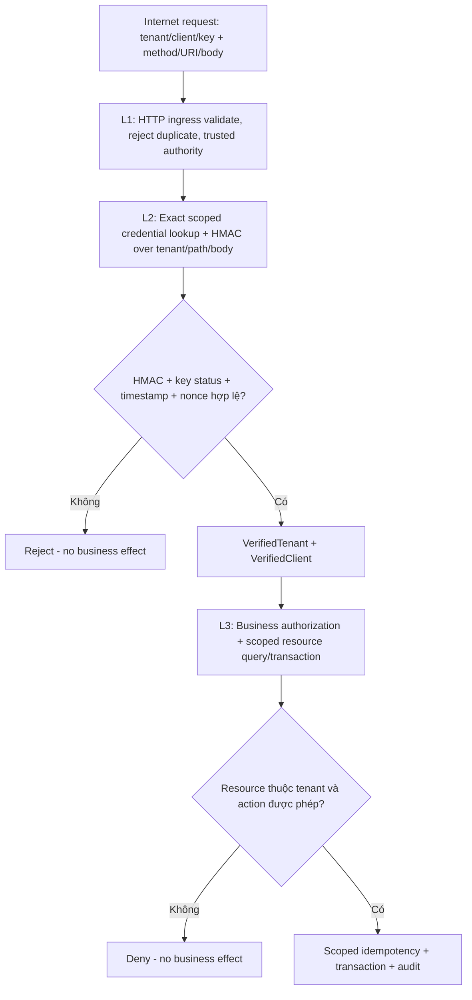

# Tránh nhầm tenant

## 1. Nhầm tenant là lỗi gì và vì sao HMAC đúng vẫn chưa đủ?

Trong hệ thống API **multi-tenant**, một hạ tầng chung phục vụ nhiều tổ chức hoặc vùng dữ liệu độc lập như `tenant-acme` và `tenant-beta`. Mỗi tenant có thể có nhiều client/service account, nhiều HMAC credentials và tập tài nguyên riêng. Hệ thống xác thực HTTP request bằng **HMAC với shared secret** phải xác định chính xác **request thuộc tenant nào**, **ai đang gọi** và **caller có quyền tác động đến tài nguyên nào**.

**Nhầm tenant (tenant confusion)** xảy ra khi một thành phần tin hoặc sử dụng **tenant context không đúng**, chẳng hạn:

- Gateway route request sang tenant A, nhưng backend hiểu nó thuộc tenant B.
- Credential lookup dùng `KeyId` giống nhau của hai tenants rồi lấy nhầm secret/owner.
- HMAC verifier tạo principal từ header `X-Tenant-Id` **trước khi** kiểm tra MAC.
- HMAC của client tenant A **hợp lệ**, nhưng request body trỏ tới `accountId` thuộc tenant B và business handler không kiểm tra owner.
- Nonce, idempotency, cache, database query hoặc object storage thiếu tenant scope, làm rò dữ liệu/side effect chéo tenant.
- Hệ thống phục hồi bản backup cũ rồi nhập HMAC secret của tenant A vào credential B do trùng local KeyId.

Ví dụ đúng cần đi qua **hai cửa riêng**:

```text
Internet caller                            Server trust boundary

Request header:
  X-Tenant-Id: tenant-acme     ────────>  ClaimedTenant (CHƯA ĐÁNG TIN)
  X-Client-Id: billing-svc     ────────>  ClaimedClient (CHƯA ĐÁNG TIN)
  X-Key-Id: key-2026-b        ────────>  ClaimedKey (CHƯA ĐÁNG TIN)

                                   Lookup exact credential tuple:
                                   (prod, tenant-acme, billing-svc, key-2026-b)
                                           |
                                   check trusted owner + state
                                   check HMAC bound to tenant/path/body
                                   timestamp + atomic nonce
                                           |
                                   VerifiedPrincipal(tenant-acme, billing-svc)
                                           |
                                   Authorize action + resource owner
                                   accountId thuộc tenant-acme?
                                           |
                                   Tx/row isolation + idempotency
```

Một HMAC hợp lệ chỉ xác nhận rằng caller nắm secret của **credential đã chọn** và request không bị sửa **trong phạm vi byte được ký**. HMAC **không** tự nói rằng account trong JSON body thuộc tenant của caller hay caller được phép tạo invoice trên account đó. Do đó **authentication** và **authorization** phải được triển khai và kiểm thử riêng.

Bài **Tránh nhầm tenant** thuộc chương **Multi-tenant** của module `SECURITY_AUTHENTICATION_HMAC_REQUEST_AUTHENTICATION`. Module học cách xác thực HTTP request bằng HMAC với canonical method/URI/headers/body, chống replay bằng timestamp/nonce, quản lý key rotation, thử nghiệm gateway/proxy và phân biệt xác thực với phân quyền. Nội dung bài tập trung vào tenant context ở các trust boundaries, chứ không chỉ đặt một header `X-Tenant-Id`.

Sau bài, bạn có thể:

- Phân biệt **claimed tenant**, **tenant của credential đã xác minh**, **tenant của route** và **tenant sở hữu resource**.
- Ràng buộc tenant ID, client ID và key ID vào canonical request đúng byte-level contract.
- Thiết kế credential lookup theo `(environment,tenantId,clientId,keyId)`; ngăn global shared secret, cache collision và key confusion.
- Kiểm tra **consistency giữa path tenant, signed header tenant, trusted credential owner và resource ownership**.
- Dùng repository/DB query có tenant scope, transactional authorization, row-level security (RLS) như defense in depth.
- Giữ anti-replay, idempotency, quota, logs, cache và background jobs đúng namespace sau gateway/failover.
- Triển khai ví dụ Java 17, golden HMAC test vectors và ma trận kiểm thử tenant isolation.

**Bất biến thiết kế:** Không thành phần nào được tự nâng một tenant ID do caller tự khai thành **trusted tenant context** trước khi kiểm chứng credential; và một principal đã xác thực cho tenant A **không được truy cập tài nguyên tenant B** nếu không có ủy quyền chéo tenant **rõ ràng, có kiểm soát và được kiểm thử**.

## 2. Bốn tenant context khác nhau dễ bị nhầm

### 2.1. Đừng dùng chung một biến `tenantId` cho mọi nguồn

| Nguồn context | Ví dụ | Độ tin cậy ban đầu | Cách xử lý |
| --- | --- | --- | --- |
| **Claimed tenant** | `X-Tenant-Id: tenant-acme` | Do caller tự khai | Validate cú pháp, ký trong HMAC, không tin làm principal |
| **Route tenant** | `/v1/tenants/tenant-acme/invoices` | Do URL caller gửi; routing có thể rewrite | Canonical signed path và so với claimed tenant |
| **Credential owner tenant** | Record `ownerTenant=tenant-acme` | Từ **trusted credential store** nếu integrity đảm bảo | Kiểm tra exact lookup, HMAC, state, rồi tạo verified principal |
| **Resource tenant** | Account `acct-a7` thuộc tenant-acme trong DB | Từ **trusted resource ownership data**, không phải JSON của caller | Kiểm tra tenant scope và authorization trong business transaction |

Ví dụ nguy hiểm:

```java
// SAI: HMAC verifier chưa chạy nhưng đã gán security context.
TenantContext.set(request.getHeader("X-Tenant-Id"));
invoiceRepository.findById(body.accountId());
```

Khi dữ liệu tenant được dùng để chọn schema/database hoặc bypass filters trước xác minh, attacker có thể điều hướng request sang dữ liệu tenant khác. Ngay cả sau HMAC, nếu repository query không có tenant scope, **resource owner** vẫn chưa được kiểm tra.

Một mô hình tốt có kiểu dữ liệu khác nhau:

```text
ClaimedTenantId("tenant-acme")      // untrusted selector
RouteTenantId("tenant-acme")        // signed routing component
VerifiedTenantId("tenant-acme")     // output của HMAC authn
ResourceOwnerTenantId("tenant-acme")// trusted storage ownership
```

Trong Java, có thể biểu diễn bằng record/type riêng để API business **không nhận** trực tiếp claimed tenant như verified context.

### 2.2. Tenant và client không nhất thiết đồng nghĩa

Một tenant có thể có nhiều service accounts:

```text
tenant-acme:
  billing-svc  / key-2026-b -> secret A1
  reports-svc  / key-2026-b -> secret A2

tenant-beta:
  billing-svc  / key-2026-b -> secret B1
```

Chuỗi `billing-svc` và `key-2026-b` có thể lặp giữa tenants hợp lệ. Tenant là **phạm vi dữ liệu/chính sách**; client là **principal gọi API**; KeyId là **selector cho credential version**. Không dùng `clientId` hoặc `keyId` làm tenant ID nếu schema không bảo đảm mối quan hệ đó và không kiểm tra owner.

### 2.3. Tenant có thể nằm ở nhiều vị trí HTTP: phải chọn contract rõ

API thực có thể định danh tenant bằng:

- Đường dẫn: `/v1/tenants/tenant-acme/...`.
- Header: `X-Tenant-Id: tenant-acme`.
- Subdomain/host: `tenant-acme.api.example.test`.
- Client credential owner trong secret manager.
- JWT claims của một **giao thức khác** (không phải HMAC scheme này).
- Resource ID → owner tra từ database.

Không tự động dùng tất cả làm “source of truth” rồi lấy trường nào tới trước. Nếu endpoint đưa tenant vào cả path và header, **quy định nhất quán bắt buộc**: hai giá trị phải khớp theo grammar; không tự chọn path khi header khác hoặc bỏ qua header nếu MAC sai.

Trong bài, tenant có mặt **ở path và signed `X-Tenant-Id`**, còn credential owner được lưu server-side và resource owner được truy vấn tại tầng nghiệp vụ. Bốn thứ được so/kiểm tra theo đúng ranh giới tin cậy.

### 2.4. Host/subdomain tenant: cần thêm một lớp tin cậy

Nếu hệ thống dùng `tenant-acme.api.example.test` để chọn tenant, **Host/:authority thường là thành phần request do client gửi**, dù server/gateway đã định tuyến. Không được coi host string tự nó là proof of tenant identity.

Phải xác định trusted external authority từ ingress/TLS/route configuration, canonical hóa nhất quán HTTP/1.1 và HTTP/2/3, tránh Host-header poisoning, proxy rewrite và `X-Forwarded-Host` từ Internet. Nếu Host là signed component, verifier phải dùng đúng authority mà client đã ký **tại boundary**, không phải hostname nội bộ của backend.

## 3. Threat model: nhầm tenant có thể xảy ra ở đâu?

### 3.1. Các tác nhân và đường tấn công

Một caller có thể điều khiển method, path, query, public headers và body. Nếu đã có **HMAC secret của tenant A**, caller có thể tự tạo những request HMAC hoàn toàn hợp lệ cho tenant A, trong đó **body cố tình tham chiếu tài nguyên tenant B**. Nếu không biết secret tenant B, caller thông thường không thể tạo HMAC hợp lệ cho B khi credential isolation/owner binding đúng.

Một attacker có thể thử:

1. Thay `X-Tenant-Id` nhưng giữ signature của A.
2. Đổi tenant trong path rồi dựa vào proxy rewrite để gateway/backend chọn khác nhau.
3. Gửi duplicate `X-Tenant-Id` hoặc `X-Client-Id` khiến các tầng đọc first/last khác nhau.
4. Đoán local KeyId trùng giữa A/B, khai client giống nhau, lợi dụng lookup thiếu tenant.
5. Gửi body `accountId` thuộc B trong một request được A ký mới hoàn toàn.
6. Đưa header giả `X-Verified-Tenant` để backend bỏ qua HMAC.
7. Dùng same idempotency key để lấy lại cached response của tenant khác.
8. Khai KeyId mới, nonce mới để vượt quota hay làm lại giao dịch.
9. Lợi dụng stale cache, restore backup hoặc region failover để “hồi sinh” mapping/key không còn hợp lệ.

### 3.2. Ma trận sai sót và hậu quả

| Nơi xảy ra | Sai lầm | Hậu quả |
| --- | --- | --- |
| Gateway | Chọn tenant theo `X-Tenant-Id` trước MAC | Có thể route sai authn/storage |
| Authn | Tra secret chỉ theo `KeyId` | HMAC/key owner confusion giữa tenants |
| Authn | Tin `tenantId` tự khai làm principal | Xác thực sai tenant |
| Canonicalization | Không ký tenant hoặc host/path có nghĩa nghiệp vụ | Tampering/misrouting |
| Credential database | Dùng global shared secret cho mọi tenants | Có secret A có thể ký giả B |
| Resource layer | `findByAccountId(id)` không scope tenant | Đọc/sửa account khác tenant |
| DB pool | Reuse session còn RLS tenant setting của request trước | Cross-request context leak |
| Cache | Key chỉ `invoiceId` hoặc `keyId` | Trả data/secret của tenant khác |
| Queue/background job | Job payload tự khai tenant không có trusted context | Worker xử lý nhầm owner |
| Nonce store | Namespace chỉ `nonce` hoặc `keyId` | False replay cross-tenant hoặc bypass cross-key |
| Idempotency | Scope chỉ idempotency key | Cached result leak/double charge |
| Authorization | `isAuthenticated()` rồi bỏ check resource owner | Horizontal privilege escalation |
| Metrics/logging | Ghi nhãn theo claimed tenant chưa xác minh | Spoofing, high-cardinality, thông tin nhạy cảm |
| Backup/DR | Snapshot A restore thành mapping B | Credential corruption/hồi sinh revoked key |

### 3.3. Ba lớp bảo vệ phải kết hợp



Lớp L1 chỉ kiểm tra **cú pháp và diễn giải HTTP**, chưa chứng minh danh tính. Lớp L2 xác minh **client/tenant credential**, không tự quyết định resource owner. Lớp L3 kiểm tra **authorization và isolation dữ liệu**. Không được thay thế một lớp bằng một lớp khác.

### 3.4. Lỗ hổng “confused deputy”

Một backend có quyền DB đọc mọi tenants có thể trở thành **confused deputy** nếu chấp nhận parameter `tenantId` do caller gửi để thực hiện thao tác vượt quyền của caller. Ngay cả khi HMAC đúng cho tenant A, backend vẫn không được dùng elevated DB service role để update row của B chỉ vì body chứa `tenantId=tenant-beta`.

Thiết kế tốt biến verified tenant thành **security constraint không thể nới** trong mọi truy vấn/tác vụ và kiểm tra resource ownership. Một **cross-tenant admin operation** nếu được phép phải có authorization rõ, audited delegation, scopes và route/giao thức riêng; không để một endpoint thông thường tự chuyển sang admin khi header `X-Admin: true`.

## 4. Tenant-aware credential model

### 4.1. Định danh credential bằng đủ namespace

Một composite key hợp lý:

```text
CredentialIdentity =
  (environment, tenantId, clientId, keyId)

prod / tenant-acme / billing-svc / key-2026-b -> secret A
prod / tenant-beta / billing-svc / key-2026-b -> secret B
```

KeyId có thể là local ID trùng chuỗi giữa hai tenants. Điều đó **không sao** nếu hệ thống chủ đích chọn namespace composite. Nếu sản phẩm cấp **global opaque KeyId**, có thể lookup trực tiếp global ID, nhưng record vẫn cần **đối chiếu owner tenant và environment**, không được suy principal từ ID do caller khai.

**Không chọn** secret bằng `credentialCache[keyId]` trong một hệ local IDs. Cache, database index, secret manager reference, rotation/revocation và audit đều phải dùng **đúng namespace**, không chỉ gateway.

### 4.2. Lược đồ dữ liệu minh họa

```sql
-- Ví dụ SQL portable ở mức khái niệm; tùy DB engine mà
-- chỉnh identity constraints, role grants và transaction isolation.
CREATE TABLE tenant_clients (
    environment VARCHAR(32) NOT NULL,
    tenant_id   VARCHAR(64) NOT NULL,
    client_id   VARCHAR(64) NOT NULL,
    status      VARCHAR(20) NOT NULL,
    PRIMARY KEY (environment, tenant_id, client_id)
);

CREATE TABLE tenant_credentials (
    environment   VARCHAR(32)  NOT NULL,
    tenant_id     VARCHAR(64)  NOT NULL,
    client_id     VARCHAR(64)  NOT NULL,
    key_id        VARCHAR(64)  NOT NULL,
    owner_tenant  VARCHAR(64)  NOT NULL,
    owner_client  VARCHAR(64)  NOT NULL,
    secret_ref    VARCHAR(512) NOT NULL,
    algorithm     VARCHAR(32)  NOT NULL,
    key_state     VARCHAR(20)  NOT NULL,
    not_before    BIGINT       NOT NULL,
    expires_at    BIGINT       NOT NULL,
    PRIMARY KEY (environment, tenant_id, client_id, key_id),
    FOREIGN KEY (environment, tenant_id, client_id)
      REFERENCES tenant_clients(environment, tenant_id, client_id),
    CHECK (owner_tenant = tenant_id),
    CHECK (owner_client = client_id),
    CHECK (expires_at > not_before)
);
```

Một cặp khóa local trùng chỉ đúng nếu các trường owner khác. DB unique/foreign constraints giúp phòng lỗi import, nhưng **không thay thế verifier check**. Production còn cần bảo vệ secret storage, grants, concurrent rotation, key revocation/expiry và consistency của caches.

### 4.3. Query đúng và query sai

```sql
-- SAI: thiếu tenant và client scope
SELECT * FROM tenant_credentials WHERE key_id = :kid;

-- ĐÚNG với local KeyId:
SELECT * FROM tenant_credentials
WHERE environment = :trusted_env
  AND tenant_id = :claimed_tenant
  AND client_id = :claimed_client
  AND key_id = :claimed_key;
```

`claimed_tenant`/`claimed_client` chỉ là selectors; **chưa** là verified identity. Sau lookup phải kiểm tra record owner, state/expiry/algorithm, HMAC rồi timestamp/nonce trước khi tạo principal.

Nếu lookup không thấy record, **không thử** key ID khác, tenant khác, client mặc định, global fallback secret hoặc mọi secret trong KMS. Những cách đó che cấu hình sai, tăng DoS surface và làm mất binding giữa chữ ký với owner.

### 4.4. Secret material phải độc lập giữa tenants

Ví dụ sai:

```text
prod / tenant-acme / billing-svc / key-b -> sharedSecret S
prod / tenant-beta / billing-svc / key-b -> sharedSecret S
```

Kể cả khi `x-tenant-id` được HMAC ký, người đã biết S vẫn có thể tự tính một HMAC **mới** với `x-tenant-id:tenant-beta` và giả mạo tenant B nếu server cũng dùng S cho B.

Vì vậy key material phải được sinh **độc lập** bằng CSPRNG, scope theo tenant/client/purpose/environment theo threat model. Một fixture dùng 32 raw bytes cho HMAC-SHA256, nhưng không vì thế mà dùng cùng giá trị test trong production.

### 4.5. Key rotation, revoke và DR cần tenant ownership

Rotation có thể tạo `tenant-acme/billing-svc/key-2026-c` trong khi B vẫn tồn tại. Revoke A **không** được làm key của tenant-beta bị revoke chỉ vì KeyId trùng. Mọi câu lệnh update/cache invalidation cần full namespace, kiểm tra affected-row count và propagation tới mọi verifier.

Encrypted backup phải ràng buộc environment, owner tenant, client, key ID, secret version và KMS metadata bằng manifest/AAD/approval. Một snapshot A cũ có `ACTIVE` không làm credential đã `REVOKED` hiện tại sống lại sau restore.

## 5. Quy tắc canonical HMAC bảo vệ tenant context

### 5.1. Ký cả tenant trong route và header

Một hợp đồng minh họa `HTTP-HMAC-TENANT-V1` yêu cầu:

```http
POST /v1/tenants/tenant-acme/invoices?mode=create HTTP/1.1
Host: api.example.test
Content-Type: application/json
X-Tenant-Id: tenant-acme
X-Client-Id: billing-svc
X-Key-Id: key-2026-b
X-Timestamp: 1790000020
X-Nonce: QEFCQ0RFRkdISUpLTE1OTw
X-Idempotency-Key: invoice-902
X-Signature: JuYwzjwrwoBrxwXuso-5Rivu2Gop9nZWc0nMhheSD1M

{"invoiceId":"inv-902","accountId":"acct-a7","amount":125000}
```

Các trường được ký: method `POST`, raw path `/v1/tenants/tenant-acme/invoices`, raw query `mode=create`, trusted external authority, content type, tenant ID, client ID, key ID, timestamp, nonce, idempotency key và SHA-256 của **exact JSON body bytes**. Header `X-Signature` mang output, **không nằm trong input HMAC**.

Các quy tắc của bản minh họa V1:

1. Có **đúng một** occurrence của mỗi signed header, kể cả `X-Signature`; HTTP ingress reject duplicates **case-insensitive trước coalescing**.
2. Header names canonical lowercase ASCII, nhưng các **values case-sensitive**. Tenant IDs chỉ nhận `[a-z0-9-]{1,64}` và client/key IDs nhận `[A-Za-z0-9._-]{1,64}`.
3. `X-Tenant-Id` phải khớp tenant trong **signed raw path** theo grammar exact path; không percent-decode tùy tầng hoặc chấp nhận `..`, Unicode lookalike, encoded slash, trailing slash.
4. Server lấy environment và trusted authority từ **trusted ingress/configuration**. Không dùng `X-Forwarded-Host` từ caller để tự đổi context.
5. Timestamp là chuỗi epoch seconds canonical, nonce 16 bytes encode Base64url no padding 22 ký tự, HMAC-SHA256 raw tag 32 bytes encode Base64url no padding 43 ký tự.
6. Body digest là SHA-256 trên exact bytes, không parse/serialize lại JSON khi tính MAC.
7. Lookup một credential theo `(environment,tenantId,clientId,keyId)`, kiểm tra trusted owner + status + algorithm + validity trước khi xác minh tag.
8. HMAC chỉ hoàn tất sau signed timestamp freshness và atomic nonce claim theo verified tenant/client; business authorization **vẫn độc lập**.
9. Domain prefix `HTTP-HMAC-TENANT-V1` ngăn dùng nhầm tag của protocol khác; thay hợp đồng ký phải dùng version mới và golden tests.
10. V1 chỉ hỗ trợ **một endpoint minh họa**; production phải mô tả thêm path/query percent encoding, HTTP/1.1/2/3, body coding, method và gateway rewrite.

### 5.2. Kiểm tra tenant consistency trong request

```text
rawPathTenant = tenant-acme        // from signed route
signedHeaderTenant = tenant-acme   // from X-Tenant-Id
credentialOwnerTenant = tenant-acme// from trusted credential record

Điều kiện bắt buộc:
  rawPathTenant == signedHeaderTenant
  signedHeaderTenant == credentialOwnerTenant
```

Sau khi ba giá trị nhất quán và HMAC hợp lệ, server mới tạo **VerifiedTenant**. Còn `accountId` trong body phải được lookup theo tenant từ database; không tự tin rằng nó thuộc tenant đó chỉ vì body đã được HMAC bảo vệ.

**Cần phân biệt:** Ký request bảo vệ **tính toàn vẹn** của `accountId`; nhưng nếu tenant A chủ động ký `accountId` thuộc tenant B, đó vẫn là một request được A xác thực hợp lệ, phải bị **từ chối bởi authorization**.

### 5.3. Đừng chọn tenant bằng một thứ tự ưu tiên ngầm

Pseudocode sai:

```text
tenant = header.X-Tenant-Id ??
         pathTenant ??
         hostSubdomain ??
         defaultTenant;

key = credentialStore.findByKeyId(X-Key-Id)
verifiedPrincipal = tenant;
```

Nếu các nguồn khác nhau, giao thức phải **reject mismatch**, không “ưu tiên header hơn path” ở gateway rồi “ưu tiên path hơn header” ở backend. Một endpoint có thật sự cho phép admin cross-tenant delegation thì cần signed delegated tenant context, trusted admin policy và audit riêng, không dùng `??` fallback.

## 6. Golden HMAC vectors: tenant A/B và request bị từ chối bởi authorization

Fixture được tính bằng SHA-256/HMAC-SHA256 trên **exact bytes** độc lập với các class Java ở phần sau. Nó chứng minh ba trường hợp:

- **A:** tenant-acme, client `billing-svc`, key `key-2026-b`, body có `accountId=acct-a7`.
- **B:** tenant-beta, **cùng local client ID và key ID** nhưng secret **khác**, body có `accountId=acct-b7`.
- **C:** tenant-acme dùng đúng secret A ký **body tham chiếu acct-b7 của tenant-beta**. HMAC **đúng** nhưng nghiệp vụ phải **deny**.

### 6.1. Canonical request của A

Dữ liệu HMAC gồm **13 dòng UTF-8**, nối byte LF `0x0A`, **không LF cuối**:

```text
HTTP-HMAC-TENANT-V1
POST
/v1/tenants/tenant-acme/invoices
mode=create
authority:api.example.test
content-type:application/json
x-tenant-id:tenant-acme
x-client-id:billing-svc
x-key-id:key-2026-b
x-timestamp:1790000020
x-nonce:QEFCQ0RFRkdISUpLTE1OTw
x-idempotency-key:invoice-902
0912285bb86bb4daab4163e3746ea8ca140d6e49ed6aca03efb883fea3160009
```

Exact JSON body của A (không trailing LF):

```json
{"invoiceId":"inv-902","accountId":"acct-a7","amount":125000}
```

- Body: **61 UTF-8 bytes**.
- SHA-256(body), lowercase hex: `0912285bb86bb4daab4163e3746ea8ca140d6e49ed6aca03efb883fea3160009`.
- Canonical request của A: **343 bytes UTF-8**, 13 dòng.
- Raw nonce 16 bytes `40..4f` → Base64url `QEFCQ0RFRkdISUpLTE1OTw`.

### 6.2. Ba test vectors độc lập

Secret A và secret B **công khai chỉ cho test**:

```text
secret A, bytes 00..1f:
000102030405060708090a0b0c0d0e0f101112131415161718191a1b1c1d1e1f

secret B, bytes 20..3f:
202122232425262728292a2b2c2d2e2f303132333435363738393a3b3c3d3e3f

body B/C (61 UTF-8 bytes):
{"invoiceId":"inv-902","accountId":"acct-b7","amount":125000}

SHA-256(body B/C):
b005b80dfde9e965ebcec5b5580eeeb34cc50a105c0ecf3f05f974f4fa930007
```

| Vector | Signed tenant/path | Secret | Canonical length | Raw HMAC-SHA256 hex | Tag Base64url no padding |
| --- | --- | --- | --- | --- | --- |
| **A** | tenant-acme, account acct-a7 | `00..1f` | 343 bytes | `26e630ce3c2bc2806bc705eeb28fb9462beed86a29f676567349cc8617920f53` | `JuYwzjwrwoBrxwXuso-5Rivu2Gop9nZWc0nMhheSD1M` |
| **B** | tenant-beta, account acct-b7 | `20..3f` | 343 bytes | `bd5f91fb24aa603da08e96fb6ede2b6fb158947e362c39c366d0d4596c3f331b` | `vV-R-ySqYD2gjpb7bt4rb7FYlH42LDnDZtDUWWw_Mxs` |
| **C** | tenant-acme, account acct-b7 | `00..1f` | 343 bytes | `e19ec778b4d2e2d1d4b710013a8e8dd479b4da99502b99c0815e7d844f9161ed` | `4Z7HeLTS4tHUtxABOo6N1Hm02plQK5nAgV59hE-RYe0` |

Để tạo B, thay tenant-acme thành tenant-beta **ở cả path và header tenant**, thay body acct-a7 thành acct-b7 và dùng secret B. Để tạo C, **giữ tenant-acme + secret A**, chỉ dùng body acct-b7, tính lại body SHA-256 và HMAC. A/B/C có độ dài canonical bằng nhau do tenant names và account IDs của fixture có độ dài tương đương.

**Điều cần khẳng định về C:** A có thể tạo chữ ký đúng cho body đề xuất tài khoản của B; verifier **không nên** reject C với nhãn “HMAC sai”. HMAC C là đúng, **business authorization** phải ngăn việc tạo invoice ở `acct-b7` vì owner trong DB là tenant-beta.

### 6.3. Không sử dụng fixture nonce/timestamp trên hệ thật

Các vectors có cùng signed timestamp `1790000020` và nonce `QEFCQ0RFRkdISUpLTE1OTw` chỉ để kiểm thử crypto riêng. Trong thực tế:

- **Mỗi attempt** tạo nonce CSPRNG mới và timestamp hợp lệ.
- Replay namespace theo `(environment,verifiedTenant,verifiedClient,rawNonce)`.
- A và C cùng verified tenant/client **không được** claim cùng nonce; muốn test authorization-denied của C sau A, dùng **nonce store độc lập chỉ trong unit test** hoặc thay nonce rồi ký lại C.
- A và B có thể dùng cùng raw nonce ở hai tenant namespaces **riêng biệt** theo policy minh họa.
- Fixture clock `Clock.fixed(1790000000)` chấp nhận `1790000020` (+20 giây) nếu future tolerance 30s; không coi timestamp cố định là live-valid trong ngày khác.

### 6.4. Tại sao phải có vector C?

Nếu chỉ test HMAC “đúng/sai”, ta dễ nhầm rằng cryptographic verification đồng nghĩa quyền truy cập tài nguyên. Vector C chứng minh điều ngược lại:

```text
MAC(C) == expected MAC computed with secret A       -> authentication PASS
VerifiedPrincipal(tenant-acme,billing-svc)           -> identity correct
ResourceOwner("acct-b7") == tenant-beta               -> authorization FAIL
Business side effects for C                          -> ZERO
```

Đó là bài học trung tâm của **“Tránh nhầm tenant”**: **đúng người gọi không đồng nghĩa đúng tài nguyên**.

## 7. Java 17: xác minh HMAC và tạo VerifiedTenant từ record đáng tin

### 7.1. Ranh giới của ví dụ

Class `TenantHmacV1` là **lab verifier** cho endpoint `POST /v1/tenants/{tenant}/invoices?mode=create`. Input đã được HTTP adapter chuyển thành semantic fields **sau khi** kiểm tra:

- Tên header case-insensitive nhưng value không bị lowercase.
- Duplicate occurrences của signed headers, `X-Signature`, invalid whitespace, CRLF/obs-fold hoặc ambiguous HTTP framing bị reject **trước khi** mất thông tin occurrences.
- Raw path/query và external authority từ trust boundary nhất quán với request client đã ký; không dùng forwarded headers tự khai làm source of truth.
- Body bytes được đọc **một lần** và bảo toàn tới bước tính digest **cũng như** bước business parse/execute.

Nó không phải full HTTP parser, secret manager adapter, KMS SDK hay gateway integration. Hợp đồng lớp này chỉ nhận request đã qua ingress adapter. Các checks điều kiện bảo mật chính nằm trong verifier, không đơn giản đưa `tenantId` từ header vào `ThreadLocal` rồi tin rằng nó đã được xác thực.

### 7.2. Class TenantHmacV1

```java
import java.nio.charset.StandardCharsets;
import java.security.GeneralSecurityException;
import java.security.MessageDigest;
import java.time.Clock;
import java.util.Base64;
import java.util.HexFormat;
import java.util.Optional;
import javax.crypto.Mac;
import javax.crypto.spec.SecretKeySpec;

public final class TenantHmacV1 {
    private static final String DOMAIN =
        "HTTP-HMAC-TENANT-V1";
    private static final String HMAC = "HmacSHA256";
    private static final long PAST_TOLERANCE = 300L;
    private static final long FUTURE_TOLERANCE = 30L;
    private static final long NONCE_MARGIN = 60L;

    public enum KeyState {
        PREPARED, ACTIVE, VERIFY_ONLY, REVOKED
    }

    // HTTP adapter đã reject duplicate headers và giữ
    // exact bytes method/URI/body, trusted authority.
    public record SignedRequest(
        String method,
        String rawPath,
        String rawQuery,
        String trustedExternalAuthority,
        String contentType,
        String claimedTenantId,
        String claimedClientId,
        String claimedKeyId,
        String timestampSeconds,
        String nonceB64url,
        String idempotencyKey,
        byte[] exactBodyBytes
    ) {
        public SignedRequest {
            if (exactBodyBytes == null) {
                throw new IllegalArgumentException(
                    "Body bytes required");
            }
            exactBodyBytes = exactBodyBytes.clone();
        }
        @Override
        public byte[] exactBodyBytes() {
            return exactBodyBytes.clone();
        }
    }

    // Chỉ tạo từ trusted server-side credential store.
    public record Credential(
        String ownerTenantId,
        String ownerClientId,
        String keyId,
        KeyState state,
        String algorithm,
        boolean tenantEnabled,
        boolean clientEnabled,
        long notBeforeEpoch,
        long expiresAtEpoch,
        byte[] rawSecret
    ) {
        public Credential {
            if (rawSecret == null) {
                throw new IllegalArgumentException(
                    "No stored secret");
            }
            rawSecret = rawSecret.clone();
        }
        @Override
        public byte[] rawSecret() {
            return rawSecret.clone();
        }
        @Override
        public String toString() {
            return "Credential[redacted]";
        }
    }

    // Kết quả CHỈ được tạo sau HMAC + time + replay.
    // Environment từ trusted routing/config, không từ caller.
    public record VerifiedPrincipal(
        String environment,
        String tenantId,
        String clientId,
        String verifiedKeyId
    ) {}

    public interface CredentialStore {
        Optional<Credential> find(
            String trustedEnvironment,
            String claimedTenantId,
            String claimedClientId,
            String claimedKeyId);
    }

    public interface NonceStore {
        // Atomic shared insert-if-absent + TTL. Nếu outage
        // hoặc kết quả unknown: throw/fail closed.
        boolean claim(
            String trustedEnvironment,
            String verifiedTenantId,
            String verifiedClientId,
            byte[] rawNonce,
            long expiresAtEpochSeconds);
    }

    private TenantHmacV1() {}

    private static void validate(SignedRequest r) {
        if (r == null
                || r.claimedTenantId() == null
                || !r.claimedTenantId().matches("[a-z0-9-]{1,64}")
                || r.claimedClientId() == null
                || !r.claimedClientId().matches(
                    "[A-Za-z0-9._-]{1,64}")
                || r.claimedKeyId() == null
                || !r.claimedKeyId().matches(
                    "[A-Za-z0-9._-]{1,64}")
                || !"POST".equals(r.method())
                || !("/v1/tenants/" + r.claimedTenantId()
                    + "/invoices").equals(r.rawPath())
                || !"mode=create".equals(r.rawQuery())
                || !"api.example.test".equals(
                    r.trustedExternalAuthority())
                || !"application/json".equals(r.contentType())
                || r.exactBodyBytes().length > 1_048_576
                || r.idempotencyKey() == null
                || !r.idempotencyKey().matches(
                    "[A-Za-z0-9._-]{8,64}")
                || r.timestampSeconds() == null
                || !r.timestampSeconds().matches(
                    "[1-9][0-9]{0,18}")) {
            throw new IllegalArgumentException(
                "Malformed tenant route or signed request");
        }
        try {
            Long.parseLong(r.timestampSeconds());
        } catch (NumberFormatException overflow) {
            throw new IllegalArgumentException(
                "Invalid timestamp range", overflow);
        }
        strictBase64url(
            r.nonceB64url(), 22, 16, "nonce");
    }

    public static byte[] strictBase64url(
            String encoded, int textLength,
            int rawLength, String field) {
        if (encoded == null || encoded.length() != textLength
                || !encoded.matches("[A-Za-z0-9_-]+")) {
            throw new IllegalArgumentException(
                "Invalid " + field + " encoding");
        }
        final byte[] raw;
        try {
            raw = Base64.getUrlDecoder().decode(encoded);
        } catch (IllegalArgumentException badEncoding) {
            throw new IllegalArgumentException(
                "Malformed " + field, badEncoding);
        }
        String reencoded = Base64.getUrlEncoder()
            .withoutPadding().encodeToString(raw);
        if (raw.length != rawLength
                || !reencoded.equals(encoded)) {
            throw new IllegalArgumentException(
                "Noncanonical " + field);
        }
        return raw;
    }

    private static String bodyHash(SignedRequest request)
            throws GeneralSecurityException {
        byte[] digest = MessageDigest
            .getInstance("SHA-256")
            .digest(request.exactBodyBytes());
        return HexFormat.of().formatHex(digest);
    }

    public static byte[] canonicalBytes(SignedRequest r)
            throws GeneralSecurityException {
        validate(r);
        String data = String.join("\n",
            DOMAIN,
            r.method(),
            r.rawPath(),
            r.rawQuery(),
            "authority:" + r.trustedExternalAuthority(),
            "content-type:" + r.contentType(),
            "x-tenant-id:" + r.claimedTenantId(),
            "x-client-id:" + r.claimedClientId(),
            "x-key-id:" + r.claimedKeyId(),
            "x-timestamp:" + r.timestampSeconds(),
            "x-nonce:" + r.nonceB64url(),
            "x-idempotency-key:" + r.idempotencyKey(),
            bodyHash(r)
        );
        return data.getBytes(StandardCharsets.UTF_8);
    }

    private static byte[] calculateMac(
            byte[] secret, byte[] input)
            throws GeneralSecurityException {
        if (secret == null || secret.length < 32) {
            throw new IllegalStateException(
                "Missing/weak stored HMAC secret");
        }
        Mac mac = Mac.getInstance(HMAC);
        mac.init(new SecretKeySpec(secret, HMAC));
        return mac.doFinal(input);
    }

    // Chỉ dùng trong lab. Client production phải dùng
    // secret được provision đúng tenant và CSPRNG nonce mới.
    public static String signForTest(
            SignedRequest request, byte[] secret)
            throws GeneralSecurityException {
        byte[] tag = calculateMac(secret, canonicalBytes(request));
        return Base64.getUrlEncoder()
            .withoutPadding().encodeToString(tag);
    }

    public static Optional<VerifiedPrincipal> verify(
            SignedRequest request,
            String signatureB64url,
            String trustedEnvironment,
            CredentialStore credentials,
            NonceStore nonces,
            Clock trustedClock
    ) throws GeneralSecurityException {
        // Tenant/client/key vẫn CHƯA ĐÁNG TIN trước MAC.
        byte[] input = canonicalBytes(request);
        byte[] supplied = strictBase64url(
            signatureB64url, 43, 32, "signature");

        // Không bao giờ lookup chỉ bằng KeyId.
        Optional<Credential> record = credentials.find(
            trustedEnvironment,
            request.claimedTenantId(),
            request.claimedClientId(),
            request.claimedKeyId());
        if (record.isEmpty()) return Optional.empty();

        Credential c = record.get();
        long now = trustedClock.instant().getEpochSecond();

        // VERIFY_ONLY vẫn xác thực trong overlap có deadline,
        // không được dùng cho credential đã compromise/revoked.
        boolean allowedKeyState =
            c.state() == KeyState.ACTIVE
            || c.state() == KeyState.VERIFY_ONLY;

        if (!allowedKeyState
                || !c.tenantEnabled() || !c.clientEnabled()
                || !request.claimedTenantId().equals(
                    c.ownerTenantId())
                || !request.claimedClientId().equals(
                    c.ownerClientId())
                || !request.claimedKeyId().equals(c.keyId())
                || !HMAC.equals(c.algorithm())
                || now < c.notBeforeEpoch()
                || now >= c.expiresAtEpoch()) {
            return Optional.empty();
        }

        byte[] expected = calculateMac(
            c.rawSecret(), input);
        if (!MessageDigest.isEqual(expected, supplied)) {
            return Optional.empty();
        }

        long signedTs = Long.parseLong(
            request.timestampSeconds());
        final long minTime, maxTime, nonceExpiry;
        try {
            minTime = Math.subtractExact(now, PAST_TOLERANCE);
            maxTime = Math.addExact(now, FUTURE_TOLERANCE);
            nonceExpiry = Math.addExact(
                signedTs, PAST_TOLERANCE + NONCE_MARGIN);
        } catch (ArithmeticException overflow) {
            throw new IllegalStateException(
                "Unsafe server clock arithmetic", overflow);
        }
        if (signedTs < minTime || signedTs > maxTime) {
            return Optional.empty();
        }

        byte[] rawNonce = strictBase64url(
            request.nonceB64url(), 22, 16, "nonce");
        // Scope theo VERIFIED tenant/client, không keyId.
        // Store phải shared/atomic trên các gateways/regions.
        if (!nonces.claim(
                trustedEnvironment, c.ownerTenantId(),
                c.ownerClientId(), rawNonce, nonceExpiry)) {
            return Optional.empty();
        }

        // Chỉ authentication; business authorization xử lý sau.
        return Optional.of(new VerifiedPrincipal(
            trustedEnvironment, c.ownerTenantId(),
            c.ownerClientId(), c.keyId()));
    }
}
```

### 7.3. Phân tích thứ tự xử lý trong verifier

1. **Validate trước lookup:** field grammar, route/header tenant consistency và Base64url canonical. Ngăn path/header ambiguity, malformed request và quá tải lookup.
2. **Lookup theo 4 trường:** `(trustedEnvironment,claimedTenantId,claimedClientId,claimedKeyId)`. Đây là selectors từ caller, chưa là verified identity.
3. **Check owner trong trusted record:** `ownerTenantId`/`ownerClientId` phải khớp selectors; record ACTIVE/VERIFY_ONLY hợp lệ, tenant/client enabled và thuật toán chính xác.
4. **MAC-bind tenant:** path, `x-tenant-id`, client ID, key ID và body digest đều được ký. Đổi tenant/path/body sau khi ký sẽ làm MAC fail (trừ xác suất MAC collision cực nhỏ).
5. **Compare tag raw bytes:** `MessageDigest.isEqual` tránh so text Base64, nhưng không khiến toàn bộ pipeline constant-time. Không chấp nhận truncated tags/khác alphabet.
6. **Timestamp và nonce:** dùng trusted clock, ký timestamp/nonce, claim nonce **sau MAC + time**, scope theo verified tenant/client, không key version.
7. **Trả principal:** tenant/client lấy **từ record trusted**, không từ header dưới dạng đã xác thực. Chỉ business layer mới xét account ownership/scope.

Không có nhánh fallback thử secret thuộc tenant khác nếu key lookup/MAC thất bại. Nếu store unavailable, không đổi request thành anonymous có quyền, không thử global secret và không trả principal theo `X-Tenant-Id`.

### 7.4. Giới hạn quan trọng của ví dụ

`SignedRequest` là DTO **sau ingress**. Nó không tự phát hiện hai `X-Tenant-Id` raw headers, malformed HTTP/2 pseudo-headers, chunked decoding disagreement, normalization của reverse proxy hoặc case-folding sai. Các tình huống đó phải được kiểm thử ở HTTP adapter, gateway và cả downstream.

`CredentialStore` cũng chỉ là interface: production phải có IAM/secret-manager, scoped key cache, revocation propagation và fail-closed semantics. `NonceStore` phải atomic/shared, không dùng một HashMap trên mỗi replica. **Business resource tenant isolation** chưa có trong verifier — nó thuộc phần tiếp theo.

## 8. Java 17: resource ownership phải được kiểm tra **sau** HMAC

### 8.1. Tại sao cần thêm tầng business?

Hai request đều có thể có chữ ký HMAC hợp lệ:

```text
A:
  VerifiedTenant=tenant-acme
  JSON accountId=acct-a7
  DB accountOwner(acct-a7)=tenant-acme  -> AUTHORIZED

C:
  VerifiedTenant=tenant-acme
  JSON accountId=acct-b7
  DB accountOwner(acct-b7)=tenant-beta  -> DENIED
```

Trước khi xét owner, HMAC đã chứng minh **đúng tenant A là bên ký request C**. Nếu service chỉ xét `isAuthenticated()` thì C sẽ ghi invoice vào account B. Việc body digest đã được ký **không cấp quyền** sử dụng mọi account ID nằm trong body.

Trong ứng dụng thực, JSON nên được parse từ **chính exact body bytes đã dùng tính HMAC**, bằng parser có schema validation, giới hạn kích thước và chính sách duplicate/unknown fields rõ ràng. Không tính MAC trên body A rồi thực thi một object B đã bị middleware thay đổi.

### 8.2. Business contract cho phép atomic authorization + idempotency

Interface `InvoiceRepository` dưới đây yêu cầu một thao tác:

```text
authorizeAndCreateOnce(
  verified principal,
  invoice body đã parse từ signed bytes,
  idempotency key đã được ký,
  fingerprint của signed business intent
)
```

Hợp đồng của implementation thật phải **trong cùng một transaction/consistency boundary**:

1. Kiểm tra principal/tenant/client còn có scope `invoices:create`.
2. Kiểm tra `accountId` thuộc **verified tenant** bằng query có tenant predicate/DB RLS, không chỉ global `findById`.
3. Kiểm tra idempotency record theo `(environment,verifiedTenant,verifiedClient,operation,key)`; chỉ trả cached result sau **authorization hiện hành**.
4. Nếu cùng key + fingerprint khác → conflict; same key + fingerprint → trả result đã lưu, không thực thi side effect.
5. Nếu chưa có record, insert idempotency reservation và invoice/outbox một cách nguyên tử; chống race giữa hai requests và failover.

Nếu chỉ làm `if (accountOwner == tenant)` ở service rồi vài millisecond sau ghi DB không có tenant predicate/transaction, record có thể bị chuyển owner hoặc code path khác bỏ check. Đây là **TOCTOU (time-of-check to time-of-use)**.

### 8.3. Class TenantInvoiceServiceV1

```java
import java.nio.charset.StandardCharsets;
import java.security.GeneralSecurityException;
import java.security.MessageDigest;
import java.time.Clock;
import java.util.HexFormat;
import java.util.Optional;
import java.util.regex.Matcher;
import java.util.regex.Pattern;

public final class TenantInvoiceServiceV1 {
    // Strict single-shape JSON parser CHỈ CHO LAB.
    // Production phải dùng proper JSON parser với schema validation,
    // duplicate-key policy, exact signed bytes và canonical
    // business intent fingerprint.
    private static final Pattern FIXTURE_JSON = Pattern.compile(
        "\\{\"invoiceId\":\"([A-Za-z0-9._-]{1,64})\","
      + "\"accountId\":\"([A-Za-z0-9._-]{1,64})\","
      + "\"amount\":([1-9][0-9]{0,12})\\}"
    );

    public record InvoiceCommand(
        String invoiceId, String accountId, long amount) {}

    public interface InvoiceRepository {
        // Production implementation: transactional authorization,
        // tenant-scoped account ownership check, idempotency
        // conflict handling and atomic business writes.
        // KHÔNG return cached result trước authorization hiện hành.
        String authorizeAndCreateOnce(
            TenantHmacV1.VerifiedPrincipal verified,
            InvoiceCommand command,
            String signedIdempotencyKey,
            String stableBusinessFingerprint);
    }

    private TenantInvoiceServiceV1() {}

    private static InvoiceCommand parseSignedBody(
            byte[] signedBytes) {
        String utf8 = new String(
            signedBytes, StandardCharsets.UTF_8);
        Matcher m = FIXTURE_JSON.matcher(utf8);
        if (!m.matches()) {
            throw new IllegalArgumentException(
                "Unsupported invoice JSON fixture");
        }
        long amount = Long.parseLong(m.group(3));
        return new InvoiceCommand(
            m.group(1), m.group(2), amount);
    }

    private static String labFingerprint(
            byte[] signedBody) throws GeneralSecurityException {
        // LAB: exact-body fingerprint; production cần chọn
        // stable semantic fingerprint theo business contract.
        return HexFormat.of().formatHex(
            MessageDigest.getInstance("SHA-256")
                .digest(signedBody));
    }

    public static String execute(
            TenantHmacV1.SignedRequest signedRequest,
            String receivedSignature,
            String trustedEnvironment,
            TenantHmacV1.CredentialStore credentials,
            TenantHmacV1.NonceStore nonces,
            Clock trustedClock,
            InvoiceRepository repository)
            throws GeneralSecurityException {
        Optional<TenantHmacV1.VerifiedPrincipal> authenticated =
            TenantHmacV1.verify(
                signedRequest, receivedSignature,
                trustedEnvironment, credentials, nonces,
                trustedClock);
        if (authenticated.isEmpty()) {
            throw new SecurityException(
                "Authentication failed");
        }

        // Parse đúng signed body, không nhận một InvoiceCommand
        // khác do caller/middleware đưa vào sau authn.
        byte[] authenticatedBody =
            signedRequest.exactBodyBytes();
        InvoiceCommand command =
            parseSignedBody(authenticatedBody);

        return repository.authorizeAndCreateOnce(
            authenticated.get(),
            command,
            signedRequest.idempotencyKey(),
            labFingerprint(authenticatedBody));
    }
}
```

### 8.4. Quan trọng: Repository phải thực thi contract, không chỉ khai interface

`InvoiceRepository` là một **security boundary**. Nếu implementation thật có:

```java
// SAI về tenant/resource ownership:
var account = accountRepository.findById(command.accountId());
invoiceRepository.save(new Invoice(account, amount));
```

thì service vẫn có thể ghi nhầm tenant dù `TenantHmacV1.verify()` hoàn toàn đúng. Một truy vấn đúng cần tenant scope:

```sql
-- Tư duy tenant-scoped query cho resource:
SELECT account_id
FROM accounts
WHERE environment = :verified_environment
  AND tenant_id = :verified_tenant
  AND account_id = :requested_account_id
FOR UPDATE;
```

Nếu không có row, trả lỗi tài nguyên không khả dụng/không được phép theo error policy, **không trả thông tin “account này thuộc tenant-beta”** cho caller A. Nếu có row, vẫn kiểm tra action permission và business policy trước khi insert. Cần unique indexes/foreign keys đảm bảo invoice trỏ tới account **cùng tenant** ngay cả khi code sai.

### 8.5. RLS hỗ trợ defense in depth, không thay authentication

Một thiết kế PostgreSQL có thể dùng tenant-scoped policies:

```sql
-- Chỉ là minh họa ý tưởng, không phải migration SQL
-- đủ dùng ngay trong production.
ALTER TABLE accounts ENABLE ROW LEVEL SECURITY;
ALTER TABLE accounts FORCE ROW LEVEL SECURITY;

CREATE POLICY accounts_tenant_policy ON accounts
USING (tenant_id = current_setting('app.verified_tenant', true))
WITH CHECK (
  tenant_id = current_setting('app.verified_tenant', true)
);

-- Application phải dùng role không có BYPASSRLS.
-- Tenant context phải được set từ VerifiedPrincipal sau HMAC,
-- trong đúng transaction, chẳng hạn SET LOCAL được bind an toàn.
```

**Các điều kiện cần kiểm tra khi dùng RLS:**

- Application DB role **không** được `BYPASSRLS`, superuser hoặc một owner bypass vô ý. `FORCE ROW LEVEL SECURITY` không tự vô hiệu superuser/BYPASSRLS.
- Chỉ set `app.verified_tenant` từ **verified principal**, không từ `X-Tenant-Id` trước MAC.
- Dùng **transaction-local** tenant context và reset khi transaction kết thúc; connection pool không được đưa tenant A sang request B.
- Việc set context và mọi SQL đọc/ghi phải ở **cùng connection/transaction**; tránh ORM query chạy ngoài transaction hoặc background task quên context.
- Bảo vệ quyền thay context và role grants: một DB session/role có quyền tự thay `app.verified_tenant` có thể phá ý nghĩa isolation nếu attacker chạy được arbitrary SQL dưới role đó. RLS tùy biến theo session variable **không tự chống SQL injection** hoặc privileged misuse.
- Có RLS tương ứng cho invoices, idempotency, job queues và account relations; không chỉ cho bảng accounts rồi để write path khác lọt.

Một giải pháp khác là **database/schema-per-tenant**, nhưng vẫn cần trusted tenant routing, quyền kết nối đúng tenant và chống cross-tenant resource lookup. Tách DB không thay thế application-level authorization.

## 9. Java 17: nonce store minh họa theo verified tenant + client

### 9.1. Key của nonce không chứa KeyId

Replay namespace của bài:

```text
(environment, verifiedTenantId, verifiedClientId, rawNonceBytes)
```

Điều này có hai hiệu ứng đúng:

- `tenant-acme/billing-svc` và `tenant-beta/billing-svc` **có thể** cùng raw nonce bytes N trong test mà không bị false conflict, vì principals khác nhau.
- `tenant-acme/billing-svc` khi xoay từ `key-2026-b` sang `key-2026-c` **không thể** reuse N. Key rotation không reset replay protection.

Nếu namespace chỉ `keyId` thì hai tenants có thể va chạm; nếu chứa key ID trong tuple thì cùng tenant/client có thể reuse nonce khi đổi key. Với policy “nonce một lần trên mỗi verified client”, đó là hai lỗi khác nhau.

### 9.2. Class TenantNonceStoreV1

```java
import java.time.Clock;
import java.util.Base64;
import java.util.concurrent.ConcurrentHashMap;
import java.util.concurrent.atomic.AtomicBoolean;

public final class TenantNonceStoreV1
        implements TenantHmacV1.NonceStore {
    private record ReplayKey(
        String environment,
        String verifiedTenantId,
        String verifiedClientId,
        String nonceB64url) {}

    private final Clock clock;
    private final ConcurrentHashMap<ReplayKey, Long> expires =
        new ConcurrentHashMap<>();

    public TenantNonceStoreV1(Clock clock) {
        if (clock == null) {
            throw new IllegalArgumentException("Clock required");
        }
        this.clock = clock;
    }

    @Override
    public boolean claim(
            String environment, String tenantId,
            String clientId, byte[] rawNonce, long expiry) {
        long now = clock.instant().getEpochSecond();
        if (environment == null || environment.isEmpty()
                || tenantId == null || tenantId.isEmpty()
                || clientId == null || clientId.isEmpty()
                || rawNonce == null || rawNonce.length != 16
                || expiry <= now) {
            throw new IllegalStateException(
                "Invalid nonce namespace or expiry");
        }

        ReplayKey key = new ReplayKey(
            environment, tenantId, clientId,
            Base64.getUrlEncoder().withoutPadding()
                .encodeToString(rawNonce));

        AtomicBoolean winner = new AtomicBoolean(false);
        // Atomic trong MỘT JVM; không có durability/cross-region.
        expires.compute(key, (k, previousExpiry) -> {
            if (previousExpiry == null || previousExpiry <= now) {
                winner.set(true);
                return expiry;
            }
            return previousExpiry;
        });
        return winner.get();
    }
}
```

**Không triển khai trực tiếp class này trong môi trường multi-instance.** `ConcurrentHashMap.compute` có atomicity trong một JVM, nhưng khi gateway A và B có hai maps độc lập, cả hai có thể nhận cùng nonce. Production cần Redis/DB conditional write atomic, TTL, shared state/consistency theo threat model và fail-closed khi storage timeout/unknown outcome. Không dùng `GET` rồi `SET` trong hai round trips.

### 9.3. TTL nonce phải bảo vệ toàn freshness window

Hợp đồng lab:

```text
serverNow - 300 <= signedTimestamp <= serverNow + 30

nonceExpiresAt = signedTimestamp + 300 + 60
```

Nếu request được nhận ở rìa sớm nhất `now=signedTimestamp−30`, nonce đã claim có thể cần tồn tại **390 giây** tới `signedTimestamp+360`, không chỉ 300 giây tính từ lúc nhận. TTL phải bảo vệ hết accepted window và safety margin, không reset khi key ID thay đổi.

Nếu mất nonce state do DR/failover trong thời gian request cũ vẫn hợp lệ, replay có thể xảy ra. Hệ thống phải restore durable nonce history hoặc giữ traffic nhạy cảm fail-closed/đợi verified window drain dưới trusted clock. Secret HMAC còn hoạt động **không đủ** để mở API sau disaster recovery.

## 10. Java 17: repository và test end-to-end tenant isolation

### 10.1. In-memory repository cho bài lab

`TenantInvoiceRepoForLab` giữ hai accounts với owners độc lập và mô phỏng **atomic business operation** bằng `synchronized` trong một JVM. Nó kiểm tra **current authorization và account ownership trước cả khi trả cached idempotent result**. Cấu trúc này dùng để chứng minh invariant trong test, không phải cách triển khai database đa replica.

```java
import java.util.HashMap;
import java.util.HashSet;
import java.util.Map;
import java.util.Set;

public final class TenantInvoiceRepoForLab
        implements TenantInvoiceServiceV1.InvoiceRepository {
    private record IdempotencyScope(
        String environment, String tenantId,
        String clientId, String operation, String idempotencyKey
    ) {}

    private record InvoiceIdentity(
        String environment, String tenantId, String invoiceId
    ) {}

    private record StoredResult(
        String fingerprint, String response
    ) {}

    // Fake trusted resource ownership store.
    private final Map<String, String> accountOwner =
        Map.of(
            "acct-a7", "tenant-acme",
            "acct-b7", "tenant-beta"
        );

    private final Set<String> disabledTenants = new HashSet<>();
    private final Map<IdempotencyScope, StoredResult> results =
        new HashMap<>();
    private final Set<InvoiceIdentity> invoiceIdentities =
        new HashSet<>();
    private int effectCount;

    public synchronized void disableTenant(
            String tenantId) {
        disabledTenants.add(tenantId);
    }

    public synchronized int effectCount() {
        return effectCount;
    }

    @Override
    public synchronized String authorizeAndCreateOnce(
            TenantHmacV1.VerifiedPrincipal verified,
            TenantInvoiceServiceV1.InvoiceCommand command,
            String signedIdempotencyKey,
            String stableBusinessFingerprint) {
        // HMAC đã tạo verified principal, nhưng phải kiểm tra
        // CURRENT business permission cho cả request mới/retry.
        if (!"test".equals(verified.environment())
                || disabledTenants.contains(
                    verified.tenantId())
                || !"billing-svc".equals(verified.clientId())) {
            throw new SecurityException(
                "Action is not authorized");
        }

        // Quan trọng: owner resource từ TRUSTED storage.
        // Không lấy tenant của account từ caller/JSON.
        String owner = accountOwner.get(
            command.accountId());
        if (owner == null
                || !owner.equals(verified.tenantId())) {
            throw new SecurityException(
                "Resource unavailable for principal");
        }

        IdempotencyScope scope = new IdempotencyScope(
            verified.environment(), verified.tenantId(),
            verified.clientId(), "invoices:create",
            signedIdempotencyKey);

        StoredResult previous = results.get(scope);
        if (previous != null) {
            if (!previous.fingerprint().equals(
                    stableBusinessFingerprint)) {
                throw new IllegalStateException(
                    "Idempotency fingerprint conflict");
            }
            return previous.response();
        }

        InvoiceIdentity resourceKey = new InvoiceIdentity(
            verified.environment(), verified.tenantId(),
            command.invoiceId());
        if (!invoiceIdentities.add(resourceKey)) {
            throw new IllegalStateException(
                "Invoice identity already exists");
        }

        // Một effect được ghi trong cùng critical section.
        // Production: DB transaction + tenant FK + unique indexes
        // + transactional outbox / provider reconciliation.
        effectCount++;
        String response = "created:" + verified.tenantId()
            + ":" + command.invoiceId();

        results.put(scope, new StoredResult(
            stableBusinessFingerprint, response));
        return response;
    }
}
```

**Chú ý giới hạn:** `synchronized` chỉ mô phỏng serial execution **trên một JVM**. Nó không bền khi restart, không atomic giữa PostgreSQL và payment provider, và không chống race giữa các node độc lập. Production repository phải dùng transaction, unique constraints tenant-scoped, optimistic locking hoặc equivalent atomic reserve, outbox/ledger và resource owner checks trong **cùng security consistency boundary**.

### 10.2. Class TenantChecksV1: ba vectors và authz khác HMAC

Bộ test dùng đúng **ba goldens** đã tính độc lập ở `6` và `Clock.fixed(1790000000)`. Nó cố tình tách việc xác minh tag C khỏi quyền truy cập tài khoản của B.

```java
import java.nio.charset.StandardCharsets;
import java.time.Clock;
import java.time.Instant;
import java.time.ZoneOffset;
import java.util.ArrayList;
import java.util.Base64;
import java.util.HexFormat;
import java.util.List;
import java.util.Map;
import java.util.Optional;
import java.util.concurrent.CountDownLatch;
import java.util.concurrent.ExecutorService;
import java.util.concurrent.Executors;
import java.util.concurrent.Future;

public final class TenantChecksV1 {
    private static final Clock NOW = Clock.fixed(
        Instant.ofEpochSecond(1790000000L), ZoneOffset.UTC);

    private static final String TAG_A =
        "JuYwzjwrwoBrxwXuso-5Rivu2Gop9nZWc0nMhheSD1M";
    private static final String TAG_B =
        "vV-R-ySqYD2gjpb7bt4rb7FYlH42LDnDZtDUWWw_Mxs";
    private static final String TAG_C =
        "4Z7HeLTS4tHUtxABOo6N1Hm02plQK5nAgV59hE-RYe0";
    private static final String NONCE_GOLDEN =
        "QEFCQ0RFRkdISUpLTE1OTw";

    private record Scope(
        String env, String tenant, String client, String keyId
    ) {}

    private static byte[] secretA() {
        return HexFormat.of().parseHex(
            "000102030405060708090a0b0c0d0e0f"
          + "101112131415161718191a1b1c1d1e1f");
    }

    private static byte[] secretB() {
        return HexFormat.of().parseHex(
            "202122232425262728292a2b2c2d2e2f"
          + "303132333435363738393a3b3c3d3e3f");
    }

    private static String nonceFromTestBytes(int start) {
        byte[] bytes = new byte[16];
        for (int i = 0; i < bytes.length; i++) {
            bytes[i] = (byte) (start + i);
        }
        return Base64.getUrlEncoder().withoutPadding()
            .encodeToString(bytes);
    }

    private static TenantHmacV1.SignedRequest request(
            String tenantId, String accountId,
            String nonceB64url) {
        String body = "{\"invoiceId\":\"inv-902\","
            + "\"accountId\":\"" + accountId + "\","
            + "\"amount\":125000}";
        return new TenantHmacV1.SignedRequest(
            "POST",
            "/v1/tenants/" + tenantId + "/invoices",
            "mode=create", "api.example.test",
            "application/json",
            tenantId, "billing-svc", "key-2026-b",
            "1790000020", nonceB64url,
            "invoice-902",
            body.getBytes(StandardCharsets.UTF_8)
        );
    }

    private static TenantHmacV1.Credential credential(
            String ownerTenant,
            byte[] secret,
            TenantHmacV1.KeyState state) {
        return new TenantHmacV1.Credential(
            ownerTenant, "billing-svc", "key-2026-b",
            state, "HmacSHA256",
            true, true, 1789990000L, 1790100000L,
            secret
        );
    }

    private static TenantHmacV1.CredentialStore store(
            Map<Scope, TenantHmacV1.Credential> records) {
        return (env, tenant, client, key) ->
            Optional.ofNullable(records.get(
                new Scope(env, tenant, client, key)));
    }

    private static TenantHmacV1.CredentialStore activeStore() {
        return store(Map.of(
            new Scope("test","tenant-acme",
                "billing-svc","key-2026-b"),
            credential("tenant-acme", secretA(),
                TenantHmacV1.KeyState.ACTIVE),
            new Scope("test","tenant-beta",
                "billing-svc","key-2026-b"),
            credential("tenant-beta", secretB(),
                TenantHmacV1.KeyState.ACTIVE)
        ));
    }

    private static void check(boolean value, String message) {
        if (!value) throw new AssertionError(message);
    }

    private static void expectDenied(
            TenantHmacV1.SignedRequest request,
            String signature,
            TenantHmacV1.CredentialStore credentials,
            TenantHmacV1.NonceStore nonces,
            TenantInvoiceRepoForLab repo) throws Exception {
        try {
            TenantInvoiceServiceV1.execute(
                request, signature, "test", credentials,
                nonces, NOW, repo);
            throw new AssertionError(
                "Cross-tenant request unexpectedly authorized");
        } catch (SecurityException expected) {
            // Denied at authentication OR business resource policy.
        }
    }

    public static void main(String[] args) throws Exception {
        var a = request("tenant-acme","acct-a7",NONCE_GOLDEN);
        var b = request("tenant-beta","acct-b7",NONCE_GOLDEN);
        var c = request("tenant-acme","acct-b7",NONCE_GOLDEN);

        check(TenantHmacV1.canonicalBytes(a).length == 343,
            "A canonical byte length");
        check(TenantHmacV1.canonicalBytes(b).length == 343,
            "B canonical byte length");
        check(TenantHmacV1.canonicalBytes(c).length == 343,
            "C canonical byte length");
        check(TAG_A.equals(TenantHmacV1.signForTest(
            a, secretA())), "A golden tag mismatch");
        check(TAG_B.equals(TenantHmacV1.signForTest(
            b, secretB())), "B golden tag mismatch");
        check(TAG_C.equals(TenantHmacV1.signForTest(
            c, secretA())), "C valid HMAC must match");

        var credentials = activeStore();
        var nonces = new TenantNonceStoreV1(NOW);

        // Hai tenants có cùng client/key ID, cùng nonce bytes,
        // nhưng VERIFIED namespace khác nhau.
        var principalA = TenantHmacV1.verify(
            a, TAG_A, "test", credentials, nonces, NOW);
        var principalB = TenantHmacV1.verify(
            b, TAG_B, "test", credentials, nonces, NOW);
        check(principalA.isPresent()
            && "tenant-acme".equals(
                principalA.get().tenantId()), "A principal");
        check(principalB.isPresent()
            && "tenant-beta".equals(
                principalB.get().tenantId()), "B principal");

        // Replay trong cùng verified tenant/client bị reject.
        check(TenantHmacV1.verify(
            a, TAG_A, "test", credentials, nonces, NOW)
            .isEmpty(), "A nonce reuse must fail");

        // Cùng tenant-acme/client + nonce A dù body C khác
        // và tag C toán học đúng -> reject replay.
        check(TenantHmacV1.verify(
            c, TAG_C, "test", credentials, nonces, NOW)
            .isEmpty(), "C nonce reuse must fail");

        // Cross-tenant MAC substitution: tag B không chứng minh A.
        check(TenantHmacV1.verify(
            a, TAG_B, "test", credentials,
            new TenantNonceStoreV1(NOW), NOW).isEmpty(),
            "B tag must not authenticate A");

        // Record tại scope A nhưng owner khai B phải bị từ chối.
        var poisoned = store(Map.of(
            new Scope("test","tenant-acme",
                "billing-svc","key-2026-b"),
            credential("tenant-beta", secretA(),
                TenantHmacV1.KeyState.ACTIVE)
        ));
        check(TenantHmacV1.verify(
            a, TAG_A, "test", poisoned,
            new TenantNonceStoreV1(NOW), NOW).isEmpty(),
            "Owner mismatch must fail");

        // Revoke chỉ key của A; B cùng local client/key ID
        // không được bị ảnh hưởng.
        var revokedA = store(Map.of(
            new Scope("test","tenant-acme",
                "billing-svc","key-2026-b"),
            credential("tenant-acme", secretA(),
                TenantHmacV1.KeyState.REVOKED),
            new Scope("test","tenant-beta",
                "billing-svc","key-2026-b"),
            credential("tenant-beta", secretB(),
                TenantHmacV1.KeyState.ACTIVE)
        ));
        check(TenantHmacV1.verify(
            a, TAG_A, "test", revokedA,
            new TenantNonceStoreV1(NOW), NOW).isEmpty(),
            "A revoked");
        check(TenantHmacV1.verify(
            b, TAG_B, "test", revokedA,
            new TenantNonceStoreV1(NOW), NOW).isPresent(),
            "B should remain active");

        // Golden C chứng minh HMAC C ĐÚNG với secret A.
        // Để test resource authorization không bị replay chặn
        // do cùng nonce fixture, dùng nonce mới + ký lại C.
        var cFresh = request(
            "tenant-acme", "acct-b7",
            nonceFromTestBytes(80));
        String tagCFresh = TenantHmacV1.signForTest(
            cFresh, secretA());

        var repo = new TenantInvoiceRepoForLab();
        var businessNonces = new TenantNonceStoreV1(NOW);
        String resultA = TenantInvoiceServiceV1.execute(
            a, TAG_A, "test", credentials,
            businessNonces, NOW, repo);
        String resultB = TenantInvoiceServiceV1.execute(
            b, TAG_B, "test", credentials,
            businessNonces, NOW, repo);
        check(resultA.equals("created:tenant-acme:inv-902"),
            "A result");
        check(resultB.equals("created:tenant-beta:inv-902"),
            "B result must stay in tenant B namespace");
        check(repo.effectCount() == 2,
            "Exactly two independent authorized creations");

        // C signed correctly by A but targets B's account.
        // Authentication PASS, resource ownership must DENY.
        check(TenantHmacV1.verify(
            cFresh, tagCFresh, "test", credentials,
            new TenantNonceStoreV1(NOW), NOW).isPresent(),
            "C HMAC must be valid for tenant-acme");
        expectDenied(
            cFresh, tagCFresh, credentials,
            businessNonces, repo);
        check(repo.effectCount() == 2,
            "Cross-tenant request caused side effect");

        // Same authorized intent, new nonce/HMAC -> idempotent.
        var aRetry = request(
            "tenant-acme", "acct-a7",
            nonceFromTestBytes(96));
        String retryTag = TenantHmacV1.signForTest(
            aRetry, secretA());
        String retried = TenantInvoiceServiceV1.execute(
            aRetry, retryTag, "test", credentials,
            businessNonces, NOW, repo);
        check(resultA.equals(retried)
                && repo.effectCount() == 2,
            "Idempotency must be tenant-scoped");

        // Đã tạo cached result nhưng current tenant policy
        // revoked: phải DENY trước khi trả cached result.
        repo.disableTenant("tenant-acme");
        var afterDisable = request(
            "tenant-acme", "acct-a7",
            nonceFromTestBytes(112));
        expectDenied(
            afterDisable,
            TenantHmacV1.signForTest(afterDisable, secretA()),
            credentials, businessNonces, repo);
        check(repo.effectCount() == 2,
            "Disabled tenant cannot get cached success");

        // 32 concurrent requests cùng principal và raw nonce:
        // đúng một winner trong một JVM.
        ExecutorService pool = Executors.newFixedThreadPool(8);
        var raceNonces = new TenantNonceStoreV1(NOW);
        CountDownLatch start = new CountDownLatch(1);
        List<Future<Boolean>> calls = new ArrayList<>();
        try {
            for (int i = 0; i < 32; i++) {
                calls.add(pool.submit(() -> {
                    start.await();
                    return TenantHmacV1.verify(
                        a, TAG_A, "test", credentials,
                        raceNonces, NOW).isPresent();
                }));
            }
            start.countDown();
            int winners = 0;
            for (Future<Boolean> f : calls) {
                if (f.get()) winners++;
            }
            check(winners == 1,
                "Expected one atomic nonce winner");
        } finally {
            pool.shutdownNow();
        }
        System.out.println(
            "HMAC golden, tenant isolation, authz and replay OK");
    }
}
```

### 10.3. Đọc kết quả test theo từng trust boundary

| Bằng chứng | Điều thực sự chứng minh | Điều **chưa** chứng minh |
| --- | --- | --- |
| HMAC A/B/C match goldens | Canonical bytes và secret choice đúng lab | Secret provisioning/KMS production an toàn |
| Verifier trả principal A/B đúng | Exact scoped lookup và owner check hoạt động | Business resources được cô lập ở DB thật |
| C có MAC hợp lệ nhưng business deny | Authz chặn tài nguyên khác tenant trong fake repo | Mọi SQL/API path thực tế có tenant scope |
| Replay A/C cùng nonce bị chặn | Nonce scope theo verified tenant/client | Distributed nonce store multi-region atomic |
| Cùng idempotency key A/B tạo 2 results riêng | Idempotency theo tenant scope | Database commit và payment provider exactly-once |
| Tenant bị disabled không nhận cached result | Current authorization trước idempotency hit | Revocation cache propagation production |
| 32 concurrent calls chỉ một winner | `ConcurrentHashMap.compute` atomic trong JVM | Nhiều replicas/regions hoặc network partition |

**Quan trọng:** từ một test suite có 3 tenants/fixtures (thực tế hai tenants và ba HMAC vectors) không thể suy ra toàn bộ production tenant isolation an toàn. Cần integration tests cho HTTP parser, gateway, KMS/credential store, DB/RLS, queue, cache và DR. Bài không chạy Gradle/build theo quy trình worker STEP_4; ví dụ Java dành để đọc, thử trong môi trường thực hành riêng và được STEP_6 kiểm tra học thuật sau.

## 11. Tenant context phải sống xuyên database, cache và background jobs

### 11.1. Nguy cơ rò context qua ThreadLocal, async và connection pool

Một antipattern thường gặp:

```java
// SAI nếu chỉ gán ở một filter rồi quên clear,
// hoặc lấy tenant từ header tự khai trước HMAC.
TenantContext.set(request.getHeader("X-Tenant-Id"));
handleBusiness();
```

Trong server có thread pools, một request của tenant A có thể chạy rồi thread được tái sử dụng cho tenant B. Nếu `TenantContext` không được clear trong `finally`, request sau có thể thừa hưởng context trước. Với `CompletableFuture`, message queue hoặc reactive framework, context có thể **không được propagate** hoặc được propagate nhầm dù cùng thread.

Khuyến nghị:

- Truyền `VerifiedPrincipal`/`VerifiedTenant` dạng **immutable explicit parameter** qua service boundary khi có thể.
- Nếu buộc dùng thread-local/security context, chỉ set **sau HMAC**, kiểm soát propagation qua async, luôn clear trong `finally`, và test thread reuse/concurrent requests.
- Không sử dụng một global static mutable `currentTenantId` hoặc singleton `Connection` với session tenant state tồn tại giữa requests.
- Không tự rebuild verified context từ `X-Tenant-Id` của HTTP request khi chuyển từ gateway sang worker.

Một rule: **tenant context phải có provenance**, biết nó đến từ authn nào và còn hiệu lực đến đâu, không chỉ là string trong một Map.

### 11.2. RLS và row filtering phải theo verified principal

Một truy vấn rủi ro:

```sql
-- SAI: account_id có thể chỉ unique trong tenant,
-- hoặc tìm được một account của tenant khác.
SELECT * FROM accounts WHERE account_id = :account_id;
```

Truy vấn đúng có tenant scope từ **verified principal**:

```sql
SELECT * FROM accounts
WHERE environment = :verified_env
  AND tenant_id = :verified_tenant
  AND account_id = :account_id;
```

Khi ghi invoice:

```sql
-- SQL ý tưởng; transaction và uniqueness triển khai
-- theo DB engine cụ thể.
INSERT INTO invoices(
    environment, tenant_id, invoice_id,
    account_id, amount
)
SELECT :verified_env, :verified_tenant, :invoice_id,
       a.account_id, :amount
FROM accounts AS a
WHERE a.environment = :verified_env
  AND a.tenant_id = :verified_tenant
  AND a.account_id = :requested_account_id;
```

Phải xác nhận số rows ảnh hưởng đúng 1 và sử dụng **composite foreign key** `(environment,tenant_id,account_id)` nếu thiết kế cho phép, không chỉ một FK theo global account ID bỏ qua tenant. Việc check quyền trước insert phải nằm trong consistency boundary/transaction phù hợp, tránh TOCTOU.

RLS có thể chặn thêm nếu query quên predicate, nhưng phụ thuộc DB role grants và cách set tenant context. Một DB session dùng role `BYPASSRLS`, superuser hoặc owner bypass không phù hợp có thể làm RLS không còn bảo vệ. RLS từ session variable do app set cũng **không bảo vệ** nếu attacker có arbitrary SQL execution với quyền set biến đó.

### 11.3. Cache keys và response caching

Các cache keys sai thường có dạng:

```text
invoiceCache[invoiceId]
accountCache[accountId]
credentialCache[keyId]
idempotencyCache[idempotencyKey]
permissionCache[clientId]
```

Trong multi-tenant, nhiều IDs có thể trùng. Cần namespace riêng:

```text
invoiceCache[(env,verifiedTenant,invoiceId)]
accountCache[(env,verifiedTenant,accountId)]
credentialCache[(env,tenant,clientId,keyId,recordVersion)]
idempotencyCache[(env,verifiedTenant,verifiedClient,operation,key)]
permissionCache[(env,verifiedTenant,verifiedClient,policyGeneration)]
```

Đối với HTTP shared caches/CDN, response có dữ liệu riêng của tenant phải có **cache policy rõ ràng** (ví dụ no-store với dữ liệu nhạy cảm) hoặc keyed theo verified security context một cách an toàn. **Không** dựa vào một `Vary: X-Tenant-Id` do caller tự khai như một bằng chứng isolation. Cached response không được trả trước current authentication và authorization theo hợp đồng.

### 11.4. Queue events, scheduled jobs và webhook callbacks

HMAC API request có thể tạo job bất đồng bộ:

```text
HTTP request signed by tenant-acme
  -> VerifiedPrincipal(tenant-acme,billing-svc)
  -> authorize invoice on acct-a7
  -> transaction writes invoice + outbox event
  -> worker consumes event
  -> email/storage/webhook
```

Nếu worker nhận event:

```json
{"tenantId":"tenant-beta","accountId":"acct-a7","invoiceId":"inv-902"}
```

mà tin ngay tenant ID trong JSON payload do bất kỳ publisher nào có thể tạo, worker có thể trở thành **confused deputy** khi dùng service credential có quyền mọi tenants. Cần:

- Chỉ nhận events từ **trusted producer/topic/queue**, kiểm tra authenticated publisher và schema/version; không dùng raw HTTP caller-supplied tenant value làm verified context.
- Event chứa **verified tenant/actor provenance** hoặc trusted reference tới DB row đã authorization.
- Worker truy vấn resource theo tenant scope và xác nhận owner trước effect.
- Idempotency/dedup của worker theo tenant + business intent, kể cả retries, redelivery và reordered messages.
- Outbox/transactional publication để tránh publish event của một request authorization failed.
- Không tự nâng quyền vì event có `admin: true`, `tenantId=other` hoặc `impersonate` mà không có delegated authorization.

### 11.5. Object storage và document search

Nếu files lưu theo path `/{tenantId}/{fileId}`, đường dẫn là tiện ích quản lý, **không là cơ chế authorization duy nhất**. Tenant ID trong URL hoặc object key phải được kiểm tra với verified owner và ACL/IAM/scoping. Một application role có quyền đọc cả bucket có thể làm lộ object B nếu chỉ nối đường dẫn từ user input.

Tương tự, vector search hoặc full-text search cần filter theo verified tenant **ở chính query execution**, không fetch toàn bộ rồi lọc vài items trong application. Khi pagination, export/report hoặc background indexing, cần test mỗi code path không bỏ qua tenant filter.

## 12. Gateway, proxy, HTTP/2/3 và nguồn tenant đáng tin

### 12.1. Tenant được định tuyến ở đâu?

Một gateway thường cần đọc path hoặc host trước khi xác thực để biết backend pool nào xử lý request. **Định tuyến theo untrusted selector có thể là thao tác kỹ thuật cần thiết**, nhưng không có nghĩa selector đó đã được xác thực. Gateway/backend phải:

1. Áp allowlist routing, HTTP parser validation và limits trước khi forward.
2. Giữ đúng raw path/query/external authority hoặc tạo trusted original request representation.
3. Xác minh HMAC và so tenant trong signed path/header với trusted credential owner **trước khi cấp quyền/truy xuất dữ liệu nhạy cảm**.
4. Không cho backend direct access bỏ qua authentication boundary.
5. Dùng authenticated internal identity assertion/mTLS nếu gateway đã verify và backend không verify lại.

**Không lấy Host header tự khai làm bằng chứng tổ chức đó đã được authenticate**. Nếu domain mapping là tenant selector, nó cần canonicalization và đối chiếu với verified tenant.

### 12.2. Ma trận biến đổi proxy gây tenant confusion

| Tình huống | Lỗi tiềm ẩn | Hành vi mong muốn |
| --- | --- | --- |
| HTTP/1.1 → HTTP/2 lowercase **tên** header | `X-Tenant-Id` thành `x-tenant-id` | Cùng semantic field |
| Proxy lowercase **giá trị** tenant ID | Đổi ID của tổ chức | Không sửa value; reject mismatch |
| Duplicate `X-Tenant-Id` khác case | Gateway chọn first, backend chọn last | Reject trước coalescing |
| Duplicate `Host`/ambiguous `:authority` | Hai tầng dùng hai host khác nhau | Reject malformed/ambiguous authority |
| `X-Tenant-Id=A` nhưng path tenant=B | Backend có policy ưu tiên khác nhau | Reject explicit mismatch |
| Percent-encoded slash/dot segment trong tenant | Routing/parsing khác nhau | Reject theo strict path grammar hoặc canonical contract |
| CDN rewrite URL query order/encoding | HMAC tính trên request khác | Verify ở trust boundary nhất quán, golden tests |
| Proxy thay external host bằng internal DNS | Canonical authority không khớp | Trusted original external authority hoặc verify tại ingress |
| Proxy reserialize JSON body | Body digest đổi | Hash exact bytes trước transform |
| Gateway strip `X-Client-Id`/`X-Key-Id` | Backend thử global/default key | Reject; không fallback |
| Two signed header occurrences bị coalesce | Parser có thể chọn sai tenant | Reject duplicate at ingress |
| Forwarded `X-Verified-Tenant` do caller gửi | Principal spoof ở backend | Xóa/không tin header ngoài |
| Gateway verify + backend lại claim nonce | Backend reject request thật là replay | Chọn **một replay owner** hoặc trusted assertion |
| Different gateway revocation caches | Tenant A revoked key vẫn được accept | Invalidation/negative canary cross-region |

HTTP/2/3 dùng lowercase **field names** nhưng **field values** không tự được lowercase. Các values `tenant-acme`, `billing-svc`, `key-2026-b`, Base64url tag và idempotency key phải được giữ theo contract. Đừng sửa giá trị chỉ vì tên header có thể normalize.

### 12.3. Host, SNI và forwarded headers

Các nguồn thường xuất hiện:

```text
TLS SNI              = edge.example.test
HTTP :authority/Host = api.example.test
X-Forwarded-Host     = attacker.example
Host backend         = service.internal.cluster
```

Chúng phục vụ những mục đích khác nhau và có thể không trùng nhau do reverse proxy. Giao thức phải công bố **authority nào được ký** và gateway có đáng tin để khai báo original external authority hay không. Không lấy `X-Forwarded-Host`/`X-Original-URI` từ Internet làm canonical input nếu gateway chưa strip và set giá trị đáng tin. Nếu backend cần signed original request, truyền qua authenticated internal channel và chặn caller forged headers.

Nếu tenant được định danh từ subdomain, server còn phải có **verified mapping** giữa hostname được định tuyến và credential owner; SNI/Host routing có thể hỗ trợ chọn partition, nhưng không thay MAC+owner check.

### 12.4. Gateway đã verify, backend có thể dùng header identity nào?

Không nên tin:

```http
X-Verified-Tenant: tenant-beta
X-Verified-Client: billing-svc
X-Verified-Role: admin
```

khi những headers đó có thể đến từ Internet. Nếu gateway kiểm tra HMAC và cấp principal, một internal assertion cần được ràng buộc với **trusted gateway identity, request/trace ID, tenant/client, authorization audience và thời gian hiệu lực**, được bảo vệ qua mTLS/signed mechanism và không bị user override. Backend phải authorize resource/action độc lập.

Nếu backend tự verify HMAC thì phải dùng **cùng canonical request semantics** và shared nonce state; không để gateway xác minh tenant A nhưng backend tự đọc header khác và xét quyền cho B.

### 12.5. Multi-region, tenant partition và failover

Một topology đa vùng có thể phân vùng tenants theo region. Các tình huống cần kiểm tra:

- Region routing cho tenant A không tự có quyền truy cập B; environment/tenant mapping phải authoritative.
- Tenant migration region X→Y không làm credential của A ánh xạ sang B vì trùng KeyId/client ID.
- Revoked key phải bị từ chối tại mọi region theo revocation SLA.
- Nonce history và idempotency/transaction journal không mất consistency khi failover.
- Cache có generation/owner scope; không dùng snapshot stale để cấp principal sai.
- Khi credential store/nonce store unavailable hoặc partitioned, **fail-closed** thay vì tin header tenant và gọi business.

Nếu failover không giữ được replay state, cần durable recovery hoặc traffic drain theo time window với trusted clock; **secret còn đúng** không chứng minh hệ thống an toàn để tiếp tục nhận request.

## 13. Tenant-aware operations: provisioning, rotation, revocation, logs và DR

### 13.1. Provisioning không được tạo credential cross-tenant

API quản trị như `POST /admin/tenants/{id}/keys` cần **control-plane authorization** riêng; một người quản trị tenant A không thể cấp key cho B chỉ bằng thay path hoặc form field. Raw secret phải được sinh **độc lập** bằng CSPRNG và lưu trong secret manager/KMS theo scope phù hợp, không copy từ tenant khác.

Các field của credential:

```text
trustedEnvironment = prod
ownerTenantId      = tenant-acme
ownerClientId      = billing-svc
keyId              = key-2026-b
secretVersion      = 7
algorithm          = HmacSHA256
state              = ACTIVE
notBefore/expiresAt
allowedProtocolVersions = {1}
secretRef          = protected store reference
```

`keyId`/`secretRef` không phải credential authorization proof. Một admin action “create key” phải kiểm tra **quyền cấp key theo tenant** và logs có actor/approval, không ghi plaintext secret vào ticket hoặc console.

### 13.2. Rotation và revocation theo đúng owner

```text
tenant-acme/billing-svc:
  key-2026-b   VERIFY_ONLY -> REVOKED
  key-2026-c   ACTIVE

tenant-beta/billing-svc:
  key-2026-b   ACTIVE (độc lập, không bị revoke theo key-b của A)
```

Revoke phải cập nhật đúng `(environment,tenantId,clientId,keyId)`, không `UPDATE WHERE key_id='key-2026-b'` áp cho tất cả tenants. Client A xoay key không được reset nonce history hoặc idempotency scope theo verified tenant/client. Trong sự cố secret bị lộ, **không kéo dài overlap** tùy tiện: `VERIFY_ONLY` vẫn chấp nhận HMAC mới do attacker biết secret cũ tạo ra.

### 13.3. Backup và disaster recovery không được hồi sinh tenant context cũ

Encrypted backup manifest nên ràng buộc environment/tenant/client/KeyId/secret version bằng metadata/AAD, cùng approved restore target. Ngay cả ciphertext có AES-GCM tag hợp lệ cũng **không chứng minh** bản backup còn là state hiện hành. Sau restore:

- Đối chiếu authoritative owner mapping và revocation state **độc lập** với snapshot.
- Restore secret vào quarantine, không tự đặt ACTIVE.
- Kiểm tra các tenants được phục hồi có đúng credential owner, current policy và KMS key reference.
- Khôi phục/reconcile nonce store, idempotency ledger và business resources theo đúng tenant.
- Kiểm tra cache/gateway canonicalization và negative cases: credential tenant A không thể trở thành principal B.
- Chỉ mở traffic nhạy cảm khi state/clock/authorization đủ đáng tin; nếu không fail-closed.

Một backup của `tenant-acme/billing-svc/key-2026-b` **không** được import sang `tenant-beta/billing-svc/key-2026-b` dù local IDs hoàn toàn giống nhau.

### 13.4. Logging và observability: claimed khác verified

Trong logs/metrics, nên phân biệt:

```text
claimed_tenant      = request header (untrusted, may be attacker input)
verified_tenant     = credential owner after HMAC/freshness/nonce
resource_tenant     = trusted storage owner (authorized or denied)
tenant_route_source = trusted ingress route, not public forwarded header
```

Tránh ghi raw shared secret, full HMAC tag, full Authorization, private body, internal KMS decrypt responses hoặc tenant resource data không cần thiết. Error response công khai không nên tiết lộ “account đó thuộc tenant-beta” hay key owner của credential lạ; dùng generic 401/403/404 theo policy, telemetry nội bộ bảo vệ chi tiết.

Các metrics hữu ích:

| Signal | Phát hiện |
| --- | --- |
| `auth_tenant_selector_mismatch_total` | Header tenant/path tenant không khớp |
| `auth_credential_owner_mismatch_total` | Credential index/owner corruption hoặc attack |
| `auth_invalid_hmac_total` | Signer/verifier/key provisioning mismatch |
| `auth_nonce_replay_total` | Replay attempts/cross-key nonce misuse |
| `authz_cross_tenant_denied_total` | HMAC valid nhưng resource owner sai |
| `tenant_cache_namespace_errors_total` | Regression cache key thiếu tenant |
| `tenant_revocation_lag_seconds` | Gateway chấp nhận revoked key quá lâu |
| `tenant_idempotency_conflicts_total` | Retry sai intent/namespace |
| `tenant_dr_readiness_fail_total` | Backup/KMS/nonce/ledger không đủ để restore |

**Không** lấy tenant ID untrusted từ caller làm metric label với vô hạn giá trị: attacker có thể tạo high-cardinality và spoof alarms. Bucket malformed/unknown/verified IDs theo whitelist và chính sách cardinality/privacy.

### 13.5. Câu hỏi điều tra sự cố tenant confusion

Khi phát hiện data leak chéo tenant, đừng chỉ xem một log “HMAC verified”. Cần nối bằng trace/audit ID và trả lời:

1. Credential nào đã verify request? Verified tenant/client/key/version nào?
2. Tenant trong raw path, signed header và credential owner có khớp không?
3. Canonical HMAC input đã ký exact method/URI/body/accountId chưa?
4. Resource owner được lấy từ trusted database nào? Query có tenant predicate/RLS không?
5. DB connection/async context có giữ tenant của request trước không?
6. Idempotency/cache/search/queue/object storage có namespace theo verified tenant không?
7. Gateway/proxy nào đã rewrite request hoặc forward identity? Có bypass path không?
8. Secret có bị chia sẻ giữa tenants? Key revocation/cache có stale không?
9. Side effects/financial records nào đã bị ảnh hưởng và có cần reconcile/revoke/containment?
10. Có đủ forensic evidence mà **không tiết lộ thêm secrets** trong incident ticket/logs không?

**Không dùng rotation đơn thuần** để “sửa” một bug resource authorization. Nếu caller A có secret hợp lệ và API vẫn cho thao tác trên resource B, key mới của A vẫn có thể ký một request tương tự; cần sửa chính trust/data boundary.

## 14. Ma trận kiểm thử chống nhầm tenant

Chia test thành nhiều boundary. Mỗi test cần assert **status, verified principal (nếu có), nonce claim count, repository access, resource owner và business side effect count**. Một test “signature verification pass” đơn lẻ không phát hiện confused deputy ở tầng DB.

### 14.1. HTTP parser, tenant route và canonical input

| Test | Mutation/đầu vào | Kết quả mong đợi |
| --- | --- | --- |
| P01 | Golden A `tenant-acme/acct-a7` | Canonical 13 dòng/343 UTF-8 bytes |
| P02 | JSON A exact 61 bytes | Body SHA-256 `0912285b...3160009` |
| P03 | HMAC A với secret `00..1f` | Tag `JuYwzjwrwoBrxwXuso-5Rivu2Gop9nZWc0nMhheSD1M` |
| P04 | Golden B với secret `20..3f` | Tag `vV-R-ySqYD2gjpb7bt4rb7FYlH42LDnDZtDUWWw_Mxs` |
| P05 | Golden C cùng secret A nhưng account B | Tag `4Z7HeLTS4tHUtxABOo6N1Hm02plQK5nAgV59hE-RYe0` |
| P06 | Bỏ `X-Tenant-Id` | Reject; không lấy tenant ngầm |
| P07 | Header tenant A, path tenant B | Reject trước credential lookup |
| P08 | Duplicate `X-Tenant-Id` khác case | Reject trước coalescing |
| P09 | Duplicate `X-Client-Id`/`X-Key-Id` | Reject; không first/last |
| P10 | Duplicate `X-Tenant-Id` hai values giống nhau | Vẫn reject duplicate |
| P11 | HTTP/2 lowercase **tên** field | Giữ cùng canonical semantics |
| P12 | Proxy lowercase **giá trị** tenant/client/key | Reject nếu value đổi theo contract |
| P13 | Tenant ID chứa Unicode confusable/encoded slash | Reject strict path/header grammar |
| P14 | Raw path có trailing slash/dot segments | Reject lab path contract |
| P15 | Query `mode=create` bị reorder/percent encoded khác | Reject nếu khác exact raw query |
| P16 | Signed external authority bị proxy thay | Reject/verify tại correct boundary |
| P17 | Raw body bị JSON reserialize sau ký | HMAC mismatch |
| P18 | Signature có padding `=` hoặc standard Base64 `+`/`/` | Reject strict Base64url no-pad |
| P19 | Nonce có wrong size/noncanonical bits | Reject, không claim |
| P20 | Bỏ signed `x-tenant-id` khỏi canonical builder | Golden test fail |
| P21 | Bỏ signed path/body digest | Golden tests fail |
| P22 | Header `X-Signature` circularly included in MAC | Golden test fail |

### 14.2. Credential lookup và owner binding

| Test | Fixture | Kết quả mong đợi |
| --- | --- | --- |
| C01 | Scope `(test,tenant-acme,billing-svc,key-b)` | Chọn đúng secret A |
| C02 | Scope `(test,tenant-beta,billing-svc,key-b)` | Chọn đúng secret B |
| C03 | Same ClientId và KeyId nhưng tenants khác | Có thể cùng local IDs, không cache collision |
| C04 | Lookup chỉ bằng `KeyId` | Negative test phát hiện cross-tenant confusion |
| C05 | Lookup thiếu tenant, chỉ ClientId+KeyId | Negative test phát hiện collision |
| C06 | Credential record trong scope A nhưng owner B | Reject trước principal creation |
| C07 | Client A dùng tag B | Reject; không trở thành principal B |
| C08 | Client B dùng tag A | Reject; không trở thành principal A |
| C09 | Thay tenant A→B sau ký giữ tag A | Reject |
| C10 | Thay KeyId sau ký giữ tag | Reject |
| C11 | Thay ClientId sau ký giữ tag | Reject |
| C12 | Cùng raw secret được cấp cho cả hai tenants | Provisioning security audit fail |
| C13 | Tenant A disabled trong trusted store | HMAC đúng vẫn không trả principal |
| C14 | Client A disabled | HMAC đúng vẫn không trả principal |
| C15 | Key A revoked/expired | Reject dù raw HMAC toán học đúng |
| C16 | Key A PREPARED | Reject trước activation |
| C17 | Algorithm trong record khác HmacSHA256 | Reject, không client algorithm negotiation |
| C18 | Environment prod không có credential của test | Không fallback cross-environment |
| C19 | Secret manager timeout/unknown response | Fail-closed, không dùng shared fallback secret |
| C20 | Key revocation cache stale ở một gateway | Negative canary phát hiện key còn accepted |
| C21 | Rotation A→new key, tenant B cùng local key không đổi | Revoke A không ảnh hưởng B |
| C22 | Backend trust claimed tenant thay owner record | Negative test phát hiện identity spoof |

### 14.3. Resource ownership, business authorization và dữ liệu

| Test | Tình huống | Kết quả mong đợi |
| --- | --- | --- |
| A01 | A ký body acct-a7, owner tenant-acme | HMAC pass, authz pass, 1 effect |
| A02 | B ký body acct-b7, owner tenant-beta | HMAC pass, authz pass, 1 effect riêng |
| A03 | C ký acct-b7 với secret A | **HMAC pass, authz deny**, effect=0 |
| A04 | Caller A sửa body accountId sau ký | HMAC fail, không business |
| A05 | API chỉ check `isAuthenticated()` | Negative test phát hiện cross-tenant write |
| A06 | Repository query chỉ `WHERE account_id=?` | Negative test phát hiện thiếu tenant predicate |
| A07 | Query theo verified tenant+account ID | Không thấy resource B từ tenant A |
| A08 | DB record account chuyển tenant giữa check và insert | Transaction/constraints ngăn TOCTOU |
| A09 | Insert invoice có FK chỉ theo global account ID | Schema security review phát hiện thiếu tenant binding |
| A10 | RLS enabled nhưng DB role có BYPASSRLS | Policy test fail |
| A11 | DB connection giữ session tenant A sang request B | Context leak test phát hiện |
| A12 | Async thread giữ ThreadLocal tenant cũ | Fail authorization test |
| A13 | Resource owner B nhưng body khai tenant A | DB ownership authoritative, deny |
| A14 | Role/scope `invoices:create` bị revoke | Deny dù HMAC tag/nonce mới đúng |
| A15 | Tenant disabled nhưng idempotency cached success | Current authz deny trước cached result |
| A16 | Client ký resource B và khai `X-Admin: true` | Không cấp quyền admin |
| A17 | Tenant A đoán object key tài liệu B | Object authorization/tenant path guard deny |
| A18 | Full-text search không có tenant filter | Negative test phát hiện result leak |
| A19 | Background job có payload `tenantId=B` do A submit | Worker không tin unverified job metadata |
| A20 | Admin cross-tenant action có audited delegation | Chỉ pass với policy/scope/route đã định nghĩa |
| A21 | Response error tiết lộ owner tenant B của account | Public information-disclosure test fail |
| A22 | Một tenant có invoiceId giống tenant khác | Scoped unique constraints cho phép records độc lập |

### 14.4. Replay, idempotency, caches, gateway và DR

| Test | Tình huống | Kết quả mong đợi |
| --- | --- | --- |
| I01 | A claim nonce N | Thành công lần đầu |
| I02 | B claim cùng N, khác verified tenant | Thành công trong namespace B |
| I03 | A claim N lần hai | Replay reject |
| I04 | A đổi KeyId nhưng giữ nonce N | Replay reject theo verified tenant/client |
| I05 | 32 concurrent attempts của A với N | Tối đa một atomic winner trong scope |
| I06 | Hai gateways có local replay maps | Integration test phát hiện replay gap |
| I07 | Nonce store timeout sau MAC đúng | Fail-closed, business count 0 |
| I08 | TTL nonce quá ngắn với future skew | Test bắt replay trong accepted window |
| I09 | A/B dùng cùng idempotency key `invoice-902` | Hai namespaces riêng, không leak cached result |
| I10 | A retry sau key rotation với nonce mới | Same intent → cached result, không double write |
| I11 | A retry same idempotency key nhưng amount khác | Fingerprint conflict, không overwrite |
| I12 | Cache keyed chỉ invoiceId/idempotency key | Negative test phát hiện cross-tenant cache leak |
| I13 | Cache keyed chỉ local KeyId | Negative test phát hiện credential secret owner confusion |
| I14 | Proxy coalesce duplicate tenant headers | Ingress phải reject trước coalescing |
| I15 | Gateway tenant A, backend tenant B theo forwarded header | Internal context mismatch reject |
| I16 | Public caller giả `X-Verified-Tenant` | Không spoof principal |
| I17 | Backend exposed trực tiếp bỏ qua gateway | Network chặn hoặc tự verify |
| I18 | Gateway và backend cùng claim một nonce | Test chỉ rõ một replay owner |
| I19 | Multi-region stale key A sau revocation | Key bị từ chối tại mọi verifier |
| I20 | DR restore backup A vào B vì trùng KeyId | Approved owner/AAD check reject |
| I21 | DR khôi phục credential nhưng mất nonce history | Fail-closed/drain window hoặc restore state |
| I22 | DR mất idempotency journal sau invoice commit | Reconcile/unique effects, không tạo trùng |

**Tổng cộng 88 ca kiểm thử được đánh số**: 22 ca P, 22 ca C, 22 ca A và 22 ca I. Đây là **ma trận thiết kế**, không có nghĩa 88 bài test đã được chạy trong project. Code minh họa kiểm tra một tập con; các test parser wire, KMS, DB/RLS và DR phải dùng môi trường integration được phê duyệt.

### 14.5. Property-based tests và metamorphic assertions

Sinh tự động tenant IDs hợp lệ, client IDs, key IDs, raw bodies và mutations có giới hạn:

- Với mọi tuple `(env,tenant,client,key)`, CredentialStore phải trả đúng **trusted owner** hoặc empty, không trả một owner khác dù local IDs trùng.
- Với mọi request HMAC hợp lệ tenant A và **bất kỳ resource B không có delegation**, số business side effects trên B phải bằng 0.
- Với mọi thay đổi header/path tenant sau ký mà giữ tag, signature/route consistency không được xác thực.
- Với mọi thay đổi body account ID sau ký mà giữ tag, HMAC phải fail (trừ xác suất MAC collision cực nhỏ).
- Với mọi two-tenant same-nonce input, replay state có thể nhận lần đầu ở **hai verified tenant namespaces** theo contract, không có false cross-tenant collision.
- Với cùng verified tenant/client/nonce nhưng key ID khác, chỉ tối đa một atomic claim trong accepted window.
- Với mọi idempotency result lưu cho A, request B không bao giờ nhận cached result của A, kể cả key text giống.
- Với cùng verified principal/operation/idempotency key và **intent fingerprint khác**, request sau bị conflict, không tạo side effect mới.
- Với mọi DB pool thread/connection reuse, verified tenant từ request trước không được lọt vào query của request sau.
- Với mọi credential revoked/tenant disabled, MAC toán học đúng không tạo principal mới.
- Với mọi failover không khôi phục đầy đủ nonce/credential authority, không được fail-open.
- Với mọi authorized resource của tenant A, tenant B không được đọc thông qua logs/cache/search/export/queue/objects nếu thiếu explicit cross-tenant grant.

Không phát biểu “mọi HMAC trên hai messages khác nhau luôn có tag khác”: HMAC output có số bit hữu hạn, collision tồn tại về toán học nhưng xác suất giả mạo với full HMAC-SHA256 là rất nhỏ trong threat model thông thường. Test fuzzing không thay threat model, cryptographic review và byte-level signed component contract.

### 14.6. Test ở đúng tầng, không chỉ HTTP 200/401

Một suite tốt gồm:

- **HTTP raw-wire/parser tests:** duplicates, HTTP/1.1/2/3, Host/:authority, request smuggling boundaries, encoded path/query, body transfer/content coding.
- **Crypto vectors:** independent HMAC oracle A/B/C, exact canonical bytes, Base64url strict decoding, constant-time raw comparison.
- **Trusted ownership tests:** composite credential lookup, status, client/tenant disabled, key rotation/revocation, cache invalidation.
- **Business isolation tests:** DB tenant predicate, composite FK, RLS role, session/async context clearing, storage object/search/cached response.
- **Distributed state tests:** concurrent nonce claim, idempotency transaction, queue redelivery, region failover, backup restore rollback.
- **Observability tests:** no raw secrets/full signatures/body leaks; distinguish claimed from verified tenant; alerts and access controls.

Mỗi failed request phải assert **không có side effect vượt quyền**; riêng test C nên xác minh HMAC thành công và business bị từ chối, không cho test “pass” chỉ vì request bị replay trước khi tới authorization.

## 15. Tình huống thực tế: phát hiện và xử lý tenant confusion

### A. “X-Tenant-Id=tenant-beta nhưng credential của tenant-acme”

Client A có một request đã ký cho `tenant-acme`. Caller sửa header `X-Tenant-Id` thành `tenant-beta`, giữ signature A và hy vọng verifier lookup secret theo KeyId chung.

**Phân tích:** Tenant ID được ký vào canonical request cùng raw path. Nếu chỉ sửa header, header/path mismatch phải bị reject. Nếu sửa cả path nhưng giữ signature, HMAC mismatch. Verifier lookup chính xác `(env,tenant,client,key)` và lấy owner từ trusted record, không thử secret A cho tenant B.

**Lesson:** Tenant selector chưa xác thực; chỉ credential owner sau MAC/timestamp/nonce mới trở thành verified tenant.

### B. “HMAC của tenant A đúng nhưng muốn invoice cho account B”

`tenant-acme/billing-svc` gửi HMAC hợp lệ cho body `{"accountId":"acct-b7"}`; account này thuộc `tenant-beta`.

**Phân tích:** Đây là **vector C**. Không được coi signature sai; đúng ra bước authentication thành công cho A, nhưng **business authorization** phải từ chối vì trusted resource owner là B. Repository phải query theo verified tenant/account, kiểm tra scope và transaction isolation; số invoice được tạo cho B bằng **0**.

**Lesson:** Tính toàn vẹn body do HMAC đảm bảo **không** tương đương quyền truy cập bất kỳ resource được nhắc tới trong body.

### C. “Hai tenants có billing-svc/key-2026-b giống nhau”

Tenant A và B cùng dùng chuỗi client ID và local key ID `billing-svc/key-2026-b`; mỗi tenant có secret độc lập.

**Phân tích:** Điều này hợp lệ nếu namespace là `(environment,tenant,client,key)`. Lỗi xuất hiện khi database/cache/secret manager chỉ lookup `KeyId` hoặc `clientId+KeyId` và chọn nhầm record. Dùng exact composite key, owner binding, immutable key versions và tests A/B có HMAC khác.

**Lesson:** Tính duy nhất của KeyId phải được định nghĩa ở đúng scope; một local ID không mang sẵn tenant identity.

### D. “Ký tenant header nhưng tất cả tenants dùng secret chung”

Team vẫn dùng `GLOBAL_HMAC_SECRET` cho cả tenant-acme và tenant-beta và đưa `X-Tenant-Id` vào signed headers.

**Phân tích:** Client A biết secret chung S có thể tự tính **HMAC mới** với `x-tenant-id:tenant-beta` và path B. Ký tenant chỉ ngăn **attacker không có S** sửa request; không bảo vệ khi B dùng cùng S. Cần secret độc lập theo tenant/client/purpose, revoke global secret và giới hạn migration deadline.

**Lesson:** Signed tenant context và secret isolation **cùng cần thiết**.

### E. “Gateway chọn tenant theo host, backend chọn theo header”

Gateway route `tenant-acme.api.example.test` sang cluster A, nhưng backend tin `X-Tenant-Id: tenant-beta` và bật DB connection của B.

**Phân tích:** Hai trust boundaries dùng hai nguồn tenant khác nhau. Cần contract xác định host/path/header nào được ký và các bước consistency check; backend phải lấy **verified tenant** từ HMAC/trusted assertion, không chọn header theo ưu tiên ngầm. Host/forwarded headers do caller gửi không phải authenticated context.

**Lesson:** Định tuyến khác xác thực; route hint không được trở thành quyền truy cập dữ liệu.

### F. “Hai X-Tenant-Id headers, gateway và backend chọn khác nhau”

Một HTTP request có:

```http
X-Tenant-Id: tenant-acme
x-tenant-id: tenant-beta
```

Gateway dùng giá trị đầu, backend dùng giá trị sau.

**Phân tích:** Field names case-insensitive nên đây là **duplicate occurrences** của một signed header. Phải reject **trước** khi framework/proxy coalesce, không thử cách normalize/first/last có thể khác tầng. Cùng nguyên tắc cho `X-Client-Id`, `X-Key-Id`, `X-Signature` và authority có ambiguity.

**Lesson:** Parser disagreement có thể biến canonical HMAC đúng ở một tầng thành request khác ở tầng tiếp theo.

### G. “RLS đã bật nên khỏi cần tenant trong SQL”

DB có policy `tenant_id=current_setting('app.verified_tenant')`, nhưng application chạy bằng privileged role có `BYPASSRLS` hoặc connection pool giữ setting tenant của request trước.

**Phân tích:** RLS có thể bị bypass hoặc dùng context stale. Phải set tenant **từ verified principal**, trong transaction-local scope, dùng non-bypass role và kiểm tra clear/reset khi connection được tái sử dụng. Tenant predicate trong query/foreign keys vẫn là defense in depth.

**Lesson:** RLS là lớp bảo vệ bổ sung, không phải phép biến header tự khai thành trusted owner.

### H. “Client A nhận cached response của tenant B”

Cache `invoiceCache["inv-902"]` đã chứa result của B; A gọi invoice cùng ID và được trả cached object ngay sau một check `isAuthenticated`.

**Phân tích:** Cache key thiếu tenant; authenticated principal A không có quyền xem dữ liệu B. Cache phải scope theo environment, verified tenant và resource, check current authorization trước trả dữ liệu. Shared CDN response có dữ liệu riêng cần no-store hoặc thiết kế verified cache separation có kiểm thử.

**Lesson:** Tenant isolation phải kéo dài tới cache và response path, không chỉ database write path.

### I. “Same idempotency key, khác tenant, trả nhầm kết quả”

Tenant A và B cùng gửi `X-Idempotency-Key: invoice-902`, server chỉ tra theo chuỗi key này.

**Phân tích:** Nếu record đầu được A tạo, B có thể nhận kết quả của A hoặc false conflict. Idempotency key cần scope `(environment,verifiedTenant,verifiedClient,operation,key)`. Khi A xoay KeyId, scope không đổi; same business intent phải dedup, tránh double invoice/charge.

**Lesson:** Idempotency không tự quản lý tenant identity; namespace phải bắt nguồn từ verified principal.

### J. “Worker nhận job có tenantId=B nên thực thi cho B”

HMAC request của tenant A tạo job rồi queue message có `tenantId=tenant-beta` do caller chèn. Worker dùng một DB role có quyền mọi tenants và tạo invoice cho B.

**Phân tích:** Worker là **confused deputy**. Hãy lấy tenant context từ trusted transaction/outbox record đã authorization, xác thực publisher, kiểm tra account owner và dùng tenant-scoped DB operations. Không nhận `tenantId` từ untrusted message làm principal, kể cả message có schema hợp lệ.

**Lesson:** Trusted identity cần provenance và propagation qua asynchronous boundaries.

### K. “Revoke key-b của tenant A làm tenant B cũng bị khóa”

Runbook chạy `UPDATE tenant_credentials SET key_state='REVOKED' WHERE key_id='key-2026-b'`, làm tất cả tenants có local KeyId này bị ảnh hưởng.

**Phân tích:** Revoke phải chứa `environment/tenant/client/key` đầy đủ; kiểm tra affected row count, cache invalidation và canary tests: key A bị reject, key B vẫn hoạt động. Trong secret manager, backup và audit cũng phải theo namespace này.

**Lesson:** Key rotation/revocation là thao tác tenant-scoped, không thực hiện theo local ID toàn hệ thống.

### L. “Restore backup A thành credential B”

Backup cũ của tenant A có encrypted secret hợp lệ, tên local `key-2026-b`. Operator import sang tenant B vì B cũng có key ID giống.

**Phân tích:** Encrypted backup phải có metadata/AAD bound với environment/tenant/client/key/version và approved target; restore vào quarantine, đối chiếu current owner/revocation độc lập. AES-GCM tag còn đúng không có nghĩa restore target đúng hay key hiện còn ACTIVE.

**Lesson:** Backup/DR phải duy trì tenant ownership và anti-rollback, không chỉ decrypt thành công.

### M. “Request chính thức có 200 nhưng backend đọc từ tenant khác”

Gateway verify HMAC thành công cho A và gửi `X-Verified-Tenant: tenant-acme`. Caller internet cũng gửi header cùng tên, hoặc backend có direct public route và tin header đó.

**Phân tích:** Backend phải chỉ tin identity từ **trusted authenticated gateway/security context**, strip client-supplied identity headers và chặn direct-backend bypass. Resource authorization/DB tenant predicate vẫn cần chạy. Không coi `200` là bằng chứng isolation nếu request thực thi trong namespace khác.

**Lesson:** Việc forward principal cần security boundary riêng, không phải một chuỗi header đặt tên “Verified”.

### N. “Có quyền admin nên chuyển tenant bằng request body”

Một admin client của tenant A gửi body `{"tenantId":"tenant-beta","accountId":"acct-b7"}` và hệ thống coi mọi key có prefix `admin-` là được cross-tenant.

**Phân tích:** Key ID naming convention không phải scope. Nếu sản phẩm hỗ trợ delegated cross-tenant operation, cần **explicit role/action/resource authorization**, audited delegation, contract signed target tenant/operation và hạn chế quyền. Không mở privilege bằng header `X-Admin` hoặc prefix của KeyId.

**Lesson:** Cross-tenant access hợp lệ phải là **ngoại lệ được policy hóa**, không phải side effect của input tùy ý.

## 16. Checklist triển khai “Tránh nhầm tenant”

### 16.1. Identity và HTTP-HMAC boundary

- [ ] Ghi rõ **claimed tenant**, signed route tenant, credential owner tenant và resource owner tenant là các giá trị có provenance khác nhau.
- [ ] Chọn quy tắc xác định tenant trong HTTP (path/header/host) theo **một protocol contract**; không ưu tiên ngầm nếu nhiều nguồn mâu thuẫn.
- [ ] Nếu tenant có trong cả path và header, **bắt buộc equal** theo grammar, reject mismatch trước khi cấp principal.
- [ ] HTTP ingress chặn duplicate signed headers, obs-fold/CRLF, invalid IDs/size và ambiguous Host/:authority **trước coalescing**.
- [ ] Canonical method/raw path/raw query/trusted authority/selected headers/body digest phản ánh **request thực sự được xử lý**.
- [ ] TenantId, ClientId, KeyId được ký trong canonical HMAC input và phiên bản/domain có golden vectors độc lập.
- [ ] Tenant IDs/client IDs/key IDs có ASCII grammar/length/case rõ; không tự lowercase value hoặc decode encoded slash theo các tầng khác nhau.
- [ ] Environment được lấy từ trusted server configuration/route, không dùng một caller-controlled header làm environment authoritative.
- [ ] Verifier lookup **đúng một** credential theo `(environment,tenant,client,key)` hoặc global KeyId có owner binding tương đương.
- [ ] Raw HMAC secret **độc lập theo tenant/client/purpose**, không dùng global shared secret hoặc copy từ môi trường khác.
- [ ] Record owner tenant/client khớp selectors, key ACTIVE/VERIFY_ONLY theo policy, algorithm/notBefore/expiresAt/tenant status đều hợp lệ.
- [ ] Tag HMAC-SHA256 32 raw bytes decode nghiêm ngặt Base64url no-padding và so bằng `MessageDigest.isEqual`; không truncated tag.
- [ ] Timestamp/nonce được ký; check freshness bằng trusted clock và claim nonce **nguyên tử sau MAC/time**.
- [ ] Chỉ tạo `VerifiedPrincipal` từ **trusted record sau xác thực**, không gán `TenantContext` từ header thô.
- [ ] Khi credential/KMS/nonce store lỗi, **fail-closed**, không thử global/default/other-tenant key và không cho principal tạm.

### 16.2. Authorization và storage isolation

- [ ] Business authorization kiểm tra **action, scope, current policy và resource ownership** theo verified tenant/client trước side effects.
- [ ] Không có `findByAccountId`/`findByInvoiceId` unscoped trên data multi-tenant; query có verified tenant predicate hoặc isolation tương đương.
- [ ] Account/invoice/idempotency tables có composite tenant/environment keys, FKs và unique constraints phù hợp để chống cross-tenant inserts.
- [ ] Tenant ownership check và business write/idempotency reservation nằm trong consistency boundary/transaction tránh TOCTOU.
- [ ] Dùng RLS nếu phù hợp nhưng không bỏ qua role privileges, BYPASSRLS/superuser/owner semantics và transaction-local tenant context.
- [ ] DB connection pools không leak tenant setting giữa requests; `ThreadLocal`/reactive/async context có test clearing/propagation.
- [ ] Cached result được trả **sau current authorization**, không chỉ sau một lần xác thực cũ.
- [ ] Cache keys có `environment+verifiedTenant` và resource; credential cache có đủ tenant/client/key+record generation.
- [ ] Object storage, search indexes, exports, BI/report endpoints và pagination đều có tenant isolation đúng tầng.
- [ ] Queue events/jobs lưu trusted tenant provenance hoặc reference đến authenticated transaction, không tin `tenantId` do caller tự khai.
- [ ] Rate limit/quota sau authn theo verified tenant/client/operation phù hợp policy; không cho đổi keyId để vượt quota.
- [ ] Cross-tenant admin/delegated access chỉ có qua **explicit policy và audit**, không dựa KeyId name, header role hoặc `isAuthenticated()`.

### 16.3. Replay, idempotency, gateway và vận hành

- [ ] Replay namespace theo `(environment,verifiedTenant,verifiedClient,rawNonce)`, không reset khi KeyId rotation; atomic across replicas.
- [ ] Nonce TTL bao phủ toàn signed timestamp window, future skew và safety margin; outage/unknown claim result fail-closed.
- [ ] Idempotency scope theo `environment+verifiedTenant+verifiedClient+operation+key`; retry khác KeyId không double effect.
- [ ] A/B cùng idempotency key hay invoice ID không leak result sang nhau; cùng principal khác intent gây fingerprint conflict.
- [ ] Gateway/proxy HTTP/1.1/2/3 giữ signed values và original trusted authority; không dùng untrusted `X-Forwarded-Host`/`X-Original-URI` làm canonical truth.
- [ ] Gateway đã verify thì forward principal bằng **authenticated internal security context**, strip forged forwarded headers và chặn backend bypass.
- [ ] Gateway/backend không double-claim nonce; xác định một replay owner và contract internal assertion.
- [ ] Revocation/rotation thay đúng full tenant credential scope, có cache invalidation và negative canary tests trên mọi region.
- [ ] Backup/restore ràng buộc tenant/client/key/version, không autoactivate snapshot ACTIVE cũ khi key hiện đã REVOKED.
- [ ] DR khôi phục/reconcile nonce/idempotency/ledger, RLS/DB role, gateway policy và trusted clock trước khi mở traffic.
- [ ] Logs/metrics phân biệt claimed/verified/resource tenant, bảo vệ secrets/tags/bodies và giới hạn metric label cardinality.
- [ ] Incident drill kiểm tra client A không thể tạo principal B, không thể đọc resource B, không nhận cached response B và không tạo side effect B.

### 16.4. Test evidence tối thiểu trước release

- [ ] Golden A/B/C đúng: 13 canonical lines, 343 bytes, raw body SHA-256 và full Base64url HMAC tags.
- [ ] A/B có cùng local `billing-svc/key-2026-b` nhưng **secrets và verified tenants khác nhau**.
- [ ] **C có HMAC hợp lệ cho tenant-acme** nhưng `acct-b7` bị resource authorization deny; **0 side effect**.
- [ ] Header tenant/path tenant mismatch, duplicate signed headers, owner mismatch, cross-tenant tag substitution và revoked key bị reject.
- [ ] Replay N của A không ảnh hưởng B (khác verified tenant), nhưng replay N trong A hoặc A sau key rotation bị reject.
- [ ] Idempotency key trùng giữa A/B không rò cached result; retry A bằng key mới giữ một business effect.
- [ ] Các query/caches/queue/jobs/search/object storage paths có tenant-scoped negative tests, không chỉ HTTP authn unit tests.
- [ ] Các node đa vùng thống nhất revocation/replay state; gateway và backend không diễn giải tenant khác nhau.
- [ ] Tất cả failed authn/authz paths có **zero unauthorized business effects** và audit tương ứng.
- [ ] Không có đường legacy global-key fallback hoặc route bypass tạo quyền dựa vào claimed tenant header.

**Kết luận:** *Tránh nhầm tenant* là bảo vệ một **chuỗi ranh giới tin cậy**, không chỉ thêm `X-Tenant-Id` vào request. Hệ thống HTTP-HMAC an toàn phải ký tenant/path cùng ClientId, KeyId và request semantics; lookup credential theo đúng environment/tenant/client/key rồi lấy **verified tenant từ trusted owner**. Sau authentication, business service phải kiểm tra **resource owner và current authorization trong cùng namespace**, còn nonce, idempotency, cache, database/RLS, queues, gateways và disaster recovery phải tiếp tục duy trì tenant scope đó. **Vector C nhắc điều thiết yếu: HMAC đúng cho tenant A không bao giờ là giấy phép tác động lên tài nguyên tenant B.**


