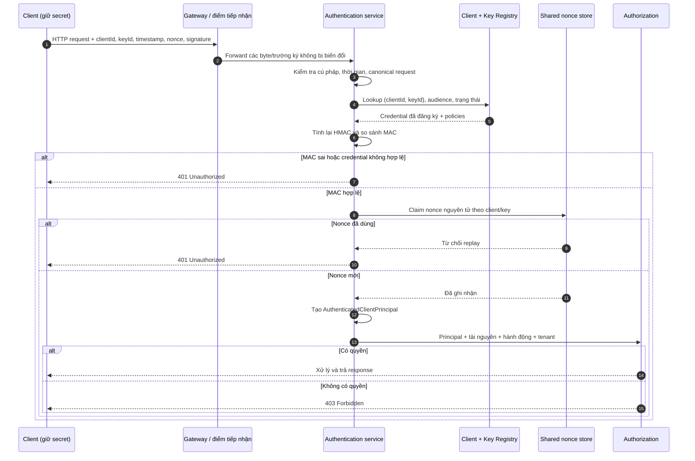

# Client identity trong mô hình client–server sử dụng HMAC

## Mục tiêu học tập

Trong chương **Mô hình client server**, bài **Client identity** giải thích cách nhận diện một ứng dụng hoặc dịch vụ đang gọi HTTP API bằng **HMAC request authentication**. Đây là một phần của module `SECURITY_AUTHENTICATION_HMAC_REQUEST_AUTHENTICATION`: client và server dùng **shared secret** để ký/xác minh một **canonical request** chứa phương thức, URI, các header và/hoặc body theo hợp đồng ký. Để nhận diện client đáng tin cậy, hệ thống còn phải chống replay bằng timestamp/nonce, hỗ trợ key rotation, kiểm tra proxy/gateway và tách biệt xác thực với phân quyền.

Sau bài này, người học có thể:

- Giải thích `clientId`, `keyId`, shared secret và **authenticated client principal** khác nhau ở đâu.
- Thiết kế quy trình đăng ký, nhận diện, xác minh và thu hồi một client trong hệ thống nhiều client.
- Tạo danh tính xác thực **chỉ sau khi** chữ ký HMAC và kiểm soát replay hợp lệ.
- Gắn danh tính client đã xác thực với quyền, tenant và API đích mà không tin vào các trường tự khai của request.
- Kiểm thử các trường hợp giả mạo client ID, replay, xoay khóa và gateway thay đổi request.

## 1. Client identity là danh tính của ai?

Trong tích hợp **machine-to-machine (M2M)**, một *client* thường là ứng dụng, service, job hoặc hệ thống đối tác gọi API, chứ không nhất thiết là người dùng cuối. Chẳng hạn, dịch vụ `checkout-service` gửi yêu cầu tạo thanh toán đến `billing-api`.

Hai tầng danh tính thường tồn tại đồng thời:

1. **Danh tính ứng dụng gọi API (client identity):** `checkout-service-prod`, đại diện cho một workload hoặc đối tác đã đăng ký với hệ thống tiếp nhận.
2. **Danh tính người dùng cuối (end-user identity, nếu có):** tài khoản đang thao tác trên ứng dụng checkout. Người dùng này có thể được xác thực bằng session, OAuth/OIDC hoặc một cơ chế khác.

**HMAC request authentication có thể xác thực client đang nắm giữ shared secret đã đăng ký**. Nó không tự chứng minh người dùng cuối nào đã thực hiện hành động, cũng không cấp quyền truy cập mọi tài nguyên.

Ví dụ: `checkout-service-prod` ký đúng yêu cầu `POST /v1/payments`. Server có thể xác nhận request phù hợp với khóa của client này. Nhưng nếu request khai `userId=alice`, giá trị đó vẫn cần một nguồn tin cậy riêng để xác minh rằng Alice thật sự là người khởi tạo thao tác, nếu nghiệp vụ yêu cầu. Tương tự, một chữ ký hợp lệ không cho phép client thao tác trên tenant của đối tác khác.

### 1.1. Các khái niệm không được đánh đồng

| Khái niệm | Ví dụ | Ý nghĩa và giới hạn |
| --- | --- | --- |
| **Client ID** (`clientId`) | `checkout-service-prod` | Định danh công khai, ổn định của ứng dụng đã đăng ký. Có thể gửi qua header để server tìm bản ghi client. Bản thân nó **không phải chứng cứ xác thực**. |
| **Key ID** (`keyId`) | `hmac-key-2026-11` | Chỉ định phiên bản credential để server chọn khóa phù hợp; có thể thay đổi khi rotation. Không phải danh tính client và không phải secret. |
| **Shared secret** | 32 byte ngẫu nhiên | Vật liệu bí mật client và server cùng nắm giữ, dùng để tính HMAC. **Không gửi secret** cùng HTTP request. |
| **Signature/MAC** | Base64URL của HMAC-SHA256 | Bằng chứng request được ký bởi một bên biết secret và các trường đã ký không bị thay đổi theo hợp đồng. Chỉ đáng tin sau xác minh bằng khóa server đã đăng ký. |
| **Authenticated client principal** | `ClientPrincipal(clientId, scopes, tenants)` | Danh tính server **tạo ra sau khi** kiểm tra chữ ký, hiệu lực khóa và chống replay. Được dùng làm đầu vào cho phân quyền. |
| **Tenant/organization** | `merchant-42` | Phạm vi tổ chức hoặc dữ liệu. Một client có thể được cấp một hoặc nhiều tenant, nhưng không được tự nâng quyền bằng cách gửi tenant ID tùy ý. |
| **Audience/API đích** | `billing-api-prod` | Dịch vụ nơi credential có hiệu lực. Giúp tránh sử dụng chữ ký ở nhầm dịch vụ hoặc môi trường. |
| **End-user identity** | `user-123` | Người dùng cuối có thể được truyền trong payload/context; cần bằng chứng và cơ chế xác thực/ủy quyền tương ứng nếu ứng dụng sử dụng. |

Quy tắc cốt lõi: **client ID là một lời khai để tra cứu; client principal là kết quả đã được server xác thực**. Không tạo principal trực tiếp từ một header do client gửi.

## 2. Danh tính gắn với đăng ký client và credential

Server cần **registry** quản lý client đã đăng ký. Một mô hình đơn giản:

```text
ClientRegistration
  clientId: checkout-service-prod
  displayName: Checkout Production Service
  status: ACTIVE
  owner: checkout-platform-team
  allowedAudiences: [billing-api-prod]
  allowedTenants: [merchant-42]
  scopes: [payments:create, payments:read]
  credentials:
    - keyId: hmac-key-2026-09
      status: RETIRING
      secretRef: secrets/checkout/hmac-2026-09
    - keyId: hmac-key-2026-11
      status: ACTIVE
      secretRef: secrets/checkout/hmac-2026-11
```

Đây là **mô hình minh họa**, không phải định dạng file cấu hình bắt buộc. `secretRef` chỉ là tham chiếu đến kho secret; secret thật cần được lưu và đọc bằng một cơ chế quản lý bí mật an toàn.

Server sử dụng **cặp** `(clientId, keyId)` để tìm đúng credential. Tên key ID chỉ cần duy nhất trong phạm vi client nếu registry định nghĩa như vậy; trong mô hình khác, key ID có thể duy nhất toàn hệ thống. Trong cả hai trường hợp, server **phải kiểm tra key ID thuộc chính client ID đang khai**.

### 2.1. Vì sao tách client ID và key ID?

Một client có danh tính ổn định trong khi secret thay đổi định kỳ hoặc cần thu hồi. Nếu dùng key ID làm danh tính và tạo một principal mới sau mỗi lần rotation, quyền, audit và chính sách tenant sẽ bị rối.

Ví dụ:

| Thời điểm | Client ID | Key ID dùng ký | Kết quả mong muốn |
| --- | --- | --- | --- |
| Trước rotation | `checkout-service-prod` | `hmac-key-2026-09` | Client vẫn có một danh tính ổn định. |
| Trong thời gian chuyển đổi | `checkout-service-prod` | Khóa cũ **hoặc** khóa mới còn hiệu lực | Server xác minh theo key ID được khai, sau đó tạo **cùng client principal**. |
| Sau thời gian chuyển đổi | `checkout-service-prod` | `hmac-key-2026-11` | Khóa cũ bị thu hồi; danh tính, scopes và tenant được giữ theo chính sách hiện tại. |

Không nên dùng chung một shared secret giữa nhiều client hoặc nhiều môi trường prod/staging. Khi một khóa chung bị lộ, server khó xác định client nào đã gửi và không thể thu hồi riêng một client mà không ảnh hưởng các client khác.

### 2.2. Những thuộc tính phải thuộc quyền quản lý của server

Các thuộc tính như `ACTIVE/SUSPENDED/REVOKED`, `allowedAudiences`, `allowedTenants`, `scopes`, thời hạn khóa và chính sách rate limit **do server hoặc hệ thống quản lý danh tính quyết định**. Không suy ra chúng từ header tự khai.

Client có thể gửi một `X-Tenant-Id` nhằm *chọn* tenant cho request, nhưng server phải kiểm tra giá trị này nằm trong tập tenant được cấp cho **authenticated principal**. Tương tự, `X-Scope: admin` do client tự gửi không tạo thêm bất kỳ quyền nào.

## 3. Luồng nhận diện client từ request tới principal

Sơ đồ sau phân biệt **định danh được khai**, **bằng chứng HMAC** và **danh tính xác thực được xây dựng**:



**Điểm chuyển đổi trạng thái tin cậy** nằm sau bước kiểm tra MAC và chống replay: từ những giá trị **chưa xác thực** (`X-Client-Id`, `X-Key-Id`) server mới tạo được principal.

Thứ tự thực thi hữu ích:

1. **Nhận request và đọc trường ở biên HTTP.** Kiểm tra phương thức, URI, header, body size và trường trùng/không hợp lệ. Thu thập đúng raw target và byte body theo hợp đồng ký. Giữ HTTPS đến trust boundary thích hợp.
2. **Kiểm tra timestamp và cú pháp nonce.** Timestamp quá cũ hoặc quá xa trong tương lai được từ chối; chưa thể xem nó là bằng chứng thời gian cho tới khi MAC hợp lệ.
3. **Tra credential.** Tìm khóa theo `(clientId, keyId)`; kiểm tra client/key còn hiệu lực và được phép sử dụng tại audience/API hiện tại. Hạn chế việc trả lỗi chi tiết giúp tránh lộ thông tin client/key tồn tại hay không.
4. **Xác minh chữ ký.** Tái tạo canonical request **từ request thực nhận** và các quy tắc đã công bố, tính HMAC bằng secret tìm từ registry, đối chiếu với MAC nhận được theo byte.
5. **Chống replay.** Sau MAC hợp lệ, thực hiện thao tác *claim nonce* nguyên tử trên kho dùng chung. Nonce đã được dùng trong cửa sổ cho phép phải bị từ chối.
6. **Tạo principal** từ bản ghi đã đăng ký: `clientId`, audiences/scopes/tenant được phép và thông tin key phục vụ audit. Không copy header `X-Scope`, `X-Role` vào principal như quyền được xác thực.
7. **Kiểm tra quyền ở API.** Quyết định client có được gọi thao tác trên resource, tenant và đối tượng nghiệp vụ cụ thể hay không.

Server không được lấy `X-Client-Id` và tra trực tiếp permissions trước khi đã xác minh bằng chứng HMAC. Nếu chữ ký sai nhưng header hợp lệ về mặt văn bản, request vẫn chưa được xác thực.

## 4. Ví dụ hợp đồng ký có ràng buộc client identity

**Không có một định dạng canonical request phổ quát cho mọi hệ thống HMAC.** Hai bên phải thống nhất thuật toán, phiên bản, thứ tự trường, cách xử lý URI/header/body và encoding. Hợp đồng `v1` sau đây chỉ để học và kiểm thử, không phải tiêu chuẩn dùng được với mọi API.

Ví dụ client gọi:

```http
POST /v1/payments?merchant=merchant-42 HTTP/1.1
Host: billing.example.test
Content-Type: application/json
X-Client-Id: checkout-service-prod
X-Key-Id: hmac-key-2026-11
X-Timestamp: 1795800000
X-Nonce: WtKLd7FxTEYYGl8u6w-AaQ
X-Content-SHA256: <base64url-sha256-body>
X-Signature: <base64url-hmac>

{"amount":120000,"currency":"VND"}
```

Ở ví dụ này:

- `X-Client-Id` và `X-Key-Id` chỉ là **khóa tra cứu registry** trước xác minh, và đều được đưa vào dữ liệu ký để chống thay đổi.
- `Host` không được đưa vào canonical request; server và client thay vào đó thống nhất **audience cố định** `billing-api-prod` được ký. Server lấy expected audience từ cấu hình dịch vụ, không tin một `X-Audience` bất kỳ.
- `X-Content-SHA256` là SHA-256 trên **toàn bộ byte body**, mã hóa Base64URL không padding; `X-Signature` là HMAC-SHA256 bằng secret tương ứng `hmac-key-2026-11`, cùng quy tắc Base64URL.
- Các chuỗi trong ngoặc `<...>` là chỗ giữ chỗ, cần tính đúng trước khi gửi request. Timestamp là ví dụ cố định; request thực tế phải dùng thời gian hiện tại.

Canonical request có **11 dòng**, UTF-8, ngăn cách đúng bằng LF (`\n`), không có LF cuối:

```text
HMAC-SHA256
v1
billing-api-prod
checkout-service-prod
hmac-key-2026-11
POST
/v1/payments?merchant=merchant-42
application/json
<base64url-sha256-body>
1795800000
WtKLd7FxTEYYGl8u6w-AaQ
```

Định dạng gồm chính xác 11 trường theo thứ tự: thuật toán, phiên bản, audience, client ID, key ID, method, raw target, Content-Type, body hash, timestamp, nonce. Hai bên phải dùng cùng thứ tự và cùng quy tắc biểu diễn byte.

Quy ước canonicalization của hợp đồng mẫu:

- Method viết hoa ASCII (`POST`). Raw target là path kèm query **như được tiếp nhận tại ranh giới xác minh**, bắt đầu bằng `/`; giữ nguyên thứ tự tham số, percent-encoding và phân biệt `%2F` với `/` hay `+` với `%20`.
- `Content-Type` chỉ bỏ ASCII space/tab ở hai đầu; nếu không có thì dùng chuỗi rỗng. Không cho phép các header liên quan đến chữ ký xuất hiện nhiều lần với cách diễn giải mơ hồ.
- Body hash dùng byte payload gốc trước JSON parser hoặc re-serialization; với hợp đồng này không nhận `Content-Encoding` khác `identity`, tránh proxy giải nén làm sai byte đã ký.
- Các trường dạng văn bản phải có cú pháp và giới hạn chiều dài, cấm ký tự CR/LF. Nonce dùng ít nhất 128 bit ngẫu nhiên; timestamp là Unix epoch **giây** dạng số thập phân. `X-Signature` không được tự ký trong canonical request.
- Client chỉ gửi request qua HTTPS; endpoint đã ký cần được giữ nguyên qua proxy/gateway, hoặc việc xác minh phải thực hiện **trước** khi gateway rewrite nội dung liên quan đến chữ ký.

Khi hiện thực, hãy định nghĩa canonical request như sau:

```text
join("\n", [
  "HMAC-SHA256", "v1",
  audience, clientId, keyId, method, rawTarget,
  normalizedContentType, base64urlSha256(bodyBytes),
  timestampSeconds, nonce
])
```

Nếu kẻ tấn công chỉ thay `X-Client-Id` thành `another-client` mà giữ chữ ký cũ, HMAC sẽ không khớp vì client ID nằm trong canonical request. Nếu họ chuyển toàn bộ request đã ký đến một dịch vụ có audience khác, chữ ký cũng không khớp với canonical request do dịch vụ mới xây dựng. Cả hai bảo đảm này còn phụ thuộc việc server dùng **khóa ràng buộc đúng client/audience** và giữ secret an toàn.

## 5. Mô hình Java: tạo principal từ dữ liệu đã kiểm chứng

Một hệ thống Java có thể tách `ClientRegistry`, `HmacVerifier`, `ReplayStore` và `AuthorizationService`. Ví dụ sau là **giả mã Java về luồng xác thực**, nơi các interface phụ thuộc vào HTTP framework, secret manager và kho nonce của ứng dụng:

```java
record ClientRegistration(
    String clientId,
    boolean active,
    Set<String> allowedAudiences,
    Set<String> scopes,
    Set<String> allowedTenants
) {}

record HmacCredential(
    String clientId,
    String keyId,
    byte[] secret,
    boolean active,
    Instant validFrom,
    Instant validUntil
) {}

record AuthenticatedClient(
    String clientId,
    String authenticatedWithKeyId,
    Set<String> scopes,
    Set<String> allowedTenants
) {}

// Các lớp phụ thuộc là abstraction do ứng dụng cung cấp.
AuthenticatedClient authenticate(HttpRequest request) {
    HmacHeaders h = parseAndValidateUniqueHeaders(request);
    // HmacHeaders có clientId, keyId, timestamp, nonce,
    // contentSha256 và signature; chưa trường nào được tin cậy.

    long now = clock.instant().getEpochSecond();
    long timestamp = parseEpochSeconds(h.timestamp());
    if (timestamp < now - 300 || timestamp > now + 300) {
        throw new UnauthorizedException();
    }

    ClientRegistration client = registry
        .findClient(h.clientId())
        .orElseThrow(UnauthorizedException::new);
    HmacCredential key = registry
        .findCredential(h.clientId(), h.keyId())
        .orElseThrow(UnauthorizedException::new);

    if (!client.active() || !key.active()) {
        throw new UnauthorizedException();
    }
    if (!key.clientId().equals(client.clientId())) {
        throw new UnauthorizedException();
    }
    if (!client.allowedAudiences().contains(EXPECTED_AUDIENCE)) {
        throw new UnauthorizedException();
    }
    if (clock.instant().isBefore(key.validFrom())
            || !clock.instant().isBefore(key.validUntil())) {
        throw new UnauthorizedException();
    }

    // verify phải kiểm tra body hash rồi tính HMAC trên
    // method, raw target, audience, clientId, keyId, timestamp,
    // nonce, Content-Type, body hash; so sánh MAC theo byte.
    if (!hmacVerifier.verify(request, h, EXPECTED_AUDIENCE, key.secret())) {
        throw new UnauthorizedException();
    }

    // Atomically claim (clientId, keyId, nonce) trong kho dùng chung.
    // TTL phải bao phủ toàn bộ khoảng thời gian request còn hợp lệ.
    if (!replayStore.claimOnce(
            client.clientId(), key.keyId(), h.nonce(), 610)) {
        throw new UnauthorizedException();
    }

    return new AuthenticatedClient(
        client.clientId(),
        key.keyId(),
        Set.copyOf(client.scopes()),
        Set.copyOf(client.allowedTenants()));
}
```

Đoạn mã minh họa các **quyết định tin cậy**, không phải lớp có thể copy, compile và triển khai ngay: các interface, type, dependency và xử lý giới hạn tài nguyên chưa được định nghĩa. Trong code production cần xử lý rõ các vấn đề sau:

- **Verify HMAC đúng cách:** dùng `Mac.getInstance("HmacSHA256")` và `SecretKeySpec` từ shared secret đã được server quản lý; dùng `MessageDigest.isEqual(expectedMac, suppliedMac)` để so sánh **byte MAC** thay cho so sánh chuỗi sớm thoát. Kiểm tra format, độ dài và Base64URL của chữ ký trước giải mã.
- **Không tin dữ liệu chưa xác thực:** `clientId` và `keyId` ban đầu chỉ phục vụ lookup; principal lấy scopes/tenant từ registry đã được server quản lý sau khi verify.
- **Trạng thái key tại thời điểm xác minh:** khóa thuộc đúng client, đúng audience theo chính sách, còn hiệu lực. Việc sử dụng một key bị thu hồi phải bị từ chối, dù chữ ký HMAC về mặt mật mã vẫn khớp.
- **Nonce và timestamp:** timestamp được **ký cùng** request; nonce phải mới, đủ ngẫu nhiên và lưu qua thao tác nguyên tử. Với chính sách cho phép chênh lệch `±300` giây, thời gian sống một bản ghi nonce tính từ lúc nhận nên bao phủ tối đa khoảng 600 giây; ví dụ TTL 610 giây có biên dự phòng. Không dùng cache nonce riêng từng node.
- **Giảm rò rỉ qua lỗi:** response cho credential không tồn tại, MAC sai hoặc key bị thu hồi thường đều là `401` không nêu chi tiết nội bộ; log có kiểm soát giúp người vận hành chẩn đoán. Giới hạn tốc độ những request không hợp lệ.

### 5.1. Authentication context dùng ở đâu?

Trong Java Spring Security, sau khi xác minh thành công, bộ lọc xác thực có thể xây dựng `Authentication` với `principal` là bản ghi immutable từ registry và các `GrantedAuthority` tương ứng. Bộ lọc cần đặt principal vào đúng `SecurityContext` **chỉ khi xác minh đã thành công**. Nếu dùng gateway để xác minh tập trung, backend chỉ được tin một context nội bộ do gateway tạo trên kênh đã bảo vệ; phải xóa hoặc từ chối mọi header principal do client ngoài internet tự gửi.

Đừng nhầm việc `Authentication.isAuthenticated() == true` trong framework với việc thư viện HTTP tự động bảo vệ request: ứng dụng vẫn phải thực sự kiểm tra HMAC, trạng thái credential, audience và replay trước khi tạo authentication context.

## 6. Client identity và authorization: hai câu hỏi khác nhau

**Authentication:** “Request này có bằng chứng hợp lệ cho danh tính client `checkout-service-prod` không?”

**Authorization:** “Client đã xác thực này có quyền thực hiện `payments:create` cho `merchant-42` trong môi trường billing hiện tại không?”

Giả sử registry có:

```text
clientId       = checkout-service-prod
allowedTenants = {merchant-42}
scopes         = {payments:create, payments:read}
```

Các request sau dẫn đến quyết định khác nhau:

| Request | Chữ ký HMAC | Quyền theo registry | Kết quả |
| --- | --- | --- | --- |
| Tạo thanh toán của `merchant-42` | Hợp lệ | Có `payments:create`, đúng tenant | Cho phép nếu quy tắc nghiệp vụ khác cũng đạt. |
| Tạo thanh toán của `merchant-99` | Hợp lệ | Không được cấp tenant này | `403 Forbidden`. |
| Xóa toàn bộ giao dịch của `merchant-42` | Hợp lệ | Không có `payments:delete` | `403 Forbidden`. |
| Tạo thanh toán của `merchant-42` với HMAC sai | Không hợp lệ | Chưa đánh giá | `401 Unauthorized`. |
| Gửi lại y nguyên request đã ký và nonce đã dùng | Bằng chứng MAC vẫn khớp | Chặn ở bước replay | `401 Unauthorized` theo chính sách mẫu. |

Một client có thể được cấp scopes ở cấp registry và tiếp tục bị hạn chế bởi dữ liệu thực tế: chủ sở hữu resource, trạng thái đơn hàng, hạn mức, chính sách chống gian lận hoặc quyền của người dùng cuối. HMAC chỉ là một lớp xác thực trong chuỗi quyết định.

Lưu ý với mô hình **on-behalf-of**: nếu `checkout-service` gọi `billing-api` thay cho người dùng, MAC chỉ xác thực `checkout-service`. Muốn billing xác thực hoặc tin cậy một user cụ thể, cần thiết kế cách chuyển tiếp và kiểm tra user context riêng (ví dụ token ủy quyền hợp lệ), tránh xem trường `userId` trong JSON đã được ký bằng key của client là bằng chứng người dùng đó đăng nhập.

## 7. Phòng tránh các kiểu nhầm lẫn danh tính

| Rủi ro | Biểu hiện | Biện pháp |
| --- | --- | --- |
| **Giả mạo client ID** | Gửi `X-Client-Id: admin-service` để lấy quyền cao hơn. | Chỉ lấy principal từ kết quả xác minh HMAC với key thuộc đúng client ID. |
| **Tráo key ID giữa client** | Dùng key ID của B cùng client ID của A. | Registry tra cặp `(clientId, keyId)`; HMAC ký cả hai định danh. |
| **Confused deputy/cross-tenant** | Client hợp lệ yêu cầu tài nguyên tenant khác. | Phân quyền theo principal, resource, scope và tenant đã đăng ký. |
| **Cross-service replay** | Đưa request của API A sang API B. | Ký audience; khóa và policy ràng buộc đúng dịch vụ/môi trường. |
| **Replay trong cửa sổ timestamp** | Gửi lại request cũ khi timestamp chưa hết hạn. | Nonce ngẫu nhiên, lưu nguyên tử, kiểm tra timestamp có chữ ký. |
| **Lộ shared secret** | Attacker có thể ký request mới thành client hợp lệ. | Secret manager, truy cập tối thiểu, rotate/thu hồi; không log secret. |
| **Dùng chung secret** | Nhiều client hoặc môi trường có cùng key, không quy trách nhiệm riêng được. | Secret riêng từng client/môi trường, key ID và quyền riêng. |
| **Header principal giả do client gửi** | Client ngoài internet gửi `X-Authenticated-Client`. | Edge xóa header nội bộ, backend chỉ tin gateway trên kênh có bảo vệ danh tính. |
| **Thay đổi request qua gateway** | Gateway đổi URI hoặc body sau khi ký. | Xác minh ở trust boundary đúng hợp đồng; kiểm thử raw target/body end-to-end. |
| **Lệch thời gian nhiều node** | Request hợp lệ có thể bị reject hoặc cửa sổ replay kéo dài. | Đồng bộ đồng hồ, cửa sổ thời gian rõ ràng và nonce store chung. |

Một chi tiết về mô hình tin cậy: vì HMAC dùng **khóa đối xứng**, cả client và server cùng biết secret. Bằng chứng HMAC cho biết “một bên nắm giữ khóa này đã tạo chữ ký” dưới giả định khóa an toàn; nó không cung cấp khả năng chứng minh chống chối bỏ (*non-repudiation*) như một chữ ký số bất đối xứng được quản lý tốt. Việc quy kết hành động đến từng con người cần dữ liệu và cơ chế xác thực khác.

### 7.1. Proxy/gateway được phép làm gì?

Giả sử client ký:

```text
POST /public/v1/payments?merchant=merchant-42
```

Gateway rewrite thành:

```text
POST /internal/payments?merchant=merchant-42
```

Nếu backend dựng canonical request từ đường dẫn **sau** rewrite, chữ ký sẽ sai. Có hai cách hợp lệ nếu được thiết kế đồng bộ:

1. **Xác minh HMAC tại gateway trước khi rewrite.** Gateway truyền client principal đã xác thực đến backend qua kênh có danh tính và tính toàn vẹn được bảo vệ. Backend không tin header principal do client ngoài gửi.
2. **Xác minh tại backend dựa trên dữ liệu gốc được gateway đáng tin cậy bảo toàn.** Hợp đồng phải mô tả cách lưu raw request-target gốc, ngăn client tự giả mạo header nội bộ, cùng xử lý byte body chưa biến đổi.

Dùng `X-Forwarded-For` hay IP nguồn làm client identity là sai mục tiêu: IP có thể thay đổi do NAT/proxy, và header forwarded có thể bị giả mạo nếu không có trust boundary rõ ràng. Dùng mTLS giữa gateway và backend có thể xác thực **gateway**, nhưng không tự chứng minh danh tính client bên ngoài nếu gateway chưa xác minh và chuyển tiếp context an toàn.

## 8. Vòng đời client identity và key rotation

Một quy trình vận hành điển hình:

1. **Đăng ký:** xác định hệ thống sở hữu client, môi trường `dev/staging/prod`, audience, scopes, tenant và đầu mối liên hệ. Sinh client ID duy nhất và **secret ngẫu nhiên có entropy cao**, chẳng hạn 256 bit cho HMAC-SHA256.
2. **Cấp phát an toàn:** trao secret qua kênh cấp phát bảo mật; client lưu trong secret manager hoặc cơ chế quản lý bí mật tương ứng. Không ghi secret vào repo, log, ticket hoặc tài liệu chia sẻ rộng.
3. **Hoạt động:** client chọn credential còn hiệu lực, ký request đúng hợp đồng; server xác minh rồi tạo principal. Theo dõi lỗi chữ ký, replay, credential hết hạn và tỷ lệ lỗi theo client ID/key ID ở mức không lộ bí mật.
4. **Rotation:** cấp `keyId` mới cho **cùng client ID**; server tạm cho phép cả hai key theo thời hạn kiểm soát, client chuyển ký sang key mới; kiểm tra lưu lượng còn dùng key cũ rồi vô hiệu key cũ.
5. **Đình chỉ/thu hồi:** nếu client bị xâm nhập hoặc không còn được phép gọi API, chuyển trạng thái client sang `SUSPENDED` hoặc thu hồi credential. Chữ ký bằng khóa bị thu hồi phải bị từ chối dù HMAC đúng về mặt kỹ thuật.
6. **Gỡ đăng ký:** kết thúc tích hợp, xóa quyền và key khi hết thời hạn lưu giữ cần thiết; giữ audit theo chính sách nhưng không giữ secret không cần thiết.

Điểm mấu chốt: **rotation đổi credential, không đổi client identity**. Quyền của client có thể được thay đổi độc lập với quá trình rotation. Nếu một ứng dụng có hai vai trò bảo mật tách biệt, ví dụ service đối soát và service chi tiền, nên xem xét tạo hai client identity/credential khác nhau thay vì cho một ID quá rộng quyền.

## 9. Kiểm thử client identity trên nhiều tầng

Mỗi trường hợp cần ghi nhận **principal cuối cùng** hoặc xác nhận không có principal; chỉ kiểm tra mã HTTP là chưa đủ.

| Ca thử | Tác động | Kỳ vọng |
| --- | --- | --- |
| Client hợp lệ, key hợp lệ, request nguyên vẹn, nonce mới | Ký đúng `clientId` và `keyId`. | Server tạo principal đúng `clientId` và quyền lấy từ registry. |
| Thay `X-Client-Id` sau ký | Tráo `checkout-service-prod` thành `admin-service`. | Từ chối; không tạo principal của admin-service. |
| Dùng key của client A với ID client B | Tra cứu sai quan hệ khóa–client. | Từ chối; không fallback sang secret bất kỳ. |
| Đổi `X-Key-Id` sau ký | Thay metadata xác định key. | Từ chối vì key ID được ký. |
| Chuyển request từ `billing-api-prod` sang audience khác | Đổi server nhận nhưng giữ nguyên chữ ký. | Từ chối vì audience trong canonical khác. |
| Đổi body hoặc URI sau ký | Sửa `merchant`, path, JSON body. | Từ chối vì MAC không khớp. |
| Cùng timestamp, nonce và chữ ký gửi đồng thời hai lần | Replay race giữa hai instance. | Chỉ một request claim nonce thành công. |
| Thực hiện rotation | Dùng key cũ và key mới trong khoảng chồng lấn. | Cả hai cùng ánh xạ **một client ID** khi còn hiệu lực. |
| Thu hồi key cũ | Dùng lại key đã revoked. | Từ chối trước khi tạo principal. |
| Chữ ký đúng, tenant không được cấp | Yêu cầu dữ liệu tenant khác. | Principal đúng nhưng authorization trả `403`. |
| Header giả `X-Authenticated-Client` gửi từ internet | Bỏ qua HMAC hoặc nâng quyền qua gateway. | Header bị xóa/từ chối, không thay thế xác minh HMAC. |
| Proxy chuẩn hóa URI hay body | Ký `%2F`, request đến dưới dạng `/`. | Phát hiện sai chữ ký hoặc xác minh ở điểm bảo toàn dữ liệu gốc. |

Ngoài ra nên thử `Content-Type` trùng lặp, header chữ ký thiếu, Base64URL sai cú pháp, nonce quá ngắn, timestamp không phải số, timestamp lệch thời gian, request body lớn bất thường, cache nonce lỗi và trạng thái client bị khóa giữa hai request.

## 10. Bài thực hành: hai client và một API thanh toán

Xây dựng API `POST /v1/payments` với hai client đăng ký sẵn:

```text
checkout-service-prod
  audiences: [billing-api-prod]
  tenants:   [merchant-42]
  scopes:    [payments:create]
  keys:      [key-checkout-01]

reporting-service-prod
  audiences: [billing-api-prod]
  tenants:   [merchant-42]
  scopes:    [payments:read]
  keys:      [key-report-01]
```

Yêu cầu thực hiện:

1. Cấp **hai shared secret khác nhau**, lưu trong kho bí mật hoặc cấu hình bảo mật cho môi trường thực hành. Tạo request có `clientId`, `keyId`, timestamp, nonce và chữ ký HMAC từ canonical request đã thống nhất.
2. Viết lớp `ClientIdentityAuthenticator` tra registry bằng `(clientId, keyId)`; chỉ trả về `AuthenticatedClient` khi key, audience, MAC và nonce đều hợp lệ.
3. Gửi request tạo thanh toán bằng `checkout-service-prod` và xác nhận có quyền `payments:create`. Dùng `reporting-service-prod` ký request tương tự rồi kiểm tra nó bị từ chối **403**, dù chữ ký chính xác.
4. Thử tráo header `X-Client-Id` của reporting thành checkout mà **không ký lại** và xác nhận server từ chối **401**, không được suy diễn danh tính từ header.
5. Thêm `key-checkout-02` và xoay khóa. Quan sát `clientId` trên authentication context không đổi; sau khi revoke `key-checkout-01`, tất cả request ký bằng key đó bị từ chối.
6. Đặt gateway rewrite `/public/v1/payments` thành `/v1/payments`; xác định vị trí xác minh request sao cho raw target và byte body được dùng nhất quán; thử cả nonce gửi song song trên hai instance.

**Câu hỏi tự đánh giá:** Nếu HMAC đúng nhưng registry đánh dấu client `SUSPENDED`, có nên tạo principal không? Nếu hai client dùng chung secret, làm sao thu hồi riêng một client? Vì sao cần ký client ID và key ID trong canonical request? Nếu `X-User-Id` xuất hiện trong body đã ký, HMAC có đủ để xác thực người dùng đó không? Nếu key mới được cấp cho cùng ứng dụng, identity và scopes nên thay đổi thế nào?

Tư duy triển khai cần giữ nhất quán: **request khai danh tính → server chọn credential đã đăng ký → kiểm tra HMAC và chống replay → tạo principal đáng tin → phân quyền theo tài nguyên và tenant**. Thiết kế đúng ranh giới này giúp mô hình client–server dùng HMAC vừa nhận diện được bên gọi API, vừa vận hành an toàn khi có nhiều client, nhiều khóa và các lớp proxy/gateway.

