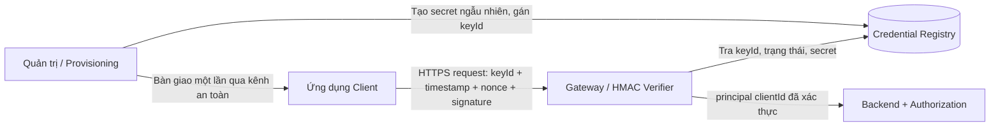
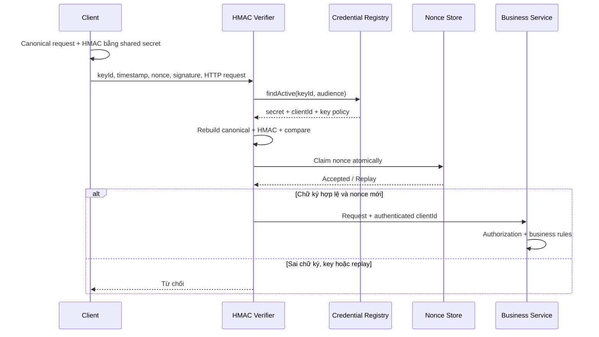
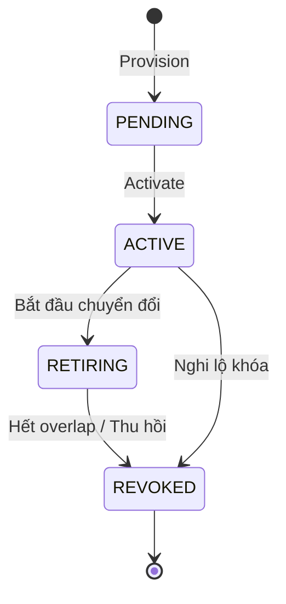

# Credential pair trong mô hình client–server xác thực HMAC

Trong mô hình client–server sử dụng HMAC (*Hash-based Message Authentication Code*), mỗi ứng dụng khách được cấp một **credential pair**: một **định danh khóa** (*key ID*, thường gọi là access key ID) và một **khóa bí mật dùng chung** (*shared secret*, đôi khi gọi là secret access key). Hai giá trị này phục vụ hai vai trò khác nhau: key ID giúp máy chủ tìm đúng khóa và danh tính ứng dụng; shared secret cho phép client tạo chữ ký mà chỉ các bên biết bí mật mới tính được.

Bài học thuộc chương **Mô hình client server** của module `SECURITY_AUTHENTICATION_HMAC_REQUEST_AUTHENTICATION`. Ta sẽ đi từ việc cấp phát cặp thông tin xác thực, cách client ký HTTP request bằng canonical request chứa method, URI, header hoặc body theo hợp đồng ký, đến cách server kiểm tra, chống replay với timestamp/nonce, xoay vòng khóa và xử lý request đi qua proxy/gateway.

## 1. Mục tiêu học tập

Sau bài này, người học có thể:

1. Phân biệt `clientId`, `keyId` và `shared secret`; giải thích vì sao chỉ biết key ID chưa chứng minh được danh tính client.
2. Mô tả cách cấp phát, chuyển giao, lưu trữ và thu hồi credential pair cho từng client, từng môi trường.
3. Giải thích cách client dùng shared secret tạo HMAC trên canonical request và server dùng key ID để tìm secret kiểm tra lại chữ ký.
4. Thiết kế quy trình key rotation sao cho key cũ và key mới có thể cùng tồn tại trong giai đoạn chuyển tiếp mà vẫn tra cứu rõ ràng.
5. Phân tích giới hạn của credential pair: secret bị lộ, replay, thay đổi request qua gateway, xác thực khác phân quyền.

## 2. Credential pair là gì?

Giả sử doanh nghiệp A tích hợp API tạo đơn hàng. Máy chủ API đăng ký một ứng dụng khách `partner-a-orders` và cấp:

| Thành phần | Ví dụ minh họa | Vai trò | Có được truyền trong từng request? |
| --- | --- | --- | --- |
| `clientId` | `partner-a-orders` | Danh tính logic ổn định của ứng dụng/đối tác; được xác nhận **sau** khi kiểm tra chữ ký. | Không bắt buộc; thường do server suy ra từ key ID đã xác minh. |
| `keyId` | `key_partner_a_202611` | Mã định danh duy nhất cho **một phiên bản khóa**; dùng để tra cứu đúng secret và các chính sách liên quan. | Có, trong header đã quy định. |
| `shared secret` | Một giá trị ngẫu nhiên 32 byte, giữ bí mật | Khóa đối xứng dùng làm đầu vào của HMAC; client và thành phần xác minh phía server cùng biết. | **Không bao giờ gửi trực tiếp** trong request nghiệp vụ. |

Một ứng dụng có thể có nhiều `keyId` còn hiệu lực trong giai đoạn chuyển đổi khóa; mỗi `keyId` tham chiếu tới **secret khác nhau** nhưng cùng có thể ánh xạ về một `clientId`. Do đó, không nên dùng key ID làm danh tính nghiệp vụ lâu dài: nó có thể thay đổi khi rotation, còn client ID thường được giữ ổn định.

### Những gì “pair” không có nghĩa

- **Không phải cặp public key/private key.** HMAC sử dụng khóa **đối xứng**: client và bộ phận xác minh ở server đều cần cùng secret. Key ID là mã tra cứu, **không phải public key mật mã học**.
- **Không phải username/password của người dùng cuối.** Credential pair thường cấp cho ứng dụng hoặc hệ thống tích hợp; việc một nhân viên/người dùng có quyền làm gì cần cơ chế khác.
- **Không chứng minh người tạo chữ ký là client hợp lệ nếu secret đã bị lộ.** Bất kỳ bên nào lấy được secret đều có thể ký như client đó cho tới khi khóa bị thu hồi.
- **Không tự mã hóa payload.** HMAC bảo vệ tính toàn vẹn của thành phần được ký và xác thực việc sở hữu khóa; TLS/HTTPS vẫn cần thiết để bảo vệ nội dung khi truyền và xác thực máy chủ.

## 3. Credential pair được tạo và quản lý ở đâu?

Trong thực tế, hệ thống quản lý client (onboarding/provisioning) tạo cặp credential, còn API gateway hoặc middleware xác thực dùng kho credential để kiểm tra request.



Registry thường cần các thuộc tính:

| Thuộc tính | Ý nghĩa |
| --- | --- |
| `keyId` | ID duy nhất, tra cứu chính xác một bản ghi credential. |
| `clientId` | Ứng dụng được cấp credential. |
| `secret` hoặc tham chiếu secret | Khóa phục vụ tính lại HMAC; phải được bảo vệ bằng secret manager/KMS, mã hóa khi lưu và kiểm soát quyền truy cập. |
| `algorithm` / `signatureVersion` | Ví dụ `HmacSHA256` / `v1`; giúp từ chối thuật toán ngoài hợp đồng. |
| `audience` / `environment` | API và môi trường được chấp nhận, ví dụ `orders-api-prod`. |
| `status`, `notBefore`, `expiresAt` | Trạng thái hoạt động và thời gian hiệu lực của khóa. |
| `permissions` hoặc liên kết đến policy | Phạm vi API mà client **có thể được xét cấp quyền**, dùng ở bước phân quyền sau xác thực. |

`keyId` có thể xuất hiện trong header và log đã được kiểm soát; nó **không được coi là bí mật**. Ngược lại, secret phải có đủ entropy để không đoán được, ví dụ tạo từ **256 bit (32 byte)** bằng bộ sinh số ngẫu nhiên dùng cho mật mã. Không chọn secret bằng ngày sinh, tên đối tác, UUID yếu, mật khẩu ngắn hoặc chuỗi mã hóa Base64 của một giá trị dễ đoán: Base64 chỉ là cách biểu diễn, không làm tăng độ ngẫu nhiên.

### Quy trình cấp phát đề xuất

1. Xác minh tổ chức/ứng dụng đăng ký, tạo `clientId` và gắn chính sách môi trường, audience, scope theo nhu cầu tối thiểu.
2. Tạo `keyId` duy nhất và sinh **secret riêng** bằng bộ sinh ngẫu nhiên mật mã; lưu secret ở kho bí mật bảo vệ, liên kết bản ghi registry với client.
3. Bàn giao `keyId` và secret cho người quản lý client **một lần** qua giao diện/kênh bảo mật; sau đó client đưa secret vào secret manager hoặc cơ chế lưu trữ an toàn.
4. Client thử ký một request kiểm tra trên môi trường được cấp; server xác minh và chỉ đánh dấu hoạt động theo quy trình phát hành.
5. Khi cần, rotate, hết hạn hoặc revoke credential mà không phải thay đổi danh tính logic `clientId`.

Ví dụ một bản ghi registry **mô tả cấu trúc**, tuyệt đối không dùng để lưu secret thật trong Git:

```yaml
keyId: key_partner_a_202611
clientId: partner-a-orders
secretRef: secret-manager://prod/hmac/partner-a/key_partner_a_202611
algorithm: HmacSHA256
signatureVersion: v1
audience: orders-api-prod
environment: production
status: ACTIVE
notBefore: "2026-11-01T00:00:00Z"
expiresAt: "2027-02-01T00:00:00Z"
```

Vì server phải **tự tính lại HMAC bằng đúng shared secret**, lưu duy nhất hàm băm một chiều của secret theo mô hình lưu mật khẩu thường **không đủ** để xác minh giao thức này. Secret cần được truy xuất có kiểm soát hoặc thiết kế một hệ thống xác minh khóa tương đương (ví dụ dịch vụ HMAC được KMS hỗ trợ), thay vì hiển thị hoặc phát tán rộng rãi secret dạng rõ.

## 4. Credential pair được dùng trong HTTP request như thế nào?

Với giao thức HMAC, client không gửi secret tới API. Client gửi **key ID và chữ ký**, còn server tự tra secret để kiểm tra. Trình tự chuẩn:

1. Client chuẩn bị request: phương thức HTTP, URI, header, body.
2. Client tạo timestamp và nonce mới cho request, rồi dựng một chuỗi **canonical request** theo hợp đồng đã thống nhất.
3. Client tính `HMAC-SHA256(sharedSecret, UTF8(canonicalRequest))`, mã hóa chữ ký (ví dụ Base64) và gắn header `X-Signature`.
4. Server nhận `X-Key-Id`, tìm credential có trạng thái hợp lệ, dựng lại **đúng những byte** canonical request từ dữ liệu nhận được.
5. Server tính lại HMAC bằng secret tương ứng, so sánh chữ ký an toàn; nếu đúng thì tiếp tục kiểm tra timestamp/nonce và gắn `clientId` đã xác thực.
6. Dịch vụ nghiệp vụ kiểm tra **quyền** của client trước khi thực hiện thao tác.



### Ví dụ một hợp đồng ký V1

Giả sử dịch vụ `orders-api-prod` quy định các dòng sau, đúng thứ tự, nối bằng ký tự LF (`\n`), mã hóa UTF-8 và **không** có LF cuối:

```text
HMAC-SHA256-V1
orders-api-prod
<UPPERCASE_HTTP_METHOD>
<RAW_PATH_AND_QUERY>
content-type:<EXACT_CONTENT_TYPE>
x-key-id:<KEY_ID>
x-timestamp:<UTC_ISO_8601_TIMESTAMP>
x-nonce:<RANDOM_NONCE>
sha256:<LOWERCASE_HEX_SHA256_OF_RAW_BODY_BYTES>
```

Đây là **hợp đồng minh họa**, không phải định dạng chuẩn chung cho mọi nhà cung cấp. Client và server phải thống nhất phiên bản thuật toán, cách chuẩn hóa method, URI, header và body; loại bỏ mọi nhập nhằng do framework, HTTP adapter hoặc proxy.

Client `partner-a-orders` chuẩn bị:

```http
POST /v1/orders?channel=partner HTTP/1.1
Host: api.example.test
Content-Type: application/json
X-Key-Id: key_partner_a_202611
X-Timestamp: 2026-11-28T02:00:00Z
X-Nonce: eU4azPc3tUaqNFjYHk2G3Q
X-Signature: v1:<BASE64_HMAC_SHA256>

{"sku":"BK-42","quantity":2}
```

Client lấy **byte body thực tế** (không thêm xuống dòng), tính SHA-256 rồi điền mã hex vào dòng `sha256:...`. Chữ ký HMAC được tính trên toàn bộ canonical request gồm `POST`, `/v1/orders?channel=partner`, các header đã chọn và digest body. Các giá trị trong `<...>` chỉ là placeholder, không phải chữ ký hoặc digest có hiệu lực.

Trong hợp đồng này, key ID cũng được ký nên không thể sửa nó mà vẫn giữ nguyên chữ ký nếu việc tìm khóa, dữ liệu ký và secret được ràng buộc đúng. Timestamp và nonce cũng được ký để kẻ tấn công không thay đổi chúng mà giữ chữ ký cũ.

**Điểm mấu chốt:** secret không xuất hiện trong request, nhưng server có thể tự tính chữ ký để kiểm tra liệu bên gửi có biết secret hay không. Một giá trị `X-Key-Id` bất kỳ do client tự khai **chưa** chứng minh danh tính cho đến khi HMAC hợp lệ.

### Tại sao phải canonical hóa chặt chẽ?

HMAC tính trên **byte**, không tính trên “ý nghĩa tương đương” của hai request:

- `/v1/orders?a=1&b=2` và `/v1/orders?b=2&a=1` khác byte nếu hợp đồng giữ nguyên thứ tự raw query. Không tự sắp xếp tham số ở server khi client ký raw query.
- `%2F`, `%2f` và dấu `/` có thể bị proxy/framework decode hoặc chuẩn hóa khác nhau. Quy định rõ nơi lấy URI gốc và từ chối biểu diễn không phù hợp.
- Body JSON `{"a":1,"b":2}` và `{"b":2,"a":1}` có thể cùng ý nghĩa nghiệp vụ nhưng khác digest khi hash raw bytes.
- Header bị lặp, khác khoảng trắng hoặc bị chuyển đổi có thể dẫn tới chuỗi ký khác nhau. Nếu chưa có quy tắc chuẩn hóa không mơ hồ, hãy từ chối request có header ký lặp hoặc không đúng định dạng.
- Không tự thêm URL host, proxy header hay header ngẫu nhiên vào canonical string nếu hợp đồng không quy định. Những thông tin ảnh hưởng đến routing/tenant/audience phải được ràng buộc bằng giá trị đã ký hoặc kiểm tra từ nguồn tin cậy.

Với request đi qua CDN, reverse proxy hay API gateway, cần quyết định **xác minh ở đâu**. Xác minh tại gateway trước rewrite thường dễ bảo toàn dữ liệu ký hơn. Nếu backend xác minh sau rewrite, giao thức phải định nghĩa an toàn cách truyền raw URI/header/body ban đầu; không tin header `X-Original-URI` hoặc `X-Forwarded-*` do client bên ngoài tự đặt.

## 5. Java 17: sinh shared secret và tính chữ ký HMAC

Đoạn Java sau minh họa hai thao tác mật mã cốt lõi: sinh secret mạnh và ký/so sánh chữ ký. Việc tìm credential theo key ID và dựng canonical request **phải được thực hiện riêng từ request thực tế** tại adapter/server.

```java
import java.nio.charset.StandardCharsets;
import java.security.GeneralSecurityException;
import java.security.MessageDigest;
import java.security.SecureRandom;
import java.util.Base64;
import javax.crypto.Mac;
import javax.crypto.spec.SecretKeySpec;

public final class HmacCredentialCrypto {
    private static final SecureRandom RANDOM = new SecureRandom();
    private static final String ALGORITHM = "HmacSHA256";

    private HmacCredentialCrypto() {}

    // Dùng khi cấp phát: mỗi keyId nhận một secret ngẫu nhiên riêng.
    public static byte[] generateSecret() {
        byte[] secret = new byte[32]; // 256 bit
        RANDOM.nextBytes(secret);
        return secret;
    }

    // Client ký bằng secret đã được cấp.
    public static String sign(byte[] secret, String canonicalRequest)
            throws GeneralSecurityException {
        Mac mac = Mac.getInstance(ALGORITHM);
        mac.init(new SecretKeySpec(secret, ALGORITHM));
        byte[] signature = mac.doFinal(
                canonicalRequest.getBytes(StandardCharsets.UTF_8));
        return Base64.getEncoder().encodeToString(signature);
    }

    // Server phải tự dựng canonicalRequest từ request nhận được.
    public static boolean verify(
            byte[] serverSecret,
            String canonicalRequest,
            String suppliedBase64Signature)
            throws GeneralSecurityException {
        if (serverSecret == null || serverSecret.length < 32
                || canonicalRequest == null
                || suppliedBase64Signature == null) {
            return false;
        }

        byte[] supplied;
        try {
            supplied = Base64.getDecoder().decode(suppliedBase64Signature);
        } catch (IllegalArgumentException ex) {
            return false;
        }

        // HMAC-SHA256 tạo đúng 32 byte và yêu cầu Base64 canonical.
        if (supplied.length != 32
                || !Base64.getEncoder().encodeToString(supplied)
                        .equals(suppliedBase64Signature)) {
            return false;
        }

        Mac mac = Mac.getInstance(ALGORITHM);
        mac.init(new SecretKeySpec(serverSecret, ALGORITHM));
        byte[] expected = mac.doFinal(
                canonicalRequest.getBytes(StandardCharsets.UTF_8));

        return MessageDigest.isEqual(expected, supplied);
    }
}
```

**Vì sao dùng `MessageDigest.isEqual`?** So sánh hai chuỗi chữ ký bằng `String.equals` hoặc so sánh byte thủ công có thể rò rỉ thông tin theo thời gian khi gặp byte sai đầu tiên. `MessageDigest.isEqual` là API Java thích hợp hơn để so sánh mã xác thực. Dù vậy, vẫn phải hạn chế số lần thử, phản hồi lỗi chung và không ghi log các giá trị bí mật.

Lưu ý rằng `sign` nhận chuỗi canonical đã xây dựng theo hợp đồng; chương trình production cần một bộ tạo canonical thống nhất, duy trì byte body gốc và kiểm tra header/URI trước khi gọi hàm. Không cho client gửi sẵn “canonical request” rồi server tin nguyên chuỗi đó: server phải **tự dựng** từ request thực nhận.

Khi provisioning, secret có thể được biểu diễn bằng Base64URL để bàn giao một lần qua kênh bảo mật, sau đó client decode thành byte. Base64URL **không phải mã hóa bảo mật**. Không in secret hoặc mã hóa Base64 của secret vào log, repo, file cấu hình công khai hoặc URL.

## 6. Tra cứu key ID và xác lập danh tính ở server

Credential registry có thể chứa nhiều bản ghi:

| keyId | clientId | Trạng thái | Audience | Ý nghĩa |
| --- | --- | --- | --- | --- |
| `key_partner_a_202611` | `partner-a-orders` | ACTIVE | `orders-api-prod` | Khóa cũ trong thời gian chuyển đổi. |
| `key_partner_a_202702` | `partner-a-orders` | ACTIVE | `orders-api-prod` | Khóa mới đang được triển khai. |
| `key_partner_b_202611` | `partner-b-sync` | REVOKED | `orders-api-prod` | Không được chấp nhận. |
| `key_partner_a_test` | `partner-a-orders` | ACTIVE | `orders-api-test` | Chỉ dùng môi trường thử nghiệm. |

Khi nhận `X-Key-Id: key_partner_a_202702`, server phải tra **đúng một** bản ghi, kiểm tra trạng thái, thời gian hiệu lực, audience và môi trường, rồi lấy secret tương ứng. Server **không** thử tất cả secret của mọi client để tìm chữ ký trùng: cách đó làm mờ danh tính, tăng tải và gây khó khăn khi revoke, audit hoặc áp chính sách riêng từng khóa.

Quy trình xác thực nên tách thành các bước rõ ràng:

```text
Nhận HTTP request
  -> kiểm tra cấu trúc/header, giới hạn kích thước và định dạng
  -> đọc keyId chưa tin cậy, tra credential đúng audience
  -> kiểm tra key đang hoạt động và trong thời hạn hiệu lực
  -> dựng canonical request từ method, raw URI, header, body
  -> tính HMAC bằng secret tương ứng, so sánh an toàn
  -> kiểm tra timestamp và claim nonce nguyên tử
  -> tạo AuthenticatedClient(clientId, keyId)
  -> kiểm tra authorization theo clientId, scope, tenant, resource
  -> xử lý nghiệp vụ
```

`AuthenticatedClient` chỉ được tạo **sau khi** chữ ký và điều kiện bảo vệ request hợp lệ. Không đặt principal dựa vào `X-Key-Id` hay `X-Client-Id` trước xác minh; các header này do client kiểm soát nên có thể bị giả mạo.

Phần backend có thể cần biết cả `clientId` (để phân quyền) và `keyId` (để audit, điều tra hoặc thu hồi chính xác). Tuy nhiên, backend chỉ được tin dữ liệu danh tính được tạo bởi bộ phận xác thực thông qua kênh nội bộ đáng tin cậy. API gateway phải xóa header principal tự khai từ client trước khi gắn principal đã kiểm chứng.

## 7. Vì sao có credential pair vẫn cần timestamp và nonce?

Một attacker không biết secret có thể không tạo được **chữ ký mới** nhưng vẫn có thể phát lại nguyên request cùng chữ ký nếu lấy được từ một nơi bị lộ. Với cùng secret và cùng canonical request, HMAC vẫn ra cùng kết quả. Vì vậy xác thực bằng credential pair cần bổ sung chống replay:

| Cơ chế | Tác dụng | Giới hạn |
| --- | --- | --- |
| Timestamp đã ký | Giới hạn tuổi request và chặn chữ ký cũ ngoài cửa sổ, ví dụ lệch tối đa ±5 phút. | Chỉ riêng timestamp chưa cản được replay **trong** cửa sổ. |
| Nonce ngẫu nhiên đã ký | Mỗi request dùng một giá trị mới; server từ chối `(keyId, nonce)` đã tồn tại. | Cần kho chung giữa các instance và thao tác claim nguyên tử. |
| Idempotency key nghiệp vụ | Chặn tạo hai giao dịch khi client retry request hợp lệ với nonce mới. | Giải quyết trùng lặp nghiệp vụ, không thay thế xác thực HMAC. |

Một thiết kế kiểm tra phổ biến: nếu timestamp nằm trong ±300 giây, server sau khi **xác minh chữ ký thành công** ghi nhận nonce bằng thao tác insert-if-absent nguyên tử (ví dụ Redis `SET ... NX EX`) trước khi gây side effect. Khóa nonce nên bao gồm `keyId` hoặc định danh phạm vi khóa thích hợp.

Chú ý biên thời gian: timestamp **nhanh hơn giờ server 300 giây** được chấp nhận ngay và vẫn có thể nằm trong cửa sổ thêm tới 600 giây. Do đó không dùng TTL nonce mặc định chỉ 300 giây từ lần nhận đầu; hãy giữ đến khi `timestamp + window` đã qua, cộng biên an toàn, hoặc dùng TTL tương đương ≥2 lần cửa sổ từ khi claim.

Nếu kho nonce lỗi, server có yêu cầu bảo vệ replay phải **từ chối an toàn** thay vì cho request qua mà bỏ kiểm tra. Client cần đồng bộ đồng hồ; retry phải tạo timestamp/nonce và chữ ký mới, đồng thời dùng cơ chế idempotency nếu thao tác nghiệp vụ có tác dụng lặp.

## 8. Vòng đời credential pair và key rotation

Cần thiết kế credential pair như tài nguyên có vòng đời và khả năng thu hồi, không phải một chuỗi secret cố định mãi mãi.



Các trạng thái là ví dụ chính sách, không bắt buộc có đúng bốn tên này trong mọi hệ thống. Có hệ thống dùng `EXPIRED` thay vì `REVOKED` khi hết hạn tự nhiên; điểm quan trọng là verifier phải hiểu trạng thái và thời gian hiệu lực rõ ràng.

### Ví dụ chuyển từ khóa cũ sang khóa mới

1. Ban đầu `partner-a-orders` sử dụng `key_partner_a_202611` với secret A.
2. Server cấp `key_partner_a_202702` với secret B **khác A**, cùng trỏ tới `clientId=partner-a-orders`. Trong thời gian overlap, cả hai key ID có thể hoạt động.
3. Client triển khai bản cấu hình mới, ký request bằng secret B và khai `X-Key-Id: key_partner_a_202702`. Server chỉ lấy secret B để kiểm tra request này.
4. Sau khi xác nhận toàn bộ ứng dụng đã chuyển và qua cửa sổ request cũ, server ngừng chấp nhận key cũ. Việc revoke phải được phản ánh nhanh tới cache ở mọi node.
5. Nếu secret A nghi bị lộ, server **thu hồi ngay** key cũ, chấp nhận gián đoạn có kiểm soát thay vì kéo dài overlap.

Trong thời gian overlap, cả key cũ và mới có thể chứng minh cùng một `clientId` nhưng audit cần lưu `keyId` cụ thể. Mỗi khóa cần có thời hạn, phân quyền và phạm vi audience rõ ràng; đừng mặc nhiên sao chép quyền rộng hơn chỉ vì cùng client.

Không tái sử dụng một secret giữa các môi trường dev/test/prod, nhiều khách hàng hoặc các API với chính sách bảo mật khác nhau. Dùng audience có ký hoặc ràng buộc tương đương để tránh dùng chữ ký của dịch vụ này ở một dịch vụ khác. Khi khóa bị lộ, kiểm kê request liên quan và xoay khóa/điều tra; chỉ đổi tên key ID trong khi giữ nguyên secret **không** giải quyết được sự cố.

## 9. Xác thực, phân quyền và tin cậy giữa các tầng

Giả sử request có chữ ký hợp lệ dưới credential của `partner-a-orders`:

- **Authentication:** hệ thống xác nhận request được tạo bởi bên nắm secret thuộc credential đang hoạt động của `partner-a-orders` (với giả định secret chưa lộ).
- **Authorization:** hệ thống kiểm tra client đó có quyền `orders:create`, có thuộc tenant được khai báo, có được thao tác trên tài nguyên mục tiêu hay không.
- **Business validation:** hệ thống còn phải xác định mã hàng, kho, hạn mức hoặc trạng thái đơn hàng có thỏa nghiệp vụ hay không.

Ví dụ `partner-a-orders` có `orders:create` nhưng không có `orders:cancel`. Chữ ký HMAC cho request `DELETE /v1/orders/42` có thể hợp lệ về mặt mật mã, nhưng hệ thống **vẫn phải từ chối vì thiếu quyền**. Khi thiếu hoặc sai credential, API thường trả lỗi xác thực `401`; khi đã xác thực nhưng thiếu quyền, thường trả `403`. Tránh thông báo phân biệt “key tồn tại nhưng secret sai” với “key không tồn tại” ra bên ngoài, vì điều đó giúp dò credential.

Credential pair không tự định danh người dùng cuối. Nếu client thực hiện thao tác thay người dùng, hệ thống cần một cơ chế riêng để chứng minh người dùng và phạm vi ủy quyền, thay vì tin một `userId` do client tự ghi vào body chỉ vì HMAC hợp lệ.

Với mô hình **client → gateway → backend**, gateway có thể xác thực HMAC và truyền principal đã kiểm chứng đến backend. Điều này chỉ an toàn nếu backend không bị gọi trực tiếp từ Internet, kênh gateway–backend được bảo vệ/định danh và gateway loại bỏ các header có thể giả mạo từ client. Ngoài ra phải kiểm thử việc proxy thay đổi method, URL prefix, query, header hoặc body để tránh sai lệch canonical request.

## 10. Kiểm thử credential pair và luồng xác thực

| Tình huống | Kết quả mong đợi |
| --- | --- |
| Key ID đúng, secret đúng, request đúng canonical contract, timestamp/nonce hợp lệ | Chữ ký hợp lệ; gắn đúng `clientId` rồi xét phân quyền. |
| Chỉ biết key ID nhưng không biết secret | Không tạo được chữ ký HMAC hợp lệ. |
| Sửa một byte body, method, raw URI/query hoặc header đã ký | HMAC không còn khớp. |
| Gửi key ID của client B nhưng dùng secret của client A | Server tra theo key ID B, chữ ký phải bị từ chối. |
| Key ID không tồn tại, đã revoke, hết hạn hoặc không đúng audience | Từ chối; không tìm thử các khóa còn lại. |
| Có hai credential ACTIVE của cùng client trong giai đoạn rotation | Mỗi key ID xác minh bằng đúng secret của nó; principal đều ánh xạ về đúng client. |
| Phát lại cùng nonce trong cửa sổ thời gian đến hai node | Chỉ một request được claim thành công nhờ kho nonce dùng chung, nguyên tử. |
| Timestamp ngoài cửa sổ cho phép | Từ chối dù HMAC đúng. |
| Chữ ký Base64 lỗi, header ký trùng hoặc request target không hợp lệ | Từ chối theo quy tắc hợp đồng, không đoán cách diễn giải. |
| Client ký request trước proxy, gateway sửa URI hoặc body | Kiểm thử end-to-end để phát hiện sai khác canonical; sửa nơi xác minh/hợp đồng. |
| Gateway nhận header principal giả từ bên ngoài | Loại bỏ header giả, chỉ truyền danh tính đã xác minh. |
| HMAC hợp lệ nhưng client thiếu scope | Phân quyền từ chối, thường `403`. |
| Secret bị lộ hoặc nghi bị lộ | Thu hồi key liên quan, tạo secret mới, kiểm toán request; không chỉ đổi key ID. |

Nên xây dựng **test vector cố định** cho các client ở ngôn ngữ khác nhau: secret thử nghiệm không nhạy cảm, method, raw URI, header, body byte, canonical string, SHA-256 body và signature kỳ vọng. Chạy chung vector với Java, JavaScript, Go hoặc các SDK liên quan để bảo đảm chuỗi HMAC đồng nhất. Test vector phải dùng **secret giả cho test**, không lấy credential thật trong production.

## 11. Câu hỏi tự kiểm tra

**Tình huống A:** Đối tác gửi `X-Key-Id: key_partner_a_202611` nhưng không có `X-Signature`. Server đã biết client nào chưa?

**Trả lời:** Chưa. Key ID là lời khai danh tính và khóa dùng để tìm bản ghi. Server chỉ có thể xác lập principal sau khi kiểm tra chữ ký và các điều kiện xác thực khác.

**Tình huống B:** Một client muốn rotate secret, nhưng vẫn giữ nguyên key ID để không phải thay đổi header. Điều này có nên làm?

**Trả lời:** Thông thường không. Dùng key ID mới cho secret mới giúp server ánh xạ một ID tới một secret, cho phép overlap có kiểm soát, giảm nhầm lẫn và thuận tiện audit/thu hồi. Nếu đặc thù giao thức buộc giữ ID, cần một cơ chế phiên bản khóa tường minh, nhưng sẽ phức tạp và cần bảo đảm không đoán thử nhiều khóa.

**Tình huống C:** Hai request dùng hai nonce khác nhau và chữ ký đều hợp lệ, nhưng cùng tạo một đơn hàng. HMAC có chặn được không?

**Trả lời:** Không. HMAC và nonce xác thực từng request, còn chống tạo trùng nghiệp vụ đòi hỏi idempotency key hoặc cơ chế giao dịch phù hợp.

**Tình huống D:** Một request có HMAC hợp lệ theo credential của ứng dụng A nhưng URL đã bị proxy rewrite sau khi ký. Điều gì có thể xảy ra?

**Trả lời:** Nếu nơi xác minh thấy byte request target khác phía client, hai bên dựng canonical request khác nhau và chữ ký thất bại. Cần xác minh trước rewrite hoặc thiết kế đường chuyển dữ liệu gốc an toàn, kèm kiểm thử xuyên suốt gateway.

## 12. Ghi nhớ

**Credential pair = key ID dùng để chọn đúng credential + shared secret dùng để chứng minh quyền sở hữu khóa thông qua HMAC.** Danh tính client ổn định (`clientId`) được server xác lập từ bản ghi credential **sau khi** chữ ký và chính sách xác thực hợp lệ. Bí mật không bao giờ gửi trong request nghiệp vụ; phải cấp phát ngẫu nhiên, lưu trữ an toàn và có khả năng rotate/revoke.

Hợp đồng canonical request, bảo vệ replay, quản lý khóa, kiểm thử proxy/gateway và phân quyền theo principal là các phần không thể tách rời nếu muốn biến một credential pair thành cơ chế xác thực HTTP request có ý nghĩa trong môi trường production.
