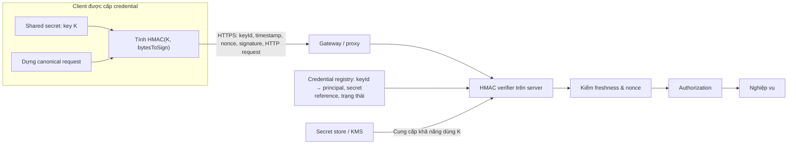

# Shared secret trong mô hình xác thực HMAC giữa client và server

> **Chương:** Mô hình client server  
> **Bài học:** Shared secret  
> **Phạm vi:** Thiết kế xác thực HTTP request bằng HMAC trong hệ thống gồm client và server. Hai bên sử dụng một khóa bí mật dùng chung để tạo và xác minh chữ ký trên canonical request, đồng thời phải xử lý việc cấp khóa, lưu trữ, phân tách danh tính, chống replay, luân chuyển khóa và phân quyền.

## 1. Shared secret là gì?

**Shared secret** là một giá trị bí mật dưới dạng **chuỗi byte** mà **cả client và server xác minh đều có khả năng sử dụng**. Trong cơ chế HTTP request authentication dựa trên HMAC, client dùng shared secret và nội dung request theo **hợp đồng ký** để tạo mã xác thực thông điệp (*Message Authentication Code*, MAC). Server sử dụng **cùng secret** để tự tính lại MAC và kiểm tra kết quả.

HMAC là thuật toán xác thực có khóa đối xứng. Ví dụ với HMAC-SHA256:

```text
signatureBytes = HMAC-SHA256(sharedSecretBytes, bytesToSign)
```

- **sharedSecretBytes:** các byte của secret đã được cấp cho credential.
- **bytesToSign:** chuỗi byte đầu vào đã được hai phía thống nhất, chẳng hạn method, URI, signed headers, timestamp, nonce và SHA-256 của raw body.
- **signatureBytes:** kết quả HMAC-SHA256 dài 32 byte; thường được biểu diễn thành Base64URL hoặc hex khi gửi qua HTTP.

**Secret không được gửi kèm theo mỗi request.** Thông thường, client gửi một **key ID** để server tìm secret và gửi **signature** để server kiểm tra. Server chỉ biết request hợp lệ khi đã tính và đối chiếu chữ ký bằng secret tương ứng; riêng việc nhận được key ID không chứng minh được danh tính client.

### Ví dụ ngắn

Giả sử đối tác `merchant-42` được cấp credential:

| Thuộc tính | Giá trị minh họa | Bí mật? |
| --- | --- | --- |
| Client/principal | `merchant-42` | Không nhất thiết |
| Key ID | `merchant-42-k2` | **Không**, chỉ để tra credential |
| Shared secret | 32 byte ngẫu nhiên, bên cấp chuyển đến client qua kênh bảo mật | **Có** |
| Thuật toán | `HMAC-SHA256` | Không |
| Trạng thái khóa | `ACTIVE` | Metadata do server quản lý |

Client gửi `X-Key-Id: merchant-42-k2` và `X-Signature`; server tìm credential `merchant-42-k2`, lấy secret từ hệ thống lưu trữ đáng tin cậy rồi xác minh HMAC. Khi tất cả điều kiện xác thực, freshness và replay đạt, server mới gán principal `merchant-42` cho request.

**Bản chất:** HMAC kiểm tra việc người tạo tag có **khả năng sử dụng shared secret**, không xác nhận độc lập phần mềm nào, thiết bị nào hay con người nào đã tạo request. Nếu secret bị lộ, kẻ khác có thể tạo chữ ký hợp lệ.

## 2. Shared secret nằm ở đâu trong client–server model?



Bên gửi và bên xác minh tin tưởng nhau ở **một điểm mật mã cụ thể**: cùng biết hoặc sử dụng khóa K. Nhưng request từ Internet vẫn là dữ liệu **chưa đáng tin** cho đến khi các bước xác minh hoàn tất.

Trong hệ thống thực tế, có thể tồn tại nhiều nơi giữ hoặc sử dụng secret:

1. **Client gọi API:** giữ secret để tính HMAC cho mỗi request.
2. **Server xác minh:** giữ secret được bảo vệ, hoặc sử dụng một dịch vụ/KMS có khả năng thực hiện MAC mà không cho ứng dụng đọc secret thô (nếu công nghệ và thiết kế hỗ trợ).
3. **Hệ thống cấp credential:** tạo và bàn giao secret; quyền truy cập cần hạn chế vì nơi này có thể cấp khả năng giả danh client.
4. **Gateway:** nếu trực tiếp xác minh, gateway cần khả năng sử dụng secret; downstream nhận principal qua một ranh giới tin cậy được bảo vệ.
5. **Service đích:** nếu tự xác minh sau gateway, service cần nhận được các thành phần request đúng theo hợp đồng ký; gateway không được làm thay đổi ý nghĩa của dữ liệu đã ký.

**Không phải service nào cũng nên có bản sao shared secret.** Càng nhiều thành phần có khả năng tạo MAC hợp lệ thì phạm vi ảnh hưởng khi một thành phần bị xâm nhập càng lớn.

## 3. Các khái niệm thường bị nhầm lẫn

| Khái niệm | Vai trò | Có được gửi trong mỗi request? |
| --- | --- | --- |
| **Shared secret** | Khóa đối xứng dùng để tạo/kiểm HMAC. | **Không**. |
| **Key ID / Credential ID** | Định danh không bí mật để server chọn đúng secret và principal. | Thường **có**. |
| **HMAC signature / tag** | Kết quả mật mã chứng minh bên tạo tag có khả năng sử dụng khóa trên đúng signing input. | **Có**. |
| **Canonical request** | Biểu diễn đã chuẩn hóa của những trường HTTP theo hợp đồng ký. | Được dựng độc lập ở hai phía; không nhất thiết gửi như một trường riêng. |
| **Body digest** | Hash của raw body bytes để đưa nội dung body vào dữ liệu ký. | Có thể không cần gửi, vì server tự tính lại. |
| **Timestamp** | Ràng buộc thời điểm tạo request; phải được ký. | Thường **có**. |
| **Nonce** | Giá trị dùng một lần để chặn phát lại; phải được ký. | Thường **có**. |
| **Principal** | Danh tính server suy ra sau khi xác thực credential. | Có thể được truyền nội bộ sau khi xác minh; không tin một principal tự khai từ Internet. |
| **Authorization** | Quyết định principal được làm gì với tài nguyên nào. | Là quyết định phía server sau authentication. |

### So sánh với API key dạng bearer

- **Bearer API key:** client gửi chính token bí mật. Ai nắm token thường có thể dùng token để gửi request; server so sánh hoặc tra token.
- **HMAC với shared secret:** client giữ secret, gửi chữ ký trên signing input; người xem request chỉ thấy key ID và tag. HMAC có thể ràng buộc **tính toàn vẹn của các trường đã ký**.
- **Điểm chung:** nếu thông tin bí mật bị đánh cắp, kẻ tấn công có thể giả danh credential. Cả hai cần TLS, giới hạn quyền, kiểm soát lưu trữ và quy trình thu hồi.
- **Không thể thay HTTPS bằng HMAC:** chữ ký không mã hóa body, URL, metadata hoặc ngăn nghe lén. Request đã ký cũng có thể bị phát lại nếu thiếu cơ chế freshness và nonce.

## 4. Một shared secret thuộc về credential, không phải toàn hệ thống

Giả sử có ba đối tác A, B, C. Thiết kế ban đầu có thể dùng **một secret chung cho tất cả đối tác**, nhưng khi secret đó bị lộ, hệ thống rất khó xác định ai đã ký request và phải thu hồi khóa của **mọi đối tác**.

Thiết kế tốt hơn cấp **credential riêng** cho mỗi client và có thể cấp nhiều credential cho một client để phục vụ rotation.

| keyId | Principal | Secret reference | Environment | Trạng thái | Ý nghĩa |
| --- | --- | --- | --- | --- | --- |
| `merchant-A-k1` | `merchant-A` | `secret-ref-A1` | production | VERIFY_ONLY | Khóa cũ trong giai đoạn chuyển |
| `merchant-A-k2` | `merchant-A` | `secret-ref-A2` | production | ACTIVE | Khóa hiện dùng để ký |
| `merchant-B-k1` | `merchant-B` | `secret-ref-B1` | production | ACTIVE | Khóa riêng của B |
| `merchant-A-test-k1` | `merchant-A` | `secret-ref-A-test` | test | ACTIVE | Không được xác minh trong production |

Bảng trên mang tính minh họa. Dữ liệu thực tế nên có `notBefore`, `notAfter`, phiên bản hợp đồng ký, thuật toán và phạm vi quyền thích hợp. `keyId` cần ánh xạ không mơ hồ tới đúng credential ở hệ thống được xác minh.

**Nguyên tắc:** server tìm khóa từ `keyId` rồi suy danh tính từ **bản ghi đáng tin cậy**; không lấy danh tính xác thực từ query, body hoặc một header `X-Client-Id` do client tự khai. Khi request có tenant mục tiêu, hệ thống vẫn phải kiểm tra quyền truy cập của principal đối với tenant đó.

## 5. Cấp phát shared secret an toàn

### 5.1. Entropy và độ dài

Shared secret là **khóa mật mã**, vì vậy phải được tạo bằng bộ sinh số ngẫu nhiên an toàn về mật mã (**CSPRNG**). Với HMAC-SHA256, sử dụng **32 byte (256 bit) ngẫu nhiên** là lựa chọn thực hành thông dụng, cung cấp entropy đủ mạnh cho mô hình xác thực API. Không dùng UUID ngắn, timestamp, mật khẩu do con người đặt, chuỗi có quy luật, `Random` hoặc `Math.random()` để tạo khóa.

Ví dụ Java 17+ để **sinh khóa mới**:

```java
import java.security.SecureRandom;
import java.util.Base64;

public final class SecretProvisioning {
    private static final SecureRandom CSPRNG = new SecureRandom();

    // Chỉ gọi ở bước cấp credential, không gọi cho từng request.
    public static byte[] generateHmacKey() {
        byte[] secret = new byte[32]; // 256 bit
        CSPRNG.nextBytes(secret);
        return secret;
    }

    // Biểu diễn để bàn giao qua kênh bảo mật; Base64URL không phải mã hóa bí mật.
    public static String encodeForProvisioning(byte[] secret) {
        return Base64.getUrlEncoder()
                .withoutPadding()
                .encodeToString(secret);
    }

    public static byte[] decodeProvisionedKey(String encoded) {
        byte[] secret = Base64.getUrlDecoder().decode(encoded);
        if (secret.length != 32) {
            throw new IllegalArgumentException("Invalid HMAC key length");
        }
        return secret;
    }
}
```

**Không in giá trị khóa vừa sinh ra vào console, log, ví dụ tài liệu hoặc hệ thống theo dõi lỗi.** Đoạn mã chỉ mô tả cách tạo và giải mã; quy trình thực tế phải chuyển khóa sang hệ thống lưu trữ bảo mật và bàn giao nó một cách an toàn cho đúng client.

### 5.2. Provisioning và onboarding

Một quy trình cấp credential có thể thực hiện như sau:

1. **Xác minh chủ thể xin cấp khóa:** ai đang tạo credential cho client nào, ở môi trường nào, với phạm vi gọi API nào?
2. **Tạo key ID duy nhất** và sinh secret ngẫu nhiên bằng CSPRNG.
3. **Lưu credential metadata** (`keyId`, principal, trạng thái, môi trường, phiên bản ký, quyền sử dụng và thời hạn) vào registry do server quản lý.
4. **Bảo vệ secret ở phía xác minh** bằng secret manager, KMS hoặc cơ chế bảo mật tương đương. Chỉ các thành phần được cấp quyền mới có thể sử dụng nó.
5. **Bàn giao secret cho đúng chủ thể** qua kênh xác thực và mã hóa; hạn chế số lần hiển thị, cấp quyền đọc và thời gian tồn tại của bản sao.
6. **Client lưu khóa** trong nơi cất giữ bí mật phù hợp với môi trường vận hành, cấu hình quyền truy cập tối thiểu.
7. **Xác minh lần đầu** bằng request thử có key ID đúng, signature hợp lệ, timestamp hiện tại và nonce mới.
8. **Ghi audit** cho thao tác tạo, cấp, kích hoạt, thay khóa và thu hồi mà không lưu secret vào audit log.

**Phân biệt độ dài và biểu diễn:** 32 byte secret khi mã hóa Base64URL không padding thường dài 43 ký tự ASCII; số ký tự không phải entropy. Không sử dụng trực tiếp chuỗi Base64URL làm **byte ký** nếu hai phía thỏa thuận rằng khóa là các byte được **decode** từ Base64URL.

## 6. Giữ secret an toàn ở cả client và server

### Phía client

- Với backend hoặc service-to-service, ưu tiên secret manager, vault, biến cấu hình được cấp từ kho bí mật hoặc cơ chế runtime tương đương. Giới hạn quyền của process và tài khoản dịch vụ.
- Không commit secret vào Git, tệp `application.yml` công khai, image Docker, tài liệu hướng dẫn, ticket hay output CI/CD.
- Không đưa shared secret dài hạn vào JavaScript chạy trên trình duyệt hoặc ứng dụng di động phân phối cho người dùng cuối nếu thiết kế yêu cầu **secret không thể bị người dùng trích xuất**. Những môi trường này không phải kho chứa shared secret đáng tin.
- Không chép secret vào URL, query string, header tùy ý hoặc body của từng request. Header mang **key ID** và **signature**, không mang khóa.
- Có quy trình thay khóa, thông báo lỗi xác thực và xử lý credential bị thu hồi.

### Phía server

- Lưu metadata credential riêng với nơi bảo vệ **secret material** hoặc **khả năng sử dụng khóa**. Một record có thể chỉ lưu `secretReference`.
- Nếu ứng dụng phải nhận khóa thô để tạo HMAC, giới hạn quyền đọc và thời gian tồn tại, tránh cache vô hạn hoặc dump bộ nhớ. Nếu có khả năng tính HMAC trực tiếp trong KMS/HSM, cân nhắc dùng theo yêu cầu hiệu năng và vận hành.
- **Không thể thay secret bằng hash một chiều thông thường rồi vẫn xác minh HMAC theo cách cũ**: bên xác minh cần chính khóa hoặc một thành phần có khả năng thực hiện phép HMAC bằng khóa. Password hashing và HMAC request authentication giải quyết hai bài toán khác nhau.
- Không ghi secret trong application log, access log, tracing, exception hoặc metrics label. Không đưa toàn bộ tag HMAC hay raw body nhạy cảm vào log nếu không có nhu cầu và chính sách bảo vệ rõ ràng.
- Phân tách môi trường **development, test, staging, production**. Một secret thử nghiệm không được chấp nhận ở production.
- Phân tách quyền cấp khóa, quyền đọc/sử dụng khóa, quyền sửa principal và quyền revoke; theo dõi mọi thao tác quản trị credential.

### Vì sao “chỉ server biết secret” là diễn đạt sai?

Với **HMAC shared secret**, client cũng có khả năng sử dụng secret để tính tag. Nếu chỉ server biết khóa còn client không có khả năng ký, đó **không phải cùng mô hình**. Trong một số triển khai, client có thể sử dụng một module bảo mật để ký mà không đọc được byte khóa; điều kiện cốt lõi vẫn là client **có khả năng sử dụng khóa** để tạo MAC.

Điều này dẫn tới một thuộc tính quan trọng: **hai bên có cùng secret đều có khả năng tạo tag hợp lệ**. HMAC không cung cấp tính *non-repudiation* của chữ ký số bất đối xứng; nó phù hợp khi hai phía đã có quan hệ tin cậy vận hành và có hợp đồng rõ ràng.

## 7. Shared secret được dùng như thế nào trong HTTP request?

### 7.1. Hợp đồng ký là một phần bắt buộc của mô hình

Biết cùng secret **chưa đủ**. Client và server còn phải thống nhất **chính xác** chuỗi byte sẽ đi vào HMAC.

Ví dụ hợp đồng ký minh họa `HMAC-SHA256/v1`:

| Thành phần | Quy tắc minh họa |
| --- | --- |
| Method | Chữ hoa (`POST`, `GET`). |
| Authority | Host/authority chuẩn hóa theo thỏa thuận, ví dụ `api.example.test`; ký nếu ảnh hưởng route/tenant. |
| Request target | Path và canonical query có cách xử lý percent-encoding, thứ tự query và key trùng được quy định rõ. |
| Signed headers | `content-type`, `x-key-id`, `x-timestamp`, `x-nonce`; tên viết thường, giá trị chuẩn hóa theo quy định. |
| Body | Tính SHA-256 từ **raw body bytes** đúng như phần sẽ được xử lý theo hợp đồng. |
| String-to-sign | Tiền tố version, các trường trên theo thứ tự cố định, nối bằng LF (`\n`), UTF-8, không thêm LF cuối. |
| Algorithm/tag | `HMAC-SHA256(secretBytes, UTF8(stringToSign))`, Base64URL không padding. |

Giả sử request tạo hoàn toàn mới:

```http
POST /v1/orders?region=vn HTTP/1.1
Host: api.example.test
Content-Type: application/json
X-Key-Id: merchant-42-k2
X-Timestamp: 1795800000
X-Nonce: 35a495df7fbd4913e97ce0d4e2143a10
X-Signature: v1=<BASE64URL_HMAC_TAG>

{"sku":"BOOK","quantity":2}
```

Giá trị `<BASE64URL_HMAC_TAG>` chỉ là **placeholder**, không phải chữ ký đã được tính; timestamp, nonce chỉ minh họa, không dùng lại trong giao dịch thật.

Một signing input được định nghĩa cho ví dụ có thể có cấu trúc:

```text
HMAC-SHA256/v1
POST
api.example.test
/v1/orders?region=vn
content-type:application/json
x-key-id:merchant-42-k2
x-nonce:35a495df7fbd4913e97ce0d4e2143a10
x-timestamp:1795800000
content-type;x-key-id;x-nonce;x-timestamp
<SHA256_HEX_OF_RAW_BODY_BYTES>
```

Dòng `<SHA256_HEX_OF_RAW_BODY_BYTES>` phải thay bằng **digest hex thực** (64 ký tự) trước khi ký. Đây là **một hợp đồng minh họa**, không phải một canonicalization chuẩn có thể áp dụng nguyên xi cho mọi URI/query. Cả hai phía cần xác định đầy đủ cách mã hóa và normalize request target, duplicate headers, whitespace, body encoding và trường rỗng trước khi triển khai production.

Nếu client và server dùng cùng secret nhưng dựng khác signing input, chữ ký sẽ sai. Nếu chúng dựng cùng signing input nhưng **để lọt trường quan trọng ngoài hợp đồng ký**, attacker có thể sửa trường đó mà tag vẫn hợp lệ.

### 7.2. Ký và xác minh HMAC bằng Java

Các hàm dưới đây minh họa **bước mật mã** khi `stringToSign` đã được xây dựng đúng từ hợp đồng ký. Chúng **không** tự thực hiện canonicalization, quản lý credential, timestamp/nonce, proxy hay authorization.

```java
import java.nio.charset.StandardCharsets;
import java.security.GeneralSecurityException;
import java.security.MessageDigest;
import java.util.Base64;

import javax.crypto.Mac;
import javax.crypto.spec.SecretKeySpec;

public final class HmacSignatures {
    public static byte[] signBytes(byte[] sharedSecret, String stringToSign)
            throws GeneralSecurityException {
        Mac mac = Mac.getInstance("HmacSHA256");
        mac.init(new SecretKeySpec(sharedSecret, "HmacSHA256"));
        return mac.doFinal(stringToSign.getBytes(StandardCharsets.UTF_8));
    }

    // Phía client: mã hóa tag để đưa vào X-Signature.
    public static String signForHeader(byte[] sharedSecret, String stringToSign)
            throws GeneralSecurityException {
        byte[] tag = signBytes(sharedSecret, stringToSign);
        return "v1=" + Base64.getUrlEncoder()
                .withoutPadding()
                .encodeToString(tag);
    }

    // Phía server: gọi sau khi chọn đúng credential và dựng stringToSign.
    public static boolean verify(byte[] sharedSecret,
                                 String stringToSign,
                                 String signatureHeader)
            throws GeneralSecurityException {
        if (signatureHeader == null || !signatureHeader.startsWith("v1=")) {
            return false;
        }

        // Ví dụ không chấp nhận padding; có thể bổ sung kiểm tra encoding
        // chặt chẽ hơn ở lớp parse header theo hợp đồng.
        String encodedTag = signatureHeader.substring(3);
        if (!encodedTag.matches("[A-Za-z0-9_-]{43}")) {
            return false; // HMAC-SHA256 = 32 byte = 43 ký tự Base64URL no padding
        }

        byte[] supplied;
        try {
            supplied = Base64.getUrlDecoder().decode(encodedTag);
        } catch (IllegalArgumentException invalid) {
            return false;
        }
        if (supplied.length != 32) {
            return false;
        }

        byte[] expected = signBytes(sharedSecret, stringToSign);
        return MessageDigest.isEqual(expected, supplied);
    }
}
```

Phần xác minh dùng `MessageDigest.isEqual` để giảm rò rỉ thời gian khi so sánh các tag byte cùng độ dài. Việc từ chối signature có encoding lạ, key ID không hợp lệ và version không được hỗ trợ vẫn phải được xử lý ở lớp giao thức. Cần giới hạn kích thước request/header; mã demo trên không phải middleware xác thực hoàn chỉnh.

### 7.3. Server tra secret như thế nào?

Một API server không nên nhận secret từ chính request để “tự kiểm tra chữ ký”. Luồng đúng:

1. Đọc `keyId` từ header chưa đáng tin, xác minh cú pháp và độ dài cho phép.
2. Tra registry ở phía server, tìm credential duy nhất tương ứng `keyId`, kiểm tra môi trường, trạng thái, thời hạn và phiên bản ký được hỗ trợ.
3. Nhận **khả năng sử dụng secret** từ kho bí mật cho credential đó; không tìm secret theo tenant tự khai.
4. Từ request nhận được ở điểm xác minh, tạo canonical request và signing input theo đúng contract.
5. Tính HMAC và so sánh tag theo byte; từ chối nếu không khớp.
6. Kiểm tra timestamp và atomic claim nonce để bảo đảm request còn mới và chưa phát lại.
7. Từ credential đã xác minh, gán principal cho security context; sau đó thực hiện **authorization** trên tài nguyên và hành động thực tế.

Về thứ tự kiểm tra, có thể kiểm tra cú pháp và timestamp trước HMAC để giảm chi phí, nhưng **không được cập nhật nonce store hoặc gán principal như đã xác thực trước khi HMAC hợp lệ**.

## 8. Vì sao shared secret chưa giải quyết được replay?

Một request có chữ ký đúng có thể bị chép lại nguyên vẹn. Attacker không cần biết secret để **phát lại** tag và dữ liệu đã được ký nếu server không có cơ chế chống replay.

| Cơ chế | Vai trò | Điều kiện |
| --- | --- | --- |
| **Signed timestamp** | Giới hạn thời gian request được phép tồn tại. | Timestamp phải nằm trong signing input; server kiểm tra đơn vị và cửa sổ sai lệch đồng hồ. |
| **Signed nonce** | Phân biệt từng lần gửi trong khoảng thời gian còn hợp lệ. | Nonce phải được ký, đủ khó đoán và dùng một lần. |
| **Nonce store** | Ghi nhận nonce đã xuất hiện với credential. | Dùng khóa như `(keyId, nonce)`; claim atomic, chia sẻ cho mọi instance. |
| **TTL nonce** | Giữ dấu vết đến khi request không còn hợp lệ. | TTL đủ bao phủ **toàn bộ** thời gian một timestamp có thể được chấp nhận. |
| **Idempotency key** | Tránh tạo tác động nghiệp vụ hai lần khi retry hợp lệ. | Không thay nonce; nên ký nếu ảnh hưởng đến xử lý. |

Ví dụ server cho phép `|serverNow - signedTimestamp| ≤ 300` giây. Nếu request có timestamp ở tương lai 300 giây thì có thể hợp lệ tổng cộng gần **600 giây**. Vì vậy TTL nonce chỉ 300 giây kể từ lần đầu nhận có thể **hết quá sớm**. Cần thiết kế TTL theo biên của freshness window, độ lệch đồng hồ và thời gian xử lý thực tế.

Nếu hai instance cùng nhận request lần đầu, đọc rồi ghi nonce bằng **hai thao tác rời rạc** có thể khiến cả hai cùng đi tiếp. Dùng thao tác nguyên tử, ví dụ Redis `SET key value NX EX ttl` trong mô hình phù hợp. Nếu nonce store gặp lỗi, API nhạy cảm cần một chính sách **fail closed** rõ ràng.

## 9. Vòng đời của shared secret và key rotation

Một shared secret không nên được coi là tồn tại mãi. Mô hình client–server cần mô tả chính xác khi nào khóa có hiệu lực và ai chịu trách nhiệm thay khóa.

| Trạng thái khái niệm | Hành vi |
| --- | --- |
| **CREATED / PENDING** | Khóa mới đã tạo nhưng chưa được phép dùng, chờ bàn giao/kích hoạt. |
| **ACTIVE** | Client được chọn khóa này để ký; server chấp nhận xác minh nếu mọi kiểm tra khác đạt. |
| **VERIFY_ONLY / OVERLAP** | Server còn chấp nhận chữ ký bằng khóa cũ trong khoảng chuyển tiếp; client nên ký request mới bằng khóa thay thế. |
| **REVOKED** | Server từ chối ngay cả khi tag HMAC tính bằng khóa cũ vẫn khớp. |
| **EXPIRED** | Hết thời hạn sử dụng theo metadata; không còn được xác minh. |

### Ví dụ rotation từ k1 sang k2

```mermaid
sequenceDiagram
    participant Admin as Credential manager
    participant Client as Client merchant-42
    participant Server as HMAC verifier
    Admin->>Server: Đăng ký merchant-42-k2, giữ k1 tạm thời
    Admin->>Client: Bàn giao k2 qua kênh bảo mật
    Client->>Server: Request ký bằng k2 + keyId k2
    Server-->>Client: HMAC hợp lệ; tiếp tục authorization
    Note over Client,Server: Giai đoạn chuyển: k1 và k2 cùng có thể được verify
    Admin->>Server: Thu hồi k1 khi kết thúc overlap
    Client->>Server: Request cũ ký bằng k1
    Server-->>Client: Từ chối do credential đã revoked/expired
```

**Quy trình nên có:**

1. Tạo secret mới và **key ID mới**, không ghi đè secret của cùng key ID.
2. Bàn giao và kích hoạt có kiểm soát; kiểm thử ký/xác minh trước khi chuyển toàn bộ lưu lượng.
3. Cho phép hai credential cùng tồn tại trong **cửa sổ chuyển tiếp có giới hạn**, nếu đây là rotation thông thường.
4. Client dùng key ID mới để ký; server tra **đúng secret theo key ID**, không thử mọi secret cho đến khi tìm được tag khớp.
5. Đóng cửa sổ chuyển tiếp, đặt khóa cũ thành revoked/expired; bảo đảm cache của các instance cập nhật kịp thời.
6. Theo dõi lỗi và kiểm tra các request bằng key cũ đã bị từ chối đúng cách.

**Trường hợp khóa bị nghi lộ:** không áp dụng grace period theo thói quen. Quy trình ứng phó cần **revoke ngay** khi mức độ rủi ro yêu cầu, phát hành khóa thay thế và điều tra request đã sử dụng key ID bị ảnh hưởng.

### Key ID cũng tham gia vào an toàn rotation

Nếu hai key có thể dùng song song, request phải chỉ rõ credential đang dùng. Trong hợp đồng phù hợp, **ký cả key ID** để không có kẽ hở thay thế metadata. Server phải kiểm tra version/algorithm và trạng thái key từ registry; không tin hoàn toàn lựa chọn thuật toán do client gửi.

## 10. Shared secret và gateway/proxy

Ở kiến trúc nhiều tầng, câu hỏi “server giữ secret ở đâu?” dẫn tới câu hỏi quan trọng hơn: **thành phần nào thực sự xác minh HMAC?**

| Mô hình | Secret nằm ở đâu | Rủi ro chính | Điều cần đảm bảo |
| --- | --- | --- | --- |
| **Gateway xác minh** | Gateway hoặc dịch vụ khóa mà gateway sử dụng. | Backend tin header danh tính do attacker tự gắn; có đường bypass gateway. | Gateway xóa header principal đến từ client, xác minh HMAC, chuyển danh tính qua kênh nội bộ đã xác thực. |
| **Service đích xác minh** | Service hoặc dịch vụ khóa mà service sử dụng. | Gateway rewrite URI/query/headers/body làm sai signing input. | Xác định rõ dữ liệu ký trước/sau proxy; bảo toàn hoặc chuyển tiếp dữ liệu gốc theo kênh đáng tin. |
| **Nhiều service cùng xác minh** | Nhiều vị trí có khả năng sử dụng secret. | Tăng phạm vi lộ khóa, credential/state lệch giữa các service. | Chỉ cấp quyền sử dụng khóa cho thành phần cần thiết, thống nhất chính sách và revocation. |

Các proxy có thể đổi path prefix, `Host`/`:authority`, chuẩn hóa query, thêm/bớt header, chuyển HTTP/1.1 sang HTTP/2 hoặc thay đổi biểu diễn body. Nếu client ký `/public/v1/orders` mà backend chỉ thấy `/v1/orders`, dù cùng secret và thuật toán, signature vẫn có thể khác.

**Không dùng `X-Forwarded-*` do client tự khai làm nguồn dữ liệu tin cậy** để tái dựng canonical request. Chỉ dùng các thông tin do proxy đáng tin đã thiết lập và có chính sách xóa header do client chèn. Cần kiểm thử đường thực tế qua gateway, load balancer và service trước khi chấp nhận một hợp đồng ký.

## 11. Những tình huống lộ shared secret và giới hạn của HMAC

| Tình huống | Attacker có thể làm gì? | Biện pháp tương ứng |
| --- | --- | --- |
| Chỉ biết key ID | Gửi request với key ID của client thật nhưng không tạo được tag mới hợp lệ. | HMAC verifier tra đúng secret và so sánh tag; không lấy principal từ key ID tự khai khi chưa xác minh. |
| Có bản sao request đã ký | Phát lại nguyên request mà không cần biết secret. | Timestamp/nonce được ký; nonce store atomic và TTL đúng. |
| Có quyền đọc mã nguồn hoặc log chứa secret | Tạo chữ ký cho request mới trong phạm vi key lộ. | Không đặt secret ở mã nguồn/log; revoke/rotate và điều tra. |
| Có quyền gọi signer nội bộ quá rộng | Có thể yêu cầu signer tạo tag cho request trái phép dù không đọc khóa. | Signer phải xác thực caller và giới hạn endpoint/tenant/payload được phép ký. |
| Chỉnh trường ngoài signing input | Đổi query, header hoặc body có ý nghĩa nghiệp vụ mà tag vẫn khớp. | Hợp đồng ký bao phủ các trường có tác động, canonicalization và parsing nhất quán. |
| Có secret của A nhưng muốn truy cập B | Có thể ký với key A; chỉ vượt được sang B nếu server có lỗi phân quyền/credential mapping. | Key riêng theo principal; authorization cho từng tài nguyên, tenant, hành động. |
| Khóa cũ vẫn được chấp nhận sau khi thu hồi | Tạo HMAC bằng khóa đáng lẽ đã vô hiệu. | Credential state đáng tin, cache invalidation và kiểm thử revoke. |

Một điều kiện quan trọng: **HMAC không chứng minh danh tính theo cách không thể chối bỏ** vì cả bên gửi và bên xác minh đều có khả năng sử dụng cùng khóa. Nếu tổ chức cần phân biệt bên ký với bên xác minh ở mức mật mã, phải đánh giá cơ chế khóa bất đối xứng phù hợp thay vì suy diễn từ HMAC.

## 12. Authentication và authorization là hai quyết định khác nhau

Xét hai request:

**Request A:** `merchant-42` ký HMAC đúng bằng secret của mình, tạo đơn hàng cho `merchant-42`. Sau khi freshness, nonce và chữ ký hợp lệ, server gán principal `merchant-42`; authorization cho phép tạo đơn hàng.

**Request B:** `merchant-42` ký HMAC đúng nhưng đường dẫn là `/v1/merchants/merchant-99/orders`. Server vẫn có thể **xác thực thành công** danh tính `merchant-42`, sau đó **phải từ chối phân quyền** khi xác định client này không có quyền thao tác với `merchant-99`.

| Bước | Câu hỏi | Dữ liệu tin cậy |
| --- | --- | --- |
| **Credential lookup** | key ID ứng với credential nào? | Registry phía server; key ID chỉ là thông tin tra cứu. |
| **Authentication** | Tag HMAC có khớp secret và signing input đúng không? | Secret được bảo vệ, hợp đồng ký, timestamp và nonce. |
| **Principal assignment** | Request được xác thực dưới danh tính nào? | Liên kết principal trong credential đã xác minh. |
| **Authorization** | Principal có quyền với endpoint, tenant và tài nguyên đích không? | Chính sách quyền và dữ liệu nghiệp vụ phía server. |

HTTP 401 thường dùng cho lỗi **không được xác thực**, còn HTTP 403 thường dùng khi đã nhận diện principal nhưng **không đủ quyền**; chính sách phản hồi cụ thể có thể thay đổi theo API và yêu cầu không tiết lộ thông tin.

## 13. Bài thực hành: kiểm thử thiết kế shared secret

Giả sử môi trường test có client A, B với key khác nhau, API đi qua gateway tới service, credential registry và kho nonce chung. Chuẩn bị một request hợp lệ để đối chiếu, sau đó thực hiện các thử nghiệm sau **trong môi trường được phép**.

| # | Thử nghiệm | Kết quả cần đạt |
| --- | --- | --- |
| 1 | Client A dùng key ID A, secret A, timestamp mới và nonce mới. | HMAC hợp lệ; request còn phải qua authorization. |
| 2 | Dùng key ID A nhưng tính tag bằng secret B. | Từ chối xác thực; không suy danh tính từ key ID đơn thuần. |
| 3 | Đổi một byte của raw body nhưng giữ chữ ký cũ. | Signature không khớp nếu body digest nằm trong hợp đồng ký. |
| 4 | Đổi method hoặc URI đã ký, giữ chữ ký cũ. | Signature không khớp. |
| 5 | Đổi timestamp hoặc nonce đã ký nhưng không ký lại. | Signature không khớp. |
| 6 | Gửi lại nguyên request HMAC hợp lệ với nonce đã được sử dụng. | Từ chối replay bằng thao tác atomic. |
| 7 | Gửi request có timestamp ngoài freshness window. | Từ chối dù tag hợp lệ về mặt mật mã. |
| 8 | Gửi cùng request đồng thời qua hai server instance. | Chỉ một request được claim nonce để đi tiếp. |
| 9 | Client A ký hợp lệ nhưng yêu cầu tài nguyên chỉ thuộc B. | Từ chối authorization. |
| 10 | Thử key ID đã revoked/expired, kể cả khi HMAC đúng bằng key cũ. | Từ chối authentication. |
| 11 | Thử secret của môi trường test với key ID production. | Không thể xác thực production. |
| 12 | Gateway rewrite path, host hoặc query được ký. | Xác minh theo đúng canonical contract; không bypass kiểm tra khi mismatch. |
| 13 | Gateway nhận header `X-Authenticated-Client` do caller tự đặt. | Xóa/ghi đè theo principal đã xác thực; backend không tin header giả. |
| 14 | Backend bị truy cập trực tiếp bỏ qua gateway. | Bị chặn bởi network và cơ chế tin cậy nội bộ. |
| 15 | Nonce store tạm thời không khả dụng. | Từ chối hoặc áp dụng chính sách fail closed đối với thao tác nhạy cảm. |
| 16 | Client thay khóa từ k1 sang k2, sau đó k1 bị revoke. | Request mới dùng k2 thành công; request dùng k1 bị từ chối. |

**Kiểm tra kết quả:** ghi loại lỗi nội bộ ở mức tổng quát (`unknown_credential`, `bad_signature`, `timestamp_expired`, `nonce_reused`, `key_revoked`, `forbidden`), correlation ID và key ID đã giảm nhạy cảm nếu cần. Không log **raw secret**, toàn bộ signature, body nhạy cảm hoặc dữ liệu có thể được dùng để tái hiện credential.

## 14. Các ngộ nhận cần tránh

1. **“Shared secret là chuỗi key ID.”** Sai. Key ID là định danh để tra khóa; secret là byte bí mật dùng trong HMAC.
2. **“Client gửi secret cho server ở mọi request.”** Sai. Quy trình cấp secret diễn ra qua kênh bảo mật; request thường mang key ID, signature và metadata đã ký.
3. **“HMAC hợp lệ chứng minh người gọi chính xác là ứng dụng nguyên bản.”** Không. Nó chứng minh khả năng sử dụng secret đối với signing input; khóa có thể bị đánh cắp hoặc signer bị lợi dụng.
4. **“Hash secret rồi xác minh HMAC như xác thực mật khẩu.”** Không đúng với thuật toán HMAC thông thường. Phép xác minh cần có khả năng tính lại MAC bằng đúng secret.
5. **“Có chung secret và HMAC-SHA256 là hai phía chắc chắn tương thích.”** Chưa đủ. Còn phải thống nhất byte signing input, canonicalization, encoding, version, xử lý proxy và body.
6. **“HMAC đã chống replay.”** Không. Cần timestamp và nonce được ký, freshness window và kho nonce dùng chung.
7. **“Rotation chỉ cần thay secret nhưng giữ nguyên key ID.”** Làm vậy dễ khiến client/server không thể xác định key nào đang dùng. Nên cấp key ID mới và hỗ trợ chuyển tiếp có kiểm soát.
8. **“Có HMAC đúng thì được phép gọi mọi API.”** Sai. Authentication phải được nối tiếp bằng authorization đối với principal, tenant và tài nguyên.

## 15. Câu hỏi tự kiểm tra

**Câu 1.** Client có key ID của người khác nhưng không có secret của họ. Vì sao chỉ key ID không đủ để giả mạo?

*Đáp án:* Vì server phải tính lại HMAC bằng secret ánh xạ với key ID trong registry và so sánh tag. Biết key ID không cho khả năng tạo MAC hợp lệ cho nội dung mới.

**Câu 2.** Khi cấp khóa mới cho cùng một client, vì sao nên tạo key ID mới?

*Đáp án:* Để mỗi request chỉ rõ credential đang dùng, server chọn đúng secret trong giai đoạn overlap và có thể revoke khóa cũ mà không làm ảnh hưởng credential mới.

**Câu 3.** Nếu attacker có bản sao request đã ký nhưng không biết shared secret, rủi ro nào còn tồn tại?

*Đáp án:* Replay. Request gốc có tag hợp lệ và vẫn có thể được phát lại nếu không kiểm nonce/timestamp.

**Câu 4.** Nếu secret bị lộ, nonce có ngăn attacker tự ký request mới không?

*Đáp án:* Không. Attacker có thể dùng secret đã lộ cùng timestamp/nonce mới để tạo chữ ký mới. Cần revoke/rotate và điều tra nguyên nhân lộ khóa.

**Câu 5.** Một client HMAC hợp lệ truy cập tenant khác. Cơ chế nào quyết định có chấp nhận không?

*Đáp án:* Authorization dựa trên principal đã xác thực và quyền đối với tenant/tài nguyên thực tế.

**Câu 6.** Vì sao việc nhúng secret dài hạn vào ứng dụng chạy trên trình duyệt thường không an toàn?

*Đáp án:* Người dùng có thể quan sát mã và dữ liệu runtime để trích xuất secret, rồi tạo HMAC từ bên ngoài ứng dụng. Chỉ giữ secret dài hạn ở môi trường có khả năng kiểm soát truy cập phù hợp.

---

**Ghi nhớ:** Shared secret là **năng lực mật mã dùng chung** của hai phía, được gắn với một credential xác định chứ không phải “mật khẩu chung cho mọi request”. Thiết kế đáng tin cậy phải trả lời được: **ai được cấp khóa, khóa nằm ở đâu, server chọn đúng khóa bằng cách nào, những byte nào được ký, request còn mới không, khóa được thay/thu hồi ra sao và principal có quyền gì**. Trả lời được các câu hỏi đó mới có thể dùng HMAC request authentication an toàn trong mô hình client–server nhiều service và gateway.
