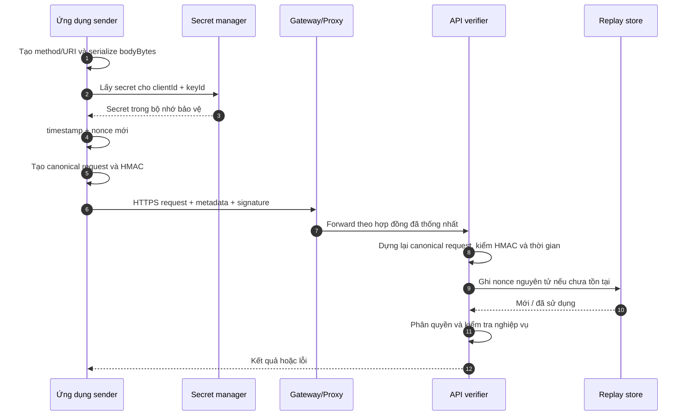
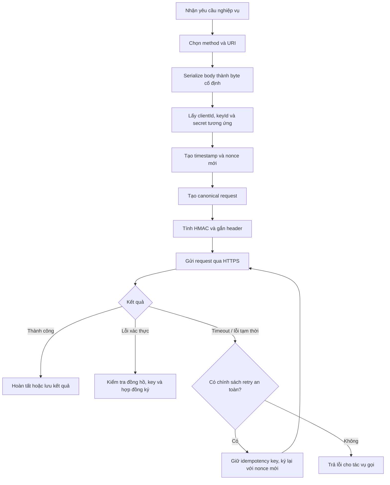

# Request sender

## 1. Request sender là ai trong mô hình client–server?

Trong mô hình xác thực HTTP request bằng HMAC, **request sender** là thành phần **tạo và gửi request có chữ ký**. Sender có thể là backend của một đối tác thanh toán, dịch vụ nội bộ gọi API của dịch vụ khác, tác vụ định kỳ hoặc ứng dụng phát webhook. Sender thường chạy trong môi trường có thể bảo vệ **shared secret**; không nên giả định rằng JavaScript trên trình duyệt hay ứng dụng mobile phân phối cho người dùng cuối có thể giữ một shared secret dùng chung lâu dài.

Ví dụ, dịch vụ đặt hàng cần gọi:

```http
POST /v1/payments?merchantId=m-42 HTTP/1.1
Host: payments.example.test
Content-Type: application/json

{"orderId":"O-42","amount":250000,"currency":"VND"}
```

Nếu endpoint chỉ kiểm tra request có đủ trường dữ liệu, người ngoài có thể tạo request tương tự. Với HMAC, sender được cấp một secret riêng và phải **ký đúng nội dung** theo hợp đồng đã thống nhất với bên nhận. Server sẽ xác minh chữ ký trước khi xử lý nghiệp vụ.

Trong module **`SECURITY_AUTHENTICATION_HMAC_REQUEST_AUTHENTICATION`**, mục tiêu là thiết kế xác thực request với **shared secret + canonical request** chứa method, URI, header và/hoặc body theo hợp đồng ký; sau đó vận hành an toàn với timestamp/nonce, key rotation, proxy/gateway và cơ chế phân quyền riêng. Bài này tập trung vào phía **sender**: cách chuẩn bị, ký, gửi và thử lại request sao cho phía xác minh có đủ dữ liệu để đánh giá.

### 1.1. Sender chịu trách nhiệm gì?

| Trách nhiệm | Việc sender cần thực hiện |
| --- | --- |
| Xác định đích gọi | Chọn đúng endpoint, HTTP method, path và query theo hợp đồng |
| Xây dựng payload | Serialize dữ liệu **một lần** thành dãy byte cụ thể; kiểm soát content type, charset |
| Tạo metadata ký | Chọn client ID, key ID, timestamp, nonce mới cho lần ký |
| Canonicalization | Chuẩn hóa/ghép các thành phần đúng thuật toán đã được hai bên công bố |
| Sinh chữ ký | Tính HMAC bằng secret tương ứng với key ID; mã hóa chữ ký theo hợp đồng |
| Phát request | Gửi **chính những byte và trường đã ký**; không sửa sau khi ký |
| Xử lý lỗi và retry | Hiểu request nào cần ký lại; dùng idempotency khi thao tác có tác dụng phụ |
| Vận hành secret | Lấy secret từ nguồn bảo mật, thực hiện rotation, giới hạn log nhạy cảm |

Sender **không quyết định** một request được chấp nhận chỉ vì đã tự tính được chữ ký. Bên nhận mới là nơi xác minh secret/key, timestamp, nonce và quyền truy cập. Một request có HMAC đúng vẫn có thể bị server từ chối do hết hạn, replay, key bị thu hồi hoặc client không có quyền trên tài nguyên.

## 2. Toàn cảnh luồng sender → gateway → verifier



Đây là luồng logic. Hệ thống có thể xác minh HMAC ngay tại gateway rồi chuyển **principal đã xác thực** đến backend qua kênh nội bộ tin cậy, hoặc xác minh tại chính backend. Sender không được tự dựa vào một header danh tính do nó đặt để thay thế chữ ký.

Điểm chung của cả hai cách: **bên ký và bên xác minh phải nhìn thấy cùng biểu diễn canonical**. Nếu client ký đường dẫn công khai `/v1/payments` còn backend tính HMAC trên đường dẫn đã rewrite `/internal/payments`, chữ ký có thể sai dù request không bị tấn công.

## 3. Hợp đồng ký: dữ liệu nào phải được bảo vệ?

**HMAC** (*Hash-based Message Authentication Code*) tạo mã xác thực cho một thông điệp bằng khóa bí mật. Với thuật toán HMAC-SHA-256:

```text
signatureBytes = HMAC-SHA256(sharedSecretBytes, canonicalRequestBytes)
signatureHeader = Base64(signatureBytes)
```

HMAC không mã hóa payload; body vẫn đọc được bởi bên có quyền truy cập đường truyền hoặc đầu cuối. Vì vậy phải sử dụng **HTTPS/TLS**, tránh để lộ secret, và không ghi nguyên vẹn payload nhạy cảm vào log.

Điều sender cần biết trước khi triển khai là **signing contract**: đặc tả chính xác cách tạo `canonicalRequestBytes`. Không có một thuật toán canonical hóa HTTP duy nhất áp dụng mặc định cho mọi hệ thống HMAC.

### 3.1. Các trường hợp đồng thường ràng buộc

| Trường | Ý nghĩa | Nguy cơ khi bỏ qua |
| --- | --- | --- |
| Method (`POST`, `GET`...) | Hành động HTTP | Một bản ký có thể bị tái sử dụng với method khác |
| URI path | Endpoint được gọi | Có thể chuyển bản ký sang tài nguyên khác |
| Query | `merchantId`, ID tài nguyên, tham số nghiệp vụ | Query có thể bị sửa mà chữ ký vẫn khớp |
| `Content-Type` | Cách diễn giải body | Parser bên nhận có thể hiểu body khác dự kiến |
| Client ID / key ID | Danh tính và phiên bản secret | Ràng buộc kém giữa chữ ký với principal và vòng đời key |
| Timestamp | Thời điểm ký request | Không hạn chế được khoảng thời gian replay |
| Nonce | Định danh duy nhất của lần ký | Khó chặn bản sao request trong cửa sổ thời gian |
| Body hash | Toàn vẹn của byte payload | Kẻ tấn công có thể thay đổi payload nếu body không được ký |
| Idempotency key, nếu có | Ràng buộc một ý định nghiệp vụ | Có thể sửa khóa chống trùng khi giữ chữ ký cũ |

Không nhất thiết phải ký mọi header. Hợp đồng cần chọn đủ những header ảnh hưởng đến việc xử lý; tránh ký các header thường xuyên bị proxy thay đổi mà không có cách biểu diễn thống nhất. Đặc biệt, **một trường có thể ảnh hưởng ý nghĩa nghiệp vụ nhưng không được bảo vệ** là khoảng trống bảo mật dù việc tính HMAC hoàn toàn chính xác.

### 3.2. Một hợp đồng ký minh họa cụ thể

Để có ví dụ nhất quán, phần còn lại của bài dùng hợp đồng **`HMAC-SHA256-V1`**:

1. Chỉ dùng HTTPS. Ví dụ thực hành sử dụng HTTP `POST` và body JSON UTF-8.
2. `method` viết hoa; `path` là **raw public path** bắt đầu bằng `/`; `query` là **raw query string** không gồm dấu `?`. Trong ví dụ, sender phát đúng path/query đã dựng và gateway **không đổi chúng trước điểm xác minh**.
3. `content-type` có giá trị chính xác `application/json`; client ID, key ID, timestamp, nonce không chứa LF/CR hoặc ký tự phân cách ngoài tập được phép.
4. `timestamp` là Unix epoch **giây UTC**; nonce là chuỗi Base64URL không padding của 16 byte ngẫu nhiên mật mã.
5. `bodyHash = lowercaseHex(SHA-256(bodyBytes))`. `bodyBytes` là **dãy byte thật được phát đi**, không phải một JSON object serialize lại để ký.
6. Ghép **mười dòng** bằng ký tự LF (`\\n`) theo đúng thứ tự bên dưới, mã hóa thành UTF-8, **không thêm LF cuối cùng**.
7. Tính HMAC-SHA-256 trên các byte canonical request; mã hóa kết quả bằng Base64 chuẩn (có padding).

```text
HMAC-SHA256-V1
POST
/v1/payments
merchantId=m-42
content-type:application/json
x-client-id:client-42
x-key-id:key-2026-11
x-timestamp:1795856400
x-nonce:7HgR1XK-pTtw1vSU55BaIQ
<body-sha256-lowercase-hex>
```

Ví dụ dùng giá trị timestamp và nonce để minh họa, **không phải request đang có hiệu lực**. Với path/query chứa khoảng trắng, ký tự Unicode, percent-encoding, query key lặp hoặc dấu `+`, hai bên phải định nghĩa **quy tắc encoding và sắp xếp chính xác** hoặc giữ nguyên raw request target ở điểm xác minh. “Sắp xếp query” hoặc “normalize URI” là mô tả chưa đủ để triển khai tương thích.

Sender cũng cần ký `idempotency-key` nếu server lấy header đó để quyết định một thao tác tạo giao dịch; khi bổ sung trường ký, phải phát hành phiên bản hợp đồng và cập nhật cả phía xác minh. Không tự ý thêm header vào canonical request của `HMAC-SHA256-V1` ở ví dụ trên vì điều đó sẽ khiến client/server lệch hợp đồng.

## 4. Vấn đề byte: chuẩn bị body trước khi ký

Trong Java, body có thể được tạo bằng Jackson hoặc serializer tương đương. Ví dụ hai JSON:

```json
{"orderId":"O-42","amount":250000,"currency":"VND"}
```

```json
{
  "currency": "VND",
  "amount": 250000,
  "orderId": "O-42"
}
```

Chúng thường có ý nghĩa tương tự với parser nghiệp vụ, nhưng **khác byte**. SHA-256 của hai payload khác nhau, kéo theo HMAC khác nhau.

Sender nên tách rõ hai giai đoạn:

```text
Đối tượng nghiệp vụ
    |
    | serialize đúng một lần
    v
byte[] bodyBytes
    |                 |
    | SHA-256         | HTTP BodyPublisher dùng chính bodyBytes
    v                 v
canonical request    request thực tế gửi đi
    |
    | HMAC
    v
X-Signature
```

**Sai lầm phổ biến:** hash body từ `objectMapper.writeValueAsString(payload)`, rồi HTTP client hoặc interceptor lại serialize một lần nữa với cấu hình khác. Thay vào đó, serialize thành `byte[]` duy nhất trước khi ký và chuyển cùng `byte[]` cho HTTP client. Nếu có compression hoặc middleware chỉnh body, phải xác định rõ **byte ở tầng nào** được ký và byte nào tới verifier.

Ngoài body, phải chuẩn bị path/query trước. Ví dụ `/v1/payments?a=1&b=2` và `/v1/payments?b=2&a=1` có thể có cùng nghĩa với một API nhưng khác raw query; theo hợp đồng minh họa, chúng tạo chữ ký khác nhau. Sender không được gọi một hàm normalize/sort query sau bước ký.

## 5. Timestamp và nonce phải được tạo cho từng lần ký

Giả sử `X-Timestamp` là thời gian hiện tại tính theo giây UTC, còn `X-Nonce` là chuỗi khó đoán vừa sinh ra. Hai trường này **phải được đưa vào canonical request**; nếu gửi chúng ngoài chữ ký, người quan sát có thể sửa timestamp hoặc nonce mà không làm chữ ký sai.

```text
T1, N1, bodyBytes → canonicalRequest1 → signature1
T2, N2, bodyBytes → canonicalRequest2 → signature2
```

Lúc này `signature1` và `signature2` thường khác nhau ngay cả khi body, method, URI giống hệt.

### 5.1. Sender có thể làm được gì và không làm được gì?

- **Có thể:** lấy thời gian từ đồng hồ hệ thống đang được đồng bộ; tạo nonce bằng CSPRNG; tránh tái sử dụng nonce; gửi tất cả metadata cần kiểm tra; đặt timeout hợp lý.
- **Không thể đơn phương:** biết nonce nào đã được server sử dụng; quyết định timestamp còn hiệu lực theo đồng hồ server; đảm bảo request chỉ được xử lý một lần bằng cách tự tạo nonce.
- **Phía server phải làm:** kiểm tra cửa sổ timestamp, xác minh HMAC trước khi chấp nhận nonce, lưu nonce theo principal bằng thao tác nguyên tử trong kho dùng chung và giữ TTL đủ dài.

Ví dụ server cho phép độ lệch **±300 giây**. Timestamp giúp chặn request quá cũ, nhưng cùng request có thể phát lại nhiều lần **trong 300 giây còn hợp lệ** nếu server không lưu nonce. Bởi vậy, nonce và timestamp phải được dùng cùng nhau.

### 5.2. Nonce không phải idempotency key

Nonce đại diện cho **mỗi lần ký**. Idempotency key đại diện cho **một ý định nghiệp vụ**, ví dụ tạo thanh toán cho đơn hàng O-42.

Khi retry sau timeout:

```text
Lần gửi đầu:      nonce=N1, timestamp=T1, idempotencyKey=pay-O-42
Lần retry mới:    nonce=N2, timestamp=T2, idempotencyKey=pay-O-42
```

Sender ký lại request với `N2` và `T2`; server sẽ kiểm tra nonce mới, còn tầng nghiệp vụ dựa vào idempotency key để trả kết quả cũ hoặc tránh tạo thêm thanh toán. **HMAC + nonce không thay thế idempotency**: hai request được ký hợp lệ, nonce khác nhau nhưng cùng nghiệp vụ vẫn có thể gây hai tác dụng phụ nếu backend không kiểm soát trùng.

## 6. Ví dụ triển khai sender bằng Java 17+

Ví dụ sau tập trung vào logic phía gửi theo hợp đồng `HMAC-SHA256-V1` đã nêu. Nó sử dụng `HttpClient`, `Mac`, `MessageDigest`, `SecureRandom` của JDK. Chữ ký được tạo từ **chính byte body** truyền vào `BodyPublishers.ofByteArray`.

```java
import java.net.URI;
import java.net.http.HttpRequest;
import java.nio.charset.StandardCharsets;
import java.security.GeneralSecurityException;
import java.security.MessageDigest;
import java.security.SecureRandom;
import java.time.Duration;
import java.time.Instant;
import java.util.Base64;
import java.util.HexFormat;
import javax.crypto.Mac;
import javax.crypto.spec.SecretKeySpec;

public final class HmacRequestSender {
    private static final SecureRandom RANDOM = new SecureRandom();
    private static final String CONTENT_TYPE = "application/json";
    private static final String SIGNING_VERSION = "HMAC-SHA256-V1";

    private HmacRequestSender() {}

    public static HttpRequest signedPost(
            URI publicUri,
            String clientId,
            String keyId,
            byte[] secret,
            byte[] bodyBytes,
            Instant signingTime) throws GeneralSecurityException {

        // Chỉ minh họa HTTPS + POST; không auto-follow redirect.
        if (!"https".equalsIgnoreCase(publicUri.getScheme())) {
            throw new IllegalArgumentException("HTTPS is required");
        }
        if (!isSafeId(clientId) || !isSafeId(keyId)) {
            throw new IllegalArgumentException("Invalid clientId/keyId");
        }
        if (secret == null || secret.length < 32) {
            throw new IllegalArgumentException("Expected a strong HMAC key");
        }
        if (bodyBytes == null || signingTime == null) {
            throw new IllegalArgumentException("Missing payload or time");
        }

        String rawPath = publicUri.getRawPath();
        String rawQuery = publicUri.getRawQuery();
        if (rawPath == null || !rawPath.startsWith("/")) {
            throw new IllegalArgumentException("Invalid path");
        }
        if (rawQuery == null) {
            rawQuery = "";
        }

        String timestamp = Long.toString(signingTime.getEpochSecond());
        String nonce = newNonce();
        String bodyHash = HexFormat.of().formatHex(
                MessageDigest.getInstance("SHA-256").digest(bodyBytes));

        String canonical = String.join("\n",
                SIGNING_VERSION,
                "POST",
                rawPath,
                rawQuery,
                "content-type:" + CONTENT_TYPE,
                "x-client-id:" + clientId,
                "x-key-id:" + keyId,
                "x-timestamp:" + timestamp,
                "x-nonce:" + nonce,
                bodyHash);

        Mac mac = Mac.getInstance("HmacSHA256");
        mac.init(new SecretKeySpec(secret, "HmacSHA256"));
        byte[] signature = mac.doFinal(
                canonical.getBytes(StandardCharsets.UTF_8));
        String signatureBase64 = Base64.getEncoder().encodeToString(signature);

        return HttpRequest.newBuilder(publicUri)
                .timeout(Duration.ofSeconds(15))
                .header("Content-Type", CONTENT_TYPE)
                .header("X-Client-Id", clientId)
                .header("X-Key-Id", keyId)
                .header("X-Timestamp", timestamp)
                .header("X-Nonce", nonce)
                .header("X-Signature", signatureBase64)
                .POST(HttpRequest.BodyPublishers.ofByteArray(bodyBytes))
                .build();
    }

    private static boolean isSafeId(String id) {
        return id != null && id.matches("[A-Za-z0-9._-]{1,80}");
    }

    private static String newNonce() {
        byte[] bytes = new byte[16]; // 128-bit random nonce
        RANDOM.nextBytes(bytes);
        return Base64.getUrlEncoder().withoutPadding()
                .encodeToString(bytes);
    }
}
```

Ví dụ gọi từ một ứng dụng backend:

```java
import java.net.URI;
import java.net.http.HttpClient;
import java.net.http.HttpRequest;
import java.net.http.HttpResponse;
import java.nio.charset.StandardCharsets;
import java.time.Instant;

// secretBytes lấy từ secret manager theo clientId/keyId, không hard-code.
byte[] bodyBytes = (
        "{\"orderId\":\"O-42\",\"amount\":250000,\"currency\":\"VND\"}"
).getBytes(StandardCharsets.UTF_8);

HttpRequest request = HmacRequestSender.signedPost(
        URI.create("https://payments.example.test/v1/payments?merchantId=m-42"),
        "client-42",
        "key-2026-11",
        secretBytes,
        bodyBytes,
        Instant.now());

HttpClient client = HttpClient.newHttpClient();
HttpResponse<String> response = client.send(
        request, HttpResponse.BodyHandlers.ofString());
```

`secretBytes` là biến do tầng quản lý secret cung cấp, nên đoạn gọi là **ví dụ tích hợp** cần nguồn khóa thật trong ứng dụng; không đưa khóa vào tài liệu hoặc Git. Mặc dù phương thức `signedPost` kiểm tra tối thiểu key length, môi trường thực tế còn cần phân quyền truy cập key, tránh dùng sai key của client khác và kiểm soát vòng đời.

Mã trên chủ ý **không** triển khai canonicalization tổng quát cho query/phần trăm mã hóa hay logic kiểm chứng phía server. Nó lấy `URI.getRawPath()` và `getRawQuery()`; vì vậy hợp đồng quy định hai phía ký **chính raw path/query được truyền** và hạ tầng không thay đổi chúng trước khi xác minh. Đối với hệ thống có gateway rewrite, phải hoàn thiện hợp đồng canonicalization hoặc chuyển nơi xác minh HMAC đến trước bước rewrite.

HTTP client phải gửi đúng phương thức, body và header đã ký. Nếu thư viện hoặc interceptor thay `Content-Type`, body, query, method, redirect sang endpoint khác hay tự retry request có nonce cũ, cần thiết kế lại vị trí ký: **ký gần điểm gửi thực tế nhất**, sau tất cả phép biến đổi ảnh hưởng đến dữ liệu được ký.

## 7. Vòng đời của một request: chuẩn bị → ký → gửi → nhận kết quả



Lưu ý ở nhánh retry: `M` là một lần **tạo lại request đã ký hoàn chỉnh**, gồm timestamp, nonce và chữ ký; trong ứng dụng, nên đi lại qua các bước dựng canonical/sign, không chỉ thay header nonce trong request cũ. Tùy hợp đồng retry, cũng có thể phải xác định lại payload hoặc kiểm tra trạng thái tác vụ trước khi gửi.

### 7.1. Đọc phản hồi đúng ý nghĩa

| Phản hồi / sự cố | Sender nên xem xét |
| --- | --- |
| Thành công HTTP 2xx | Ghi nhận kết quả, không tự gửi thêm bản sao |
| Chữ ký sai / thiếu xác thực | Kiểm tra secret đúng key, canonicalization, body bytes và phiên bản hợp đồng; không lặp vô hạn |
| Timestamp ngoài cửa sổ | Đồng bộ thời gian và định dạng giây/ms; chỉ ký lại khi đã sửa nguyên nhân |
| Nonce bị sử dụng | Kiểm tra việc tái sử dụng request và cơ chế tự retry của HTTP client |
| HTTP 403 khi đã xác thực | Kiểm tra quyền client đối với scope/merchant, không sửa chữ ký để “vượt” phân quyền |
| Timeout / mất kết nối | Trạng thái nghiệp vụ chưa rõ: dùng idempotency hoặc API tra cứu trạng thái |
| HTTP 429 hoặc 503 | Tuân thủ `Retry-After`/backoff theo hợp đồng, tạo nonce/chữ ký mới cho lần gửi lại |

Mã trạng thái cụ thể phụ thuộc API; không tự kết luận mọi `401` đều là timestamp sai hoặc mọi `409` đều là replay. Sender cần đọc mã lỗi ứng dụng do server công bố và áp dụng giới hạn số lần thử.

## 8. Sender vận hành key rotation như thế nào?

Một client có thể được cấp nhiều phiên bản key theo thời gian. **Key ID** là định danh của phiên bản secret; nó không phải secret và có thể xuất hiện trong request. Server dùng client ID + key ID để tra khóa ứng viên, rồi kiểm tra HMAC và chính sách hiệu lực.

```text
Giai đoạn 1: Sender ký bằng key-A; server chấp nhận key-A.
Giai đoạn 2: Cấp key-B; server tạm chấp nhận A và B.
Giai đoạn 3: Sender chuyển sang ký bằng key-B.
Giai đoạn 4: Thu hồi key-A khi hết thời gian chuyển đổi.
```

**Nguyên tắc gửi:**

1. Lấy `keyId` và secret theo **cặp đồng bộ** từ hệ thống quản lý khóa; tránh race khiến header chứa `key-B` nhưng HMAC lại tính bằng secret của `key-A`.
2. Trong quá trình chuyển đổi, chọn đúng key đang được phép ký; thử nghiệm khả năng xác minh ở môi trường được kiểm soát.
3. Không tự động thử lần lượt các secret cho mỗi request khi server trả lỗi xác thực: cách đó có thể tạo nhiều request nghiệp vụ ngoài mong muốn và che giấu lỗi rotation.
4. Khi key bị lộ, cần thu hồi, cấp lại và rà soát log/sự kiện; timestamp/nonce không ngăn đối phương **biết secret** tạo request mới.

Không phát tán secret trong log, exception, metric tag, trace, URL, header hay dashboard. Chữ ký HMAC, nonce và body nhạy cảm cũng nên được che khi ghi log vì bản sao nguyên request có thể bị dùng để replay trong thời gian còn hiệu lực.

## 9. Gateway/proxy và điểm đặt signer

Một request đi qua các thành phần trung gian có thể bị thay đổi mà ứng dụng không nhận ra:

```text
Sender ký:
  POST /api/v1/payments?merchantId=m-42

Gateway chuyển tiếp:
  POST /internal/payments?merchantId=m-42

Backend nhận:
  POST /internal/payments?merchantId=m-42
```

Nếu sender ký path công khai mà backend dùng path nội bộ để kiểm tra, HMAC khác. Cũng tương tự khi gateway bỏ dấu `/` cuối, đổi `%2F` thành `/`, sắp xếp query, giải nén body hoặc thay header có trong canonical request.

Hệ thống cần chọn một trong các cơ chế có hợp đồng rõ:

- **Xác minh tại gateway trước rewrite:** gateway dựng canonical request trên đường dẫn public; sau khi xác minh, backend chỉ tin principal do gateway truyền trong kênh nội bộ được bảo vệ.
- **Xác minh tại backend:** gateway phải bảo toàn các trường/byte đã ký hoặc chuyển dữ liệu public-original qua metadata **không thể bị client Internet giả mạo**; backend xác minh đúng biểu diễn client đã ký.

Từ góc nhìn sender, cần có **test vector end-to-end** thể hiện request trước gateway, request ở điểm verifier và canonical request của cả hai bên. Một request tạo chữ ký thành công tại máy client chưa đủ chứng minh toàn bộ đường đi tương thích.

## 10. Những lỗi sender thường gặp

| Lỗi | Triệu chứng | Cách xử lý |
| --- | --- | --- |
| Serialize body lần thứ hai sau khi ký | HMAC sai dù JSON “giống nhau” | Ký hash của cùng `byte[]` gửi qua HTTP |
| Dùng `getPath()` ở sender, `getRawPath()` ở verifier | Sai khác percent-encoding | Đặc tả quy tắc raw/decoded và thống nhất ở cả hai bên |
| Dùng milliseconds thay cho seconds | Timestamp bị xem quá xa tương lai | Công bố định dạng Unix time rõ ràng |
| Nonce cố định hoặc tái sử dụng request object | Bị từ chối là replay | Tạo nonce mới cho mỗi lần ký |
| Gửi lại nguyên request sau timeout | Lần sau bị chặn bởi replay store | Tạo request và chữ ký mới; giữ idempotency key |
| Header có khoảng trắng, chữ hoa hoặc charset khác | HMAC sai do canonicalization khác | Chuẩn hóa header theo hợp đồng và kiểm thử |
| Key ID và secret không cùng phiên bản | Chữ ký không khớp sau rotation | Đọc cặp key ID/secret cùng thời điểm |
| Sign `Host` nhưng proxy đổi host | Chữ ký sai qua gateway | Chỉ ký khi có quy ước host public đáng tin cậy |
| Log trọn request và secret | Rò rỉ thông tin ký | Che secret, chữ ký, body và hạn chế quyền xem log |
| Giả định HMAC xác nhận quyền truy cập | Request hợp lệ bị từ chối 403 | Kiểm tra scope/merchant tại tầng phân quyền |

## 11. Bộ kiểm thử tập trung vào request sender

Tối thiểu cần **test vector độc lập** gồm input, raw method/path/query, các header đã ký, body bytes, body hash, canonical string và chữ ký kỳ vọng từ một **secret thử nghiệm**. Test vector cho phép kiểm tra Java sender có tương thích với verifier ở ngôn ngữ khác, không phụ thuộc implementation của chính sender.

| Kiểm thử | Thao tác | Kỳ vọng |
| --- | --- | --- |
| Deterministic signing | Cố định secret giả, timestamp, nonce, method, URI, body | Canonical request và Base64 HMAC khớp test vector |
| Một byte body thay đổi | Đổi ký tự trong payload | Hash và chữ ký đổi |
| Query đảo thứ tự | Ký `a=1&b=2` rồi `b=2&a=1` theo hợp đồng raw query | Chữ ký khác theo hợp đồng minh họa |
| Path percent-encoding | Thử `%2F`, `/`, Unicode encoded | Sender/verifier thống nhất cùng biểu diễn |
| Timestamp và nonce thay đổi | Hai lần ký cùng body/URI với nonce khác nhau | Chữ ký khác; mỗi request có metadata mới |
| Byte JSON thay đổi nhưng ngữ nghĩa tương đương | Đổi khoảng trắng/thứ tự key | HMAC khác khi ký byte gốc |
| Wrong key ID | Ký với secret A nhưng header key ID B | Verifier từ chối |
| Sender retry sau timeout | Tạo nonce và chữ ký mới, giữ idempotency key | Chống replay không chặn lần ký mới; nghiệp vụ không lặp |
| Gateway rewrite | Gửi qua môi trường gateway thực tế | Verifier dùng đúng canonical target được quy định |
| Key rotation | Ký qua giai đoạn hai khóa hoạt động và sau thu hồi | Chỉ key đang hiệu lực được server chấp nhận |
| Đồng hồ sender sai lệch | Giả lập thời gian quá cũ/tương lai | Server từ chối đúng cửa sổ |
| Header có ký tự xuống dòng | Client ID/key ID chứa CR hoặc LF | Sender từ chối trước khi tạo request |
| Proxy/SDK thay body | Thêm interceptor thay `Content-Type`, encoding hoặc byte body sau sign | Test phát hiện chữ ký sai và xác định điểm ký |

**Chỉ kiểm thử với endpoint thử nghiệm và secret được cấp cho môi trường đó.** Không dùng secret production trong fixture hoặc log kiểm thử. Không chạy test chỉ bằng cách cho signer tự xác minh chữ ký của chính mình; cả hai bên có thể cùng lặp lại một lỗi canonicalization mà test vẫn “xanh”.

## 12. Bài tập thiết kế một sender đúng

Nhóm phát triển nhận được yêu cầu tích hợp dịch vụ thanh toán bằng HMAC-SHA-256. Server yêu cầu ký method, raw URI, `Content-Type`, client/key ID, timestamp, nonce và SHA-256 của body bytes. Request sẽ đi qua gateway và backend xử lý thanh toán có idempotency key.

Hãy trả lời:

1. Sender nên serialize JSON thành `byte[]` ở thời điểm nào, và vì sao không ký một bản JSON rồi gửi bản khác?
2. Request `POST /v1/payments?merchantId=m-42` được gateway rewrite thành `POST /internal/payments?merchantId=m-42`. Đặt điểm xác minh ở đâu hoặc cần bảo toàn dữ liệu nào để hai phía tính cùng HMAC?
3. Sau timeout, sender có nên gửi lại **nguyên** request đã ký không? Cần giữ nguyên trường nào để tránh tạo hai thanh toán?
4. Khi đồng hồ sender nhanh hơn server 8 phút nhưng cửa sổ chấp nhận chỉ ±5 phút, hệ thống sẽ có triệu chứng gì? Giải pháp là gì?
5. Trong lúc rotation, nếu sender điền `X-Key-Id: key-B` nhưng dùng secret của `key-A`, điều gì xảy ra?
6. Nếu một request HMAC được xác minh thành công mà client thiếu quyền tạo thanh toán cho `merchantId=m-42`, thành phần nào phải từ chối?

**Hướng trả lời:** (1) Serialize một lần thành `byte[]`, tính hash và phát đi cùng byte; (2) xác minh trước rewrite hoặc bảo toàn public original target bằng cơ chế tin cậy; (3) ký lại với timestamp/nonce mới, giữ idempotency key nghiệp vụ; (4) server từ chối timestamp ngoài cửa sổ, cần đồng bộ đồng hồ và đơn vị thời gian; (5) HMAC bên server không khớp với key ID công bố; (6) tầng phân quyền, sau xác thực.

## 13. Điều cần ghi nhớ

Request sender chịu trách nhiệm phát đi **một request cụ thể được ràng buộc bằng chữ ký HMAC**, chứ không chỉ tạo ra một chuỗi Base64. Độ tin cậy của chữ ký phụ thuộc vào việc:

- Hai phía dùng cùng hợp đồng canonical request cho method, URI, header, body và metadata.
- Sender tính hash từ đúng byte được gửi đi, tạo timestamp và nonce mới cho mỗi lần ký, bảo vệ secret và chọn đúng phiên bản key.
- Retry được thiết kế cùng idempotency; proxy/gateway không làm lệch dữ liệu đã ký tại điểm xác minh.
- Verifier kiểm tra chữ ký, timestamp, nonce và bảo đảm chống replay; hệ thống **phân quyền độc lập** trước khi thực thi nghiệp vụ.

Khi hiểu rõ những trách nhiệm này, người học có thể xây dựng client ký HMAC có khả năng tương tác với các service khác, giải thích vì sao một request bị từ chối và kiểm thử được cả tuyến **sender → gateway → server**.
