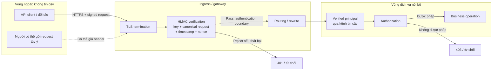
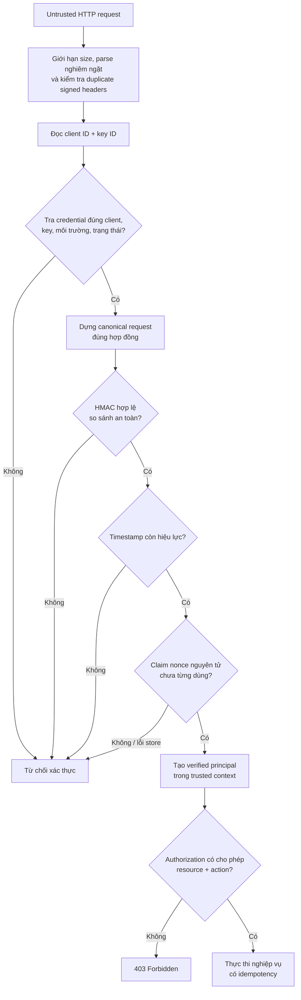

# Authentication boundary

## 1. Authentication boundary là gì?

Trong **mô hình client–server**, *authentication boundary* (ranh giới xác thực) là điểm mà một request từ vùng **chưa được tin cậy** phải vượt qua bước kiểm tra danh tính trước khi hệ thống chấp nhận nó là request đến từ một principal đã xác thực. Với module `SECURITY_AUTHENTICATION_HMAC_REQUEST_AUTHENTICATION`, bằng chứng xác thực là **chữ ký HMAC** trên một **canonical HTTP request**, được tính bằng shared secret mà client và server đã thỏa thuận.

Chẳng hạn, một đối tác dùng API chuyển khoản gửi `POST /public/v1/transfers` kèm `X-Client-Id`, `X-Key-Id`, `X-Timestamp`, `X-Nonce` và `X-Signature`. Trước boundary, tất cả các header này **chỉ là dữ liệu do phía gọi tự khai**. Sau khi hệ thống kiểm tra khóa, chữ ký, thời gian và replay thành công, server mới được thiết lập một principal như `merchant-42` để xử lý request.

Phân biệt ba ranh giới thường bị nhầm:

| Ranh giới | Câu hỏi nó trả lời | Không tự bảo đảm |
| --- | --- | --- |
| **TLS boundary** | Lưu lượng được mã hóa/xác thực kết nối tới endpoint TLS nào? | Client ứng dụng đã được xác thực bằng HMAC; người gọi có quyền chuyển tiền |
| **Authentication boundary** | Bên gọi chứng minh được quyền sử dụng credential HMAC nào? | Credential đó được phép thực hiện mọi hành động |
| **Authorization boundary** | Principal đã xác thực có được làm hành động này trên tài nguyên này không? | Request ban đầu thực sự được ký nếu authentication chưa được thực thi |

Mục tiêu học tập của bài này là xác định nơi đặt authentication boundary, cách duy trì ranh giới qua **client → proxy/gateway → service**, cách dựng canonical request nhất quán với hợp đồng ký, và cách truyền **danh tính đã được kiểm tra** đến thành phần nghiệp vụ mà không mở đường cho giả mạo.

## 2. Sơ đồ vùng tin cậy của HMAC request authentication



Đường đi trên mô tả **phương án xác minh tại gateway**. Có thể đặt HMAC verification tại service thay vì gateway, nhưng lúc đó boundary nằm **sâu hơn** trong hệ thống và các thành phần đi trước vẫn phải xem request là **chưa xác thực**.

Hai điểm cần nhớ:

1. **TLS termination không đồng nghĩa HMAC authentication.** HTTPS cho phép gateway nhận nội dung request qua kênh được bảo vệ; bản thân việc kết nối TLS thành công không chứng minh client biết shared secret.
2. **Mạng nội bộ không tự biến header thành thông tin đáng tin.** Backend chỉ nên dùng danh tính đã được xác minh từ một nguồn có thể xác thực, chẳng hạn security context trong cùng tiến trình hoặc assertion nội bộ do gateway tin cậy phát hành qua kênh có xác thực.

Đặt một đường kẻ tưởng tượng ngay **trước** HMAC verifier. Mọi dữ liệu đến từ phía ngoài đường kẻ — method, URI, header, body, client ID, signature, forwarded headers — đều là input không tin cậy cho đến khi được kiểm tra.

## 3. Dữ liệu phải vượt qua authentication boundary

Trong HMAC, boundary không được chỉ kiểm tra xem có header `X-Signature` hay không. Phải kiểm tra mối ràng buộc giữa **credential**, **request** và **thời điểm gửi**.

Một request minh họa:

```http
POST /public/v1/transfers?currency=VND HTTP/1.1
Host: api.example.test
Content-Type: application/json
X-Client-Id: merchant-42
X-Key-Id: key-2026-11
X-Timestamp: <unix-epoch-seconds>
X-Nonce: <unique-random-nonce>
X-Signature: <base64url-hmac-sha256>

{"transferId":"tr-19","amount":250000}
```

Các giá trị trong dấu `<...>` là placeholder. Chúng **không phải chữ ký/timestamp có thể dùng trực tiếp**.

Hợp đồng canonicalization của **ví dụ bài học**:

```text
POST
/public/v1/transfers
currency=VND
content-type:application/json
x-client-id:merchant-42
x-key-id:key-2026-11
x-timestamp:<unix-epoch-seconds>
x-nonce:<unique-random-nonce>
<lowercase-hex-sha256-of-exact-body-bytes>
```

Quy ước: các dòng nối bằng LF (`\n`), không có LF cuối; các tên header ký viết thường; method viết hoa; `raw path` và `raw query` lấy theo dạng đã thống nhất **tại ingress trước rewrite**; dòng cuối là SHA-256 hex chữ thường của **đúng byte body** sau khi HTTP transfer coding đã được loại bỏ theo hợp đồng, nhưng trước middleware thay đổi nội dung. Toàn chuỗi canonical được mã hóa UTF-8 trước khi tính `HMAC-SHA256(secret, canonicalBytes)`. Chữ ký được truyền dưới dạng Base64url theo quy tắc thống nhất.

Đây chỉ là **một hợp đồng minh họa**. Trong hệ thống thực, cần quy định rõ case, whitespace, newline, percent encoding, dấu `/` cuối, query trùng tên, header trùng tên, body rỗng, encoding và những trường có ý nghĩa bảo mật. Client và verifier phải sử dụng **cùng một định nghĩa**, kể cả khi thư viện HTTP có quy tắc parse khác nhau.

### Các điều kiện xác thực

| Kiểm tra | Câu hỏi bảo mật | Nếu bỏ qua |
| --- | --- | --- |
| **Client ID + Key ID** | Credential thuộc đúng client, môi trường và trạng thái còn hiệu lực? | Có thể trộn khóa giữa client, dùng khóa đã thu hồi hoặc quá hạn |
| **Canonical request đầy đủ** | Chữ ký có ràng buộc method, URI/query, header quan trọng và body không? | Trường không được ký có thể bị thay đổi mà HMAC vẫn hợp lệ |
| **Chữ ký HMAC** | Người gửi biết shared secret gắn với credential được phép? | Dữ liệu caller tự khai có thể bị coi là đã xác thực |
| **Timestamp đã ký** | Request có nằm trong cửa sổ thời gian cho phép? | Chữ ký cũ có thể được phát lại rất lâu |
| **Nonce đã ký** | Nonce của client đã được dùng trước đó chưa? | Một request có chữ ký hợp lệ có thể được gửi nhiều lần trong cửa sổ timestamp |
| **Trạng thái thu hồi / rotation** | Phiên bản secret này còn được phép dùng? | Key bị lộ vẫn có thể ký request mới sau khi cần thu hồi |

Nếu resource hoặc authorization phụ thuộc vào HTTP authority/`Host`, hợp đồng cũng phải ràng buộc authority đã chuẩn hóa thích hợp vào chữ ký hoặc có bảo vệ định tuyến tương đương. Nếu client có thể ký body nhưng thay đổi query chọn người nhận/loại tiền mà không đổi chữ ký, boundary đang bảo vệ **thiếu dữ liệu**.

## 4. Quy trình vượt qua boundary



Giải thích thứ tự:

- **Giới hạn và parse đầu vào:** từ chối request quá lớn, header ký bị lặp, header chứa CR/LF không hợp lệ, encoding mơ hồ hoặc canonicalization không xác định; xử lý lỗi theo cách không rò secret.
- **Tra credential:** `clientId` và `keyId` ban đầu là dữ liệu tự khai, chỉ dùng để **tìm bản ghi**. Xác thực bản ghi thuộc đúng principal, phạm vi và trạng thái `ACTIVE` hoặc trạng thái rotation còn được phép. Không cho fallback tùy tiện sang mọi secret khác.
- **Xác minh HMAC:** tính trên canonical bytes theo hợp đồng, giải mã signature có kiểm soát và so sánh bằng thao tác phù hợp nhằm tránh rò rỉ thời gian. Nếu HMAC không khớp thì **không** tạo principal.
- **Chống replay:** timestamp và nonce phải nằm trong dữ liệu đã ký. Chỉ đánh dấu nonce đã dùng **sau khi chữ ký hợp lệ** để kẻ không có secret không thể chiếm nonce của client; thao tác claim nonce phải nguyên tử giữa các instance.
- **Chuyển đổi niềm tin:** chỉ sau tất cả kiểm tra xác thực, verifier mới tạo `VerifiedPrincipal` từ **credential đã xác minh**. Một header `X-Client-Id` xuất hiện trên request chưa bao giờ tự mang ý nghĩa “đã xác thực”.

Có thể từ chối sớm request có timestamp **sai định dạng** hoặc ngoài cửa sổ trước khi tính HMAC để tiết kiệm tài nguyên, nhưng không được sử dụng kết quả đó để trao quyền hay claim nonce. TTL của nonce phải bao phủ toàn bộ thời gian request có thể được chấp nhận, gồm sai lệch đồng hồ và độ trễ qua các vùng triển khai.

### Java: biểu diễn danh tính tại boundary

Đoạn Java 17 bên dưới mô tả **hợp đồng giữa lớp xác thực và lớp nghiệp vụ**, không nhằm thay thế implementation HMAC đầy đủ. `RawHttpRequest` là dữ liệu chưa tin cậy; `Authenticator` phải thực hiện toàn bộ bước xác minh ở trên.

```java
import java.time.Instant;
import java.util.Set;

public record VerifiedPrincipal(
    String clientId,
    String keyId,
    Set<String> scopes,
    Instant authenticatedAt
) {
    public VerifiedPrincipal {
        scopes = Set.copyOf(scopes);
    }
}

interface RawHttpRequest {
    String method();
    String rawPath();
    String rawQuery();
    byte[] bodyBytes();
    String singleHeader(String name); // reject nếu header ký bị lặp
}

interface Authenticator {
    // Ném AuthenticationException nếu HMAC/key/timestamp/nonce sai.
    VerifiedPrincipal authenticate(RawHttpRequest request);
}

interface Authorizer {
    boolean canTransfer(
        VerifiedPrincipal principal, String fromAccountId
    );
}

final class TransferEndpoint {
    private final Authenticator authenticator;
    private final Authorizer authorizer;

    TransferEndpoint(Authenticator authenticator, Authorizer authorizer) {
        this.authenticator = authenticator;
        this.authorizer = authorizer;
    }

    void handle(RawHttpRequest untrustedRequest, String fromAccountId) {
        // Chỉ authenticator có quyền tạo principal sau khi kiểm tra.
        VerifiedPrincipal caller = authenticator.authenticate(untrustedRequest);

        // Authentication thành công chưa có nghĩa caller được chuyển tiền.
        if (!authorizer.canTransfer(caller, fromAccountId)) {
            throw new SecurityException("Forbidden");
        }

        // Tại đây mới kiểm tra idempotency và gọi use case nghiệp vụ.
    }
}
```

Trong code thật, constructor của `VerifiedPrincipal` nên được giới hạn đường sử dụng bởi các thành phần tin cậy hoặc được quản lý qua security framework. Đơn thuần tạo một object có tên “Verified” **không tạo ra bằng chứng xác thực**. Mấu chốt là đường gọi tới nghiệp vụ chỉ nhận context do verifier gán thành công, không nhận principal deserialize từ body hoặc header của client.

**Xác thực khác phân quyền:** HMAC có thể xác thực rằng request dùng credential của `merchant-42`, trong khi `merchant-42` vẫn không được phép chuyển tiền từ tài khoản không thuộc mình. Bước authorization phải kiểm tra principal, scope, hành động và tài nguyên (và có thể hạn mức, quy tắc phê duyệt) **sau** khi xác thực.

## 5. Nên đặt HMAC verifier ở gateway hay service?

Có ba kiểu tổ chức thường gặp; chọn một điểm chịu trách nhiệm xác thực chính và làm rõ ranh giới trước khi triển khai.

| Phương án | Authentication boundary | Lợi thế | Nghĩa vụ kỹ thuật |
| --- | --- | --- | --- |
| **Gateway xác minh HMAC** | Tại ingress/gateway, **trước** routing hoặc rewrite ảnh hưởng trường đã ký | Có thể từ chối request giả mạo sớm; chuẩn hóa chính sách xác thực cho nhiều service | Bảo vệ secret tại gateway; truyền verified principal an toàn; backend không tin header do client tự gửi; kiểm soát bypass |
| **Service xác minh HMAC** | Tại mỗi service xác minh | Service tự kiểm tra credential và gắn principal; không phải dựa hoàn toàn vào assertion do gateway tạo | Bảo toàn đúng raw method/path/query/header/body qua proxy; đồng bộ key/nonce/revocation giữa service; kiểm soát đường ingress |
| **Xác minh ở một tầng, kiểm tra quyền ở tầng khác** | HMAC tại gateway; authorization tại service | Tách rõ xác thực dùng chung và phân quyền theo tài nguyên | Có **kênh tin cậy** chở principal; service phải phát hiện assertion giả, cũ hoặc sai audience |

Không nên xác minh HMAC độc lập ở cả gateway và service rồi **mỗi nơi lại claim cùng một nonce**: verifier thứ hai có thể coi request hợp lệ là replay. Nếu muốn defense in depth, định nghĩa chính xác **tầng duy nhất sở hữu nonce**, cách chuyển kết quả xác thực có kiểm chứng hoặc dùng cơ chế xác thực **riêng** giữa gateway và service, thay vì lặp nguyên bước HMAC theo cách mâu thuẫn.

### Ví dụ gateway rewrite làm lệch chữ ký

Client gọi:

```text
POST /public/v1/transfers?currency=VND
```

Gateway chuyển tiếp vào backend:

```text
POST /v1/transfers?currency=VND
```

Nếu client ký `/public/v1/transfers` nhưng backend tạo canonical từ `/v1/transfers`, HMAC không khớp dù client có secret đúng. Cách thiết kế:

1. **Xác minh trước rewrite ở ingress:** gateway dựng canonical từ request bên ngoài, kiểm tra HMAC và chuyển trusted principal xuống service.
2. **Xác minh tại service với hợp đồng rõ ràng:** bảo toàn dữ liệu đường dẫn gốc qua cơ chế nội bộ **chống giả mạo**, có xác thực nguồn, và chỉ dùng khi được tin cậy; đồng thời từ chối trường hợp gateway/ứng dụng có cách hiểu đường dẫn bất nhất.
3. **Định nghĩa canonical ổn định giữa các tầng:** nếu hợp đồng ký sử dụng dạng path chuẩn hóa, phải công bố và kiểm thử chuẩn hóa đó tại client, gateway và verifier. Tránh suy ra lại “path gốc” từ `X-Forwarded-*` do client có thể tự gửi.

Không dùng cách “nếu signature sai thì thử lần lượt tất cả dạng path và query” vì tạo nhiều cách hiểu request, khiến việc đánh giá tính toàn vẹn trở nên khó kiểm soát.

### Header, query và body cũng có thể bị biến đổi

- **Header:** reverse proxy có thể đổi chữ hoa/thường tên header, gộp header lặp, bỏ khoảng trắng hoặc thêm `X-Forwarded-*`. Hợp đồng phải quy định chính xác cách chuẩn hóa; với header ký bị lặp hoặc mơ hồ, nên từ chối.
- **Query:** `a=1&b=2` và `b=2&a=1` có thể có nghĩa tương tự đối với một handler nhưng là chuỗi byte khác. Không tự sắp xếp hoặc decode theo suy đoán nếu hợp đồng không định nghĩa.
- **Percent encoding:** `%2F` và `/`, `%2e` và `.` có thể bị các tầng giải mã khác nhau; kiểm tra chênh lệch giữa router và verifier. Nếu canonicalization ký raw request target, phải giữ raw đúng loại và ranh giới đã quy định.
- **Body:** JSON parser có thể thay thứ tự field, whitespace, newline hoặc charset; middleware có thể giải nén body. Nếu hợp đồng ký body bytes thì verifier phải hash **đúng bytes được ký**. HTTP chunk framing không phải nội dung body sau transfer decoding; quy định rõ cách xử lý content coding như gzip.
- **Authority/Host:** nếu host ảnh hưởng đến tenant, routing hoặc authorization, không được để host không ký làm thay đổi ý nghĩa của một request đã xác minh; đưa authority phù hợp vào hợp đồng hoặc giới hạn qua định tuyến được kiểm soát.

## 6. Làm sao chuyển verified principal qua boundary nội bộ?

Sau khi xác thực tại gateway, service cần biết **client nào đã được xác thực**, nhưng client ngoài mạng có thể tự gửi header như:

```http
X-Verified-Client: admin-tenant
X-Authenticated: true
X-Forwarded-User: superuser
```

Nếu gateway chuyển nguyên các header đó và service tin chúng, attacker có thể vượt qua authentication boundary mà không có HMAC hợp lệ. Cần một trong những cách bảo đảm sau:

- **Trong cùng tiến trình:** lưu principal vào request/security context chỉ do middleware xác thực tạo. Handler không tin đối tượng/field do caller tự chọn.
- **Gateway → service:** gateway **xóa/ghi đè** mọi header hoặc metadata danh tính từ bên ngoài trước khi gán kết quả. Kênh nội bộ phải xác thực nguồn (ví dụ mTLS cho service identities), giới hạn service được gọi trực tiếp và bảo đảm chỉ gateway được phép cấp thông tin principal.
- **Assertion nội bộ có chữ ký:** gateway phát hành token ngắn hạn có issuer, audience, issued-at/expiry và identity đã xác minh; service kiểm tra chữ ký, audience, expiry và phạm vi trước khi dùng. Token này là **credential nội bộ khác**, cần quản lý khóa và chống lộ/replay phù hợp.
- **Backend tự xác minh HMAC:** nếu service không có cơ chế tin cậy để nhận assertion từ gateway, service xác minh request HMAC tại boundary của chính nó. Điều này đòi hỏi bảo toàn canonical request qua các hop.

**mTLS giữa gateway và service chứng minh danh tính workload/kênh nội bộ**, không tự chứng minh rằng `merchant-42` đã ký HTTP request ở phía ngoài. Trường hợp service chỉ cần tin kết quả authn của gateway, cần đồng thời bảo đảm: gateway thực sự xác minh HMAC, service chỉ nhận dữ liệu từ gateway đáng tin, dữ liệu principal không thể bị client giả và service vẫn thực thi authorization.

### Gắn identity đúng credential

Ví dụ store có bản ghi:

```text
(clientId = merchant-42, keyId = key-2026-11)
  secret = [protected, never logged]
  state  = ACTIVE
  scope  = transfers:create
  env    = production
```

Verifier tra đúng cặp `(merchant-42, key-2026-11)`, tính HMAC với secret của bản ghi, xác thực trạng thái và gắn principal `merchant-42` sau khi thành công. Nếu client khai `merchant-73` nhưng dùng secret `merchant-42`, verifier **không được** chọn secret chỉ dựa trên chữ ký rồi tin client ID tự khai. Client ID và key ID phải là thành phần trong canonical request và credential lookup phải ràng buộc chúng với owner.

Nếu secret bị lộ, bên tấn công vẫn có thể tạo chữ ký hợp lệ **trong phạm vi credential đó** cho tới khi bị thu hồi; xác thực HMAC không thể phân biệt ai đang cầm cùng shared secret. Scope tối thiểu, authorization, hạn mức và revocation giúp giảm thiệt hại.

## 7. Những đường bypass authentication boundary

Bản thiết kế chỉ an toàn nếu **tất cả** đường tới nghiệp vụ nhạy cảm đều đi qua kiểm tra xác thực đúng.

| Sai sót ở boundary | Điều kẻ tấn công có thể làm | Cách khắc phục |
| --- | --- | --- |
| Gateway yêu cầu HMAC nhưng service mở cổng nội bộ/public có thể gọi thẳng | Bỏ qua gateway, gọi nghiệp vụ không xác thực | Giới hạn ingress tới service, xác thực service-to-service và kiểm tra boundary tại đúng entrypoint |
| Backend tin `X-Verified-Client` từ request | Tự gán danh tính có quyền cao | Strip/overwrite header tại gateway, xác thực kênh/assertion và từ chối header nguồn ngoài |
| HMAC chỉ ký body, không ký method/query/path | Đổi trường điều khiển hành vi mà chữ ký không đổi | Ký mọi thành phần ảnh hưởng ngữ nghĩa và quyền; đồng bộ canonicalization |
| Gateway và service parse query/path khác nhau | Chữ ký ràng buộc một cách hiểu, backend thực thi cách hiểu khác | Chuẩn hóa thống nhất, từ chối encoding/query mơ hồ, kiểm thử qua proxy |
| Không kiểm tra timestamp/nonce hoặc nonce lưu riêng từng instance | Replay request qua replica khác | Timestamp đã ký, nonce claim nguyên tử trên kho chia sẻ, TTL phù hợp |
| Key đã thu hồi nhưng verifier dùng cache cũ | Tiếp tục chấp nhận chữ ký dùng secret bị lộ | Phân phối/invalidate trạng thái thu hồi kịp thời; fail-closed với endpoint nhạy cảm |
| Có HMAC hợp lệ nhưng không kiểm tra quyền | Client vượt scope hoặc thao tác tài nguyên của người khác | Authorization dựa trên verified principal và resource/action sau authn |
| Hai tầng cùng claim nonce không phối hợp | Request hợp lệ bị từ chối ở tầng sau | Phân định chủ sở hữu replay check; truyền assertion đã được xác minh qua kênh tin cậy |
| Chỉ kiểm tra có signature header | Dữ liệu tự khai được coi là đã xác thực | Kiểm tra HMAC đúng secret, canonical request và key state; xử lý lỗi xác thực an toàn |

Tách lỗi để dễ vận hành: request chưa được xác thực hoặc bằng chứng sai thường nhận HTTP `401 Unauthorized`; request đã xác thực nhưng không có quyền nhận `403 Forbidden`. Không đưa secret, toàn bộ canonical request nhạy cảm hoặc chi tiết tra cứu credential vào phản hồi lỗi.

## 8. Thực hành thiết kế boundary với gateway và Java service

### Bối cảnh

Hệ thống có đường gọi:

```text
Partner app
    |
    | HTTPS + HMAC-signed POST /public/v1/transfers
    v
API Gateway: verify HMAC, timestamp, nonce
    |
    | mTLS + authenticated caller context
    | rewrite to /v1/transfers
    v
Transfer Service: authorize + idempotency + business logic
```

Thiết lập hai client:

- `merchant-42`: scope `transfers:create`, chỉ được chuyển từ các tài khoản được gán.
- `merchant-73`: scope `transfers:read`, không có quyền tạo chuyển khoản.

Mỗi client có secret riêng, key ID và trạng thái rotation riêng. Gateway và service đều phải biết contract về caller đã xác minh, nhưng service **không cần biết shared secret của đối tác** nếu tin một assertion nội bộ được bảo vệ từ gateway.

**Bài thực hành 1 — Xác định boundary:** Đánh dấu bằng sơ đồ vị trí kết thúc TLS, nơi kiểm tra HMAC, nơi ghi nonce, nơi hình thành principal, nơi kiểm tra scope/resource, và chỗ gateway rewrite path. Giải thích vì sao backend không thể tin `X-Client-Id` của request ngoài nếu chưa có verification.

**Bài thực hành 2 — Truy vết một request:**

1. Client ký canonical request theo method `POST`, path bên ngoài `/public/v1/transfers`, query `currency=VND`, signed headers và hash body.
2. Gateway đọc raw request, tra credential, kiểm tra signature, timestamp và claim nonce.
3. Chỉ sau authn thành công, gateway rewrite path cho route nội bộ; gán trusted principal `merchant-42` vào security context hoặc internal assertion.
4. Service xác thực nguồn identity nội bộ, kiểm tra scope `transfers:create`, quyền đối với tài khoản nguồn, rồi thực thi idempotency.
5. Dùng log không lộ secret để theo dõi request ID, key ID, kết quả authn/authz và lý do bị từ chối.

**Bài thực hành 3 — Kiểm thử các ca tấn công:** Chạy thử với dữ liệu giả và môi trường lab:

| Test | Request / điều kiện | Kết quả mong đợi |
| --- | --- | --- |
| 1. Hợp lệ | HMAC đúng, timestamp mới, nonce mới, quyền đủ | Đi qua authn và authz; nghiệp vụ thành công |
| 2. Thiếu signature | Không có `X-Signature` | `401`, không tạo principal |
| 3. Giả mạo principal | Gửi `X-Verified-Client: merchant-42` nhưng không có HMAC | `401` ở boundary; header tự khai bị loại bỏ |
| 4. Body bị đổi | Giữ signature cũ, sửa `amount` | `401` do HMAC không khớp |
| 5. Query bị đổi | Giữ signature, sửa `currency` | `401` nếu query đã ký đúng hợp đồng |
| 6. Replay | Gửi lại y nguyên request hợp lệ, kể cả qua instance khác | Lần sau bị từ chối do nonce đã dùng |
| 7. Timestamp quá hạn | Request ký đúng với timestamp cũ | `401` do cửa sổ thời gian |
| 8. Khóa đã thu hồi | HMAC hợp lệ bằng secret cũ đã `REVOKED` | `401` từ mọi verifier, kể cả cache/replica |
| 9. Gateway rewrite | Client ký path bên ngoài, gateway chuyển path nội bộ | Thành công nếu verify trước rewrite; không xác minh trên path bị đổi |
| 10. Header lặp | Hai `X-Client-Id` hoặc `X-Signature` | Từ chối input mơ hồ, không chọn tùy tiện |
| 11. Giả client khác | Dùng secret `merchant-42` nhưng khai `merchant-73` | `401`; credential lookup ràng buộc owner |
| 12. Không đủ quyền | `merchant-73` ký đúng request tạo chuyển khoản | Qua authn rồi `403` ở authz |
| 13. Gọi thẳng backend | Gọi service ngoài đường trusted gateway | Từ chối ở mạng/entrypoint hoặc thiếu internal authentication |
| 14. Nonce trên nhiều instance | Hai request đồng thời cùng client/nonce | Tối đa một nonce claim thành công |
| 15. Thu hồi khi cache lỗi | Một instance không nhận bản cập nhật key revoked | Phải từ chối hoặc bị loại khỏi đường phục vụ; không tiếp tục dùng dữ liệu cho phép cũ |

**Bài thực hành 4 — Bàn giao identity:** Viết hợp đồng nội bộ có ít nhất `clientId`, `keyId`, `scopes`, `authenticatedAt`, `issuer`, `audience` và `expiresAt` nếu dùng assertion có chữ ký. Nêu ai được phát hành, ai được chấp nhận, cách kiểm tra chữ ký, cách ngăn spoof header và giới hạn thời hạn. Nếu dùng cùng process, xác định security context do middleware đặt và nơi clear context sau request.

## 9. Vận hành và quan sát boundary

Một số chỉ số cần quan sát ở **điểm xác thực**: số request HMAC thành công/thất bại, lỗi canonicalization, timestamp ngoài cửa sổ, nonce trùng, key không tồn tại/đã thu hồi, lỗi dịch vụ tra key/nonce và độ trễ xác minh. Theo dõi riêng `403` do authorization để tránh nhầm sự cố chính sách quyền với lỗi ký HMAC.

Log phục vụ điều tra có thể chứa request ID, thời điểm server, endpoint đã xử lý, client ID/key ID sau khi kiểm tra, phiên bản chính sách, trạng thái authn/authz và kết quả. **Không log shared secret**, body nhạy cảm, toàn bộ request có thể replay hoặc nội dung internal assertion cần bảo vệ. Một chữ ký HMAC tự nó không tiết lộ secret; tuy nhiên **request đầy đủ kèm chữ ký hợp lệ** có thể bị phát lại nếu replay defense không đúng.

Với **key rotation**, verifier ở boundary phải chọn secret theo key ID và trạng thái vòng đời; trong rotation định kỳ có thể có thời gian chuyển đổi được quy định. Khi secret **nghi bị lộ**, phải thu hồi phiên bản cũ ngay, đồng bộ trạng thái tới gateway/service và kiểm tra đường bypass. Thêm secret mới mà vẫn chấp nhận secret lộ sẽ không khắc phục vấn đề.

Bảo đảm availability nhưng không hạ chuẩn: khi nonce store hoặc nguồn xác nhận trạng thái thu hồi không sẵn sàng, các endpoint nhạy cảm nên **fail-closed**, đồng thời trả lỗi phù hợp và có theo dõi vận hành. Không âm thầm biến request “không xác minh được” thành principal mặc định.

## 10. Checklist thiết kế authentication boundary

- [ ] Xác định **đúng một nơi chịu trách nhiệm** xác minh request HMAC từ bên ngoài; mọi đường truy cập nghiệp vụ phải đi qua boundary có hiệu lực.
- [ ] Phân biệt TLS termination, HMAC authentication và authorization; không coi kết nối nội bộ hoặc header tự khai là principal đã xác thực.
- [ ] Có hợp đồng canonical request chính xác cho method, raw path, query, signed headers, body/hash body, encoding và xử lý duplicate/ambiguous inputs.
- [ ] Key ID/client ID được ràng buộc đúng credential, môi trường, scope và trạng thái rotation/revocation; chỉ tra key hợp lệ theo owner.
- [ ] Xác minh signature đúng secret, timestamp đã ký và nonce được claim nguyên tử qua các instance; không claim nonce trước chữ ký hợp lệ.
- [ ] Gateway/reverse proxy được kiểm thử với path rewrite, query, percent encoding, header normalization, body transform và authority/routing.
- [ ] Verified principal được tạo sau authn thành công và truyền qua security context hoặc kênh/assertion nội bộ có xác thực nguồn, chống spoofing.
- [ ] Service kiểm tra quyền theo principal, scope, hành động và tài nguyên; áp dụng idempotency/hạn mức khi cần.
- [ ] Có kiểm thử bypass gateway, header giả, replay đa instance, key đã thu hồi, stale cache và lỗi nguồn key/nonce.
- [ ] Log/metrics hỗ trợ điều tra nhưng không tiết lộ secret hoặc dữ liệu nhạy cảm; lỗi xác thực không tiết lộ chi tiết credential.

**Ý chính:** *Authentication boundary* là nơi một HTTP request còn không đáng tin được biến thành danh tính **đã kiểm chứng** thông qua HMAC và các điều kiện kèm theo. Boundary chỉ có ý nghĩa khi canonical request được bảo toàn đúng hợp đồng, mọi đường đi đều đi qua kiểm tra và principal sau xác thực được truyền an toàn tới lớp **phân quyền**.
