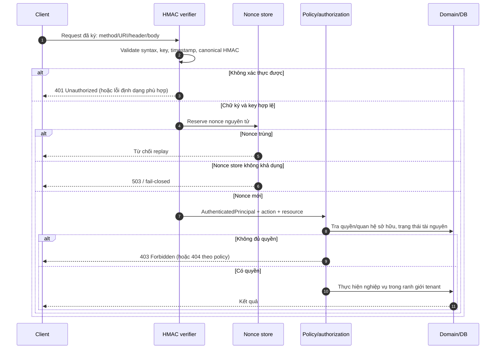

# Authorization sau authentication trong mô hình client–server HMAC

## 1. Hai câu hỏi khác nhau tại cùng một request

Trong module **`SECURITY_AUTHENTICATION_HMAC_REQUEST_AUTHENTICATION`**, client sử dụng **shared secret** để tính HMAC trên **canonical request** theo hợp đồng ký. Canonical request có thể gồm phương thức HTTP, raw URI, một số header bắt buộc và hash của raw body. Server có thể xác minh chữ ký, kiểm tra timestamp/nonce để chống replay rồi xác định bên đang giữ secret.

Nhưng một chữ ký hợp lệ **không cấp quyền thực hiện mọi thao tác**. Hệ thống phải trả lời lần lượt hai câu hỏi:

- **Authentication (xác thực):** “Bên nào gửi request này và họ có chứng minh được việc giữ shared secret hợp lệ không?”
- **Authorization (phân quyền):** “Bên đã được xác thực có được phép thực hiện *hành động cụ thể* trên *tài nguyên cụ thể* trong *ngữ cảnh hiện tại* không?”

Ví dụ ứng dụng đối tác `client-17` có secret hợp lệ và quyền tạo thanh toán cho `merchant-42`. Request dưới đây hoàn toàn có thể có HMAC chính xác nhưng vẫn phải bị từ chối:

```http
POST /v1/merchants/merchant-99/payments HTTP/1.1
Content-Type: application/json
X-HMAC-Key-Id: client-17:v3
X-HMAC-Timestamp: 1795838400
X-HMAC-Nonce: 2cbe36cfeb154e97b838d5b2462d96d1
X-HMAC-Signature: <base64-hmac-sha256>

{"amountMinor":125000,"currency":"VND","destinationAccount":"A123"}
```

Khi server xác minh thành công, kết quả chỉ cho biết request đến từ ứng dụng đã đăng ký `client-17`. Quyền của ứng dụng này thuộc `merchant-42`, trong khi URI yêu cầu tạo thanh toán cho `merchant-99`. Nếu không có ủy quyền hợp lệ, **authorization phải trả `403 Forbidden`**, dù HMAC, timestamp và nonce đều hợp lệ.

### Mục tiêu học tập

Sau bài này, bạn có thể:

1. Diễn giải luồng **client → gateway/server → principal đã xác thực → policy → resource**.
2. Thiết kế cách ánh xạ `keyId` và shared secret sang **principal có thể tin cậy**, tách biệt với quyền truy cập.
3. Áp dụng quyền ở **endpoint, hành động, tenant, tài nguyên và thuộc tính nghiệp vụ**.
4. Nhận ra nguy cơ **IDOR/BOLA, giả mạo thông tin nhận dạng, confused deputy, quyền cũ trong cache** và bypass gateway.
5. Kiểm tra bằng tình huống HMAC đúng nhưng authorization sai, bao gồm lúc rotate key và qua reverse proxy.

## 2. Principal phải được tạo bởi phía server

### 2.1 Phân biệt key ID, secret, principal và quyền

| Đối tượng | Vai trò | Có đáng tin ngay khi nhận HTTP request? |
| --- | --- | --- |
| `X-HMAC-Key-Id` | Gợi ý chọn secret/version để *thử xác minh*. | **Không**. Client tự gửi giá trị này. |
| Shared secret | Bí mật dùng tính/kiểm tra HMAC. | Chỉ được lấy từ kho khóa được server quản lý; không nhận từ request. |
| Chữ ký HMAC | Bằng chứng toàn vẹn cho những byte **đã được ký** và việc bên gửi biết secret. | Chỉ sau khi server dựng đúng canonical request và so chữ ký. |
| Timestamp + nonce | Hạn chế replay của một request đã ký. | Phải kiểm tra cửa sổ thời gian và ghi nonce nguyên tử tại kho dùng chung. |
| `AuthenticatedPrincipal` | Danh tính ứng dụng/đối tác đã xác minh; ví dụ `client-17` thuộc `tenant-42`. | Có, **nếu** được server xây dựng sau khi hoàn tất authentication. |
| Scope/role/grant | Những hành động/tài nguyên principal được sử dụng. | Có, **nếu** lấy từ policy/identity store do server quản lý và còn hiệu lực. |
| `merchantId`, `paymentId`, `tenantId` trong URI/body | Tài nguyên hoặc ngữ cảnh client đang yêu cầu. | **Không tự động**. Dù đã được ký, chúng vẫn là dữ liệu do client chọn. |

Một mối quan hệ có thể là:

```text
keyId "client-17:v3"
    └─ key đang active, secret hợp lệ
          └─ HMAC + timestamp + nonce PASS
                └─ principal { applicationId: "client-17",
                               homeTenant: "tenant-42" }
                      └─ server-side grants:
                          payments:create trên merchant-42
                          payments:read   trên merchant-42
```

`keyId` thường chứa số phiên bản để hỗ trợ **key rotation**. Không nên tách chuỗi `client-17:v3` bằng phép cắt chuỗi rồi tự coi `client-17` hoặc `v3` là quyền. Bảng ánh xạ từ key hợp lệ sang danh tính và trạng thái khóa phải nằm ở phía server. Nếu hai key cùng thuộc một ứng dụng trong giai đoạn rotation, chúng thường ánh xạ về cùng principal nhưng có trạng thái chấp nhận chữ ký riêng.

### 2.2 Chuỗi trách nhiệm tối thiểu



Chỉ tạo principal sau khi chữ ký và cơ chế chống replay thành công. Không bao giờ tạo principal trực tiếp từ `X-Client-Id`, `X-Tenant-Id`, `X-Role` hay giá trị `keyId` chưa được xác minh. Việc **reserve nonce trước authorization** bảo đảm một request đã xác thực nhưng bị từ chối quyền cũng không được tái sử dụng sau này nếu policy đổi trong cửa sổ timestamp.

### 2.3 Trạng thái HTTP mang ý nghĩa khác nhau

| Kết quả | Ý nghĩa thường gặp | Tình huống |
| --- | --- | --- |
| `400 Bad Request` | Request sai định dạng/cú pháp theo giao thức. | Timestamp không thể parse, header bị nhân đôi; cách xử lý chi tiết theo hợp đồng API. |
| `401 Unauthorized` | Chưa xác thực thành công. | Key không hợp lệ, HMAC sai, request hết hạn hoặc không vượt qua điều kiện authentication. |
| `403 Forbidden` | Đã xác thực nhưng **không được phép** hành động này. | `client-17` tạo payment cho merchant không thuộc quyền. |
| `404 Not Found` | Tài nguyên không tồn tại, hoặc hệ thống **cố ý che** sự tồn tại của tài nguyên mà caller không được xem. | Truy cập payment của tenant khác theo chính sách chống dò tài nguyên. |
| `503 Service Unavailable` | Không bảo đảm bước xác minh do hạ tầng phụ thuộc lỗi. | Nonce store hoặc cơ chế kiểm tra trạng thái khóa bắt buộc không khả dụng. |

API có thể thống nhất phản hồi authentication để tránh tiết lộ key ID có tồn tại hay không. `403` và `404` cho tài nguyên nhạy cảm cần một quy ước rõ, đồng nhất; đừng để khác biệt mã lỗi vô tình làm lộ ID của tenant khác.

## 3. Hợp đồng ký ảnh hưởng trực tiếp tới phân quyền

Authorization kiểm tra **method, hành động, resource và dữ liệu nghiệp vụ**. Nếu client có thể thay đổi một trường ảnh hưởng đến các yếu tố này mà không làm HMAC sai, ranh giới tin cậy đã bị phá vỡ.

### 3.1 Những dữ liệu phải được bảo vệ

Ví dụ contract minh họa HMAC-SHA256 ký các giá trị:

```text
HMAC-SHA256
POST
/v1/merchants/merchant-42/payments
content-type:application/json
x-hmac-key-id:client-17:v3
x-hmac-timestamp:1795838400
x-hmac-nonce:2cbe36cfeb154e97b838d5b2462d96d1
body-sha256:<lowercase-hex-sha256-of-raw-body>
```

Dòng `body-sha256:...` phải chứa hash thực tế khi ký. Client và server phải thống nhất chính xác định dạng, UTF-8, cách xử lý raw query/percent-encoding và header. Trong contract trên, **method, merchant trong path, header chống replay và byte body** được bao phủ bởi chữ ký. Nếu đổi `POST` thành `DELETE`, `merchant-42` thành `merchant-99` hoặc đổi `amountMinor` trong body mà không biết secret, chữ ký sẽ không khớp.

Cần phân biệt hai rủi ro khác nhau:

- **Sửa request khi không có secret:** signature verification ngăn việc sửa các trường đã ký, bao gồm resource/amount nếu contract ký chúng.
- **Client có secret nhưng vượt quyền:** client có thể **tự ký một request mới** cho `merchant-99`. Chữ ký vẫn hợp lệ, và chỉ **authorization** mới chặn được việc truy cập sai.

Đừng suy luận “field này đã được ký nên người gửi có quyền dùng giá trị đó”. HMAC bảo vệ **tính toàn vẹn thông tin**, còn quyền sử dụng giá trị do policy phía server quyết định.

### 3.2 Chọn các thành phần cần ký theo quyết định quyền

| Thành phần request | Hậu quả nếu bị bỏ khỏi contract ký | Khuyến nghị |
| --- | --- | --- |
| Method | Có thể bị đổi hành động khi cùng URI hỗ trợ nhiều method. | Ký method thực tế. |
| Raw path và query | Có thể đổi resource ID, tenant ID, tham số lọc hoặc mức phân trang có ý nghĩa bảo mật. | Ký raw request target theo hợp đồng, quy định rõ canonicalization. |
| Body bytes hoặc digest | Có thể đổi số tiền, tài khoản đích, đối tượng được cập nhật. | Ký SHA-256 raw body hoặc bảo vệ nội dung theo chuẩn ký đã chọn. |
| Header được dùng quyết định chính sách | Có thể sửa idempotency key, audience, yêu cầu impersonation hoặc một header có tác dụng nghiệp vụ. | Ký header có ý nghĩa bảo mật, chuẩn hóa cách đọc/trim/duplicate. |
| Timestamp, nonce, key ID | Có thể chỉnh các tham số chống replay hoặc định danh key. | Bắt buộc bao phủ khi dùng chúng trong xác thực. |
| `X-Tenant-Id` hoặc `X-Role` do client tự gửi | Nguy cơ giả mạo khi code tin trực tiếp giá trị. | Tốt nhất xác định tenant/role từ principal server-side; nếu header là tham số yêu cầu thì vẫn phải kiểm tra quyền. |

**Proxy/gateway là điểm cần đặc biệt chú ý:** gateway có thể rewrite URI, chuẩn hóa percent-encoding, đổi `Host` hoặc giải nén body. Nếu backend xác minh dựa trên request *sau* biến đổi khác với byte đã ký, chữ ký sẽ sai; nếu các lớp **phân quyền theo resource khác nhau**, có thể xảy ra lỗ hổng phân quyền. Phải thống nhất cùng một cách hiểu về method, route, tenant/resource giữa nơi xác minh, nơi authorization và nơi thực thi nghiệp vụ.

## 4. Quyền phải được kiểm tra theo nhiều lớp

Một ứng dụng B2B có thể được cấp scope `payments:create`, nhưng điều đó thường **chưa đủ** để được tạo thanh toán cho mọi merchant. Cần xét ít nhất những lớp sau:

1. **Quyền endpoint/hành động:** principal có scope `payments:create`, `payments:read`, `payments:refund` tương ứng với hành động đang gọi không?
2. **Quyền tenant/resource:** principal có được phép thao tác trên `merchantId` hoặc `paymentId` cụ thể không? Quyền có thể đến từ ownership, ACL hoặc một hợp đồng ủy quyền.
3. **Điều kiện thuộc tính (ABAC):** yêu cầu có nằm trong hạn mức tiền, loại giao dịch, môi trường, trạng thái đối tác hay tài khoản đích được phép không?
4. **Quy tắc nghiệp vụ và dữ liệu:** tài nguyên đang ở trạng thái hợp lệ để thao tác, request có hợp lệ và idempotency được đảm bảo không?

Scope, RBAC và ABAC bổ sung cho nhau. Một permission kiểu `payments:refund` có thể đến từ role được lưu ở server, nhưng quyết định hoàn tiền vẫn cần kiểm tra **payment thuộc tenant nào**, **số tiền có vượt mức đã thanh toán** và **trạng thái có cho phép hoàn không**.

### 4.1 Ví dụ ma trận quyền

Giả sử server giữ chính sách sau:

| Client đã xác thực | Scope | Quyền resource theo phía server | Ví dụ quyết định |
| --- | --- | --- | --- |
| `client-17`, tenant `tenant-42` | `payments:create`, `payments:read` | `merchant-42` | Được tạo payment cho `merchant-42` khi điều kiện bổ sung đạt. |
| `client-17`, tenant `tenant-42` | `payments:create`, `payments:read` | `merchant-42` | **Từ chối** tạo payment cho `merchant-99`. |
| `client-17`, tenant `tenant-42` | `payments:create`, `payments:read` | `merchant-42` | **Từ chối** refund, vì thiếu `payments:refund`. |
| `client-18`, tenant `tenant-99` | `payments:read` | `merchant-99` | Được đọc payment thuộc merchant của mình; không có quyền tạo. |
| `client-partner` | `payments:create` | `merchant-42` với grant có hiệu lực | Được tạo theo phạm vi ủy quyền; không suy ra quyền tới merchant khác. |

**Mặc định từ chối (deny by default)** khi không tìm thấy policy/grant còn hiệu lực. Một principal không nên thừa kế toàn bộ quyền của tenant chỉ vì dùng chung secret hoặc có key ID chứa tên tenant. Hãy cấp quyền tối thiểu cho từng ứng dụng, từng hành động và từng tập tài nguyên.

### 4.2 Không tin tenant/resource ID do client tự khai

Trong API đa tenant, một kẻ tấn công có secret hợp lệ của **tenant A** có thể liên tục gửi request tới ID của **tenant B** để thử lỗ hổng **Broken Object Level Authorization (BOLA/IDOR)**.

**Cách yếu:**

```java
// SAI: request được HMAC ký đúng không chứng minh quyền sở hữu merchantId.
Payment payment = paymentRepository.findById(paymentId).orElseThrow();
return payment;
```

**Hướng đúng:**

```java
// principal do verifier tạo từ key đã xác minh, không lấy từ body/header.
// Ràng buộc quyền đọc theo merchant/tenant và payment cụ thể.
if (!grants.canReadPayment(principal.applicationId(), principal.tenantId(), paymentId)) {
    throw new ForbiddenException();
}
return paymentRepository.findVisibleToAuthorizedMerchant(
        paymentId, principal.tenantId()).orElseThrow();
```

Trong hệ thống thực tế, có thể kiểm tra quyền và scope ngay trong truy vấn DB có điều kiện tenant/merchant để giảm nguy cơ truy vấn nhầm tài nguyên. Với thao tác cập nhật/xóa, cần giữ điều kiện ownership trong **transaction và câu lệnh update**, không chỉ kiểm tra một lần rồi cập nhật theo ID đơn thuần. Nếu có quan hệ ủy quyền xuyên tenant, mô hình truy vấn phải hỗ trợ **grant rõ ràng** thay vì bắt buộc `resource.tenantId == principal.tenantId` trong mọi trường hợp.

## 5. Ví dụ Java: authorizer đứng sau bộ xác minh HMAC

Ví dụ này dùng **Java 17+**, mô tả lớp authorization độc lập với framework HTTP. Đầu vào `HmacPrincipal` giả định được tạo **chỉ khi** bộ xác minh đã kiểm tra key còn hoạt động, canonical HMAC-SHA256 đúng, timestamp trong cửa sổ, nonce được reserve nguyên tử. Quyền `scopes` đến từ cấu hình server, không đến từ header hay JSON do client khai.

```java
import java.util.Objects;
import java.util.Set;

// Principal nội bộ được tạo sau khi HMAC + anti-replay PASS.
record HmacPrincipal(
        String applicationId,
        String tenantId,
        Set<String> scopes) {
    HmacPrincipal {
        Objects.requireNonNull(applicationId);
        Objects.requireNonNull(tenantId);
        scopes = Set.copyOf(Objects.requireNonNull(scopes));
    }
}

// merchantId lấy từ route đã được bảo vệ bằng chữ ký;
// body chứa số tiền và tài khoản đích đã được verify qua raw-body hash.
record CreatePaymentCommand(long amountMinor, String destinationAccount) {}

interface MerchantGrantRepository {
    // Truy vấn cấu hình quyền server-side còn hiệu lực;
    // kiểm tra cả principal, tenant, merchant và action.
    boolean hasActiveGrant(
            String applicationId,
            String principalTenantId,
            String merchantId,
            String action);
}

interface PaymentPolicy {
    long maxAmountMinor(String applicationId, String merchantId);
    boolean destinationAllowed(String merchantId, String destinationAccount);
}

final class PaymentAuthorizer {
    private final MerchantGrantRepository grants;
    private final PaymentPolicy policy;

    PaymentAuthorizer(MerchantGrantRepository grants, PaymentPolicy policy) {
        this.grants = grants;
        this.policy = policy;
    }

    boolean mayCreate(
            HmacPrincipal principal,
            String merchantIdFromPath,
            CreatePaymentCommand request) {
        if (principal == null || request == null
                || merchantIdFromPath == null || merchantIdFromPath.isBlank()) {
            return false; // default deny
        }

        // Lớp 1: quyền hành động
        if (!principal.scopes().contains("payments:create")) return false;

        // Lớp 2: resource grant có hiệu lực, không tin client tự khai tenant.
        if (!grants.hasActiveGrant(
                principal.applicationId(),
                principal.tenantId(),
                merchantIdFromPath,
                "payments:create")) {
            return false;
        }

        // Lớp 3: chính sách thuộc tính. Validate nghiệp vụ còn cần thêm.
        if (request.amountMinor() <= 0
                || request.destinationAccount() == null) return false;
        if (request.amountMinor()
                > policy.maxAmountMinor(principal.applicationId(), merchantIdFromPath)) {
            return false;
        }
        return policy.destinationAllowed(
                merchantIdFromPath, request.destinationAccount());
    }
}
```

Cách sử dụng ở service/controller sau khi authentication thành công:

```java
// Pseudocode lớp ứng dụng: verifiedPrincipal chỉ đến từ verifier tin cậy.
HmacPrincipal verifiedPrincipal = securityContext.requireHmacPrincipal();
String merchantId = pathVariables.get("merchantId");

CreatePaymentCommand command = validatedBody; // raw body đã được ký.
if (!paymentAuthorizer.mayCreate(verifiedPrincipal, merchantId, command)) {
    throw new ForbiddenException();
}

// Chỉ lúc này mới xử lý lệnh; thao tác DB cần transaction và ràng buộc tenant.
return paymentService.createAuthorized(
        verifiedPrincipal, merchantId, command, idempotencyKey);
```

Trong Spring Security, có thể thêm kiểm tra coarse-grained ở route bằng `hasAuthority("payments:create")` hoặc permission tương đương; **resource check vẫn phải thực hiện tại service/domain**. Nếu ứng dụng dùng tên authority `SCOPE_payments:create` thì cấu hình phải thống nhất đúng tên; không mặc nhiên giả định Spring Security tự biết principal HMAC tự triển khai.

Các đoạn trên minh họa **biên logic**; code production còn cần validator đầu vào, xử lý lỗi DB/policy, transaction, khóa truy vấn phù hợp, audit và idempotency. `PaymentAuthorizer` không được gọi trên principal tự dựng từ request chưa được xác minh.

## 6. Gateway xác thực thay backend: truyền danh tính thế nào cho đúng?

Có hai cấu trúc thường gặp:

### Mô hình A — Backend tự xác minh HMAC

```text
Internet client
   │ signed HTTP request
   ▼
Gateway (routing, rate limit, bảo toàn dữ liệu ký)
   │
   ▼
Backend HMAC verifier ──► principal ──► authorization ──► domain
```

Gateway phải giữ nguyên những byte/giá trị mà hợp đồng ký bảo vệ, hoặc cung cấp metadata gốc qua kênh đáng tin cậy. Backend **không** dựa vào header `X-Authenticated-Client` do bên ngoài có thể giả mạo. Với path/query có percent-encoding, query trùng key hoặc proxy rewrite, cần kiểm thử nhất quán giữa route xác minh và route phân quyền.

### Mô hình B — Gateway xác minh HMAC

```text
Internet client
   │ signed HTTP request
   ▼
Trusted gateway: verify HMAC + nonce, tạo principal
   │ internal authenticated channel + trusted identity context
   ▼
Backend: kiểm tra quyền endpoint/resource + domain transaction
```

Để backend chấp nhận principal từ gateway, toàn bộ điều kiện sau phải được bảo đảm:

- **Không có đường truy cập công khai đi thẳng tới backend** để bỏ qua gateway. Áp dụng network policy/service authentication phù hợp.
- Gateway **xóa hoặc ghi đè** tất cả header nhận dạng nội bộ mà client tự gửi (ví dụ `X-Verified-Client`, `X-Tenant-Id`, `X-Scopes`); backend chỉ nhận chúng từ gateway được xác thực, có thể qua mTLS, signed assertion nội bộ hoặc cơ chế truyền context an toàn của hạ tầng.
- Nếu gateway xác minh còn backend dùng resource path sau rewrite, cả hai phải thống nhất **endpoint/resource thực sự được yêu cầu**, tránh route ambiguity và confused deputy.
- Backend **vẫn phải phân quyền** dựa trên principal và policy hiện hành, kể cả khi gateway đã kiểm tra scope sơ bộ. Gateway không đủ ngữ cảnh về ownership/trạng thái payment ở DB.
- Quyền của client không được mở rộng khi đi qua nhiều service; khi service A gọi service B thay mặt principal, truyền danh tính/ủy quyền theo giao thức tin cậy với phạm vi giới hạn. Không dùng một service account có quyền toàn bộ để vô tình bỏ qua quyền người gọi.

**Confused deputy** xảy ra khi một service có đặc quyền lớn bị điều khiển thực hiện hành động cho client không có quyền. Chữ ký HMAC của client với service A không mặc nhiên trao quyền cho A dùng credential nội bộ để truy cập mọi dữ liệu trong service B.

## 7. Policy thay đổi, key rotation và replay có liên quan gì đến quyền?

### 7.1 Quyền có thể bị thu hồi trong khi secret vẫn hợp lệ

Giả sử `client-17` bị thu hồi quyền `payments:refund` nhưng khóa HMAC `v3` vẫn còn hoạt động. Từ thời điểm policy có hiệu lực, request refund có chữ ký hợp lệ **vẫn phải bị từ chối**. Không nên đưa quyền vào trạng thái bất biến gắn chặt với secret rồi chỉ cập nhật khi rotate key; quyền và trạng thái xác minh khóa là hai vòng đời khác nhau.

Khi dùng cache authorization, hãy xác định TTL, cách invalidate khi thu hồi grant và mức độ nhất quán yêu cầu của nghiệp vụ. Cache stale có thể tạo khoảng thời gian truy cập trái phép. Với quyền nhạy cảm, cần cơ chế thu hồi hiệu lực kịp thời hoặc tra cứu nguồn chính sách đáng tin cậy. Nếu policy store bắt buộc nhưng không truy cập được, **không tự cấp quyền mặc định**.

### 7.2 Xoay key không có nghĩa mở rộng quyền

Một ứng dụng có thể đồng thời dùng `client-17:v2` và `client-17:v3` trong thời gian chuyển khóa. Cả hai key đã được xác minh nên ánh xạ về cùng `applicationId=client-17` và cùng policy, trừ khi tổ chức chủ động cấu hình quyền khác. Server phải quản lý `active/verify-only/revoked` của từng key; một key bị thu hồi phải bị chặn ngay ở authentication. Không suy ra scope từ suffix `v2` hay `v3`.

Nếu shared secret bị lộ, kẻ tấn công có thể ký một request *mới* với nonce và timestamp hợp lệ. Nonce store không thể ngăn kiểu giả mạo đó; cần thu hồi secret, rà soát grant và điều tra hành động trong phạm vi quyền đã cấp. Chính sách ít quyền giúp hạn chế tác động của việc lộ key.

### 7.3 Chống replay và idempotency cũng là các kiểm soát khác

- **HMAC**: kiểm tra bên gửi biết shared secret và tính toàn vẹn của những trường được ký.
- **Timestamp + nonce**: ngăn gửi lại cùng signed request trong khoảng thời gian bảo vệ; yêu cầu nonce store chung và ghi nguyên tử.
- **Authorization**: quyết định principal có quyền hành động trên resource/tenant này không.
- **Idempotency**: xử lý an toàn trường hợp client gửi nhiều request **khác nonce nhưng cùng ý định nghiệp vụ**, ví dụ client retry tạo thanh toán sau timeout.

Ví dụ `client-17` có quyền tạo thanh toán cho `merchant-42` và gửi hai request đều HMAC hợp lệ, timestamp hợp lệ, **hai nonce khác nhau**, nhưng cùng `Idempotency-Key`. Authorization cho phép cả hai; hệ thống vẫn phải dùng cơ chế idempotency phù hợp để tránh thanh toán hai lần. Nếu `Idempotency-Key` được client truyền và có ý nghĩa nghiệp vụ, nên nằm trong tập header được ký và cần gắn với principal, operation và nội dung request.

## 8. Sai lầm thường gặp và cách phòng tránh

| Sai lầm | Vì sao nguy hiểm | Cách xử lý |
| --- | --- | --- |
| “HMAC đúng tức là admin” | Secret chỉ xác thực ứng dụng, không cấp toàn bộ quyền. | Principal phía server + policy theo hành động và resource. |
| Dùng `X-Tenant-Id`/`X-Role` làm danh tính | Client có thể tự khai hoặc ký một giá trị tùy ý bằng chính secret của mình. | Tenant/role lấy từ identity/policy store đáng tin; header yêu cầu vẫn phải được phân quyền. |
| Chỉ kiểm tra scope `payments:read` | Có thể đọc payment của tenant khác nếu truy vấn theo ID toàn cục. | Kiểm tra ownership/ACL, gắn tenant/merchant vào truy vấn. |
| Chỉ phân quyền tại gateway | Gateway thường không biết quan hệ sở hữu hoặc trạng thái dữ liệu nội bộ. | Backend kiểm tra quyền mức tài nguyên và điều kiện nghiệp vụ. |
| Backend tin header nội bộ do Internet gửi | Kẻ tấn công có thể giả principal/role, hoặc truy cập trực tiếp backend. | Strip/overwrite header, bảo vệ đường nội bộ, không cho bypass gateway. |
| Contract ký không gồm path/body quan trọng | Kẻ khác có thể đổi resource/hành động/amount mà chữ ký vẫn giống. | Ký toàn bộ thành phần ảnh hưởng đến identity/action/resource theo hợp đồng. |
| Policy dùng cache quá lâu sau khi thu hồi | Key hợp lệ vẫn sử dụng grant đã hết hiệu lực. | Giới hạn cache TTL, invalidate khi đổi quyền, kiểm soát tính nhất quán. |
| Check ownership rồi update bằng ID đơn thuần | Race/TOCTOU hoặc truy vấn nhầm tenant có thể cập nhật sai resource. | Quyền và điều kiện tenant ở transaction/câu lệnh thay đổi dữ liệu. |
| Xem nonce là idempotency | Client vẫn có thể ký request mới với nonce mới và cùng ý định nghiệp vụ. | Idempotency key/transaction nghiệp vụ độc lập với chống replay. |
| Log secret, raw chữ ký và body nhạy cảm | Làm lộ dữ liệu, tăng nguy cơ giả mạo request. | Log correlation ID, key ID không nhạy cảm, kết quả quyết định và policy version ở mức cần thiết. |

## 9. Ma trận kiểm thử authorization sau authentication

Đừng dừng ở test “HMAC đúng trả `200`”. Cần ít nhất hai nhóm kiểm thử: **authentication/replay** và **authorization/resource**. Với mỗi case, xác nhận side effect nghiệp vụ và audit, không chỉ status code.

| Case | Điều kiện test | Kết quả mong đợi |
| --- | --- | --- |
| A01 | Key hợp lệ, chữ ký đúng, nonce mới; `client-17` tạo payment cho `merchant-42`, đủ scope/grant. | Cho phép khi business rule đạt; ghi nhận principal, resource và idempotency. |
| A02 | Chữ ký đúng nhưng scope chỉ có `payments:read`; gọi POST create. | `403`; không tạo payment. |
| A03 | Chữ ký đúng, đủ `payments:create` nhưng path là `merchant-99` không được cấp grant. | `403`/`404` theo policy; không tạo payment của merchant khác. |
| A04 | Chữ ký đúng, client đọc `paymentId` thuộc tenant khác. | Bị chặn ở object-level authorization; không lộ dữ liệu/metadata. |
| A05 | Chữ ký đúng, scope và merchant đúng nhưng vượt hạn mức hoặc tài khoản đích không được phép. | Bị từ chối theo policy/rule; không chuyển tiền. |
| A06 | Bên gửi thêm `X-Role: admin` hoặc `X-Tenant-Id: tenant-99` vào request. | Quyền không tăng; header không tin cậy bị bỏ qua hoặc được kiểm tra như dữ liệu đã ký. |
| A07 | Thay method, path, query hoặc raw body sau khi ký. | Authentication thất bại nếu trường đó thuộc contract ký. |
| A08 | Key `v2` và `v3` cùng hợp lệ trong rotation, cùng `applicationId`. | Cùng authorization policy; không tự nâng quyền theo version. |
| A09 | Thu hồi grant `payments:refund` nhưng giữ secret hợp lệ. | Request refund HMAC đúng vẫn bị từ chối sau khi policy có hiệu lực; kiểm tra invalidation cache. |
| A10 | Request tới backend bằng đường bypass gateway hoặc header `X-Verified-Client` tự tạo. | Không được tạo principal; không bypass authentication. |
| A11 | Replay đúng request với timestamp còn hạn, nonce đã dùng. | Bị từ chối trước authorization; không chạy nghiệp vụ hai lần. |
| A12 | Nonce store hoặc policy store thiết yếu mất kết nối. | Fail-closed, không cấp quyền và không thực hiện nghiệp vụ; có lỗi vận hành phù hợp. |
| A13 | Hai request nonce khác nhau nhưng cùng `Idempotency-Key` và nội dung giao dịch. | Không thực hiện nghiệp vụ trùng dù cả hai đều qua authentication và authorization. |
| A14 | Gateway rewrite URI có percent-encoding hoặc route alias trước backend. | Resource mà verifier, authorizer và controller hiểu phải nhất quán; sai hợp đồng ký phải bị từ chối. |
| A15 | Client có grant ủy quyền vào merchant khác trong một thời hạn xác định. | Chỉ allow đúng action/merchant và khi grant còn hiệu lực; revoke có tác dụng. |

Có thể viết integration test theo chuỗi **signed client → API gateway → auth verifier → nonce store → authorization service → database**. Dùng clock cố định và secret thử nghiệm để tạo test vector có cùng canonical bytes/HMAC; kết quả authorization được quyết định bằng policy giả lập rõ ràng. Test phải chứng minh một request **được xác thực thành công nhưng bị phân quyền từ chối** không thay đổi dữ liệu.

### Câu hỏi tự kiểm tra

1. Vì sao `keyId` có tên giống tenant không đủ để kết luận request có quyền với tenant đó?
2. Một client có thể tự ký request HMAC hợp lệ để sửa `merchantId` từ 42 sang 99. Lớp nào phải từ chối và vì sao?
3. Tại sao kiểm tra scope `payments:read` ở gateway chưa đủ khi backend truy xuất payment bằng ID?
4. Khi rotate từ key `v2` sang `v3`, quyền ứng dụng có nhất thiết phải thay đổi không?
5. Vì sao nonce đã được reserve nhưng request bị `403` vẫn không nên hoàn trả nonce vào kho?
6. Nếu gateway xác minh HMAC, cần bảo vệ đường kết nối và header danh tính từ gateway tới backend ra sao?
7. Vì sao hai request có HMAC hợp lệ với hai nonce khác nhau vẫn có thể làm thanh toán trùng?

## 10. Bài tập áp dụng

**Tình huống:** `client-vendor` được cấp quyền `orders:read` cho `tenant-A`, không có `orders:update`. Client này gửi request đã ký chính xác:

```http
PUT /v1/tenants/tenant-B/orders/order-88 HTTP/1.1
X-HMAC-Key-Id: client-vendor:v2
X-HMAC-Timestamp: <epoch-seconds>
X-HMAC-Nonce: <unique-nonce>
X-HMAC-Signature: <valid-signature>

{"status":"SHIPPED"}
```

Giả sử timestamp/nonce còn hợp lệ, key active và server kiểm tra đúng chữ ký. Hãy xác định server xử lý ra sao.

**Phân tích:** Authentication thành công chứng minh người gửi giữ secret của `client-vendor`. Authorization phải từ chối **hai lý do độc lập**: client không có quyền `orders:update` và không được cấp grant tới `tenant-B`/`order-88`. Server không được cập nhật order, không được dùng `tenant-B` từ path làm principal, và phải ghi nhận từ chối quyền ở mức audit phù hợp. Với tài nguyên mà policy cần che tồn tại, server có thể trả `404` thay vì `403`; điều này không được khiến dữ liệu bị truy xuất hoặc cập nhật.

**Ghi nhớ:** Trong mô hình client–server HMAC, chữ ký là bước **xác thực nguồn gửi và tính toàn vẹn của request đã ký**. Sau khi kiểm tra replay, server tạo principal đáng tin rồi **phân quyền riêng** theo hành động, tenant, resource, grant và chính sách nghiệp vụ. Hãy đặt kiểm tra ở đúng ranh giới tin cậy, duy trì quyền theo dữ liệu phía server và bảo đảm proxy/gateway, verifier, authorizer và database cùng hiểu một request theo một cách.
