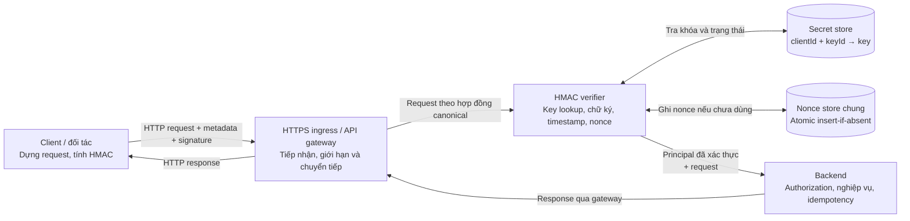
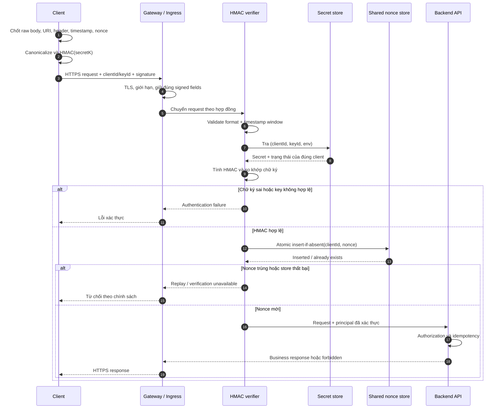

# Luồng xử lý tổng thể trong mô hình Client–Server HMAC Request Authentication

## Mục tiêu học tập

Sau bài học này, bạn có thể:

- Mô tả đầy đủ vòng đời **một HTTP request được ký bằng HMAC**, từ thời điểm client chuẩn bị request đến khi backend trả response.
- Phân định trách nhiệm giữa client, HTTPS ingress/API gateway, HMAC verifier, kho khóa, kho nonce và tầng nghiệp vụ.
- Giải thích vì sao client và verifier phải tuân thủ **cùng một hợp đồng canonical request** cho method, URI, header và body.
- Xác định vị trí kiểm tra timestamp, nonce, phiên bản khóa, chữ ký và quyền truy cập; xử lý các nhánh thành công/thất bại.
- Thiết kế retry, key rotation, kiểm thử qua proxy/gateway và quan sát hệ thống mà không nhầm **authentication** với **authorization**.

**Ngữ cảnh:** Bài thuộc chương **Mô hình client server** của module `SECURITY_AUTHENTICATION_HMAC_REQUEST_AUTHENTICATION`. Hệ thống dùng HMAC với khóa bí mật chia sẻ giữa bên gửi HTTP request và bên xác minh. Phần lớn ví dụ dùng HMAC-SHA256; hợp đồng canonical minh họa dưới đây là quy ước **riêng cho ví dụ**, không mặc nhiên là chuẩn tương thích với API khác.

## 1. Bức tranh tổng thể: ai làm gì?

Giả sử một đối tác `partner-17` gọi API `POST /v1/orders` của nền tảng bán hàng. Đối tác được cấp `clientId=partner-17` và một secret ứng với `keyId=k2`. Client tạo request, ký các trường đã thỏa thuận rồi gửi qua HTTPS. Verifier tra đúng phiên bản khóa, kiểm tra chữ ký và chống replay. Backend chỉ xử lý đơn hàng khi **đã xác thực principal** và **đã phân quyền** thao tác tạo đơn.



| Thành phần | Trách nhiệm chính | Không nên làm |
|---|---|---|
| **Client** | Nắm secret được cấp, tạo timestamp/nonce, ký chính request sẽ gửi | Gửi secret qua header, tự chọn thuật toán không được cho phép |
| **Ingress / gateway** | Bảo vệ TLS, giới hạn kích thước/rate, giữ đúng thông tin cần ký, định tuyến | Rewrite URI/header/body không được hai phía thống nhất; tin header định danh do client chèn |
| **Verifier** | Dựng lại canonical request, tra khóa, kiểm tra HMAC và replay, tạo principal | Coi `clientId` tự khai là danh tính đã xác thực; tự cấp quyền nghiệp vụ |
| **Secret store** | Lưu hoặc cung cấp khả năng sử dụng khóa theo client, key ID và môi trường; phục vụ thu hồi | Dùng một global secret cho mọi tenant, lưu secret trong log |
| **Nonce store** | Phát hiện một nonce đã được dùng trong cửa sổ hợp lệ, chia sẻ trạng thái giữa replica | Dùng bộ nhớ cục bộ khi có nhiều verifier; kiểm tra rồi ghi bằng hai thao tác không nguyên tử |
| **Backend** | Kiểm tra quyền theo principal, tenant, tài nguyên; thực thi và bảo đảm idempotency | Chấp nhận request chỉ vì chữ ký hợp lệ, hoặc tin header identity bên ngoài |

**Điểm quan trọng:** verifier có thể chạy ngay trong API gateway hoặc ở một service riêng. Sơ đồ chỉ phân tách **trách nhiệm logic**; triển khai vật lý phải bảo vệ được cả đường đi **sau** bước xác minh.

## 2. Điều kiện trước khi client gửi request

Luồng HMAC không bắt đầu ở phép tính `Mac.doFinal`, mà bắt đầu từ việc hai bên có cùng cấu hình:

1. **Cấp khóa:** hệ thống sinh secret bằng bộ sinh số ngẫu nhiên an toàn (CSPRNG), ví dụ 32 bytes ngẫu nhiên cho HMAC-SHA256, và cấp qua kênh được bảo vệ. Client chỉ lưu secret trong cơ chế quản lý bí mật được phép.
2. **Đăng ký định danh:** verifier ánh xạ `(clientId, keyId, environment)` tới secret, trạng thái khóa và principal. `keyId` là mã chọn **phiên bản khóa**, không phải mật khẩu.
3. **Chốt hợp đồng ký có phiên bản:** thuật toán, encoding chữ ký, trường bắt buộc ký, thứ tự, dấu ngăn dòng, quy tắc header/URI, xử lý body trống và request đi qua proxy đều phải xác định.
4. **Đồng bộ thời gian và replay policy:** server đặt cửa sổ timestamp, ví dụ ±300 giây, và có nonce store chịu được truy cập đồng thời.
5. **Thiết lập TLS và phân quyền:** client tin đúng endpoint HTTPS; backend định nghĩa ai được gọi endpoint nào và trên tài nguyên nào.

Nếu bất kỳ điều kiện nào chưa rõ, hai phía có thể cùng dùng HMAC-SHA256 nhưng **không tạo ra cùng chữ ký** hoặc vô tình chấp nhận request không an toàn.

## 3. Ví dụ hợp đồng canonical request phiên bản 1

Để theo dõi một request cụ thể, giả sử API công bố hợp đồng sau. Quy ước này cố ý ngắn để người học nhìn được toàn bộ pipeline.

| Mục ký | Giá trị được đưa vào canonical request | Lưu ý |
|---|---|---|
| Method | Viết hoa, ví dụ `POST` | Không cho method override qua header ngoài hợp đồng |
| URI | Path và query đúng biểu diễn `/v1/orders?currency=VND` | Không tự sort/normalize query ở một phía; xử lý rõ duplicate, percent-encoding |
| `host` | Host public được xác định đáng tin, viết thường | Chú ý `Host` HTTP/1.1 và `:authority` HTTP/2, proxy không được tự tin dữ liệu client spoof |
| `content-type` | Giá trị sau trim và viết thường | Chỉ chấp nhận một giá trị hợp lệ theo quy ước |
| `x-client-id` | ID client gửi, được đưa vào chữ ký | Header khai báo chưa đáng tin trước khi verify |
| `x-key-id` | Phiên bản khóa, được đưa vào chữ ký | Tra đúng khóa thuộc client đó |
| `x-timestamp` | Unix time tính bằng giây dưới dạng thập phân | Bắt buộc ký để không thể sửa cửa sổ thời gian |
| `x-nonce` | Chuỗi ngẫu nhiên duy nhất cho mỗi lần ký | Bắt buộc ký để chống replay |
| `body-sha256` | Base64URL không padding của SHA-256 trên **raw body bytes** | Không parse rồi serialize lại JSON |

**Quy tắc ghép:** mỗi mục một dòng theo đúng thứ tự bảng; mỗi dòng header có dạng `lowercase-name:value`. Dùng LF (`\n`) phân tách dòng, **không thêm LF sau dòng cuối**, mã hóa UTF-8, dùng `HMAC-SHA256` và kết quả `Base64URL` không padding. `X-Signature` là nơi mang chữ ký và **không tự được ký**. Header bắt buộc phải xuất hiện đúng một lần; nếu thiếu, lặp hoặc chứa ký tự xuống dòng bất thường thì từ chối.

Trong thực tế, cần đặc tả thêm path normalization, encoded slash, query parameter trùng, charset, nhiều giá trị header và các trường ứng dụng khác. Những trường nào ảnh hưởng đến routing, tenant hay quyền truy cập phải được ràng buộc bằng chữ ký hoặc được lấy từ một ngữ cảnh đã xác thực/kiểm soát tương đương.

### Request client định gửi

```http
POST /v1/orders?currency=VND HTTP/1.1
Host: api.example.test
Content-Type: application/json
X-Client-Id: partner-17
X-Key-Id: k2
X-Timestamp: <unix-time-hien-tai>
X-Nonce: <nonce-ngau-nhien-128-bit>
X-Signature: <base64url-hmac-sha256>

{"orderId":"O-42","tenantId":"partner-17","amount":120000}
```

Các giá trị trong dấu `<...>` là **placeholder giải thích**; HTTP request thực tế phải có Unix timestamp, nonce và chữ ký đúng định dạng. Body gửi đi là các byte UTF-8 của JSON minh họa, **không thêm newline cuối**.

Với ví dụ này, canonical request có dạng:

```text
POST
/v1/orders?currency=VND
host:api.example.test
content-type:application/json
x-client-id:partner-17
x-key-id:k2
x-timestamp:<unix-time-hien-tai>
x-nonce:<nonce-ngau-nhien-128-bit>
body-sha256:<base64url-sha256-cua-dung-body-bytes>
```

Cả client và verifier phải đưa vào cùng chuỗi byte sau khi thay placeholder bằng dữ liệu thật. Khi đó:

```text
bodyDigest = Base64URL_NoPadding(SHA256(rawBodyBytes))
signature  = Base64URL_NoPadding(HMAC_SHA256(secretK, UTF8(canonicalRequest)))
```

`signature` là mã xác thực, **không phải bản mã hóa body**. Dùng HTTPS/TLS để giữ bí mật nội dung trong lúc truyền tải.

## 4. Luồng phía client: từ request nghiệp vụ đến request đã ký

Trình tự phía client nên ổn định và có thể kiểm thử:

1. **Tạo dữ liệu nghiệp vụ:** quyết định method, URL, query, header có ý nghĩa và serialize body đúng một lần thành `rawBodyBytes`. Không ký một JSON rồi để HTTP client serialize ra một JSON khác.
2. **Lấy định danh khóa:** chọn `clientId=partner-17` và `keyId=k2` đang hoạt động; tải hoặc sử dụng secret tương ứng từ hệ thống lưu khóa được phép.
3. **Tạo chống replay:** tạo timestamp theo Unix seconds hiện hành, nonce đủ khó đoán và duy nhất (ví dụ 128-bit CSPRNG). Mỗi **lần ký mới** dùng metadata mới.
4. **Dựng canonical request:** áp dụng chính xác hợp đồng ký, băm `rawBodyBytes`, thêm timestamp/nonce và các trường bắt buộc.
5. **Tính chữ ký:** tạo HMAC-SHA256 từ secret và UTF-8 của canonical request; encode Base64URL không padding.
6. **Gắn header và gửi qua HTTPS:** gửi đúng method, target, headers và body đã được dùng để ký. Tránh middleware thay đổi dữ liệu đã ký sau bước này.
7. **Xử lý response:** phân biệt lỗi xác thực, lỗi quyền, hết hạn thời gian, replay, rate limiting và lỗi nghiệp vụ để quyết định có retry hay cần làm mới khóa/cấu hình.

Việc client gửi `X-Client-Id` không biến nó thành principal. Client còn có thể tự nhận là `partner-99` trong header; chỉ verifier mới kiểm tra được mối quan hệ **ID ↔ phiên bản khóa ↔ chữ ký**.

## 5. Luồng phía server: các cổng kiểm tra theo thứ tự

Một pipeline điển hình tại ingress và verifier có thể chia thành các cổng kiểm tra:

| Thứ tự | Cổng | Hành động | Khi không đạt |
|---|---|---|---|
| 1 | Nhận request | TLS, size limit, giới hạn header/body, chống quá tải, xác định raw target/body | Từ chối sớm, không chạy nghiệp vụ |
| 2 | Kiểm tra cú pháp | Method/URI hợp lệ; các header HMAC bắt buộc đúng một lần; chữ ký đúng encoding, timestamp đúng format | Từ chối request không hợp lệ |
| 3 | Giới hạn thời gian | Kiểm tra timestamp trong cửa sổ chấp nhận, ví dụ `abs(serverNow − timestamp) ≤ 300s` | Từ chối quá cũ hoặc quá xa tương lai |
| 4 | Tra phiên bản khóa | Tra `(clientId, keyId, env)`, kiểm tra key đang được phép verify và đúng owner | Từ chối nếu không tồn tại/đã thu hồi |
| 5 | Xác minh HMAC | Dựng lại canonical request bằng request **thực sự nhận**, tính HMAC và so sánh an toàn thời gian | Từ chối chữ ký sai |
| 6 | Chống replay | Với chữ ký hợp lệ, ghi `(clientId, nonce)` vào store chung bằng *insert-if-absent* nguyên tử, TTL đủ dài | Từ chối nonce đã dùng hoặc fail closed khi store lỗi |
| 7 | Tạo principal | Ánh xạ kết quả key lookup đã verify sang danh tính nội bộ có thể tin | Không lấy principal trực tiếp từ header client |
| 8 | Phân quyền | Kiểm tra principal, scope, tenant, endpoint và resource | Từ chối truy cập nếu không có quyền |
| 9 | Xử lý nghiệp vụ | Kiểm tra idempotency, validation, transaction, tạo đơn hoặc cập nhật trạng thái | Trả kết quả/lỗi nghiệp vụ theo hợp đồng |

**Thứ tự quan trọng:** không đưa request vào backend trước khi xác minh; không ghi nonce cho chữ ký sai (tránh attacker tạo nonce giả để chặn request hợp lệ); không kiểm tra phân quyền bằng một principal chưa được xác thực.

Kiểm tra timestamp sớm giúp loại bỏ nhiều request vô ích, nhưng chỉ khi HMAC hợp lệ mới có thể tin timestamp thực sự gắn với người nắm khóa. Đối với kiểm tra nonce, thao tác phải nguyên tử giữa mọi replica. Có thể dùng insert-if-absent vào Redis hoặc database với unique constraint; `GET` rồi `SET` riêng rẽ không đủ khi có race.

### Sequence diagram hoàn chỉnh



Thành công ở bước HMAC chứng minh client đã dùng đúng secret được verifier chấp nhận, và **chỉ những trường nằm trong hợp đồng ký** được bảo vệ. Nó không tự chứng minh người gửi có quyền tạo đơn cho tenant khác.

## 6. Minh họa hai phía bằng Java

Đoạn mã sau cho thấy phần chung mà cả client lẫn verifier cần thống nhất: **tạo canonical request trên dữ liệu đã được kiểm tra**, tính HMAC và so sánh chữ ký. Đây là ví dụ lõi mật mã phục vụ bài học, chưa phải một HTTP filter đầy đủ.

```java
import java.nio.charset.StandardCharsets;
import java.security.GeneralSecurityException;
import java.security.MessageDigest;
import java.util.Base64;
import java.util.Locale;
import javax.crypto.Mac;
import javax.crypto.spec.SecretKeySpec;

public final class HmacRequestV1 {
    private HmacRequestV1() {}

    public record Input(
            String method, String rawTarget, String publicHost,
            String contentType, String clientId, String keyId,
            String timestamp, String nonce, byte[] rawBody) {}

    // Chỉ gọi sau khi đã kiểm tra format, single-value header và raw target.
    public static String canonical(Input p) throws GeneralSecurityException {
        String digest = Base64.getUrlEncoder().withoutPadding()
            .encodeToString(MessageDigest.getInstance("SHA-256")
                .digest(p.rawBody()));

        return String.join("\n",
            p.method().toUpperCase(Locale.ROOT),
            p.rawTarget(),
            "host:" + p.publicHost().trim().toLowerCase(Locale.ROOT),
            "content-type:" + p.contentType().trim().toLowerCase(Locale.ROOT),
            "x-client-id:" + p.clientId().trim(),
            "x-key-id:" + p.keyId().trim(),
            "x-timestamp:" + p.timestamp().trim(),
            "x-nonce:" + p.nonce().trim(),
            "body-sha256:" + digest);
    }

    private static byte[] mac(byte[] secret, String canonical)
            throws GeneralSecurityException {
        Mac hmac = Mac.getInstance("HmacSHA256");
        hmac.init(new SecretKeySpec(secret, "HmacSHA256"));
        return hmac.doFinal(canonical.getBytes(StandardCharsets.UTF_8));
    }

    // Client dùng đúng rawBody và rawTarget sẽ gửi để ký.
    public static String sign(byte[] secret, Input input)
            throws GeneralSecurityException {
        return Base64.getUrlEncoder().withoutPadding()
            .encodeToString(mac(secret, canonical(input)));
    }

    // Verifier tra secret theo (clientId, keyId, environment) trước khi gọi.
    public static boolean verify(byte[] secret, Input received,
                                 String signature)
            throws GeneralSecurityException {
        if (signature == null || !signature.matches("[A-Za-z0-9_-]{43}")) {
            return false; // HMAC-SHA256: 32 bytes -> 43 ký tự Base64URL.
        }
        byte[] actual;
        try {
            actual = Base64.getUrlDecoder().decode(signature);
        } catch (IllegalArgumentException invalidEncoding) {
            return false;
        }
        if (actual.length != 32) {
            return false;
        }
        byte[] expected = mac(secret, canonical(received));
        return MessageDigest.isEqual(expected, actual);
    }
}
```

Client và server có thể sử dụng cùng cách tính `canonical` nhưng **đầu vào khác nguồn**: client lấy dữ liệu từ request đã chốt để gửi, verifier lấy từ request thực nhận tại vị trí xác minh. Nếu hai bên tính `rawTarget` hoặc `rawBody` khác nhau thì chữ ký sẽ khác, dù mật mã hoàn toàn đúng.

Đoạn mã chủ ý **không** quản lý khóa, format/timestamp/nonce, lưu replay state, API gateway, authorization hoặc chống DoS. Trong thực tế, verifier phải có các bước này và giới hạn đầu vào **trước khi** gọi `canonical`. Không log secret hoặc toàn bộ body để debug.

### Pseudocode kiểm soát luồng server

```text
verifyAndDispatch(request):
    enforceTlsIngressAndSizeLimits(request)
    metadata = parseAndValidateRequiredFields(request)
    checkTimestampWindow(metadata.timestamp)

    keyRecord = secretStore.find(
        metadata.clientId, metadata.keyId, environment)
    require keyRecord exists and keyRecord.canVerify

    canonical = canonicalizeExactlyAsContract(request)
    require constantTimeCompare(
        HMAC_SHA256(keyRecord.secret, canonical),
        decode(metadata.signature))

    require nonceStore.atomicInsertIfAbsent(
        metadata.clientId, metadata.nonce, expiryCoveringTimestampWindow)

    principal = keyRecord.ownerPrincipal
    require authorization.canPerform(
        principal, request.operation, request.tenant, request.resource)

    return businessHandler.executeWithIdempotency(request, principal)
```

Đây là pseudocode trình tự, không phải thư viện chạy trực tiếp. Verifier phải xử lý ngoại lệ tra khóa/kho nonce theo **chính sách an toàn**; API backend phải nhận principal qua context nội bộ đã bảo vệ, không chấp nhận người gọi tự truyền principal.

## 7. Gateway và proxy có thể thay đổi điều gì?

Một request có thể đi qua CDN, reverse proxy, load balancer, service mesh hoặc API gateway. Tại mỗi hop có nguy cơ:

- **Path/query bị viết lại:** gateway bỏ prefix `/api`, decode `%2F`, đổi thứ tự query hoặc thay `+` thành dấu cách; verifier và client có thể ký khác chuỗi.
- **Host/scheme bị thay:** `Host` public khác `Host` nội bộ; HTTP/2 dùng `:authority`; header `X-Forwarded-Host` do client tự gửi không mặc nhiên đáng tin.
- **Header bị chuẩn hóa:** case tên header, khoảng trắng, header lặp, gộp danh sách; hai framework có thể chọn giá trị khác nhau.
- **Body bytes bị đổi:** gzip giải nén, charset transform, JSON được parse rồi serialize, newline hoặc transfer encoding thay đổi.
- **Identity bị chèn:** client tự thêm `X-Authenticated-Principal` rồi backend nhầm là header do gateway xác thực.

Một hợp đồng ký hợp lệ phải chỉ ra **verifier nhìn thấy biểu diễn nào**. Hai lựa chọn cơ bản: xác minh tại ingress **trước rewrite**, hoặc xác minh sau gateway với dữ liệu gốc/bản chuẩn hóa do proxy tin cậy cung cấp. Với lựa chọn thứ hai, đường truyền và header gốc cần được bảo vệ khỏi spoofing. Khi đã verify, backend cũng cần chặn đường gọi trực tiếp bỏ qua verifier và phải tin principal từ kênh nội bộ có kiểm soát.

**Kiểm thử cần chạy qua đúng chuỗi gateway/proxy thực tế**, không chỉ test hai hàm ký và verify trực tiếp. Có thể HMAC unit test pass 100% nhưng production liên tục báo sai chữ ký do path đã rewrite.

## 8. Timestamp và nonce: ngăn một chữ ký hợp lệ bị dùng nhiều lần

Xét hai request cùng method, URI, body, headers, timestamp, nonce và chữ ký. Nếu không có replay protection, **cả hai đều có HMAC hợp lệ**. Hệ thống cần kiểm tra thêm:

- Timestamp phải nằm trong cửa sổ server cho phép (ví dụ ±300 giây) và là một trường **được ký**.
- Mỗi lần client tạo một chữ ký mới phải có nonce đủ ngẫu nhiên, duy nhất trong miền client và khoảng thời gian chấp nhận.
- Verifier chỉ ghi nonce **sau khi chữ ký hợp lệ**, bằng thao tác insert-if-absent nguyên tử trên store dùng chung cho mọi replica.
- Khóa replay nên chứa tối thiểu principal/client ID và nonce; không được gắn với mỗi pod. Có thể bổ sung scope môi trường theo thiết kế.
- TTL nonce phải bao phủ đến khi timestamp tương ứng **không còn được chấp nhận**. Với cửa sổ ±Δ, nếu request đến sớm nhất tại thời điểm `timestamp − Δ` thì thời gian giữ có thể tới gần `2Δ` cộng biên lệch đồng hồ.
- Khi nonce store lỗi, API nhạy cảm nên **fail closed**: không chuyển tiếp request mà không có khả năng chống replay.

**Vấn đề riêng của retry:** request ban đầu có thể đã xử lý đơn hàng nhưng client bị timeout không nhận response. Nếu gửi lại y nguyên nonce, verifier sẽ từ chối replay. Nếu client ký lại với nonce mới, backend có thể chạy nghiệp vụ lần nữa. Vì vậy các lệnh tạo đơn/thanh toán cần **Idempotency-Key** và xử lý idempotent. Nếu ứng dụng dùng header này làm quyết định nghiệp vụ thì phải đưa nó vào hợp đồng ký, hoặc ràng buộc bằng một cơ chế tương đương.

## 9. Key rotation trong luồng client–server

Key rotation làm thay đổi phần **chọn khóa**, nhưng không làm thay đổi nguyên tắc xác minh.

```text
Thời gian T1: client ký bằng k1; verifier cho phép k1
Thời gian T2: cấp k2; verifier cho phép k1 và k2 trong khoảng chuyển tiếp
Thời gian T3: client chuyển sang ký bằng k2
Thời gian T4: verifier vô hiệu hóa k1; chỉ còn k2
```

Trong mọi giai đoạn, request mang `clientId` và `keyId` tương ứng; server dùng **đúng bộ khóa của client và môi trường đó**. Không thử tất cả khóa của mọi đối tác và không tự thay key ID khi chữ ký thất bại.

Hai trạng thái khác nhau cần phân biệt:

- **Khóa có thể dùng để ký:** client đang phát sinh request mới với phiên bản đó.
- **Khóa còn được verifier chấp nhận:** server có thể tạm chấp nhận cả khóa cũ và mới trong giai đoạn chuyển tiếp, hoặc từ chối khóa bị thu hồi ngay lập tức.

Nếu phát hiện secret bị lộ, attacker có thể tạo request mới với timestamp/nonce mới; timestamp/nonce không cứu được trường hợp này. Cần **thu hồi secret**, bảo đảm cache key của verifier nhận thay đổi, cấp khóa mới và kiểm tra hoạt động bất thường.

## 10. Xử lý response và nhánh lỗi

Tại API, có thể dùng mã HTTP phù hợp hợp đồng dịch vụ; không nên cho rằng mọi hệ thống dùng cùng một mã cho replay hay clock skew.

| Trường hợp | Bước phát hiện | Hành vi mong đợi |
|---|---|---|
| Header/URI/chữ ký sai định dạng | Parse/validate | Từ chối trước nghiệp vụ, trả lỗi không lộ secret |
| Timestamp quá cũ hoặc quá xa tương lai | Kiểm tra thời gian | Từ chối; client kiểm tra đồng hồ và ký một request mới khi phù hợp |
| `clientId`/`keyId` không tồn tại, key bị disabled | Tra secret | Từ chối xác thực; không tự tìm key thay thế |
| Canonical request lệch hoặc HMAC sai | Xác minh chữ ký | Từ chối xác thực; kiểm tra contract và proxy khi debug |
| Nonce trùng | Replay store | Từ chối replay, không thực thi nghiệp vụ lần nữa |
| Nonce store không khả dụng | Replay store | Fail closed đối với thao tác yêu cầu chống replay; trả lỗi hạ tầng theo chính sách |
| Chữ ký hợp lệ nhưng thiếu quyền tenant/tài nguyên | Authorization | Từ chối quyền; không xem đây là lỗi tính HMAC |
| Signature/replay/authz hợp lệ nhưng dữ liệu nghiệp vụ sai | Handler | Trả lỗi validation/transaction theo hợp đồng |
| Request hợp lệ đã thực thi nhưng response bị mất | Client/network | Retry theo idempotency và tạo chữ ký mới nếu gửi request mới |

Ví dụ một thiết kế dùng `400` cho request sai cấu trúc, `401` cho authentication failure và `403` cho authorization failure. Trường hợp nonce trùng hay service phụ thuộc lỗi có thể chọn mã khác theo chính sách API. Hạn chế chi tiết phản hồi có thể giúp kẻ tấn công phân biệt “khóa có tồn tại hay không”; audit nội bộ nên vẫn giữ mã nguyên nhân.

### Hai luồng thất bại đáng nhớ

**Thất bại A — request bị sửa body:** Client ký body có `amount=120000`, một tầng trung gian chuyển body thành `amount=900000`. Nếu body digest nằm trong canonical request, HMAC server tính lại sẽ khác và **không được chạy handler**.

**Thất bại B — HMAC đúng nhưng vượt quyền:** `partner-17` ký request tạo đơn cho `tenantId=partner-99` bằng key hợp lệ của mình. Verifier xác thực được `partner-17`; backend phải **từ chối phân quyền** vì principal đó không có quyền với tenant `partner-99`. Một chữ ký đúng không biến việc vượt tenant thành hợp lệ.

## 11. Observability: theo dõi luồng mà không lộ khóa

Để vận hành và debug, nên lưu log/metric có chọn lọc:

- Request/trace ID, thời điểm nhận, route, môi trường, `clientId`/`keyId` đã được xác minh hoặc thông tin đã giảm nhạy cảm theo chính sách.
- Trạng thái ở từng cổng: malformed, clock skew, key unavailable, bad signature, replay, authorization denied, business failure.
- Tỷ lệ request dùng key cũ trong giai đoạn rotation; độ trễ secret store/nonce store; số nonce conflict; số lần canonicalization fail theo proxy route.
- Số request retry và số idempotency hit, cùng các chỉ số độ trễ/timeout.

**Không log secret hoặc bản dump header/body nhạy cảm** khi điều tra chữ ký sai. Trong hệ thống nhiều tenant, log cũng cần kiểm soát quyền truy cập và không vô tình lộ dữ liệu kinh doanh.

## 12. Bộ kiểm thử tích hợp cho luồng tổng thể

| Ca kiểm thử | Cách thực hiện | Kết quả mong đợi |
|---|---|---|
| Happy path | Client ký đúng bằng key `k2`, timestamp mới, nonce mới | Authn pass → authz pass → handler chạy một lần |
| Thay một byte body sau ký | Sửa payload tại điểm kiểm thử | HMAC fail, handler không chạy |
| Sai method hoặc URI | Ký `POST` nhưng gửi `PUT` hoặc query khác | HMAC fail nếu các trường nằm trong hợp đồng |
| Thiếu/lặp header HMAC | Gửi hai `X-Client-Id` hoặc header thiếu | Reject trước khi chọn principal |
| Key cross-tenant | `clientId=B` nhưng ký bằng key của A | Reject; không thử key khác owner |
| Timestamp sai | Gửi quá hạn, quá xa tương lai, không phải số | Từ chối trước nghiệp vụ |
| Replay tuần tự | Gửi lại nguyên request đã thành công | Lần sau không đi đến handler |
| Replay đồng thời nhiều replica | Hai request cùng nonce qua hai instance | Tối đa một request được chấp nhận |
| Nonce store outage | Vô hiệu hóa kho nonce ở môi trường thử nghiệm | Fail closed theo chính sách |
| Rotation | Chuyển client từ `k1` sang `k2` rồi disable `k1` | Request `k2` vẫn pass, `k1` bị reject |
| Gateway rewrite | Thử path prefix, Host, query và body qua ingress thật | Contract xử lý nhất quán hoặc request bị từ chối |
| Header identity giả | Gửi `X-Authenticated-Principal: admin` từ Internet | Header không làm backend nhận principal admin |
| Signature đúng, sai quyền | Key của A ký request tới tenant B | Authentication pass, authorization deny |
| Client timeout/retry | Gửi lại cùng nghiệp vụ với chữ ký mới và cùng idempotency key | Không tạo đơn/thanh toán trùng |

Các test trên nên chạy qua **client HTTP thật → ingress/proxy → verifier → backend**, kết hợp unit test canonicalization với integration test trạng thái replay và phân quyền.

## 13. Những nhầm lẫn thường gặp

1. **“Client ID là bằng chứng xác thực.”** Client ID là dữ liệu tự khai để chọn khóa. Chỉ chữ ký đúng với khóa thuộc client mới cho verifier thiết lập principal.
2. **“Chỉ ký body là đủ.”** Nếu method, URI, tenant hay header quan trọng bị bỏ ngoài hợp đồng, chúng có thể bị sửa mà chữ ký vẫn đúng.
3. **“Cùng dùng HMAC-SHA256 là chắc chắn tương thích.”** Chỉ một khác biệt về byte, newline, host, query hoặc body digest đã tạo chữ ký khác.
4. **“Verifier xử lý xong thì backend có thể tin mọi header.”** Backend chỉ nên tin authentication context được chuyển qua ranh giới đáng tin và vẫn phải phân quyền.
5. **“Timestamp giải quyết replay.”** Timestamp chỉ giới hạn thời gian phát lại; nonce với trạng thái chia sẻ/atomic mới chặn gửi lại trong cửa sổ đó.
6. **“Nonce giải quyết request trùng nghiệp vụ.”** Retry với nonce mới vẫn có thể lặp nghiệp vụ; cần idempotency.
7. **“Rotation chỉ là thay secret.”** Cần key ID, giai đoạn chuyển tiếp, trạng thái version, thu hồi, cache invalidation và audit.

## 14. Bài tập thực hành

Hãy mô tả và hiện thực một luồng mô phỏng gồm `invoice-client` gọi `POST /v1/invoices?tenant=acme` qua reverse proxy đến một verifier có hai replica và backend.

Yêu cầu thiết kế:

1. Xác định `clientId`, `keyId`, vị trí giữ shared secret và chính xác các phần method/URI/header/body phải ký.
2. Viết hàm tạo canonical request thống nhất cho Java client và verifier; tạo chữ ký HMAC-SHA256 với encoding đã công bố.
3. Mô tả cách verifier lấy raw request bytes qua gateway, tra key, so sánh HMAC an toàn và chặn request quá hạn.
4. Chọn kho lưu nonce chia sẻ, xác định khóa ghi, TTL và thao tác atomic insert-if-absent.
5. Gắn principal khi xác thực thành công; kiểm tra quyền tạo invoice cho tenant `acme`.
6. Mô phỏng retry khi client timeout, thực hiện idempotency để không phát sinh hai invoice.
7. Thử key rotation `k1 → k2` và chứng minh key `k1` bị từ chối sau thu hồi.
8. Đưa vào ít nhất năm ca thử âm tính: thay body, đổi path, duplicate header, replay, thiếu quyền tenant.

**Tiêu chí hoàn thành:** Trình bày được chính xác điểm **request chưa đáng tin → principal đã xác thực → được phân quyền**, chứng minh signed fields mà backend thực thi không khác giữa client và verifier, và có kết quả kiểm thử replay qua **nhiều replica**.

---

**Ghi nhớ:** Luồng client–server của `SECURITY_AUTHENTICATION_HMAC_REQUEST_AUTHENTICATION` được chia thành ba lớp trách nhiệm: **client tạo và ký đúng canonical request**, **verifier kiểm tra khóa/chữ ký/timestamp/nonce qua các trust boundary**, và **backend phân quyền rồi xử lý nghiệp vụ có idempotency**. Sự thống nhất của hợp đồng ký, kiểm soát proxy/gateway và vòng đời khóa quan trọng ngang với phép tính HMAC.
