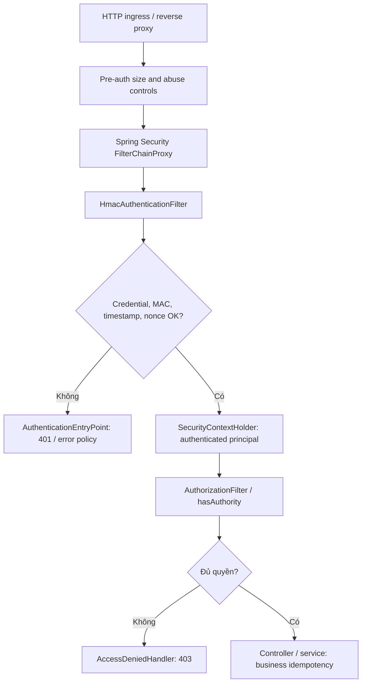
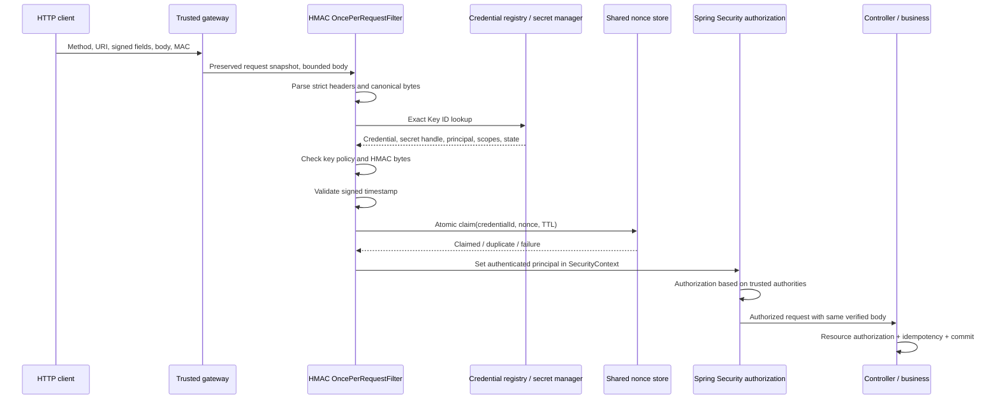
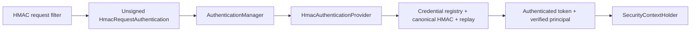

# HMAC trong Spring Security: tích hợp xác thực HTTP request bằng chữ ký

## 1. Bài toán và mục tiêu

Giả sử một dịch vụ Spring Boot cung cấp API tạo đơn:

```http
POST /api/orders HTTP/1.1
Host: api.example.test
Content-Type: application/json
X-Key-Id: kid_<opaque-id>
X-Signature-Version: hmac-spring-v1
X-Timestamp: 2026-11-28T10:00:00Z
X-Nonce: <random-nonce>
X-Signature: <HMAC-SHA256-hex>

{"orderId":"O-42","amount":90000}
```

Một client đã được cấp **Key ID** và **shared secret** sẽ ký các thành phần request theo một hợp đồng canonicalization. Server dùng Key ID để tra đúng credential record, tính lại HMAC trên canonical bytes, so sánh chữ ký và kiểm tra timestamp/nonce để chặn replay. Khi tất cả bước xác thực thành công, ứng dụng cần đưa **verified principal** vào **Spring Security Context** để các rule phân quyền như `hasAuthority(...)` hoạt động bình thường.

Nếu chỉ so MAC rồi gọi trực tiếp controller, lập trình viên dễ bỏ qua credential bị revoke, quyền trên tài nguyên, trạng thái replay hoặc filter khác. Ngược lại, nếu dùng Spring Security đúng cách nhưng đọc/chuẩn hóa HTTP request sai, chữ ký có thể lệch giữa client và gateway, hoặc các thành phần backend xử lý một body khác với body đã ký.

Bài **HMAC trong Spring Security** thuộc chương **Spring Security**, trong module `SECURITY_AUTHENTICATION_HMAC_REQUEST_AUTHENTICATION`. Module hướng tới việc **thiết kế xác thực HTTP request bằng HMAC với shared secret** và canonical request gồm HTTP method, URI, signed headers hoặc body theo hợp đồng ký; thực hành xác minh chữ ký, chống replay bằng timestamp/nonce, quản lý key rotation, kiểm thử proxy/gateway và phân biệt **authentication** với **authorization**.

Tài liệu dùng **Java 17+, Spring Boot 3.x, Spring Security 6.x và Servlet stack** (`jakarta.servlet`) làm phạm vi minh họa. Các class Spring Security và API được trình bày theo phong cách **component-based `SecurityFilterChain`**, không dùng `WebSecurityConfigurerAdapter`. Version phụ thuộc cụ thể do Spring Boot dependency management và dự án quản lý; ví dụ không tuyên bố tương thích mọi phiên bản Spring hoặc mọi cấu hình proxy.

Sau bài học, người đọc cần:

1. Hiểu HMAC thuộc **authentication**, còn Spring Security authorization xử lý quyền truy cập sau đó.
2. Xác định thứ tự filter, vị trí `OncePerRequestFilter`, cơ chế đặt `Authentication` vào `SecurityContextHolder` và cách trả 401/403.
3. Định nghĩa canonical request **byte-for-byte** giữa signer và verifier, gồm signed Key ID, version, timestamp, nonce, body digest và trusted audience.
4. Đọc body an toàn một lần nhưng để controller vẫn đọc được bytes đã xác minh; tránh **request smuggling**, duplicate headers, body mutation và nguy cơ DoS vì cache vô hạn.
5. Tách `CredentialRegistry`, `HmacVerifier`, `ReplayStore`, `AuthenticationEntryPoint` và `SecurityFilterChain` để test độc lập.
6. Kiểm thử active/revoked/rotated credentials, replay, proxy/gateway normalization, filter double registration, session/state và authorization.

## 2. HMAC đứng ở đâu trong Spring Security?

Spring Security Servlet sử dụng chuỗi servlet filters. Filter tùy chỉnh có thể chuyển một request thành một **authenticated `Authentication` object** khi HMAC hợp lệ; các phần còn lại của Spring Security áp dụng authorization và security context.



Điểm cần giữ rõ:

| Thành phần | Vai trò |
| --- | --- |
| **`FilterChainProxy` / `SecurityFilterChain`** | Xác định các security filters cho route được bảo vệ. |
| **`OncePerRequestFilter`** | Nơi tích hợp việc đọc signed request, gọi verifier và đặt authenticated principal. |
| **`CredentialRegistry`** | Định danh Key ID, secret handle, principal, role/scope, trạng thái key, thời hạn và audience được server quản trị. |
| **`HmacVerifier`** | Kiểm tra canonicalization, HMAC, timestamp và nonce theo signature profile. |
| **`Authentication`** | Đối tượng đại diện principal/authorities **đã xác thực**, không chứa raw secret. |
| **`SecurityContextHolder`** | Giữ `SecurityContext` của request đang xử lý; phải có lifecycle/cleanup đúng. |
| **`AuthorizationFilter`** | Áp dụng rules như `hasAuthority("orders:write")` dựa trên principal đã xác minh. |
| **`AuthenticationEntryPoint`** | Phát sinh response khi xác thực thất bại, thường là 401 theo contract của API. |
| **`AccessDeniedHandler`** | Phản hồi khi principal đã xác thực nhưng không được phép, thường là 403. |
| **`ReplayStore`** | Claim nonce nguyên tử với TTL trên phạm vi phù hợp; **không** phải session store hay rate limiter. |

### Authentication khác authorization

Giả sử client A biết secret K1 và ký đúng `POST /api/orders`. Sau verification, HMAC filter có thể tạo principal `merchant-a` cùng authority `orders:write`. Tuy nhiên controller/service vẫn phải kiểm tra request tạo đơn **thuộc merchant-a**, hạn mức hoặc điều kiện business. Một chữ ký HMAC đúng **không tự cấp quyền đọc mọi order**.

Một client có thể **được xác thực nhưng thiếu `orders:write`**: Spring Security trả 403 theo cấu hình. Một client gửi MAC sai **không được đánh dấu authenticated** rồi mới trả 403; nó phải thất bại ở authentication.

## 3. Quyết định thiết kế trước khi viết filter

### 3.1 Chọn scope đúng: Servlet hay WebFlux?

Bài này dùng **Spring MVC/Servlet** với `HttpServletRequest`, `OncePerRequestFilter`, `HttpSecurity` và `SecurityFilterChain`.

Nếu dùng **Spring WebFlux**, stack khác: `ServerWebExchange`, reactive body `DataBuffer`, `WebFilter` / `SecurityWebFilterChain` và reactive security context. Không mang trực tiếp code `OncePerRequestFilter` sang WebFlux, đặc biệt vì body là stream khác cơ chế và có backpressure.

### 3.2 Định nghĩa một signature profile được version hóa

Trong tài liệu, tên minh họa là `hmac-spring-v1`. Nó **không phải chuẩn mặc định của Spring Security**: client và server phải thống nhất chính xác cùng một hợp đồng. Không tự biến tên `HMAC` thành một phương pháp canonicalization “chuẩn” nếu chưa công bố.

Profile V1 có ranh giới cố ý đơn giản để người học nhìn thấy mọi byte:

- **Method:** duy nhất `POST`.
- **Path:** duy nhất `/api/orders`; **không hỗ trợ query string** trong demo.
- **Audience:** `https://api.example.test` đến từ **trusted service configuration**, không tin `Host` hay `X-Forwarded-Host` do Internet caller khai báo.
- **Content-Type:** đúng `application/json`; không chấp nhận biến thể có charset hoặc whitespace nội bộ trong demo nếu chưa version hóa.
- **Headers phải ký:** `Content-Type`, `X-Key-Id`, `X-Signature-Version`, `X-Timestamp`, `X-Nonce`.
- **Signature carrier:** `X-Signature` dưới dạng **64 chữ số hex thường**; chính chữ ký không được ký lồng vào canonical request.
- **Key ID:** `kid_` + Base64URL-no-padding của 16 byte opaque ngẫu nhiên, đủ 26 ASCII chars.
- **Timestamp:** UTC dạng `YYYY-MM-DDTHH:mm:ssZ`, độ phân giải tới giây. Request được chấp nhận khi `serverNow - 300s <= timestamp <= serverNow + 30s`.
- **Nonce:** Base64URL-no-padding của **24 byte CSPRNG** (32 chars); mới cho từng request attempt.
- **Body:** SHA-256 của **bytes thực**, tối đa 1 MiB, không hỗ trợ `Content-Encoding`/nén trong demo.
- **Canonical framing:** các dòng nối bằng LF `0A`, encode UTF-8, **không có LF cuối**. Signed header names viết chữ thường.
- **MAC:** `HmacSHA256` trên canonical bytes bằng shared secret đã cấp, kết quả **32 bytes**.

### 3.3 Canonical request V1

Ví dụ logic của message được ký:

```text
HMAC-SPRING-V1
POST
https://api.example.test
/api/orders
content-type:application/json
x-key-id:kid_AAAAAAAAAAAAAAAAAAAAAA
x-signature-version:hmac-spring-v1
x-timestamp:2026-11-28T10:00:00Z
x-nonce:AAAAAAAAAAAAAAAAAAAAAAAAAAAAAAAA
<lowercaseHex(SHA-256(bodyBytes))>
```

**Dòng cuối chỉ là placeholder**, phải thay bằng đúng 64 hex chars của SHA-256 body thật. Không ký dấu `<` hay `>`. Chuỗi `kid_A...` và nonce toàn A chỉ là ký hiệu minh họa; chúng **không có entropy bảo mật** để dùng khi provisioning.

```text
bodyDigest     = SHA-256(bodyBytes)
canonicalBytes = UTF8(canonical lines with lowercaseHex(bodyDigest))
signature      = lowercaseHex(HMAC-SHA256(secretForExactKeyId, canonicalBytes))
```

Server **không nhận secret từ client**. `X-Key-Id` là định danh công khai cho lookup, nhưng là **signed field** để ràng buộc chữ ký với đúng credential. Signature version do server allowlist và credential policy quyết định, không được cho client chọn thuật toán yếu hơn như `HmacSHA1` theo một header tùy ý.

### 3.4 Nguyên tắc về bytes và proxy

Trong Servlet, `request.getRequestURI()`, `getQueryString()`, `getInputStream()` và `getHeader(...)` biểu diễn **request sau khi qua container/gateway**, không đương nhiên là nguyên văn HTTP wire bytes client đã gửi. Một proxy có thể rewrite path, reorder query, decompress body hoặc hợp nhất duplicate headers.

Với profile V1 chỉ chấp nhận route `/api/orders` không query, có thể dùng `getRequestURI()` sau khi **đã xác định contract ingress không rewrite path này**; nếu deployment có context path, rewrite hoặc URL encoding khác, phải thay đổi thiết kế/adapter trước khi dùng. Không tự gọi `URLDecoder`, lowercase opaque Key ID hoặc parse JSON rồi serialize lại để tính MAC.

Nên **chặn duplicate signed fields ở gateway còn thấy raw HTTP field lines**, vì `HttpServletRequest.getHeaders(name)` có thể đã nhận biểu diễn được proxy/framework biến đổi. Trong demo ta kiểm tra `getHeaders` không trùng, nhưng **chỉ riêng Servlet API không thể chứng minh không có hai field lines bị upstream merge**. Đây là ranh giới an ninh phải được test xuyên proxy.

## 4. Các cấu phần cần tách khỏi Spring Security filter

Một thiết kế dễ kiểm thử có các biên rõ ràng:



### 4.1 Credential registry

Registry là **server-side authoritative source** gắn một Key ID chính xác với credential metadata:

```text
keyId             = "kid_<opaque>"
immutableCredId   = "cred-42"
clientId          = "integration-a"
principalId       = "merchant-a"
secretRef         = "vault://payments/cred-42"
lifecycleState    = ACTIVE | SUSPENDED | REVOKED
notBefore         = ...
expiresAt         = ...
allowedAudience   = "https://api.example.test"
allowedOperations = ["POST /api/orders"]
allowedVersions   = ["hmac-spring-v1"]
authorities       = ["orders:write"]
```

HMAC cần **bytes của secret thật** hoặc một cơ chế HMAC operation từ KMS/HSM được provisioning đúng; Key ID là **public index**, không được dùng làm secret. Trong production, secret manager / KMS / HSM có thể có cách xuất hoặc thực hiện HMAC khác nhau; không giả định mọi symmetric key đều export được cho client. Credential có thể ở trạng thái SUSPENDED/REVOKED dù secret vẫn còn trong vault.

**Không tạo raw secret từ `X-Key-Id`**, không đọc một vault path do HTTP client chỉ định, không fallback sang secret mặc định khi lookup miss hoặc HMAC sai. Với nhiều client, dùng Key ID để chọn **một** credential record rồi xác minh; không scan toàn bộ secrets đến khi MAC khớp.

### 4.2 HMAC verifier độc lập HTTP framework

Hãy giữ logic crypto và policy càng ít phụ thuộc Spring càng tốt. Một service có thể nhận `SignedRequest` bất biến gồm method, canonical target, audience, signed fields và byte[] body; trả kết quả `VerifiedPrincipal` hoặc mã lỗi. Điều này giúp dùng cùng golden fixture để kiểm thử signer Java, client SDK khác ngôn ngữ và Spring adapter.

Trong ví dụ bên dưới, verifier nhận `HttpServletRequest` được bọc bởi bounded-body wrapper để minh họa tích hợp trực tiếp. Sản phẩm lớn có thể tách tiếp canonicalizer/service interface.

### 4.3 Nonce store và failure behavior

Nonce dùng để ngăn **replay của request đã hợp lệ**, không phải idempotency key của nghiệp vụ:

```text
replay:v1:<immutable-credential-id>:<nonce>
```

Nếu request đã qua HMAC và timestamp, server cần **claim nonce nguyên tử** bằng thao tác tương đương `SET NX EX` trên một store được chia sẻ theo phạm vi verifier. Nếu nonce đã tồn tại, reject. Nếu store timeout, thao tác trả kết quả không chắc chắn hoặc không bảo đảm TTL, **fail closed** cho request nhạy cảm.

Với cửa sổ `MAX_AGE=300s`, `FUTURE_SKEW=30s`, TTL minh họa `360s` bao phủ độ dài cửa sổ tối đa từ lúc nhận + margin 30s. Không được để eviction trước TTL biến replay thành request “mới”. Trên nhiều JVM/region, một `ConcurrentHashMap` riêng mỗi node **không chống replay toàn cục**.

### 4.4 Không nhầm replay với retry thanh toán

Nếu client nhận timeout sau khi gửi `POST /api/orders`, nó phải tạo **nonce mới, timestamp mới và HMAC mới** cho lần retry. Một **Idempotency-Key** nghiệp vụ có thể giữ nguyên theo logical order để tránh tạo hai đơn. Profile code dưới đây tập trung vào HMAC nên không bắt buộc `Idempotency-Key` trong canonical V1; nếu đưa nó vào request để bảo vệ nghiệp vụ, cần **đưa vào signed canonical contract mới/được công bố**, không âm thầm tin một header chưa ký để phân biệt tác vụ.

## 5. Khung dependency và cấu hình Spring Security

Ví dụ dependency của Spring Boot 3 dùng Spring Security Servlet và Spring MVC, **không ghim version rời khỏi Boot dependency management**:

```xml
<!-- pom.xml: phần dependencies minh họa -->
<dependencies>
    <dependency>
        <groupId>org.springframework.boot</groupId>
        <artifactId>spring-boot-starter-web</artifactId>
    </dependency>
    <dependency>
        <groupId>org.springframework.boot</groupId>
        <artifactId>spring-boot-starter-security</artifactId>
    </dependency>
    <dependency>
        <groupId>org.springframework.boot</groupId>
        <artifactId>spring-boot-starter-test</artifactId>
        <scope>test</scope>
    </dependency>
    <dependency>
        <groupId>org.springframework.security</groupId>
        <artifactId>spring-security-test</artifactId>
        <scope>test</scope>
    </dependency>
</dependencies>
```

Không thêm một dependency HMAC bất kỳ để dùng `HmacSHA256`: **JCA/JCE trong JDK** đã cung cấp `javax.crypto.Mac` và `SecretKeySpec`. Phần cần triển khai là **giao thức HTTP và tích hợp Spring Security**, không phải tự viết thuật toán mật mã.

### Filter chain stateless

Đối với một **machine-to-machine API hoàn toàn stateless, không dựa vào browser cookies để xác thực**, có thể cấu hình:

```java
@Bean
SecurityFilterChain apiSecurity(
        HttpSecurity http,
        HmacVerifier verifier,
        AuthenticationEntryPoint entryPoint) throws Exception {
    HmacAuthenticationFilter hmacFilter =
            new HmacAuthenticationFilter(verifier, entryPoint);

    return http
            .securityMatcher("/api/**")
            .csrf(AbstractHttpConfigurer::disable)
            .sessionManagement(sm -> sm.sessionCreationPolicy(
                    SessionCreationPolicy.STATELESS))
            .formLogin(AbstractHttpConfigurer::disable)
            .httpBasic(AbstractHttpConfigurer::disable)
            .exceptionHandling(ex -> ex
                    .authenticationEntryPoint(entryPoint)
                    .accessDeniedHandler((request, response, error) ->
                            response.sendError(
                                    HttpServletResponse.SC_FORBIDDEN)))
            .authorizeHttpRequests(auth -> auth
                    .requestMatchers(HttpMethod.POST, "/api/orders")
                    .hasAuthority("orders:write")
                    .anyRequest().denyAll())
            .addFilterBefore(
                    hmacFilter, UsernamePasswordAuthenticationFilter.class)
            .build();
}
```

Trong ví dụ, `HmacVerifier`, `HmacAuthenticationFilter` và `entryPoint` do ứng dụng định nghĩa. Đoạn này chỉ minh họa **điểm đặt filter và authorization rules**; mã triển khai các class được trình bày trong phần sau.

**Không tắt CSRF theo thói quen cho mọi website.** CSRF có ý nghĩa với xác thực dựa trên browser cookies và những luồng stateful; chỉ tắt khi chain này thật sự là API HMAC stateless được thiết kế phù hợp. Đồng thời, `securityMatcher("/api/**")` chỉ chọn chain cho những URL đó; phần còn lại của ứng dụng phải có **chain/rules riêng** để tránh những route vô tình không được bảo vệ.

### Vì sao dùng `addFilterBefore`?

HMAC authentication cần chạy đủ sớm để một `Authentication` được tạo **trước khi `AuthorizationFilter` đánh giá quyền**. Đặt filter trước `UsernamePasswordAuthenticationFilter` là một vị trí hay dùng trong Servlet security chain mẫu; thứ tự chính xác phải kiểm tra khi ứng dụng còn có bearer token, API key, mTLS, exception handling hoặc nhiều `SecurityFilterChain`.

**Lưu ý tinh tế:** `ExceptionTranslationFilter` nằm ở một vị trí nhất định trong chain và **không tự bắt mọi exception được ném từ một custom filter nằm phía trước nó**. Vì vậy, với HMAC filter đặt sớm, cần **tự xử lý lỗi xác thực trong filter** qua `AuthenticationEntryPoint` hoặc response mapping đã thiết kế; không giả định cứ `throw BadCredentialsException` là Spring sẽ biến thành 401 ở mọi cấu hình.

### Tránh chạy filter hai lần

Nếu đăng ký `HmacAuthenticationFilter` dưới dạng Spring `@Component`/`@Bean` servlet `Filter` **và** thêm instance đó vào Spring Security chain, Spring Boot có thể **auto-register filter ở servlet container** ngoài security chain, khiến filter chạy sai thứ tự hoặc hai lần.

Trong mẫu này, tạo `new HmacAuthenticationFilter(...)` **trực tiếp trong cấu hình `SecurityFilterChain`** và **không** đồng thời đăng ký nó như standalone servlet filter. Nếu bắt buộc có Filter bean để inject, cần vô hiệu servlet auto-registration bằng `FilterRegistrationBean` có `setEnabled(false)` rồi chỉ đăng ký vào security chain. Kiểm thử thực tế thứ tự filter với DEBUG logs/test request; `OncePerRequestFilter` **không chữa được việc đăng ký hai vòng filter chains khác nhau**.

## 6. Ví dụ Java 17 và Spring Security 6: mã lõi

Để giữ các thành phần nhất quán, phần này trình bày **một file minh họa** `HmacApiSecurityConfig.java` trong package `example.hmac`, dùng các nested types để giản lược cấu trúc dự án. Các interface/stores chạy trong bộ nhớ chỉ phục vụ minh họa; triển khai thật phải thay bằng credential registry/vault và nonce store phân tán.

**Điều kiện của code:** ứng dụng chạy Servlet/Spring MVC trên **context path rỗng**, không dùng Servlet async I/O cho route này, proxy đã giữ nguyên `POST /api/orders` và từ chối duplicate raw headers trước khi merge. Không hỗ trợ query hoặc content encoding trong profile. Lược đồ này chỉ đưa đủ phần **authentication filter và cấu hình security**, chưa phải sản phẩm xử lý đơn hàng.

### 6.1 Import, kiểu dữ liệu và credential registry

```java
package example.hmac;

import jakarta.servlet.FilterChain;
import jakarta.servlet.ReadListener;
import jakarta.servlet.ServletException;
import jakarta.servlet.ServletInputStream;
import jakarta.servlet.http.HttpServletRequest;
import jakarta.servlet.http.HttpServletRequestWrapper;
import jakarta.servlet.http.HttpServletResponse;
import org.springframework.context.annotation.Bean;
import org.springframework.context.annotation.Configuration;
import org.springframework.http.HttpMethod;
import org.springframework.security.authentication.BadCredentialsException;
import org.springframework.security.authentication.UsernamePasswordAuthenticationToken;
import org.springframework.security.config.annotation.web.builders.HttpSecurity;
import org.springframework.security.config.annotation.web.configurers.AbstractHttpConfigurer;
import org.springframework.security.config.http.SessionCreationPolicy;
import org.springframework.security.core.Authentication;
import org.springframework.security.core.authority.SimpleGrantedAuthority;
import org.springframework.security.core.context.SecurityContext;
import org.springframework.security.core.context.SecurityContextHolder;
import org.springframework.security.web.AuthenticationEntryPoint;
import org.springframework.security.web.SecurityFilterChain;
import org.springframework.security.web.authentication.UsernamePasswordAuthenticationFilter;
import org.springframework.web.filter.OncePerRequestFilter;

import javax.crypto.Mac;
import javax.crypto.spec.SecretKeySpec;
import java.io.BufferedReader;
import java.io.ByteArrayInputStream;
import java.io.IOException;
import java.io.InputStreamReader;
import java.nio.charset.StandardCharsets;
import java.security.GeneralSecurityException;
import java.security.MessageDigest;
import java.time.Clock;
import java.time.Duration;
import java.time.Instant;
import java.time.format.DateTimeParseException;
import java.util.Arrays;
import java.util.Base64;
import java.util.Collections;
import java.util.Enumeration;
import java.util.HexFormat;
import java.util.List;
import java.util.Map;
import java.util.Objects;
import java.util.Set;
import java.util.concurrent.ConcurrentHashMap;
import java.util.concurrent.atomic.AtomicBoolean;
import java.util.regex.Pattern;

@Configuration
public class HmacApiSecurityConfig {
    static final String AUDIENCE = "https://api.example.test";
    static final String TARGET = "/api/orders";
    static final String PROFILE = "hmac-spring-v1";
    static final String OPERATION = "POST /api/orders";
    static final int MAX_BODY = 1_048_576;
    static final Duration MAX_AGE = Duration.ofSeconds(300);
    static final Duration FUTURE_SKEW = Duration.ofSeconds(30);
    static final Duration NONCE_TTL = Duration.ofSeconds(360);
    static final HexFormat HEX = HexFormat.of();
    static final Pattern KEY_ID =
            Pattern.compile("kid_[A-Za-z0-9_-]{22}");
    static final Pattern NONCE =
            Pattern.compile("[A-Za-z0-9_-]{32}");
    static final Pattern SIGNATURE =
            Pattern.compile("[0-9a-f]{64}");
    static final Pattern TIMESTAMP =
            Pattern.compile("[0-9]{4}-[0-9]{2}-[0-9]{2}T"
                    + "[0-9]{2}:[0-9]{2}:[0-9]{2}Z");

    // Không giữ shared secret trong Spring Security principal.
    public record VerifiedHmacPrincipal(
            String clientId, String principalId, String credentialId) {}

    // Chỉ server được quyền tạo credential records có giá trị.
    public record Credential(
            String keyId, String credentialId, String clientId,
            String principalId, byte[] secret, boolean active,
            Instant notBefore, Instant expiresAt, String audience,
            Set<String> allowedOperations, Set<String> allowedProfiles,
            Set<String> authorities) {
        public Credential {
            Objects.requireNonNull(keyId);
            Objects.requireNonNull(credentialId);
            Objects.requireNonNull(secret);
            secret = secret.clone();
            allowedOperations = Set.copyOf(allowedOperations);
            allowedProfiles = Set.copyOf(allowedProfiles);
            authorities = Set.copyOf(authorities);
        }
        @Override public byte[] secret() {
            return secret.clone();
        }
        public Credential withActive(boolean enabled) {
            return new Credential(
                    keyId, credentialId, clientId, principalId,
                    secret, enabled, notBefore, expiresAt, audience,
                    allowedOperations, allowedProfiles, authorities);
        }
    }

    // Production repository phải dùng exact case-sensitive Key ID lookup.
    interface CredentialRepository {
        Credential findExact(String keyId)
                throws RegistryUnavailableException;
    }

    static final class RegistryUnavailableException extends Exception {
        RegistryUnavailableException(String message) {
            super(message);
        }
    }

    // Demo ONLY: không phải durable credential store.
    static final class DemoCredentialRepository
            implements CredentialRepository {
        private final ConcurrentHashMap<String, Credential> data =
                new ConcurrentHashMap<>();

        void provisionForTest(Credential credential) {
            if (data.putIfAbsent(credential.keyId(), credential) != null) {
                throw new IllegalArgumentException(
                        "Key ID already exists; never overwrite secret");
            }
        }

        void updateActiveForTest(String keyId, boolean active) {
            data.computeIfPresent(keyId,
                    (id, current) -> current.withActive(active));
        }

        @Override public Credential findExact(String keyId) {
            return data.get(keyId);
        }
    }

    private record NonceKey(
            String immutableCredentialId, String nonce) {}

    interface ReplayStore {
        boolean claim(
                String credentialId, String nonce,
                Instant now, Duration ttl) throws ReplayStoreUnavailable;
    }

    static final class ReplayStoreUnavailable extends Exception {
        ReplayStoreUnavailable(String message) {
            super(message);
        }
    }

    // Chỉ atomic trong MỘT JVM. Production: shared store + TTL.
    static final class DemoReplayStore implements ReplayStore {
        private final ConcurrentHashMap<NonceKey, Instant> used =
                new ConcurrentHashMap<>();

        @Override public boolean claim(
                String credentialId, String nonce,
                Instant now, Duration ttl) {
            AtomicBoolean fresh = new AtomicBoolean(false);
            used.compute(new NonceKey(credentialId, nonce),
                    (key, oldExpiry) -> {
                        if (oldExpiry == null
                                || !oldExpiry.isAfter(now)) {
                            fresh.set(true);
                            return now.plus(ttl);
                        }
                        return oldExpiry;
                    });
            return fresh.get();
        }
    }

    // Cần một body snapshot để HMAC và MVC handler dùng cùng bytes.
    // Chỉ dành cho synchronous servlet request trong demo.
    static final class CachedBodyRequest
            extends HttpServletRequestWrapper {
        private final byte[] body;

        CachedBodyRequest(HttpServletRequest original)
                throws IOException {
            super(original);
            // Không gọi readAllBytes() vô giới hạn trên Internet request.
            byte[] received = original.getInputStream()
                    .readNBytes(MAX_BODY + 1);
            if (received.length > MAX_BODY) {
                throw new BodyTooLargeException();
            }
            this.body = received;
        }

        byte[] bodyBytes() {
            return body.clone();
        }

        @Override public ServletInputStream getInputStream() {
            ByteArrayInputStream input =
                    new ByteArrayInputStream(body);
            return new ServletInputStream() {
                @Override public int read() {
                    return input.read();
                }
                @Override public boolean isFinished() {
                    return input.available() == 0;
                }
                @Override public boolean isReady() {
                    return true;
                }
                @Override public void setReadListener(
                        ReadListener readListener) {
                    throw new UnsupportedOperationException(
                            "Synchronous Servlet demo only");
                }
            };
        }

        @Override public BufferedReader getReader() {
            return new BufferedReader(new InputStreamReader(
                    getInputStream(), StandardCharsets.UTF_8));
        }
    }

    static final class BodyTooLargeException extends IOException {}

    enum VerifyStatus {
        VALID, MALFORMED, UNAUTHENTICATED
    }

    record Verification(
            VerifyStatus status,
            VerifiedHmacPrincipal principal,
            Set<String> authorities) {
        static Verification failed(VerifyStatus status) {
            return new Verification(status, null, Set.of());
        }
        static Verification passed(
                VerifiedHmacPrincipal principal,
                Set<String> authorities) {
            return new Verification(
                    VerifyStatus.VALID, principal, Set.copyOf(authorities));
        }
    }

    static final class HmacVerifier {
        private final CredentialRepository registry;
        private final ReplayStore replay;
        private final Clock clock;

        HmacVerifier(
                CredentialRepository registry,
                ReplayStore replay, Clock clock) {
            this.registry = Objects.requireNonNull(registry);
            this.replay = Objects.requireNonNull(replay);
            this.clock = Objects.requireNonNull(clock);
        }

        // Chỉ bỏ HTTP OWS ở hai rìa field-value.
        private static String stripOws(String input) {
            int start = 0, end = input.length();
            while (start < end
                    && (input.charAt(start) == ' '
                        || input.charAt(start) == '\t')) start++;
            while (end > start
                    && (input.charAt(end - 1) == ' '
                        || input.charAt(end - 1) == '\t')) end--;
            return input.substring(start, end);
        }

        private static String singleHeader(
                HttpServletRequest request, String name) {
            Enumeration<String> all = request.getHeaders(name);
            if (all == null || !all.hasMoreElements()) {
                throw new IllegalArgumentException("Missing signed header");
            }
            String first = all.nextElement();
            if (all.hasMoreElements() || first == null) {
                throw new IllegalArgumentException(
                        "Duplicate or null signed header");
            }
            String value = stripOws(first);
            for (int i = 0; i < value.length(); i++) {
                char ch = value.charAt(i);
                if (ch < 0x20 || ch > 0x7e) {
                    throw new IllegalArgumentException(
                            "Non-ASCII/control signed header");
                }
            }
            return value;
        }

        private static boolean canonicalBase64Url(
                String encoded, int expectedBytes) {
            if (encoded == null
                    || !encoded.matches("[A-Za-z0-9_-]+")) {
                return false;
            }
            try {
                byte[] decoded =
                        Base64.getUrlDecoder().decode(encoded);
                return decoded.length == expectedBytes
                        && encoded.equals(Base64.getUrlEncoder()
                                .withoutPadding().encodeToString(decoded));
            } catch (IllegalArgumentException invalid) {
                return false;
            }
        }

        private static boolean validKeyId(String input) {
            return input != null && KEY_ID.matcher(input).matches()
                    && canonicalBase64Url(input.substring(4), 16);
        }

        private static boolean validNonce(String input) {
            return input != null && NONCE.matcher(input).matches()
                    && canonicalBase64Url(input, 24);
        }

        private static Instant parseTimestamp(String input) {
            if (input == null
                    || !TIMESTAMP.matcher(input).matches()) {
                throw new IllegalArgumentException(
                        "Invalid timestamp format");
            }
            try {
                Instant parsed = Instant.parse(input);
                if (parsed.getNano() != 0
                        || !parsed.toString().equals(input)) {
                    throw new IllegalArgumentException(
                            "Noncanonical timestamp");
                }
                return parsed;
            } catch (DateTimeParseException invalid) {
                throw new IllegalArgumentException(
                        "Invalid timestamp", invalid);
            }
        }

        private static byte[] canonicalBytes(
                CachedBodyRequest request,
                String contentType, String keyId, String timestamp,
                String nonce) throws GeneralSecurityException {
            String bodyHash = HEX.formatHex(
                    MessageDigest.getInstance("SHA-256")
                            .digest(request.bodyBytes()));
            String canonical = String.join("\n",
                    "HMAC-SPRING-V1",
                    request.getMethod(),
                    AUDIENCE,
                    TARGET,
                    "content-type:" + contentType,
                    "x-key-id:" + keyId,
                    "x-signature-version:" + PROFILE,
                    "x-timestamp:" + timestamp,
                    "x-nonce:" + nonce,
                    bodyHash);
            return canonical.getBytes(StandardCharsets.UTF_8);
        }

        private static byte[] computeMac(
                byte[] secret, byte[] message)
                throws GeneralSecurityException {
            // Một Mac instance cho mỗi request, không chia sẻ mutable state.
            Mac mac = Mac.getInstance("HmacSHA256");
            mac.init(new SecretKeySpec(secret, "HmacSHA256"));
            return mac.doFinal(message);
        }

        Verification verify(CachedBodyRequest request)
                throws GeneralSecurityException,
                       RegistryUnavailableException,
                       ReplayStoreUnavailable {
            if (!"POST".equals(request.getMethod())
                    || !TARGET.equals(request.getRequestURI())
                    || request.getQueryString() != null
                    || request.getHeader("Content-Encoding") != null
                    || request.bodyBytes().length == 0) {
                return Verification.failed(VerifyStatus.MALFORMED);
            }

            final String contentType, keyId, profile, timestampText;
            final String nonce, signatureText;
            final Instant timestamp;
            try {
                contentType = singleHeader(request, "Content-Type");
                keyId = singleHeader(request, "X-Key-Id");
                profile = singleHeader(request, "X-Signature-Version");
                timestampText = singleHeader(request, "X-Timestamp");
                nonce = singleHeader(request, "X-Nonce");
                signatureText = singleHeader(request, "X-Signature");

                if (!"application/json".equals(contentType)
                        || !validKeyId(keyId)
                        || !PROFILE.equals(profile)
                        || !validNonce(nonce)
                        || !SIGNATURE.matcher(signatureText).matches()) {
                    return Verification.failed(VerifyStatus.MALFORMED);
                }
                timestamp = parseTimestamp(timestampText);
            } catch (IllegalArgumentException malformed) {
                return Verification.failed(VerifyStatus.MALFORMED);
            }

            // Dùng Key ID công khai để tìm MỘT candidate credential.
            Credential credential = registry.findExact(keyId);
            Instant now = clock.instant();
            if (credential == null || !credential.active()
                    || !keyId.equals(credential.keyId())
                    || credential.clientId() == null
                    || credential.principalId() == null
                    || credential.credentialId() == null
                    || credential.notBefore() == null
                    || credential.expiresAt() == null
                    || now.isBefore(credential.notBefore())
                    || !now.isBefore(credential.expiresAt())
                    || !AUDIENCE.equals(credential.audience())
                    || !credential.allowedOperations().contains(OPERATION)
                    || !credential.allowedProfiles().contains(PROFILE)) {
                return Verification.failed(VerifyStatus.UNAUTHENTICATED);
            }

            byte[] secret = credential.secret();
            if (secret.length < 32) {
                return Verification.failed(VerifyStatus.UNAUTHENTICATED);
            }
            byte[] expected = computeMac(secret, canonicalBytes(
                    request, contentType, keyId, timestampText, nonce));
            byte[] submitted = HEX.parseHex(signatureText);
            if (expected.length != 32 || submitted.length != 32
                    || !MessageDigest.isEqual(expected, submitted)) {
                return Verification.failed(VerifyStatus.UNAUTHENTICATED);
            }
            if (timestamp.isBefore(now.minus(MAX_AGE))
                    || timestamp.isAfter(now.plus(FUTURE_SKEW))) {
                return Verification.failed(VerifyStatus.UNAUTHENTICATED);
            }

            // Nonce claim SAU MAC và freshness. Nếu storage lỗi,
            // không cấp authenticated principal.
            if (!replay.claim(credential.credentialId(),
                    nonce, now, NONCE_TTL)) {
                return Verification.failed(VerifyStatus.UNAUTHENTICATED);
            }
            return Verification.passed(
                    new VerifiedHmacPrincipal(
                            credential.clientId(),
                            credential.principalId(),
                            credential.credentialId()),
                    credential.authorities());
        }
    }

    static final class HmacAuthenticationFilter
            extends OncePerRequestFilter {
        private final HmacVerifier verifier;
        private final AuthenticationEntryPoint entryPoint;

        HmacAuthenticationFilter(
                HmacVerifier verifier,
                AuthenticationEntryPoint entryPoint) {
            this.verifier = Objects.requireNonNull(verifier);
            this.entryPoint = Objects.requireNonNull(entryPoint);
        }

        @Override protected boolean shouldNotFilter(
                HttpServletRequest request) {
            // Chỉ filter route dùng profile này. Trong demo,
            // ứng dụng phải chạy với Servlet context path rỗng.
            return !TARGET.equals(request.getRequestURI());
        }

        @Override protected void doFilterInternal(
                HttpServletRequest request,
                HttpServletResponse response, FilterChain chain)
                throws ServletException, IOException {
            // Chặn body quá lớn trước khi cấp bộ nhớ cache.
            if (request.getContentLengthLong() > MAX_BODY) {
                response.sendError(
                        HttpServletResponse.SC_REQUEST_ENTITY_TOO_LARGE);
                return;
            }
            final CachedBodyRequest cached;
            try {
                cached = new CachedBodyRequest(request);
            } catch (BodyTooLargeException oversized) {
                response.sendError(
                        HttpServletResponse.SC_REQUEST_ENTITY_TOO_LARGE);
                return;
            }

            final Verification result;
            try {
                result = verifier.verify(cached);
            } catch (RegistryUnavailableException
                    | ReplayStoreUnavailable
                    | GeneralSecurityException unavailable) {
                // Internal security dependency failure != invalid MAC.
                // Không accept/fallback, không trả chi tiết cho client.
                response.sendError(
                        HttpServletResponse.SC_SERVICE_UNAVAILABLE);
                return;
            }

            if (result.status() == VerifyStatus.MALFORMED) {
                response.sendError(HttpServletResponse.SC_BAD_REQUEST);
                return;
            }
            if (result.status() != VerifyStatus.VALID) {
                // Filter này đặt trước ExceptionTranslationFilter nên
                // chủ động gọi AuthenticationEntryPoint.
                entryPoint.commence(cached, response,
                        new BadCredentialsException("HMAC rejected"));
                return;
            }

            VerifiedHmacPrincipal principal = result.principal();
            List<SimpleGrantedAuthority> grants =
                    result.authorities().stream()
                            .map(SimpleGrantedAuthority::new)
                            .toList();
            Authentication authentication =
                    UsernamePasswordAuthenticationToken.authenticated(
                            principal, null, grants);
            SecurityContext context =
                    SecurityContextHolder.createEmptyContext();
            context.setAuthentication(authentication);
            SecurityContextHolder.setContext(context);

            try {
                // Chuyển wrapper đã xác minh cho controller, không
                // chuyển lại request gốc đã bị đọc input stream.
                chain.doFilter(cached, response);
            } finally {
                // Không để principal của request trước rò sang thread kế.
                SecurityContextHolder.clearContext();
            }
        }
    }

    @Bean
    Clock hmacClock() {
        return Clock.systemUTC();
    }

    @Bean
    DemoCredentialRepository credentialRepository() {
        // Demo trống ban đầu: KHÔNG hardcode default secret production.
        // Test có thể provisionForTest(...) trước khi gọi API.
        return new DemoCredentialRepository();
    }

    @Bean
    ReplayStore replayStore() {
        // Không dùng local map này cho nhiều instances/regions.
        return new DemoReplayStore();
    }

    @Bean
    AuthenticationEntryPoint hmacEntryPoint() {
        return (request, response, authenticationException) -> {
            response.setStatus(HttpServletResponse.SC_UNAUTHORIZED);
            response.setCharacterEncoding("UTF-8");
            response.setContentType("application/problem+json");
            response.setHeader("Cache-Control", "no-store");
            // HMAC scheme/challenge trong ví dụ là custom contract,
            // không phải một scheme HTTP chuẩn tự có sẵn.
            response.setHeader("WWW-Authenticate",
                    "HMAC realm=" + '"' + "api.example.test" + '"');
            response.getWriter().write("""
                    {"type":"about:blank",
                     "title":"Authentication failed",
                     "status":401}
                    """);
        };
    }

    @Bean
    SecurityFilterChain hmacApiChain(
            HttpSecurity http,
            DemoCredentialRepository registry,
            ReplayStore replay,
            Clock hmacClock,
            AuthenticationEntryPoint hmacEntryPoint)
            throws Exception {
        HmacVerifier verifier =
                new HmacVerifier(registry, replay, hmacClock);
        // KHÔNG đánh dấu filter instance này @Component/@Bean.
        HmacAuthenticationFilter filter =
                new HmacAuthenticationFilter(verifier, hmacEntryPoint);

        return http
                .securityMatcher("/api/**")
                .csrf(AbstractHttpConfigurer::disable)
                .sessionManagement(sm -> sm.sessionCreationPolicy(
                        SessionCreationPolicy.STATELESS))
                .requestCache(AbstractHttpConfigurer::disable)
                .formLogin(AbstractHttpConfigurer::disable)
                .httpBasic(AbstractHttpConfigurer::disable)
                .logout(AbstractHttpConfigurer::disable)
                .exceptionHandling(ex -> ex
                        .authenticationEntryPoint(hmacEntryPoint)
                        .accessDeniedHandler((req, resp, error) -> {
                            resp.setHeader("Cache-Control", "no-store");
                            resp.sendError(
                                    HttpServletResponse.SC_FORBIDDEN);
                        }))
                .authorizeHttpRequests(auth -> auth
                        .requestMatchers(HttpMethod.POST, TARGET)
                        .hasAuthority("orders:write")
                        .anyRequest().denyAll())
                .addFilterBefore(
                        filter, UsernamePasswordAuthenticationFilter.class)
                .build();
    }
}
```

### 6.2 Vì sao các phần quan trọng được viết như vậy?

**Key ID/secret:** `CredentialRepository.findExact` trả một credential duy nhất; `HmacVerifier` dùng secret của đúng record, không suy secret từ string ID, không thử các secrets khác. Bản ghi `Credential` clone byte[] để tránh thay đổi vô ý sau provisioning. Trong ứng dụng thật, nên dùng secret reference, ACL, audit và rotation lifecycle thay vì giữ raw secret trong `ConcurrentHashMap`.

**Header parsing:** `singleHeader` yêu cầu đúng một giá trị cho mỗi signed field mà Servlet API có thể quan sát, chặn control chars và chỉ bỏ **outer OWS**. `Content-Type` bắt buộc đúng chữ `application/json` theo V1; không tự canonicalize các biểu diễn HTTP tương đương nhưng giao thức chưa công bố.

**Body:** `CachedBodyRequest` đọc tối đa `MAX_BODY + 1` byte để phát hiện quá giới hạn và trả lại một stream tương ứng với **cùng bytes đã dùng tính digest**. `ContentCachingRequestWrapper` của Spring **không tự biến body đã đọc thành nguồn có thể phát lại cho controller** theo mọi cách sử dụng; vì vậy demo dùng wrapper lặp lại stream rõ ràng. Wrapper chỉ hỗ trợ **synchronous servlet I/O**, không được mang nguyên vẹn sang async servlet hoặc multipart/streaming upload.

**Security context:** sau verifier PASS, filter tạo `UsernamePasswordAuthenticationToken.authenticated(principal, null, authorities)` và đặt vào một `SecurityContext` mới. `principal` chứa client ID/principal ID/credential ID **đã được server xác minh**, không chứa raw shared secret. `finally` xóa context để tránh leak identity qua thread pool. Với mô hình security context propagation sang async thread/executor, phải dùng cơ chế phù hợp của Spring Security và thiết kế trust boundary riêng.

**Session:** `SessionCreationPolicy.STATELESS` không tạo một HTTP session để lưu authentication giữa requests. Mỗi HTTP attempt cần chứng minh HMAC, timestamp/nonce mới. Không dùng `JSESSIONID` để bỏ qua filter HMAC ở request sau trừ khi đã thiết kế một phương thức xác thực khác có policy riêng.

**Error handling:** body vượt 1 MiB trả 413; malformed input trả 400; Key ID không có, key bị revoke, signature sai, nonce trùng hoặc request stale trả lỗi xác thực chung (401); registry/crypto/replay store không khả dụng trả 503, **không chấp nhận request**. Nếu authorization fail ở phần còn lại của chain, `AccessDeniedHandler` trả 403. Phản hồi công khai không nói Key ID nào tồn tại hay secret nào bị thu hồi.

**Auth scheme:** `WWW-Authenticate: HMAC ...` chỉ phù hợp khi sản phẩm đã **định nghĩa và triển khai một HTTP authentication scheme custom** có client support. Nếu thực tế HMAC được mang trong các header độc lập, hãy thống nhất challenge/response contract; không tự tuyên bố có một chuẩn HTTP HMAC tích hợp sẵn trong Spring Security.

**Thread safety:** mỗi lần verify tạo một `Mac` instance mới, tránh chia sẻ `javax.crypto.Mac` mutable giữa threads. `ConcurrentHashMap.compute` atomic per-key trong demo không bảo đảm nonce uniqueness giữa các JVM/regions; replay store production phải có **atomic shared claim + TTL** theo phạm vi hệ thống xác minh.

## 7. Spring MVC controller tiêu thụ verified identity và body

Sau khi HMAC filter gọi `chain.doFilter(cached, response)`, Spring MVC có thể đọc `@RequestBody` từ **cùng bytes đã được dùng trong canonical digest**. Principal được lấy từ `SecurityContext`, không lấy từ một header HTTP do client tự khai.

```java
package example.hmac;

import org.springframework.http.MediaType;
import org.springframework.http.ResponseEntity;
import org.springframework.security.core.annotation.AuthenticationPrincipal;
import org.springframework.web.bind.annotation.PostMapping;
import org.springframework.web.bind.annotation.RequestBody;
import org.springframework.web.bind.annotation.RestController;
import java.util.Map;

@RestController
public class OrdersController {
    @PostMapping(path = "/api/orders",
            consumes = MediaType.APPLICATION_JSON_VALUE)
    public ResponseEntity<Map<String, String>> createOrder(
            @AuthenticationPrincipal
                    HmacApiSecurityConfig.VerifiedHmacPrincipal principal,
            @RequestBody byte[] verifiedBody) {
        // Demo không thực sự commit order. Production phải kiểm tra
        // principal có quyền trên merchantId/resource bên trong body.
        if (principal == null) {
            throw new IllegalStateException(
                    "Authenticated principal is required");
        }
        return ResponseEntity.ok(Map.of(
                "authenticatedPrincipal", principal.principalId(),
                "receivedBytes", Integer.toString(verifiedBody.length)));
    }
}
```

Tại sao controller không dùng:

```java
// KHÔNG NÊN: identity này có thể do HTTP caller tự khai.
String identity = request.getHeader("X-Client-Id");

// KHÔNG NÊN: getHeader("X-Key-Id") chỉ là lookup hint, chưa là principal.
String identity2 = request.getHeader("X-Key-Id");
```

Vì principal hợp lệ phải đến từ **credential record đã được verified**. Nếu có gateway HMAC verification thay vì backend, chỉ tin metadata **gateway tự tạo và truyền qua authenticated channel**, không tin các header như `X-Verified-Principal` đến từ Internet.

### Kiểm tra quyền theo tài nguyên vẫn là bắt buộc

`hasAuthority("orders:write")` ở filter chain chỉ kiểm tra authority theo credential. Nếu body có `merchantId`, cần xác nhận merchant đó thuộc **verified principal** hoặc actor có quyền được ủy nhiệm:

```java
// Pseudocode nghiệp vụ, nằm trong service layer:
if (!orderOwnershipPolicy.canCreateFor(
        verifiedPrincipal.principalId(), order.merchantId())) {
    throw new AccessDeniedException("Resource is not owned");
}
```

Một MAC hợp lệ **không khiến mọi trường trong body có quyền tự xác định tenant**. Signature ràng buộc bytes mà client có quyền ký, nhưng business authorization quyết định client đó **được làm gì** với dữ liệu.

### JSON parser, body snapshot và kiểm thử bytes

Trong profile V1, body digest được tính từ bytes **trước JSON deserialization**. Hai JSON có cùng nội dung logic nhưng khác whitespace hoặc thứ tự trường **sẽ tạo HMAC khác** nếu bytes khác:

```json
{"orderId":"O-42","amount":90000}
```

```json
{ "amount": 90000, "orderId": "O-42" }
```

Đây **không phải lỗi HMAC**; đó là hệ quả của hợp đồng ký raw body bytes. Client phải ký **đúng byte array sẽ gửi**. Server không được parse JSON rồi serialize lại để “làm cho chữ ký dễ khớp”.

Các hệ thống cần **streaming request bodies, upload lớn hoặc body compression** nên dùng profile khác được thiết kế và kiểm thử riêng, có giới hạn tài nguyên và giải pháp hashing/verification trước khi xử lý business side effects. Không mở rộng wrapper cache 1 MiB thành một `readAllBytes()` vô giới hạn.

## 8. Java signer để tạo fixture tương thích với Spring verifier

Để xác nhận hai bên thống nhất canonicalization, viết signer ở client bằng **cùng quy tắc**, nhưng không copy kết quả MAC làm “đáp án” duy nhất. Test nên lưu **canonical bytes và expected digest** của một **test secret cố định**, sau đó so signer Java, SDK khác ngôn ngữ và Spring verifier.

Đoạn code sau minh họa phương pháp tạo signed headers cho **một attempt**. Đây là snippet client Java 17; ứng dụng thật lưu client secret an toàn, không hardcode:

```java
import java.nio.charset.StandardCharsets;
import java.security.MessageDigest;
import java.security.SecureRandom;
import java.time.Instant;
import java.time.temporal.ChronoUnit;
import java.util.Base64;
import java.util.HexFormat;
import java.util.LinkedHashMap;
import java.util.Map;
import javax.crypto.Mac;
import javax.crypto.spec.SecretKeySpec;

// Phương thức này thuộc ClientSigner / test helper riêng.
static Map<String, String> signHeaders(
        String issuedKeyId, byte[] issuedSharedSecret,
        byte[] exactBody, Instant now, SecureRandom random)
        throws Exception {
    byte[] nonceBytes = new byte[24];
    random.nextBytes(nonceBytes);
    String nonce = Base64.getUrlEncoder().withoutPadding()
            .encodeToString(nonceBytes);
    String time = now.truncatedTo(ChronoUnit.SECONDS).toString();
    String bodyHash = HexFormat.of().formatHex(
            MessageDigest.getInstance("SHA-256").digest(exactBody));

    String canonical = String.join("\n",
            "HMAC-SPRING-V1",
            "POST",
            "https://api.example.test",
            "/api/orders",
            "content-type:application/json",
            "x-key-id:" + issuedKeyId,
            "x-signature-version:hmac-spring-v1",
            "x-timestamp:" + time,
            "x-nonce:" + nonce,
            bodyHash);

    Mac mac = Mac.getInstance("HmacSHA256");
    mac.init(new SecretKeySpec(
            issuedSharedSecret, "HmacSHA256"));
    String signature = HexFormat.of().formatHex(
            mac.doFinal(canonical.getBytes(StandardCharsets.UTF_8)));

    Map<String, String> headers = new LinkedHashMap<>();
    headers.put("Content-Type", "application/json");
    headers.put("X-Key-Id", issuedKeyId);
    headers.put("X-Signature-Version", "hmac-spring-v1");
    headers.put("X-Timestamp", time);
    headers.put("X-Nonce", nonce);
    headers.put("X-Signature", signature);
    return Map.copyOf(headers);
}
```

Với mỗi HTTP attempt, `SecureRandom` cấp nonce mới và timestamp lấy UTC clock. Truyền **`exactBody` tương ứng** trong HTTP request, không serialize một object JSON lần thứ hai sau khi ký.

**Chú ý Java Base64:** nếu hệ thống provisioning lưu secret dạng Base64, client phải `Base64.getDecoder().decode(secretBase64)` để có **secret bytes**, không dùng `secretBase64.getBytes(UTF_8)` làm khóa HMAC. Key ID là giá trị riêng: không dùng `issuedKeyId.getBytes()` làm HMAC secret.

### Kiểm tra nhanh HMAC-SHA256 độc lập Spring

Trước khi debug filter chain, xác nhận `Mac` cho kết quả chuẩn với vector kiểm thử công khai:

```java
import java.nio.charset.StandardCharsets;
import java.util.Arrays;
import java.util.HexFormat;
import javax.crypto.Mac;
import javax.crypto.spec.SecretKeySpec;

byte[] secret = new byte[20];
Arrays.fill(secret, (byte) 0x0b);
byte[] message = "Hi There".getBytes(StandardCharsets.US_ASCII);
Mac mac = Mac.getInstance("HmacSHA256");
mac.init(new SecretKeySpec(secret, "HmacSHA256"));
String actual = HexFormat.of().formatHex(mac.doFinal(message));
String expected =
        "b0344c61d8db38535ca8afceaf0bf12b881dc200c9833da726e9376"
        + "c2e32cff7";
assert expected.equals(actual);
```

Vector trên có **Key 20 bytes của 0x0b**, message ASCII `Hi There` và HMAC-SHA256 đúng `b0344c61...2e32cff7`. Dùng `-ea` để bật Java `assert` khi chạy bằng JVM hoặc dùng JUnit; đây là kiểm tra **crypto primitive** chứ chưa chứng minh canonical HTTP bytes hay request filter đúng.

## 9. Kiểm thử Spring Security bằng MockMvc

Nên có **ít nhất ba tầng test**, để phân biệt bug crypto, bug Servlet filter và bug gateway:

1. **Unit test `HmacVerifier`:** truyền request snapshot có Key ID/secret kiểm thử cố định, kiểm tra canonical bytes, signature, timestamp, nonce, credential state.
2. **`MockMvc` integration test:** chạy Spring Security filter chain, kiểm tra 400/401/403, security context, controller đọc lại đúng verified body.
3. **End-to-end qua reverse proxy/gateway:** gửi HTTP/1.1 và HTTP/2, raw duplicate field lines, path/query encoding và body transformation để tìm khác biệt mà MockMvc có thể không mô phỏng đúng.

### 9.1 Fixture Spring Boot test

Với một ứng dụng Spring Boot thực sự có `@SpringBootApplication` quét package `example.hmac` và có `OrdersController`, test có thể tự cấp test credential cho in-memory registry. Đoạn dưới là **phác thảo test đủ cụ thể để triển khai**, dùng helper `signHeaders` của phần 8 được đặt trong một lớp test support (không thuộc Spring Boot):

```java
package example.hmac;

import org.junit.jupiter.api.BeforeEach;
import org.junit.jupiter.api.Test;
import org.springframework.beans.factory.annotation.Autowired;
import org.springframework.boot.test.autoconfigure.web.servlet.AutoConfigureMockMvc;
import org.springframework.boot.test.context.SpringBootTest;
import org.springframework.http.HttpHeaders;
import org.springframework.test.web.servlet.MockMvc;
import java.nio.charset.StandardCharsets;
import java.security.SecureRandom;
import java.time.Instant;
import java.util.Base64;
import java.util.Map;
import java.util.Set;
import static org.springframework.test.web.servlet.request
        .MockMvcRequestBuilders.post;
import static org.springframework.test.web.servlet.result
        .MockMvcResultMatchers.status;

@SpringBootTest
@AutoConfigureMockMvc
class HmacMvcIntegrationTest {
    @Autowired MockMvc mvc;
    @Autowired
    HmacApiSecurityConfig.DemoCredentialRepository repository;

    final SecureRandom random = new SecureRandom();
    String keyId;
    byte[] secret;
    final byte[] body = """
            {"orderId":"O-42","amount":90000}
            """.stripTrailing().getBytes(StandardCharsets.UTF_8);

    @BeforeEach void provision() {
        byte[] opaque = new byte[16];
        random.nextBytes(opaque);
        keyId = "kid_" + Base64.getUrlEncoder()
                .withoutPadding().encodeToString(opaque);
        secret = new byte[32];
        random.nextBytes(secret);
        Instant now = Instant.now();

        repository.provisionForTest(
                new HmacApiSecurityConfig.Credential(
                        keyId, keyId, "integration-a", "merchant-a",
                        secret, true, now.minusSeconds(60),
                        now.plusSeconds(3600),
                        "https://api.example.test",
                        Set.of("POST /api/orders"),
                        Set.of("hmac-spring-v1"),
                        Set.of("orders:write")));
    }

    private HttpHeaders signedHeaders(byte[] bytes)
            throws Exception {
        // ClientTestSigner.signHeaders là phương thức phần 8,
        // được đặt trong class test helper của dự án.
        Map<String, String> values =
                ClientTestSigner.signHeaders(
                        keyId, secret, bytes, Instant.now(), random);
        HttpHeaders headers = new HttpHeaders();
        values.forEach(headers::add);
        return headers;
    }

    @Test void acceptsValidHmac() throws Exception {
        mvc.perform(post("/api/orders")
                .headers(signedHeaders(body))
                .content(body))
            .andExpect(status().isOk());
    }

    @Test void rejectsTamperedBody() throws Exception {
        byte[] different = """
                {"orderId":"O-42","amount":90001}
                """.stripTrailing().getBytes(StandardCharsets.UTF_8);
        mvc.perform(post("/api/orders")
                .headers(signedHeaders(body))
                .content(different))
            .andExpect(status().isUnauthorized());
    }

    @Test void rejectsDuplicateKeyId() throws Exception {
        HttpHeaders duplicated = signedHeaders(body);
        duplicated.add("x-key-id", keyId);
        mvc.perform(post("/api/orders")
                .headers(duplicated)
                .content(body))
            .andExpect(status().isBadRequest());
    }

    @Test void revokedKeyDoesNotAuthenticate() throws Exception {
        HttpHeaders signed = signedHeaders(body);
        repository.updateActiveForTest(keyId, false);
        mvc.perform(post("/api/orders")
                .headers(signed)
                .content(body))
            .andExpect(status().isUnauthorized());
    }
}
```

**Để đoạn test chạy trực tiếp**, dự án cần tạo class `ClientTestSigner` chứa helper đã trình bày ở phần 8, có Spring Boot application context và route/controller minh họa. `@SpringBootTest` và `@AutoConfigureMockMvc` không tự tạo một server ứng dụng hay helper nếu chưa có những class đó. Test sử dụng `Instant.now()` để đơn giản, nhưng **các test ranh giới thời gian nên inject `Clock.fixed(...)`** để không phụ thuộc wall clock/CI timing.

Với JUnit test bị fail do `content-type` bị gửi hai lần qua `MockMvc`, hãy kiểm tra test fixture/headers trước khi kết luận server sai; profile chỉ chấp nhận **một** signed Content-Type. Cũng cần test **HTTP field lines thô** ngoài MockMvc, vì một số test/Servlet APIs hợp nhất duplicate values khác wire-level.

### 9.2 Test filter chain, không chỉ hàm `verify`

Kiểm tra những bất biến:

| Test | Dữ liệu đầu vào | Kết quả kỳ vọng |
| --- | --- | --- |
| Đúng HMAC, ACTIVE, `orders:write`. | Một signed POST có body đúng. | 200 từ controller và authenticated principal đúng. |
| Đúng MAC, không có `orders:write`. | Credential chỉ có `orders:read`. | **403** từ Spring Security authorization. |
| MAC sai nhưng credential có authority. | Đổi một byte body, giữ signature. | **401**, không tạo authenticated principal. |
| Credential SUSPENDED/REVOKED/expired. | MAC toán học có thể đúng. | **401**; không vào controller. |
| Không có `X-Key-Id`. | Thiếu signed field. | **400** theo parser contract demo. |
| Key ID đúng format nhưng chưa provision. | Unknown key ID. | **401**, không thử secret mặc định. |
| Đổi `X-Key-Id` sau khi ký. | Key ID khác, MAC cũ. | **401** hoặc format reject trước đó. |
| Sai signature version. | `hmac-legacy` thay V1. | **400**/profile reject; không downgrade. |
| Timestamp ngoài freshness window. | Cũ hơn 300s hoặc đi trước hơn 30s. | **401** dù MAC đúng. |
| Nonce đã claim. | Gửi lại nguyên signed request. | **401**, không gọi handler lần hai. |
| Nonce store timeout. | HMAC/freshness đúng, claim unknown. | **503 fail closed**. |
| Credential registry unavailable. | Không xác định credential state. | **503 fail closed**. |
| Body trên 1 MiB. | Gửi payload quá giới hạn, dù signature có thể hợp lệ. | **413** trước HMAC/controller. |
| Query string được thêm vào V1. | `POST /api/orders?x=1`. | **400**, không tự bỏ query khi verify. |
| `Content-Encoding: gzip`. | Gửi body nén. | **400**, profile V1 không hỗ trợ. |
| Duplicate Content-Type/Key ID/timestamp. | Hai signed field lines. | **400** tại adapter nhìn thấy duplicates. |
| Controller đọc `@RequestBody byte[]`. | HMAC dùng `CachedBodyRequest`. | Cùng body đã verified, không rỗng. |
| Filter bị đăng ký hai lần. | Servlet filter registration và Spring chain cùng có filter. | Test phát hiện 2 lần verify/claim nonce; sửa config. |
| Method security và URL authorization. | Đã verified nhưng thiếu permission. | **403**, không coi HMAC là authorization. |
| Không dùng session. | Request thứ hai không có signature dù request trước có. | Không được thừa hưởng authenticated principal. |
| Request A rồi request B cùng thread pool. | A authenticated, B có MAC sai. | Security context B không chứa principal A. |

### 9.3 Unit test canonicalization/golden fixtures

Một bộ fixture tốt cần có:

```text
profile          = hmac-spring-v1
method           = POST
trustedAudience  = https://api.example.test
target           = /api/orders
contentType      = application/json
keyId            = <canonical test key ID>
keyBytesHex      = <test secret only>
timestamp        = 2026-11-28T10:00:00Z
nonce            = <canonical test nonce>
bodyBytesHex     = <exact UTF-8 JSON bytes>
bodySha256Hex    = <computed expected digest>
canonicalHex     = <computed bytes, LF no trailing LF>
signatureHex     = <computed expected HMAC-SHA256>
```

Client SDK và server verifier phải so sánh **hex dump của canonical bytes**, không chỉ so decoded JSON object. Với test secret cố định và clock được tiêm, phải có kết quả tái lập. Đối chiếu từng byte khi phát hiện khác nhau ở LF/CRLF, path percent encoding, Content-Type, header whitespace hoặc body.

## 10. `AuthenticationManager` và `AuthenticationProvider`: khi nào nên dùng?

Spring Security còn hỗ trợ cách tích hợp authentication thông qua **`AuthenticationManager` / `AuthenticationProvider`**. Thay vì filter gọi trực tiếp `HmacVerifier` và tạo `UsernamePasswordAuthenticationToken`, ta có thể tạo **token dành riêng cho signed request** rồi đưa cho manager xác minh:



Hướng này đặc biệt hữu ích nếu ứng dụng cần **nhiều cơ chế xác thực** (HMAC, bearer token, mTLS), tích hợp authentication events và phân tách adapter/filter khỏi domain verifier theo kiến trúc lớn.

### Ranh giới giữa filter và provider

| Lớp | Nên làm gì | Không nên làm gì |
| --- | --- | --- |
| **Servlet filter** | Giới hạn/capture body, đọc signed headers, tạo immutable signed request representation, chuyển cho manager/provider, xử lý response/auth context. | Tự suy secret từ Key ID, gọi controller trước khi verify, tin header principal. |
| **Custom authentication token (chưa xác thực)** | Chở **proof request** và data cần verify trong phạm vi request; mặc định `isAuthenticated=false`. | Tự đánh dấu authenticated khi mới nhận header, log raw secret. |
| **AuthenticationProvider** | Lookup credential, verify HMAC/freshness/nonce, trả token authenticated chứa server-derived principal/authorities. | Thử mọi secret hoặc bỏ credential lifecycle vì MAC khớp. |
| **AuthenticationManager** | Chọn/ủy nhiệm provider phù hợp theo token type. | Quyết định canonical bytes thay client/server contract. |
| **AuthorizationFilter / method security** | Kiểm tra `hasAuthority`, role/scope và policy truy cập. | Coi HMAC là quyền trên mọi resource hoặc lấy tenant từ body không kiểm tra. |

Một `AuthenticationProvider` điển hình chỉ được gọi khi `supports(CustomHmacAuthenticationToken.class)` đúng. Provider tạo **authenticated token mới**, không tự gọi `setAuthenticated(true)` trên input token của caller. Tuy nhiên **cả hai cách** (gọi verifier trực tiếp trong filter hoặc dùng manager/provider) đều có thể đúng nếu tuân trust boundary, error mapping, cleanup và tests.

**Tại sao ví dụ chọn filter + verifier?** Nó ít scaffolding hơn, làm rõ luồng byte-level, và phù hợp một cơ chế HMAC duy nhất. Nếu hệ thống mở rộng nhiều providers, nên cân nhắc trích verifier thành service độc lập để sử dụng bởi một provider mà **không thay đổi canonical signature contract**.

### Tránh đưa secret vào `Authentication.getCredentials()`

Spring Security có thể log/toString, erase credentials hoặc serialize một số token theo cấu hình. Không nên đặt raw shared secret vào authenticated token hay `SecurityContext`. Chỉ cần principal ID, client ID, credential ID, scopes/authorities và metadata tối thiểu đã được verify. Nếu cần tham chiếu key lifecycle, lưu **internal credential identifier**, không lưu plaintext key.

## 11. Thứ tự filters, context lifecycle và nhiều chains

### 11.1 Filter position có liên quan đến exception handling

Khi HMAC filter nằm **trước `UsernamePasswordAuthenticationFilter`**, nó thường nằm **trước** `ExceptionTranslationFilter`. Exception ném từ custom filter không được bảo đảm sẽ được filter phía sau bắt. Cần map lỗi tại chỗ hoặc có authentication failure handler thích hợp, như phần code đã gọi `AuthenticationEntryPoint` trực tiếp.

Nếu một dự án thay đổi filter position (ví dụ đặt sau bearer authentication), phải xác định:

- HMAC có thay thế hay bổ sung cơ chế hiện tại?
- Token `Authentication` trước đó có bị ghi đè không?
- Route nào buộc HMAC và route nào dùng OAuth2 Bearer?
- Nếu cùng request gửi `Authorization: Bearer ...` và các `X-HMAC-*`, quy tắc chọn cơ chế nào?
- Authentication failure của cơ chế này có được phép fallback sang cơ chế khác không?

**Không tự fallback từ HMAC sai sang “anonymous allow” hoặc JWT chỉ vì request có thêm header khác**, trừ khi route contract thực sự cho phép và đã được threat-model. Các cơ chế xác thực hỗn hợp có thể làm yếu mục tiêu “route này chỉ chấp nhận HMAC”.

### 11.2 Multiple `SecurityFilterChain`

Ứng dụng có thể có:

```text
/api/integrations/**  -> HMAC-only chain
/api/users/**         -> OAuth2 bearer chain
/actuator/health      -> dedicated health policy
/*                    -> deny-all or UI session chain
```

Phải kiểm thử **thứ tự `@Order`** của các chain, `securityMatcher`, `requestMatchers` và catch-all policy. Một chain quá rộng hoặc một `permitAll()` nằm trước có thể làm request đi qua **không chạy HMAC filter**, kể cả khi class filter đã viết rất đúng.

Ví dụ: không cấu hình `/api/orders` trong một chain `permitAll` có độ ưu tiên cao hơn rồi chờ chain HMAC phía sau xác minh: **Spring Security chọn một matching `SecurityFilterChain`**, không chạy lần lượt mọi chain để thêm lớp bảo vệ.

### 11.3 Async, error dispatch và thread context

`OncePerRequestFilter` có cơ chế liên quan tới async dispatch và error dispatch. Trong demo, route là **synchronous Servlet request**, wrapper `setReadListener` không hỗ trợ async read. Nếu controller dùng `Callable`, `DeferredResult`, `@Async`, Reactor hay `CompletableFuture`, cần thiết kế riêng:

- Ai giữ hoặc truyền `SecurityContext` sang thread khác?
- Byte snapshot verified có còn tồn tại và không bị mutate?
- Dispatch thứ hai có cần chạy filter lại hay không, và nếu chạy lại thì **nonce có bị claim lần hai**?
- Có rò principal từ thread pool do context không được clear?
- Một background job nhận trusted identity thế nào mà không tin lại `X-Verified-Principal` từ Internet?

Không tự bật `shouldNotFilterAsyncDispatch() = false` rồi kỳ vọng cùng request dùng lại HMAC/nonce an toàn. Nếu phát sinh async jobs, dùng **trusted job envelope** chứa verified identity và immutable body/operation metadata, thiết kế riêng admission-time/execution-time authorization.

### 11.4 CORS, CSRF, TLS và sessions

- **TLS/HTTPS** vẫn cần để bảo vệ lưu lượng, xác minh server và chống nghe lén/metadata disclosure. HMAC **không mã hóa body**.
- **CSRF** chủ yếu liên quan browser credentials tự được gửi (ví dụ cookie). Stateless machine-to-machine HMAC có thể dùng `csrf.disable()` cho **chain đúng phạm vi**, không nên tắt trên toàn ứng dụng có cookie session.
- **CORS** là chính sách trình duyệt, không phải xác thực HMAC. API client server-to-server không được “bảo vệ” chỉ vì browser chặn origin khác; không để preflight `OPTIONS` bị hiểu nhầm là signed POST. Nếu hỗ trợ browser, hãy định nghĩa CORS/preflight routes riêng và lưu ý shared secret khó giữ kín trong JavaScript public.
- **`SessionCreationPolicy.STATELESS`** có nghĩa không dựa vào servlet session để giữ authentication, không có nghĩa mọi thành phần của ứng dụng đều không giữ state: replay cache, rate limiter, idempotency store và credential registry vẫn có state.
- **Security headers/cache:** không cache private response của một principal cho principal khác; cân nhắc `Cache-Control: no-store` với dữ liệu nhạy cảm và phản hồi authentication.

### 11.5 HMAC filter không nên là servlet filter global chạy ngoài security chain

Nếu bắt buộc tạo filter bằng bean:

```java
// Minh họa tắt servlet auto-registration nếu filter là Spring bean.
@Bean
org.springframework.boot.web.servlet.FilterRegistrationBean<
        HmacAuthenticationFilter> preventDoubleRegistration(
                HmacAuthenticationFilter hmacFilterBean) {
    var registration =
            new org.springframework.boot.web.servlet.FilterRegistrationBean<>(
                    hmacFilterBean);
    registration.setEnabled(false);
    return registration;
}
```

Đoạn này chỉ dùng khi dự án có **bean `HmacAuthenticationFilter` được tạo riêng**; không thêm nó vào ví dụ phần 6 vì phần 6 đã tạo filter bằng `new` bên trong `SecurityFilterChain`. Với cấu hình nhiều chain, cần kiểm tra đúng **một đường đi xác thực** và dùng Spring Security filter-chain debug/test để xác nhận thực tế.

## 12. Key rotation, suspension và nhiều client trong Spring Security

Một client tích hợp có thể được provision hai credential khi xoay khóa:

```text
credential ID1 -> secret K1 -> client integration-a -> principal merchant-a
credential ID2 -> secret K2 -> client integration-a -> principal merchant-a
```

Trong khoảng overlap được phê duyệt, cả ID1 và ID2 có thể active. Mỗi request vẫn chỉ chứa **một Key ID**, và verifier thực hiện **lookup đúng một candidate secret**; không thử K1 rồi K2 dưới cùng ID. Sau cutoff, đổi ID1 sang REVOKED/EXPIRED trong registry; request HMAC đúng với K1 **vẫn bị reject**.

Spring Security principal có thể ổn định qua rotation:

```text
ID1 + K1 + valid HMAC -> VerifiedPrincipal(client=integration-a,
                                            principal=merchant-a)
ID2 + K2 + valid HMAC -> VerifiedPrincipal(client=integration-a,
                                            principal=merchant-a)
```

Điều đó giúp **authorization và idempotency theo principal** hoạt động nhất quán. `credentialId` còn hữu ích cho audit/replay namespace, nhưng thường **không phải ID khách hàng để quota per-client** nếu một client có nhiều credentials.

### Suspension và revoke phải được thực thi trước authentication

Credential có thể ở trạng thái `ACTIVE`, `SUSPENDED`, `REVOKED`, hoặc ngoài `notBefore/expiresAt`. Ví dụ code dùng `active` boolean cho ngắn gọn; production nên có explicit lifecycle state và revision/epoch để kiểm soát concurrent changes, audit, cache invalidation và resume policy.

**Không cho request qua vì MAC đúng khi credential đang suspended/revoked**. Nếu secret nghi đã lộ, phải revoke/rotate, không tự resume cùng secret chỉ vì đã hết một khoảng thời gian. Nếu principal có nhiều credentials, suspension một Key ID **không tự khóa toàn account**; cần một account/principal-level policy nếu mục tiêu là dừng mọi khóa.

### Race giữa credential lookup và business commit

Nếu security team revoke credential **sau khi verifier đã đọc `ACTIVE` nhưng trước khi controller commit**, một lần kiểm tra trạng thái ở đầu request có thể đã quá cũ. Cần xác định rõ policy:

- **Admission-time:** request đã được xác thực trước cutoff có thể tiếp tục xử lý theo quy định nghiệp vụ.
- **Execution-time:** side effects chưa commit phải kiểm tra policy/version lại, có thể cần **fencing token**, transactional check hoặc centralized admission.

Đọc state hai lần ở filter/handler chỉ **thu hẹp race**, không chứng minh toàn hệ thống có suspension/revocation tức thời trong mạng phân tán. Những thao tác nhạy cảm phải chọn consistency guarantee rõ ràng.

### Authority mapping khi credential thay đổi

Trong demo, `Credential.authorities` lấy từ metadata server. Nếu quyền `orders:write` bị thu hồi trong một request đang xử lý, `Authentication` đã được tạo có thể vẫn giữ authorities cũ cho đến hết request. Với yêu cầu authorization real-time, cần re-evaluate quyền tại business boundary và có policy revision/epoch được quản lý; không chỉ phụ thuộc vào Set authorities được snapshot một lần.

## 13. Proxy/gateway, canonical URL và body: vùng dễ xảy ra lỗi nhất

Ứng dụng Spring Boot thường chạy sau:

```text
Client signer
    |
    | Signed HTTP request (method, raw URI, headers, body, MAC)
    v
CDN / reverse proxy / API gateway
    |
    | Có thể chuyển HTTP/2 -> HTTP/1.1, rewrite URL,
    | gộp headers, decompress body, thêm forwarded headers
    v
Servlet container + Spring Security HMAC filter
    |
    v
Spring MVC controller -> service -> database
```

Mục tiêu không nhất thiết là ký **mọi wire byte** của HTTP (chunk sizes, HPACK/QPACK framing), mà là định nghĩa một **logical canonical HTTP request** có thể tái tạo giống nhau ở cả signer và verifier **trên các trường đã ký**. Điều này đòi hỏi một **trust boundary rõ** về raw target, authority và body.

### 13.1 URI normalization

| Trường hợp | Dễ lỗi ở đâu? | Biện pháp |
| --- | --- | --- |
| Client ký `/api/orders`, gateway chuyển thành `/internal/orders`. | `getRequestURI()` ở backend không giống target đã ký. | Verify trước rewrite hoặc chuyển original target qua **trusted gateway metadata**, có signature/profile rõ. |
| Client ký `/api/%6Frders`, Servlet decode thành `/api/orders`. | Byte canonical khác; một tầng thấy route tương đương, tầng khác thấy chuỗi khác. | Định nghĩa percent-encoding, normalization, encoded slash và path parameters trong hợp đồng; reject ambiguity. |
| Query `a=1&b=2` vs `b=2&a=1`. | Thứ tự khác dù backend business logic có thể coi tương đương. | Nếu hỗ trợ query, định nghĩa exact raw query hoặc canonical sort/encoding riêng. **V1 demo không nhận query.** |
| Proxy thêm/trừ trailing slash. | `/api/orders/` khác `/api/orders`. | Reject path ngoài contract; test route matching và filter matching. |
| HTTP/2 `:authority` khác `Host` ở backend. | Lấy audience từ untrusted header có thể chọn sai service/tenant. | Bind audience vào server-side route/ingress config đáng tin. |
| Servlet context path `/app` được thêm vào URL. | `getRequestURI()` có thể chứa `/app/api/orders`. | Cập nhật profile/adapter theo deploy topology; **code minh họa giả định context path rỗng**. |

**Không lấy `X-Forwarded-Host`, `X-Forwarded-Proto` hoặc `X-Original-URI` trực tiếp từ Internet** để tái tạo canonical request. Nếu cần tin forwarded metadata, gateway phải strip headers caller tự khai, tạo metadata của chính nó và chuyển qua kênh được xác thực/kiểm soát, ví dụ mTLS, trusted network và signature hoặc authenticated internal context.

### 13.2 Duplicate HTTP headers

Theo quy tắc HTTP, **field name không phân biệt chữ hoa/thường**, còn Key ID value/signed value có thể **case-sensitive**:

```http
X-Key-Id: kid_AAAAAAAAAAAAAAAAAAAAAA
x-key-id: kid_BBBBBBBBBBBBBBBBBBBBBB
```

Nếu gateway chọn dòng đầu nhưng Servlet/backend chọn dòng cuối, server có thể xác minh một identity và xử lý một identity khác. **Reject duplicate signed header field lines ở ingress** khi còn quan sát được chúng, bao gồm `Content-Type`, `X-Key-Id`, `X-Timestamp`, `X-Nonce`, `X-Signature-Version` và `X-Signature`. Không tin rằng `request.getHeader(name)` trả một String là bằng chứng header ban đầu không bị duplicate.

### 13.3 Body hashing và `ContentCachingRequestWrapper`

Một lỗi phổ biến:

```java
// SAI theo thứ tự xử lý: wrapper chưa có bytes cho đến khi stream
// được đọc bởi bên dưới; lấy cache ngay lúc này có thể rỗng.
ContentCachingRequestWrapper wrapper =
        new ContentCachingRequestWrapper(request);
byte[] bytes = wrapper.getContentAsByteArray();
byte[] bodyHash = sha256(bytes);  // có thể là hash của body rỗng
```

Một lỗi khác:

```java
// SAI: đọc stream xong chuyển request gốc cho controller.
byte[] signedBody = request.getInputStream().readAllBytes();
verifyHmac(signedBody);
chain.doFilter(request, response); // handler có thể không đọc lại được body
```

Bài dùng bounded-body wrapper có `getInputStream()` trả **stream mới trên cùng byte snapshot**. Dù vậy, production còn phải giải quyết:

- HTTP transfer framing được servlet container gỡ trước khi tạo body bytes; không ký chunk boundaries.
- `Content-Encoding` không được hỗ trợ ở V1; không để proxy decompress ngầm rồi ký khác bytes.
- Servlet filters trước Spring Security (logging, form parsing, compression) không được đọc/mutate body làm thay đổi snapshot.
- JSON parser ở controller không được diễn giải một byte stream **khác** với byte stream đã verify.
- Multipart, chunked uploads lớn, streaming I/O hoặc async processing cần thiết kế riêng thay vì cache toàn bộ RAM.
- Content-Length có thể bị giả, thiếu hoặc không khớp framing; limit bằng **thực tế bytes đọc tới MAX+1**, không chỉ `Content-Length`.
- Với sensitive payload, tránh log body/hex digest không cần thiết vì có thể hỗ trợ đoán dữ liệu nhỏ hoặc lộ thông tin qua telemetry.

### 13.4 HTTP request smuggling và parser differential

Một request có `Content-Length` và `Transfer-Encoding` mâu thuẫn, duplicate headers, invalid header characters hoặc nhập nhằng path có thể bị gateway/backend diễn giải khác. **Không cố dùng HMAC để “sửa” parsing mâu thuẫn**. Phải cấu hình HTTP ingress để từ chối framing nhập nhằng và kiểm thử từ client → proxy → servlet container.

Đây là lý do HMAC verification nên diễn ra ở một **điểm nhận signed request đáng tin** trước các biến đổi không tương thích, hoặc có **signed logical request metadata** được bảo vệ xuyên hop. Một filter chạy bên trong Spring MVC **không nhìn thấy mọi raw wire byte** đã bị proxy xử lý.

### 13.5 Gateway verify rồi backend nhận danh tính

Nếu gateway trực tiếp xác minh HMAC, backend có thể nhận một `VerifiedPrincipal` do gateway truyền qua **authenticated service-to-service channel**. Nhưng nếu backend lộ công khai hoặc chấp nhận:

```http
X-Verified-Principal: merchant-admin
```

từ Internet, attacker có thể mạo danh mà không cần ký HMAC. Vì vậy:

1. Gateway strip mọi inbound identity assertion headers từ caller.
2. Gateway tạo authenticated context sau MAC, key status, timestamp và nonce.
3. Metadata downstream được ràng buộc vào route/audience và bảo vệ qua mTLS hoặc cơ chế tương đương.
4. Backend xác minh nguồn metadata, chặn direct access và tiếp tục authorization theo resource.
5. Khi có suspension/revoke ở gateway, phải có cơ chế propagate trạng thái/epoch hoặc enforcement tại backend theo security requirement.

## 14. Chống abuse trước HMAC và sau xác thực

### Pre-auth rate limiting

Trước khi verifier biết client là ai, attacker có thể gửi 100.000 requests/s với `X-Key-Id` là một ID của merchant hợp lệ nhưng `X-Signature` sai. Nếu trừ **quota của merchant** trước khi xác minh HMAC, attacker có thể khiến khách hàng đó hết quota (targeted denial of service).

Hãy áp dụng **pre-auth size/connection/IP/global limits** trước crypto và chỉ trừ **per-client business quota** sau khi có verified principal từ Spring Security Context. IP/forwarded chain phải đến từ trusted ingress; nhiều client hợp lệ cùng NAT có thể bị ảnh hưởng nếu IP cap quá chặt.

```text
untrusted X-Key-Id
    -> bounded ingress parsing / preauth admission
    -> exact credential lookup + MAC + time + nonce
    -> trusted clientId/principalId
    -> authorization
    -> per-client/tenant/operation rate limit
    -> idempotency + business
```

Nếu HMAC đã hợp lệ nhưng request bị rate limit (429) **sau nonce claim** như profile này, nonce đã được dùng. Client retry phải tạo **nonce, timestamp, HMAC mới**, nhưng giữ nguyên business idempotency key cho cùng operation. Có thể cần thêm authenticated-abuse limiter để client có secret hợp lệ **không làm đầy replay store bằng vô số nonce mới khi liên tục nhận 429**; đây là trade-off cần capacity-plan, không chỉ tối ưu token bucket.

### Key enumeration và timing side channels

Lookup unknown Key ID có thể nhanh hơn HMAC mismatch cho một ID tồn tại. Mặc dù Key ID là public identifier, việc tiết lộ ID nào tồn tại có thể hỗ trợ enumeration/DoS. Dùng **phản hồi công khai chung**, bounded input, rate limits và telemetry có kiểm soát. Nếu threat model đòi hạn chế key-existence timing hơn nữa, cần đánh giá **toàn pipeline**; một dummy MAC computation không tự đảm bảo constant-time ở tầng HTTP/database/network.

`MessageDigest.isEqual` giúp tránh so MAC bằng vòng lặp dừng theo byte đầu khác, nhưng **không chứng minh toàn bộ verifier constant-time**, bởi lookup/state checks và request parsing còn khác biệt thời gian. Không dùng so sánh `String.equals` của full hex signature làm biện pháp bảo vệ timing duy nhất.

### Kẻ đã có shared secret hợp lệ

Nếu attacker đã đánh cắp secret K1, họ có thể tạo **timestamp mới, nonce mới và MAC mới**. Replay cache không chặn impersonation kiểu này. Cần **revocation/rotation**, audit, alert và authorization hạn chế phạm vi tác động. TLS bảo vệ truyền tải nhưng không xóa hậu quả secret bị lộ từ client/CI/logs.

## 15. Ma trận kiểm thử tích hợp HMAC trong Spring Security

Đối với security filter, **một unit test trả `Optional.empty()` khi MAC sai không đủ**. Cần test **đúng MAC nhưng credential bị suspend**, **MAC đúng nhưng thiếu quyền**, **nonce mới nhưng request đã quá hạn** và **filter thực sự chạy trước controller**.

| Ca kiểm thử | Đầu vào / setup | Kết quả mong đợi |
| --- | --- | --- |
| Happy path | Credential ACTIVE, đúng Key ID/secret, POST target, body, timestamp, nonce. | Filter đặt authenticated principal; authorization đạt; controller nhận đúng body. |
| Thiếu Key ID | Không gửi `X-Key-Id`. | 400 malformed, không lookup secret mặc định. |
| Key ID đúng grammar nhưng chưa đăng ký | 26-char opaque ID chưa provision. | 401, không thử tất cả keys. |
| Key ID có dấu `=`/space/Unicode | Base64URL không canonical hoặc invalid format. | 400; không tự sửa ID. |
| Key ID khác chữ hoa/thường | Đổi một ký tự trong phần opaque. | Exact lookup không alias; fail. |
| Key ID bị đổi sau khi ký | ID1/K1 signature, thay header ID2. | 401/MAC mismatch hoặc policy reject. |
| Secret Base64 bị dùng sai | Client ký bằng UTF-8 chars của Base64 text. | 401 dù ID tồn tại; cần decode secret bytes. |
| HMAC-SHA256 body bị sửa 1 byte | Signed body A nhưng HTTP body B. | 401, không vào controller. |
| Body được JSON reserialize | Client ký compact JSON, proxy format lại JSON. | 401, không parse-and-rewrite để “sửa” chữ ký. |
| POST request thiếu body | Bytes rỗng trong profile yêu cầu body. | 400. |
| Body trên giới hạn 1 MiB | Content-Length lớn hoặc chunked thật vượt giới hạn. | 413 trước khi thực hiện business. |
| Content-Encoding được thêm | Header `Content-Encoding: gzip`. | 400 vì profile V1 không hỗ trợ. |
| `Content-Type` đổi từ `application/json` | Gửi `application/json; charset=UTF-8` khi V1 không cho. | 400; không tự chuẩn hóa sang profile khác. |
| Header `X-Key-Id` trùng | Gửi hai HTTP field lines khác case. | Gateway reject; Servlet adapter reject nếu còn thấy cả hai. |
| Timestamp header trùng | Hai `X-Timestamp` khác nhau. | Reject, không lấy first/last. |
| MAC hex uppercase | `X-Signature` có `A-F` uppercase. | 400 theo strict lowercase hex profile. |
| MAC sai length | 63 hoặc 65 hex chars, Base64 thay cho hex. | 400; không decode linh hoạt. |
| Signature version lạ | `hmac-v0` hoặc `HmacSHA1` tự khai. | Reject, không tự downgrade algorithm. |
| Timestamp đúng tại biên `now-300s` | MAC ký với timestamp ở biên min. | Freshness PASS nếu policy còn cho key/nonce. |
| Timestamp cũ `now-301s` | HMAC đúng nhưng quá tuổi. | 401. |
| Timestamp đúng tại biên `now+30s` | MAC đúng. | Freshness PASS theo inclusive boundary. |
| Timestamp `now+31s` | HMAC đúng nhưng quá xa tương lai. | 401. |
| Timestamp có milliseconds hoặc offset `+07:00` | Không đúng canonical UTC V1. | 400; không tự sửa sang Z. |
| Nonce đúng Base64URL nhưng đã claim | Gửi lại nguyên signed request. | 401 replay, không gọi handler. |
| Replay hai threads cùng credential/nonce | Concurrent verify hai copies cùng request. | Chỉ một atomic claim thành công trong phạm vi replay store. |
| Nonce store unavailable | Store throw timeout/unknown decision. | 503 fail closed. |
| Nonce cache eviction sớm | Entry mất trước freshness window hết hạn. | Integration test phát hiện replay vulnerability; sửa TTL/storage. |
| Key ACTIVE và HMAC đúng | Đủ credentials và scope. | Authentication PASS. |
| Key SUSPENDED nhưng HMAC đúng | Registry status SUSPENDED. | 401; không cấp principal. |
| Key REVOKED nhưng HMAC đúng | Secret cũ chưa bị xóa. | 401; không hồi sinh key. |
| Key chưa tới `notBefore` | Signed timestamp được đặt trước/sau tùy ý. | 401 theo **serverNow**. |
| Key hết `expiresAt` | MAC đúng và request còn fresh. | 401; key policy thắng toán học HMAC. |
| Rotation dual-accept | ID1/K1 và ID2/K2 cùng principal, cả hai ACTIVE. | Mỗi Key ID lookup đúng một secret, principal ổn định. |
| Sau rotation cutoff | ID1 bị revoke, ID2 active. | ID1 FAIL, ID2 có thể PASS. |
| HMAC đúng, thiếu authority | Credential chỉ có `orders:read`. | **403** từ Spring Security authorization. |
| HMAC đúng, có authority nhưng resource thuộc tenant khác | Body chứa merchant khác. | Business authorization từ chối, không tin tenant do body tự khai. |
| Client gửi `X-Verified-Principal` giả | Header chưa xác thực. | Không override SecurityContext; gateway strip hoặc reject. |
| Filter vô tình bị đăng ký hai lần | Servlet + Spring Security chain. | Test phát hiện duplicate verification/replay claim; fix registration. |
| Một chain `permitAll` bắt route trước HMAC chain | Có nhiều `SecurityFilterChain` và order sai. | Test phải phát hiện route auth bypass; sửa `@Order` và matchers. |
| Request thứ hai sau request hợp lệ không ký | Cùng TCP/session, thiếu HMAC headers. | Không được thừa hưởng authenticated principal của request trước. |
| Error dispatch/async | Controller ném exception hoặc chạy async. | Không rò principal, không claim nonce lần hai; profile sync giới hạn rõ. |
| Context path thay đổi | Deploy app dưới `/service`. | Test phát hiện mismatch; cập nhật gateway/profile/adapter, không tự bỏ prefix. |
| Gateway rewrite query/path | Client ký URI A, backend thấy URI B. | Reject hoặc verified logical target từ trusted gateway metadata. |
| HTTP/1.1 và HTTP/2 | Names lowercase, `Host`/`:authority` khác format. | Signed logical semantics nhất quán; không sửa header value. |
| CDN cache private response trước auth | Client khác gọi cùng URL. | Không trả dữ liệu/response của principal khác, cache policy an toàn. |
| Store/crypto provider lỗi | Registry/KMS/JCA không sẵn sàng. | 503 hoặc policy fail-closed, không fallback key. |
| HMAC sai nhưng attacker dùng Key ID hợp lệ | Flood nhiều requests. | Chặn pre-auth abuse; không trừ authenticated business budget của owner. |

### Fixture kiểm thử nên giữ ổn định

Một file fixture **test-only** (được lưu trong dự án test riêng, không phải file bài học) có thể mô tả:

```yaml
profile: hmac-spring-v1
method: POST
trustedAudience: https://api.example.test
rawTarget: /api/orders
contentType: application/json
testKeyId: "kid_<valid fixture>"
testSecretHex: "<test-only bytes>"
timestamp: "2026-11-28T10:00:00Z"
nonce: "<valid nonce>"
bodyBytesHex: "<test JSON UTF-8 bytes>"
sha256BodyHex: "<computed expected body hash>"
canonicalRequestHex: "<computed exact bytes>"
expectedHmacHex: "<computed 32-byte MAC>"
```

Đây chỉ là **mẫu mô tả fixture**, chưa chứa vector giá trị thật; không ký placeholders. Khi viết tests, hãy tính expected bytes độc lập, cố định `Clock`, và so sánh **exact canonical hex** giữa client và verifier để phát hiện sai lệch ở ký tự xuống dòng, encoding, method/target, header values hoặc body.

## 16. Debug lỗi 401/403 mà không lộ secret

| Triệu chứng | Có thể do | Cách chẩn đoán an toàn |
| --- | --- | --- |
| Mọi request nhận 401. | Chưa provision Key IDs; registry demo mặc định rỗng; client dùng secret khác. | Kiểm tra registry identity, trạng thái, golden fixtures **test secret**. |
| Chỉ staging lỗi, local OK. | Proxy rewrite URI, context path, Content-Type, clock skew hoặc key inventory sai. | Dùng HTTP trace test đã redact, so canonical byte fixtures và trust boundary. |
| MAC đúng trong unit test nhưng API trả 400. | Header duplicate/missing, noncanonical timestamp, unsupported query hoặc content encoding. | Kiểm tra strict protocol validation trước HMAC và actual field lines. |
| API trả 401 khi ký lại request cũ. | Reuse nonce hoặc timestamp quá cũ; signature đổi nhưng nonce giữ nguyên. | SDK tạo nonce mới per attempt, shared replay cache và fixed-clock tests. |
| Một số request trả 401 sau rollout. | Key rotation, node giữ registry cũ, clocks lệch hoặc cache revoke. | Metrics theo credential generation và region; kiểm tra propagation/clock. |
| MAC PASS nhưng API trả 403. | Principal thiếu `orders:write` hoặc resource authorization fail. | Kiểm tra authorities server-side và method/URL security rules. |
| Controller thấy body rỗng. | Filter đã đọc `request.getInputStream()` và chuyển request gốc. | Dùng replayable bounded wrapper, test body equality. |
| Controller thấy JSON khác bytes đã ký. | Middleware/proxy transform body hoặc parser differential. | Capture đúng signed body snapshot; không reserialize để verify. |
| Request hợp lệ đôi khi bị reject là replay. | Filter đăng ký hai lần, proxy retries gửi lại cùng nonce, duplicate traffic. | Kiểm tra filter chain order, duplicate registration, request IDs. |
| Request đến route khác vẫn vào controller mà không HMAC. | `securityMatcher`/`requestMatchers`/`@Order` sai hoặc bypass gateway. | Kiểm thử **từng URL + method** và catch-all deny rule. |
| Response 401 không như mong đợi. | Custom filter ném exception trước `ExceptionTranslationFilter`. | Gọi `AuthenticationEntryPoint` trực tiếp hoặc điều chỉnh filter design. |
| Thiếu `Authentication` trong async task. | Thread-local context không được propagate. | Dùng Spring Security context propagation đúng, không copy secret. |
| Kết quả 503 khi secret manager chập chờn. | Backend không thể xác minh key/nonce. | Fail closed, cảnh báo dependency, có runbook/retry an toàn; không default secret. |

### Những gì tuyệt đối không nên log

```text
DEBUG HMAC_SECRET=...
DEBUG expectedSignature=...
DEBUG privateKeyOrSharedSecretFromVault=...
ERROR requestBody=... (payment, password, PII)
INFO  Authorization: ... (credentials/tokens)
```

Ngay cả thông tin “credential này có thật” có thể hữu ích cho enumeration. Log có kiểm soát các **mã nguyên nhân nội bộ**, operation/route, request ID, latency, internal credential ID đã được ẩn danh, policy version, replay decision và metrics theo region. Phản hồi công khai nên dùng lỗi chung, tránh trả expected MAC hoặc secret manager path.

### Metrics nên theo dõi

| Metric | Giá trị vận hành |
| --- | --- |
| `hmac_auth_success_total` | Số request verified, phân theo route/profile/client tier với cardinality kiểm soát. |
| `hmac_auth_failure_total` | Lỗi format, unknown Key ID, bad MAC, key inactive, stale/replay theo mã nội bộ. |
| `hmac_canonicalization_mismatch_test` | Regression test xuyên SDK/gateway theo golden fixture. |
| `hmac_key_state_version_lag` | Trễ propagate key revoke/rotation đến các verifier. |
| `hmac_replay_claim_latency` / errors | Dấu hiệu shared nonce store chậm/không đáng tin. |
| `hmac_crypto_latency` | CPU/digest/HmacSHA256, dấu hiệu DoS pre-auth. |
| `http_body_rejected_oversize_total` | Body bị giới hạn trước khi cache/tính MAC. |
| `spring_security_403_total` | Đã authenticated nhưng thiếu authority; cần phân biệt từ lỗi HMAC. |
| `gateway_header_parser_differential_total` | Các ca header/URI/body bị biến đổi không tương thích. |
| `hmac_filter_double_invocation_test` | Test phát hiện filter duplicate/dispatch bất thường khi cấu hình thay đổi. |

Không gắn raw signature/secret/PII vào metric labels; giới hạn cardinality. Nếu cần đối chiếu Key ID với merchant, dùng công cụ nội bộ có quyền thay vì public logs.

## 17. Bài tập thực hành

### Bài tập A — Từ HMAC verifier đến Spring Security Context

Bạn có một Java service kiểm tra:

```java
if (MessageDigest.isEqual(expectedMac, receivedMac)) {
    return true;
}
```

Hãy chuyển thiết kế sang Spring Security bằng cách:

1. Định nghĩa `VerifiedHmacPrincipal` chứa `clientId`, `principalId`, `credentialId` **từ registry**.
2. Sau MAC/time/nonce PASS, tạo `Authentication` với authorities phù hợp.
3. Đặt token vào `SecurityContextHolder`, chuyển request cho `AuthorizationFilter`.
4. Dùng rule `hasAuthority("orders:write")` cho `POST /api/orders`.
5. Đảm bảo request MAC sai **không tạo** authenticated token; request thiếu authority nhận **403**.

**Câu hỏi mở:** vì sao đưa Key ID hoặc raw `X-Client-Id` trực tiếp vào `Authentication.getPrincipal()` trước MAC là sai?

### Bài tập B — Body đã bị đọc trước Controller

Một filter gọi `request.getInputStream().readAllBytes()` để tính SHA-256 rồi `chain.doFilter(request, response)`. Controller có `@RequestBody Order order` và thấy body rỗng.

Hãy sửa thành wrapper có **body-size cap**, replayable stream/reader và xác minh trên byte snapshot. Kiểm thử hai JSON biểu diễn cùng dữ liệu nhưng khác whitespace có chữ ký khác nhau theo profile raw body bytes. Nêu giới hạn của wrapper khi dùng Servlet async/multipart/streaming.

### Bài tập C — AuthenticationEntryPoint và ExceptionTranslationFilter

Custom HMAC filter được thêm `before UsernamePasswordAuthenticationFilter`. Khi MAC sai, filter ném `BadCredentialsException` nhưng API trả lỗi 500 thay vì JSON 401.

Hãy:

- Xác định vị trí `ExceptionTranslationFilter` liên quan đến custom filter.
- Sửa filter gọi `AuthenticationEntryPoint.commence(...)` hoặc dùng failure handling đã kiểm chứng.
- Phân biệt lỗi **400 malformed**, **401 invalid authentication**, **403 authorization denied** và **503 dependency failure**.
- Viết MockMvc test chứng minh SecurityContext không được set khi MAC sai.

### Bài tập D — Key rotation với hai secrets, một principal

```text
Key ID1 -> K1 -> principal merchant-a -> ACTIVE
Key ID2 -> K2 -> principal merchant-a -> ACTIVE
```

Viết `CredentialRepository` lookup exact và tích hợp vào verifier. Trong overlap, client có thể ký request mới bằng ID1/K1 hoặc ID2/K2. Sau thời hạn retire, ID1 bị revoked, ID2 vẫn active. Hãy kiểm thử:

1. Không thử K2 khi request khai ID1 nhưng MAC với K1 sai.
2. Đổi `X-Key-Id` giữa chừng giữ MAC cũ bị từ chối.
3. Principal và business idempotency vẫn ổn định qua rotation.
4. Revoked ID1 bị từ chối ngay cả khi client tạo MAC hợp lệ toán học.

### Bài tập E — Timestamp, nonce và retry idempotency

Cho `MAX_AGE=300s`, `FUTURE_SKEW=30s`, nonce store atomic. Một client đã gửi POST tạo đơn, server xử lý xong nhưng client không nhận response. Client retry sau 5 giây.

Hãy thiết kế flow để:

- Retry có **timestamp mới, nonce mới, signature mới**.
- Business `Idempotency-Key` giữ nguyên theo logical order và được ký trong **một signature profile phù hợp** nếu đưa vào contract.
- Không tạo đơn thứ hai nếu attempt đầu đã commit.
- Nếu replay cache unavailable, không gọi business handler.
- Khi request bị rate limit sau nonce claim, attempt mới không được reuse nonce của request 429.

### Bài tập F — Proxy rewrite làm MAC sai

Client ký `POST /api/orders`, nhưng gateway chuyển request thành `POST /internal/orders` trước khi tới Servlet; backend verifier lấy `getRequestURI()`.

Nêu:

1. Vì sao client/server canonical bytes khác nhau?
2. Các phương án: verify tại gateway trước rewrite, hoặc chuyển trusted original target có bảo vệ.
3. Vì sao không tin `X-Original-URI` do client tự gửi?
4. Test nào cần chạy với HTTP/1.1, HTTP/2, encoded paths, duplicate headers và body transformations?
5. Nếu chọn hỗ trợ thêm query, phải định nghĩa canonical query encoding/order như thế nào?

### Bài tập G — Hai SecurityFilterChains

Một ứng dụng dùng HMAC cho `/api/integrations/**` và bearer token cho `/api/users/**`. Có một chain `permitAll` chung. Hãy sắp xếp matchers/`@Order` để không có request nào tới protected route mà không qua đúng chain.

Kiểm thử request dùng:

```text
POST /api/integrations/orders with valid HMAC only
POST /api/integrations/orders with invalid HMAC + valid Bearer token
GET  /api/users/me with valid Bearer token
GET  /api/users/me with only HMAC headers
POST /api/integrations/orders with no auth headers
```

Giải thích khi nào có thể chấp nhận nhiều authentication mechanisms trên một route và vì sao **không được tự fallback** sang một cơ chế khác nếu mục tiêu ban đầu là HMAC-only.

### Bài tập H — Credential suspension xảy ra trong lúc xử lý request

Verifier đọc trạng thái `ACTIVE rev12` và MAC PASS, nhưng security operator suspend credential thành `SUSPENDED rev13` ngay trước controller commit thanh toán.

Phân biệt **admission-time** và **execution-time** policies. Hãy thiết kế recheck policy revision, fencing hoặc transaction boundary nếu sản phẩm cần bảo đảm không có side effect **bắt đầu sau suspension commit**. Giải thích vì sao chỉ kiểm tra state hai lần chưa chứng minh global atomicity.

### Bài tập I — Chứng minh không có filter double registration

Đội phát triển thêm `@Component` lên `HmacAuthenticationFilter` rồi vẫn gọi `http.addFilterBefore(hmacFilter, ...)`. Các request hợp lệ bắt đầu bị replay reject không đều.

Hãy mô tả nguyên nhân có thể: filter đã chạy trong **servlet container chain** và **Spring Security chain**, cùng claim nonce hai lần. Sửa bằng **chỉ một đường đăng ký** hoặc `FilterRegistrationBean#setEnabled(false)` khi filter cần là bean. Viết test ghi số lần gọi verifier và bảo đảm **một signed HTTP attempt chỉ được verify/claim đúng theo contract**.

### Bài tập J — Đổi Servlet sang WebFlux

API chuyển từ Spring MVC sang WebFlux. Hãy giải thích vì sao không thể copy nguyên `HttpServletRequestWrapper` và `OncePerRequestFilter` qua `SecurityWebFilterChain`. Đề xuất cách thiết kế body buffering/streaming theo reactive semantics, backpressure, context propagation, replay store async và security exceptions, vẫn giữ nguyên **canonical HMAC contract** ở cấp logical HTTP message.

## 18. Checklist triển khai HMAC trong Spring Security

### Signature protocol và credential management

- [ ] Có **signature profile/version** được công bố: method, canonical URI/query, signed header list, body digest, encoding, separators, final newline policy và HMAC algorithm.
- [ ] Key ID là định danh public **case-sensitive**, có grammar/length/canonical Base64URL rõ; không phải secret.
- [ ] Key ID được ký trong canonical request và ánh xạ **exact** sang một credential record.
- [ ] Secret key bytes được cấp an toàn từ CSPRNG/provisioning; nếu được lưu Base64 phải decode trước `Mac.init`.
- [ ] HMAC-SHA256 sử dụng `javax.crypto.Mac`, `SecretKeySpec`, byte[] đúng; không viết thuật toán crypto tùy biến.
- [ ] Không reuse `Mac` mutable giữa threads; tính expected full 32-byte MAC và so bằng `MessageDigest.isEqual`.
- [ ] Credential policy gồm trạng thái ACTIVE/SUSPENDED/REVOKED, time validity, audience, operation, allowed profile, principal/scopes, rotation.
- [ ] Không fallback sang secret mặc định hoặc thử mọi secrets khi MAC sai.
- [ ] Một key mới có Key ID mới; rotation/retire/revoke được cập nhật và audit, cache invalidation phù hợp.
- [ ] Khi key bị lộ, revoke/rotate thay vì chỉ kéo dài timestamp window hoặc reset nonce cache.

### Spring Security filter và identity

- [ ] Dùng `SecurityFilterChain` và đặt filter **trước authorization**, kiểm tra thứ tự thực khi có nhiều chains/providers.
- [ ] Filter không được auto-register hai lần tại servlet container và security chain; nếu dùng filter bean phải kiểm soát `FilterRegistrationBean`.
- [ ] `OncePerRequestFilter` có **`shouldNotFilter`** đúng route, được test cho mọi method/path biến thể; catch-all policy deny route không được hỗ trợ.
- [ ] Mỗi request được verify trước khi tạo authenticated `Authentication`; principal và authorities lấy từ **server metadata**.
- [ ] Không lưu raw secret vào `SecurityContext`, `Authentication.getCredentials()`, MDC/logs hoặc response.
- [ ] Dùng `SecurityContextHolder.createEmptyContext()`, đặt `Authentication` rồi cleanup/context propagation đúng.
- [ ] Sử dụng `AuthenticationEntryPoint` cho authentication failures và `AccessDeniedHandler` cho authorization failures; custom filter đặt sớm **tự xử lý exceptions** phù hợp.
- [ ] Áp dụng `hasAuthority`/method security và **resource ownership check**; HMAC đúng không tự cho mọi quyền.
- [ ] Stateless session policy phù hợp; không dùng cookies/session để bypass requirement ký request mới.
- [ ] Không tắt CSRF trên browser cookie chains chỉ vì API HMAC khác có thể tắt; phân tách CORS và authentication.

### Body, HTTP parsing và proxy

- [ ] Ingress chặn malformed HTTP framing, duplicate signed header field lines, header normalization và request smuggling trước khi Servlet mất thông tin raw.
- [ ] HMAC verifier nhận **cùng canonical method/target/headers/body bytes** với client signer; gateway rewrite được xử lý theo contract rõ.
- [ ] Trusted audience/route đến từ cấu hình ingress/server, không từ caller-controlled `Host`/`X-Forwarded-Host`.
- [ ] Bounded body buffering thực sự có upper size cap **khi đọc bytes**, không chỉ dựa trên `Content-Length`.
- [ ] Controller đọc đúng **body snapshot đã verified**; không chuyển request gốc khi input stream đã bị filter tiêu thụ.
- [ ] Nếu dùng `ContentCachingRequestWrapper`, hiểu thời điểm cache được điền và khả năng replay stream; không lấy cached bytes rỗng làm HMAC body.
- [ ] Có quyết định rõ cho compression, multipart, query canonicalization, path encoding, context path, streaming và Servlet async.
- [ ] Kiểm thử HTTP/1.1/HTTP/2, proxy path/query rewrites, duplicate headers khác case, forwarded metadata và body transforms.

### Replay, lỗi vận hành và integration tests

- [ ] Timestamp được parse strict canonical UTC; server clock kiểm tra inclusive freshness boundaries và credential validity độc lập.
- [ ] Nonce CSPRNG mới mỗi HTTP attempt, có strict encoding và **atomic shared replay claim + TTL đủ dài**.
- [ ] Chỉ claim nonce sau khi HMAC/policy/time đạt; replay store lỗi hoặc claim outcome unknown phải fail closed.
- [ ] Client retry không dùng lại nonce/chữ ký cũ; business idempotency key giữ nguyên theo logical operation trong contract phù hợp.
- [ ] Pre-auth size/global/IP abuse limits bảo vệ verifier trước key lookup/crypto; per-client quota chỉ áp dụng sau verified identity.
- [ ] Có timeout/alert cho credential registry, KMS/HSM, replay store, crypto provider và security configuration changes; không fallback sang unauthenticated access.
- [ ] Response phân biệt malformed, unauthenticated, unauthorized và dependency errors; không lộ thông tin secret/key enumeration.
- [ ] Không cache private authenticated response theo URL chung giữa các principals.
- [ ] Logging/metrics redaction: không raw secret, expected MAC, full signature hoặc body/PII nhạy cảm.
- [ ] Unit tests HMAC/golden fixtures, MockMvc filter/context/authorization, end-to-end proxy tests và concurrent nonce tests đều có.
- [ ] Test key rotation, revoke/suspend, wrong audience/route, multi-client identity và principal/credential mapping.
- [ ] Production yêu cầu mạnh về suspension cutoff phải có state epoch/fencing/transaction guarantee, không chỉ pre-check một lần.
- [ ] Nhận thức demo in-memory stores **không có distributed consistency/durability**; thay thế trước production.

## 19. Tổng kết

Spring Security **không tự tạo ra một giao thức HMAC HTTP chuẩn** chỉ vì dự án đã bật `spring-boot-starter-security`. Người triển khai cần **một signing contract byte-for-byte** giữa client và server, `CredentialRegistry` để chọn đúng shared secret, timestamp và nonce để chống replay, và một HMAC authentication filter/provider gắn kết quả vào **Spring Security Context**.

Trong Servlet stack, `OncePerRequestFilter` có thể thực hiện việc xác minh trước `AuthorizationFilter`, nhưng phải lưu ý **thứ tự filter**, `AuthenticationEntryPoint` khi filter đứng trước `ExceptionTranslationFilter`, **body buffering có giới hạn**, những gì `HttpServletRequest` nhìn thấy sau proxy, session/async context và nguy cơ filter đăng ký hai lần. Khi authentication thành công, Spring Security dùng **server-derived principal/authorities** để phân quyền; business vẫn phải kiểm tra resource ownership và idempotency.

**Điểm cần nhớ:** **HMAC chứng minh request được ký bằng đúng secret và các signed bytes không đổi; Spring Security đưa kết quả đó vào hệ thống authentication/authorization, nhưng không thay thế credential lifecycle, chống replay, trust boundary của gateway hay phân quyền nghiệp vụ.** Mỗi request phải được xác minh đúng profile và đúng credential, không fallback secret/thuật toán yếu, không coi Key ID tự khai là identity, và không để controller xử lý body khác với body đã được ký.
