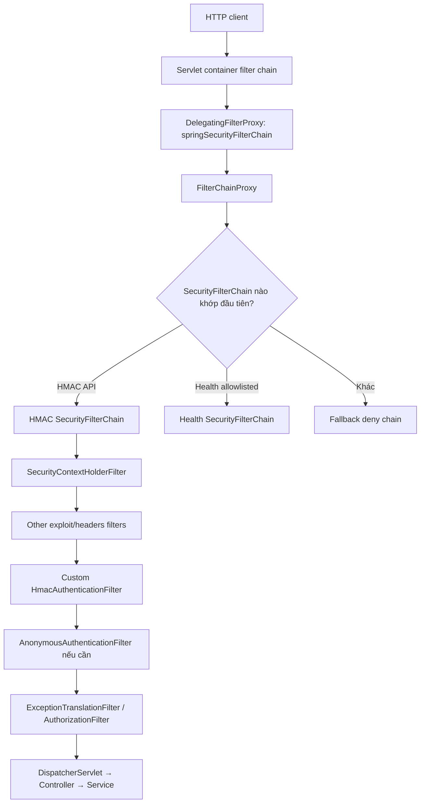
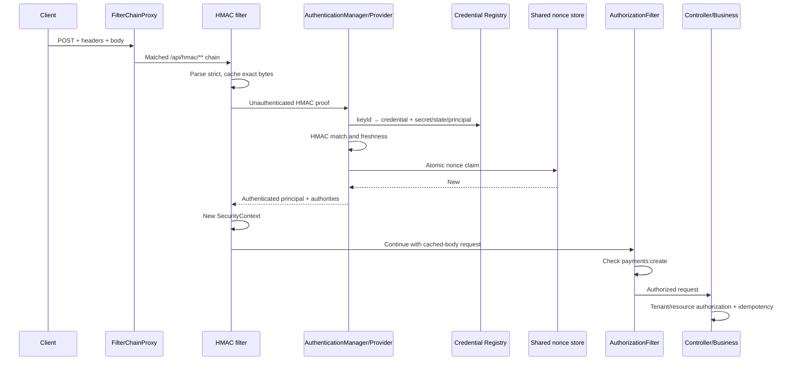
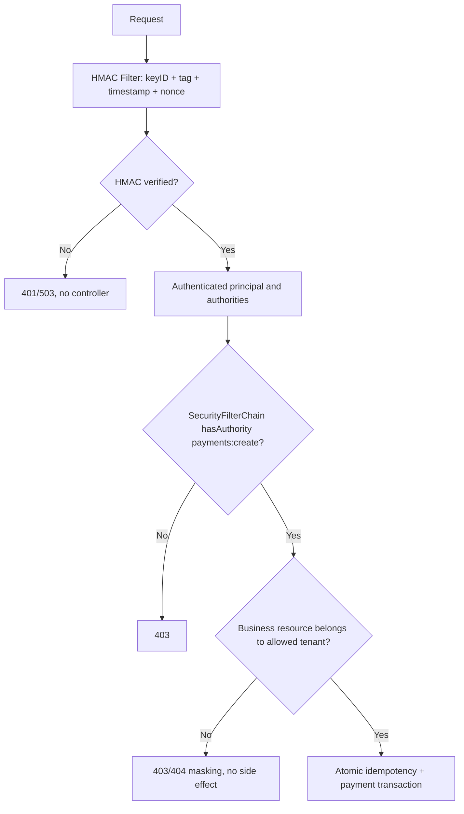
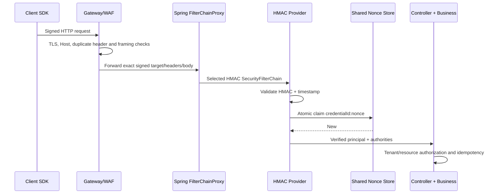

# SecurityFilterChain: tích hợp xác thực HTTP HMAC an toàn vào Spring Security

> **Chương:** Spring Security  
> **Bài học:** SecurityFilterChain  
> **Module:** `SECURITY_AUTHENTICATION_HMAC_REQUEST_AUTHENTICATION` — xây dựng xác thực HTTP request bằng HMAC với shared secret và canonical request ràng buộc method, URI, headers và body; chống replay bằng timestamp/nonce; quản lý credential/key rotation, kiểm thử proxy/gateway và phân biệt authentication với authorization.

Bài tập trung vào **Spring Security cho Servlet stack (Spring MVC)**, sử dụng `SecurityFilterChain` dạng `@Bean` và cách chèn HMAC authentication filter vào đúng vị trí. Ví dụ mã hướng tới **Java 17+, Spring Boot 3.x / Spring Security 6.x** với `jakarta.servlet.*` và lambda DSL. Tư duy `FilterChainProxy`, matchers, filter ordering và security context vẫn hữu ích trong các phiên bản mới, nhưng **cần đối chiếu API/migration notes theo phiên bản dự án thật**. Đây **không phải** hướng dẫn reactive WebFlux (`SecurityWebFilterChain` là kiểu khác).

## 1. Mục tiêu học tập

Sau bài này, người học có thể:

1. Giải thích đường đi `DelegatingFilterProxy → FilterChainProxy → SecurityFilterChain → DispatcherServlet`.
2. Phân biệt **chain matching** (`securityMatcher`) và **authorization rules** (`requestMatchers`).
3. Cấu hình nhiều `SecurityFilterChain` an toàn với `@Order`, nhất là HMAC API và fallback deny.
4. Chèn một HMAC authentication filter **trước authorization**, tránh đăng ký hai lần ở Servlet container.
5. Đọc headers và raw body đúng thời điểm, giới hạn dung lượng, tạo request wrapper để controller vẫn đọc body.
6. Tích hợp `AuthenticationManager` / `AuthenticationProvider` và công bố `Authentication` có principal đáng tin trong `SecurityContextHolder`.
7. Xử lý `401`, `403`, malformed request và lỗi replay/secret store mà không bypass.
8. Hiểu tác động `STATELESS`, CSRF, CORS, request cache, session và async dispatch.
9. Kết hợp HMAC với timestamp, nonce, credential lifecycle, key rotation và authorization theo tenant/resource.
10. Thiết kế integration tests `MockMvc`, thử duplicate headers, proxy rewrite và multi-instance replay.

## 2. Tại sao không chỉ viết một Servlet Filter rồi cho qua?

Một HMAC verifier thuần Java có thể tính đúng:

\[
\operatorname{HMAC\!-\!SHA256}(K,\mathrm{bytesToSign})
\]

Nhưng đưa verifier vào Spring MVC không đúng vị trí sẽ tạo lỗ hổng:

- Controller chạy trước khi HMAC được xác minh.
- Filter chỉ áp dụng `/api/payments`, nhưng `/api/payments/` hoặc route tương đương lại đi qua chain khác.
- Một filter `@Component` vừa được Boot đăng ký với container **vừa** được thêm vào `HttpSecurity`; chạy hai lần hoặc sai thứ tự.
- `SecurityContextHolder` của request trước còn trên thread khi request tiếp theo tới.
- Filter đọc hết `ServletInputStream` để tính body SHA-256 khiến `@RequestBody` ở controller nhận body rỗng.
- Client gửi hai `X-Key-Id`; proxy và service chọn hai giá trị khác nhau.
- Filter HMAC trả principal không có authorities, nhưng `authorizeHttpRequests` cấu hình sai và bỏ qua kiểm quyền tài nguyên.
- HMAC đúng nhưng timestamp đã hết hạn hoặc nonce đã claim; route vẫn thực thi vì exception bị nuốt.
- `csrf().disable()` được dùng trên cả ứng dụng có cookie-session chỉ vì API HMAC muốn stateless.
- Một request không khớp bất kỳ security chain nào nên **không được Spring Security bảo vệ**.

**`SecurityFilterChain` là chỗ kết nối authentication, authorization, filter ordering và cấu hình endpoint một cách có kiểm soát.** Nó không tự tạo HMAC; ta phải đưa verifier và credential policy vào chain.

## 3. Kiến trúc Spring Security Servlet



Sơ đồ là **mô hình logic**, không phải thứ tự đầy đủ/không đổi của từng filter cho mọi version/config. Trong ứng dụng thật hãy xem danh sách filter được build và thứ tự thực thi.

### 3.1. `DelegatingFilterProxy`

`DelegatingFilterProxy` là Servlet `Filter` làm cầu nối tới một bean trong Spring application context, thường tên `springSecurityFilterChain`. Nhờ đó security logic có dependency injection và lifecycle do Spring quản lý.

Trong Spring Boot, auto-configuration thường nối filter proxy với container; ta **không** tạo riêng một `FilterChainProxy` hay đăng ký thủ công nó nếu không có nhu cầu đặc biệt.

### 3.2. `FilterChainProxy`

`FilterChainProxy` quản lý một danh sách `SecurityFilterChain`. Với request mới, nó tìm **chain khớp đầu tiên** theo thứ tự:

```text
@Order(1)   /api/hmac/**          → HMAC filter + HMAC authz policy
@Order(2)   /actuator/health/**   → health endpoint policy
@Order(99)  ANY                   → deny all / explicit fallback
```

Đây chỉ là **thứ tự minh họa**; ta có thể đặt health trước HMAC vì không giao nhau.

**Một request không chạy tất cả matching chains**. Khi đã chọn chain đầu, `FilterChainProxy` không tìm thêm filter từ các chains phía sau. Vì vậy một catch-all chain đặt `@Order(1)` có thể “nuốt” tất cả request và khiến HMAC chain không bao giờ chạy.

`FilterChainProxy` cũng hỗ trợ cơ chế bảo vệ/filter-lifecycle như firewall và dọn `SecurityContext` theo kiến trúc của Spring Security.

### 3.3. `SecurityFilterChain`

Một `SecurityFilterChain` có **matcher** xác định request nào áp dụng và **danh sách filters**. `HttpSecurity` là builder tạo ra nó:

```java
@Bean
SecurityFilterChain apiChain(HttpSecurity http) throws Exception {
    http
        .securityMatcher("/api/hmac/**")
        .authorizeHttpRequests(auth -> auth
            .anyRequest().authenticated());
    return http.build();
}
```

Code này **chưa đủ** cho HMAC, vì chưa có custom authentication mechanism, credential lookup hoặc anti-replay. Nó chỉ minh họa cách xây chain.

### 3.4. `SecurityContextHolder` và `Authentication`

Sau khi xác minh thành công, HMAC filter tạo một `Authentication` được trusted:

```text
Authentication
  principal    = VerifiedHmacPrincipal(principalId, tenantId, credentialId)
  authorities  = ["payments:create"]   # từ registry/policy đáng tin
  authenticated= true
  credentials  = null                  # không đưa shared secret vào context
```

Spring authorization filter hoặc method security đọc `Authentication` này để quyết định xem principal có quyền truy cập endpoint/action không.

**Không đặt shared secret hay raw Vault token vào `principal`, `credentials`, `details`, session hoặc logs.** `keyId` do caller gửi chỉ là selector; principal/authorities phải đến từ credential registry đã được xác minh bằng HMAC.

## 4. `securityMatcher` và `requestMatchers` rất khác nhau

Đây là một nguồn lỗi cấu hình quan trọng.

| API | Vai trò | Ví dụ | Hậu quả nếu hiểu sai |
| --- | --- | --- | --- |
| `http.securityMatcher(...)` | Xác định **toàn bộ SecurityFilterChain** áp dụng request nào. | `/api/hmac/**` | Request ngoài matcher không chạy HMAC filter của chain này. |
| `authorizeHttpRequests(...requestMatchers(...))` | Đặt **authorization rule** cho requests **đã đi vào chain**. | `POST /api/hmac/v1/payments` yêu cầu `payments:create` | Rule không khiến chain tự bắt thêm URL ngoài `securityMatcher`. |
| `authorizeHttpRequests(...anyRequest())` | Rule còn lại **trong chain hiện tại**. | `denyAll()` | Không phải `anyRequest` của toàn ứng dụng nếu chain có matcher hẹp. |
| `@Order` | Thứ tự chọn chain khi matchers có thể chồng nhau. | HMAC trước fallback | Catch-all chain đặt trước có thể bỏ qua HMAC chain. |

### Ví dụ an toàn và không an toàn

**Sai:**

```java
@Bean
@Order(1)
SecurityFilterChain everything(HttpSecurity http) throws Exception {
    return http.authorizeHttpRequests(a -> a
            .anyRequest().permitAll()).build();
}
// @Order(2) HMAC chain không bao giờ được chọn!
```

**Đúng về cấu trúc:**

```java
@Bean
@Order(1)
SecurityFilterChain hmac(HttpSecurity http) throws Exception {
    return http.securityMatcher("/api/hmac/**")
        .authorizeHttpRequests(a -> a.anyRequest().authenticated())
        .build();
}

@Bean
@Order(99)
SecurityFilterChain fallback(HttpSecurity http) throws Exception {
    return http.authorizeHttpRequests(a -> a.anyRequest().denyAll())
        .build();
}
```

Đoạn trên chỉ minh họa matcher/fallback; production còn cần xác thực HMAC và các policy ở những phần sau. Nếu **không có chain khớp một URL**, request đó không được Spring Security bảo vệ; do vậy một fallback catch-all có `denyAll` là lựa chọn an toàn cho API nội bộ khi không muốn route tự động được mở.

### `permitAll`, `denyAll`, `authenticated`

- `permitAll()`: endpoint không yêu cầu `Authentication` cho phép truy cập, nhưng vẫn đi qua những security filters thuộc chain; nếu bạn thêm custom HMAC filter **không phân biệt endpoint**, nó có thể vẫn reject trước khi authorization rule tới lượt.
- `denyAll()`: không cấp quyền theo rule; không có nghĩa filter HMAC nhất thiết không chạy nếu cùng chain.
- `authenticated()`: yêu cầu authentication object hợp lệ, **không** đủ xác định principal có `payments:create` hay tenant đúng.
- `hasAuthority("payments:create")`: kiểm authority đã cấp từ nguồn đáng tin, nhưng resource/tenant ownership thường cần kiểm sâu hơn ở business/service layer.

## 5. Hợp đồng bảo mật HTTP HMAC của bài

Để tập trung vào `SecurityFilterChain`, ta dùng **một endpoint fixture**:

```http
POST /api/hmac/v1/payments?currency=VND&orderId=42 HTTP/1.1
Host: api.example.test
Content-Type: application/json
Idempotency-Key: pay-order-42
X-Key-Id: merchant-a-k2
X-Timestamp: 1767225600
X-Nonce: 87a3d56ea72d40af89f5b68cb3e831d4
X-Signature: v1=<43_BASE64URL_CHARS>

{"amount":100000,"currency":"VND"}
```

Đây là **hợp đồng minh họa tùy biến** tên `SPRING-HMAC-V1`, không phải một chuẩn HMAC header phổ quát và không đồng nhất với **RFC 9421 HTTP Message Signatures**. Hostname và timestamp chỉ là fixtures; tag trong `<...>` là placeholder, không phải signature hợp lệ.

### 5.1. Những trường bắt buộc

| Trường | Cardinality | Grammar/policy | Có được ký? |
| --- | --- | --- | --- |
| Method | 1 | `POST`, đúng case | Có |
| Authority | 1 | `api.example.test` theo ingress trust boundary | Có |
| Raw path | 1 | `/api/hmac/v1/payments` | Có |
| Raw query | 1 | `currency=VND&orderId=42` trong fixture | Có |
| `Content-Type` | Chính xác 1 | `application/json` | Có |
| `Idempotency-Key` | Chính xác 1 | `[A-Za-z0-9._-]{1,64}` | Có |
| `X-Key-Id` | Chính xác 1 | `[A-Za-z0-9._-]{1,64}` | Có |
| `X-Timestamp` | Chính xác 1 | Unix epoch **seconds**, decimal ASCII, no leading zeros | Có |
| `X-Nonce` | Chính xác 1 | 128-bit CSPRNG, 32 lowercase hex chars | Có |
| `X-Signature` | Chính xác 1 | `v1=` + 43 ký tự Base64URL unpadded | Output, không tự ký |
| Raw request body | ≤64 KiB | Bytes UTF-8 JSON thực sự chuyển tới handler | Có qua SHA-256 digest |

**Mục đích của fixture cố định:** Không nhầm phương thức `getRequestURI()` hoặc cách Servlet parse query với một canonicalizer URI tổng quát. Trong API thật cần quy định duplicate query keys, path segments, percent-encoding, authority/port, body content-coding và proxy rewrite.

### 5.2. Canonical request byte-level

```text
POST
api.example.test
/api/hmac/v1/payments
currency=VND&orderId=42
content-type:application/json
idempotency-key:pay-order-42
x-key-id:merchant-a-k2
x-nonce:87a3d56ea72d40af89f5b68cb3e831d4
x-timestamp:1767225600
content-type;idempotency-key;x-key-id;x-nonce;x-timestamp
<SHA256_HEX_OF_EXACT_RAW_BODY_BYTES>
```

Các dòng ngăn bằng LF `\n`, **không LF ở cuối**. `bytesToSign`:

```text
canonicalRequest = joinLF(11 lines above)
bytesToSign      = UTF8("HMAC-SHA256/SPRING-HMAC-V1\n"
                        + canonicalRequest)
rawTag           = HMAC-SHA256(secretBytesOfKeyId, bytesToSign)
X-Signature      = "v1=" + Base64URLNoPadding(rawTag)
```

Một full HMAC-SHA256 tag là **32 bytes**, Base64URL không padding có **43 ký tự**; vì vậy `v1=` + tag dài 46 ký tự. Đoạn public test vector RFC 4231 có thể kiểm tra **HMAC primitive**, còn việc kết hợp string-to-sign phải có golden vectors API riêng.

### 5.3. Vì sao ký key ID, timestamp, nonce, idempotency và body?

- **Key ID:** Ràng buộc selector với chữ ký; thay k2 thành k1 không cho phép dùng nguyên tag.
- **Timestamp:** Nếu không ký, attacker có thể thay time để vượt freshness.
- **Nonce:** Nếu không ký, attacker có thể đổi nonce sau khi replay cũ.
- **Idempotency-Key:** Nếu không ký, attacker có thể đổi business retry intent để gây duplicate side effects.
- **Method/URI/query:** Nếu không ký, một tag cho `GET` có thể bị áp sai lên `POST` hoặc tài nguyên khác.
- **Body digest:** Nếu không ký, amount/recipient có thể bị sửa sau khi client đã ký.
- **Authority:** Giúp chống chuyển hướng request có cùng path giữa các hosts/services khác nhau theo contract.

**HMAC xác thực** người có shared key và integrity của signing input; **không phải authorization**. Dù tag khớp, backend vẫn phải kiểm principal/action/tenant/resource.

## 6. Bộ lọc chạy ở đâu: authentication phải trước authorization

Dòng xử lý logic:



**`OncePerRequestFilter` không tự xác thực.** Nó là một convenience base class với `doFilterInternal` và bảo đảm liên quan đến invocation cho **một request dispatch** theo cơ chế của Spring Web. Nó không thay thế idempotency, chống replay hay kiểm authorization.

### 6.1. Chọn filter position

Spring Security mô tả trật tự logic:

1. Tải/thiết lập `SecurityContext`.
2. Các filters bảo vệ HTTP requests (headers, CSRF/CORS khi cấu hình).
3. Authentication.
4. Authorization.

Một custom HMAC authentication filter thường đặt **sau những filter khởi tạo context, trước `AuthorizationFilter` và trước anonymous authentication nếu bạn muốn nó cung cấp principal**. Có thể dùng:

```java
http.addFilterBefore(
    new HmacAuthenticationFilter(authenticationManager),
    UsernamePasswordAuthenticationFilter.class);
```

Khi dùng vị trí này, HMAC filter cần tự xử lý authentication failures của mình: nó có thể chạy **trước `ExceptionTranslationFilter`**, nên ném `AuthenticationException` ra ngoài không bảo đảm được handler cấu hình trong `exceptionHandling` bắt lại. Ví dụ sẽ **catch và trả 401/503** ngay trong filter, còn `ExceptionTranslationFilter` xử lý failure từ các bước authorization phía sau.

**Không dựa vào một danh sách filter order copy từ một version cũ.** Kiểm thực tế với Spring Security DEBUG/TRACE và Spring Security tests.

### 6.2. Tránh đăng ký custom filter hai lần

**Cạm bẫy Spring Boot:**

```java
@Component
public class HmacAuthenticationFilter extends OncePerRequestFilter {
    // ...
}
```

Sau đó cũng gọi `http.addFilterBefore(hmacFilter, ...)` có thể khiến filter vừa nằm trong **Servlet container chain** vừa nằm trong **Spring Security chain**. Một lần chạy có thể không thuộc chain mong muốn hoặc sai thứ tự; anti-replay có thể bị claim hai lần, body bị đọc sai.

Có hai cách:

1. **Ví dụ chọn:** tạo `new HmacAuthenticationFilter(...)` **bên trong `SecurityFilterChain`**, không khai báo filter này là `@Component` hoặc `@Bean` để Boot tự đăng ký.
2. Nếu filter bắt buộc là Spring bean, dùng `FilterRegistrationBean` và `setEnabled(false)` để chặn container registration rồi chỉ thêm filter vào `HttpSecurity`.

```java
@Bean
FilterRegistrationBean<HmacAuthenticationFilter> hmacRegistration(
        HmacAuthenticationFilter filter) {
    var reg =
        new FilterRegistrationBean<HmacAuthenticationFilter>(filter);
    reg.setEnabled(false);
    return reg;
}
```

Chỉ dùng lựa chọn (2) khi filter thực sự là bean và bạn cấu hình đúng dependency; không khai cả hai kiểu bừa bãi.

## 7. Session, CSRF, CORS và statefulness

### 7.1. HMAC request authentication thường stateless theo HTTP session

Nếu client gửi signature trên **mỗi request**, có thể cấu hình:

```java
http.sessionManagement(session -> session
    .sessionCreationPolicy(SessionCreationPolicy.STATELESS));
```

Trong Spring Security, `STATELESS` làm Spring Security không tạo/use `HttpSession` để lấy `SecurityContext`. Nó **không** đồng nghĩa server hoàn toàn không có state:

- Replay protection **cần server-side state** (hoặc cơ chế tương đương có bảo đảm single-use).
- Idempotency store **cần state** để chống duplicate nghiệp vụ.
- Credential registry, revoke state và authorization policy **cần state**.
- Application/Servlet container/library khác vẫn có thể tạo session nếu được phép; test end-to-end thay vì chỉ nhìn một enum.

### 7.2. CSRF không được disable vô điều kiện

Với **non-browser B2B HMAC API** dùng headers không tự được browser gửi, không dựa vào ambient cookie/session credential, việc disable CSRF **chỉ trong HMAC chain** có thể hợp lý.

```java
http
    .securityMatcher("/api/hmac/**")
    .csrf(csrf -> csrf.disable());
```

**Nhưng:** `STATELESS` **không tự động loại bỏ CSRF**. Nếu browser tự gửi credential dạng cookie hoặc HTTP Basic, hoặc endpoint có session-backed authentication khác, CSRF vẫn có thể là rủi ro. Một ứng dụng hỗn hợp có web forms/session phải cấu hình CSRF riêng cho web chain và không tắt toàn bộ vì API HMAC.

CORS cũng **không phải authentication**. Một browser bị CORS chặn không có nghĩa server bảo vệ khỏi cURL/server-to-server clients. Nếu HMAC endpoint thực sự dành cho browser, cần giải quyết secure storage của shared secret, origin policy, preflight `OPTIONS` và mô hình client phù hợp; **không cấp long-lived HMAC shared secret cho JavaScript public browser**.

### 7.3. Không bật form login/Basic như fallback ngầm

Trong chain HMAC-only, vô hiệu hóa các cơ chế khác nếu endpoint không chủ ý hỗ trợ:

```java
http
    .httpBasic(basic -> basic.disable())
    .formLogin(form -> form.disable())
    .logout(logout -> logout.disable());
```

Nếu `httpBasic` hoặc `formLogin` vẫn hoạt động trên cùng URL, client có thể được xác thực bằng cơ chế khác ngoài hợp đồng HMAC và `authenticated()` vẫn pass. **Chỉ cho nhiều mechanisms nếu có use case/authorization rõ**.

### 7.4. Request cache và exception responses

Non-browser HMAC API thường không cần lưu request để redirect sang login:

```java
http.requestCache(cache -> cache.disable());
```

Trả JSON lỗi với `Cache-Control: no-store`, không redirect trang login, không tiết lộ secret, expected HMAC hoặc sự tồn tại của key ID. Nếu dùng custom `Authorization` scheme, có thể công bố `WWW-Authenticate` theo HTTP authentication framework; với ví dụ `X-*` headers phải định nghĩa error contract riêng, không giả định browser xử lý challenge.

## 8. Cấu hình nhiều `SecurityFilterChain`: ví dụ Spring Boot 3.x

Phần này là **mã cấu hình theo Spring Security 6.x Servlet lambda DSL**, chạy khi dự án đã thêm các starter cần thiết và có bean `HmacVerifier`/`AuthenticationProvider` tương ứng ở phần sau. Để tránh copy nhầm, bài sẽ ghi rõ phần nào là dependency/adapter cần triển khai.

Các dependencies thông dụng:

```text
spring-boot-starter-web
spring-boot-starter-security
spring-boot-starter-test
spring-security-test
```

Khi thêm chúng, dùng **BOM/dependency management của Spring Boot release đang chọn**; không tự mix Spring Security phiên bản khác major.

### 8.1. `HmacSecurityConfig.java`

```java
package com.example.hmac;

import java.time.Clock;
import org.springframework.context.annotation.Bean;
import org.springframework.context.annotation.Configuration;
import org.springframework.core.annotation.Order;
import org.springframework.http.HttpMethod;
import org.springframework.security.authentication.AuthenticationManager;
import org.springframework.security.authentication.ProviderManager;
import org.springframework.security.config.annotation.method.configuration.EnableMethodSecurity;
import org.springframework.security.config.annotation.web.builders.HttpSecurity;
import org.springframework.security.config.http.SessionCreationPolicy;
import org.springframework.security.web.SecurityFilterChain;
import org.springframework.security.web.authentication.UsernamePasswordAuthenticationFilter;
import org.springframework.security.web.context.NullSecurityContextRepository;

@Configuration
@EnableMethodSecurity
public class HmacSecurityConfig {

    @Bean
    Clock clock() {
        return Clock.systemUTC();
    }

    @Bean
    AuthenticationManager hmacAuthenticationManager(
            HmacAuthenticationProvider provider) {
        return new ProviderManager(provider);
    }

    @Bean
    @Order(1)
    SecurityFilterChain hmacApi(
            HttpSecurity http,
            AuthenticationManager hmacAuthenticationManager)
            throws Exception {
        // IMPORTANT: constructed here, NOT a @Component/@Bean,
        // so Boot does not register the filter at servlet container level.
        HmacAuthenticationFilter hmacFilter =
                new HmacAuthenticationFilter(
                    hmacAuthenticationManager);

        http
            .securityMatcher("/api/hmac/**")
            .sessionManagement(session -> session
                .sessionCreationPolicy(SessionCreationPolicy.STATELESS))
            .securityContext(context -> context
                .securityContextRepository(
                    new NullSecurityContextRepository()))
            .requestCache(cache -> cache.disable())
            .csrf(csrf -> csrf.disable()) // Non-browser HMAC-only chain.
            .httpBasic(basic -> basic.disable())
            .formLogin(form -> form.disable())
            .logout(logout -> logout.disable())
            .authorizeHttpRequests(auth -> auth
                .requestMatchers(
                    HttpMethod.POST, "/api/hmac/v1/payments")
                    .hasAuthority("payments:create")
                .anyRequest().denyAll())
            .exceptionHandling(exceptions -> exceptions
                .authenticationEntryPoint(
                    (req, res, error) ->
                        HmacErrorWriter.write(
                            res, 401, "unauthenticated"))
                .accessDeniedHandler(
                    (req, res, error) ->
                        HmacErrorWriter.write(
                            res, 403, "forbidden")))
            .addFilterBefore(
                hmacFilter, UsernamePasswordAuthenticationFilter.class);

        return http.build();
    }

    // Optional: a separate narrowly scoped health chain.
    @Bean
    @Order(2)
    SecurityFilterChain health(HttpSecurity http)
            throws Exception {
        return http
            .securityMatcher(
                "/actuator/health", "/actuator/health/**")
            .authorizeHttpRequests(auth -> auth
                .anyRequest().permitAll())
            .build();
    }

    // Catch-all: no accidental unprotected URL.
    @Bean
    @Order(99)
    SecurityFilterChain rejectEverythingElse(HttpSecurity http)
            throws Exception {
        return http
            .authorizeHttpRequests(auth -> auth
                .anyRequest().denyAll())
            .build();
    }
}
```

**Các điểm cần đọc kỹ:**

- `@Order(1)` trước `@Order(99)` bảo đảm `/api/hmac/**` chọn **HMAC chain**, không bị catch-all chain nuốt.
- `securityMatcher("/api/hmac/**")` không chỉ giới hạn `authorizeHttpRequests`; nó giới hạn **toàn bộ custom HMAC filter**.
- `POST /api/hmac/v1/payments` còn cần authority `payments:create`; mọi URL HMAC khác bị deny.
- Fallback `denyAll` giúp lộ rõ khi có route controller mới nhưng chưa đưa vào policy, thay vì silently unprotected.
- Health chain chỉ là ví dụ: không nên mở thêm actuator endpoints hoặc quản trị chỉ bằng `permitAll`; triển khai production phải đặt network/auth policy phù hợp.
- `NullSecurityContextRepository` và `STATELESS` tránh lưu HMAC authentication vào session; replay/idempotency vẫn là server state độc lập.
- Chỉ disable CSRF ở chain không dùng ambient browser credentials. Các chain khác có security policy riêng.
- `AuthenticationEntryPoint` xử lý unauthenticated do các downstream components; **filter HMAC phải xử lý lỗi authentication của chính nó** do vị trí filter.
- `HmacErrorWriter`, `HmacAuthenticationProvider` và `HmacAuthenticationFilter` được định nghĩa ở phần sau. Registry/replay store là adapter cần nối với cơ sở dữ liệu/shared store trong ứng dụng thật.

### 8.2. Nếu không có fallback chain thì sao?

Nếu `/admin/delete-user` không match `/api/hmac/**` cũng không match health chain, nó **có thể nằm ngoài bảo vệ Spring Security** dù controller vẫn tồn tại. Với hệ thống yêu cầu deny-by-default, fallback chain loại bỏ lỗi cấu hình này.

### 8.3. Matcher nào được kiểm trước?

`@Order` điều khiển thứ tự **SecurityFilterChain**; bên trong chain `requestMatchers(HttpMethod.POST, "...")` được Spring authorization manager kiểm. Đừng nhầm:

```text
[Chain selection]
GET /api/hmac/v1/payments
  → HMAC chain (vì /api/hmac/**)

[HMAC filter]
  → reject method/contract hoặc không xác thực

[Authorization]
  → anyRequest().denyAll() cho route ngoài POST rule
```

Trong API mẫu, HMAC filter có thể reject method sớm dưới dạng malformed; nó không tạo một đường bypass cho GET.

---

## 9. HMAC authentication filter: kiểm header và replay raw body

`OncePerRequestFilter` là adapter từ HTTP request sang authentication. Trong bài, filter phải:

- Từ chối target khác hợp đồng, headers thiếu/trùng, signature sai grammar và body quá lớn.
- Đọc **bytes thật** từ `ServletInputStream` tối đa 64 KiB, không parse JSON trước khi ký.
- Tạo `Authentication` chưa xác thực, gọi `AuthenticationManager`, chỉ set `SecurityContext` khi provider trả về một authenticated principal.
- Tạo request wrapper có thể phát lại body cho `@RequestBody` phía controller.
- Không gọi `chain.doFilter` nếu chứng thực thất bại; tự trả 400/401/413/503 theo error contract.
- Clear `SecurityContextHolder` ở `finally`, không lưu credential vào session.

**Lưu ý:** `ContentCachingRequestWrapper` chỉ cache các bytes đã được đọc; nó **không tự bảo đảm** downstream có thể đọc lại request stream sau khi custom filter đã tiêu thụ body. Khi filter phải đọc toàn bộ body, cần wrapper replayable hoặc thiết kế streaming phù hợp.

### 9.1. `HmacAuthenticationFilter.java`

Đoạn dưới dành cho **synchronous Servlet MVC**, không phải Servlet async/nonblocking hoặc multipart streaming.

```java
package com.example.hmac;

import jakarta.servlet.FilterChain;
import jakarta.servlet.ReadListener;
import jakarta.servlet.ServletException;
import jakarta.servlet.ServletInputStream;
import jakarta.servlet.http.HttpServletRequest;
import jakarta.servlet.http.HttpServletRequestWrapper;
import jakarta.servlet.http.HttpServletResponse;
import java.io.BufferedReader;
import java.io.ByteArrayInputStream;
import java.io.IOException;
import java.io.InputStreamReader;
import java.nio.charset.StandardCharsets;
import java.util.Collections;
import java.util.List;
import java.util.Objects;
import org.springframework.security.authentication.AbstractAuthenticationToken;
import org.springframework.security.authentication.AuthenticationManager;
import org.springframework.security.authentication.AuthenticationServiceException;
import org.springframework.security.authentication.BadCredentialsException;
import org.springframework.security.core.Authentication;
import org.springframework.security.core.AuthenticationException;
import org.springframework.security.core.context.SecurityContext;
import org.springframework.security.core.context.SecurityContextHolder;
import org.springframework.web.filter.OncePerRequestFilter;

public final class HmacAuthenticationFilter extends OncePerRequestFilter {
    private static final int MAX_BODY = 64 * 1024;
    private final AuthenticationManager manager;

    public HmacAuthenticationFilter(AuthenticationManager manager) {
        this.manager = Objects.requireNonNull(manager);
    }

    @Override
    protected void doFilterInternal(
            HttpServletRequest req,
            HttpServletResponse resp,
            FilterChain chain) throws IOException, ServletException {

        HmacProof proof;
        try {
            proof = extract(req);
        } catch (BodyTooLarge e) {
            SecurityContextHolder.clearContext();
            HmacErrorWriter.write(resp, 413, "payload_too_large");
            return;
        } catch (BadCredentialsException e) {
            SecurityContextHolder.clearContext();
            HmacErrorWriter.write(resp, 401, "unauthenticated");
            return;
        } catch (MalformedHmacRequest e) {
            SecurityContextHolder.clearContext();
            HmacErrorWriter.write(resp, 400, "malformed_request");
            return;
        }

        Authentication result;
        try {
            result = manager.authenticate(
                new HmacRequestAuthenticationToken(proof));
            if (result == null || !result.isAuthenticated()) {
                throw new BadCredentialsException(
                    "Provider did not authenticate");
            }
        } catch (AuthenticationServiceException unavailable) {
            SecurityContextHolder.clearContext();
            HmacErrorWriter.write(
                resp, 503, "verification_unavailable");
            return;
        } catch (AuthenticationException rejected) {
            SecurityContextHolder.clearContext();
            HmacErrorWriter.write(resp, 401, "unauthenticated");
            return;
        }

        SecurityContext context =
                SecurityContextHolder.createEmptyContext();
        context.setAuthentication(result);
        SecurityContextHolder.setContext(context);

        try {
            chain.doFilter(
                new ReplayableBodyRequest(req, proof.body()), resp);
        } finally {
            SecurityContextHolder.clearContext();
        }
    }

    private static HmacProof extract(HttpServletRequest r)
            throws IOException {
        // Fixed endpoint: this is NOT a general URI canonicalizer.
        if (!"POST".equals(r.getMethod())
                || !"api.example.test".equals(r.getServerName())
                || !"/api/hmac/v1/payments".equals(
                    r.getRequestURI())
                || !"currency=VND&orderId=42".equals(
                    r.getQueryString())) {
            throw new MalformedHmacRequest("Unsupported target");
        }

        String type = one(r, "Content-Type");
        if (!"application/json".equals(type)
                || r.getHeaders("Content-Encoding")
                    .hasMoreElements()) {
            throw new MalformedHmacRequest(
                "Unsupported representation");
        }

        String keyId = one(r, "X-Key-Id");
        String signature = one(r, "X-Signature");
        if (keyId == null || signature == null) {
            throw new BadCredentialsException(
                "Missing HMAC credentials");
        }
        String timestamp = one(r, "X-Timestamp");
        String nonce = one(r, "X-Nonce");
        String idempotency = one(r, "Idempotency-Key");

        if (timestamp == null || nonce == null
                || idempotency == null
                || !keyId.matches("[A-Za-z0-9._-]{1,64}")
                || !signature.matches("v1=[A-Za-z0-9_-]{43}")
                || !timestamp.matches("[1-9][0-9]{9,10}")
                || !nonce.matches("[0-9a-f]{32}")
                || !idempotency.matches("[A-Za-z0-9._-]{1,64}")) {
            throw new MalformedHmacRequest("Bad signed headers");
        }

        if (r.getContentLengthLong() > MAX_BODY) {
            throw new BodyTooLarge();
        }
        // Bounded even when Content-Length is absent/dishonest.
        byte[] body = r.getInputStream().readNBytes(MAX_BODY + 1);
        if (body.length > MAX_BODY) {
            throw new BodyTooLarge();
        }

        return new HmacProof(
            keyId, timestamp, nonce, idempotency,
            r.getRequestURI(), r.getQueryString(), type,
            body, signature);
    }

    private static String one(HttpServletRequest r, String name) {
        // Servlet container/proxy may have ALREADY coalesced duplicates.
        // Edge must reject ambiguous raw HTTP before coalescing as well.
        List<String> values = Collections.list(r.getHeaders(name));
        if (values.size() > 1) {
            throw new MalformedHmacRequest(
                "Duplicate signed header: " + name);
        }
        if (values.isEmpty()) return null;

        String value = values.get(0);
        if (value == null || value.length() > 1024
                || !value.equals(value.strip())) {
            throw new MalformedHmacRequest("Invalid signed header");
        }
        for (int i = 0; i < value.length(); i++) {
            char c = value.charAt(i);
            if (c < 0x20 || c > 0x7e) {
                throw new MalformedHmacRequest(
                    "Control/non-ASCII header");
            }
        }
        return value;
    }

    // Simplified replay wrapper; synchronous MVC only.
    static final class ReplayableBodyRequest
            extends HttpServletRequestWrapper {
        private final byte[] body;

        ReplayableBodyRequest(
                HttpServletRequest original, byte[] rawBody) {
            super(original);
            this.body = rawBody.clone();
        }

        @Override public int getContentLength() {
            return body.length;
        }

        @Override public long getContentLengthLong() {
            return body.length;
        }

        @Override public ServletInputStream getInputStream() {
            ByteArrayInputStream source =
                new ByteArrayInputStream(body);
            return new ServletInputStream() {
                @Override public int read() {
                    return source.read();
                }
                @Override public boolean isFinished() {
                    return source.available() == 0;
                }
                @Override public boolean isReady() {
                    return true;
                }
                @Override public void setReadListener(
                        ReadListener listener) {
                    throw new UnsupportedOperationException(
                        "Async read not supported by this demo");
                }
            };
        }

        @Override public BufferedReader getReader() {
            return new BufferedReader(new InputStreamReader(
                getInputStream(), StandardCharsets.UTF_8));
        }
    }
}

// Untrusted proof: NEVER holds the shared secret.
record HmacProof(
        String keyId, String timestamp, String nonce,
        String idempotencyKey, String path, String query,
        String contentType, byte[] body, String signature) {
    HmacProof {
        body = body.clone();
    }
    @Override public byte[] body() {
        return body.clone();
    }
}

// Submitted to the AuthenticationManager, still unauthenticated.
final class HmacRequestAuthenticationToken
        extends AbstractAuthenticationToken {
    private final HmacProof proof;

    HmacRequestAuthenticationToken(HmacProof proof) {
        super(null);
        this.proof = Objects.requireNonNull(proof);
        super.setAuthenticated(false);
    }

    HmacProof proof() { return proof; }

    @Override public Object getPrincipal() {
        return proof.keyId();
    }

    @Override public Object getCredentials() {
        return null;
    }

    @Override public void setAuthenticated(boolean value) {
        if (value) throw new IllegalArgumentException(
            "Proof token cannot be trusted directly");
        super.setAuthenticated(false);
    }

    @Override public String toString() {
        return "HmacRequestAuthenticationToken[untrusted]";
    }
}

// Fixed server-generated codes only; no user input in JSON.
final class HmacErrorWriter {
    private HmacErrorWriter() {}

    static void write(
            HttpServletResponse response,
            int status, String code) throws IOException {
        response.setStatus(status);
        response.setCharacterEncoding("UTF-8");
        response.setContentType("application/json");
        response.setHeader("Cache-Control", "no-store");
        response.getWriter().write(
            "{\"error\":\"" + code + "\"}");
    }
}

final class MalformedHmacRequest extends RuntimeException {
    MalformedHmacRequest(String message) {
        super(message);
    }
}

final class BodyTooLarge extends RuntimeException {}
```

### 9.2. Không phân loại nhầm lỗi của controller

Filter catch authentication exceptions **trước khi** gọi `chain.doFilter`. Lỗi phát sinh từ `AuthorizationFilter` hoặc controller phía sau phải đi qua cơ chế xử lý tương ứng của Spring, không bị catch tùy tiện thành “HMAC sai”. Filter ở vị trí trước `ExceptionTranslationFilter` có thể **không được exception handler downstream bắt lỗi do chính nó ném ra**, nên code tự xử lý failure 400/401/413/503.

### 9.3. Ranh giới của replay wrapper

- Class trên không hỗ trợ async `ReadListener`, multipart, streaming upload, compression/transcoding hay trailer fields.
- Nếu một filter **bên ngoài** security chain đọc hết body trước HMAC, wrapper bên trong không thể khôi phục raw bytes.
- `readNBytes(MAX+1)` giới hạn memory, nhưng ingress cần network timeouts/rate limits; client chậm vẫn có thể giữ thread.
- `getServerName()` và `getRequestURI()` là view sau Servlet container, có thể khác request target tại edge; phải chốt trust boundary với gateway.
- Reject duplicate auth/signed headers tại **HTTP ingress trước coalescing** nếu Servlet API không còn original occurrences.
- Signature phải được tính trên bytes mà controller thật xử lý; không ký JSON object đã normalize rồi cho controller đọc một representation khác.

## 10. AuthenticationManager và AuthenticationProvider

Không đặt principal `authenticated=true` trước khi thật sự xác minh HMAC. Một `AuthenticationProvider` nhận proof, gọi verifier và trả authenticated `Authentication` với principal/authorities từ nguồn tin cậy:

```text
HmacRequestAuthenticationToken(isAuthenticated=false)
  → ProviderManager
    → HmacAuthenticationProvider.supports(...)
      → HmacVerifier.verify(...)
        → Credential registry + HMAC + freshness + atomic nonce
  → UsernamePasswordAuthenticationToken.authenticated(
        VerifiedHmacPrincipal, null, trustedAuthorities)
  → SecurityContextHolder (per-request)
  → AuthorizationFilter / method security
```

Dùng `UsernamePasswordAuthenticationToken.authenticated` như **kết quả Authentication** cho ngắn gọn không biến giao thức thành password login; production có thể tạo HMAC-specific token type để rõ provenance.

### 10.1. `HmacAuthenticationProvider.java`

```java
package com.example.hmac;

import java.util.List;
import org.springframework.security.authentication.AuthenticationProvider;
import org.springframework.security.authentication.UsernamePasswordAuthenticationToken;
import org.springframework.security.core.Authentication;
import org.springframework.security.core.AuthenticationException;
import org.springframework.security.core.authority.SimpleGrantedAuthority;
import org.springframework.stereotype.Component;

@Component
public final class HmacAuthenticationProvider
        implements AuthenticationProvider {
    private final HmacVerifier verifier;

    public HmacAuthenticationProvider(HmacVerifier verifier) {
        this.verifier = verifier;
    }

    @Override
    public Authentication authenticate(Authentication input)
            throws AuthenticationException {
        HmacRequestAuthenticationToken request =
            (HmacRequestAuthenticationToken) input;
        HmacVerifier.VerifiedCredential credential =
            verifier.verify(request.proof());

        List<SimpleGrantedAuthority> authorities =
            credential.authorities().stream()
                .map(SimpleGrantedAuthority::new)
                .toList();

        return UsernamePasswordAuthenticationToken.authenticated(
            new VerifiedHmacPrincipal(
                credential.credentialId(),
                credential.principalId(),
                credential.tenantId()),
            null,
            authorities);
    }

    @Override
    public boolean supports(Class<?> authentication) {
        return HmacRequestAuthenticationToken.class
            .isAssignableFrom(authentication);
    }
}

record VerifiedHmacPrincipal(
        String credentialId,
        String principalId,
        String tenantId) {}
```

**Không** đưa raw secret vào `Authentication.getCredentials()` hoặc một `UserDetails` shared cache; provider và Spring Security có thể clear/mutate credentials vì an toàn. Signature cũng không nên xuất hiện trong `toString()`/logs.

Đừng thêm một auth provider khác như “fallback HMAC không thành công thì thử Basic” trên cùng HMAC-only endpoint. Đa cơ chế là một **giao thức mới** cần security review.

---

## 11. HmacVerifier: key lookup, HMAC, timestamp và atomic nonce

Service này là **core security logic** được `AuthenticationProvider` gọi. Đừng xây secret lookup bằng cách nối raw `keyId` vào Vault path, và đừng thử các secrets/version khác khi HMAC mismatch.

### 11.1. `HmacVerifier.java`

```java
package com.example.hmac;

import java.nio.charset.StandardCharsets;
import java.security.GeneralSecurityException;
import java.security.MessageDigest;
import java.time.Clock;
import java.util.Arrays;
import java.util.Base64;
import java.util.HexFormat;
import java.util.Objects;
import java.util.Set;
import javax.crypto.Mac;
import javax.crypto.spec.SecretKeySpec;
import org.springframework.security.authentication.AuthenticationServiceException;
import org.springframework.security.authentication.BadCredentialsException;
import org.springframework.stereotype.Service;

@Service
public final class HmacVerifier {
    private static final String PREFIX =
        "HMAC-SHA256/SPRING-HMAC-V1\n";
    private static final String SIGNED_NAMES =
        "content-type;idempotency-key;x-key-id;"
        + "x-nonce;x-timestamp";
    private static final long PAST = 300;
    private static final long FUTURE = 300;
    private static final long NONCE_MARGIN = 60;
    private static final HexFormat HEX = HexFormat.of();

    private final CredentialRegistry credentials;
    private final ReplayNonceStore replay;
    private final Clock clock;

    public HmacVerifier(
            CredentialRegistry credentials,
            ReplayNonceStore replay,
            Clock clock) {
        this.credentials = Objects.requireNonNull(credentials);
        this.replay = Objects.requireNonNull(replay);
        this.clock = Objects.requireNonNull(clock);
    }

    public record VerifiedCredential(
            String credentialId,
            String principalId,
            String tenantId,
            Set<String> authorities) {
        public VerifiedCredential {
            authorities = Set.copyOf(authorities);
        }
    }

    public VerifiedCredential verify(HmacProof proof) {
        CredentialRecord credential;
        try {
            credential = credentials.findByKeyId(proof.keyId());
        } catch (RuntimeException unavailable) {
            throw new AuthenticationServiceException(
                "Credential lookup unavailable", unavailable);
        }

        if (credential == null
                || !proof.keyId().equals(credential.keyId())) {
            throw new BadCredentialsException(
                "Invalid HMAC credential");
        }

        long now = clock.instant().getEpochSecond();
        if (credential.state() == CredentialState.REVOKED
                || credential.state() == CredentialState.PREPARED
                || (credential.state() == CredentialState.VERIFY_ONLY
                    && now > credential.verifyUntilEpoch())) {
            throw new BadCredentialsException(
                "Invalid HMAC credential");
        }

        byte[] supplied;
        try {
            String wire = proof.signature();
            if (!wire.matches("v1=[A-Za-z0-9_-]{43}")) {
                throw new IllegalArgumentException("Tag grammar");
            }
            String encoded = wire.substring(3);
            supplied = Base64.getUrlDecoder().decode(encoded);
            if (supplied.length != 32
                    || !encoded.equals(Base64.getUrlEncoder()
                        .withoutPadding().encodeToString(supplied))) {
                throw new IllegalArgumentException("Noncanonical tag");
            }
        } catch (IllegalArgumentException badTag) {
            throw new BadCredentialsException(
                "Invalid HMAC signature");
        }

        byte[] secret = credential.secretBytes();
        if (secret.length != 32) {
            throw new AuthenticationServiceException(
                "Invalid server credential record");
        }

        byte[] expected;
        try {
            byte[] digest = MessageDigest.getInstance("SHA-256")
                .digest(proof.body());

            String canonical = String.join("\n",
                "POST", "api.example.test",
                proof.path(), proof.query(),
                "content-type:" + proof.contentType(),
                "idempotency-key:" + proof.idempotencyKey(),
                "x-key-id:" + proof.keyId(),
                "x-nonce:" + proof.nonce(),
                "x-timestamp:" + proof.timestamp(),
                SIGNED_NAMES,
                HEX.formatHex(digest));

            Mac mac = Mac.getInstance("HmacSHA256");
            mac.init(new SecretKeySpec(secret, "HmacSHA256"));
            expected = mac.doFinal((PREFIX + canonical)
                .getBytes(StandardCharsets.UTF_8));
        } catch (GeneralSecurityException cryptoFailure) {
            throw new AuthenticationServiceException(
                "HMAC provider unavailable", cryptoFailure);
        } finally {
            Arrays.fill(secret, (byte) 0); // Best effort only.
        }

        if (!MessageDigest.isEqual(expected, supplied)) {
            throw new BadCredentialsException(
                "Invalid HMAC signature");
        }

        long timestamp;
        try {
            timestamp = Long.parseLong(proof.timestamp());
        } catch (NumberFormatException malformed) {
            throw new BadCredentialsException(
                "Invalid timestamp");
        }
        if (timestamp < now - PAST
                || timestamp > now + FUTURE) {
            throw new BadCredentialsException(
                "Invalid timestamp");
        }

        // One nonce across all nodes, scoped to immutable credential ID.
        String nonceKey = credential.credentialId()
                + ":" + proof.nonce();
        long expiresAt;
        try {
            expiresAt = Math.addExact(
                Math.addExact(timestamp, PAST), NONCE_MARGIN);
        } catch (ArithmeticException invalidTimestamp) {
            throw new BadCredentialsException(
                "Invalid timestamp");
        }

        boolean claimed;
        try {
            claimed = replay.claim(nonceKey, expiresAt, now);
        } catch (RuntimeException unavailable) {
            throw new AuthenticationServiceException(
                "Replay store unavailable", unavailable);
        }

        if (!claimed) {
            throw new BadCredentialsException("Replay rejected");
        }

        return new VerifiedCredential(
            credential.credentialId(),
            credential.principalId(),
            credential.tenantId(),
            credential.authorities());
    }
}

// Key ID is globally unique in this example.
enum CredentialState {
    PREPARED, ACTIVE, VERIFY_ONLY, REVOKED
}

record CredentialRecord(
        String keyId,
        String credentialId,
        String principalId,
        String tenantId,
        CredentialState state,
        long verifyUntilEpoch,
        byte[] secretBytes,
        Set<String> authorities) {
    CredentialRecord {
        Objects.requireNonNull(keyId);
        Objects.requireNonNull(credentialId);
        Objects.requireNonNull(principalId);
        Objects.requireNonNull(tenantId);
        Objects.requireNonNull(state);
        Objects.requireNonNull(secretBytes);
        Objects.requireNonNull(authorities);
        secretBytes = secretBytes.clone();
        authorities = Set.copyOf(authorities);
    }

    @Override public byte[] secretBytes() {
        return secretBytes.clone();
    }
}

// A real adapter gets metadata from trusted registry and
// secret bytes from a least-privilege secret manager.
interface CredentialRegistry {
    CredentialRecord findByKeyId(String keyId);
}

// Shared atomic claim + TTL; never one local map per pod in production.
interface ReplayNonceStore {
    boolean claim(
        String scopedNonce, long expiresAtEpoch, long nowEpoch);
}
```

### 11.2. Credential policy là điều kiện độc lập với HMAC

| State | Verifier có chấp nhận? | Có được tạo signing attempts mới? |
| --- | --- | --- |
| `PREPARED` | Không với traffic thường. | Không. |
| `ACTIVE` | Có nếu tag/freshness/replay đúng. | Có. |
| `VERIFY_ONLY` | Có trong overlap tới deadline. | Client không nên ký mới. |
| `REVOKED` | **Không**, kể cả raw HMAC bằng secret cũ đúng. | Không. |

**Key ID không phải quyền truy cập.** Registry chọn đúng một secret và principal; authority `payments:create` phải đến từ policy đã được cấp và vẫn cần kiểm tenant/resource ownership. Khi rotation k1→k2, idempotency store nên scope theo **stable principal/tenant/operation**, không theo key ID.

### 11.3. Timestamp freshness và nonce TTL

Dùng timestamp `T` do client ký, thời điểm server `N`, giới hạn past `P` và future `F`:

\[
N-P \le T \le N+F
\]

Một nonce phải được giữ tới ít nhất:

\[
\mathrm{expiresAt} = T + P + \mathrm{margin}
\]

Ví dụ `P=F=300`, request có thể tới sớm tại `N=T-300` và vẫn được chấp nhận tới `N=T+300`. Nếu nonce chỉ lưu `now+300` khi request tới sớm, nó hết hạn khi cùng timestamp còn được chấp nhận. **Không để cửa sổ replay mở lại do TTL tính sai**.

### 11.4. Phân loại lỗi trong verifier

- `BadCredentialsException`: HMAC mismatch, key unknown/revoked, stale hoặc replay; không trả nguyên nhân chi tiết cho caller.
- `AuthenticationServiceException`: credential registry, replay store hoặc cryptographic provider gặp lỗi; **fail closed**, không coi request hợp lệ.
- `MalformedHmacRequest` từ HTTP adapter: cấu trúc/độ dài/duplicate headers không đúng contract.
- `AccessDeniedException` từ authorization: người giữ key được xác thực nhưng không có quyền tài nguyên.

Một provider không được để một `RuntimeException` do DB/Vault timeout dẫn đến fallback `permitAll` hoặc chuyển thành `AUTHENTICATED`.

## 12. Nối các adapters và phân biệt bản demo với production

`HmacSecurityConfig` ở mục 8 đã khai báo một bean `Clock` dùng `Clock.systemUTC()`. Khi test, có thể đưa vào một bean `Clock.fixed(...)` với `@Primary` để tạo fixtures có timestamp ổn định; trong production vẫn cần đồng bộ đồng hồ máy chủ và giám sát clock skew.

### 12.1. Demo registry, replay store **chỉ dùng trên local/test**

Một adapter in-memory giúp minh họa luồng, **không được đem sang production nhiều nodes**:

```java
package com.example.hmac;

import java.util.HexFormat;
import java.util.Map;
import java.util.Set;
import java.util.concurrent.ConcurrentHashMap;
import java.util.concurrent.atomic.AtomicBoolean;
import org.springframework.context.annotation.Bean;
import org.springframework.context.annotation.Configuration;
import org.springframework.context.annotation.Profile;

@Configuration
@Profile("demo")
public class DemoHmacAdapters {
    @Bean
    CredentialRegistry credentialRegistry() {
        // PUBLIC TEST KEY ONLY, NEVER ship as a customer credential.
        byte[] testKey = HexFormat.of().parseHex(
            "000102030405060708090a0b0c0d0e0f"
            + "101112131415161718191a1b1c1d1e1f");

        CredentialRecord one = new CredentialRecord(
            "merchant-a-k2",
            "cred-a-2",
            "service-merchant-a",
            "merchant-a",
            CredentialState.ACTIVE,
            Long.MAX_VALUE,
            testKey,
            Set.of("payments:create"));

        Map<String, CredentialRecord> data =
            Map.of(one.keyId(), one);
        return data::get;
    }

    @Bean
    ReplayNonceStore replayNonceStore() {
        ConcurrentHashMap<String, Long> used =
            new ConcurrentHashMap<>();
        return (nonceKey, expiresAt, now) -> {
            AtomicBoolean claimed = new AtomicBoolean(false);
            used.compute(nonceKey, (k, oldExpiry) -> {
                if (oldExpiry == null || oldExpiry <= now) {
                    claimed.set(true);
                    return expiresAt;
                }
                return oldExpiry;
            });
            return claimed.get();
        };
    }
}
```

**Dấu `@Profile("demo")` không tự làm test credentials an toàn.** Không kích hoạt `demo` profile trên hệ thống production; public key fixture rất dễ bị giả mạo request nếu vô tình deploy. Có thể bỏ hẳn demo adapters khỏi production artifact/module.

### 12.2. Adapters production cần điều gì?

**CredentialRegistry**:

- Global-unique key ID → immutable credential identity, principal, tenant, status, secretRef.
- Tra secret từ Vault/KMS/secret manager với workload identity và least privilege.
- Cache có TTL/revocation invalidation, không thử multiple old secrets khi mismatch.
- Khi key REVOKED, từ chối ngay theo consistency/fencing policy dù cache còn key bytes.
- Không log shared secret hoặc Vault API JSON chứa key.

**ReplayNonceStore**:

- Một shared atomic store cho các verifier có thể nhận request (ví dụ Redis SET-if-absent với expiry, hoặc SQL unique insert có transaction).
- Expiry `T+P+margin` có TTL >0, không dùng now+P tùy tiện.
- Nếu kết quả claim timeout/không rõ đã ghi hay chưa, **không tạo business side effect**; retry hợp lệ dùng nonce mới và Idempotency-Key ổn định.
- Namespace theo stable credential ID, không raw keyId/header tenant tùy ý.
- Đảm bảo behavior khi failover/partition, không tự fallback local `ConcurrentHashMap` nhiều pods.

**Clock**: đồng hồ server synchronized, UTC epoch seconds; monitor skew. `Clock.systemUTC()` không tự đồng bộ NTP.

## 13. Controller và business authorization không được bỏ qua

Ví dụ minh họa endpoint:

```java
package com.example.hmac;

import java.util.Map;
import org.springframework.http.ResponseEntity;
import org.springframework.security.core.annotation.AuthenticationPrincipal;
import org.springframework.security.access.prepost.PreAuthorize;
import org.springframework.web.bind.annotation.PostMapping;
import org.springframework.web.bind.annotation.RequestBody;
import org.springframework.web.bind.annotation.RestController;

@RestController
public class PaymentController {
    @PostMapping("/api/hmac/v1/payments")
    @PreAuthorize("hasAuthority('payments:create')")
    public ResponseEntity<Map<String, Object>> create(
            @AuthenticationPrincipal VerifiedHmacPrincipal principal,
            @RequestBody byte[] rawBody) {

        // Demo only: real business must also check order/payment
        // ownership and tenant permission before a transaction.
        if (!"merchant-a".equals(principal.tenantId())) {
            return ResponseEntity.status(403).build();
        }
        return ResponseEntity.status(201).body(
            Map.of("principal", principal.principalId(),
                   "bodyBytes", rawBody.length));
    }
}
```

Đây **không phải** payment implementation: chưa có idempotency persistence, amount validation, transaction/outbox, multi-tenant resource check hay PSP integration. Mục đích của controller là chứng minh:

- `@AuthenticationPrincipal` lấy **principal đã xác thực**, không đọc `X-Key-Id` trực tiếp.
- `@PreAuthorize` được gọi sau HMAC filter vì `@EnableMethodSecurity` đã bật.
- `@RequestBody byte[]` vẫn nhận raw bytes đã ký nhờ replay wrapper.
- Route và authority policy còn được kiểm; principal khác tenant vẫn có thể bị cấm.
- Trong ứng dụng thật, **resource-level authorization** và idempotency cần xử lý trong service/business transaction, không kết luận `hasAuthority` là đủ.

### Filter chỉ nhận chứng minh identity; authorization vẫn riêng



## 14. CORS preflight, actuator và mixed-mode applications

### 14.1. Nếu có browser-origin clients

Browser gửi một `OPTIONS` CORS preflight có thể **không mang HMAC headers**. Nếu HMAC filter áp vào `/api/hmac/**` cho mọi method, preflight sẽ bị reject 400 trước CORS:

```text
OPTIONS /api/hmac/v1/payments
Access-Control-Request-Method: POST
Access-Control-Request-Headers: x-key-id,x-signature,...
Origin: https://console.example.test
```

Không nên “cho mọi OPTIONS đi qua” một cách thiếu kiểm soát. Một ứng dụng browser có thể cần:

1. CORS configuration riêng với **exact allowed origins/methods/headers**.
2. Xử lý preflight **trước HMAC filter** theo yêu cầu protocol; CORS không tạo authenticated principal.
3. `POST` thật vẫn phải có signature, nonce và authorization.
4. **Không nhúng lâu dài shared HMAC secret vào public browser JavaScript**; ưu tiên backend-for-frontend hoặc phương án authentication cho browser phù hợp.

Spring Security có CORS integration khi cấu hình tương ứng; cần test thực tế thứ tự CORS filter và custom filter, không đặt một global wildcard CORS policy rồi xem như an toàn.

### 14.2. Health endpoint

Health chain sử dụng `permitAll()` chỉ nên mở các thông tin **đủ an toàn để public** như readiness/liveness tùy deployment. Spring Boot Actuator endpoints giàu thông tin (`env`, `heapdump`, `beans`, custom admin routes) không được mở chung bằng matcher rộng.

### 14.3. Web form cùng ứng dụng

Nếu ứng dụng vừa có browser web UI (cookies/session/CSRF) vừa có B2B HMAC API:

- Hai chain **riêng** và matchers không chồng mơ hồ.
- Web chain cần CSRF/session/form-login phù hợp.
- HMAC chain cần stateless, header signature và chống replay.
- Fallback deny-by-default.
- Test mọi request thuộc **đúng** chain, không có accidental authentication mechanism fallback.

### 14.4. Async dispatch

`OncePerRequestFilter` có hành vi liên quan async/error dispatch; không nên giả định nó bắt buộc chạy lại theo cùng cách với mọi dispatcher. Demo body wrapper **không hỗ trợ nonblocking read** và tự clear context khi kết thúc `doFilterInternal`. Với `Callable`, `DeferredResult`, servlet async, WebFlux hay background jobs, phải thiết kế security context propagation và body handling riêng; không copy `SecurityContextHolder` ThreadLocal sang thread pool tùy tiện rồi để rò identity.

---

## 15. MockMvc: kiểm chứng cả filter chain, không chỉ HMAC helper

`MockMvc` giúp kiểm thử `FilterChainProxy`, custom filter, authentication provider, security context, authorization và controller. Một test chỉ gọi `Mac.doFinal()` hoặc `HmacVerifier.verify()` **không chứng minh** request thực sự đi qua chain phù hợp.

### 15.1. Spring Boot integration tests

Ví dụ JUnit 5, `spring-boot-starter-test` và `spring-security-test`; dự án phải có `@SpringBootApplication` ở root package, các class ở mục 8–13 và profile `demo` chỉ dùng trong môi trường test.

```java
package com.example.hmac;

import java.nio.charset.StandardCharsets;
import java.security.MessageDigest;
import java.time.Clock;
import java.time.Instant;
import java.time.ZoneOffset;
import java.util.Base64;
import java.util.HexFormat;
import javax.crypto.Mac;
import javax.crypto.spec.SecretKeySpec;
import org.junit.jupiter.api.Test;
import org.springframework.beans.factory.annotation.Autowired;
import org.springframework.boot.test.autoconfigure.web.servlet.AutoConfigureMockMvc;
import org.springframework.boot.test.context.SpringBootTest;
import org.springframework.boot.test.context.TestConfiguration;
import org.springframework.context.annotation.Bean;
import org.springframework.context.annotation.Import;
import org.springframework.context.annotation.Primary;
import org.springframework.http.MediaType;
import org.springframework.security.test.context.support.WithMockUser;
import org.springframework.test.context.ActiveProfiles;
import org.springframework.test.web.servlet.MockMvc;
import org.springframework.test.web.servlet.request.MockHttpServletRequestBuilder;
import static org.springframework.test.web.servlet.request.MockMvcRequestBuilders.*;
import static org.springframework.test.web.servlet.result.MockMvcResultMatchers.*;

@SpringBootTest
@AutoConfigureMockMvc
@ActiveProfiles("demo")
@Import(HmacSecurityIntegrationTest.FixedClock.class)
class HmacSecurityIntegrationTest {
    private static final HexFormat HEX = HexFormat.of();
    private static final byte[] KEY = HEX.parseHex(
        "000102030405060708090a0b0c0d0e0f"
        + "101112131415161718191a1b1c1d1e1f");
    private static final String T = "1767225600";
    private static final String IDEM = "pay-order-42";

    @Autowired MockMvc mvc;

    @TestConfiguration
    static class FixedClock {
        @Bean @Primary
        Clock clockForTest() {
            return Clock.fixed(
                Instant.ofEpochSecond(1767225600L), ZoneOffset.UTC);
        }
    }

    private static String signature(String nonce, String json)
            throws Exception {
        byte[] digest = MessageDigest.getInstance("SHA-256")
            .digest(json.getBytes(StandardCharsets.UTF_8));

        String canonical = String.join("\n",
            "POST", "api.example.test",
            "/api/hmac/v1/payments",
            "currency=VND&orderId=42",
            "content-type:application/json",
            "idempotency-key:" + IDEM,
            "x-key-id:merchant-a-k2",
            "x-nonce:" + nonce,
            "x-timestamp:" + T,
            "content-type;idempotency-key;x-key-id;"
                + "x-nonce;x-timestamp",
            HEX.formatHex(digest));

        Mac mac = Mac.getInstance("HmacSHA256");
        mac.init(new SecretKeySpec(KEY, "HmacSHA256"));
        byte[] tag = mac.doFinal(
            ("HMAC-SHA256/SPRING-HMAC-V1\n" + canonical)
                .getBytes(StandardCharsets.UTF_8));
        return "v1=" + Base64.getUrlEncoder()
            .withoutPadding().encodeToString(tag);
    }

    private MockHttpServletRequestBuilder signed(
            String nonce, String json, String signature) {
        return post("/api/hmac/v1/payments"
                    + "?currency=VND&orderId=42")
            .with(r -> {
                r.setServerName("api.example.test");
                return r;
            })
            .contentType(MediaType.APPLICATION_JSON)
            .header("Idempotency-Key", IDEM)
            .header("X-Key-Id", "merchant-a-k2")
            .header("X-Timestamp", T)
            .header("X-Nonce", nonce)
            .header("X-Signature", signature)
            .content(json);
    }

    @Test
    void validRequestReachesController() throws Exception {
        String body = "{\"amount\":100000,\"currency\":\"VND\"}";
        String nonce = "aaaaaaaaaaaaaaaaaaaaaaaaaaaaaaaa";
        mvc.perform(signed(nonce, body, signature(nonce, body)))
            .andExpect(status().isCreated());
    }

    @Test
    void sameAttemptIsReplay() throws Exception {
        String body = "{\"amount\":200000,\"currency\":\"VND\"}";
        String nonce = "bbbbbbbbbbbbbbbbbbbbbbbbbbbbbbbb";
        String tag = signature(nonce, body);
        mvc.perform(signed(nonce, body, tag))
            .andExpect(status().isCreated());
        mvc.perform(signed(nonce, body, tag))
            .andExpect(status().isUnauthorized());
    }

    @Test
    void tamperedBodyRejected() throws Exception {
        String nonce = "cccccccccccccccccccccccccccccccc";
        mvc.perform(signed(nonce, "{\"amount\":900000}",
                signature(nonce, "{\"amount\":100000}")))
            .andExpect(status().isUnauthorized());
    }

    @Test
    @WithMockUser(authorities = "payments:create")
    void mockUserCannotBypassHmac() throws Exception {
        mvc.perform(post("/api/hmac/v1/payments"
                    + "?currency=VND&orderId=42")
            .with(r -> {
                r.setServerName("api.example.test");
                return r;
            })
            .contentType(MediaType.APPLICATION_JSON)
            .content("{}"))
            .andExpect(status().isUnauthorized());
    }

    @Test
    void duplicateSecurityHeaderRejected() throws Exception {
        String nonce = "dddddddddddddddddddddddddddddddd";
        mvc.perform(signed(nonce, "{}",
                signature(nonce, "{}"))
                .header("X-Key-Id", "merchant-b-k1"))
            .andExpect(status().isBadRequest());
    }

    @Test
    void unexpectedAuthorityRejected() throws Exception {
        String nonce = "eeeeeeeeeeeeeeeeeeeeeeeeeeeeeeee";
        mvc.perform(signed(nonce, "{}",
                signature(nonce, "{}"))
            .with(r -> {
                r.setServerName("untrusted.test");
                return r;
            }))
            .andExpect(status().isBadRequest());
    }

    @Test
    void fallbackDeniesUnknownEndpoint() throws Exception {
        mvc.perform(get("/admin/private-data"))
            .andExpect(status().is4xxClientError());
    }
}
```

**Đây là ví dụ tích hợp có điều kiện**: Chỉ chạy khi dự án có các beans/starter/controller tương ứng, và demo profile được bật **trong test**. Mã không tự chứng minh một production deployment đã chạy hoặc pass. `Clock.fixed` giúp fixtures có cùng timestamp tại cả client signer và verifier; production dùng synchronized system time.

### 15.2. Tại sao test dưới đây chưa đủ?

```text
signature = verifier.sign(request)
assert(verifier.verify(request, signature) == true)
```

Nếu signer và verifier cùng có bug canonicalization, cả hai vẫn pass. Phải có **golden vectors được tính độc lập**, gồm secret test bytes, body hex, canonical bytes UTF-8 hex, HMAC tag hex và Base64URL tag. Quan trọng hơn, cần traffic thật qua gateway/HTTP transport để kiểm các transformations mà `MockMvc` không tái hiện đầy đủ.

### 15.3. Golden fixture chưa tính sẵn

```yaml
contract: SPRING-HMAC-V1
keyId: merchant-a-k2
rawMethod: POST
authority: api.example.test
rawPath: /api/hmac/v1/payments
rawQuery: currency=VND&orderId=42
timestamp: "1767225600"
nonce: 87a3d56ea72d40af89f5b68cb3e831d4
idempotencyKey: pay-order-42
contentType: application/json
bodyUtf8: '{"amount":100000,"currency":"VND"}'
publicTestKeyHex: '<FIXTURE_32_BYTE_KEY>'
expectedBodySha256Hex: '<CALCULATE>'
expectedCanonicalUtf8Hex: '<CALCULATE>'
expectedStringToSignHex: '<CALCULATE>'
expectedFullHmacTagHex: '<CALCULATE>'
expectedSignature: '<CALCULATE_BASE64URL_NO_PADDING>'
```

Các `<...>` là **placeholders**, không phải golden vector hoàn chỉnh. Để phát hành SDK, cần tính thật và kiểm bằng một implementation độc lập.

## 16. Gateway/proxy: Spring chỉ thấy request sau Servlet container



| Chỗ bị biến đổi | Rủi ro | Hướng xử lý |
| --- | --- | --- |
| `Host`/`:authority` external → internal. | Signing authority khác ở Spring. | Verify ở edge hoặc chuyển original target bằng metadata đáng tin. |
| URL prefix rewrite, trailing slash. | Canonical path không khớp. | Chốt nguyên tắc trước/sau rewrite và test. |
| Percent-encoding/query duplicate keys. | Gateway và controller hiểu request khác. | Reject ambiguity hoặc canonicalize có contract chính xác. |
| HTTP/2 lower-case header names. | Field name khác chữ hoa/thường bình thường. | Normalize **names**, giữ nguyên signed values. |
| Headers bị merge trước Servlet API. | Không còn original occurrences để phát hiện duplicate. | Reject duplicate security headers ngay tại ingress. |
| Content-Type được thêm sau client signing. | Signed metadata mismatch. | Finalize request trước signer. |
| Proxy decode/re-serialize body JSON. | SHA-256 digest khác. | Verify raw representation đồng nhất; không bỏ body khỏi signature. |
| `X-Forwarded-Host`/`X-Original-URI` do Internet gửi. | Caller tự định nghĩa signed target/trust context. | Gateway strip/overwrite, chỉ nhận từ proxy tin cậy. |
| Backend được gọi trực tiếp. | Bypass gateway verification. | Network ACL/mTLS + tự verify hoặc protected assertion. |
| Gateway và service cùng claim nonce. | False replay ở bước thứ hai. | Chọn **một authoritative claim point**. |

**Lưu ý:** `getServerName()` trong Servlet có thể bắt nguồn từ Host header hoặc forwarded-header adaptation. Việc code so với `api.example.test` chỉ là policy **trong fixture**; muốn bảo vệ host/target thật phải kiểm proxy trust boundary, SNI/`:authority`/Host và forwarding metadata theo kiến trúc.

### Gateway verify hay Spring verify?

**Gateway verify:** xác minh request tại edge, claim nonce một lần và truyền principal/tenant dưới dạng **internal authenticated assertion**, không tin raw `X-Verified-Principal` do client đẩy vào. Backend tiếp tục authorization/idempotency và không được truy cập trực tiếp từ Internet.

**Spring verify:** gateway bảo toàn signed target/headers/body; HMAC `SecurityFilterChain` tự verify và claim nonce. Không để gateway claim nonce rồi Spring claim lại cùng attempt, hoặc sửa body sau verification trước controller.

### HTTP/1.1 ↔ HTTP/2

HTTP/2 có `:method`/`:path`/`:authority` pseudo-headers, còn HTTP/1.1 có request-line và Host header. Không cần ký raw wire framing, nhưng **semantic components** được ký phải thống nhất với routing/business parser. Một API chỉ test MockMvc không chứng minh cả hai transports tương thích.

## 17. SecurityContext, authority và authorization nghiệp vụ

Một authenticated `Authentication` có thể chứa:

```text
principal = VerifiedHmacPrincipal(
  credentialId="cred-a-2",
  principalId="service-merchant-a",
  tenantId="merchant-a"
)
authorities = ["payments:create"]
```

**Nhưng:** Authority `payments:create` chỉ là một quyền tổng quát. Nếu request nhắm order thuộc `merchant-b`, business phải kiểm resource owner theo tenant đáng tin. Không tin `X-Tenant-Id` do caller tự khai làm tenant context nếu chưa ràng buộc vào signature/registry và được authorize.

### Vòng đời per-request của `SecurityContextHolder`

```java
SecurityContext context =
    SecurityContextHolder.createEmptyContext();
context.setAuthentication(authenticated);
SecurityContextHolder.setContext(context);
try {
    chain.doFilter(requestWithCachedBody, response);
} finally {
    SecurityContextHolder.clearContext();
}
```

Không giữ `Authentication` của request A qua request B trên thread pool. `STATELESS` không xóa trách nhiệm dọn context khi dùng custom filter. Nếu controller mở async worker, phải dùng context propagation an toàn và review trust boundary riêng.

### CSRF và CORS

Việc disable CSRF ở HMAC chain **chỉ** hợp lý khi credential là HMAC headers không tự động đi theo cookie/browser ambient authentication và endpoint thực sự dành cho non-browser clients. Một session/cookie web app dù cấu hình “stateless” vẫn có thể chịu CSRF. CORS preflight `OPTIONS` có thể không mang HMAC; nếu muốn browser-origin requests thì cấu hình CORS filter trước HMAC đúng policy và **không** nhúng long-lived HMAC shared secret vào public JavaScript.

### Key rotation và revoke

- `merchant-a-k1`: `VERIFY_ONLY` trong overlap, không còn là preferred signer.
- `merchant-a-k2`: `ACTIVE`, có secret mới và stable principal.
- Khi k1 `REVOKED`, HMAC với k1 phải bị reject **dù raw tag khớp**.
- Verifiers có caches ở nhiều regions cần revocation propagation/fencing và fail-closed policy; một `SecurityFilterChain` không tự giải quyết consistency phân tán.

### Replay khác idempotency

Một retry POST hợp lệ phải tạo **timestamp/nonce/signature mới** nhưng **giữ Idempotency-Key** cho cùng business intent. Idempotency store nên scope theo `principal + tenant + operation + key` và có atomic reservation/reconciliation; không key chỉ theo HMAC key ID hoặc nonce.

## 18. Bảng mã lỗi và quan sát

| Mã | Kết quả | Ví dụ |
| --- | --- | --- |
| `400` | Malformed request | Duplicate signed headers, query sai fixture, timestamp grammar sai. |
| `401` | Unauthenticated | Missing credential, key revoked, HMAC mismatch, stale/replay. |
| `403` | Authenticated but forbidden | Thiếu authority, tenant/resource không thuộc principal. |
| `413` | Payload too large | Raw body vượt 64KiB. |
| `503` | Verification unavailable | Credential registry/Vault/replay store/crypto provider lỗi. |

**`ExceptionTranslationFilter`** hỗ trợ chuyển authentication/authorization exceptions phát sinh ở các bước phía sau nó. Nếu custom authentication filter được đặt trước nó, một exception do filter tự ném không mặc nhiên được catch bởi `exceptionHandling`. Code mẫu bắt lỗi trước khi gọi downstream, còn access denied từ authorization rule được xử lý bởi `AccessDeniedHandler`.

### Log an toàn

Nên log: correlation ID, method/route template, chain được chọn, outcome category, credential ID đã mask nếu cần, authn/nonce latency, epoch/revision, response status, business operation ID.

Không log: raw HMAC secret, Base64/hex của secret, Vault token, expected signature bytes, toàn bộ sensitive request body, đầy đủ signature header hoặc full authentication token trong exception/debug output.

**Không biến client error thành oracle:** tránh tiết lộ “key ID này tồn tại nhưng đã revoke”, thời điểm nonce được dùng, hoặc phần nào của signature sai. Internally vẫn nên có metrics phân loại để debug.

---

## 19. Ma trận kiểm thử SecurityFilterChain và HMAC (75 tình huống)

Để bảo đảm **SecurityFilterChain thực sự thi hành hợp đồng**, phải test cấu hình Spring, Servlet lifecycle, HMAC bytes, replay store, secret manager và behavior qua gateway, không chỉ kiểm return value của hàm crypto.

| # | Test case | Kết quả mong đợi |
| --- | --- | --- |
| 1 | `POST /api/hmac/v1/payments` có HMAC/tag đúng, nonce mới. | HMAC filter pass, authority đủ, controller nhận body. |
| 2 | Cùng request nhưng không có `X-Key-Id`. | 401, không gọi controller. |
| 3 | Thiếu `X-Signature`. | 401, không gọi controller. |
| 4 | `@WithMockUser` nhưng không có HMAC. | Không bypass, HMAC filter từ chối. |
| 5 | Có `Authorization: Bearer` nhưng không có HMAC headers. | Không bypass HMAC-only chain. |
| 6 | Có `Authorization: Basic` nhưng thiếu HMAC. | Không bypass; Basic disabled cho chain. |
| 7 | Body UTF-8 đúng nhưng sau ký đổi amount. | Signature mismatch, 401. |
| 8 | Thêm LF cuối body sau khi ký. | SHA-256 khác, signature mismatch. |
| 9 | Thay JSON field order/whitespace sau ký. | Raw-body hash khác theo contract. |
| 10 | Body BOM/content encoding bị thay sau ký. | Reject/mismatch; không silently normalize. |
| 11 | Body vượt 64KiB với Content-Length đúng. | 413 trước business. |
| 12 | Body vượt 64KiB với Content-Length thiếu/sai. | Bounded read phát hiện, 413. |
| 13 | Duplicate `X-Key-Id` headers khác case. | Reject trước coalescing. |
| 14 | Duplicate `X-Signature`. | Reject, không chọn first/last. |
| 15 | Duplicate `X-Timestamp`. | Reject, không chọn first/last. |
| 16 | Duplicate `X-Nonce`. | Reject, không chọn first/last. |
| 17 | Duplicate `Idempotency-Key`. | Reject. |
| 18 | Duplicate `Content-Type`. | Reject theo 1-value contract. |
| 19 | Header value chứa CRLF/tab/control. | Reject at edge/Servlet adapter, không header injection. |
| 20 | Signature Base64 thường dùng `+`/`/`. | Reject Base64URL grammar. |
| 21 | Signature có padding `=`. | Reject unpadded grammar. |
| 22 | Signature dài khác 43 ký tự sau prefix. | Reject malformed. |
| 23 | Signature noncanonical pad bits dù decode cùng bytes. | Re-encode mismatch, reject. |
| 24 | Raw HMAC tag một byte khác. | Constant-time byte comparison từ chối. |
| 25 | Ký bằng secret K1 nhưng khai keyId K2. | Reject, không thử các keys khác. |
| 26 | Unknown key ID. | Reject authentication, không leak existence. |
| 27 | Credential `PREPARED` nhưng HMAC đúng. | Reject theo lifecycle. |
| 28 | Credential `VERIFY_ONLY` chưa hết deadline, HMAC đúng. | Verify theo overlap policy. |
| 29 | `VERIFY_ONLY` đã quá deadline. | Reject, dù raw tag đúng. |
| 30 | Credential `REVOKED` nhưng secret còn trong cache/Vault. | Reject theo status. |
| 31 | Key registry trả secret sai độ dài. | Verification unavailable, fail closed. |
| 32 | Key registry timeout/permission denied. | 503, không fallback key cũ hoặc allow. |
| 33 | Secret rotation k1→k2 với same principal. | Keys/authorities đúng, idem scope không reset. |
| 34 | Gateway đổi HTTP method sau signing. | Reject method/HMAC. |
| 35 | Gateway sửa path sau signing. | Reject/mismatch, không route khác. |
| 36 | Gateway đổi raw query order hoặc encoding. | Reject/mismatch theo contract. |
| 37 | Proxy đổi Host/`:authority`. | Không silently accept khác authority. |
| 38 | Header name từ `X-Nonce` thành `x-nonce` (đúng 1 field). | HTTP case-insensitive, semantics giữ nguyên. |
| 39 | Proxy đổi signed header value uppercase/lowercase. | Reject nếu value khác contract. |
| 40 | Proxy reserialize JSON body. | Body hash mismatch. |
| 41 | HTTP/1.1 ↔ HTTP/2 qua gateway. | Signed semantic components không đổi. |
| 42 | Gateway coalesce duplicate signature headers. | Ingress reject trước khi mất occurrences. |
| 43 | Redirect sang origin khác nhưng reuse signature. | Không forward credential cũ; verify authority/policy. |
| 44 | Request GET trên HMAC endpoint. | Không đi tới business POST, reject/deny. |
| 45 | Request `/api/hmac/v1/payments/` trailing slash. | Không lọt route/canonical fixture. |
| 46 | Route `/api/hmac/internal` không có authorization rule. | HMAC chain `denyAll`; không được phép. |
| 47 | Route ngoài `/api/hmac/**` và health. | Fallback deny chain. |
| 48 | Đặt catch-all chain `@Order(1)` trước HMAC. | Test fail và phát hiện HMAC filter không chạy. |
| 49 | `securityMatcher` chỉ bảo vệ path quá hẹp. | Regression test phát hiện route bypass. |
| 50 | `permitAll` trong chain nhưng HMAC filter vẫn bắt headers. | Không nhầm authorization rule với filter bypass. |
| 51 | Custom filter vừa `@Component` vừa trong `HttpSecurity`. | Detect double invocation; remove container registration. |
| 52 | Lần 1 HMAC đúng, lần 2 replay nguyên nonce. | 401/no second business side effect. |
| 53 | Hai requests cùng nonce vào hai JVM nodes. | Một authoritative atomic claim, một reject. |
| 54 | Replay store timeout. | 503/fail closed. |
| 55 | Nonce TTL tính theo `now+P` cho request đến sớm. | Test phát hiện replay window mở lại. |
| 56 | Timestamp epoch milliseconds thay seconds. | Reject grammar/freshness. |
| 57 | Timestamp cũ hơn past window. | Reject stale. |
| 58 | Timestamp xa hơn future window. | Reject future. |
| 59 | Timestamp/nonce bị sửa mà không ký lại. | HMAC mismatch. |
| 60 | HMAC đúng nhưng principal thiếu `payments:create`. | 403; no controller side effect. |
| 61 | HMAC đúng, authority đủ nhưng resource thuộc tenant B. | Resource authorization deny. |
| 62 | Client gửi `X-Tenant-Id=B` để override principal A. | Không tin raw header làm verified tenant context. |
| 63 | Một request kết thúc, thread pool tái dùng cho request khác. | Không còn `SecurityContext` cũ. |
| 64 | Async dispatch/coroutine dùng context ngoài request. | Test propagation/clear riêng, không leak. |
| 65 | `@RequestBody` ở controller nhận body sau filter đã đọc. | Exact same signed bytes, không rỗng. |
| 66 | Servlet filter khác tiêu thụ body trước HMAC. | Regression test phát hiện; sửa filter order/body wrapper. |
| 67 | Browser preflight `OPTIONS` không gửi HMAC. | CORS policy đúng hoặc reject có chủ đích; không mở POST. |
| 68 | Web login/session chain riêng vẫn bật CSRF. | Không bị tắt do HMAC chain config. |
| 69 | `STATELESS` nhưng replay/idempotency store hoạt động. | Không nhầm server stateless về mặt nghiệp vụ. |
| 70 | Retry POST nonce mới, cùng Idempotency-Key/body. | One payment/business outcome, not duplicate. |
| 71 | Retry cùng Idempotency-Key nhưng body khác. | 409 conflict/fingerprint policy. |
| 72 | Business idempotency store unavailable. | Không thực thi uncontrolled side effect. |
| 73 | Gateway verify nonce rồi service tự claim thêm. | Detect double claim; chọn một authoritative point. |
| 74 | Control plane revoke key trong lúc request in-flight. | Enforce admission fencing policy/consistency SLA. |
| 75 | Upgrade Spring Security/Servlet container. | Matchers, filter order, body and security context tests vẫn pass. |

### Test assertions quan trọng hơn HTTP status

- HMAC-invalid, revoked, stale, replay, missing-authority requests **không tạo payment/event**.
- Một request thành công sử dụng principal/tenant/authorities từ credential registry, không raw headers.
- Không có request nào nằm ngoài mọi chain trừ khi được cố ý thiết kế.
- `SecurityContextHolder` sạch sau success, rejection và exception.
- Body controller xử lý **chính bytes** đã được dùng tính signature.
- Replay store atomic hoạt động ở **mọi verifier nodes**, không chỉ trong một JVM.
- Mọi credential/key rotation không vô hiệu hóa business idempotency history.
- Gateway/Servlet parser nhìn cùng signed target, không có first/last duplicate interpretation.

## 20. Troubleshooting khi HMAC API bị 401 hoặc bypass

### 20.1. Quy trình chẩn đoán theo lớp

```text
01. Request có match đúng SecurityFilterChain không?
02. @Order của HMAC chain có bị một catch-all chain nuốt không?
03. Filter có được thêm bằng addFilterBefore đúng vị trí không?
04. Filter có bị @Component / FilterRegistrationBean đăng ký 2 lần?
05. Có đúng một X-Key-Id, X-Signature, timestamp/nonce/idem field?
06. HttpServletRequest đã bị gateway rewrite Host/path/query chưa?
07. Body bytes signer gửi và verifier nhận có thực sự giống nhau?
08. Content-Type có bị HTTP client/serializer sửa sau signing?
09. Key ID registry trỏ đúng key/tenant/state và environment?
10. Secret là raw bytes hay text Base64 chưa decode?
11. Full tag 32 bytes có đúng Base64URL 43 chars/no padding?
12. Canonical lines, UTF-8, LF, body SHA-256 đều trùng fixtures?
13. Timestamp epoch seconds, server clock skew và replay TTL đúng?
14. Nonce có bị claim hai lần do double filter/gateway+service?
15. Credential bị revoke hoặc VERIFY_ONLY deadline hết?
16. Registry/Vault/replay store có lỗi timeout/permission/cache stale?
17. Authentication Manager có dùng đúng provider và supports(token)?
18. SecurityContext có authenticated principal/authorities ở đúng request?
19. AccessDenied/EntryPoint có phân biệt 401, 403, 503 không?
20. Controller/@PreAuthorize/tenant owner/idempotency có từ chối sau HMAC?
21. Route fallback / actuator / web chain có vô tình permitAll không?
22. Servlet async/ThreadLocal/request cache có gây reuse context không?
```

### 20.2. Bảng triệu chứng

| Triệu chứng | Nghi vấn | Cách kiểm |
| --- | --- | --- |
| Filter HMAC không chạy. | `securityMatcher`, `@Order` hoặc chain fallback. | DEBUG/TRACE `FilterChainProxy` và MockMvc matching. |
| Filter HMAC chạy hai lần. | Boot tự container-register filter và `addFilterBefore`. | Inspect filter registrations; remove double registration. |
| Controller nhận body rỗng. | Filter đọc `ServletInputStream` trước MVC, wrapper không replay. | So raw-body digest và `@RequestBody` length. |
| 401 tăng sau thay gateway. | Host/path/query/header/body transformations. | So golden signing bytes trước/sau gateway. |
| 401 chỉ trên một pod. | Credential cache/registry revision khác hoặc clock skew. | So key status/version và server time. |
| 403 dù HMAC đúng. | Thiếu authority hoặc resource ownership. | Kiểm Spring Security `Authentication` & business policy. |
| 503 ngay khi Vault outage. | Không có cache hợp lệ theo policy. | Kiểm fail closed, retry/backoff và reauth Vault. |
| 403/401 trên `OPTIONS`. | Preflight đi qua HMAC filter trước CORS. | Cấu hình exact CORS origins/methods trước HMAC. |
| Retry POST tạo hai payments. | Idempotency scope/atomic reservation sai. | Kiểm principal/tenant/operation/key + business fingerprint. |
| Không thấy nonce replay trên cluster. | Per-pod map hoặc store consistency yếu. | Concurrent tests qua nhiều instances/failover. |
| Đổi `STATELESS` mà vẫn có `JSESSIONID`. | Other filter/controller/library tạo session. | Inspect runtime session behavior, không suy từ enum. |
| @WithMockUser pass mà không có signature. | Test không đi qua HMAC chain hoặc filter bị bypass. | `MockMvc` full security chain, no false unit mocks. |

**Không sửa lỗi bằng cách tắt nonce, bỏ ký body/path, dùng secret mặc định hoặc đổi `denyAll` thành `permitAll`.** Xác định đúng matcher/filter/byte input và root cause.

## 21. Checklist triển khai production

### Spring Security configuration

- [ ] Dùng `SecurityFilterChain` bean và lambda DSL đúng version Spring Security đang triển khai.
- [ ] `@Order` và `securityMatcher` của HMAC API không bị catch-all chain che khuất.
- [ ] Có fallback deny-by-default cho routes chưa cho phép.
- [ ] `requestMatchers` cấp đúng authority, không chỉ authenticated khi action cần quyền cao hơn.
- [ ] HMAC filter được thêm vào chain **một lần**, không bị Boot container-register tự động lần nữa.
- [ ] Authentication chạy trước authorization; exception handling đúng vị trí filter.
- [ ] `SecurityContext` mới được tạo sau verified HMAC, và clear theo request.
- [ ] Không giữ shared secret trong `Authentication`/session/logs.
- [ ] `STATELESS`, request cache, formLogin/basic/CSRF/CORS áp theo từng security chain, không global thiếu cân nhắc.
- [ ] Controller/method security/business layer kiểm tenant/resource ownership độc lập.

### HMAC/security contract

- [ ] Public contract quy định canonical method/authority/path/query/headers/body bytes, LF, encoding và version.
- [ ] Key ID trỏ duy nhất một credential; secret bytes từ trusted registry/secret manager.
- [ ] Sig tag full HMAC-SHA256 32-byte, Base64URL 43-char unpadded, strict decode/re-encode và compare raw bytes.
- [ ] Timestamp signed, epoch seconds, clock skew window và nonce 128-bit CSPRNG có policy.
- [ ] Shared atomic nonce store có expiry đủ `T+P+margin`, không local map nhiều pods.
- [ ] Credential rotation, verify-only deadline, emergency revoke và cache invalidation có SLA rõ.
- [ ] No replay/credential dependency failures leads to authentication bypass.
- [ ] `Idempotency-Key` cũng được ký; POST retry giữ key/business intent, tạo nonce/tag mới.
- [ ] Reject malformed, duplicate signed headers trước proxy/container coalescing nếu cần.
- [ ] Không log key, raw secret, expected tag hoặc body nhạy cảm.

### Integration and operations

- [ ] MockMvc tests có valid, invalid, revoked, stale, replay, bad-authority, no-signature, duplicate.
- [ ] Tests chứng minh `@RequestBody` đọc chính raw bytes đã ký.
- [ ] Test actual gateway HTTP/1.1 + HTTP/2, Host/URI rewrites, redirects và body transforms.
- [ ] Test load/clock skew, nonce concurrency across instances và failover.
- [ ] Test Spring Security version upgrade cho filter order/matchers/exception mapping.
- [ ] Rate limits cho unauthenticated traffic trước lookup/replay, metrics cho authn/authz/replay separate.
- [ ] Operational runbook cho Vault outage, key leak/revoke và unknown key ID.
- [ ] Audit chain selected, principal/revision, authorized action và request ID nhưng không lộ secrets.
- [ ] Backend có mTLS/network constraints nếu security delegated to gateway.

## 22. Bài tập thực hành

### Bài tập A — Vẽ filter chain

Với 3 `SecurityFilterChain`: HMAC API `@Order(1)`, health `@Order(2)`, fallback `@Order(99)`, mô phỏng request `POST /api/hmac/v1/payments`, `GET /actuator/health` và `GET /admin`.

**Tiêu chí đạt:** Chỉ đúng **một chain** được chọn theo first-match và mỗi request có outcome rõ.

### Bài tập B — Tìm lỗi `securityMatcher`

Sửa một cấu hình catch-all `@Order(1) .anyRequest().permitAll()` làm HMAC chain `@Order(2)` không được chạy. Viết MockMvc negative test chứng minh request thiếu HMAC không được phép đến controller.

**Tiêu chí đạt:** HMAC chain chạy với đúng prefix, fallback deny không bỏ sót routes.

### Bài tập C — Body replay

Tạo HMAC filter đọc raw-body bytes rồi controller `@RequestBody byte[]`. Thử body có Unicode, whitespace, newline và quá 64KiB.

**Tiêu chí đạt:** Controller chỉ nhận đúng raw bytes được ký, payload quá lớn bị 413, không dùng `ContentCachingRequestWrapper` sai mục đích.

### Bài tập D — AuthenticationProvider và authorities

Triển khai `CredentialRegistry` test có hai principals: A có `payments:create`, B chỉ `payments:read`. Ký request hợp lệ cho cả hai.

**Tiêu chí đạt:** HMAC của B có thể đúng nhưng Spring authorization trả 403 đối với action create; principal không đến từ raw headers.

### Bài tập E — Distributed nonce store

Thay `LocalReplayStore` bằng Redis/SQL có atomic insert-if-absent và expiry. Gửi hai bản sao signed request tới hai pods đồng thời.

**Tiêu chí đạt:** Một claim thành công, một reject replay, không phụ thuộc node/process.

### Bài tập F — Proxy rewrite

Đưa API qua gateway đổi `Host`, path prefix và Content-Type. Ghi/so canonical request hex ở client và verifier bằng fixture không nhạy cảm.

**Tiêu chí đạt:** Không nới hợp đồng ký; sửa trust boundary hoặc giữ nguyên signed components.

### Bài tập G — Credential rotation

Thực hiện k1 `VERIFY_ONLY`, k2 `ACTIVE`, sau đó `REVOKED` k1. Thử request k1 trước/sau deadline và retry POST bằng k2 với idem key cũ.

**Tiêu chí đạt:** k1 bị từ chối sau revoke; k2 hoạt động; không tạo business duplicate.

### Bài tập H — Mixed application CSRF

Thiết kế một app vừa có web form dùng cookie session, vừa có B2B HMAC API. Cấu hình chain riêng và kiểm `POST` web không có CSRF token, POST HMAC có header signature, browser OPTIONS preflight.

**Tiêu chí đạt:** Web session endpoints không mất CSRF protection do HMAC chain; API chỉ cho phép theo policy rõ.

## 23. Câu hỏi tự kiểm tra

**Câu 1.** `SecurityFilterChain` và `FilterChainProxy` khác nhau thế nào?

*Đáp án:* `SecurityFilterChain` gồm matcher và danh sách filters áp dụng; `FilterChainProxy` chọn **chain đầu tiên** khớp request và điều phối invocation.

**Câu 2.** `http.securityMatcher` và `authorizeHttpRequests.requestMatchers` có cùng nghĩa không?

*Đáp án:* Không. `securityMatcher` xác định chain nào áp dụng; `requestMatchers` đặt authorization rules bên trong chain đã được chọn.

**Câu 3.** Vì sao cần fallback `denyAll` chain?

*Đáp án:* Để URL không khớp HMAC/health chain không vô tình nằm ngoài bảo vệ Spring Security.

**Câu 4.** Chỉ thêm `.anyRequest().authenticated()` có tạo HMAC verification không?

*Đáp án:* Không. Phải có custom authentication filter/provider/verifier và set authenticated principal trước authorization.

**Câu 5.** Vì sao không dùng `@Component` cho HMAC Filter rồi đồng thời `addFilterBefore`?

*Đáp án:* Boot có thể tự đăng ký với Servlet container và Spring Security lại thêm lần nữa, gây double invocation hoặc sai thứ tự.

**Câu 6.** Custom HMAC authentication filter nên đứng trước hay sau `AuthorizationFilter`?

*Đáp án:* Trước; authorization cần `Authentication` đáng tin do HMAC tạo ra.

**Câu 7.** Một `AuthenticationManager` có thể dùng nhiều `AuthenticationProvider` không?

*Đáp án:* Có, `ProviderManager` thường chọn providers tương thích. Nhưng HMAC-only endpoint không được fallback sang cơ chế yếu ngoài contract.

**Câu 8.** Vì sao cần tạo `SecurityContext` mới?

*Đáp án:* Tránh mutate một context có thể bị share/reuse, giữ principal trong request đúng, clear sau request.

**Câu 9.** `SessionCreationPolicy.STATELESS` có loại bỏ replay database không?

*Đáp án:* Không. Nó áp cho HTTP session/security context persistence; nonce replay và idempotency vẫn cần server-side state.

**Câu 10.** `STATELESS` có nghĩa có thể tắt CSRF cho tất cả endpoints không?

*Đáp án:* Không. Browser requests dùng ambient cookie/Basic credentials vẫn có CSRF risk; chỉ disable cho đúng API không dựa vào browser credential theo threat model.

**Câu 11.** Vì sao body HMAC phải đọc trước controller nhưng controller vẫn cần đọc được body?

*Đáp án:* Verifier cần hash raw-body bytes; nếu filter tiêu thụ input stream mà không replay, `@RequestBody` sẽ thấy body rỗng. Cần wrapper đúng.

**Câu 12.** `ContentCachingRequestWrapper` có luôn tái phát body sau filter đọc không?

*Đáp án:* Không tự động; nó cache bytes đã đọc nhưng không bảo đảm downstream input stream reset/replay. Cần thiết kế wrapper phù hợp.

**Câu 13.** Vì sao `MessageDigest.isEqual` được dùng?

*Đáp án:* So HMAC tag ở dạng raw bytes theo phép so phù hợp crypto; tránh sai lầm so signed Base64 strings mà chưa strict decode/canonicalize.

**Câu 14.** Key ID có thể tự biến thành principal không?

*Đáp án:* Không. Key ID do caller đưa chỉ chọn record; sau HMAC và credential state checks, registry mới cung cấp principal/tenant đáng tin.

**Câu 15.** Vì sao nonce phải claim sau HMAC và freshness?

*Đáp án:* Request sai signature không nên tiêu thụ nonce; timestamp stale cũng không nên đi tiếp. Replay state chỉ áp cho attempt đã được xác thực đúng theo policy.

**Câu 16.** Hai pods có local `ConcurrentHashMap` có chặn replay toàn hệ thống không?

*Đáp án:* Không. Cần shared atomic claim store/consistency across nodes.

**Câu 17.** Một HMAC hợp lệ nhưng không có authority `payments:create` nhận gì?

*Đáp án:* Bị từ chối authorization (thường 403), không phải cần tạo signature khác để vượt quyền.

**Câu 18.** Vì sao security filter không nên catch tất cả exceptions từ `chain.doFilter` và trả 401?

*Đáp án:* Nó có thể nuốt/nhầm lỗi authorization/controller, biến lỗi nghiệp vụ thành authentication failure. Bắt lỗi authn ở bước filter tự xử lý; để downstream exception handling xử lý phần còn lại.

**Câu 19.** `@WithMockUser` có chứng minh HMAC integration hoạt động không?

*Đáp án:* Không. Nó đặt authentication trong test context; phải kiểm một request thiếu HMAC vẫn bị custom filter từ chối nếu thuộc HMAC-only chain.

**Câu 20.** Khi gateway đổi path/Host/body sau signing, sửa bằng cách bỏ các trường đó khỏi chữ ký có đúng không?

*Đáp án:* Không. Cần sửa gateway/adapter/canonicalization trust boundary mà vẫn bảo vệ những trường ảnh hưởng tính toàn vẹn.

**Câu 21.** `WWW-Authenticate` và `401` có áp giống nhau cho mọi custom `X-Signature` scheme không?

*Đáp án:* Không mặc nhiên. `WWW-Authenticate` là challenge của HTTP authentication framework; custom X-header API phải định nghĩa response contract nếu không triển khai auth-scheme chuẩn.

**Câu 22.** Key k1 bị REVOKED nhưng secret còn trong cache có được verifier chấp nhận không?

*Đáp án:* Không. Credential state/revocation policy luôn là điều kiện bắt buộc độc lập với HMAC toán học.

**Câu 23.** Khi retry POST bằng k2 sau khi đã gửi bằng k1, giữ và đổi giá trị nào?

*Đáp án:* Giữ Idempotency-Key/body business intent, đổi timestamp/nonce, tính lại tag với đúng secret k2, authorization vẫn kiểm hiện tại.

**Câu 24.** Nếu credentials/replay store unavailable, có nên trả authenticated principal từ cache hết hạn không?

*Đáp án:* Không. Fail closed; chỉ có thể dùng cache khi vẫn đáp ứng policy hard-expiry/revocation consistency.

---

## Tài liệu tham khảo

- [Spring Security — Servlet Architecture](https://docs.spring.io/spring-security/reference/servlet/architecture.html): `FilterChainProxy`, `SecurityFilterChain`, filter ordering, `addFilterBefore`, duplicate container registration.
- [Spring Security — Java Configuration](https://docs.spring.io/spring-security/reference/servlet/configuration/java.html): multiple `HttpSecurity` chains, `securityMatcher` vs `requestMatchers`, first-match.
- [Spring Security — Servlet Authentication Architecture](https://docs.spring.io/spring-security/reference/servlet/authentication/architecture.html): `Authentication`, `AuthenticationManager`, providers và `SecurityContextHolder`.
- [Spring Security — Session Management](https://docs.spring.io/spring-security/reference/servlet/authentication/session-management.html): `STATELESS` và cách persistence/security context hoạt động.
- [Spring Security — Servlet CSRF](https://docs.spring.io/spring-security/reference/servlet/exploits/csrf.html): điều kiện đánh giá CSRF, browser và non-browser apps.
- [Spring Security — Authorize HTTP Requests](https://docs.spring.io/spring-security/reference/servlet/authorization/authorize-http-requests.html): request authorization rules.
- [Spring Security — Testing](https://docs.spring.io/spring-security/reference/servlet/test/index.html): MockMvc và Spring Security integration tests.
- [Spring Security — ProviderManager API](https://docs.spring.io/spring-security/reference/api/java/org/springframework/security/authentication/ProviderManager.html): provider selection, credential erasure.
- [Spring Framework — OncePerRequestFilter Javadoc](https://docs.spring.io/spring-framework/docs/current/javadoc-api/org/springframework/web/filter/OncePerRequestFilter.html): invocation và async/error dispatch.
- [Spring Framework — ContentCachingRequestWrapper Javadoc](https://docs.spring.io/spring-framework/docs/current/javadoc-api/org/springframework/web/util/ContentCachingRequestWrapper.html): caching bytes đã đọc, không phải replayable stream mặc định.
- [RFC 9110 — HTTP Semantics](https://www.rfc-editor.org/rfc/rfc9110): HTTP methods, fields, authentication và authorization.
- [RFC 3986 — URI](https://www.rfc-editor.org/rfc/rfc3986): authority/path/query và percent-encoding.
- [RFC 2104 — HMAC](https://www.rfc-editor.org/rfc/rfc2104): message authentication code có secret.
- [RFC 4231 — HMAC-SHA2 Test Vectors](https://www.rfc-editor.org/rfc/rfc4231): HMAC-SHA256 known-answer fixtures.
- [RFC 4648 — Base64/Base64URL](https://www.rfc-editor.org/rfc/rfc4648): encoding và canonical form của signature.
- [RFC 9421 — HTTP Message Signatures](https://www.rfc-editor.org/rfc/rfc9421): chuẩn HTTP signing **khác** custom `SPRING-HMAC-V1` trong bài.
- [OWASP — REST Security Cheat Sheet](https://cheatsheetseries.owasp.org/cheatsheets/REST_Security_Cheat_Sheet.html): authentication, authorization và bảo vệ API.
- [OWASP — Authorization Cheat Sheet](https://cheatsheetseries.owasp.org/cheatsheets/Authorization_Cheat_Sheet.html): least privilege và resource-level authorization.
- [Oracle Java SE 17 — `javax.crypto.Mac`](https://docs.oracle.com/en/java/javase/17/docs/api/java.base/javax/crypto/Mac.html): HmacSHA256 qua JCA.
- [Oracle Java SE 17 — `MessageDigest`](https://docs.oracle.com/en/java/javase/17/docs/api/java.base/java/security/MessageDigest.html): SHA-256 body bytes và so HMAC tag.
- [Oracle Java SE 17 — `Base64`](https://docs.oracle.com/en/java/javase/17/docs/api/java.base/java/util/Base64.html): strict Base64URL encoding/decoding.

**Ghi nhớ:** `SecurityFilterChain` là **điểm tích hợp HTTP HMAC vào Spring Security**, không phải thuật toán HMAC. Dùng `FilterChainProxy`/`@Order`/`securityMatcher` để chọn đúng chain; đặt HMAC filter trước authorization; không đăng ký filter hai lần; ký **đúng method/authority/path/query/headers/raw body**; đặt principal/authorities tin cậy vào `SecurityContext` chỉ sau HMAC, timestamp và nonce đều đạt. `STATELESS` không loại bỏ replay/idempotency state, `authenticated()` không thay resource authorization, và `MockMvc` không thay gateway end-to-end tests. Khi key bị revoke hoặc registry/replay store lỗi, **fail closed**. Không sửa sự cố signing bằng cách mở `permitAll`, bỏ body khỏi HMAC hay bỏ chống replay.
