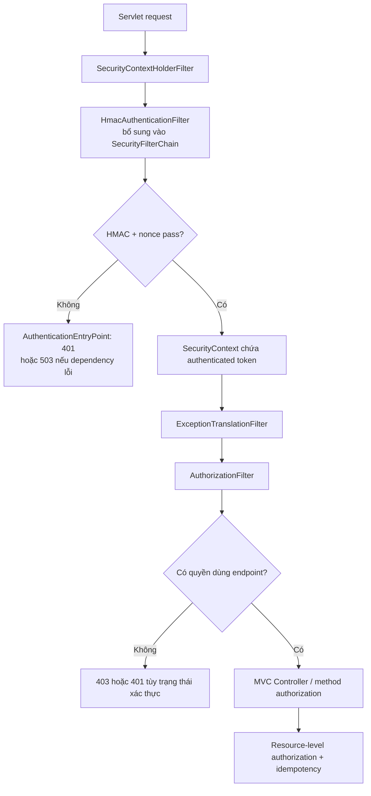
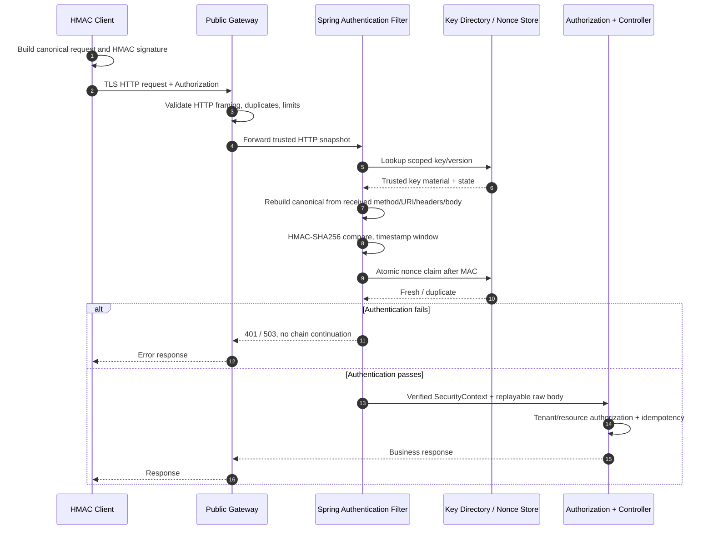

# Authentication filter trong Spring Security cho HMAC Request Authentication

## Mục tiêu học tập

Sau bài học, người học có thể:

- Giải thích vai trò của **authentication filter** trong Spring Security: chuyển một HTTP request chưa đáng tin thành một `Authentication` đã xác minh, đặt vào `SecurityContext` cho **request hiện tại**, trước khi Spring Security đưa ra quyết định authorization.
- Chọn đúng vị trí của filter trong **`SecurityFilterChain`**, phân biệt `FilterChainProxy`, `OncePerRequestFilter`, `SecurityContextHolderFilter`, `ExceptionTranslationFilter` và `AuthorizationFilter`.
- Thiết kế một **HMAC authentication filter cho Servlet stack** (Spring Boot 3.x / Spring Security 6.x, `jakarta.servlet`): đọc `Authorization: HMAC-V1`, kiểm tra cú pháp, lấy raw body với giới hạn, dựng server canonical request và xác minh HMAC-SHA256.
- Tránh lỗi đọc body trước controller: `ContentCachingRequestWrapper` **không tự tạo input stream đọc lại được** khi filter đã tiêu thụ stream; hiểu lúc nào cần **repeatable-body wrapper** hoặc xác minh ở boundary trước body transformation.
- Dùng `Mac.getInstance("HmacSHA256")` và `MessageDigest.isEqual` với **tag 32 raw bytes**, lựa chọn secret theo đúng `(environment,audience,tenantId,clientId,keyId)` và áp key-state/expiration theo server clock.
- Chống replay bằng signed timestamp + nonce, kiểm tra freshness, **atomic nonce claim** trước business side effect và chọn namespace/TTL không vô tình reset khi key rotation.
- Thiết lập **stateless SecurityFilterChain**, không dựa vào HTTP session, không cài filter hai lần do auto-registration, không tự động cho phép anonymous/fallback khi thiếu chữ ký.
- Xây `VerifiedPrincipal` từ bản ghi khóa đã xác minh; tách **HMAC authentication** khỏi **authorization theo tenant, route, action và resource owner**.
- Lập test matrix cho Spring `MockMvc`, filter ordering, duplicate headers, exception mapping, proxy/gateway, multi-replica nonce store và các tình huống failure/rotation.

**Bối cảnh:** Bài thuộc chương **Spring Security**, chủ đề **Authentication filter**, trong module `SECURITY_AUTHENTICATION_HMAC_REQUEST_AUTHENTICATION`. Phạm vi module là thiết kế xác thực HTTP request bằng **HMAC với shared secret và canonical request** gồm HTTP method, URI, headers/body theo hợp đồng ký; người học thực hành xác minh chữ ký, chống replay bằng timestamp/nonce, key rotation, kiểm thử proxy/gateway và phân biệt xác thực với phân quyền.

> Bài dùng **Spring MVC/Servlet** với API `jakarta.servlet` và DSL `SecurityFilterChain` kiểu Spring Security 6.x, **không phải Spring WebFlux** (`SecurityWebFilterChain`/`WebFilter`). Phiên bản Spring mới hơn có thể thay đổi chi tiết DSL; cần kiểm tra API của dự án khi tích hợp. `HMAC-V1` và canonical profile `hmac-spring-filter-v1` dưới đây là **giao thức mẫu tự thiết kế**, không phải format chuẩn của mọi API HMAC.

## 1. Authentication filter giải quyết vấn đề gì?

Một ứng dụng Spring MVC phục vụ `POST /api/hmac/orders`. Đối tác gửi request kèm HMAC tag; Spring Security phải từ chối request chưa xác thực **trước khi controller tạo order**.

Luồng mong muốn:

```text
HTTPS request
   |
   v
Gateway / Servlet container
   |
   v
Spring Security FilterChainProxy
   |
   v
HmacAuthenticationFilter
   |- Validate HTTP framing/header cardinality (trusted adapter)
   |- Parse clientId, keyId, timestamp, nonce, signature
   |- Lookup secret/key state theo đúng scope
   |- Server canonical bytes + HMAC verification
   |- Shared nonce claim
   |- Set authenticated SecurityContext
   |
   v
AuthorizationFilter / @PreAuthorize
   |
   v
Controller -> Domain service -> Tenant/resource authorization
                                   -> Idempotency -> Transaction
```

**Authentication** trả lời “Ai có khả năng dùng đúng HMAC secret cho request này, theo key record nào?”. **Authorization** trả lời “Principal đã xác thực có quyền thao tác resource này không?”.

Nếu chỉ kiểm tra chữ ký trong controller mà bỏ qua Spring Security context:

- `@PreAuthorize`, authorization rules và các lớp auditing khó dùng identity đồng nhất.
- Lỗi authentication dễ bị lẫn với lỗi nghiệp vụ.
- Những endpoint khác hoặc async/forward dispatch có thể bỏ sót kiểm tra.
- Code có nguy cơ tự lấy `X-Client-Id` chưa xác thực làm principal.

Filter thích hợp để **thiết lập ranh giới xác thực tập trung**. Tuy nhiên filter **không tự làm request an toàn** nếu HTTP parsing/canonicalization và backend authorization vẫn không thống nhất.

## 2. Vai trò của từng thành phần Spring Security

| Thành phần | Vai trò | Lưu ý cho HMAC |
|---|---|---|
| `DelegatingFilterProxy` | Cầu nối từ Servlet filter registration sang Spring Security | Không phải nơi đặt HMAC logic |
| `FilterChainProxy` | Chọn `SecurityFilterChain` đầu tiên khớp request | Phải cấu hình matcher và fallback rõ ràng |
| `SecurityFilterChain` | Danh sách security filters theo thứ tự | HMAC filter phải nằm **trước authorization** |
| `OncePerRequestFilter` | Base class giúp tránh lặp filter trong một dispatch theo contract | **Không** tự xác thực, tự cache body hoặc bảo đảm global exactly-once |
| `SecurityContextHolderFilter` | Chuẩn bị và dọn `SecurityContext` theo lifecycle chain | Trong Spring Security 6, không mặc định tự lưu context sau khi code set |
| `UsernamePasswordAuthenticationFilter` | Xử lý form-login khi được bật | Dùng làm **điểm chèn theo order**; không có nghĩa API đang bật form login |
| `ExceptionTranslationFilter` | Chuyển một số exception từ downstream filters thành entry-point/access-denied response | Filter đứng **trước** nó cần tự xử lý authentication failure |
| `AuthorizationFilter` | Thực thi authorization policy của chain | Phải thấy `Authentication` đã xác minh |
| `AuthenticationEntryPoint` | Khởi tạo phản hồi authentication failure, thường 401 | Không leak secret/key existence |
| `SecurityContextHolder` | Nơi giữ context theo chiến lược hiện hành, thường thread-local | Không đặt secret vào context, không giả định tự truyền qua mọi async thread |

### `OncePerRequestFilter` khác `AuthenticationFilter` thế nào?

Có thể triển khai một credential scheme bằng:

1. **`OncePerRequestFilter`**: tự đọc HTTP, gọi verifier, xây `Authentication`, set `SecurityContext`, xử lý lỗi. Phù hợp để **học rõ toàn pipeline**, nhất là khi cần giữ raw body bytes.
2. **`AuthenticationFilter` + `AuthenticationConverter` + `AuthenticationManager`/`AuthenticationProvider`**: converter chuyển request thành unauthenticated token, provider làm verify; Spring filter hỗ trợ failure/success handlers. Phù hợp để tách thành phần trong sản phẩm lớn.
3. **`AbstractAuthenticationProcessingFilter`**: lớp nền matcher + auth manager có thể dùng cho protocol chuyên biệt.

**Trong bài dùng `OncePerRequestFilter`** để nhìn rõ mọi trust boundary. Không phải cứ subclass filter là Spring tự gọi verifier; phải **đăng ký vào đúng SecurityFilterChain và thiết lập context sau xác minh thành công**.

## 3. Filter ordering và những sai lầm thường gặp

### Filter phải chạy trước authorization



Mẫu cấu hình thường gặp:

```java
http.addFilterBefore(
    new HmacAuthenticationFilter(verifier, entryPoint),
    UsernamePasswordAuthenticationFilter.class
);
```

Điểm chèn này đặt HMAC filter **trước các filter xác thực form login theo thứ tự chuẩn** và trước `AuthorizationFilter` trong cấu hình mẫu. Không suy ra rằng `UsernamePasswordAuthenticationFilter` phải thực sự có mặt trong chain: Spring Security có bảng order đã biết. **Cần xem cấu hình chain thực tế**, nhất là khi ứng dụng thêm OAuth2/Bearer/basic/custom filters khác.

### Tại sao `ExceptionTranslationFilter` có thể không bắt lỗi của custom HMAC filter?

Một filter nằm **upstream** `ExceptionTranslationFilter` gọi `chain.doFilter(...)`. `ExceptionTranslationFilter` chỉ xử lý exceptions từ **phần chain chạy sau vị trí của nó**, không đi ngược để bắt mọi exception phát sinh trước khi nó được gọi.

Do đó **không** viết code giả định “ném `BadCredentialsException` ở filter trước đó là Spring sẽ luôn trả 401”. Với filter trong bài, hãy:

- Catch `AuthenticationException` từ **riêng bước HMAC verification**.
- Gọi `AuthenticationEntryPoint.commence` hoặc trả lỗi có chủ đích.
- `return`, **không gọi controller/next chain** sau thất bại.
- **Không catch trùm `chain.doFilter`** rồi biến mọi lỗi quyền/nghiệp vụ downstream thành “HMAC sai”.

### Tránh đăng ký filter hai lần

Nếu subclass `Filter` vừa là `@Component`/`@Bean` trong Spring Boot, Boot có thể **auto-register** nó như một Servlet filter **ngoài** Spring Security chain. Nếu tiếp tục `addFilterBefore(...)` cùng instance, request có thể đi qua hai đường, dẫn đến đọc body hai lần, claim nonce trùng và 401 khó hiểu.

**Trong ví dụ:** instantiate filter **trực tiếp trong method tạo `SecurityFilterChain`**, **không** khai báo nó như một `@Bean Filter` độc lập. Nếu cần injection thành bean, hãy kiểm soát Servlet auto-registration bằng `FilterRegistrationBean` disabled và bảo đảm chỉ một đường security filter chạy.

## 4. Chốt contract HMAC trước khi viết Spring code

Một request HTTP minh họa (mọi giá trị `<...>` chỉ là placeholder):

```http
POST /api/hmac/orders HTTP/1.1
Host: api.example.test
Content-Type: application/json
X-Tenant-Id: tenant-alpha
Idempotency-Key: order-alpha-001
Authorization: HMAC-V1 client="integrator-7", keyid="k2", ts="<epoch-seconds>", nonce="<22-base64url-chars>", sig="<43-base64url-chars>"

{"orderId":"A-42","amountMinor":120000}
```

**Profile của bài:**

- Method đúng `POST`; raw request URI đúng `/api/hmac/orders`; **không có query string**.
- Public `Host` cố định `api.example.test`; việc xác định Host khi ở sau gateway là trách nhiệm của một **trusted boundary**.
- Bắt buộc đúng một occurrence của `Authorization`, `Host`, `Content-Type`, `X-Tenant-Id`, `Idempotency-Key`.
- `Content-Type` phải đúng `application/json`, không accept nhiều biến thể/charset theo kiểu “đoán” khi protocol không cho.
- `Content-Encoding` vắng mặt hoặc `identity`; không tự decompress/serialize body làm canonical bytes thay đổi.
- Raw body phải có từ 1 đến **16.384 bytes**, giới hạn ngay ở filter/ingress trước khi cấp phát lớn.
- `client`, `keyid` và `X-Tenant-Id` là ASCII identifier theo `[A-Za-z0-9][A-Za-z0-9._-]{0,63}`, **case-sensitive**.
- `ts` là Unix epoch seconds ASCII decimal không leading zero, trong cửa sổ **±300 giây** theo server clock.
- `nonce` là 16 random bytes → Base64URL no padding **22 chars**, `sig` là full 32-byte HMAC-SHA256 tag → Base64URL no padding **43 chars**.
- Scheme `HMAC-V1` và tên auth-params **case-insensitive**, values case-sensitive; profile chỉ nhận **một serialization fixed order/spacing** để tránh parser ambiguity.
- `environment=production` và `audience=orders-api` được cấu hình **phía server**, không lấy từ untrusted request header.

### Canonical text, byte-level

```text
hmac-spring-filter-v1
POST
/api/hmac/orders
host:api.example.test
content-type:application/json
x-tenant-id:tenant-alpha
idempotency-key:order-alpha-001
environment:production
audience:orders-api
auth-scheme:hmac-v1
client:integrator-7
keyid:k2
ts:<epoch-seconds>
nonce:<22-base64url-chars>
body-sha256:<base64url-sha256-of-exact-raw-body>
```

**Rules không được ngầm thay đổi:**

1. Mỗi dòng phân cách bằng **LF 0x0A**, **không có newline cuối**.
2. Canonical text encode **UTF-8 không BOM**, không dùng `System.lineSeparator()`.
3. `body-sha256` là `SHA-256` trên **exact raw HTTP body bytes** sau khi HTTP framing kết thúc, trước mọi JSON parse/serialization.
4. `host`, signed header values và raw target phải khớp **những gì backend thực sự xử lý**; gateway rewrite phải có hợp đồng rõ.
5. `environment`/`audience` là server-side domain separation, ràng buộc service/region chính sách.
6. `client`, `keyid`, `ts`, `nonce` là giá trị sau strict parse; `sig` **không** được đưa vào canonical text vì đang được tính.
7. Không tồn tại `alg=none`, `skipBody` hay tùy chọn unsigned header do client điều khiển.

```text
digest  = SHA256(rawBodyBytes)
message = UTF8(canonicalText)
tag     = HMAC-SHA256(secretFromExactKeyRef, message)
sig     = Base64URL_NoPadding(tag)    // 32 bytes -> 43 chars
```

**Quan trọng:** tenant ID được ký và key directory tra `(environment,audience,tenantId,clientId,keyId)`. Trước khi HMAC pass, tenant/client/key ID chỉ là **candidate lookup hints**. Sau đó mới gắn principal và tenant đã được issuer ràng buộc.

## 5. Vì sao đọc request body trong filter dễ gây lỗi?

Trong Servlet API, `HttpServletRequest.getInputStream()` thường đại diện cho **một luồng body**. Khi filter đọc đến EOF để tính SHA-256, controller `@RequestBody` phía sau có thể thấy **stream đã bị tiêu thụ**.

### Anti-pattern: đọc hết body rồi gọi chain với request gốc

```java
// SAI: controller thường không thể tự đọc lại input stream.
byte[] raw = request.getInputStream().readAllBytes();
byte[] digest = MessageDigest.getInstance("SHA-256").digest(raw);
filterChain.doFilter(request, response); // @RequestBody có thể rỗng
```

Đoạn trên còn đọc không giới hạn kích thước, có thể gây memory pressure/DoS.

### `ContentCachingRequestWrapper` không tự làm stream lặp lại

`ContentCachingRequestWrapper` hữu ích khi muốn **quan sát content mà các tầng sau đã đọc**, nhưng nếu filter **tự đọc toàn bộ body trước**, việc wrap rồi gọi `chain.doFilter(wrapper,...)` không khiến downstream `getInputStream()` tự quay lại đầu như một input stream mới.

**Lựa chọn của bài:** filter đọc body **có giới hạn**, rồi truyền xuống chain một `HttpServletRequestWrapper` mà `getInputStream()` và `getReader()` trả stream mới từ **byte[] đã lưu**.

### Những giới hạn cần chỉ rõ

- Bọc body theo hướng này hợp với **request synchronous JSON cỡ nhỏ**; buffering toàn bộ payload không phù hợp streaming/file upload và nonblocking Servlet I/O nếu không thiết kế riêng.
- `getInputStream()` và `getReader()` có contract/encoding riêng. Mẫu wrapper minh họa **UTF-8 JSON only**, không dùng cho multipart/form-data và async read listener.
- Bộ lọc/proxy upstream có thể đã tiêu thụ/giải nén/transform body; filter không thể “khôi phục exact bytes” nếu trust boundary đã mất.
- Nếu dùng request size cap 16 KiB trong app, gateway vẫn nên có giới hạn connection/body/header tương ứng; chặn ở app **không thay thế** edge limits.

## 6. Kiến trúc ví dụ Java/Spring Security

Bộ ví dụ gồm **bốn file Java riêng** trong package `com.example.orders.security`:

1. `HmacVerifier.java`: parse Authorization, kiểm tra key lifecycle/timestamp, canonical HMAC, nonce store, tạo authenticated token.
2. `ReplayableBodyRequest.java`: wrapper hỗ trợ controller đọc lại body đã được filter kiểm tra.
3. `HmacAuthenticationFilter.java`: `OncePerRequestFilter`, bounded body read, gọi verifier, chọn 401/413/503 và set `SecurityContext`.
4. `HmacSecurityConfiguration.java`: chọn chain cho `/api/hmac/**`, bật stateless, đặt thứ tự filter và deny-by-default cho routes khác trong ví dụ.

**Dữ liệu giả định có sẵn từ tầng tin cậy:** một `HmacVerifier.KeyDirectory` tra key theo scope; một `HmacVerifier.NonceStore` có **atomic insert-if-absent + TTL**, shared giữa mọi verifier replicas. Không có “production database/KMS/Redis code” trá hình trong ví dụ.

### 6.1. Domain model và verifier — `HmacVerifier.java`

```java
package com.example.orders.security;

import java.nio.charset.StandardCharsets;
import java.security.GeneralSecurityException;
import java.security.MessageDigest;
import java.security.Principal;
import java.time.Clock;
import java.time.Duration;
import java.time.Instant;
import java.util.Arrays;
import java.util.Base64;
import java.util.Collection;
import java.util.List;
import java.util.Optional;
import java.util.regex.Matcher;
import java.util.regex.Pattern;
import javax.crypto.Mac;
import javax.crypto.spec.SecretKeySpec;
import org.springframework.security.authentication.BadCredentialsException;
import org.springframework.security.authentication.UsernamePasswordAuthenticationToken;
import org.springframework.security.core.Authentication;
import org.springframework.security.core.GrantedAuthority;

public final class HmacVerifier {
    private static final String VERSION = "hmac-spring-filter-v1";
    private static final String ENV = "production";
    private static final String AUDIENCE = "orders-api";
    private static final String HOST = "api.example.test";
    private static final String TARGET = "/api/hmac/orders";
    private static final String TYPE = "application/json";
    private static final int MAX_BODY = 16 * 1024;
    private static final long CLOCK_WINDOW = 300;
    private static final long MAX_EPOCH = 253402300799L;
    private static final Duration NONCE_TTL = Duration.ofSeconds(605);
    private static final Base64.Encoder B64 =
            Base64.getUrlEncoder().withoutPadding();

    private static final Pattern ID =
            Pattern.compile("[A-Za-z0-9][A-Za-z0-9._-]{0,63}");
    private static final Pattern IDEMPOTENCY =
            Pattern.compile("[A-Za-z0-9][A-Za-z0-9._-]{0,79}");
    private static final Pattern TS =
            Pattern.compile("[1-9][0-9]{0,11}");
    private static final Pattern NONCE =
            Pattern.compile("[A-Za-z0-9_-]{22}");
    private static final Pattern TAG =
            Pattern.compile("[A-Za-z0-9_-]{43}");

    // Fixed-order, fixed-spacing, quoted profile. Names case-insensitive,
    // values case-sensitive. Duplicate/extra params cannot full-match.
    private static final Pattern AUTH = Pattern.compile(
            "(?i:HMAC-V1) (?i:client)=\"([A-Za-z0-9][A-Za-z0-9._-]{0,63})\", " +
            "(?i:keyid)=\"([A-Za-z0-9][A-Za-z0-9._-]{0,63})\", " +
            "(?i:ts)=\"([1-9][0-9]{0,11})\", " +
            "(?i:nonce)=\"([A-Za-z0-9_-]{22})\", " +
            "(?i:sig)=\"([A-Za-z0-9_-]{43})\"");

    public enum KeyState {
        PREPARED, ACTIVE, VERIFY_ONLY, REVOKED
    }

    public record KeyRef(
            String environment, String audience, String tenantId,
            String clientId, String keyId) {}

    // SecurityContext and Authentication NEVER store the raw secret.
    public record VerifiedPrincipal(
            String tenantId, String clientId,
            String account, String keyId) implements Principal {
        @Override
        public String getName() {
            return account;
        }
    }

    public record KeyRecord(
            KeyRef ref, String account, KeyState state,
            Instant notBefore, Instant verifyUntil,
            byte[] secret, Collection<? extends GrantedAuthority> authorities) {

        public KeyRecord {
            if (ref == null || account == null || account.isBlank() ||
                    state == null || notBefore == null ||
                    verifyUntil == null ||
                    !notBefore.isBefore(verifyUntil) ||
                    secret == null || secret.length != 32 ||
                    authorities == null) {
                throw new IllegalArgumentException("Invalid key record");
            }
            secret = secret.clone();
            authorities = List.copyOf(authorities);
        }

        @Override
        public byte[] secret() {
            return secret.clone(); // Caller cannot mutate stored secret.
        }

        public boolean mayVerify(Instant now) {
            return (state == KeyState.ACTIVE ||
                    state == KeyState.VERIFY_ONLY) &&
                    !now.isBefore(notBefore) &&
                    now.isBefore(verifyUntil);
        }
    }

    public record NonceScope(
            String environment, String audience, String tenantId,
            String clientId) {}

    public record SignedRequest(
            String method, String rawUri, String query,
            String host, String contentType, String tenantId,
            String idempotencyKey, byte[] rawBody) {
        public SignedRequest {
            if (rawBody == null) {
                throw new IllegalArgumentException("Missing body");
            }
            rawBody = rawBody.clone();
        }

        @Override
        public byte[] rawBody() {
            return rawBody.clone();
        }
    }

    private record Claims(
            String clientId, String keyId, String timestamp, String nonce) {}
    private record Parsed(Claims claims, byte[] suppliedTag) {}

    public interface KeyDirectory {
        Optional<KeyRecord> find(KeyRef ref);
    }

    public interface NonceStore {
        // Production: shared atomic claim and TTL, not a local HashSet.
        boolean claim(NonceScope scope, String nonce, Duration ttl);
    }

    public static final class HmacInfrastructureException
            extends RuntimeException {
        public HmacInfrastructureException(String message, Throwable cause) {
            super(message, cause);
        }
    }

    private final KeyDirectory keys;
    private final NonceStore nonces;
    private final Clock serverClock;

    public HmacVerifier(
            KeyDirectory keys, NonceStore nonces, Clock serverClock) {
        this.keys = java.util.Objects.requireNonNull(keys);
        this.nonces = java.util.Objects.requireNonNull(nonces);
        this.serverClock = java.util.Objects.requireNonNull(serverClock);
    }

    private static BadCredentialsException badCredential() {
        return new BadCredentialsException("Invalid HMAC credential");
    }

    private static byte[] decodeStrict(
            String value, Pattern grammar, int size) {
        if (value == null || !grammar.matcher(value).matches()) {
            throw new IllegalArgumentException("Bad Base64URL grammar");
        }
        final byte[] decoded;
        try {
            decoded = Base64.getUrlDecoder().decode(value);
        } catch (IllegalArgumentException malformed) {
            throw new IllegalArgumentException("Invalid Base64URL");
        }
        if (decoded.length != size ||
                !B64.encodeToString(decoded).equals(value)) {
            throw new IllegalArgumentException("Noncanonical Base64URL");
        }
        return decoded;
    }

    private static long epochSeconds(String raw) {
        if (raw == null || !TS.matcher(raw).matches()) {
            throw new IllegalArgumentException("Bad timestamp grammar");
        }
        long t = Long.parseLong(raw);
        if (t > MAX_EPOCH) {
            throw new IllegalArgumentException("Timestamp out of range");
        }
        return t;
    }

    private static Parsed parse(String authorization) {
        if (authorization == null || authorization.length() > 512) {
            throw new IllegalArgumentException("Bad Authorization length");
        }
        Matcher m = AUTH.matcher(authorization);
        if (!m.matches()) {
            throw new IllegalArgumentException("Invalid HMAC auth-param");
        }
        Claims claims = new Claims(
                m.group(1), m.group(2), m.group(3), m.group(4));
        epochSeconds(claims.timestamp());
        decodeStrict(claims.nonce(), NONCE, 16);
        return new Parsed(
                claims, decodeStrict(m.group(5), TAG, 32));
    }

    private static void validate(SignedRequest r) {
        if (r == null || !"POST".equals(r.method()) ||
                !TARGET.equals(r.rawUri()) ||
                r.query() != null ||
                !HOST.equals(r.host()) ||
                !TYPE.equals(r.contentType()) ||
                r.tenantId() == null ||
                !ID.matcher(r.tenantId()).matches() ||
                r.idempotencyKey() == null ||
                !IDEMPOTENCY.matcher(r.idempotencyKey()).matches() ||
                r.rawBody().length == 0 ||
                r.rawBody().length > MAX_BODY) {
            throw new IllegalArgumentException("Invalid signed request");
        }
    }

    private static byte[] canonical(SignedRequest r, Claims c)
            throws GeneralSecurityException {
        byte[] bodyHash = MessageDigest.getInstance("SHA-256")
                .digest(r.rawBody());
        String message = String.join("\n",
                VERSION,
                "POST",
                TARGET,
                "host:" + r.host(),
                "content-type:" + r.contentType(),
                "x-tenant-id:" + r.tenantId(),
                "idempotency-key:" + r.idempotencyKey(),
                "environment:" + ENV,
                "audience:" + AUDIENCE,
                "auth-scheme:hmac-v1",
                "client:" + c.clientId(),
                "keyid:" + c.keyId(),
                "ts:" + c.timestamp(),
                "nonce:" + c.nonce(),
                "body-sha256:" + B64.encodeToString(bodyHash));
        return message.getBytes(StandardCharsets.UTF_8);
    }

    private static byte[] computeTag(
            byte[] temporaryKey, SignedRequest r, Claims c)
            throws GeneralSecurityException {
        try {
            Mac mac = Mac.getInstance("HmacSHA256");
            mac.init(new SecretKeySpec(temporaryKey, "HmacSHA256"));
            return mac.doFinal(canonical(r, c));
        } finally {
            // Best effort for THIS clone, not a JVM-wide zeroization proof.
            Arrays.fill(temporaryKey, (byte) 0);
        }
    }

    public Authentication authenticate(
            SignedRequest request, String authorization) {
        final Parsed parsed;
        try {
            parsed = parse(authorization);
            validate(request);
        } catch (IllegalArgumentException malformed) {
            throw badCredential();
        }

        Instant now = serverClock.instant();
        long nowSec = now.getEpochSecond();
        long t = epochSeconds(parsed.claims().timestamp());
        long delta = t - nowSec;
        if (nowSec < 0 || nowSec > MAX_EPOCH ||
                delta < -CLOCK_WINDOW || delta > CLOCK_WINDOW) {
            throw badCredential();
        }

        // tenantId/clientId/keyId are untrusted lookup hints UNTIL MAC pass.
        KeyRef ref = new KeyRef(
                ENV, AUDIENCE, request.tenantId(),
                parsed.claims().clientId(), parsed.claims().keyId());
        final Optional<KeyRecord> candidate;
        try {
            candidate = keys.find(ref);
        } catch (RuntimeException sourceUnavailable) {
            throw new HmacInfrastructureException(
                    "Key registry unavailable", sourceUnavailable);
        }
        KeyRecord key = candidate.orElseThrow(HmacVerifier::badCredential);

        // Never accept a mismatched owner/state, nor fall back to other keys.
        if (!ref.equals(key.ref()) || !key.mayVerify(now)) {
            throw badCredential();
        }

        final byte[] expected;
        try {
            expected = computeTag(
                    key.secret(), request, parsed.claims());
        } catch (GeneralSecurityException cryptoError) {
            throw new HmacInfrastructureException(
                    "HMAC provider unavailable", cryptoError);
        }
        if (!MessageDigest.isEqual(expected, parsed.suppliedTag())) {
            throw badCredential();
        }

        // Nonce namespace is tenant+client, NOT keyId.
        NonceScope scope = new NonceScope(
                ENV, AUDIENCE, key.ref().tenantId(),
                key.ref().clientId());
        final boolean fresh;
        try {
            fresh = nonces.claim(
                    scope, parsed.claims().nonce(), NONCE_TTL);
        } catch (RuntimeException storeUnavailable) {
            throw new HmacInfrastructureException(
                    "Replay store unavailable", storeUnavailable);
        }
        if (!fresh) {
            throw badCredential();
        }

        // Principal/authorities ONLY from trusted verified key record.
        VerifiedPrincipal principal = new VerifiedPrincipal(
                key.ref().tenantId(), key.ref().clientId(),
                key.account(), key.ref().keyId());
        return UsernamePasswordAuthenticationToken.authenticated(
                principal, null, key.authorities());
    }
}
```

### 6.2. Những điều `HmacVerifier` bảo đảm và chưa bảo đảm

**Đã biểu diễn trong code:**

- Client/tenant/key ID bị giới hạn format trước lookup; `ENV`/`AUDIENCE` chỉ từ server.
- `KeyRef` tách nhiều tenant và key versions, không có try-all hoặc fallback secret.
- `KeyRecord.mayVerify` enforce `ACTIVE`/`VERIFY_ONLY` và hard `verifyUntil` theo **server `Clock`**, không dùng signed timestamp làm key lifetime.
- Nonce 16 bytes và signature full 32 bytes đều decode/re-encode Base64URL canonical; timestamp strict decimal.
- Canonical text ký tenant, client, key ID, timestamp, nonce, method/URI/Host, Content-Type, Idempotency-Key, exact raw body digest.
- HMAC-SHA256 tính bằng JCA; full tag compare bằng `MessageDigest.isEqual` (tránh early-exit compare trực tiếp của code ứng dụng).
- Nonce claim **sau khi MAC đúng**, trước khi tạo authenticated token.
- Token có principal/authorities từ **verified key record**, không lấy role do caller khai.

**Chưa được code này giải quyết:** HTTP framing, gateway rewrite, nhập nhằng duplicate header, secret injection nguồn thật, distributed nonce store, business authorization, idempotency transaction và đảm bảo revocation state nhất quán giữa các replicas. Những nhiệm vụ đó được giao cho các thành phần khác trong kiến trúc.

### 6.3. Repeatable body — `ReplayableBodyRequest.java`

```java
package com.example.orders.security;

import java.io.BufferedReader;
import java.io.ByteArrayInputStream;
import java.io.InputStreamReader;
import java.nio.charset.StandardCharsets;
import jakarta.servlet.ReadListener;
import jakarta.servlet.ServletInputStream;
import jakarta.servlet.http.HttpServletRequest;
import jakarta.servlet.http.HttpServletRequestWrapper;

public final class ReplayableBodyRequest extends HttpServletRequestWrapper {
    private final byte[] body;

    public ReplayableBodyRequest(
            HttpServletRequest original, byte[] verifiedBody) {
        super(original);
        body = verifiedBody.clone();
    }

    @Override
    public ServletInputStream getInputStream() {
        ByteArrayInputStream input = new ByteArrayInputStream(body);
        return new ServletInputStream() {
            @Override
            public int read() {
                return input.read();
            }

            @Override
            public boolean isFinished() {
                return input.available() == 0;
            }

            @Override
            public boolean isReady() {
                return true;
            }

            @Override
            public void setReadListener(ReadListener listener) {
                // This teaching wrapper supports synchronous I/O only.
                throw new IllegalStateException(
                        "Async/nonblocking body read is unsupported");
            }
        };
    }

    @Override
    public BufferedReader getReader() {
        return new BufferedReader(new InputStreamReader(
                getInputStream(), StandardCharsets.UTF_8));
    }

    @Override
    public int getContentLength() {
        return body.length;
    }

    @Override
    public long getContentLengthLong() {
        return body.length;
    }
}
```

**Cảnh báo:** wrapper này chỉ minh họa **synchronous JSON endpoint**. Nó cố ý không hỗ trợ `setReadListener` cho Servlet nonblocking I/O; không áp dụng nguyên xi cho async controllers, streaming uploads, multipart/form hoặc request có encoding khác. Body được giữ trong RAM và `body.clone()` tạo thêm bản sao; chính vì vậy filter/ingress giới hạn 16 KiB. Ở app thực, cân nhắc framework/body API phù hợp, hash streaming ở trusted boundary hoặc mô hình verify riêng cho tải lớn.

### 6.4. Authentication filter — `HmacAuthenticationFilter.java`

```java
package com.example.orders.security;

import java.io.ByteArrayOutputStream;
import java.io.IOException;
import java.io.InputStream;
import java.util.Enumeration;
import jakarta.servlet.FilterChain;
import jakarta.servlet.ServletException;
import jakarta.servlet.http.HttpServletRequest;
import jakarta.servlet.http.HttpServletResponse;
import org.springframework.security.authentication.BadCredentialsException;
import org.springframework.security.core.Authentication;
import org.springframework.security.core.context.SecurityContext;
import org.springframework.security.core.context.SecurityContextHolder;
import org.springframework.security.web.AuthenticationEntryPoint;
import org.springframework.web.filter.OncePerRequestFilter;

public final class HmacAuthenticationFilter extends OncePerRequestFilter {
    private static final int MAX_BODY = 16 * 1024;
    private final HmacVerifier verifier;
    private final AuthenticationEntryPoint entryPoint;

    public HmacAuthenticationFilter(
            HmacVerifier verifier, AuthenticationEntryPoint entryPoint) {
        this.verifier = verifier;
        this.entryPoint = entryPoint;
    }

    private static boolean exactlyOneHeader(
            HttpServletRequest req, String name) {
        Enumeration<String> values = req.getHeaders(name);
        if (values == null || !values.hasMoreElements()) return false;
        values.nextElement();
        return !values.hasMoreElements();
    }

    private static boolean atMostOneHeader(
            HttpServletRequest req, String name) {
        Enumeration<String> values = req.getHeaders(name);
        if (values == null || !values.hasMoreElements()) return true;
        values.nextElement();
        return !values.hasMoreElements();
    }

    private static void validateHeaderCardinality(
            HttpServletRequest request) {
        for (String name : new String[] {
                "Authorization", "Host", "Content-Type",
                "X-Tenant-Id", "Idempotency-Key"}) {
            if (!exactlyOneHeader(request, name)) {
                throw new BadCredentialsException(
                        "Invalid signed HTTP headers");
            }
        }
        if (!atMostOneHeader(request, "Content-Encoding")) {
            throw new BadCredentialsException("Invalid content encoding");
        }
        String encoding = request.getHeader("Content-Encoding");
        if (encoding != null &&
                !"identity".equalsIgnoreCase(encoding)) {
            throw new BadCredentialsException(
                    "Unsupported content encoding");
        }
    }

    private static final class BodyTooLarge extends RuntimeException {}

    private static byte[] readBounded(InputStream input)
            throws IOException {
        ByteArrayOutputStream output = new ByteArrayOutputStream();
        byte[] block = new byte[4096];
        int n;
        while ((n = input.read(block)) != -1) {
            if (n > MAX_BODY - output.size()) {
                throw new BodyTooLarge();
            }
            output.write(block, 0, n);
        }
        return output.toByteArray();
    }

    @Override
    protected void doFilterInternal(
            HttpServletRequest request,
            HttpServletResponse response,
            FilterChain chain) throws ServletException, IOException {

        final byte[] body;
        final Authentication verified;

        // Only verify block is caught. Do NOT catch all of chain.doFilter().
        try {
            validateHeaderCardinality(request);
            if (request.getContentLengthLong() > MAX_BODY) {
                throw new BodyTooLarge();
            }
            body = readBounded(request.getInputStream());

            HmacVerifier.SignedRequest signed =
                    new HmacVerifier.SignedRequest(
                            request.getMethod(),
                            request.getRequestURI(),
                            request.getQueryString(),
                            request.getHeader("Host"),
                            request.getHeader("Content-Type"),
                            request.getHeader("X-Tenant-Id"),
                            request.getHeader("Idempotency-Key"),
                            body);
            verified = verifier.authenticate(
                    signed, request.getHeader("Authorization"));

        } catch (BodyTooLarge oversized) {
            response.sendError(
                    HttpServletResponse.SC_REQUEST_ENTITY_TOO_LARGE);
            return;
        } catch (BadCredentialsException failed) {
            // This filter sits BEFORE ExceptionTranslationFilter.
            // Do not leak key existence, exact MAC, or secret to caller.
            entryPoint.commence(
                    request, response,
                    new BadCredentialsException("Authentication failed"));
            return;
        } catch (HmacVerifier.HmacInfrastructureException unavailable) {
            // Key directory / crypto provider / nonce store cannot be trusted.
            // Fail closed instead of forwarding an unauthenticated request.
            response.sendError(HttpServletResponse.SC_SERVICE_UNAVAILABLE);
            return;
        }

        // Never mutate a previously shared/anonymous context in place.
        SecurityContext context =
                SecurityContextHolder.createEmptyContext();
        context.setAuthentication(verified);
        SecurityContextHolder.setContext(context);

        try {
            // The controller receives exactly the body whose hash was signed.
            chain.doFilter(
                    new ReplayableBodyRequest(request, body), response);
        } finally {
            // The security chain also has context lifecycle handling;
            // local cleanup makes this custom filter's ownership explicit.
            SecurityContextHolder.clearContext();
        }
    }
}
```

### 6.5. Quan sát ba nhánh phản hồi của filter

| Điều kiện | Hành vi | Có gọi `chain.doFilter`? |
|---|---|---|
| Malformed/missing Authorization, bad HMAC, revoked/expired key, stale timestamp, duplicate signed header, replay | Gọi `AuthenticationEntryPoint` → 401 chung | **Không** |
| Body lớn hơn limit | `413 Payload Too Large` | **Không** |
| Trusted key directory, JCA provider hoặc nonce store không đáp ứng tin cậy | `503 Service Unavailable` / fail closed | **Không** |
| HMAC + key state + timestamp + nonce hợp lệ | Tạo `SecurityContext` rồi gọi chain với repeatable body | **Có** |
| Downstream authorization deny | `AuthorizationFilter`/method security xử lý | Filter **không tự chuyển thành 401 HMAC** |
| Downstream business exception | Lỗi trả về qua cơ chế MVC/security phù hợp | Filter chỉ dọn SecurityContext khi kết thúc |

**Không catch `Exception` quanh toàn bộ `chain.doFilter`**. Nếu downstream ném `AccessDeniedException` hoặc logic nghiệp vụ lỗi, filter không được “nuốt” lỗi rồi ghi “bad signature”; điều đó có thể che lỗ hổng authorization và làm audit sai.

**Nếu Servlet `InputStream` ném `IOException`**, filter để lỗi đi qua container/error handling; request **không** được chuyển tiếp tới controller. Production nên có exception logging/response policy hợp lý nhưng không in raw body/credential.

### 6.6. SecurityFilterChain — `HmacSecurityConfiguration.java`

```java
package com.example.orders.security;

import java.time.Clock;
import org.springframework.context.annotation.Bean;
import org.springframework.context.annotation.Configuration;
import org.springframework.core.annotation.Order;
import org.springframework.http.HttpStatus;
import org.springframework.security.config.annotation.method.configuration.EnableMethodSecurity;
import org.springframework.security.config.annotation.web.builders.HttpSecurity;
import org.springframework.security.config.annotation.web.configuration.EnableWebSecurity;
import org.springframework.security.config.annotation.web.configurers.AbstractHttpConfigurer;
import org.springframework.security.config.http.SessionCreationPolicy;
import org.springframework.security.web.AuthenticationEntryPoint;
import org.springframework.security.web.SecurityFilterChain;
import org.springframework.security.web.authentication.HttpStatusEntryPoint;
import org.springframework.security.web.authentication.UsernamePasswordAuthenticationFilter;
import org.springframework.security.web.context.NullSecurityContextRepository;

@Configuration
@EnableWebSecurity
@EnableMethodSecurity
public class HmacSecurityConfiguration {

    @Bean
    Clock hmacServerClock() {
        return Clock.systemUTC();
    }

    @Bean
    HmacVerifier hmacVerifier(
            HmacVerifier.KeyDirectory keys,
            HmacVerifier.NonceStore nonces,
            Clock hmacServerClock) {
        return new HmacVerifier(keys, nonces, hmacServerClock);
    }

    @Bean
    @Order(1)
    SecurityFilterChain hmacApiChain(
            HttpSecurity http, HmacVerifier verifier) throws Exception {
        AuthenticationEntryPoint entryPoint =
                new HttpStatusEntryPoint(HttpStatus.UNAUTHORIZED);

        http
            .securityMatcher("/api/hmac/**")
            // Scope CSRF change ONLY to this stateless HMAC API.
            .csrf(AbstractHttpConfigurer::disable)
            .sessionManagement(sm ->
                    sm.sessionCreationPolicy(SessionCreationPolicy.STATELESS))
            .securityContext(sc ->
                    sc.securityContextRepository(
                            new NullSecurityContextRepository()))
            .exceptionHandling(ex ->
                    ex.authenticationEntryPoint(entryPoint))
            .authorizeHttpRequests(auth ->
                    auth.anyRequest().authenticated())
            // Direct construction: do NOT @Bean/@Component this Filter.
            .addFilterBefore(
                    new HmacAuthenticationFilter(verifier, entryPoint),
                    UsernamePasswordAuthenticationFilter.class);

        return http.build();
    }

    // Example fallback: do not accidentally leave unmatched routes open.
    // Real applications may have separate, deliberately secured chains.
    @Bean
    @Order(2)
    SecurityFilterChain denyOtherRoutes(HttpSecurity http)
            throws Exception {
        http.authorizeHttpRequests(auth ->
                auth.anyRequest().denyAll());
        return http.build();
    }
}
```

**Các điểm cần đọc đúng từ cấu hình:**

- `securityMatcher("/api/hmac/**")` chỉ định **chain nào xử lý request**, không phải yêu cầu tự động áp HMAC cho toàn bộ ứng dụng.
- `@Order(1)` chọn HMAC chain trước; fallback `@Order(2)` **deny all** trong bài để tránh đường không khớp chain trở thành công khai.
- `sessionCreationPolicy(STATELESS)` và `NullSecurityContextRepository` thể hiện không dựa vào `HttpSession` để duy trì authentication. Mỗi HTTP attempt phải ký, không dùng session để bỏ qua HMAC.
- `new HmacAuthenticationFilter(...)` được tạo **trong chain**, tránh Boot tự đăng ký như một Servlet filter độc lập.
- `@EnableMethodSecurity` cho phép dùng `@PreAuthorize` trong service/controller; annotation này **không tự thay thế** resource-level checks.
- `csrf(disable)` chỉ áp cho chain stateless HMAC nơi credential không được browser tự động gắn như cookie. Nếu ứng dụng có cookie/session-based endpoints, không tắt CSRF toàn cục vô điều kiện.
- `AuthenticationEntryPoint` trả 401 cho lỗi authentication; với permission deny trên authenticated caller, Spring Security có thể trả 403 theo handler/policy.
- Code cấu hình **không định nghĩa `KeyDirectory`/`NonceStore` production beans** vì mỗi deployment phải gắn với hệ thống lưu khóa và nonce phù hợp. Khi chưa có implementation đáng tin, **ứng dụng phải fail startup**, không dùng hardcoded dev secret hoặc local replay set làm fallback.

## 7. SecurityContext và Authentication principal: không đưa secret vào context

`SecurityContextHolder` giữ một `SecurityContext` thường **gắn với thread xử lý request**. Bài dùng:

```java
SecurityContext context = SecurityContextHolder.createEmptyContext();
context.setAuthentication(verifiedAuthentication);
SecurityContextHolder.setContext(context);

try {
    chain.doFilter(replayableRequest, response);
} finally {
    SecurityContextHolder.clearContext();
}
```

### `Authentication` nên chứa gì?

| Thuộc tính | Nguồn đáng tin | Có được đưa vào `Authentication`? |
|---|---|---|
| `VerifiedPrincipal.tenantId` | `KeyRecord.ref` đã được HMAC xác minh | Có |
| `VerifiedPrincipal.clientId` | `KeyRecord.ref` đã được HMAC xác minh | Có |
| `VerifiedPrincipal.account` | Issuer/identity mapping trong key directory | Có |
| `VerifiedPrincipal.keyId` | Phiên bản key đã verify | Có nếu cần audit hạn chế |
| `GrantedAuthority` | Trusted server-side entitlement registry | Có, sau khi kiểm tra policy |
| Raw HMAC secret | Secret manager/KMS/JCA temporary use | **Không** |
| Expected HMAC tag | Kết quả tính verifier | **Không** |
| Raw `Authorization` header | HTTP input có signature/timestamp/nonce | **Không** |
| Role/tenant do caller tự gửi và chưa đối chiếu | Untrusted input | **Không** |

`UsernamePasswordAuthenticationToken.authenticated(principal, null, authorities)` là một cách tạo token đã xác thực trong ví dụ. **Không** set `authenticated=true` cho token chứa chưa kiểm tra HMAC, và không lấy authorities từ `X-Roles` hoặc nội dung JSON của client.

### Stateless và thread-local không đồng nghĩa “tự bảo vệ mọi luồng”

- Spring Security filters quản lý context theo request/thread; `OncePerRequestFilter` không bảo đảm run đúng một lần trong **mọi async/error dispatch**.
- Nếu controller/service dùng `@Async`, executor tự tạo thread hoặc reactive bridge, phải dùng **cơ chế context propagation được kiểm soát** (ví dụ `DelegatingSecurityContext...` khi phù hợp), hoặc truyền identity object đã xác minh rõ ràng.
- Không mặc định gửi raw `SecurityContext` sang message broker hoặc job bất đồng bộ; chỉ truyền các claims có thể kiểm tra và gắn với service identity/hop security.
- Không dùng `ThreadLocal` tùy tiện để lưu secret, và không truyền inherited security context sang child thread mà không quản lý cleanup.
- `SecurityContextHolderFilter` trong Spring Security 6 hỗ trợ lifecycle nhưng không đồng nghĩa context sau khi `setAuthentication` sẽ được lưu vào session. Bài cố ý chọn **stateless**.

## 8. Authorization sau HMAC: từ endpoint tới resource owner

Đưa identity vào `SecurityContext` mới giải quyết bước đầu. Ví dụ sau minh họa method security:

```java
// Đoạn minh họa trong một @RestController / @Service đã được cấu hình.
@PreAuthorize("hasAuthority('orders:create')")
public OrderReceipt createOrder(
        @AuthenticationPrincipal HmacVerifier.VerifiedPrincipal caller,
        CreateOrderCommand command,
        String idempotencyKey) {

    // Service tiếp tục kiểm tra quyền theo action/tenant/resource.
    // caller.tenantId() xuất phát từ KeyRecord đã verify.
    // Tuyệt đối không tin riêng X-Tenant-Id để truy vấn dữ liệu tenant.
    return orderService.createForVerifiedTenant(
            caller.tenantId(), caller.account(),
            command, idempotencyKey);
}
```

Đây là **đoạn minh họa tích hợp**, không phải source file hoàn chỉnh: `OrderReceipt`, `CreateOrderCommand`, `orderService` do ứng dụng định nghĩa.

**Không chỉ dùng annotation rồi bỏ qua data-level authz.** Với endpoint đọc hoặc cập nhật order:

```sql
SELECT id, tenant_id, amount_minor
FROM orders
WHERE id = :order_id
  AND tenant_id = :verified_tenant_id;
```

`:verified_tenant_id` phải đến từ `VerifiedPrincipal`/**trusted authorization context**, không phải raw request header do caller tự chọn. Ngay cả khi tenant đúng, backend còn cần kiểm tra **principal role/scope/operation** và các business constraints.

### Các lỗi cần tách biệt

- Bad HMAC/unknown key/expired key → **authentication failure** (thường 401).
- Correct HMAC nhưng principal không có `orders:create` → **authorization failure** (thường 403).
- Correct HMAC, authority hợp lệ, nhưng order thuộc tenant khác → **resource authorization failure**, không trả dữ liệu tenant khác.
- Correct HMAC/nonce nhưng retry cùng Idempotency-Key đã commit → **idempotency outcome**, không phải replay attack nếu attempt có nonce mới.

## 9. Replay protection nằm ở filter hay tầng riêng?

### Timestamp freshness và nonce atomic claim

Filter gọi verifier ở **điểm authentication**. Verifier kiểm tra signed timestamp `t` trong:

\[
now-300 \le t \le now+300
\]

Sau MAC đúng, claim nonce trong store:

```text
ReplayScope = (
  environment,
  audience,
  verifiedTenantId,
  verifiedClientId,
  canonicalNonce
)
```

Không đặt `keyId` vào namespace nếu cần nonce **không thể dùng lại xuyên k1→k2** cùng tenant/client. Với time window ±W, nonce có thể cần giữ **ít nhất `2W + margin`** kể từ lúc claim. Profile này chọn `605 s` = 2×300 + 5 giây cho lab; production cần xét clock drift, store TTL resolution và failover.

Redis minh họa nguyên tắc atomic:

```redis
SET replay:<encoded-scope>:<nonce> 1 NX EX 605
```

`SET NX EX` là atomic trong một Redis instance/consistency domain phù hợp, nhưng **replication/failover bất đồng bộ có thể làm mất claim**, không tự có exactly-once trên nhiều vùng. Shared nonce store phải có semantics đủ mạnh cho threat model. Nếu timeout không rõ claim outcome, **fail closed** trước business side effect.

### Vì sao claim nonce sau HMAC?

Nếu claim sớm từ untrusted `clientId/nonce`, attacker có thể gửi MAC rác để chiếm nonce của client/tenant khác. Đường đúng:

```text
strict parse -> key scoped lookup -> verify state/timestamp
  -> canonical HMAC comparison -> atomic nonce claim
  -> authenticated SecurityContext -> authorization -> business
```

**Không cố rollback nonce claim sau response 403/429/5xx** trừ khi có protocol riêng đã được phân tích an toàn. Đối với request signed attempt đã qua HMAC, retry cần **nonce mới, timestamp mới, HMAC mới**.

### Nonce khác Idempotency-Key

`Nonce` chống chấp nhận lại **cùng signed attempt**. `Idempotency-Key` chống chạy lại **cùng logical business operation** sau khi client ký attempt mới. Khi rotate từ k1 sang k2:

```text
Operation = create-order-A-42
Idempotency-Key = order-alpha-001  // giữ nguyên

Attempt 1: keyid=k1, nonce=N1, ts=T1, sig=HMAC(K1,M1)
Attempt 2: keyid=k2, nonce=N2, ts=T2, sig=HMAC(K2,M2)
```

Hai attempts có thể đều qua authentication/replay gate nếu keys còn hợp lệ vào lúc xác minh; backend phải dùng **tenant/principal/operation/idempotency-key + business fingerprint** để tạo tối đa một order.

## 10. Key rotation và secret injection trong Spring application

### Secret theo version, không thay value sau cùng key ID

Một bản ghi khóa ví dụ:

```text
KeyRef(production, orders-api, tenant-alpha, integrator-7, k1)
  -> Secret K1
  -> VERIFY_ONLY, verifyUntil = T2

KeyRef(production, orders-api, tenant-alpha, integrator-7, k2)
  -> Secret K2 (mới, độc lập)
  -> ACTIVE, verifyUntil = T3
```

- `KeyRef` phải map bất biến tới đúng secret material/algorithm policy.
- Client được chuyển sang ký bằng K2; server tiếp tục verify K1 trong overlap **có hard deadline**.
- `VERIFY_ONLY` là **policy hạn chế signer**, không phải phép chứng minh người giữ K1 không thể tạo MAC mới; ai có K1 vẫn ký mới được đến lúc verifier ngừng nhận.
- Sau `serverNow >= verifyUntil`, k1 bị reject **dù HMAC toán học vẫn đúng**.
- Key bị compromise phải **REVOKED ngay**, không chờ overlap.
- Không “cứu” request `keyid=k2` sai tag bằng cách tự thử K1: explicit key ID chọn **duy nhất một secret**.

### Secret injection

Source của `KeyDirectory` phải dùng **workload identity + allowlisted secret references**, ví dụ secret manager, KMS/HSM hoặc protected volume. Không:

- Hardcode K1/K2 vào `@Configuration`, `application.yml` công khai, git, Docker image hoặc test logs.
- Nhận `X-Secret-Path`/`keyId` từ HTTP rồi ghép thành file path hoặc provider resource name tùy ý.
- Đưa raw secret vào `Authentication.credentials`/`principal` hoặc metrics.
- Fallback sang dev secret khi KMS unavailable; nếu không biết key state đáng tin, **fail closed**.

### Cache key state khi ứng dụng có nhiều replica

`Map<KeyRef, KeyRecord>` local có thể giúp đọc nhanh nhưng nếu key directory báo K1 `REVOKED`, một replica vẫn cache `VERIFY_ONLY` sẽ còn chấp nhận kẻ có K1. Muốn revocation đáng tin:

1. Versioned policy/key snapshot và hard verification deadline theo server clock.
2. Cache invalidation/push hoặc bounded freshness; quarantine instance không cập nhật revoke barrier.
3. Key rotation: **provision K2 trên toàn fleet trước khi client ký K2**.
4. Failover/restore không phục hồi K1 từ backup cũ để tái chấp nhận.
5. Theo dõi by-key acceptance sau revoke; không chỉ kiểm tra một node.

**`SecurityContext` stateless không giải quyết key cache stale**: context mới cho mỗi request vẫn có thể được tạo từ một key record lỗi thời.

## 11. Proxy/gateway và signed request semantics

Bên ngoài Spring filter, HTTP có thể đã bị thay đổi:



| Tình huống | Lỗi nguy hiểm | Biện pháp |
|---|---|---|
| Gateway thay public Host bằng internal Host | Client ký khác host verifier thấy | Verify tại edge hoặc dùng trusted public authority snapshot |
| `X-Forwarded-Host` do caller gửi | Tự chọn audience/host lookup | Strip/overwrite tại ingress; không đọc untrusted forwarded header |
| Path decoding/normalization khác | Spring controller chạy trên route B, HMAC ký route A | Chốt raw target contract; reject ambiguity; test encoded slash/`%2F` |
| Query parameter reorder | Một bên canonicalize khác bên kia | Profile này reject query; profile khác phải định nghĩa canonical query |
| HTTP/2 `:authority` khác `Host` | Gateway route khác verifier lookup | Reject conflicts ở protocol boundary |
| Hai Authorization occurrences | Container/proxy chọn first/last khác nhau | Reject trước khi bị merge, kiểm tra downstream cardinality |
| Duplicate signed header | Verifier ký giá trị A, controller dùng B | Reject; chỉ tạo một signed snapshot |
| Chunked/content-length smuggling | Proxy/backend hiểu số bytes khác nhau | Reject malformed framing ở ingress, thống nhất request boundary |
| Body JSON được serialize lại | SHA-256 khác hoặc backend thực thi JSON khác | Hash đúng representation được chuyển tiếp, không mutate sau verify |
| Transparent compression/decompression | Raw bytes được ký không còn giống downstream | Contract Content-Encoding; reject unsupported transforms |
| Proxy tự retry POST | Gửi lại nguyên tag/nonce | Shared replay gate reject, client retry bằng nonce mới |
| Backend đi đường khác filter | Endpoint bỏ HMAC authentication | Bảo vệ internal routes, multiple chain matchers và hop authorization |
| Auth principal header do caller khai | Backend tin `X-Authenticated-User` giả | Xóa external copy; chỉ dùng context từ trusted filter |
| TLS termination trước app | Servlet `isSecure` có thể không phản ánh public TLS | Enforce HTTPS trên trusted gateway, bảo vệ hop nội bộ |

**Không mặc định `HttpServletRequest.getRequestURI()` là nguồn “raw wire target” tuyệt đối sau mọi proxy/container.** Code khóa chặt `/api/hmac/orders` và không query để giảm ambiguity; production cần chứng minh container, reverse proxy và endpoint thực thi **cùng target** (hoặc verify tại boundary có original target được bảo vệ).

## 12. Một số lựa chọn Spring Security thay thế

### `AuthenticationManager` + `AuthenticationProvider`

Nếu muốn chia code, có thể thiết kế:

```text
HmacAuthenticationConverter
  HTTP request -> HmacUnauthenticatedToken (claims, signed snapshot)

AuthenticationManager
  delegates to HmacAuthenticationProvider
    -> scoped key/state lookup
    -> canonical HMAC verification
    -> atomic nonce claim
    -> HmacAuthenticatedToken(principal, authorities)

AuthenticationFilter
  -> success context handler / failure entry point
```

Lợi điểm: tái sử dụng cách Spring xử lý authenticate/failure, unit test provider độc lập, phù hợp nhiều authentication schemes. Nhưng vẫn cần **bounded repeatable body**, HTTP cardinality và raw target trust boundary. Đừng dùng `UsernamePasswordAuthenticationToken` với `principal=clientId` và `credentials=raw secret from request` để biến HMAC thành mật khẩu được gửi lên server.

### Khi nào dùng WebFlux?

`SecurityWebFilterChain` và `WebFilter` có mô hình reactive body (một lần subscribe, `DataBuffer` ownership/retention) và `ReactiveSecurityContextHolder`. **Không copy nguyên `OncePerRequestFilter`, `HttpServletRequestWrapper` hoặc `ThreadLocal` của bài sang WebFlux**. HMAC canonicalization và security invariants vẫn giống về mặt mật mã, nhưng implementation phải quản lý reactive body và cancellation/backpressure riêng.

### Khi nào xác minh ở API gateway thay vì service?

Nếu gateway được tin, có thể verify HMAC tại edge rồi gửi authenticated identity sang Spring service. Khi đó cần **xác thực service-to-service hop** (mTLS hoặc signed/internal identity context), bảo vệ request semantics và ngăn client kết nối thẳng backend hoặc giả `X-Authenticated-*`. Đừng đồng thời tin một header identity không bảo vệ và bỏ filter trong backend.

## 13. Observability và failure policy trong authentication filter

| Sự kiện | Phản hồi công khai gợi ý | Log/metric nội bộ an toàn |
|---|---|---|
| Missing/malformed Authorization | 401 chung | `hmac_auth_malformed` |
| Unknown client/tenant/key ID | 401 chung | `hmac_key_not_found`, ID được pseudonymize |
| HMAC mismatch | 401 chung | `hmac_signature_mismatch` |
| Timestamp ngoài cửa sổ | 401 chung | `hmac_timestamp_invalid` |
| Key PREPARED/REVOKED/expired | 401 chung | `hmac_key_state_rejected` |
| Nonce duplicate | 401 chung | `hmac_nonce_replay` |
| Body >16 KiB | 413 | `hmac_body_oversize` |
| Key directory unavailable | 503 / fail closed | `hmac_key_source_unavailable` |
| Nonce store unavailable | 503 / fail closed | `hmac_nonce_store_unavailable` |
| Authenticated, thiếu quyền | 403 | `hmac_resource_forbidden` |
| Authenticated, vượt quota | 429 | `hmac_rate_limited` |
| Idempotency fingerprint mismatch | 409 theo API contract | `idempotency_conflict` |

**Public response không nên lộ key có tồn tại, secret version, expected signature, nonce store key hoặc tenant khác**. Phân biệt 401/503 theo loại lỗi dependency là hữu ích, nhưng cần tránh tạo oracle thông qua response latency, body hoặc headers.

### Secret và body trong logs

Không log:

- Shared secret, kết quả trả về của secret manager/KMS hoặc provider tokens.
- Raw `Authorization` header, full HMAC tag hay expected tag.
- Canonical request có dữ liệu cá nhân nếu không có redaction được kiểm soát.
- Raw body order chứa PII.
- SecurityContext như một object chứa mọi metadata nhạy cảm khi logger tự động gọi `toString()`.

Chỉ log reason category, trace ID, server-side policy revision/hashed key ref và khoảng thời gian cần thiết. `MessageDigest.isEqual` giúp tránh early-exit compare trên tag; **không hứa toàn pipeline có timing hoàn toàn constant-time**, vì key lookup, parser, KMS, nonce store và authorization có runtime khác nhau.

## 14. Chiến lược kiểm thử filter với MockMvc và integration

Một test HMAC filter **không** chỉ gọi `Mac.doFinal` thành công. Nó phải chứng minh **Spring chain chặn/cho qua đúng lúc** và body không bị filter tiêu thụ trước controller.

### 14.1. Arrange fixtures

- Sử dụng `Clock.fixed` và key fixture 32 random bytes; không dùng production secret.
- Fake `KeyDirectory` chứa đúng một tenant/client/key ID, keyState ACTIVE và verifyUntil còn hạn.
- Fake `NonceStore` có atomic claim trong một JVM để test điều kiện logic, **không dùng làm production**.
- Test signer **độc lập** dựng đúng canonical text rồi HMAC, không chỉ gọi lại chính method verifier một cách làm cùng lỗi ở hai phía.
- `MockMvc` được thiết lập qua Spring Security filter chain thật, không gọi controller trực tiếp bỏ qua filter.
- Một controller test trả checksum/body length (dữ liệu giả) để xác nhận `@RequestBody` vẫn nhận raw bytes sau authentication.

### 14.2. Một skeleton MockMvc

```java
// Minh họa test body và security filter; test fixture
// signedHeaderForFixture(...) do test client riêng xây bằng raw key.
@AutoConfigureMockMvc
@SpringBootTest
class SignedOrdersHttpTest {

    @Autowired MockMvc mvc;

    @Test
    void validSignedBodyReachesController() throws Exception {
        byte[] body =
                "{\"orderId\":\"A-42\",\"amountMinor\":120000}"
                    .getBytes(StandardCharsets.UTF_8);
        String nonce = fixtureFreshNonce();
        String authorization =
                signedHeaderForFixture(
                    "tenant-alpha", "integrator-7", "k2",
                    body, nonce, "order-alpha-001");

        mvc.perform(post("/api/hmac/orders")
                .header("Host", "api.example.test")
                .header("X-Tenant-Id", "tenant-alpha")
                .header("Content-Type", "application/json")
                .header("Idempotency-Key", "order-alpha-001")
                .header("Authorization", authorization)
                .content(body))
            .andExpect(status().is2xxSuccessful());
    }
}
```

**Đây là skeleton**, chưa thể chạy độc lập vì chưa khai báo `fixtureFreshNonce`, `signedHeaderForFixture`, test beans và controller. Để có test runnable hoàn chỉnh, triển khai test signer theo **cùng byte contract nhưng độc lập code path**, fake key directory/nonce store và một handler tại endpoint. Kiểm tra exact body bytes trong controller bằng SHA-256 hoặc so mảng bytes, không chỉ status 200.

### 14.3. Điều cần khẳng định từ test

- Khi chữ ký thiếu/sai: **controller không được chạy**.
- Khi nonce trùng: controller chỉ chạy ở attempt đầu.
- Khi body đã được filter đọc: `@RequestBody byte[]` của controller vẫn nhận nguyên bytes.
- Khi body bị sửa 1 byte: HMAC mismatch, bất kể JSON vẫn parse được.
- Khi key revoked hoặc hết hạn: reject dù MAC đúng.
- Khi filter đưa principal vào context: `@PreAuthorize`/controller thấy account/tenant/authorities từ server key record; request không thể tự đặt role.
- Khi handler ném `AccessDeniedException`: filter **không đổi** lỗi này thành “bad signature” do catch trùm.
- Khi user đã xác thực nhưng thiếu quyền: 403; khi chưa xác thực: 401.
- Đúng một `HmacAuthenticationFilter` trong security chain; không duplicate Servlet registration.

## 15. Ma trận kiểm thử HMAC Authentication filter

| Ca kiểm thử | Thao tác | Kỳ vọng |
|---|---|---|
| Missing Authorization | Không gửi auth header | 401, controller không chạy |
| Wrong auth scheme | Dùng `Bearer` trên HMAC-only route | 401, không fallback |
| Bad auth syntax | Sai quote/comma/order/extra param | Reject |
| Duplicate Authorization | Hai header occurrences | Reject tại gateway/filter |
| Duplicate `keyid` auth-param | `keyid=k1, KEYID=k2` | Reject parser |
| Uppercase scheme/name | `hmac-v1 CLIENT=...` | Names được xử lý đúng theo grammar |
| Uppercase values | `tenant-alpha` → `TENANT-ALPHA` | ID khác, lookup/MAC fail |
| Unknown tenant | Tenant chưa provision | 401, không tiết lộ tenant tồn tại |
| Unknown client | Client chưa có key trong tenant | 401 |
| Unknown keyId | `keyid=k999` | 401, không try-all keys |
| Same keyId across tenants | Alpha và beta đều có k1 | Lookup đúng secret theo tenant |
| Key ID modified | Đổi k1→k2, giữ HMAC cũ | Reject |
| Tenant modified | Đổi `X-Tenant-Id`, giữ HMAC cũ | Reject |
| Timestamp outside window | `ts=now−301` hoặc `now+301` | Reject |
| Timestamp at boundary | `now±300` | Pass freshness nếu các điều kiện khác pass |
| Millisecond timestamp | `ts` có 13 chữ số | Reject |
| Noncanonical nonce | Base64URL padding/pad bits sai | Reject |
| Truncated MAC | Tag <32 bytes raw | Reject |
| Body modified | Thay amountMinor, giữ tag | Reject |
| Wrong Host | Không phải `api.example.test` | Reject |
| Duplicate Host | Hai occurrences | Reject ingress/filter |
| Raw target with query | `/api/hmac/orders?x=1` | Reject theo profile |
| Percent-encoded path ambiguity | Route cùng logic nhưng raw URI khác | Reject/canonical mismatch |
| `Content-Type` khác | `application/json; charset=utf-8` | Reject theo strict profile |
| Signed header duplicate | Hai `X-Tenant-Id` | Reject |
| Compressed body | `Content-Encoding: gzip` | Reject theo profile |
| 16 KiB body | Hợp lệ nếu HMAC đúng và body nonempty | Có thể pass |
| 16 KiB +1 byte | Vượt bounded read | 413, không controller |
| Filter reads body first | Controller dùng `@RequestBody` | Vẫn nhận exact body bytes |
| Key PREPARED | Có secret nhưng chưa activate | Reject |
| Key VERIFY_ONLY | HMAC đúng, còn deadline | Verify tạm thời |
| Key REVOKED | HMAC đúng/nonce mới | Reject |
| Key at verifyUntil | ServerNow đúng deadline | Reject upper-exclusive |
| Key lookup outage | Registry trả lỗi | 503/fail closed |
| Nonce duplicate | Replay signed attempt | 401, no business side effect |
| Nonce store unavailable | Không chắc claim outcome | 503/fail closed |
| Nonce k1→k2 | Cùng nonce, khác key ID | Reject trong cùng tenant/client |
| Nonce same text alpha/beta | Hai valid credentials khác tenant | Namespace độc lập |
| HMAC valid, role missing | Principal không có authority | 403 |
| HMAC valid, wrong resource owner | Signed tenant alpha, order thuộc beta | Backend authorization deny |
| Request for non-HMAC route | Không khớp chain HMAC | Fallback chain deny theo bài |
| Auto-registered filter duplicate | Filter vừa bean Servlet vừa in chain | Phải phát hiện và sửa |
| Async/error dispatch | Re-dispatch hoặc executor khác | Test context propagation/lifecycle rõ |
| Two concurrent same nonce | Hai verifier replicas | Tối đa một atomic claim pass |
| Multi-region nonce failover | Claim đã ACK bị mất | Test replay risk/consistency |
| K1 revoked on one replica | Replica khác cache stale | Must invalidate/quarantine/fail closed |
| Retry after timeout | Same Idempotency-Key, new timestamp/nonce/tag | Không tạo duplicate order |
| Proxy rewrites Host/path/body | Signed bytes/route khác | Reject hoặc verify tại trusted boundary |
| Untrusted forwarded identity | Client tự thêm `X-Authenticated-Tenant` | Không được bypass |
| Secret logs | Log line chứa raw key/Authorization | Test phải fail/redact |

### Bốn cấp test

1. **Unit:** parser strict, Base64URL canonical, time window, key lifecycle, canonical bytes/JCA HMAC, nonce scope.
2. **Filter/Web MVC:** `MockMvc` với Spring Security chain, 401/403/413/503, controller call count, body replay, authorization annotations.
3. **Integration:** secret manager/key directory, nonce store atomic TTL, key cache invalidation, multi-client/tenant policy, idempotency DB transaction.
4. **E2E/chaos:** HTTPS client qua proxy/gateway và ít nhất hai verifier instances, clock skew, Redis/KMS failure, key rotation, node failover và route bypass.

### Không chứng minh nhầm “test pass = an toàn production”

- `MockMvc` có thể không tái hiện đầy đủ HTTP/1.1 smuggling, HTTP/2 pseudo-headers hay reverse-proxy rewrites.
- Một local `ConcurrentHashMap` không chứng minh atomic replay claim trên đa replica.
- Một filter thành công trên một API route không chứng minh không có **route khác** bypass security matcher.
- Test `MessageDigest.isEqual` không chứng minh toàn HTTP endpoint có thời gian phản hồi constant-time.
- Mọi thay đổi canonical contract cần **test vectors cross-language**, không chỉ unit test Java client và Java server dùng chung helper.

## 16. Bài tập thực hành: Authentication filter cho Orders API

**Bối cảnh:** Dịch vụ Spring Boot MVC xử lý `POST /api/hmac/orders` cho hai tenant. Gateway kết thúc TLS bên ngoài và chuyển request tới ba Java replicas; các clients ký bằng HMAC-SHA256, có timestamp ±300 s, nonce ngẫu nhiên, key rotation và retry với Idempotency-Key. Service dùng Spring Security method authorization và database đa tenant.

**Yêu cầu triển khai:**

1. **Chốt profile HMAC**: method, raw target, trusted Host, Content-Type, X-Tenant-Id, Idempotency-Key, client/key ID, timestamp, nonce, SHA-256 raw body, LF/UTF-8, HMAC-SHA256, Base64URL no padding.
2. **Tạo các interfaces** `KeyDirectory` và `NonceStore` với source of truth đáng tin, key state có hard expiry và atomic claim with TTL; không dùng secret từ HTTP.
3. **Cài `HmacVerifier`** bằng JCA `Mac` và `MessageDigest.isEqual`; strict parse duplicate auth-param, key lookup theo `(env,audience,tenant,client,keyId)`.
4. **Tạo `ReplayableBodyRequest`** hoặc giải pháp thay thế phù hợp: filter đọc bounded body và controller vẫn nhận exact bytes; không dùng unlimited `readAllBytes()`.
5. **Tạo `HmacAuthenticationFilter`** kế thừa `OncePerRequestFilter`, xử lý 401/413/503 đúng nhánh, set `SecurityContext` sau MAC và nonce, clear trong finally.
6. **Đăng ký `SecurityFilterChain`** stateless, chỉ áp HMAC với `/api/hmac/**`, addFilterBefore authorization, fallback deny không có route hở; kiểm tra filter không được đăng ký hai lần.
7. **Thử negative cases:** malformed signature/nonce, timestamp stale, body bị sửa, duplicate Authorization, wrong Host, key revoked, replay và KMS outage.
8. **Kiểm tra principal:** chỉ từ verified key record và trusted authorities; thử fake `X-Roles: ADMIN`/`X-Authenticated-Tenant` để bảo đảm không nâng quyền.
9. **Kết hợp authorization:** method permission `orders:create` và DB query predicate theo verified tenant; HMAC đúng nhưng truy cập order tenant khác vẫn bị deny.
10. **Multi-replica nonce:** gửi cùng request song song qua hai instances và failover; tối đa một nonce claim được chấp nhận, không double side effect.
11. **Key rotation:** verifier đã provision k2 trước signer; k1 VERIFY_ONLY hữu hạn; revoke k1 khẩn cấp phải làm mọi replica từ chối, không fallback.
12. **Proxy/gateway:** test Host/`:authority`, raw path percent encoding, request smuggling, duplicate signed headers, body reserialization, forwarded metadata và hop security.
13. **Retry/idempotency:** request k1 đã commit nhưng response mất, client re-sign bằng k2 với nonce/tag mới, Idempotency-Key giữ nguyên → chỉ một logical order.
14. **Async/streaming review:** giải thích lý do wrapper synchronous chỉ phù hợp JSON 16 KiB; nếu cần Servlet async/WebFlux/upload lớn, thiết kế đúng body/event lifecycle thay vì copy mẫu.

**Tiêu chí hoàn thành:** một HTTP request chưa xác thực **không thể tới controller với authenticated SecurityContext**; request HMAC hợp lệ tạo **`VerifiedPrincipal` từ trusted key record** sau khi nonce atomic claim; controller nhận **đúng signed raw body**; Spring authorization và backend resource checks tách biệt; key rotation, proxy và nhiều replica không mở đường replay/bypass.

---

## Ghi nhớ

Trong `SECURITY_AUTHENTICATION_HMAC_REQUEST_AUTHENTICATION`, **Authentication filter** là điểm nối **HTTP HMAC verification** với **Spring SecurityContext**. Một `OncePerRequestFilter` phải được đặt trong đúng `SecurityFilterChain`, kiểm tra **một Authorization hợp lệ + exact canonical bytes + đúng scoped HMAC secret + key lifecycle + signed timestamp/nonce**, claim nonce nguyên tử **trước khi tạo authenticated principal**, sau đó mới cho `AuthorizationFilter`/controller chạy với body nguyên vẹn. Với Servlet API, chú ý **body stream chỉ đọc một lần**, filter ordering, xử lý lỗi 401/503 tại đúng vị trí và tránh double registration. **Authentication không phải authorization**: tenant/resource rights, idempotency, multi-replica replay state, key rotation và sự nhất quán của proxy/gateway vẫn cần kiểm soát riêng.
