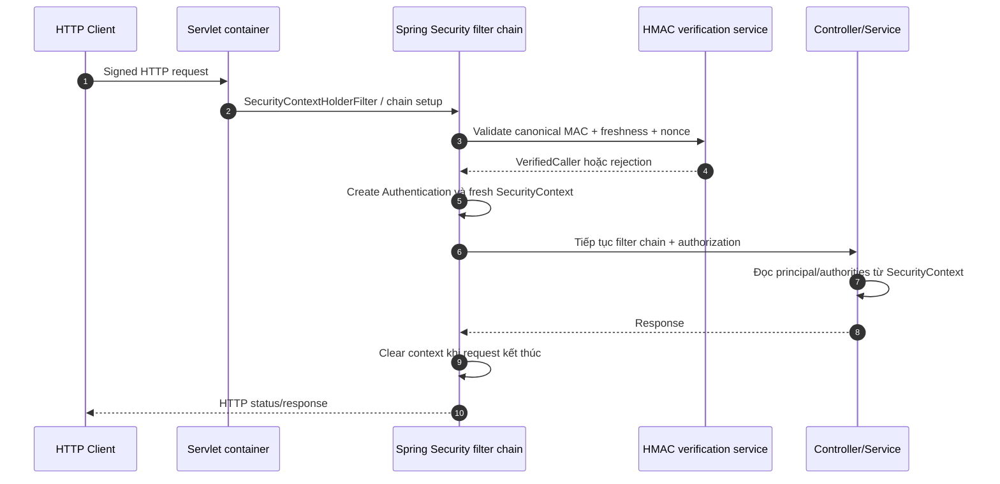
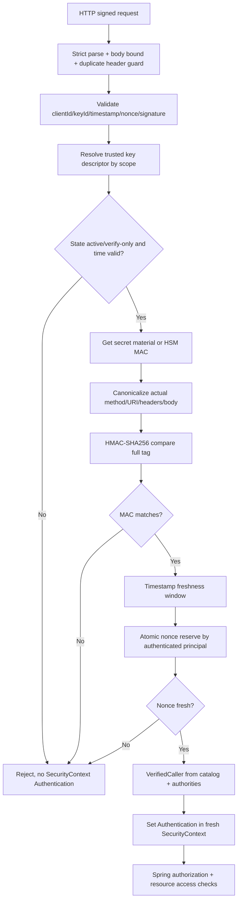
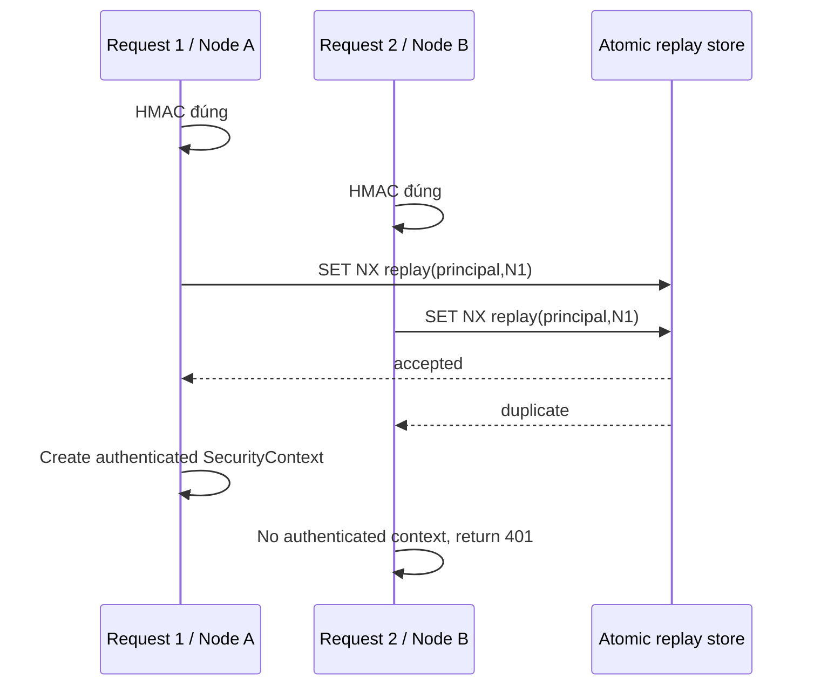

# SecurityContext

## 1. Vì sao HMAC request authentication cần hiểu SecurityContext?

Trong hệ thống Java sử dụng **Spring Security**, một request HTTP đã có **HMAC hợp lệ** không tự động làm Spring Security biết người gọi là ai. HMAC chỉ là **bằng chứng mật mã**: sender đã dùng shared secret của một credential để ký canonical request. Spring Security cần một đối tượng **`Authentication` đã được xác thực** trong **`SecurityContext`** để các lớp authorization, controller và audit có thể xác định principal và quyền tương ứng.

Xem hai bước khác nhau:

```text
BƯỚC 1 — HMAC request verification:
  HTTP method / URI / signed headers / body bytes
      + clientId / keyId / timestamp / nonce / tag
      + secret ứng với đúng credential
    -> xác minh chữ ký + chống replay
    -> VerifiedCaller (tenant, principal, scopes từ nguồn tin cậy)

BƯỚC 2 — Spring Security integration:
  VerifiedCaller
    -> Authentication authenticated=true
    -> SecurityContext
    -> SecurityContextHolder (trong request processing)
    -> authorization / @AuthenticationPrincipal / audit
```

Nếu application **đặt `Authentication` vào `SecurityContextHolder` trước khi MAC được kiểm**, attacker có thể tự chọn `X-Client-Id` hoặc `X-Tenant-Id` và vô tình được ứng dụng xem là đã đăng nhập. Đây là **authentication bypass**, không phải lỗi hiển thị tên người dùng.

Bài **“SecurityContext”** thuộc chương **Spring Security** của mô-đun **`SECURITY_AUTHENTICATION_HMAC_REQUEST_AUTHENTICATION`**, tập trung thiết kế xác thực HTTP request bằng HMAC với shared secret và canonical request gồm method, URI, header hoặc body theo hợp đồng ký; xác minh chữ ký, chống replay bằng timestamp/nonce, quản lý key rotation, kiểm thử proxy/gateway và phân biệt xác thực với phân quyền.

**Mục tiêu học tập:**

- Giải thích vai trò của `SecurityContext`, `SecurityContextHolder`, `Authentication`, `principal`, `credentials` và `authorities`.
- Biết **chính xác khi nào** đặt hoặc không đặt authentication vào security context trong HTTP HMAC filter.
- Thiết kế integration **stateless**: không đưa xác thực HMAC vào `HttpSession`, không tái sử dụng principal từ request trước.
- Tách thành phần **crypto verification**, **replay prevention**, **authentication adapter** và **authorization**.
- Triển khai `OncePerRequestFilter`, `SecurityFilterChain`, HMAC-backed `Authentication` bằng Java 17 và Servlet API `jakarta.servlet`.
- Xử lý body request chính xác, duplicate signed headers, proxy rewriting, key rotation và tenant scoping.
- Phân biệt lỗi **401 Unauthorized** và **403 Forbidden**, kiểm tra thread-local, async dispatch và context cleanup.
- Viết tests với Spring Security test helpers và MockMvc để chứng minh không bị authentication leakage.

**Bất biến trọng tâm:** một `SecurityContext` chỉ được xem là đáng tin **khi nó chứa `Authentication` được tạo từ credential đã xác minh đầy đủ**, không lấy danh tính, role hoặc scope trực tiếp từ một header do client tự khai.

## 2. SecurityContext, Authentication và SecurityContextHolder khác nhau ra sao?

Các thuật ngữ Spring Security dễ bị nhầm:

| Khái niệm | Chứa gì / dùng để làm gì? | Trong HMAC authentication |
| --- | --- | --- |
| `SecurityContext` | Một ngữ cảnh bảo mật, chủ yếu chứa `Authentication` | Bao bọc principal đã xác minh cho một lượt xử lý |
| `Authentication` | Principal, credentials, authorities, details, trạng thái xác thực | Đối tượng sau khi MAC/freshness/replay đạt |
| `principal` | Danh tính người dùng hoặc service caller | Server lấy từ **trusted credential catalog** |
| `credentials` | Bằng chứng dùng để xác thực, thường password/token | Không cần giữ **raw HMAC secret** hoặc full tag sau xác minh |
| `authorities` | Những quyền/role đã được server xác nhận | Ví dụ `payments:create`, không lấy từ `X-Role` |
| `SecurityContextHolder` | API tra/đặt security context của luồng thực thi hiện tại | MVC/controllers/method security đọc từ đây |
| `SecurityContextRepository` | Cơ chế lấy/lưu context qua request, session hoặc nguồn khác | HMAC stateless thường dùng `NullSecurityContextRepository` |
| `SecurityFilterChain` | Chuỗi security filters theo request matcher | Gắn HMAC filter và authorization rules |
| `AuthenticationEntryPoint` | Phản hồi khi request chưa xác thực | Thường là 401 cho MAC invalid/missing |
| `AccessDeniedHandler` | Phản hồi request đã xác thực nhưng thiếu quyền | Thường là 403 |

Đọc context hiện tại:

```java
import org.springframework.security.core.Authentication;
import org.springframework.security.core.context.SecurityContextHolder;

Authentication authentication =
        SecurityContextHolder.getContext().getAuthentication();
```

Đối tượng `Authentication` có thể là `null`, anonymous authentication, hoặc một implementation đã xác thực. **Không chỉ dựa vào việc `getAuthentication() != null` để kết luận có HMAC hợp lệ**.

### 2.1. Authentication có hai vai trò: yêu cầu và kết quả

Một số cơ chế Spring Security dùng một `Authentication` **chưa xác thực** để gửi vào `AuthenticationManager`, rồi nhận một `Authentication` **đã xác thực** từ `AuthenticationProvider`.

```text
Authentication request (isAuthenticated=false)
    -> AuthenticationManager / AuthenticationProvider
    -> Authentication result (isAuthenticated=true)
    -> SecurityContext
```

Một HMAC filter tự gọi một verification service cũng có thể xây dựng trực tiếp **trusted authenticated token** sau khi service xác minh, nếu hệ thống không dùng `AuthenticationProvider` riêng. Trong cả hai cách, **đừng coi việc constructor tạo token thành công là bằng chứng crypto**.

### 2.2. HMAC secret không phải principal

Nếu credential có metadata:

```text
tenantId     = tenant-42
clientId     = client-api
keyId        = k-2026-11
principalId  = svc-payments-42
secret       = [32 raw bytes được bảo vệ]
authorities  = payments:create, payments:read
```

Sau khi xác minh HMAC, `principal` có thể mang `tenantId, clientId, principalId`. **Không đặt secret vào principal, credentials, authorities, details, HTTP response hoặc security event log**.

Raw key được dùng khi kiểm MAC phải có vòng đời ngắn, key storage/rotation riêng; nó **không cần được giữ trong `SecurityContext`**.

## 3. SecurityContext nằm ở đâu trong một request servlet?

Trong ứng dụng servlet theo mô hình Spring Security, `SecurityContextHolder` thông thường dùng chiến lược **`MODE_THREADLOCAL`**. Context có hiệu lực cho **luồng xử lý hiện tại**, được security filters thiết lập và dọn dẹp theo lifecycle của request.



**Quan trọng:** `SecurityContextHolder` **không phải một map global lưu đăng nhập của mọi client**. Request B chạy trên cùng servlet thread sau request A không được thừa hưởng principal A. Nếu application tự tạo threads hoặc sử dụng executor, cần có chiến lược propagation riêng.

### 3.1. Vai trò của SecurityContextHolderFilter

Trong các cấu hình Spring Security servlet hiện đại, `SecurityContextHolderFilter` chịu trách nhiệm đưa context từ `SecurityContextRepository` vào holder theo request và dọn dẹp holder khi hoàn tất. Việc **lưu context ngược vào repository** có thể yêu cầu hành động rõ ràng, tùy filter và cấu hình.

Với HMAC API stateless, thường **không cần lưu SecurityContext cho request kế tiếp** vì request kế tiếp phải có signature/timestamp/nonce riêng và được xác minh lại.

### 3.2. ThreadLocal không phải request ID

ThreadLocal gắn dữ liệu với **thread đang thực thi**, không với HTTP request theo định nghĩa. Servlet thread pools tái sử dụng threads. Vì vậy:

- Chỉ đặt context **sau** xác minh thành công.
- Đảm bảo **clear** khi kết thúc đường xử lý, kể cả exception.
- Không dùng `static Authentication currentUser` hoặc cache principal toàn cục.
- Không bật `MODE_GLOBAL` cho backend multi-user/multi-tenant.
- Không xem `MODE_INHERITABLETHREADLOCAL` là giải pháp tự động cho executor/thread pools.

## 4. Điểm sai thường gặp: set context trước khi xác minh HMAC

Ví dụ **nguy hiểm**:

```java
// KHÔNG LÀM THẾ: X-Client-Id do bất cứ caller nào gửi.
String clientId = request.getHeader("X-Client-Id");

var token = new UsernamePasswordAuthenticationToken(
        clientId, null,
        java.util.List.of(
                new SimpleGrantedAuthority("payments:create")));

SecurityContextHolder.getContext()
        .setAuthentication(token);

// Sau đó mới kiểm HMAC? Đã quá muộn.
```

Đoạn mã trên gán quyền `payments:create` từ một ID chưa xác thực. Một attacker chỉ cần tự khai `clientId` để nhận role đó nếu authorization chạy ở giữa hoặc bước verify thất bại mà context không được dọn.

**Thứ tự an toàn:**

```text
1. HTTP strict parse / input limits.
2. Lookup candidate key theo clientId/keyId (chưa authenticated).
3. Kiểm key ownership, purpose, status, key rotation policy.
4. Canonicalize request từ method/path/query/headers/raw body.
5. HMAC-SHA-256 expected vs supplied raw tag (constant-time compare).
6. Kiểm timestamp đã ký trong window.
7. Atomic reserve nonce trên replay store.
8. Lấy trusted principal/authorities từ bản ghi đã xác minh.
9. Tạo authenticated Authentication + fresh SecurityContext.
10. Tiếp tục Spring Security chain; thực hiện authorization.
```

Các bước kiểm cú pháp/window có thể được thực hiện sớm để hạn chế DoS, nhưng **không** được set principal hoặc reserve nonce trước HMAC hợp lệ.

## 5. HMAC authentication và Spring authorization là hai lớp riêng

Giả sử `client-42` ký một request có MAC hợp lệ đến endpoint:

```http
POST /v1/payments?merchantId=m-99 HTTP/1.1
X-Client-Id: client-42
X-Key-Id: k-demo-01
X-Timestamp: 1795856400
X-Nonce: AAAAAAAAAAAAAAAAAAAAAA
X-Signature: <base64-sha256-hmac>
```

Server có thể xác minh principal `svc-payments-42` nhưng principal ấy chỉ có quyền tạo payment cho merchant `m-42`.

**Tầng authentication:** có thể thành công (client biết key hợp lệ của chính nó).

**Tầng authorization:** phải từ chối nếu merchant `m-99` không thuộc scope của principal.

```text
Authentication result:
  tenantId: tenant-42
  principalId: svc-payments-42
  authorities: [payments:create]

Authorization decision:
  POST /v1/payments for merchantId=m-99
  -> DENY nếu principal không sở hữu/quản lý merchant m-99
```

`hasAuthority("payments:create")` chỉ kiểm quyền loại thao tác; với multi-tenant cần thêm **resource-level policy**, ví dụ `@PreAuthorize` gọi authorization service kiểm tenant/merchant.

## 6. 401 và 403: lỗi xác thực khác lỗi phân quyền

| Trường hợp | Context có authenticated HMAC principal? | HTTP status thường dùng |
| --- | --- | --- |
| Thiếu signature trên endpoint bắt buộc HMAC | Không | **401** |
| Base64 signature sai / MAC mismatch | Không | **401** |
| Key ID không có hoặc key revoked | Không | **401** (public error thống nhất) |
| Timestamp hết hạn hoặc nonce replay | Không | **401** (hoặc policy error thống nhất) |
| Secret store unavailable, không thể verify | Không | **503** hoặc lỗi hạ tầng phù hợp, **không** accept |
| HMAC đúng, thiếu `payments:create` | Có | **403** |
| HMAC đúng, có `payments:create` nhưng sai merchant | Có | **403** |
| Body quá lớn theo request-size policy | Không | **413** |
| Malformed HTTP request | Không | **400** nếu theo API contract; vẫn không set principal |

Đừng để một HMAC filter đặt authentication rồi ném `AuthenticationException` không được xử lý, khiến framework trả lỗi không đúng hoặc giữ context ngoài ý muốn.

### 6.1. Spring Security filter order ảnh hưởng việc xử lý exception

`ExceptionTranslationFilter` chủ yếu dịch các `AuthenticationException`/`AccessDeniedException` phát sinh **phía sau** nó trong security filter chain. Nếu custom HMAC filter đứng **trước** nó, exception ném trực tiếp từ filter có thể **không** được nó chuyển thành 401 như bạn tưởng.

Có hai cách rõ ràng:

- Filter tự gọi `AuthenticationEntryPoint.commence(...)` khi xác thực thất bại và **dừng chain**; hoặc
- Thiết kế filter/provider/exception handling đúng vị trí và kiểm thử thực tế thứ tự.

Trong bài, dùng **AuthenticationEntryPoint do filter gọi trực tiếp** để tránh phụ thuộc giả định về vị trí `ExceptionTranslationFilter`.

### 6.2. Không trả key existence chi tiết cho attacker

Public error contract nên thống nhất cho unknown client/key, bad MAC, revoked key và các lỗi xác thực tương tự:

```json
{"error":"invalid_hmac_authentication"}
```

Chi tiết `unknown_key`, `key_revoked`, `timestamp_stale`, `nonce_reused` có thể ghi vào **metrics/audit nội bộ đã kiểm quyền**, không tiết lộ raw secrets hay expected tags.

## 7. API HMAC nên stateless: không lưu Authentication trong session

Trong ứng dụng machine-to-machine không sử dụng cookie-based login, mỗi HTTP attempt phải có **signature riêng**; một request thành công không cho request sau bỏ qua HMAC.

```text
Request 1: valid MAC, nonce N1 -> authenticated principal 42
Request 2: no MAC, same TCP connection -> 401
Request 3: invalid MAC, same servlet thread -> 401
Request 4: valid MAC, nonce N2 -> authenticated principal 42
```

Nếu `SecurityContext` được lưu vào `HttpSession` và tự phục hồi cho request 2, hệ thống có thể trở thành **session authentication**, trái với contract HMAC-per-request.

Các quyết định thường áp dụng:

- `SessionCreationPolicy.STATELESS` cho các route HMAC.
- `NullSecurityContextRepository` nếu chính sách **không lưu hoặc phục hồi context qua session**.
- Tắt `formLogin`, `httpBasic` cho **chain chỉ phục vụ HMAC** nếu không dùng chúng.
- Chỉ cấu hình `csrf.disable()` khi đó thực sự là API **không dùng browser cookie/session làm authentication**; nếu trộn cookie auth với HMAC, CSRF cần thiết kế riêng.
- Dù `SecurityContext` stateless, **replay store vẫn cần shared state** cho nonce; “stateless authentication” **không** có nghĩa bỏ chống replay.

### 7.1. NullSecurityContextRepository không tự làm HMAC đúng

`NullSecurityContextRepository` chỉ quyết định persistence của context; nó **không** kiểm chữ ký, timestamp hoặc nonce. Tương tự, `STATELESS` không đồng nghĩa request được bảo vệ nếu custom filter thiếu validation.

### 7.2. Vì sao không cache SecurityContext theo clientId?

Một map như `Map<String, SecurityContext>` keyed by client ID có thể khiến request khác **được mượn identity/authorities** chỉ vì cùng header. Với HMAC, mỗi request phải được verify bằng **message-specific MAC**. Có thể cache **key metadata/material** theo policy nhưng **không dùng cached successful authentication của request cũ** để tin request mới.

## 8. Đặt HMAC filter vào Spring Security filter chain

Một cấu hình minh họa dùng **Spring Security servlet-style configuration** (phù hợp các API `SecurityFilterChain`/`HttpSecurity` trong thế hệ cấu hình hiện đại). Ví dụ là thiết kế cho **HTTP API sync, backend-to-backend**, không bao gồm authentication cho browser/session hay WebFlux.

```java
import org.springframework.context.annotation.Bean;
import org.springframework.context.annotation.Configuration;
import org.springframework.http.HttpMethod;
import org.springframework.security.config.annotation.web.builders.HttpSecurity;
import org.springframework.security.config.annotation.web.configurers.AbstractHttpConfigurer;
import org.springframework.security.config.http.SessionCreationPolicy;
import org.springframework.security.core.context.SecurityContextHolder;
import org.springframework.security.web.AuthenticationEntryPoint;
import org.springframework.security.web.SecurityFilterChain;
import org.springframework.security.web.context.NullSecurityContextRepository;
import org.springframework.security.web.authentication.UsernamePasswordAuthenticationFilter;

@Configuration
public class HmacSecurityConfigV1 {

    @Bean
    SecurityFilterChain hmacApiChain(
            HttpSecurity http,
            HmacVerificationService verifier)
            throws Exception {

        AuthenticationEntryPoint entryPoint =
                (request, response, exception) -> {
                    SecurityContextHolder.clearContext();
                    response.setStatus(401);
                    response.setContentType("application/json");
                    response.getWriter().write(
                            "{\"error\":\"invalid_hmac_authentication\"}");
                };

        // Khởi tạo filter bên trong chain; đừng đồng thời đăng ký
        // nó thành global Servlet Filter/Component.
        var filter = new HmacAuthenticationFilterV1(
                verifier, entryPoint);

        http
            .securityMatcher("/v1/**")
            .sessionManagement(sm -> sm.sessionCreationPolicy(
                    SessionCreationPolicy.STATELESS))
            .securityContext(sc -> sc.securityContextRepository(
                    new NullSecurityContextRepository()))
            .csrf(AbstractHttpConfigurer::disable)
            .httpBasic(AbstractHttpConfigurer::disable)
            .formLogin(AbstractHttpConfigurer::disable)
            .exceptionHandling(ex -> ex
                    .authenticationEntryPoint(entryPoint)
                    .accessDeniedHandler((request, response, denied) ->
                            response.sendError(403)))
            .authorizeHttpRequests(auth -> auth
                    .requestMatchers(
                            HttpMethod.POST, "/v1/payments")
                        .hasAuthority("payments:create")
                    .anyRequest().authenticated())
            .addFilterBefore(
                    filter, UsernamePasswordAuthenticationFilter.class);

        return http.build();
    }
}
```

**Giải thích:**

- `securityMatcher("/v1/**")` áp dụng chain cho các API route tương ứng. Đừng giả định những endpoint ngoài `/v1/**` được bảo vệ bởi chain này; cấu hình **chain khác** cho actuator/health/admin và default deny policy theo sản phẩm.
- `STATELESS` + `NullSecurityContextRepository` ngăn tự phục hồi context qua `HttpSession`.
- `addFilterBefore(..., UsernamePasswordAuthenticationFilter.class)` dùng một vị trí đã biết trong servlet security chain. Phải kiểm Spring Security filter order thực tế khi có nhiều custom filters.
- Với chain chỉ dành cho backend HMAC không dùng browser cookie auth, `csrf.disable()` có thể là quyết định phù hợp; **không copy vào ứng dụng browser session**.
- `entryPoint` trả 401 khi authentication fail; `accessDeniedHandler` trả 403 khi principal đã xác thực nhưng thiếu quyền. Controller/method security có thể áp dụng resource-level checks.
- Filter được tạo qua `new` trong `SecurityFilterChain`, **không annotate `@Component`**, nhằm tránh Spring Boot tự đăng ký nó **lần hai ở servlet container**.
- Nếu ứng dụng có nhiều `SecurityFilterChain`, cần định nghĩa `@Order`/matchers phù hợp và bảo đảm request **không đi qua một chain ngoài ý muốn**.

### 8.1. Vì sao không tạo filter global với @Component rồi addFilterBefore?

Một `Filter` bean được Spring Boot tự đăng ký có thể chạy **bên ngoài** `FilterChainProxy`; nếu đồng thời thêm nó vào Spring Security chain, filter có thể chạy hai lần hoặc sai vị trí/dispatch, gây **double nonce reservation** hoặc context không đúng.

Nếu có yêu cầu quản lý filter như bean, cần dùng `FilterRegistrationBean` với `enabled=false` để ngăn global servlet registration, rồi đăng ký đúng một lần trong Spring Security chain. Với bài này, tạo đối tượng filter ngay trong cấu hình đơn giản hơn.

## 9. Định nghĩa principal và VerifiedCaller từ nguồn tin cậy

Một authenticated principal nên là **đối tượng rõ kiểu**, không phải toàn bộ credential record chứa raw secret.

```java
import java.security.Principal;
import java.util.List;
import java.util.Objects;
import org.springframework.security.core.GrantedAuthority;

public final class HmacIdentityV1 {
    private HmacIdentityV1() {}

    public record HmacPrincipal(
            String tenantId,
            String principalId,
            String clientId) implements Principal {

        public HmacPrincipal {
            Objects.requireNonNull(tenantId);
            Objects.requireNonNull(principalId);
            Objects.requireNonNull(clientId);
            if (tenantId.isBlank()
                    || principalId.isBlank()
                    || clientId.isBlank()) {
                throw new IllegalArgumentException(
                        "Invalid authenticated identity");
            }
        }

        @Override public String getName() {
            // Không cần global-unique string nếu cấu trúc
            // principal/tenant luôn được giữ riêng ở authz.
            return tenantId + ":" + principalId;
        }
    }

    public record VerifiedCaller(
            HmacPrincipal principal,
            String keyId,
            List<GrantedAuthority> authorities) {

        public VerifiedCaller {
            Objects.requireNonNull(principal);
            Objects.requireNonNull(keyId);
            Objects.requireNonNull(authorities);
            if (keyId.isBlank()) {
                throw new IllegalArgumentException(
                        "Missing verified key ID");
            }
            // Defensive copy; không tin mutable list ở layer khác.
            authorities = List.copyOf(authorities);
        }
    }
}
```

**Nguồn đúng của dữ liệu:**

- `tenantId`, `principalId` và ownership thuộc **trusted credential catalog** sau MAC verification.
- `keyId` đã được ràng buộc với canonical request và đúng record được xác minh.
- `authorities` lấy từ trusted authorization store/policy, **không** lấy từ `X-Roles`/`X-Scopes` tự khai.
- Không chứa `sharedSecret`, `SecretKeySpec` hoặc full HMAC tag trong `HmacPrincipal` hay `VerifiedCaller`.

### 9.1. Authority là dữ liệu đáng tin, nhưng có thể lỗi thời

Credential có thể tồn tại nhiều tuần; quyền `payments:create` của principal có thể bị thu hồi bất cứ lúc nào. Không suy mọi quyền từ lúc sinh key rồi giữ mãi cho đến khi rotate secret. Nên có **authorization policy/versioning/cache invalidation** phù hợp để quyền bị revoke có hiệu lực theo SLA, ngay cả khi MAC vẫn hợp lệ.

## 10. Giao diện HMAC verification service tách khỏi Spring context

Filter không nên tự kiêm mọi trách nhiệm, đặc biệt là lưu secret, canonicalization, anti-replay và authorization. Tạo **verification service** trả kết quả đã xác minh:

```java
import jakarta.servlet.http.HttpServletRequest;

public interface HmacVerificationService {
    // Contract: chỉ return nếu credential lookup/owner,
    // HMAC full tag, timestamp freshness và atomic
    // replay reservation đã thành công.
    HmacIdentityV1.VerifiedCaller verify(
            HttpServletRequest request, byte[] rawBody);
}
```

Các exception theo contract minh họa:

```java
public class HmacRejectedException
        extends RuntimeException {

    public HmacRejectedException() {
        super("Invalid HMAC authentication");
    }
}

public class HmacVerificationUnavailableException
        extends RuntimeException {

    public HmacVerificationUnavailableException(
            String safeReason, Throwable cause) {
        super(safeReason, cause);
    }
}
```

**Kỳ vọng:**

- `HmacRejectedException` cho missing/malformed signature, unknown/revoked key, bad MAC, timestamp expired hoặc nonce replay.
- `HmacVerificationUnavailableException` cho Vault/KMS/replay store không phục vụ được; **không** được tạo success Authentication.
- `VerifiedCaller` chỉ được return khi đã kiểm HMAC cùng canonical method/URI/signed headers/body, timestamp/nonce và key lifecycle.
- Filter chỉ chuyển `VerifiedCaller` thành Spring `Authentication` và gọi chain.
- Resource authorization do `authorizeHttpRequests`/method security/service layer quyết định, không đặt vào HMAC verifier như một bypass rule.

### 10.1. Verification failure phải fail closed

Không có fallback kiểu:

```java
// SAI: nếu Vault timeout thì cho request qua.
try {
    return verifyHmac(...);
} catch (Exception backendFailure) {
    return new VerifiedCaller(
            principalFromRequestHeader,
            keyIdFromRequest,
            List.of(new SimpleGrantedAuthority("admin")));
}
```

Nếu không thể xác minh, **không có authenticated principal**. Có thể trả lỗi hạ tầng 503 để caller retry, nhưng không được “đăng nhập tạm”.

## 11. Body buffering: hash đúng raw body nhưng controller vẫn đọc được

Canonical request có thể chứa `SHA-256(raw HTTP body bytes)`. HTTP request body từ `ServletInputStream` bình thường **không thể đọc lại vô hạn**. Nếu HMAC filter đọc hết body rồi chuyển nguyên request xuống Spring MVC, `@RequestBody` có thể nhận body rỗng.

Một wrapper thường bị hiểu sai là `ContentCachingRequestWrapper`: nó **cache bytes khi được đọc**, nhưng không tự bảo đảm mọi downstream reader có một input stream **replayable** sau khi upstream đã đọc hết.

**Hợp đồng an toàn cho endpoint body nhỏ, đồng bộ (sync-only):**

1. Ingress giới hạn `Content-Length`/stream byte count.
2. Filter đọc **đúng raw bytes** đến tối đa kích thước cho phép; không parse rồi serialize lại JSON trước khi ký.
3. Wrapper giữ một bản byte array và cung cấp `getInputStream()` mới cho downstream.
4. Verification tính SHA-256 trên **cùng bytes**.
5. Nếu body quá lớn, trả 413 **trước khi tạo SecurityContext**.
6. Với async I/O, streaming uploads, multipart, body rất lớn, cần **thiết kế khác**; không sao chép wrapper sync-only dưới đây một cách mù quáng.

### 11.1. ReplayableBodyRequestV1 cho servlet sync-only

```java
import java.io.BufferedReader;
import java.io.ByteArrayInputStream;
import java.io.IOException;
import java.io.InputStreamReader;
import java.nio.charset.Charset;
import java.nio.charset.StandardCharsets;
import jakarta.servlet.ReadListener;
import jakarta.servlet.ServletInputStream;
import jakarta.servlet.http.HttpServletRequest;
import jakarta.servlet.http.HttpServletRequestWrapper;

public final class ReplayableBodyRequestV1
        extends HttpServletRequestWrapper {

    public static final int MAX_BYTES = 1024 * 1024;
    private final byte[] body;

    public static final class BodyTooLargeException
            extends IOException {
        public BodyTooLargeException() {
            super("Request body exceeds HMAC size limit");
        }
    }

    public ReplayableBodyRequestV1(HttpServletRequest source)
            throws IOException {
        super(source);

        // Chỉ đọc tối đa LIMIT+1 bytes, không cấp phát vô hạn
        // dựa trên Content-Length chưa tin cậy.
        byte[] read = source.getInputStream()
                .readNBytes(MAX_BYTES + 1);

        if (read.length > MAX_BYTES) {
            throw new BodyTooLargeException();
        }
        this.body = read;
    }

    public byte[] copyRawBody() {
        return body.clone();
    }

    @Override public int getContentLength() {
        return body.length;
    }

    @Override public long getContentLengthLong() {
        return body.length;
    }

    @Override public ServletInputStream getInputStream() {
        ByteArrayInputStream replay =
                new ByteArrayInputStream(body);

        return new ServletInputStream() {
            @Override public int read() {
                return replay.read();
            }

            @Override public boolean isFinished() {
                return replay.available() == 0;
            }

            @Override public boolean isReady() {
                return true;
            }

            @Override public void setReadListener(
                    ReadListener listener) {
                // Example chỉ hỗ trợ blocking/synchronous IO.
                // Async servlet IO cần listener contract riêng.
                throw new IllegalStateException(
                        "Async reads are not supported by V1");
            }
        };
    }

    @Override public BufferedReader getReader()
            throws IOException {
        String supplied = getCharacterEncoding();
        Charset charset = supplied == null
                ? StandardCharsets.UTF_8
                : Charset.forName(supplied);
        return new BufferedReader(
                new InputStreamReader(getInputStream(), charset));
    }
}
```

**Chỉ dùng ví dụ này cho sync-only JSON API**. Wrapper giữ body trong heap và tạo bản sao để cung cấp cho verifier; cần bảo vệ logging/heap dumps và kiểm soát kích thước thực tế. Với async/non-blocking I/O, phải triển khai `ReadListener`/dispatch semantics đúng theo Servlet spec, hoặc dùng một pipeline khác.

### 11.2. Body hash khác JSON canonicalization

Nếu contract ký **hash của raw body bytes**, các payload có cùng nội dung JSON nhưng khác whitespace/key order/encoding có **hash khác nhau**. Không parse JSON rồi serialize bằng ObjectMapper ở verifier trừ khi contract ký đã quy định **JSON canonicalization chính xác**.

Body của request trên wire và body dùng cho HMAC phải là một byte sequence thống nhất qua gateway và controller.

## 12. OncePerRequestFilter: chỉ set Authentication sau verification thành công

Ví dụ filter dùng `HmacVerificationService` ở mục 10 và `ReplayableBodyRequestV1` ở mục 11:

```java
import java.io.IOException;
import java.util.Arrays;
import jakarta.servlet.FilterChain;
import jakarta.servlet.ServletException;
import jakarta.servlet.http.HttpServletRequest;
import jakarta.servlet.http.HttpServletResponse;
import org.springframework.security.authentication.BadCredentialsException;
import org.springframework.security.authentication.UsernamePasswordAuthenticationToken;
import org.springframework.security.core.Authentication;
import org.springframework.security.core.context.SecurityContext;
import org.springframework.security.core.context.SecurityContextHolder;
import org.springframework.security.web.AuthenticationEntryPoint;
import org.springframework.web.filter.OncePerRequestFilter;

public final class HmacAuthenticationFilterV1
        extends OncePerRequestFilter {

    private final HmacVerificationService verifier;
    private final AuthenticationEntryPoint entryPoint;

    public HmacAuthenticationFilterV1(
            HmacVerificationService verifier,
            AuthenticationEntryPoint entryPoint) {
        this.verifier = java.util.Objects.requireNonNull(verifier);
        this.entryPoint =
                java.util.Objects.requireNonNull(entryPoint);
    }

    @Override
    protected void doFilterInternal(
            HttpServletRequest request,
            HttpServletResponse response,
            FilterChain chain)
            throws ServletException, IOException {

        // SecurityContextHolderFilter xử lý lifecycle tổng,
        // nhưng dọn rõ ở filter này để tránh leak khi fail.
        SecurityContextHolder.clearContext();

        final ReplayableBodyRequestV1 wrapped;
        try {
            wrapped = new ReplayableBodyRequestV1(request);
        } catch (ReplayableBodyRequestV1.BodyTooLargeException large) {
            SecurityContextHolder.clearContext();
            response.sendError(413);
            return;
        }

        byte[] bodyForVerifier = wrapped.copyRawBody();

        try {
            HmacIdentityV1.VerifiedCaller verified;
            try {
                // Contract: MAC + key policy + freshness
                // + atomic replay phải PASS trước return.
                verified = verifier.verify(wrapped, bodyForVerifier);
            } catch (HmacRejectedException rejected) {
                SecurityContextHolder.clearContext();
                entryPoint.commence(wrapped, response,
                        new BadCredentialsException(
                                "Invalid HMAC credential"));
                return;
            } catch (HmacVerificationUnavailableException down) {
                SecurityContextHolder.clearContext();
                response.sendError(503,
                        "Authentication service unavailable");
                return;
            }

            if (verified == null) {
                SecurityContextHolder.clearContext();
                entryPoint.commence(wrapped, response,
                        new BadCredentialsException(
                                "Invalid HMAC credential"));
                return;
            }

            // Chỉ TRUSTED verification result mới tạo token.
            // credentials=null để không lưu key/tag trong context.
            Authentication authentication =
                    UsernamePasswordAuthenticationToken.authenticated(
                            verified.principal(),
                            null,
                            verified.authorities());

            SecurityContext context =
                    SecurityContextHolder.createEmptyContext();
            context.setAuthentication(authentication);
            SecurityContextHolder.setContext(context);

            // Authorization rules và controller đọc context
            // trên thread xử lý hiện tại.
            chain.doFilter(wrapped, response);
        } finally {
            Arrays.fill(bodyForVerifier, (byte) 0);
            SecurityContextHolder.clearContext();
        }
    }
}
```

**Quan trọng:**

- Filter **không dùng `X-Client-Id` làm principal**. Nó chỉ nhận `VerifiedCaller` đã được verification service tạo sau khi kiểm secret đúng credential.
- Dùng `createEmptyContext()` thay vì sửa shared context instance có thể được giữ/cached bởi repository.
- Đặt `credentials=null`, **không** truyền raw secret hoặc full HMAC tag vào token.
- `UsernamePasswordAuthenticationToken.authenticated(...)` chỉ được gọi trong **nhánh verification thành công**. Tên class này không có nghĩa ta xác thực bằng password.
- `chain.doFilter` nhận `wrapped`, không nhận request gốc, để MVC đọc lại đúng body bytes.
- Trong `finally` dọn `SecurityContextHolder` dù downstream ném exception.
- Nếu verifier ném unexpected runtime exception, context vẫn được dọn và request **không** tiếp tục xử lý. Policy mapping exception/5xx cần được xử lý ở servlet error boundary; **không** chuyển unknown error thành success.
- Vì filter chạy **trước** `ExceptionTranslationFilter` trong thiết lập minh họa, lỗi xác thực được phản hồi trực tiếp qua `entryPoint.commence`.

### 12.1. Vì sao phải dọn bodyForVerifier?

`bodyForVerifier` có thể chứa dữ liệu nghiệp vụ nhạy cảm, được clone từ wrapper. `Arrays.fill` là **best effort**; raw body trong wrapper vẫn tồn tại đến khi GC và có thể có copies trong servlet/MVC buffers. Không tuyên bố zeroize là xóa mọi bản sao dữ liệu trong JVM.

### 12.2. Khi nào không nên dùng filter này?

- Request body lớn/streaming/multipart.
- Async servlet IO hoặc nonblocking `ReadListener`.
- Mixed authentication chain với cookie/session/OAuth2 mà HMAC chỉ là một option.
- Gateway đã xác thực HMAC và backend chỉ nhận **protected internal identity assertion**.
- WebFlux/reactive application (dùng `WebFilter` và Reactor Context).

Với những tình huống đó, vẫn giữ invariant **“set trusted Authentication sau verification”**, nhưng phải dùng adapter phù hợp với mô hình thực thi.

## 13. Verification service: ràng buộc key ID và MAC với canonical bytes

Filter chỉ giải quyết Spring Security context. Bản thân HMAC verification service vẫn phải tuân thủ protocol.

Một hợp đồng ký minh họa **HMAC-SPRING-SECURITY-V1**:

```text
HMAC-SPRING-SECURITY-V1
POST
/v1/payments
merchantId=m-42
content-type:application/json
client-id:client-42
key-id:k-demo-01
x-timestamp:1795856400
x-nonce:AAAAAAAAAAAAAAAAAAAAAA
<lowercase-hex-SHA256(raw-body)>
```

Đây là **10 dòng**, LF-delimited, không có LF cuối. `method`, `path`, `query`, `Content-Type`, client/key ID, timestamp, nonce và body bytes phải đến từ **HTTP request thực nhận** dưới một canonical contract đã công bố.

### 13.1. Verification pipeline ở domain layer



**Lưu ý về key rotation:** request có `keyId=k-old` phải được kiểm bằng **đúng secret k-old** nếu key còn `VERIFY_ONLY` trong grace; không thử mọi secret hoặc fallback khi key bị `REVOKED`. Session/stateless context không ảnh hưởng quy tắc key lifecycle.

### 13.2. Nonce phải được reserve trước khi tạo context

Nếu HMAC đúng nhưng nonce đã được dùng:

```text
HMAC matches = true
ReplayStore.reserveOnce(principal, nonce) = false
-> HmacRejectedException
-> no authenticated SecurityContext
-> 401 / API-specific auth error
```

Không được đặt context authenticated rồi mới kiểm replay ở downstream, vì những filter/controller khác có thể đã bắt đầu xử lý.

## 14. Golden HMAC test vector để xác nhận kết quả domain verifier

Dữ liệu **công khai chỉ dành cho test**, không dùng làm production credential:

```text
Raw key, 32 bytes, HEX:
00112233445566778899aabbccddeeff00112233445566778899aabbccddeeff

JSON body (56 UTF-8 bytes, no final newline):
{"orderId":"O-42","amountMinor":250000,"currency":"VND"}

SHA-256 body, lowercase HEX:
eaeb86c57439a64c80d023bc882535c45ebfcabb7617add8d2a628637faab41a
```

Canonical request **10 dòng LF, 243 bytes UTF-8**:

```text
HMAC-SPRING-SECURITY-V1
POST
/v1/payments
merchantId=m-42
content-type:application/json
client-id:client-42
key-id:k-demo-01
x-timestamp:1795856400
x-nonce:AAAAAAAAAAAAAAAAAAAAAA
eaeb86c57439a64c80d023bc882535c45ebfcabb7617add8d2a628637faab41a
```

Full HMAC-SHA-256 tag:

```text
Expected HEX (32 bytes):
a777b90704850d0b1cec5dc9bb90b9be274e8fc3a27abac668f974903753c6a1

Expected Base64 Basic padded (44 ASCII chars):
p3e5BwSFDQsc7F3Ju5C5vidOj8OierrGaPl0kDdTxqE=
```

Các giá trị đã được **tính độc lập từ đúng raw bytes** để làm golden vector. Chúng giúp phát hiện sai canonical string, sai body bytes, sai secret encoding, sai algorithm hoặc sai Base64.

### 14.1. Một HMAC đúng không có nghĩa cần set context

Ngay cả nếu tag khớp golden vector, nếu key đó đã `REVOKED`, timestamp hết hạn hoặc nonce từng dùng, `HmacVerificationService.verify` phải reject và **không trả VerifiedCaller**.

Timestamp `1795856400` và nonce toàn ký tự `A` là **fixtures cố định**; production cần timestamp cập nhật và CSPRNG nonce mới theo mỗi HTTP attempt.

### 14.2. Java 17 test vector độc lập với Spring Security

```java
import static org.junit.jupiter.api.Assertions.*;
import java.nio.charset.StandardCharsets;
import java.security.MessageDigest;
import java.util.Base64;
import java.util.HexFormat;
import javax.crypto.Mac;
import javax.crypto.spec.SecretKeySpec;
import org.junit.jupiter.api.Test;

class HmacSpringSecurityV1VectorTest {

    @Test
    void canonicalAndTagMatchIndependentFixture()
            throws Exception {

        byte[] body = (
                "{\"orderId\":\"O-42\","
                + "\"amountMinor\":250000,"
                + "\"currency\":\"VND\"}"
        ).getBytes(StandardCharsets.UTF_8);

        assertEquals(56, body.length);

        String digest = HexFormat.of().formatHex(
                MessageDigest.getInstance("SHA-256").digest(body));

        assertEquals(
                "eaeb86c57439a64c80d023bc882535c45ebfcabb7617add8d2a628637faab41a",
                digest);

        byte[] canonical = String.join("\n",
                "HMAC-SPRING-SECURITY-V1",
                "POST",
                "/v1/payments",
                "merchantId=m-42",
                "content-type:application/json",
                "client-id:client-42",
                "key-id:k-demo-01",
                "x-timestamp:1795856400",
                "x-nonce:AAAAAAAAAAAAAAAAAAAAAA",
                digest)
                .getBytes(StandardCharsets.UTF_8);

        assertEquals(243, canonical.length);

        byte[] key = HexFormat.of().parseHex(
                "00112233445566778899aabbccddeeff"
                + "00112233445566778899aabbccddeeff");

        Mac mac = Mac.getInstance("HmacSHA256");
        mac.init(new SecretKeySpec(key, "HmacSHA256"));
        byte[] tag = mac.doFinal(canonical);

        assertEquals(
                "a777b90704850d0b1cec5dc9bb90b9be274e8fc3a27abac668f974903753c6a1",
                HexFormat.of().formatHex(tag));

        assertEquals(
                "p3e5BwSFDQsc7F3Ju5C5vidOj8OierrGaPl0kDdTxqE=",
                Base64.getEncoder().encodeToString(tag));
    }
}
```

Test vector này chạy với Java crypto API, **không tự kiểm `SecurityContext`**. Các phần MockMvc dưới đây mới kiểm đúng lúc Spring Security công bố authenticated principal.

## 15. Chống duplicate headers và untrusted request identity

HMAC canonicalization dễ bị lỗi nếu gateway, servlet container và verifier diễn giải khác nhau một header.

Ví dụ:

```http
X-Client-Id: client-42
x-client-id: client-99
```

Nếu gateway dùng first value để kiểm MAC, backend dùng last value để xác định principal, hệ thống có thể có **identity confusion**.

Đối với những field được giao thức yêu cầu **đúng một giá trị** (client ID, key ID, timestamp, nonce, signature), HTTP adapter nên:

- Từ chối duplicate header fields, kể cả khác hoa/thường trong tên.
- Từ chối giá trị chứa dấu phân cách hoặc ký tự điều khiển trái contract.
- Định nghĩa rõ có cho phép combined values hay không; mặc định profile này **không cho**.
- Không trim/normalize header ngoài canonical contract.
- Giới hạn kích thước header/body và route path.
- Không tin `X-Authenticated-Principal`/`X-Role` do Internet gửi.

### 15.1. Đoạn kiểm singleton header minh họa

```java
import java.util.ArrayList;
import java.util.Collections;
import jakarta.servlet.http.HttpServletRequest;

public final class SignedHeaderReaderV1 {
    private SignedHeaderReaderV1() {}

    public static String one(
            HttpServletRequest request, String headerName) {
        var enumeration = request.getHeaders(headerName);
        if (enumeration == null) {
            throw new HmacRejectedException();
        }
        var values = Collections.list(enumeration);

        if (values.size() != 1) {
            throw new HmacRejectedException();
        }
        String value = values.get(0);
        if (value == null || value.isBlank()
                || value.indexOf('\r') >= 0
                || value.indexOf('\n') >= 0) {
            throw new HmacRejectedException();
        }
        return value;
    }
}
```

**Giới hạn quan trọng:** sau khi proxy/container đã **merge các duplicate fields thành một chuỗi**, `getHeaders` có thể không còn chứng minh được wire request có một field duy nhất. Phải yêu cầu **ingress/gateway reject ambiguities trước khi normalize** và kiểm thử end-to-end. Đoạn code chỉ là một lớp bảo vệ ở servlet adapter.

### 15.2. Multi-tenant metadata phải khớp authenticated principal

`X-Tenant-Id` có thể giúp chọn đúng candidate secret, nhưng `VerifiedCaller.principal.tenantId` phải đến từ **trusted record sau MAC**. Nếu path dẫn tới tenant-99 còn HMAC principal thuộc tenant-42, authorization phải reject; trong contract chặt, verifier có thể reject ngay khi canonical signed tenant/path mismatch.

Không dùng role tự khai:

```http
X-Roles: ROLE_ADMIN
X-Permissions: payments:create,users:delete
```

Các header này **không tự biến thành `GrantedAuthority`**, dù attacker kèm một chữ ký hợp lệ của client chỉ có quyền hạn thấp. Authority phải đến từ server-side policy.


## 16. Controller nhận principal từ SecurityContext, không từ header

Sau khi HMAC filter đặt `Authentication` vào `SecurityContextHolder`, Spring MVC có thể inject principal vào controller bằng `@AuthenticationPrincipal`.

Ví dụ:

```java
import org.springframework.http.ResponseEntity;
import org.springframework.security.core.annotation.AuthenticationPrincipal;
import org.springframework.web.bind.annotation.PostMapping;
import org.springframework.web.bind.annotation.RequestBody;
import org.springframework.web.bind.annotation.RequestMapping;
import org.springframework.web.bind.annotation.RequestParam;
import org.springframework.web.bind.annotation.RestController;

@RestController
@RequestMapping("/v1")
public final class PaymentControllerV1 {
    private final PaymentService paymentService;

    public PaymentControllerV1(PaymentService paymentService) {
        this.paymentService = paymentService;
    }

    public record PaymentInput(
            String orderId, long amountMinor, String currency) {}

    @PostMapping("/payments")
    public ResponseEntity<String> createPayment(
            @AuthenticationPrincipal
            HmacIdentityV1.HmacPrincipal principal,
            @RequestParam String merchantId,
            @RequestBody PaymentInput body) {

        // principal đã được tạo từ VerifiedCaller của HMAC,
        // không phải từ request.getHeader("X-Client-Id").
        String paymentId = paymentService.create(
                principal, merchantId, body);
        return ResponseEntity.ok(paymentId);
    }

    public interface PaymentService {
        String create(
                HmacIdentityV1.HmacPrincipal principal,
                String merchantId, PaymentInput body);
    }
}
```

Điều kiện để `@AuthenticationPrincipal` trả đúng object là `Authentication.getPrincipal()` chứa `HmacIdentityV1.HmacPrincipal` do filter đã gắn. Nếu không có authenticated principal, endpoint phải bị chặn bởi chain trước khi controller chạy.

**Không viết lại:**

```java
@PostMapping("/payments")
public String insecure(
        @RequestHeader("X-Client-Id") String clientId,
        @RequestBody PaymentInput input) {
    // SAI nếu clientId được tin làm principal nghiệp vụ.
    return paymentService.payAsClient(clientId, input);
}
```

Một header do Internet tự khai không trở thành identity đáng tin chỉ vì nó có tên `X-Client-Id`. Ngay cả khi filter ký header đó, controller vẫn nên dùng **principal được xác minh và ràng buộc record** để tránh bypass ở endpoint chưa có filter hoặc gateway cấu hình sai.

### 16.1. Authentication#getName và kiểu principal

Vì `HmacPrincipal` implement `java.security.Principal`, `Authentication.getName()` có thể cung cấp chuỗi tên phù hợp. Nhưng **authorization không nên parse tenant từ một chuỗi tên** nếu đã có principal record với các field tách biệt.

Nên sử dụng:

```java
var authentication =
        SecurityContextHolder.getContext().getAuthentication();

if (authentication != null
        && authentication.getPrincipal()
                instanceof HmacIdentityV1.HmacPrincipal principal) {
    String tenantId = principal.tenantId();
    String clientId = principal.clientId();
    String principalId = principal.principalId();
}
```

Ở các entry points không thuộc HMAC chain, `Authentication` có thể là kiểu khác. Kiểm type hoặc thiết kế security chains rõ ràng trước khi cast.

## 17. Method security và resource-level authorization

Trong `SecurityFilterChain` mẫu, `hasAuthority("payments:create")` chỉ xác nhận quyền loại thao tác. Để tránh một client thuộc tenant A tạo payment cho merchant của tenant B, cần **authorization dựa trên resource owner**.

Bật method security bằng cấu hình theo nhu cầu ứng dụng:

```java
import org.springframework.context.annotation.Configuration;
import org.springframework.security.config.annotation.method.configuration.EnableMethodSecurity;

@Configuration
@EnableMethodSecurity
public class HmacMethodSecurityConfigV1 {}
```

Bean ủy quyền:

```java
import org.springframework.stereotype.Component;

@Component("merchantPolicy")
public final class MerchantPolicyV1 {
    private final MerchantOwnershipStore ownership;

    public MerchantPolicyV1(MerchantOwnershipStore ownership) {
        this.ownership = ownership;
    }

    public boolean mayCreatePayment(
            HmacIdentityV1.HmacPrincipal principal,
            String merchantId) {

        if (principal == null || merchantId == null
                || !merchantId.matches("m-[0-9]{1,12}")) {
            return false;
        }

        // Tenant/client/principal từ Authentication
        // được đối chiếu với policy/source of truth.
        return ownership.isAllowed(
                principal.tenantId(),
                principal.principalId(),
                merchantId,
                "payments:create");
    }

    public interface MerchantOwnershipStore {
        boolean isAllowed(
                String tenantId,
                String principalId,
                String merchantId,
                String permission);
    }
}
```

Ở service layer:

```java
import org.springframework.security.access.prepost.PreAuthorize;
import org.springframework.stereotype.Service;

@Service
public class AuthorizedPaymentServiceV1 {

    @PreAuthorize(
        "hasAuthority('payments:create') && "
      + "@merchantPolicy.mayCreatePayment("
      + "authentication.principal, #merchantId)")

    public String createPayment(
            String merchantId, PaymentControllerV1.PaymentInput body) {
        // Chỉ chạy sau khi HMAC auth + resource authorization pass.
        return "payment-created";
    }
}
```

**Lưu ý:**

- `@PreAuthorize` chạy thông qua Spring method-security interception; **self-invocation** trong cùng bean có thể bỏ qua proxy interception, nên cần thiết kế service invocation phù hợp.
- Quyền trong `Authentication.authorities` phải được lấy từ **trusted policy**, không tự lấy request headers.
- Với tenant/resource authorization, dùng authoritative ownership data, không chỉ so `principal.tenantId` với một field JSON mà caller tự khai.
- Business permission có thể đổi mà không rotate key; cần cache/policy invalidation riêng.
- Nếu method security không được bật hoặc annotation không có hiệu lực do cấu trúc bean, **đừng** giả định filter HMAC đã bảo đảm mọi quyền.

### 17.1. Không cho HMAC filter tự cấp quyền admin

Sai:

```java
if (signatureMatches) {
    authorities = List.of(
        new SimpleGrantedAuthority("ROLE_ADMIN"));
}
```

MAC khớp chứng minh **nắm secret thuộc credential**. Roles, scopes và merchant ownership phải được ánh xạ từ **trusted client registration/authorization service**, không tự chọn quyền tối đa.

## 18. SecurityContext và key rotation

Một client có thể có hai key versions trong planned rotation:

```text
tenant-42/client-api
  k-2026-10: VERIFY_ONLY, valid until grace deadline
  k-2026-11: CURRENT_SIGNER
```

Ở mỗi request, verifier tìm key version theo signed `clientId/keyId`; nếu key còn verify-eligible và MAC hợp lệ, cả A và B đều có thể tạo **cùng principal**:

```text
Request A:
  HMAC(secret A, canonical request A)
  -> principal = tenant-42 / svc-payments-42

Request B:
  HMAC(secret B, canonical request B)
  -> principal = tenant-42 / svc-payments-42
```

**Key version đổi nhưng authenticated principal có thể ổn định**. Đây là lý do controller không nên xem `keyId` như identity hoặc scope idempotency. `keyId` có thể được giữ như một **metadata audit an toàn** trong verified result, nhưng resource authorization dựa trên principal, tenant và policy.

### 18.1. Key đã revoked không được tạo SecurityContext thành công

```text
MAC(secret A, canonical) matches = true
Key A state                  = REVOKED

HmacVerificationService.verify(...) -> reject
HmacAuthenticationFilterV1         -> no authenticated context, 401
```

MAC đúng toán học không thay thế **credential lifecycle policy**. Nếu một verifier node cache state cũ, nó có thể chấp nhận A sau revoke; cần **cache invalidation/short TTL/authoritative revocation check** theo SLA.

### 18.2. Không tạo session để hỗ trợ key rotation

Nếu client chuyển từ A sang B giữa hai HTTP attempts, không cần giữ `Authentication` của request A trong session. Request B xác minh bằng B, rồi tạo **fresh context** chứa cùng principal nếu policy cho phép.

Không dùng `SecurityContext` như key cache, current key pointer hoặc secret manager.

## 19. Async servlet, executor và ThreadLocal context propagation

`SecurityContextHolder` sử dụng ThreadLocal theo mặc định cho servlet application thông thường, nên đoạn code sau **không được mặc định tin** context sẽ xuất hiện trong một worker thread khác:

```java
import java.util.concurrent.CompletableFuture;

CompletableFuture.runAsync(() -> {
    var auth = SecurityContextHolder
            .getContext().getAuthentication();

    // Có thể null hoặc không mang context gốc.
    // Đừng tự lấy tenant từ HTTP header ở đây.
});
```

### 19.1. Khi cần truyền context sang một task

Spring Security có helpers kiểu `DelegatingSecurityContextRunnable`, `DelegatingSecurityContextCallable` và `DelegatingSecurityContextExecutor` để **capturing/propagating context có chủ đích** và dọn context trên thread đích khi hoàn thành.

Ví dụ minh họa:

```java
import java.util.concurrent.Executor;
import org.springframework.security.concurrent.DelegatingSecurityContextExecutor;
import org.springframework.security.core.context.SecurityContextHolder;

public final class HmacContextTaskDispatchV1 {
    public static void enqueueWithContext(
            Executor underlyingExecutor,
            Runnable work) {

        var secured = new DelegatingSecurityContextExecutor(
                underlyingExecutor);

        // Submit khi SecurityContext của request còn hợp lệ.
        secured.execute(work);
    }
}
```

**Cẩn trọng:** dùng context được propagate **không tự động kéo dài authorization**. Nếu task chạy sau khi HTTP request kết thúc, roles/tenant permissions có thể đã bị revoke. Với tác vụ lâu dài, nên dùng **explicit immutable job identity + server-side reauthorization** hoặc service account riêng theo threat model, không ngầm coi request context cũ là giấy phép vĩnh viễn.

### 19.2. Đừng chuyển qua MODE_INHERITABLETHREADLOCAL một cách tùy tiện

`MODE_INHERITABLETHREADLOCAL` có thể truyền giá trị khi **thread con mới được tạo**, nhưng **thread pools** tái sử dụng worker threads, nên context có thể bị sai thời điểm hoặc thiếu cleanup. Nó không phải giải pháp phổ quát cho `@Async`/`CompletableFuture`.

### 19.3. OncePerRequestFilter và dispatch

`OncePerRequestFilter` có hành vi theo **request dispatch** và có hooks liên quan async/error dispatch. Ví dụ bài chủ đích hỗ trợ **sync-only** và không xử lý `ReadListener`. Đừng mặc định filter chạy lại đúng cách trên mọi async/error thread.

Với HTTP async, cần thiết kế propagation/security context lifecycle rõ, test khi response dispatch lại và khi exception. Không lưu verified principal vào mutable global field của filter để “chia sẻ” qua threads.

### 19.4. WebFlux không dùng cùng cách tiếp cận servlet

Ứng dụng reactive sử dụng **`SecurityWebFilterChain`**, `WebFilter` và `ReactiveSecurityContextHolder` (Reactor Context), không phải `OncePerRequestFilter` + servlet ThreadLocal làm nền tảng chính.

Không sao chép trực tiếp filter servlet trên vào Spring WebFlux rồi kỳ vọng context propagation hoạt động. HMAC verifier vẫn có thể chia sẻ **logic canonicalization và secret key policy**, nhưng adapter, body handling và security context propagation là kiến trúc khác.

## 20. Test filter: có context trong chain, được dọn sau request

Để test riêng việc gắn `SecurityContext`, ta có thể dùng một fake verifier **chỉ trong unit test** trả `VerifiedCaller` cố định. Đây **không phải verification service dùng production**, vì nó không kiểm signature thật.

```java
import static org.junit.jupiter.api.Assertions.*;
import java.util.List;
import java.util.concurrent.atomic.AtomicBoolean;
import jakarta.servlet.FilterChain;
import org.junit.jupiter.api.Test;
import org.springframework.mock.web.MockHttpServletRequest;
import org.springframework.mock.web.MockHttpServletResponse;
import org.springframework.security.authentication.BadCredentialsException;
import org.springframework.security.core.authority.SimpleGrantedAuthority;
import org.springframework.security.core.context.SecurityContextHolder;
import org.springframework.security.web.AuthenticationEntryPoint;

class HmacAuthenticationFilterV1Test {

    private static final AuthenticationEntryPoint ENTRY_POINT =
            (request, response, ex) -> response.sendError(401);

    private static HmacIdentityV1.VerifiedCaller trustedTestResult() {
        return new HmacIdentityV1.VerifiedCaller(
                new HmacIdentityV1.HmacPrincipal(
                        "tenant-42", "svc-payments-42", "client-42"),
                "k-demo-01",
                List.of(new SimpleGrantedAuthority(
                        "payments:create")));
    }

    @Test
    void verifiedCallerIsVisibleOnlyWithinFilterChain()
            throws Exception {

        // Stub có chủ đích: test filter/context, KHÔNG test HMAC.
        HmacVerificationService fake =
                (request, body) -> trustedTestResult();

        var filter = new HmacAuthenticationFilterV1(
                fake, ENTRY_POINT);

        var request = new MockHttpServletRequest(
                "POST", "/v1/payments");
        request.setContentType("application/json");
        request.setContent("{}".getBytes(
                java.nio.charset.StandardCharsets.UTF_8));
        var response = new MockHttpServletResponse();

        AtomicBoolean reached = new AtomicBoolean();
        FilterChain chain = (req, res) -> {
            reached.set(true);
            var auth = SecurityContextHolder
                    .getContext().getAuthentication();

            assertNotNull(auth);
            assertTrue(auth.isAuthenticated());
            assertNull(auth.getCredentials());
            assertEquals(
                    "tenant-42:svc-payments-42",
                    auth.getName());
            assertTrue(auth.getAuthorities().stream()
                    .anyMatch(a -> a.getAuthority()
                            .equals("payments:create")));
        };

        filter.doFilter(request, response, chain);

        assertTrue(reached.get());
        assertNull(SecurityContextHolder.getContext()
                .getAuthentication(),
                "Authentication must not leak after request");
    }

    @Test
    void failedVerificationNeverExposesAuthentication()
            throws Exception {

        HmacVerificationService fake =
                (request, body) -> {
                    throw new HmacRejectedException();
                };
        var filter = new HmacAuthenticationFilterV1(
                fake, ENTRY_POINT);

        var request = new MockHttpServletRequest(
                "POST", "/v1/payments");
        var response = new MockHttpServletResponse();

        FilterChain mustNotRun = (req, res) ->
                fail("Invalid HMAC must stop the chain");

        filter.doFilter(request, response, mustNotRun);

        assertEquals(401, response.getStatus());
        assertNull(SecurityContextHolder.getContext()
                .getAuthentication());
    }

    @Test
    void unavailableVerifierMustFailClosed()
            throws Exception {

        HmacVerificationService fake =
                (request, body) -> {
                    throw new HmacVerificationUnavailableException(
                            "backend unavailable", null);
                };

        var filter = new HmacAuthenticationFilterV1(
                fake, ENTRY_POINT);
        var response = new MockHttpServletResponse();

        filter.doFilter(
                new MockHttpServletRequest(
                        "POST", "/v1/payments"),
                response,
                (req, res) -> fail("Must not run business code"));

        assertEquals(503, response.getStatus());
        assertNull(SecurityContextHolder.getContext()
                .getAuthentication());
    }
}
```

**Giới hạn:** `fake verifier` cố định chỉ kiểm **Spring context integration**. Tách nó khỏi Golden HMAC test và end-to-end integration tests; không gộp hai loại bằng chứng.

### 20.1. Test liên tiếp hai requests trên cùng thread

Thêm một test sequence:

```text
Request 1: fake verifier SUCCESS -> context visible in downstream
Request 1 end -> SecurityContextHolder empty
Request 2: fake verifier REJECT -> chain not called, response 401
Request 2 end -> SecurityContextHolder empty
```

Đây là bài test quan trọng vì servlet container **tái sử dụng worker threads**. Nếu một context vẫn còn trên thread sau exception, request sau có thể nhìn thấy principal của request trước.

## 21. Test MockMvc/Spring Security chain: authentication khác authorization

Unit test của filter chưa kiểm `SecurityFilterChain`, `authorizeHttpRequests` và `@PreAuthorize`. Với Spring MVC cần thêm tests chạy **Spring Security filter chain thực**, có thể dùng:

- `@SpringBootTest` + `@AutoConfigureMockMvc` để kiểm wiring của ứng dụng.
- `@WebMvcTest` với imported security configuration và các dependency mocks phù hợp.
- `MockMvcBuilders.webAppContextSetup(...).apply(springSecurity())` nếu setup thủ công.
- `spring-security-test` để hỗ trợ assertion/context và test helpers.

**Lưu ý:** `@WithMockUser` hoặc `SecurityMockMvcRequestPostProcessors.user(...)` có thể giúp test **authorization**, nhưng chúng **đặt sẵn authentication giả**, nên **không chứng minh HMAC filter xác minh request thật**. Với HMAC e2e, gửi request signed thật qua filter và kiểm verifier/nonce store.

### 21.1. Các trường hợp cần có trong MockMvc

| Request | HMAC verification | Authorities | Kỳ vọng |
| --- | --- | --- | --- |
| Thiếu HMAC | Reject | — | 401; controller không chạy |
| MAC sai | Reject | — | 401; không set principal |
| Nonce replay | Reject | — | 401; request không có side effect |
| Key revoked | Reject | — | 401; không tạo context |
| Secret store down | Unavailable | — | 503 hoặc policy error, không accept |
| MAC đúng | Verified | `payments:create` | Đi qua route authorization |
| MAC đúng | Verified | Không có `payments:create` | 403 |
| MAC đúng, role đúng | Verified | `payments:create` | 403 nếu merchant ownership sai |
| Body bị đổi | Reject | — | 401; body không được xuống controller |
| HTTP body quá lớn | Reject | — | 413 |
| Request A ok rồi request B thiếu MAC | B reject | — | 401, không nhận auth của A |
| Header claim `X-Roles: ROLE_ADMIN` | MAC vẫn đúng với low scope credential | `payments:read` | Không được tự nâng role |
| Gateway route tenant không khớp signed tenant | Reject | — | 401/400 theo contract |
| Request với key ID cũ VERIFY_ONLY trong grace | Verified nếu MAC/freshness đúng | Trusted policy | Có thể tiếp tục |
| Request key ID cũ REVOKED | Reject | — | 401 dù tag đúng |

### 21.2. Kiểm SecurityContext không bị persistence vào session

Một integration test tốt phải gửi **hai request liên tiếp với cùng session/cookie context** (nếu client vô tình gửi cookie):

1. Request A ký HMAC đúng, trả 2xx/4xx nghiệp vụ tùy payload.
2. Request B **không có signature** nhưng gửi lại cookie/session của A.
3. B phải **401**, không được phục hồi authenticated HMAC principal từ `HttpSession`.

Thử thêm trường hợp `SessionCreationPolicy.STATELESS` được áp dụng trên đúng security chain và không có filter khác vô tình lưu context/session.

## 22. Key state, nonce và SecurityContext trong các lỗi concurrency

### 22.1. Nonce reserve race

Hai requests có cùng `(authenticated principal, nonce)` đến hai API pods:



Không dùng local `HashSet` khi nhiều nodes nhận cùng signed requests; replay store phải có **atomic insert-if-absent** và TTL phù hợp với timestamp window. Request duplicate **không** được đi vào controller với principal đã xác minh ở node khác.

### 22.2. Tenant scoping của nonce

Nếu `principalId` không unique toàn cục, replay key cần scope theo tenant:

```text
replayKey = (
  protocolVersion,
  authenticatedTenantId,
  authenticatedPrincipalId,
  nonce
)
```

Không thêm `keyId` mặc định nếu policy nonce single-use xuyên key rotation cho cùng principal. Key ID mới không được làm request replay có cơ hội nhận lại một nonce cũ.

### 22.3. Rotation và cache

Khi key A chuyển `VERIFY_ONLY → REVOKED`, verifier phải ngừng chấp nhận A theo revocation SLA, kể cả một JVM có raw secret A cache. Nếu A còn được verify trên một node và context được tạo thành công, Spring Security authorization **không tự phát hiện key A đã revoke**; đó là lý do key lifecycle state cần được kiểm **trước khi tạo Authentication**.

### 22.4. Idempotency sau rotation

Một payment retry có thể dùng key B, timestamp/nonce mới, chữ ký mới nhưng **giữ `Idempotency-Key` của cùng business intent**. Anti-replay quyết định HTTP attempt có bị phát lại không; business idempotency chặn double charge. `SecurityContext` chỉ chứa principal/authorities của attempt hiện tại, không dùng làm idempotency ledger.

## 23. Gateway trust boundary và SecurityContext

Một kiến trúc phổ biến:

```text
Client
  |
  v
CDN/WAF
  |
  v
API Gateway (public path)
  |
  +-- Option A: verify HMAC here
  |
  v
Spring Boot backend
  |
  +-- Option B: verify HMAC here (trusted public request metadata)
  |
  v
Business service
```

### 23.1. Nếu verify HMAC tại gateway

Gateway có thể tạo một **internal identity assertion** (ví dụ signed metadata hoặc mTLS-protected header) cho backend. Spring Security backend cần một adapter riêng xác thực **gateway identity và assertion**, rồi mới tạo `Authentication`.

**Không** đọc thẳng:

```java
// SAI: client Internet có thể tự gửi header này.
String principal = request.getHeader(
        "X-Authenticated-Principal");
SecurityContextHolder.getContext().setAuthentication(
        someTrustedToken(principal));
```

Gateway phải **strip** mọi incoming identity assertion headers, bảo vệ backend route khỏi truy cập Internet trực tiếp, và ký/xác thực nội bộ assertion hoặc dùng trust mechanism tương đương.

### 23.2. Nếu verify HMAC tại backend

Reverse proxy có thể chuyển `/v1/payments` thành `/internal/payments`. Backend cần nguồn **public raw request target đã được gateway bảo vệ**, hoặc phải verify ở điểm trước khi rewrite. Không đọc `X-Original-URI` client tự gửi làm dữ liệu chắc chắn để tính canonical request.

### 23.3. Không reserve cùng nonce hai lần

Nếu gateway đã verify+reserve nonce mà backend lại chạy `HmacVerificationService` đầy đủ, backend có thể xem request hợp lệ là replay. Quyết định **một authentication boundary** hoặc tách internal assertion trust, không vô tình chạy hai nonce consumers trong cùng pipeline.

### 23.4. Header identity và authority không được trust chỉ vì TLS

TLS tới API gateway chỉ bảo vệ **đường truyền**; nó không có nghĩa Internet client được phép đặt bất kỳ header identity nào. Cần phân biệt **client-to-gateway TLS**, **gateway-to-backend mTLS/service identity** và **verified principal assertion**.

## 24. Sự cố phổ biến khi dùng SecurityContext với HMAC

| Dấu hiệu | Nguyên nhân khả dĩ | Cách kiểm |
| --- | --- | --- |
| 401 dù HMAC đúng | Filter chưa chạy trên chain phù hợp | Kiểm `securityMatcher`/filter order |
| 401 khi gọi controller có `@RequestBody` | Filter đọc body, controller thấy body rỗng | Dùng replayable body contract |
| 403 sau khi verified | Thiếu authority hoặc resource-level permission | Kiểm trusted authorities/tenant ownership |
| Controller thấy principal của request trước | ThreadLocal không clear hoặc context cache sai | Kiểm `finally`/SecurityContextHolderFilter |
| Request thiếu signature vẫn qua | Session/anonymous/fallback chain tin cũ | Kiểm STATELESS, chain precedence, entry point |
| MAC đúng trên gateway, sai backend | Rewrite path/query/header/body | Kiểm public canonical contract |
| Hai requests cùng nonce đều accepted | Replay store không atomic/multi-node | Concurrency integration test |
| Request HMAC đúng nhưng key revoked vẫn qua | Cache stale/không kiểm key state | Revocation SLA/ledger |
| 401 ở một region, 2xx ở region khác sau rotation | Key metadata/secret propagation chưa đồng bộ | Region readiness/cache invalidation |
| Nonce N1 đã reserve ở gateway, backend báo replay | Double verification | Chọn một boundary |
| 403 dù token trả authorities | Authorities sai string hoặc method security mismatch | Kiểm exact `GrantedAuthority` naming |
| Role do header quyết định | Trust boundary sai | Dùng policy/catalog đã xác minh |
| Context biến mất trong `CompletableFuture` | ThreadLocal không propagate | Explicit controlled propagation/reauthorization |
| Context stale ở executor | Context capture quá lâu / không cleanup | Delegating executor hoặc job identity |
| CSRF bị tắt nhưng app dùng cookie login | Trộn browser và machine API auth | Tách chain, khôi phục CSRF phù hợp |
| Filter chạy hai lần | Bean auto servlet registration + security chain registration | Chỉ đăng ký trong chain / disable global registration |
| Secret xuất hiện trong logs | Debug exception/Authentication.toString | Redact metadata, không chứa secret trong token |

### 24.1. Logging đúng và không lộ HMAC secrets

Có thể ghi:

```text
requestId=R123
result=AUTHENTICATED
tenantId=tenant-42
principalId=svc-payments-42
keyId=k-demo-01
canonicalProfile=HMAC-SPRING-SECURITY-V1
authzResult=DENIED
```

Không ghi raw HMAC key, text Base64 của secret, expected tag, raw auth header đầy đủ hay request payload nhạy cảm theo kiểu tràn lan. Key ID/principal cũng có thể là thông tin nhạy cảm và phải tuân thủ retention/PII policy.

## 25. Ma trận kiểm thử tích hợp SecurityContext

### 25.1. Unit tests cho filter và context lifecycle

| ID | Tình huống | Kỳ vọng |
| --- | --- | --- |
| U01 | Verifier trả `VerifiedCaller` hợp lệ | Set authenticated token trong chain |
| U02 | Token có principal typed record | `@AuthenticationPrincipal` đọc đúng tenant/client |
| U03 | Token có `credentials=null` | Không lưu raw secret/tag |
| U04 | Authorities từ trusted record | Không lấy từ `X-Roles` |
| U05 | HMAC reject | 401, không gọi chain |
| U06 | Verifier unavailable | 503/fail closed, không gọi chain |
| U07 | Body vượt limit | 413, không set context |
| U08 | Body đúng byte | Controller nhận body vẫn đọc được |
| U09 | Chain downstream ném exception | `finally` clear ThreadLocal |
| U10 | Hai requests liên tiếp trên same thread | Request sau không nhận auth request trước |
| U11 | Key revoked | Không có `VerifiedCaller`/context |
| U12 | Nonce replay | Không có context |
| U13 | Full HMAC tag 32 bytes | Parser/verification chấp nhận nếu MAC đúng |
| U14 | Truncated HMAC tag | Reject |
| U15 | Body thay đổi sau signing | Reject |
| U16 | Key ID đổi sau signing | Reject |
| U17 | Client ID đổi sau signing | Reject |
| U18 | Timestamp ngoài window | Reject |
| U19 | Signature Base64 sai canonical | Reject |
| U20 | Dữ liệu nhập role/tenant giả | Không nâng role hoặc đổi tenant |
| U21 | SecurityContextHolder ban đầu có stale token | Filter clear rồi verify mới |
| U22 | Không có verified principal trên failure path | Authentication null/không đáng tin |

### 25.2. Integration/MockMvc tests

| ID | Tình huống | Kỳ vọng |
| --- | --- | --- |
| I01 | Request HMAC đúng, scope `payments:create` | Vào controller theo route policy |
| I02 | HMAC đúng, thiếu `payments:create` | 403 |
| I03 | HMAC đúng, sai merchant ownership | 403 |
| I04 | Request không có signature nhưng gửi cookie của request cũ | 401 |
| I05 | Anonymous caller tự gửi `X-Authenticated-Principal` | Không được xác thực |
| I06 | Filter chain không match endpoint nhạy cảm | Test phát hiện route bypass |
| I07 | HMAC filter bean bị register hai lần | Test phát hiện double nonce reserve |
| I08 | HTTP duplicate `X-Client-Id` | Reject tại ingress/adapter |
| I09 | HTTP duplicate `X-Key-Id` | Reject |
| I10 | HTTP duplicate signature | Reject |
| I11 | Gateway rewritten URI | MAC mismatch hoặc trusted metadata flow |
| I12 | Content-Type normalized khác hợp đồng | Reject hoặc canonical policy đúng |
| I13 | JSON body whitespace khác | Theo raw-body hash contract |
| I14 | Key đang VERIFY_ONLY trong grace | Accepted nếu policy/MAC/freshness đúng |
| I15 | Key REVOKED | Không accept dù MAC đúng |
| I16 | Nonce N1 gửi đồng thời ở 2 pods | Chỉ một reserve thành công |
| I17 | Nonce cross-tenant với principal name trùng | Replay scope tách tenant |
| I18 | Secret store timeout | Fail closed |
| I19 | Redis replay store timeout | Không gọi business |
| I20 | Multi-region key rotation state lệch | Test propagation/alert |
| I21 | Auth context vào async task | Theo explicit propagation policy |
| I22 | Async task lâu sau request | Không dùng stale rights tự động |
| I23 | Gateway verify và backend consume nonce lần nữa | Test phát hiện double-consumption |
| I24 | @PreAuthorize self-invocation không qua proxy | Security test phát hiện nếu call path sai |
| I25 | Một request HMAC đúng nhưng response bị lỗi 500 | Request tiếp theo không giữ auth cũ |
| I26 | Backend nhận protected identity assertion sai signature | Reject |
| I27 | Bị replay với timestamp còn hạn | 401, không side effect |
| I28 | Retry payment với nonce mới cùng Idempotency-Key | Một business operation |
| I29 | Key material bị thay dưới cùng key ID | MAC mismatch/rotation policy reject |
| I30 | Test dùng `@WithMockUser` | Chỉ khẳng định authz, không dùng làm bằng chứng HMAC |

### 25.3. Fault injection cho Spring chain và context lifecycle

```text
F1. Secret manager timeout sau khi parse headers, trước MAC.
F2. MAC đúng nhưng Redis reserveOnce timeout.
F3. Replay reserveOnce trả duplicate.
F4. Downstream controller ném RuntimeException sau khi context set.
F5. Một request lỗi 401 rồi servlet thread tái sử dụng cho request mới.
F6. Proxy rewrite signed path trong một region.
F7. Một region stale metadata ACTIVE sau revoke.
F8. Async task chạy khi HTTP request kết thúc và key vừa revoke.
F9. HmacAuthenticationFilterV1 vô tình được register hai lần.
F10. SecurityFilterChain matcher bỏ sót một endpoint payment mới.
F11. Truyền X-Roles: ROLE_ADMIN trong request có MAC của principal quyền thấp.
F12. Reuse Idempotency-Key giữa các tenants.
```

Mỗi phép thử phải xác nhận **request có tạo authenticated SecurityContext không**, **bằng chứng crypto/replay nào đã kiểm**, **context có bị rò sang request/thread khác không** và **business authorization có được thực thi**.

## 26. Checklist code review cho HMAC SecurityContext

Một PR tích hợp HMAC với Spring Security cần trả lời:

- [ ] `SecurityFilterChain` bảo vệ **đúng mọi route yêu cầu HMAC**.
- [ ] `OncePerRequestFilter` chỉ chạy một lần trong security chain; không double servlet registration.
- [ ] `Authentication` chỉ được tạo **sau** HMAC full-tag valid, key ownership/lifecycle, freshness và atomic replay reserve.
- [ ] `clientId`/`keyId`/`tenantId` từ header được coi là **untrusted lookup hints** trước MAC.
- [ ] Principal và authorities được lấy từ trusted key/authorization records.
- [ ] `SecurityContextHolder.createEmptyContext()` dùng để set một fresh context; không chia shared instance mutable.
- [ ] `credentials=null` hoặc không chứa raw key/signature trong context.
- [ ] Filter dọn holder trên success, failure và exception paths.
- [ ] API header-auth dùng `STATELESS` + `NullSecurityContextRepository` nếu policy không persistence.
- [ ] Không tin session/cookie cũ để thay thế signature HMAC mỗi request.
- [ ] CSRF được quyết định theo authentication mechanism, không disable toàn cục khi có browser cookie auth.
- [ ] Body được hash từ **raw bytes** và MVC đọc lại đúng nội dung.
- [ ] Body/header/query size limits và duplicate signed headers được kiểm ở ingress/adapter.
- [ ] 401 cho authentication failure, 403 cho authenticated-but-denied, 503 cho verify infrastructure unavailable theo contract.
- [ ] Spring `@PreAuthorize` hoặc resource policy kiểm merchant/tenant ownership độc lập với MAC.
- [ ] Authentication không tồn tại ở async worker trừ khi truyền context có chủ đích hoặc thiết lập service identity riêng.
- [ ] WebFlux sử dụng reactive SecurityContext thay cho servlet filter.
- [ ] Key rotation/grace/revoke cache không bị bỏ qua vì context/session persistence.
- [ ] Request retries tạo timestamp/nonce/signature mới; business Idempotency-Key giữ ổn định cho cùng intent.
- [ ] Key cache không chia sai client/tenant; nonce store atomic trên mọi verifier nodes.
- [ ] Gateway identity assertion được bảo vệ, không tin Internet-supplied auth headers.
- [ ] Golden vectors và MockMvc/Servlet integration tests tách rõ trách nhiệm.
- [ ] Logging/audit không chứa raw secrets, expected MAC hoặc full signed request nhạy cảm.

## 27. Bài tập thực hành: bảo vệ API Spring Boot bằng HMAC

Một API payment xây trên Java 17, Spring MVC và Spring Security. Đối tác `client-42` gọi `POST /v1/payments` bằng HMAC, canonical method/path/query/headers/body. Hệ thống có secret manager, key catalog, replay store Redis, API gateway và hai regions.

**Câu hỏi:**

1. `SecurityContext` lưu thông tin gì? `SecurityContextHolder` dùng làm gì?
2. Trong HMAC authentication, khi nào được phép `setAuthentication`?
3. Vì sao không lấy `X-Client-Id` làm authenticated principal trước MAC?
4. `credentials` trong token Spring Security có nên giữ shared secret production không?
5. Authority `payments:create` nên lấy từ header hay nguồn nào?
6. `SecurityContextHolder` mặc định dùng kiểu lưu trữ nào trong servlet app?
7. Vì sao thread pool gây nguy cơ principal leakage nếu không clear holder?
8. `NullSecurityContextRepository` khác nonce replay store như thế nào?
9. Request A hợp lệ rồi request B thiếu MAC trên cùng session: B phải trả gì?
10. Lỗi HMAC signature sai khác thiếu merchant permission ra sao về HTTP status?
11. Filter custom đứng trước `ExceptionTranslationFilter` có nên dựa hoàn toàn vào exception translator không?
12. Vì sao không đọc body trong filter rồi truyền request gốc xuống `@RequestBody`?
13. `ContentCachingRequestWrapper` có tự replay body khi input stream đã đọc hết không?
14. Nếu JSON payload có cùng field values nhưng whitespace khác, raw body hash sẽ thế nào?
15. Tại sao phải ký key ID, client ID và request target?
16. Một key VERIFY_ONLY có MAC đúng trong grace có thể tạo principal không?
17. Một key REVOKED có MAC đúng có tạo authenticated context không?
18. Tại sao nonce reserve nên hoàn tất trước khi tạo context?
19. Hai requests cùng nonce đến hai pods, kết quả replay store phải thế nào?
20. Vì sao dùng `@WithMockUser` không đủ để chứng minh HMAC verification hoạt động?
21. Một filter được annotate `@Component` đồng thời addFilterBefore có nguy cơ gì?
22. `@AuthenticationPrincipal` khác với đọc `X-Client-Id` trong controller ra sao?
23. `@PreAuthorize` có đảm bảo mọi lời gọi trong cùng bean qua self-invocation đều được intercept không?
24. Nếu principal có `payments:create` nhưng không có quyền merchant m-99, kết quả gì?
25. Vì sao `MODE_INHERITABLETHREADLOCAL` không phải lời giải tự động cho thread pools?
26. Trong WebFlux, nên dùng `SecurityContextHolder` servlet kiểu ThreadLocal hay Reactor Context?
27. Khi API gateway verify HMAC, backend nên tin header identity trong điều kiện nào?
28. Nếu gateway và backend đều reserve nonce, chuyện gì có thể xảy ra?
29. Khi retry sau rotation A→B, trường nào đổi và trường nào giữ với cùng business intent?
30. Nêu ba negative tests để chứng minh context không bị rò sang request kế tiếp.

### Gợi ý đáp án

1. `SecurityContext` chứa `Authentication`; holder truy cập nó trong phạm vi xử lý.
2. Chỉ sau credential policy, full MAC, freshness và atomic nonce pass.
3. Header chưa được xác thực, attacker tự khai được.
4. Không; key/tag không cần nằm trong context.
5. Trusted credential catalog/authorization policy.
6. Thường là `MODE_THREADLOCAL`.
7. Thread reused có thể thấy context cũ nếu không cleanup.
8. Repository là persistence context; replay store lưu nonce một lần, vẫn cần dùng cho stateless API.
9. **401**.
10. MAC sai **401**, authenticated nhưng thiếu quyền **403**.
11. Không mặc định; filter có thể gọi entry point trực tiếp theo order.
12. Body stream bị consume; MVC không đọc lại nếu không có replayable wrapper.
13. Không tự bảo đảm replay đầy đủ.
14. Hash khác nếu raw bytes khác, trừ khi contract định nghĩa JSON canonicalization khác.
15. Ràng buộc identity/key/version và target vào MAC.
16. Có nếu policy còn verify-eligible và request vượt tất cả checks.
17. Không, revocation từ chối trước authenticated context.
18. Request replay không được xem là authenticated và tạo business side effect.
19. Chỉ một `reserveOnce` thành công; request còn lại reject.
20. Vì nó đặt sẵn Authentication, không gửi signature thật qua verifier.
21. Có thể double registration/double nonce reserve.
22. Principal đã xác minh từ SecurityContext; header là untrusted input.
23. Không mặc định; self-invocation có thể bypass proxy interception.
24. Authorization trả **403**.
25. Pooled threads không phải mỗi task tạo thread con mới, cleanup/propagation không được đảm bảo.
26. Dùng reactive `ReactiveSecurityContextHolder`/Reactor Context.
27. Chỉ khi gateway đã verify, header giả từ Internet bị strip và nội bộ được bảo vệ/xác minh.
28. Backend coi request hợp lệ là replay vì nonce đã dùng ở gateway.
29. Key ID/secret, timestamp, nonce, MAC mới; cùng intent giữ Idempotency-Key.
30. Success rồi missing MAC, failure rồi success, downstream exception rồi next request; luôn assert không có stale Authentication.

## 28. Tổng kết

**`SecurityContext` là cầu nối** giữa việc xác minh HMAC của một HTTP request và cơ chế principal/authorization của Spring Security. Một chữ ký đúng chỉ có ý nghĩa xác thực khi server dùng **đúng shared secret của đúng credential**, canonicalize đúng method/URI/signed headers/raw body bytes, kiểm full HMAC-SHA-256, timestamp, nonce và key lifecycle.

Trong **Spring MVC servlet API**, `SecurityContextHolder` thông thường lưu context theo ThreadLocal; filter phải tạo **fresh `SecurityContext` và authenticated `Authentication` sau thành công**, không biến các header `clientId/keyId/tenantId` chưa xác minh thành principal. Context phải được dọn ở mọi đường xử lý; API HMAC-per-request thường cần **STATELESS + NullSecurityContextRepository** thay vì persistence qua session.

Phân biệt rõ: **authentication** thiết lập principal/authorities từ nguồn tin cậy; **authorization** kiểm quyền `payments:create`, merchant/tenant/resource; **replay protection** ngăn nonce đã dùng; **idempotency** ngăn tác dụng phụ nghiệp vụ lặp. Spring Security không tự bảo đảm các tính chất ấy chỉ vì `SecurityContextHolder.getContext().getAuthentication() != null`.

Để dùng production, cần kiểm bằng **golden HMAC vectors, MockMvc/security filter integration, concurrency replay tests, key rotation/revocation, proxy/gateway trust, async context propagation và kiểm thử no-leak giữa các requests**. Thiết kế tốt là mỗi request **được chứng minh độc lập**, được gán context **đúng lúc**, được **ủy quyền đúng phạm vi** và **không để lại identity cho request khác**.


