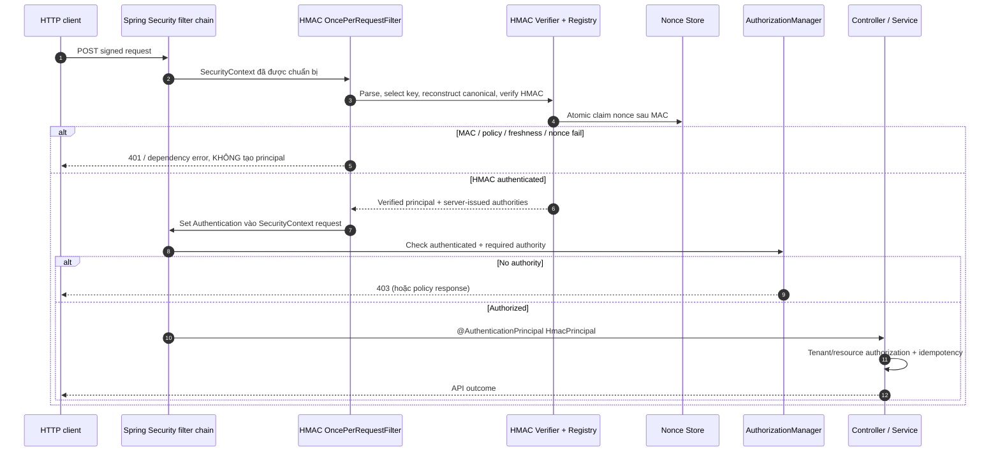

# Authenticated principal trong Spring Security khi xác thực HTTP request bằng HMAC

## Mục tiêu học tập

Trong chương **Spring Security**, bài **Authenticated principal** giải thích cách đưa **danh tính đã được xác thực bằng HMAC** vào mô hình bảo mật của Spring Security: từ một HTTP request có `clientId`/`keyId` chưa đáng tin, qua lựa chọn shared secret đúng credential, canonical request, HMAC verification, timestamp/nonce chống replay, cho tới tạo `Authentication` đã xác thực trong `SecurityContext` để các lớp controller/service có thể kiểm tra quyền.

Bài thuộc module `SECURITY_AUTHENTICATION_HMAC_REQUEST_AUTHENTICATION`: thiết kế xác thực HTTP request bằng HMAC với shared secret, ký method/URI/header hoặc body theo hợp đồng canonical, kiểm tra chữ ký, chống replay, quản lý key rotation, kiểm thử proxy/gateway và **phân biệt authentication với authorization**. Ví dụ chọn **Java 17, Spring Boot 3 / Spring Security 6, Servlet stack (`jakarta.servlet`)** làm ngữ cảnh minh họa; không giả định một thư viện HMAC authentication chuẩn đã có sẵn trong Spring Security.

Sau bài, bạn có thể:

- Phân biệt **claimed client ID**, **credential key ID**, **authenticated principal**, **authorities** và **tenant/resource permissions**.
- Mô tả chính xác khi nào được tạo `Authentication` với `isAuthenticated() == true` và vì sao không thể tin header `X-User`, `clientId` hay một chữ ký chưa kiểm chứng.
- Hiểu vai trò của `SecurityContextHolder`, `SecurityContext`, `Authentication.getPrincipal()`, `getAuthorities()` và `@AuthenticationPrincipal` trong request lifecycle.
- Gắn HMAC verifier vào `SecurityFilterChain` đúng vị trí, xử lý 401/403 và lỗi dependency, tránh tình huống filter chạy hai lần hoặc một chain khác vô tình bỏ qua HMAC.
- Tạo principal bất biến từ **registry đã đối chiếu bằng MAC**, không đưa raw shared secret, expected MAC hay header `Authorization` vào principal.
- Thiết kế canonical HMAC-SHA256 có audience, client ID, key ID, method, raw URI, Content-Type, body digest, Idempotency-Key, timestamp và nonce.
- Dùng `Mac`, `SecretKeySpec`, `MessageDigest.isEqual`, cửa sổ timestamp và **atomic nonce claim** để quyết định authentication.
- Hiểu cách bảo toàn request body cho controller, tính nhất quán gateway/proxy và giới hạn của `ContentCachingRequestWrapper`.
- Thực hành cấu hình, filter, verifier, controller và negative tests với Spring Security 6.
- Phân biệt **principal đã xác thực** với **principal có quyền cho tenant/action/resource cụ thể**, kể cả khi client rotate key hoặc request được retry.

## 1. HMAC authentication tạo ra principal như thế nào?

### 1.1. Danh tính được khai chưa phải danh tính đã chứng minh

Một client có thể gửi:

```http
POST /api/hmac/v1/payouts?tenant=merchant-a HTTP/1.1
Host: payments.example.test
Content-Type: application/json
Authorization: HMAC-SHA256 clientId="payout-worker", keyId="kid_2026_11", timestamp="<epoch>", nonce="<nonce-b64url>", signature="<mac-b64url>"
Idempotency-Key: <operation-id-b64url>
X-Content-SHA256: <body-digest-b64url>

{"amount":120000,"currency":"VND"}
```

Các trường trong `Authorization` trước khi xác minh chỉ là dữ liệu **do phía gọi tự khai**. Người ngoài có thể viết `clientId="payout-worker"`, tự tạo một MAC bằng khóa riêng của họ hoặc sao chép key ID từ log. **Không một trường nào tự chứng minh danh tính**, và `clientId` **không tự trở thành principal**.

Server phải thực hiện:

```text
Untrusted HTTP bytes
   |
   v
Parse + validate unique Authorization, method, raw URI, headers, body
   |
   v
Lookup (expectedAudience, claimedClientId, claimedKeyId)
   |
   v
Trusted credential record:
  sharedSecretReference + keyStatus + principalId + allowedAuthorities
   |
   v
Recreate canonical bytes + HMAC-SHA256 + compare raw MAC bytes
   |
   v
Timestamp freshness + nonce atomic claim (anti-replay)
   |
   v
Create AUTHENTICATED Authentication with trusted principal
   |
   v
SecurityContextHolder -> SecurityFilterChain -> controller/service
   |
   v
Authorization for tenant/resource/action -> business operation
```

**Không có registry record, key đã REVOKED, MAC sai, timestamp quá cửa sổ hoặc nonce đã dùng → không tạo authenticated principal.** Không dùng secret mặc định khi lookup thất bại và không tạo `SecurityContext` hợp lệ chỉ dựa trên `clientId`.

### 1.2. Authentication, principal và authorization không đồng nghĩa

| Khái niệm | Ví dụ | Có ý nghĩa gì? |
| --- | --- | --- |
| Claimed identity | `clientId=payout-worker` từ header | Đầu vào chưa tin để tìm credential. |
| Key identifier | `keyId=kid_2026_11` | Chọn một bản ghi secret/version, không phải raw secret. |
| Authenticated principal | `principalId=svc-payout-worker` từ registry sau MAC hợp lệ | Chủ thể đã được chứng minh đang dùng credential hợp lệ theo policy. |
| Authorities | `payouts:create` do policy registry cấp | Quyền tổng quát để Spring Security dùng ở route/method level. |
| Tenant authorization | `svc-payout-worker` được phép tạo payout ở `merchant-a` | Kiểm tra điều kiện cụ thể theo tenant/action/resource và policy hiện hành. |
| Business idempotency | `(principal, tenant, operationId)` đã commit? | Tránh side effect trùng; không tự xác thực client. |

Một principal có thể có quyền `payouts:create` trên tenant A nhưng không có quyền trên tenant B. HMAC hợp lệ cho URL chứa `tenant=B` **không biến quyền của A thành quyền B**.

### 1.3. Danh tính nên ổn định qua key rotation

Ví dụ:

```text
Credential old:
  audience=payments-api-prod
  clientId=payout-worker
  keyId=K_old
  principalId=svc-payout-worker
  status=RETIRING

Credential new:
  audience=payments-api-prod
  clientId=payout-worker
  keyId=K_new
  principalId=svc-payout-worker
  status=ACTIVE
```

Khi client đổi từ K_old sang K_new, **authenticated principal vẫn có thể là cùng `svc-payout-worker`**. Không lấy `keyId` làm principal nếu quyền nghiệp vụ thuộc về service account, vì rotation có thể vô tình làm đổi tenant scope hoặc namespace idempotency.

Ngược lại, nếu provisioning policy chủ đích đổi principal khi đổi credential, đó là **thay đổi danh tính/quyền**, không chỉ rotation; phải được phê duyệt và kiểm thử.

## 2. Mô hình `Authentication` của Spring Security

### 2.1. Các trường có ý nghĩa gì?

Một `Authentication` thường phơi bày:

```java
Authentication authentication =
        SecurityContextHolder.getContext().getAuthentication();

Object principal = authentication.getPrincipal();
Object credentials = authentication.getCredentials();
Collection<? extends GrantedAuthority> authorities =
        authentication.getAuthorities();
boolean authenticated = authentication.isAuthenticated();
Object details = authentication.getDetails();
```

Trong tích hợp HMAC:

| API Spring Security | Thiết kế mong muốn |
| --- | --- |
| `getPrincipal()` | Object danh tính bất biến lấy từ **verified credential record**, không phải chuỗi client ID mù quáng. |
| `getCredentials()` | `null` (hoặc đã xóa) **sau xác minh**; không giữ shared secret/HMAC signature trong context. |
| `getAuthorities()` | Các `GrantedAuthority` tin cậy từ policy/registry, không lấy trực tiếp từ header `scope=admin`. |
| `isAuthenticated()` | `true` **chỉ khi verifier đã thành công và caller được phép dùng credential**. |
| `getDetails()` | Nếu cần, chỉ metadata request đã redacted/audit-safe; không lưu full Authorization hoặc secret. |

Spring Security **không tự biết HMAC scheme custom của bài**. Lập trình viên chịu trách nhiệm chuyển một kết quả HMAC đã xác thực thành `Authentication` đúng nghĩa; framework sau đó mới dùng `AuthorizationManager`, method security và `@AuthenticationPrincipal`.

### 2.2. Principal không phải shared secret

Có thể định nghĩa kiểu rõ ràng:

```java
public record HmacPrincipal(
        String principalId,
        String clientId,
        String audience,
        String keyId
) {}
```

`principalId` là danh tính nghiệp vụ/tài khoản dịch vụ đã đăng ký, `clientId` và `keyId` hữu ích cho audit/lifecycle. **Không đặt `byte[] secret`, DEK/KEK, private token, expected HMAC hay mật khẩu trong `HmacPrincipal`.**

Tùy hệ thống, principal có thể còn tenant mặc định hoặc danh sách claims đã được *server* cấp. Nhưng nếu quyền tenant thường xuyên thay đổi, hãy **truy vấn authorization policy tại điểm sử dụng**; không coi principal snapshot là nguồn quyền vĩnh viễn.

### 2.3. Tạo `Authentication` sau verify thành công

Với Spring Security 6, một cách đơn giản là:

```java
List<GrantedAuthority> granted =
        verifiedAuthorities.stream()
                .map(SimpleGrantedAuthority::new)
                .map(x -> (GrantedAuthority) x)
                .toList();

HmacPrincipal principal = new HmacPrincipal(
        verifiedPrincipalId,
        verifiedClientId,
        "payments-api-prod",
        verifiedKeyId);

// Chỉ gọi SAU khi key status, MAC, timestamp và nonce đều đạt.
Authentication authentication =
        UsernamePasswordAuthenticationToken.authenticated(
                principal,
                null,       // Không đưa raw secret vào SecurityContext.
                granted
        );

SecurityContext context =
        SecurityContextHolder.createEmptyContext();
context.setAuthentication(authentication);
SecurityContextHolder.setContext(context);
```

`UsernamePasswordAuthenticationToken` ở đây **chỉ là carrier** cho principal/authorities đã được xác thực bằng HMAC. Tên class **không** có nghĩa request dùng username/password. Nếu hệ thống cần phân biệt scheme một cách mạnh hơn, có thể viết `HmacAuthenticationToken` riêng bằng `AbstractAuthenticationToken`, đảm bảo trạng thái authenticated chỉ được thiết lập bởi verifier/`AuthenticationProvider` đáng tin.

Không gọi factory `.authenticated(...)` **ngay sau khi parse header**; đó là bỏ qua HMAC. Nếu dùng mô hình `AuthenticationManager`/`AuthenticationProvider`, đưa **unauthenticated request token** vào manager, và chỉ provider được chấp thuận trả về một authenticated token sau khi xác minh.

### 2.4. Đừng dùng `isAuthenticated()` đơn độc để quyết định tin cậy

Trong Spring Security, một số token đại diện **anonymous authentication** có thể báo `isAuthenticated() == true` theo implementation, dù `AuthorizationManager` vẫn phân biệt anonymous với user được xác thực. Vì vậy:

```java
// DỄ SAI: token anonymous có thể có isAuthenticated() == true.
Authentication a =
        SecurityContextHolder.getContext().getAuthentication();
if (a != null && a.isAuthenticated()) {
    // Không tự kết luận đây là HMAC-authenticated principal.
}
```

Dùng `authorizeHttpRequests(...authenticated())` và/hoặc kiểm tra đúng kiểu `HmacPrincipal` ở API chuyên HMAC. Với authorization cụ thể, luôn đánh giá `principalId` và scopes từ authenticated record, không suy quyền từ một boolean.

## 3. SecurityContext lifecycle và vị trí của HMAC filter

### 3.1. `SecurityContextHolder` mặc định gắn với execution context

Trong Servlet stack, `SecurityContextHolder` mặc định sử dụng mô hình liên quan tới **thread hiện tại** (thường `MODE_THREADLOCAL`). Spring Security thiết lập/đọc/clear context theo filter-chain lifecycle. Vì vậy:

- Principal của request A **không được rò** sang request B trên thread pool.
- Hãy tạo **`SecurityContext` mới** khi đã verify xong, không sửa một instance toàn cục chia sẻ giữa requests.
- Sau request, Spring Security phải clear context; filter custom cũng nên có cleanup đúng với dispatch model và tránh để lại thread-local identity sau exception.
- Với async tasks, thread hopping hoặc reactive stack, `ThreadLocal` không tự propagate chính xác; dùng cơ chế context propagation được framework hỗ trợ, hoặc truyền identity/tenant context rõ ràng.
- Với **WebFlux**, cơ chế reactive `ReactiveSecurityContextHolder` khác Servlet filter này; không bê nguyên `OncePerRequestFilter` sang reactive pipeline.

### 3.2. `SecurityContextHolderFilter` và `SecurityContextRepository`

Với cấu hình stateless API, filter HMAC nên đặt sau các filter hạ tầng đã chuẩn bị security context và trước bước authorization. Một `SecurityContext` được tạo cho **request hiện tại**, không lưu mặc định vào `HttpSession`.

Ở Spring Security 6, `SecurityContextHolderFilter` có mô hình **explicit save** qua `SecurityContextRepository`; đặt context vào holder để các filter/controller phía sau thấy principal **không tự đồng nghĩa lưu/persist nó qua request**. Với HMAC ký từng HTTP request, việc không duy trì session là thiết kế mong muốn.

Nếu ứng dụng có nhiều `SecurityFilterChain` cho web/browser, JWT và HMAC, phải kiểm soát **chain matcher**, ordering và phương thức auth của từng đường. Không để một chain `permitAll()`/form login hoặc bearer fallback vô tình cho phép route HMAC chạy mà không kiểm tra MAC.

### 3.3. Vị trí filter trong `SecurityFilterChain`



`OncePerRequestFilter` giúp tránh thực thi lặp ngoài ý muốn trong những kiểu dispatch nhất định; **không thay cơ chế replay detection**. Một signed request gửi lần hai là **HTTP request khác**, vẫn phải bị chặn bởi nonce store.

### 3.4. Đừng dựa vào `ExceptionTranslationFilter` để bắt exception từ mọi vị trí

Một HMAC filter custom đặt **trước `AnonymousAuthenticationFilter`** cũng nằm **trước `ExceptionTranslationFilter`** trong filter order thông dụng. Exception được ném ngay từ HMAC filter **không được bảo đảm** đi qua `ExceptionTranslationFilter` (vốn chỉ bắt exception từ các filter **phía sau** nó khi gọi `chain.doFilter`).

Vì vậy filter tự xử lý lỗi của bước HMAC bằng `AuthenticationEntryPoint` hoặc `AuthenticationFailureHandler`, còn `AccessDeniedHandler`/`ExceptionTranslationFilter` xử lý exception authorization xảy ra trong downstream chain. Không ném `BadCredentialsException` rồi mặc định chờ chain khác trả 401 nếu không chắc vị trí.

## 4. Canonical request bảo đảm principal được gắn đúng request

### 4.1. Hợp đồng minh họa `spring-principal-v1`

Để bài tự chứa, dùng một contract giáo dục HMAC-SHA256 cho:

```http
POST /api/hmac/v1/payouts?tenant=merchant-a HTTP/1.1
Host: payments.example.test
Content-Type: application/json
Authorization: HMAC-SHA256 clientId="payout-worker", keyId="kid_2026_11", timestamp="<epoch-seconds>", nonce="<22-char-base64url>", signature="<43-char-base64url>"
Idempotency-Key: <22-char-base64url>
X-Content-SHA256: <43-char-base64url>

{"amount":120000,"currency":"VND"}
```

Quy tắc cụ thể của ví dụ:

1. Chỉ nhận HTTP `POST` với raw target `/api/hmac/v1/payouts?tenant=[a-z0-9-]{1,32}`, **một** tham số `tenant`, không additional/duplicate params, không percent-encoding nhập nhằng.
2. Content-Type được ký **exact text `application/json`**; body được hash trên **đúng byte đã gửi**, không parse/serialize JSON rồi hash object.
3. Header `Authorization` phải xuất hiện **đúng một field line**, có năm auth-params ở format được quy định; giá trị `clientId`, `keyId` có grammar chặt; không chấp nhận duplicate `keyId`/`KEYID`.
4. `Idempotency-Key` là text Base64URL không padding của 16 byte; giữ nguyên khi retry cùng logical operation, khác với nonce mới mỗi signed attempt.
5. Timestamp Unix epoch seconds ở dạng decimal canonical; nonce là Base64URL 16 byte CSPRNG; signature là Base64URL của HMAC-SHA256 raw 32 bytes.
6. Audience lấy từ server configuration `payments-api-prod`, **không** lấy từ một header do client tự khai.
7. Canonicalization, algorithm và auth scheme **được pin**; không có fallback sang `HmacSHA1`, `none` hoặc secret khác.

Canonical **12 dòng UTF-8**, nối `LF`, **không LF cuối**:

```text
HMAC-SHA256
spring-principal-v1
payments-api-prod
payout-worker
kid_2026_11
POST
/api/hmac/v1/payouts?tenant=merchant-a
application/json
<base64url-sha256-exact-body>
<idempotency-key>
<unix-timestamp>
<nonce-base64url>
```

| Dòng | Thành phần | Vì sao cần ký? |
| --- | --- | --- |
| 1–2 | Algorithm và canonical version | Không nhầm scheme/phiên bản. |
| 3 | Audience | Chống dùng credential sai service/môi trường. |
| 4 | Claimed client ID | Không chuyển MAC từ client A sang B. |
| 5 | Key ID | Không tráo key record và giữ MAC cũ. |
| 6–7 | HTTP method và raw target | Ràng buộc action, URI và requested tenant. |
| 8–9 | Content-Type và exact body hash | Ngăn sửa nội dung request. |
| 10 | Idempotency-Key | Ngăn đổi operation identity sau ký. |
| 11–12 | Timestamp và nonce | Gắn attempt/time vào MAC, phối hợp freshness/replay. |

```text
bodyHashText = Base64URL_NoPadding(SHA256(exactBodyBytes))
canonicalBytes = UTF8(join("\n", 12 fields))
macBytes = HMAC-SHA256(rawSecretFor(audience, clientId, keyId),
                       canonicalBytes)
signature = Base64URL_NoPadding(macBytes)
```

Kết quả MAC phải được decode về **32 byte** rồi so sánh bằng `MessageDigest.isEqual(expectedBytes, suppliedBytes)`. Việc dùng `String.equals` hoặc `Arrays.equals` để so MAC text không phải giải pháp so sánh thời gian ổn định phù hợp.

### 4.2. Bind `clientId` và `keyId` trước khi tạo principal

Một request do attacker sửa:

```text
Original signed:
  clientId=payout-worker
  keyId=K_old
  signature=MAC_old

Tampered:
  clientId=admin-service
  keyId=K_admin
  signature=MAC_old  (giữ nguyên)
```

Verifier phải lookup đúng `(audience,admin-service,K_admin)` và tính HMAC trên canonical mới. MAC cũ không hợp lệ; không thể tạo principal `admin-service`. Nếu key ID không tồn tại, không được thử mọi raw secrets để “tìm ra user”.

Nếu key rotation có K_old/K_new cho cùng principal, mỗi request chỉ khai **một key ID được cho phép**. Bên ký dùng đúng secret/version tương ứng và ký key ID; bên nhận không lấy key ID từ text response hoặc header proxy không đáng tin.

### 4.3. Servlet API và raw request-target không luôn tương đương network bytes

`request.getRequestURI()` và `request.getQueryString()` phản ánh những gì **Servlet container** cung cấp, không tự chứng minh đó là **raw request-target nguyên thủy** trước reverse proxy/gateway. `Host`/`:authority`, percent encoding, URL rewrite, routing prefix và body transformation có thể đã đổi ở ingress.

Vì vậy ví dụ sau sẽ **giả định** HMAC được xác minh ở điểm đã thống nhất với signer, với context path rỗng, không có gateway rewrite, và URI/query được giữ đúng contract. Production cần:

- Chọn verifier ở gateway **trước rewrite**, hoặc backend nhận trusted original metadata qua kênh có xác thực/toàn vẹn.
- Không tin `X-Original-URI`/`X-Forwarded-Host` từ internet.
- Quy định chính xác URI encoding, duplicate query, content encoding, header normalization, host/audience binding.
- Kiểm thử qua đường vào thực, không chỉ MockMvc bypass gateway.
- Không “sửa” MAC mismatch bằng cách bỏ method/URI/body khỏi canonical.

## 5. Danh tính trong `SecurityContext` phải không chứa bí mật

### 5.1. Định nghĩa identity object bất biến

Ví dụ:

```java
public record HmacPrincipal(
        String principalId,
        String clientId,
        String audience,
        String keyId
) {}
```

Nguyên tắc:

- `principalId` và mapping principal lấy từ **trusted credential registry**, không lấy từ `X-Principal-Id` hay `scope` do client tự thêm.
- `keyId` chỉ để audit/lifecycle/credential selection; có thể thay khi rotation mà principal không đổi.
- `audience` phải đúng API/môi trường đang nhận request.
- **Không lưu `rawSecret`, `SecretKey`, full signature, nonce hoặc body** trong principal.
- Nếu dùng `Authentication.getDetails()`, không đưa vào đó raw `Authorization` hoặc HTTP headers có secret/token.
- Object nên immutable để tránh một business filter sửa principal của request đang được xử lý.

### 5.2. Authorities khác quyền trên từng tenant

Một record đã được xác minh có thể phát:

```text
principal=svc-payout-worker
authorities=["payouts:create", "reports:read"]
allowedTenants:
  merchant-a -> payouts:create
  merchant-b -> reports:read
```

`@PreAuthorize("hasAuthority('payouts:create')")` chỉ kiểm tra authority tổng quát. Với request `tenant=merchant-b`, vẫn phải kiểm tra `tenantPolicy.allow(svc-payout-worker,merchant-b,payouts:create)` và quyền trên resource cụ thể.

Không tin client tự khai `tenant=merchant-a` hoặc `scope=admin` chỉ vì các claim đó **được ký bằng secret của chính client**: HMAC chứng minh người cầm secret đã phát claim, không chứng minh issuer cấp quyền tương ứng.

### 5.3. Thời gian sống của principal

Authenticated principal trong context của một HTTP request:

- Không tự tồn tại qua request tiếp theo khi dùng stateless HMAC (client phải ký lại từng request).
- Không tự chịu trách nhiệm invalidate một cached `Authentication` dài hạn khi credential bị revoke.
- Không tự truyền chính xác tới executor thread khác nếu không có context propagation an toàn.
- Không được serialize thành một “trusted header” gửi tới downstream nếu bên nhận không chứng minh được nguồn, audience, TTL và toàn vẹn.
- Không được dùng để bypass authorization cho business operation bất đồng bộ chỉ vì request gốc từng có HMAC hợp lệ.

## 6. Thiết kế `SecurityFilterChain` cho endpoint HMAC

### 6.1. Mục tiêu cấu hình

Trong Spring Security 6 / Boot 3 Servlet application:

- Dành một `SecurityFilterChain` cụ thể cho `/api/hmac/**`, **stateless**.
- Chỉ chạy HMAC filter trong chain đó, không đăng ký nó thành **Servlet Filter toàn cục** ngoài Spring Security.
- Dùng `AuthorizationManager` để yêu cầu một `Authentication` hợp lệ và các authorities tối thiểu.
- Dùng `AuthenticationEntryPoint` chung cho thiếu/sai HMAC; `AccessDeniedHandler` cho lỗi quyền downstream.
- Xử lý lỗi xảy ra **ngay trong HMAC filter** tại filter, không trông đợi `ExceptionTranslationFilter` nằm phía sau.
- Không dùng `permitAll` cho endpoint side effect, không dựa vào `SecurityContextHolder.getContext().getAuthentication() != null` để nhận dạng principal HMAC.
- Với endpoint machine-to-machine không phụ thuộc cookie/browser session, có thể tắt CSRF **chỉ trong chain chuyên dụng này sau khi phân tích CSRF threat model**; không tắt CSRF tùy tiện cho những browser endpoints khác.

### 6.2. Cấu hình ví dụ

Đoạn sau dùng filter/verifier ở mục tiếp theo. `HmacApiFilter` được **new trực tiếp trong `SecurityFilterChain`**, không chú thích `@Component` hay cung cấp một global `@Bean Filter` để tránh Boot tự đăng ký thêm lần nữa.

```java
import org.springframework.context.annotation.Bean;
import org.springframework.context.annotation.Configuration;
import org.springframework.core.annotation.Order;
import org.springframework.http.HttpMethod;
import org.springframework.security.config.annotation.method.configuration.EnableMethodSecurity;
import org.springframework.security.config.annotation.web.builders.HttpSecurity;
import org.springframework.security.config.annotation.web.configuration.EnableWebSecurity;
import org.springframework.security.config.annotation.web.configurers.AbstractHttpConfigurer;
import org.springframework.security.config.http.SessionCreationPolicy;
import org.springframework.security.web.AuthenticationEntryPoint;
import org.springframework.security.web.SecurityFilterChain;
import org.springframework.security.web.authentication.AnonymousAuthenticationFilter;

@Configuration
@EnableWebSecurity
@EnableMethodSecurity
class SecurityConfig {

    @Bean
    @Order(1)
    SecurityFilterChain hmacChain(
            HttpSecurity http, HmacVerifier verifier) throws Exception {
        AuthenticationEntryPoint unauthorized =
                (request, response, cause) -> {
                    response.setHeader(
                            "WWW-Authenticate",
                            "HMAC-SHA256 realm=\"payments-api-prod\"");
                    response.sendError(
                            401, "Authentication failed");
                };

        http.securityMatcher("/api/hmac/**")
                .csrf(AbstractHttpConfigurer::disable)
                .sessionManagement(session ->
                        session.sessionCreationPolicy(
                                SessionCreationPolicy.STATELESS))
                .requestCache(cache -> cache.disable())
                .exceptionHandling(ex -> ex
                        .authenticationEntryPoint(unauthorized)
                        .accessDeniedHandler(
                                (request, response, cause) ->
                                        response.sendError(403)))
                .authorizeHttpRequests(auth -> auth
                        .requestMatchers(
                                HttpMethod.POST,
                                "/api/hmac/v1/payouts")
                        .hasAuthority("payouts:create")
                        .anyRequest().authenticated())
                .addFilterBefore(
                        new HmacApiFilter(verifier, unauthorized),
                        AnonymousAuthenticationFilter.class);

        return http.build();
    }

    @Bean
    @Order(2)
    SecurityFilterChain otherRoutes(HttpSecurity http)
            throws Exception {
        // Demo fail-closed: các đường không thuộc HMAC chain
        // không tự mở thành permitAll.
        http.authorizeHttpRequests(auth ->
                auth.anyRequest().denyAll());
        return http.build();
    }
}
```

Lưu ý:

- `securityMatcher` phân vùng **chain**, còn `requestMatchers` trong `authorizeHttpRequests` đặt **quyền** cho endpoint được chain xử lý. Phải kiểm tra matcher của đường dẫn thực sau context path/servlet mappings.
- `addFilterBefore(..., AnonymousAuthenticationFilter.class)` là một anchor giúp filter HMAC chạy trước anonymous và authorization. Thứ tự cụ thể còn phụ thuộc các filter custom khác, nên cần kiểm tra filter chain thực khi tích hợp.
- Nếu có JWT/Bearer chain riêng, phải dùng matcher/ordering tách biệt; request HMAC sai không được rơi sang một phương thức auth khác vì chain bị cấu hình quá rộng.
- Code fallback `denyAll()` chỉ minh họa nguyên tắc *deny by default*; ứng dụng thật có thể thêm các chain khác được cấu hình rõ cho health endpoints, admin hoặc web login.

## 7. Java 17: mô hình credential, principal và HMAC verifier

Các đoạn mã dưới đây là **một ví dụ Servlet/Spring Security 6 có chủ đích học thuật**. Giả định chúng nằm trong cùng package của một dự án Spring Boot 3, với các dependencies `spring-boot-starter-web` và `spring-boot-starter-security`. Để tập trung vào **authenticated principal**, những interface tới credential registry, nonce store và business authorization được giữ dưới dạng **contract**; production cần cung cấp implementation có quyền, consistency, audit và secret management thích hợp.

### 7.1. Kiểu dữ liệu tin cậy từ registry

```java
import java.time.Duration;
import java.util.Arrays;
import java.util.Optional;
import java.util.Set;
import org.springframework.security.core.GrantedAuthority;

record HmacPrincipal(
        String principalId, String clientId,
        String audience, String keyId) {}

enum KeyState {
    ISSUED, ACTIVE, RETIRING, REVOKED
}

record HmacCredential(
        String audience,
        String clientId,
        String keyId,
        String principalId,
        byte[] rawSecret,
        KeyState state,
        long notBeforeEpochSeconds,
        long verifyUntilEpochSeconds,
        Set<String> authorities) {

    HmacCredential {
        rawSecret = rawSecret.clone();
        authorities = Set.copyOf(authorities);
    }

    @Override
    public byte[] rawSecret() {
        return rawSecret.clone();
    }
}

interface CredentialRegistry {
    // expectedAudience là giá trị trusted do backend quyết định.
    Optional<HmacCredential> find(
            String expectedAudience, String clientId, String keyId);
}

interface NonceStore {
    // Atomic claim-once trên toàn verifier fleet.
    // False nếu nonce đã claim; lỗi hạ tầng -> throw exception.
    boolean claimOnce(
            String expectedAudience,
            String principalId,
            String nonce,
            Duration timeToLive);
}

final class RegistryUnavailableException
        extends RuntimeException {
    RegistryUnavailableException(String message) {
        super(message);
    }
}

final class NonceStoreUnavailableException
        extends RuntimeException {
    NonceStoreUnavailableException(String message) {
        super(message);
    }
}

record VerifiedHmacIdentity(
        HmacPrincipal principal,
        Set<String> authorities) {

    VerifiedHmacIdentity {
        authorities = Set.copyOf(authorities);
    }
}
```

**Vì sao principal là một record riêng?**

- `HmacCredential` là **dữ liệu bảo mật nội bộ**, có raw secret, status và policy; không được đưa nó vào `SecurityContext`.
- `VerifiedHmacIdentity` chỉ là **kết quả đã xác thực** do verifier trả về.
- `HmacPrincipal` chỉ chứa identity/metadata cần dùng; không xuất raw HMAC key vào controller/log.
- `authorities` được lấy từ policy server (ví dụ `payouts:create`), không từ một trường do caller tự thêm vào request.
- `clientId`, `keyId` có thể bị giả mạo trước xác minh; **chỉ sau lookup + MAC hợp lệ** chúng mới trở thành metadata tin cậy của credential đã được dùng.

**Lưu ý về Java memory:** `byte[]` được clone để tránh chia sẻ tham chiếu trực tiếp; Java/JCA provider không bảo đảm mọi bản sao raw key có thể zeroize tuyệt đối. Production nên ưu tiên secret manager/KMS/HSM theo kiến trúc, hạn chế heap dumps, logs và lifetime của bản sao khóa.

### 7.2. Verifier: kiểm tra credential policy trước khi tạo identity

```java
import jakarta.servlet.http.HttpServletRequest;
import java.nio.charset.StandardCharsets;
import java.security.GeneralSecurityException;
import java.security.MessageDigest;
import java.time.Clock;
import java.time.Duration;
import java.time.Instant;
import java.util.Arrays;
import java.util.Base64;
import java.util.Collections;
import java.util.List;
import java.util.Locale;
import java.util.Optional;
import java.util.regex.Matcher;
import java.util.regex.Pattern;
import javax.crypto.Mac;
import javax.crypto.spec.SecretKeySpec;
import org.springframework.security.authentication.AuthenticationServiceException;
import org.springframework.security.authentication.BadCredentialsException;
import org.springframework.stereotype.Service;

@Service
final class HmacVerifier {
    private static final String AUDIENCE = "payments-api-prod";
    private static final long MAX_PAST_SECONDS = 300L;
    private static final long MAX_FUTURE_SECONDS = 60L;
    private static final Duration NONCE_TTL =
            Duration.ofSeconds(370L);  // 300+60+10 (minh họa).

    // Chỉ nhận một dạng đã công bố, có auth scheme/param name
    // case-insensitive nhưng GIÁ TRỊ clientId/keyId case-sensitive.
    // Đúng năm param theo thứ tự của contract này; reject others.
    private static final Pattern AUTH = Pattern.compile(
            "^(?i:HMAC-SHA256) "
            + "(?i:clientId)=\"([A-Za-z0-9_-]{1,64})\", "
            + "(?i:keyId)=\"([A-Za-z0-9_-]{1,64})\", "
            + "(?i:timestamp)=\"([1-9][0-9]{0,11})\", "
            + "(?i:nonce)=\"([A-Za-z0-9_-]{22})\", "
            + "(?i:signature)=\"([A-Za-z0-9_-]{43})\"$");

    private static final Pattern TARGET = Pattern.compile(
            "/api/hmac/v1/payouts\\?tenant=[a-z0-9-]{1,32}");

    private static final Base64.Encoder B64 =
            Base64.getUrlEncoder().withoutPadding();
    private static final Base64.Decoder B64_DEC =
            Base64.getUrlDecoder();

    private final CredentialRegistry registry;
    private final NonceStore nonces;
    private final Clock clock;

    HmacVerifier(
            CredentialRegistry registry,
            NonceStore nonces,
            Clock clock) {
        this.registry = registry;
        this.nonces = nonces;
        this.clock = clock;
    }

    VerifiedHmacIdentity verify(
            HttpServletRequest request, byte[] exactBody) {
        try {
            if (!"POST".equals(request.getMethod())) {
                throw rejected();
            }
            if (!request.getContextPath().isEmpty()) {
                // Demo này giả định root deployment context.
                throw rejected();
            }
            String target = request.getRequestURI()
                    + "?" + request.getQueryString();
            if (!TARGET.matcher(target).matches()) {
                // Bắt cả duplicate/extra query, percent encoding,
                // null query và unsupported raw target.
                throw rejected();
            }

            String contentType = oneHeader(
                    request, "Content-Type", 64);
            if (!"application/json".equals(contentType)) {
                throw rejected();
            }

            String authorization = oneHeader(
                    request, "Authorization", 512);
            Matcher auth = AUTH.matcher(authorization);
            if (!auth.matches()) {
                throw rejected();
            }
            String clientId = auth.group(1);
            String keyId = auth.group(2);
            String timestampText = auth.group(3);
            String nonceText = auth.group(4);
            String signatureText = auth.group(5);

            String operationId = oneHeader(
                    request, "Idempotency-Key", 64);
            strictB64(operationId, 22, 16);
            String declaredBodyHash = oneHeader(
                    request, "X-Content-SHA256", 64);
            byte[] declaredHash =
                    strictB64(declaredBodyHash, 43, 32);

            // clientId/keyId chỉ là lookup hints chưa đáng tin.
            Optional<HmacCredential> found =
                    registry.find(AUDIENCE, clientId, keyId);
            if (found.isEmpty()) {
                // Không default secret; không thử tất cả keys.
                throw rejected();
            }
            HmacCredential credential = found.get();
            if (!AUDIENCE.equals(credential.audience())
                    || !clientId.equals(credential.clientId())
                    || !keyId.equals(credential.keyId())) {
                throw rejected();
            }

            long now = Instant.now(clock).getEpochSecond();
            if (!mayVerify(credential, now)) {
                throw rejected(); // ISSUED/REVOKED/outside lifetime.
            }
            long signedAt = Long.parseLong(timestampText);
            if (signedAt < Math.subtractExact(
                        now, MAX_PAST_SECONDS)
                    || signedAt > Math.addExact(
                        now, MAX_FUTURE_SECONDS)) {
                throw rejected();
            }

            // Hash trên exact binary body, không serialize lại JSON.
            byte[] computedHash = MessageDigest
                    .getInstance("SHA-256").digest(exactBody);
            if (!MessageDigest.isEqual(
                    computedHash, declaredHash)) {
                throw rejected();
            }

            // Canonical đúng 12 dòng LF, không LF cuối.
            String canonical = String.join("\n",
                    "HMAC-SHA256",
                    "spring-principal-v1",
                    AUDIENCE,
                    clientId,
                    keyId,
                    request.getMethod(),
                    target,
                    contentType,
                    B64.encodeToString(computedHash),
                    operationId,
                    timestampText,
                    nonceText);

            byte[] expectedMac;
            byte[] rawKey = credential.rawSecret();
            try {
                Mac mac = Mac.getInstance("HmacSHA256");
                mac.init(new SecretKeySpec(
                        rawKey, "HmacSHA256"));
                expectedMac = mac.doFinal(
                        canonical.getBytes(StandardCharsets.UTF_8));
            } finally {
                Arrays.fill(rawKey, (byte) 0); // Best effort.
            }

            byte[] suppliedMac =
                    strictB64(signatureText, 43, 32);
            if (!MessageDigest.isEqual(
                    expectedMac, suppliedMac)) {
                throw rejected();
            }

            // Chỉ sau MAC đúng mới claim nonce của authenticated
            // principal; không dùng untrusted keyId làm namespace.
            if (!nonces.claimOnce(
                    AUDIENCE, credential.principalId(),
                    nonceText, NONCE_TTL)) {
                throw rejected();  // Replay.
            }

            HmacPrincipal principal = new HmacPrincipal(
                    credential.principalId(),
                    credential.clientId(),
                    credential.audience(),
                    credential.keyId());

            return new VerifiedHmacIdentity(
                    principal, credential.authorities());

        } catch (RegistryUnavailableException
                 | NonceStoreUnavailableException ex) {
            // Lỗi hạ tầng: fail closed, phân biệt với unknown ID.
            throw new AuthenticationServiceException(
                    "Authentication dependency unavailable", ex);
        } catch (GeneralSecurityException ex) {
            throw new AuthenticationServiceException(
                    "HMAC provider unavailable", ex);
        } catch (IllegalArgumentException
                 | ArithmeticException ex) {
            // Parse/encoding/time lỗi: không tạo principal.
            throw rejected();
        }
    }

    private static boolean mayVerify(
            HmacCredential credential, long now) {
        boolean statusOk = credential.state() == KeyState.ACTIVE
                || credential.state() == KeyState.RETIRING;
        return statusOk
                && credential.notBeforeEpochSeconds() <= now
                && now < credential.verifyUntilEpochSeconds();
    }

    private static String oneHeader(
            HttpServletRequest request,
            String headerName, int maximumLength) {
        List<String> values = Collections.list(
                request.getHeaders(headerName));
        if (values.size() != 1 || values.get(0) == null
                || values.get(0).isBlank()
                || values.get(0).length() > maximumLength) {
            throw rejected();
        }
        return values.get(0);
    }

    private static byte[] strictB64(
            String text, int expectedChars, int expectedBytes) {
        if (text == null || text.length() != expectedChars
                || !text.matches("[A-Za-z0-9_-]+")) {
            throw rejected();
        }
        byte[] bytes = B64_DEC.decode(text);
        if (bytes.length != expectedBytes
                || !B64.encodeToString(bytes).equals(text)) {
            throw rejected(); // Reject noncanonical pad bits.
        }
        return bytes;
    }

    private static BadCredentialsException rejected() {
        return new BadCredentialsException(
                "HMAC authentication failed");
    }
}
```

**Điểm phải hiểu rõ:**

1. `AUTH` là một parser cho **tập con cố định có chủ đích** của custom scheme, không phải HTTP Authentication header parser tổng quát. Nó yêu cầu đúng thứ tự năm auth-params, nhưng cho phép cách viết khác nhau của **tên** scheme/param (không làm thay đổi **giá trị** client ID/key ID). Nếu cần grammar linh hoạt, dùng parser chuyên dụng và reject duplicates case-insensitively.
2. `oneHeader` đếm field values để từ chối duplicate `Authorization`, `Content-Type`, `Idempotency-Key`, `X-Content-SHA256`. **HTTP adapter/edge vẫn phải chống framing ambiguity** hoặc proxy gộp header theo cách khó phục hồi; Servlet API không tự cho thấy mọi raw wire form.
3. `registry.find` phải trả về bản ghi **đúng audience/clientId/keyId**; trạng thái `REVOKED` phải được authoritative policy chặn. Không tìm thấy record không phải bằng chứng có thể fallback sang một key khác.
4. `credential.authorities()` là tập quyền **do server cấp**, nhưng **tenant/object authorization vẫn phải thực hiện riêng**.
5. `MessageDigest.isEqual` được dùng với binary MAC 32 byte; **constant-time MAC comparison không có nghĩa toàn bộ HTTP verifier chạy constant time**, đặc biệt giữa known/unknown key hoặc lỗi registry. Hạn chế public error detail, rate limiting và key enumeration vẫn cần.
6. `NONCE_TTL=370s` là ví dụ với past=300s, future=60s, margin=10s **tính từ lúc claim**; thực tế cần consistency/durability đủ mạnh. Khi failover mất nonce đã ACK, một signed attempt có thể bị replay trong freshness window.
7. `Math.addExact`/`subtractExact` chặn overflow; `catch` bên ngoài chuyển lỗi parse/overflow thành authentication failure, **không** tạo principal.
8. `rawKey` được clone và cố xóa mảng tạm sau phép tính; đây **không phải bảo đảm zeroization tuyệt đối** trong JVM/JCA.
9. `statusOk` là snapshot tại lookup. Production phải giải quyết race/revocation propagation và caching; nếu authority không đáng tin, có thể cần fail closed, chứ không chấp nhận trạng thái `ACTIVE` từ replica stale.

### 7.3. Thiết lập các bean hạ tầng và clock

`HmacVerifier` được Spring tạo vì có `@Service`, nhưng **cần** implementation cho `CredentialRegistry` và `NonceStore`. Đây là interfaces trong ví dụ, **không phải bean tự xuất hiện**. Production có thể dùng secret manager/credential DB + Redis với atomic claim, hoặc dịch vụ có consistency mạnh hơn tùy threat model.

```java
import java.time.Clock;
import org.springframework.context.annotation.Bean;
import org.springframework.context.annotation.Configuration;

@Configuration
class HmacClockConfig {
    @Bean
    Clock hmacClock() {
        return Clock.systemUTC();
    }
}
```

Trong unit tests, thay `Clock.systemUTC()` bằng `Clock.fixed(...)` để kiểm tra timestamp boundaries mà không dựa vào đồng hồ thật. Trong multi-node production, đồng bộ clock và monitor offset; không tự nới freshness window vô hạn khi thời gian sai.

Một `NonceStore` test có thể dùng `ConcurrentHashMap.newKeySet()`, nhưng nó **không** có TTL, persistence hoặc khả năng claim nguyên tử qua nhiều node. Không coi bộ nhớ JVM là giải pháp anti-replay production.

### 7.4. Điều gì xảy ra khi client tự khai `principalId`?

Nếu người gửi bổ sung:

```http
X-Principal-Id: svc-admin
X-Authorities: payouts:create,users:admin
```

`HmacVerifier` **không sử dụng chúng** để tạo principal/authorities. Nếu API cho phép các header này đi qua, backend/gateway phải bảo đảm chúng không có ý nghĩa xác thực hoặc phải **xóa** chúng tại trust boundary. Trong thiết kế có trusted delegation, chỉ nhận internal asserted identity qua kênh có chứng minh nguồn (ví dụ mTLS/được ký với audience/TTL) và reject metadata do client Internet tự đưa.

## 8. HMAC Servlet filter: set `SecurityContext` và giữ request body

### 8.1. Vấn đề body được đọc hai lần

Để tính `SHA-256(exactBody)`, HMAC filter cần đọc body **trước** controller. Nhưng `HttpServletRequest.getInputStream()` thông thường là một stream có thể chỉ đọc một lần; nếu filter tiêu thụ hết body rồi gọi `filterChain.doFilter(request,response)` với request gốc, `@RequestBody` ở controller có thể nhận body rỗng hoặc lỗi parse.

`ContentCachingRequestWrapper` của Spring **chỉ cache bytes khi request body được đọc**; nó **không mặc nhiên biến `getInputStream()` thành stream tự động replay từ đầu cho controller**. Không chỉ bọc `ContentCachingRequestWrapper` rồi cho rằng có thể đọc lại tùy ý.

Một cách minh họa cho **blocking Servlet request có body nhỏ** là tạo wrapper chủ động buffer tối đa và cung cấp `getInputStream()` mới mỗi lần. Với streaming/async/non-blocking body, cần giải pháp khác được review chuyên biệt để không làm sai servlet read semantics hoặc tiêu tốn RAM.

### 8.2. Wrapper đọc body với giới hạn cứng

```java
import jakarta.servlet.ReadListener;
import jakarta.servlet.ServletInputStream;
import jakarta.servlet.http.HttpServletRequest;
import jakarta.servlet.http.HttpServletRequestWrapper;
import java.io.BufferedReader;
import java.io.ByteArrayInputStream;
import java.io.IOException;
import java.io.InputStreamReader;
import java.nio.charset.StandardCharsets;

final class BodyTooLargeException
        extends RuntimeException {}

final class BufferedBodyRequest
        extends HttpServletRequestWrapper {
    static final int MAX_BODY_BYTES = 1_048_576;
    private final byte[] body;

    BufferedBodyRequest(HttpServletRequest request)
            throws IOException {
        super(request);

        // Trường Content-Length có thể thiếu/sai; phải giới hạn
        // số byte THỰC đọc từ stream, không tin mỗi header length.
        body = request.getInputStream().readNBytes(
                MAX_BODY_BYTES + 1);
        if (body.length > MAX_BODY_BYTES) {
            throw new BodyTooLargeException();
        }
    }

    byte[] exactBodyBytes() {
        return body.clone();
    }

    @Override
    public ServletInputStream getInputStream() {
        ByteArrayInputStream source =
                new ByteArrayInputStream(body);

        // Chỉ hỗ trợ blocking I/O để minh họa, không hỗ trợ
        // servlet async ReadListener/non-blocking dispatch.
        return new ServletInputStream() {
            @Override public int read() {
                return source.read();
            }

            @Override
            public int read(byte[] b, int off, int len) {
                return source.read(b, off, len);
            }

            @Override public boolean isFinished() {
                return source.available() == 0;
            }

            @Override public boolean isReady() {
                return true;
            }

            @Override
            public void setReadListener(ReadListener listener) {
                throw new UnsupportedOperationException(
                        "Demo supports only blocking Servlet I/O");
            }
        };
    }

    @Override
    public BufferedReader getReader() {
        return new BufferedReader(new InputStreamReader(
                getInputStream(), StandardCharsets.UTF_8));
    }

    @Override public int getContentLength() {
        return body.length;
    }

    @Override public long getContentLengthLong() {
        return body.length;
    }
}
```

Tại production:

- Giới hạn cả header/body size ở **gateway/container** trước khi request đi vào app; wrapper chỉ là phòng vệ bổ sung.
- Với file upload hoặc streaming/chunked bodies, cân nhắc hashed streaming tại trusted edge hoặc thiết kế digest/transport contract có integrity bảo vệ, tránh buffer hàng GB.
- Giới hạn request encoding/Content-Type/charset nhất quán; `getReader()` trên đây cố định UTF-8 cho demo.
- Không log body, đặc biệt request chứa số tiền, PII hoặc token.
- Nếu controller cần body, phải chuyển **chính instance wrapper đã buffer** xuống chain; không gọi lại request gốc.
- Với async/non-blocking servlet cần một wrapper triển khai `ReadListener` đúng contract hoặc giải pháp khác, không copy nguyên wrapper đơn giản.

### 8.3. Filter đặt principal vào context ở điểm hợp lệ

```java
import jakarta.servlet.FilterChain;
import jakarta.servlet.ServletException;
import jakarta.servlet.http.HttpServletRequest;
import jakarta.servlet.http.HttpServletResponse;
import java.io.IOException;
import java.util.List;
import org.springframework.security.authentication.AuthenticationServiceException;
import org.springframework.security.core.Authentication;
import org.springframework.security.core.GrantedAuthority;
import org.springframework.security.core.authority.SimpleGrantedAuthority;
import org.springframework.security.authentication.UsernamePasswordAuthenticationToken;
import org.springframework.security.core.context.SecurityContext;
import org.springframework.security.core.context.SecurityContextHolder;
import org.springframework.security.web.AuthenticationEntryPoint;
import org.springframework.security.core.AuthenticationException;
import org.springframework.web.filter.OncePerRequestFilter;

final class HmacApiFilter extends OncePerRequestFilter {
    private final HmacVerifier verifier;
    private final AuthenticationEntryPoint entryPoint;

    HmacApiFilter(
            HmacVerifier verifier,
            AuthenticationEntryPoint entryPoint) {
        this.verifier = verifier;
        this.entryPoint = entryPoint;
    }

    @Override
    protected void doFilterInternal(
            HttpServletRequest request,
            HttpServletResponse response,
            FilterChain chain) throws ServletException, IOException {

        // Chỉ catch lỗi VERIFY, không catch AuthorizationException
        // phát sinh về sau trong chain.doFilter.
        final BufferedBodyRequest replayable;
        final VerifiedHmacIdentity identity;
        try {
            replayable = new BufferedBodyRequest(request);
            identity = verifier.verify(
                    replayable, replayable.exactBodyBytes());
        } catch (BodyTooLargeException tooLarge) {
            response.sendError(413);
            return;
        } catch (AuthenticationServiceException outage) {
            response.sendError(
                    503, "Authentication service unavailable");
            return;
        } catch (AuthenticationException denied) {
            entryPoint.commence(request, response, denied);
            return;
        }

        List<GrantedAuthority> granted =
                identity.authorities().stream()
                        .map(SimpleGrantedAuthority::new)
                        .map(a -> (GrantedAuthority) a)
                        .toList();
        Authentication authenticated =
                UsernamePasswordAuthenticationToken.authenticated(
                        identity.principal(), null, granted);

        try {
            SecurityContext context =
                    SecurityContextHolder.createEmptyContext();
            context.setAuthentication(authenticated);
            SecurityContextHolder.setContext(context);

            // Controller đọc đúng body được buffer.
            // Lỗi authorization của downstream không map thành 401.
            chain.doFilter(replayable, response);
        } finally {
            SecurityContextHolder.clearContext();
        }
    }
}
```

Filter trên **không** phải `@Component`/`@Bean Filter`: nó được thêm **duy nhất** bởi `SecurityFilterChain`. Nếu cố ý dùng `@Bean` để inject filter, Spring Boot có thể auto-register nó ngoài `springSecurityFilterChain`; cần vô hiệu hóa Servlet registration hoặc chọn cách cấu hình chính xác một lần.

**Lưu ý xử lý exception:** Filter chỉ catch `AuthenticationException` từ `verifier.verify`, không bao quanh `chain.doFilter` bằng catch biến mọi lỗi thành 401. Các lỗi authorization ở downstream được xử lý bởi `ExceptionTranslationFilter`, `AccessDeniedHandler` hoặc MVC exception handling phù hợp. Luôn kiểm tra response đã commit khi viết error handler custom.

### 8.4. Chỉ catch lỗi xác thực trước khi gọi downstream

Phiên bản `HmacApiFilter` ở trên đã tách hai giai đoạn: **verify và xử lý lỗi của chính filter**, sau đó mới **thiết lập `SecurityContext`, gọi `chain.doFilter` và clear context trong `finally`**. Việc tách này tránh biến `AccessDeniedException` phát sinh ở controller/service thành authentication failure và tránh gửi 401 khi downstream đã bắt đầu response.

Đây là **phiên bản xử lý khuyến nghị** để tích hợp vào `doFilterInternal`: chỉ lỗi ở **bước xác minh** được xử lý bằng entry point; lỗi authorization ở downstream để `ExceptionTranslationFilter`, `AccessDeniedHandler` hoặc lớp MVC phù hợp xử lý. Nó cũng tránh việc vô tình bắt `AuthenticationException` do component khác ném sau khi response đã commit.

Nếu sử dụng `AuthenticationManager`/`AuthenticationProvider`, bộ lọc có thể chuyển `UnauthenticatedHmacToken` đến manager; **provider** chịu trách nhiệm mọi kiểm tra và chỉ trả token authenticated khi thành công. Dù triển khai theo filter trực tiếp hay provider, **không có đường đi nào** từ header tự khai tới `SecurityContext` trước MAC/freshness/replay.

## 9. Controller và service sử dụng `@AuthenticationPrincipal`

### 9.1. Cách lấy principal sau một request HMAC hợp lệ

Sau filter thành công, controller có thể nhận principal:

```java
import org.springframework.security.core.annotation.AuthenticationPrincipal;
import org.springframework.security.access.prepost.PreAuthorize;
import org.springframework.security.access.AccessDeniedException;
import org.springframework.http.ResponseEntity;
import org.springframework.web.bind.annotation.PostMapping;
import org.springframework.web.bind.annotation.RequestBody;
import org.springframework.web.bind.annotation.RequestHeader;
import org.springframework.web.bind.annotation.RequestMapping;
import org.springframework.web.bind.annotation.RequestParam;
import org.springframework.web.bind.annotation.RestController;

interface TenantAuthorization {
    boolean may(
            String principalId, String tenantId, String action);
}

interface PayoutService {
    // Có atomic idempotency, tenant-safe transaction và
    // durable outcome handling trong implementation thực.
    ResponseEntity<?> createIdempotently(
            String principalId, String tenantId,
            String operationId, byte[] body);
}

@RestController
@RequestMapping("/api/hmac/v1")
class PayoutController {
    private final TenantAuthorization tenantPolicy;
    private final PayoutService payoutService;

    PayoutController(
            TenantAuthorization tenantPolicy,
            PayoutService payoutService) {
        this.tenantPolicy = tenantPolicy;
        this.payoutService = payoutService;
    }

    @PostMapping("/payouts")
    @PreAuthorize("hasAuthority('payouts:create')")
    ResponseEntity<?> createPayout(
            @AuthenticationPrincipal HmacPrincipal principal,
            @RequestParam("tenant") String tenant,
            @RequestHeader("Idempotency-Key") String operationId,
            @RequestBody byte[] exactBody) {

        // Không coi principal null là hệ thống authentication pass.
        if (principal == null) {
            throw new AccessDeniedException(
                    "HMAC principal not available");
        }

        // Authority tổng quát ở @PreAuthorize KHÔNG có nghĩa
        // mọi tenant đều được phép tạo payout.
        if (!tenantPolicy.may(
                principal.principalId(), tenant,
                "payouts:create")) {
            throw new AccessDeniedException(
                    "Tenant action not permitted");
        }

        return payoutService.createIdempotently(
                principal.principalId(),
                tenant,
                operationId,
                exactBody);
    }
}
```

Ở đây, `@AuthenticationPrincipal` không **tự xác minh MAC**. Nó chỉ lấy `Authentication.getPrincipal()` từ context đã được filter xây dựng. Đảm bảo **endpoint chỉ đi qua đúng HMAC chain**, không cho principal do phương thức auth khác thay thế nếu API yêu cầu HMAC-specific assurance.

Một phương án khác là inject `Authentication authentication` vào controller:

```java
@PostMapping("/whoami")
Map<String, Object> whoami(Authentication authentication) {
    HmacPrincipal p = (HmacPrincipal) authentication.getPrincipal();
    return Map.of("principalId", p.principalId(),
                  "clientId", p.clientId());
}
```

Đoạn này chỉ minh họa **cách dùng API**, không thêm endpoint `/whoami` vào policy HMAC production mặc định. Endpoint nhận Authentication từ framework, **không cần** gọi `SecurityContextHolder` ở mọi business method. Đừng cast tùy tiện nếu route có thể chấp nhận nhiều loại authentication tokens; dùng type check hoặc `@AuthenticationPrincipal` rõ ràng.

### 9.2. `Authentication.getName()` và tên principal

Nếu dùng `UsernamePasswordAuthenticationToken` chứa record `HmacPrincipal`, `getName()` có thể không cho ra `principalId` như mong đợi, tùy logic Spring Security quyết định tên từ kiểu principal. Vì thế:

- Đối với business policy, **dùng `((HmacPrincipal) auth.getPrincipal()).principalId()`** hoặc service helper chuẩn.
- Nếu thư viện downstream yêu cầu `Authentication.getName()` trả principalId, hãy thiết kế `HmacPrincipal` implement `java.security.Principal` với `getName()`, hoặc dùng token custom override `getName()`.
- Không dựa vào `toString()` của token/record để làm identity key trong DB, audit hay idempotency.
- Không biến `keyId` thành `getName()` chỉ vì tiện: key ID có thể rotate mà principal không đổi.

Ví dụ một principal hỗ trợ tên ổn định:

```java
import java.security.Principal;

public record HmacPrincipal(
        String principalId,
        String clientId,
        String audience,
        String keyId
) implements Principal {

    @Override
    public String getName() {
        return principalId;
    }
}
```

Hai phiên bản `HmacPrincipal` trong tài liệu là **hai biến thể thay thế**, không đặt đồng thời trong một project. Nếu chọn phiên bản implement `Principal`, dùng nó xuyên filter, controller và tests.

### 9.3. Authentication token không được làm idempotency key

Sai:

```java
// Sai: keyId thay khi rotation, có thể làm mất business dedup.
String cacheKey = principal.keyId() + ":" + operationId;
```

Đúng hơn:

```text
business idempotency scope =
    (audience, authenticatedPrincipalId, authorizedTenant, operationId)

business fingerprint =
    (method, effective URI/tenant, exact semantic body hash, action)
```

Một retry hợp lệ có thể chọn `K_new` sau khi `K_old` hết grace, với nonce/timestamp/signature **mới**, nhưng giữ `operationId` và logical operation. Không để Spring principal metadata `keyId` làm thay đổi phép dedup nghiệp vụ.

### 9.4. Tenant routing dùng principal đã xác thực

Nếu `tenant` được lấy từ query/path, đó là **requested tenant**. Dù query đã được ký và MAC đúng, client hợp lệ vẫn có thể **tự ký request tenant khác** bằng shared secret của nó. Chỉ policy server mới quyết định tenant nào được phép.

```text
POST /api/hmac/v1/payouts?tenant=merchant-a
    HMAC valid -> principal svc-payout-worker
    tenantPolicy(svc-payout-worker, merchant-a, payouts:create) = ALLOW
    -> business route tenant A

POST /api/hmac/v1/payouts?tenant=merchant-b
    HMAC valid -> principal svc-payout-worker
    tenantPolicy(svc-payout-worker, merchant-b, payouts:create) = DENY
    -> 403, không thực hiện payout B
```

Downstream `PayoutService` phải còn kiểm tra **resource ownership, tenant isolation, transaction/idempotency**. Nếu report/payout ID có thể trùng giữa tenants, query/cache cần tenant predicate tương ứng, không chỉ `WHERE payout_id=:id`.

## 10. Những sai lầm khi thiết lập authenticated principal

### 10.1. Trust client ID thay vì kết quả HMAC

```java
// SAI: user input được elevate thành authenticated identity.
String clientId = request.getHeader("X-Client-Id");
Authentication auth =
    UsernamePasswordAuthenticationToken.authenticated(
            clientId, null, List.of());
SecurityContextHolder.getContext().setAuthentication(auth);
```

Attacker chỉ cần tự đặt header để biến mình thành một “principal” trong mắt Spring Security. Nếu business layer chỉ kiểm tra `authentication.isAuthenticated()`, lỗi còn nghiêm trọng hơn.

**Sửa:** strict-parse HMAC, tra credential, verify body/canonical/MAC/freshness/replay, **sau đó** tạo token từ record đã được hệ thống cấp.

### 10.2. Đưa raw HMAC secret vào `credentials` của token

```java
// SAI: SecurityContext có thể bị trace/serialize/in debug.
Authentication auth =
    UsernamePasswordAuthenticationToken.authenticated(
            trustedPrincipal, rawHmacSecret, authorities);
```

Authentication credentials không cần raw secret sau HMAC verification. Dùng `null`, xóa buffers tạm đúng khả năng nền tảng, và không log token đầy đủ. Nếu dùng một `HmacAuthenticationToken` custom, hạn chế `toString()` và serialization, không nhúng secret vào fields không cần thiết.

### 10.3. Gán authority từ header chưa được issuer phê duyệt

```http
X-Roles: ROLE_ADMIN
X-Scopes: payouts:create,clients:delete
```

```java
// SAI: người gọi tự cấp quyền cho mình.
List<GrantedAuthority> authorities =
    parseScopesFromUntrustedHeader(request.getHeader("X-Scopes"));
```

Ngay cả khi header nằm trong canonical và có HMAC đúng, client vẫn có thể **tự viết một header scope mới rồi tự ký**. HMAC bảo vệ nguồn gốc request **theo credential**, không chứng minh claims đó được server cấp. Chỉ dùng scopes/roles từ registry/authorization policy đáng tin hoặc token do issuer khác ký và được xác minh riêng.

### 10.4. Set context trước replay protection

```text
BAD sequence:
  valid HMAC -> SecurityContext.authenticated=true
  -> controller business side effect
  -> nonce store claim afterwards
```

Nếu hai requests dùng cùng timestamp/nonce tới đồng thời, cả hai có thể tạo side effect trước khi phát hiện replay. Phải claim nonce **nguyên tử trước business execution** và sau MAC (để attacker chưa xác thực không chiếm nonce namespace). Với side effects như payout, nonce chưa đủ: cần **business idempotency** xử lý retries có nonce khác nhau.

### 10.5. Thread-local leak hoặc manual context reuse

```java
// SAI: context global tái sử dụng giữa requests.
static final SecurityContext GLOBAL =
        SecurityContextHolder.createEmptyContext();
```

`SecurityContext` cần gắn request/execution phù hợp; không tái dùng object chung. Nếu một filter set context rồi không clear khi exception hoặc thread được tái sử dụng, client B có nguy cơ nhìn principal A. Spring Security đã có lifecycle management; filter custom phải tuân thủ nó, không bypass chain.

### 10.6. Anonymous token có thể làm check thủ công sai

`isAuthenticated() == true` không tương đương “đã xác thực bằng HMAC”. Nếu code:

```java
Authentication auth =
        SecurityContextHolder.getContext().getAuthentication();
if (auth != null && auth.isAuthenticated()) {
    allowAllPayouts();
}
```

đó là một authorization bypass tiềm tàng ngay cả khi không có HMAC. Dùng `SecurityFilterChain` và/hoặc `@PreAuthorize` với required authorities, kiểm tra principal type, tenant/resource policy và cấm permitAll cho endpoint HMAC.

### 10.7. Tin `X-Authenticated-Principal` sau proxy rewrite

Khi gateway verify HMAC tại edge rồi gửi header nội bộ tới backend:

```http
X-Authenticated-Principal: svc-payout-worker
X-Verified-Tenant: merchant-a
```

Nếu backend nhận những header này trực tiếp từ internet hoặc từ proxy không xóa header do client đưa vào, caller có thể giả mạo. Cần mTLS/short-lived signed delegation/trusted network boundary phù hợp, strip untrusted headers và bind principal với **effective resource/tenant**. Không tự coi header đã xuất hiện là authentication thành công.

### 10.8. HMAC filter trở thành Servlet Filter toàn cục

Khi vừa:

```java
@Component
class HmacApiFilter extends OncePerRequestFilter { ... }
```

vừa `http.addFilterBefore(hmacApiFilter, ...)`, Spring Boot có thể tự đăng ký filter qua Servlet container ngoài `springSecurityFilterChain`. Hệ quả gồm filter chạy hai lần, body bị đọc sớm, SecurityContext chưa được chuẩn bị hoặc nonce bị claim trùng.

Ưu tiên **chỉ tạo filter trong SecurityFilterChain** như ví dụ, hoặc nếu cần bean thì dùng cấu hình vô hiệu hóa Servlet auto-registration theo phiên bản Boot đang dùng. Kiểm tra filter order trên chính deployment, không suy từ annotations.

## 11. Authentication failures, authorization denials và lỗi hệ thống

### 11.1. Mapping response có kiểm soát

| Tình huống | Phân loại đúng | Response tham khảo |
| --- | --- | --- |
| Thiếu `Authorization` | Unauthenticated | 401 + HMAC challenge phù hợp. |
| Client/key ID không có record | Unauthenticated | 401 chung, không lộ danh sách key. |
| Key ISSUED/REVOKED/outside verify window | Unauthenticated | 401 chung, **không** tạo principal. |
| Header/mac noncanonical | Request invalid/unauthenticated | 401 hoặc 400 theo contract, không lộ expected MAC. |
| Body digest hoặc MAC sai | Unauthenticated | 401 chung, không thử mọi keys. |
| Timestamp ngoài freshness | Unauthenticated | 401 chung, không nới window tùy tiện. |
| Nonce trùng | Replay / failed authentication attempt | 401 hoặc policy error, không làm side effect. |
| Credential registry/nonce store timeout | **Dependency unavailable** | 503/thất bại an toàn, không coi unknown client. |
| HMAC hợp lệ nhưng thiếu authority | Authorization denied | 403 do access handler. |
| HMAC hợp lệ, authority đủ nhưng tenant sai | Authorization denied | 403/404 theo API resource concealment policy. |
| HMAC hợp lệ, cùng Idempotency-Key nhưng payload khác | Business operation conflict | 409 theo hợp đồng nghiệp vụ. |
| HMAC hợp lệ, backend tenant không tồn tại | Routing/configuration failure | 503/5xx có kiểm soát, không fallback tenant. |

Chỉ nên gửi thông báo public cần thiết để client xử lý. Internally có thể lưu `reasonCategory`, `correlationId`, `policyRevision` và hashed/redacted identity theo policy; không in raw secret, expected MAC, entire Authorization hoặc body PII.

### 11.2. Phân biệt `401` với `403` ngay trên Spring Security chain

Với request chưa chứng minh HMAC, **đừng** set authenticated principal để Spring trả 403 thay vì 401. 403 có thể làm người vận hành hiểu sai rằng client đã xác thực nhưng thiếu quyền. Ngược lại, nếu HMAC pass mà `payouts:create` thiếu, không nên đổi thành `BadCredentialsException` rồi trả 401: đó là **authorization**, không phải lỗi HMAC.

Với endpoint có chức năng che giấu sự tồn tại resource, một số policy chọn 404 thay cho 403. Dù status nào, backend vẫn phải bảo đảm **không có side effect** khi access denied.

### 11.3. Không “fix” outage bằng fail-open

```text
Nếu registry không phản hồi:
  KHÔNG dùng DEFAULT_SECRET.
  KHÔNG set Authentication(true) để service chạy tiếp.

Nếu nonce store mất:
  KHÔNG cho phép bypass anti-replay.

Nếu key bị REVOKED:
  KHÔNG dùng secret backup/cached secret để authenticate.

Nếu gateway đổi raw target:
  KHÔNG bỏ URI khỏi canonical chỉ để MAC trùng.
```

Những biện pháp “cứu availability” như trên làm mất toàn bộ ý nghĩa của authenticated principal. Nếu không thể chứng minh request có credential hợp lệ và chống replay theo contract, phải **từ chối hoặc giảm phạm vi dịch vụ có kiểm soát**.

## 12. Timestamp, nonce và key rotation trong Spring Security

### 12.1. Freshness phải dựa trên server clock

Nếu dùng:

```text
serverNow - P <= clientTimestamp <= serverNow + F
P=300 giây, F=60 giây
```

Một signed request có timestamp t có thể được chấp nhận trong khoảng `t-F` tới `t+P`, nghĩa là nonce được claim ở biên sớm có thể cần được nhớ ít nhất **P+F=360 giây**, cộng margin phù hợp (ví dụ TTL 370 giây).

Spring Security **không tự cấp nonce store cho HMAC custom**. `NonceStore.claimOnce` phải atomic theo namespace đã chọn, ví dụ `(audience, authenticatedPrincipalId, nonce)`, có TTL và durability/consistency phù hợp với nhiều verifier instances. Nếu Redis failover làm mất một nonce đã ACK, request cũ có thể được nhận lại trong freshness window.

### 12.2. Key rotation và authenticated principal

Trong planned rotation có thể có:

```text
Client signing key:
  K_new ACTIVE

Server allowed verify keys:
  K_old RETIRING, until T_cutoff (exclusive)
  K_new ACTIVE
```

Verifier đọc `keyId` trên signed Authorization, lookup **chính một record**, kiểm tra trạng thái và HMAC bằng secret tương ứng. `keyId` nằm trong canonical; không thử mọi secret cho đến khi MAC khớp.

Nếu K_old và K_new đều map tới `principalId=svc-payout-worker`, Spring sẽ nhận **cùng authenticated principal** dù `keyId` metadata khác. Idempotency scope và tenant policy cần ổn định theo principal, không bị reset chỉ vì rotation.

Khi K_old bị `REVOKED`, HMAC bằng S_old vẫn có thể đúng toán học, nhưng **không tạo authenticated principal**. Đừng cho key đã revoke vào context do cache stale/backup rollback.

### 12.3. Retry request đã ký phải tạo signed attempt mới

Ví dụ:

```text
Attempt 1:
  keyId=K_old
  timestamp=T1
  nonce=N1
  idempotencyKey=OP-42
  signature=HMAC(S_old, canonical(..., K_old, T1, N1, OP-42))

Attempt 2 sau retry/rotation:
  keyId=K_new
  timestamp=T2 (mới)
  nonce=N2 (mới)
  idempotencyKey=OP-42 (giữ logical operation)
  signature=HMAC(S_new, canonical(..., K_new, T2, N2, OP-42))
```

Một gateway tự retry **nguyên Authorization** sau khi nonce N1 được claim sẽ bị replay-reject. Hãy đặt signer-aware retry ở client SDK, chứ không bỏ kiểm tra nonce. Một API payout còn cần atomic idempotency/transaction ở business layer để attempt 2 không tạo side effect mới nếu attempt 1 đã commit nhưng response bị mất.

## 13. Kiểm thử Spring Security: principal chỉ tồn tại sau HMAC thành công

### 13.1. Ba mức kiểm thử cần phối hợp

**Unit tests cho `HmacVerifier`**: dùng fake `CredentialRegistry`, `NonceStore` và `Clock.fixed`; kiểm tra canonical bytes, MAC, key status, freshness, nonce claim và trả `VerifiedHmacIdentity`. Không cần khởi động web server.

**Spring Security/MockMvc integration tests**: dùng `@SpringBootTest`, `@AutoConfigureMockMvc` và `spring-security-test` để đảm bảo request thật đi qua **đúng filter chain**. Kiểm tra `401`/`403`/`503`, context có đúng principal, body controller còn nguyên và filter không chạy hai lần.

**End-to-end gateway tests**: gửi request qua reverse proxy/ingress thật, kiểm tra raw request target, authorization header, Content-Type/body bytes, clock, key rotation và nonce store nhiều nodes. MockMvc một mình không phát hiện mọi lỗi proxy/HTTP framing.

### 13.2. Những gì cần assert, ngoài HTTP status

Ví dụ workflow test:

```text
Fixture:
  audience=payments-api-prod
  clientId=payout-worker
  keyId=K1
  secret=S1 (32 bytes CSPRNG, test-only)
  principal=svc-payout-worker
  authorities=[payouts:create]
  allowedTenants=[merchant-a]
  clock=t0=1700000000

Signed request A:
  method=POST
  target=/api/hmac/v1/payouts?tenant=merchant-a
  body bytes={"amount":120000,"currency":"VND"}
  operationId=OP1 (16 bytes base64url)
  timestamp=t0
  nonce=N1 (16 bytes base64url)
  signature=HMAC-SHA256(S1, canonical A)
```

Assertions khi A hợp lệ:

- `HmacVerifier` gọi đúng một `registry.find(payments-api-prod,payout-worker,K1)`.
- `NonceStore.claimOnce(payments-api-prod,svc-payout-worker,N1,ttl)` được gọi **sau HMAC đúng**.
- `Authentication.getPrincipal()` là `HmacPrincipal("svc-payout-worker","payout-worker","payments-api-prod","K1")`.
- `Authentication.isAuthenticated()` là `true` và `getCredentials()==null`.
- Authorities đến từ trusted record, không từ `X-Authorities` do request gửi.
- `@AuthenticationPrincipal` ở controller nhận **cùng principal**; `@RequestBody` vẫn có exact body.
- Controller/business chỉ được gọi nếu authority và **tenant policy** đều ALLOW.
- Context được clear sau request; request khác không kế thừa principal từ thread pool.
- Business idempotency chỉ commit side effect một lần khi retry logical operation.

### 13.3. Một test cơ bản cho thiếu Authorization

Đây là ví dụ **minh họa phần MockMvc**; để chạy thực tế cần bổ sung `CredentialRegistry`, `NonceStore`, `TenantAuthorization`, `PayoutService` fake beans cho test và bật các dependencies ứng dụng như đã nêu.

```java
import static org.springframework.test.web.servlet.request
        .MockMvcRequestBuilders.post;
import static org.springframework.test.web.servlet.result
        .MockMvcResultMatchers.status;

import org.junit.jupiter.api.Test;
import org.springframework.beans.factory.annotation.Autowired;
import org.springframework.boot.test.autoconfigure.web.servlet
        .AutoConfigureMockMvc;
import org.springframework.boot.test.context.SpringBootTest;
import org.springframework.http.MediaType;
import org.springframework.test.web.servlet.MockMvc;

@SpringBootTest
@AutoConfigureMockMvc
class HmacPrincipalHttpTest {
    @Autowired
    MockMvc mvc;

    @Test
    void missingAuthorizationIsNotAuthenticated()
            throws Exception {
        mvc.perform(post("/api/hmac/v1/payouts")
                    .queryParam("tenant", "merchant-a")
                    .contentType(MediaType.APPLICATION_JSON)
                    .content(
                        "{\"amount\":120000,\"currency\":\"VND\"}"))
                .andExpect(status().isUnauthorized());
    }
}
```

Test này **không chứng minh valid HMAC được xác minh đúng**; nó chỉ chứng minh thiếu Authorization bị từ chối bởi HMAC chain. Cần thêm test với **signed fixture do chính test helper tính HMAC**, không dùng `@WithMockUser` thay thế. `@WithMockUser` mô phỏng một SecurityContext có sẵn; nếu test dựa vào nó, có thể vô tình bỏ qua toàn bộ canonical HMAC verification.

### 13.4. Kiểm tra principal bằng controller giả

Một controller test có thể ghi nhận principal một cách có kiểm soát:

```java
// Pseudocode cho test-only controller/service:
record ObservedPrincipal(
    String principalId, String clientId,
    String audience, String keyId) {}

AtomicReference<ObservedPrincipal> observed = new AtomicReference<>();

// Khi request hợp lệ tới test controller:
HmacPrincipal principal = /* @AuthenticationPrincipal */;
observed.set(new ObservedPrincipal(
    principal.principalId(), principal.clientId(),
    principal.audience(), principal.keyId()));

// Assert sau MockMvc.perform(signed request):
assertEquals("svc-payout-worker", observed.get().principalId());
assertEquals("payout-worker", observed.get().clientId());
```

Không đưa raw secret hoặc entire `Authentication` vào test logs. Với request MAC sai, test cần chứng minh **controller không được gọi** và `observed` không thay đổi.

### 13.5. Ma trận negative tests cho authenticated principal

| Test | Input/điều kiện | Kết quả mong đợi |
| --- | --- | --- |
| Request hợp lệ | Credential ACTIVE, đúng MAC, fresh timestamp, nonce mới | Authenticated HmacPrincipal + đúng authorities. |
| Thiếu Authorization | Header không có | 401, không tạo principal. |
| Scheme khác HMAC | Bearer/Basic ở HMAC-only route | 401, không fallback sang auth method khác. |
| Hai Authorization field lines | Duplicate header | 401/400 theo contract, không chọn first/last. |
| Duplicate keyId auth-param | `keyId=K1, KEYID=K2` | Reject; không ambiguity. |
| Unknown auth-param | `scope=admin` ngoài grammar | Reject; không cấp admin. |
| Client ID lạ | Không có registry record | 401, không default secret. |
| Key ID lạ của client hợp lệ | `K_unknown` | 401, không thử mọi secret. |
| Client A khai client B | Giữ MAC A, đổi clientId | Reject MAC/credential. |
| Key ID bị thay sau ký | Giữ signature K1, đổi K2 | Reject. |
| Credential ISSUED chưa active | MAC đúng toán học | Không authenticated. |
| Credential REVOKED | MAC đúng bằng old secret | Không authenticated. |
| Key RETIRING còn trong grace | MAC và timestamp đúng, server time trước cutoff | Có thể authenticated theo policy. |
| Key đã qua `verifyUntil` | MAC fresh nhưng ngoài verify deadline | 401, không dùng timestamp client để gia hạn key. |
| Secret sai | Signer dùng S2 thay S1 | MAC reject. |
| Signature Base64URL padded | Text 44 ký tự có `=` | Reject theo strict contract. |
| Signature pad bits không canonical | Decode ra bytes tương tự nhưng re-encode khác | Reject text. |
| Signature 31/33 bytes | Sai binary MAC length | Reject trước so MAC. |
| Signature first/last byte đổi | Một bit HMAC bị sửa | Reject, không tạo context. |
| Body hash thay | Header không khớp exact body bytes | Reject. |
| Body JSON whitespace đổi | Byte khác dù object semantics có vẻ giống | Reject nếu signature không ký lại. |
| Method POST thành GET | Chỉ đổi method/route | Reject contract/MAC. |
| Raw target đổi | `tenant=merchant-a` → `merchant-b` | Reject MAC nếu giữ signature cũ. |
| Client ký mới cho tenant B | MAC hợp lệ, principal chỉ có tenant A | Authentication pass, **authorization 403**. |
| Header `X-Authorities` giả | Client yêu cầu quyền cao | Không ảnh hưởng server authorities. |
| Header `X-Authenticated-Principal` giả | Client tự khai admin | Không ảnh hưởng HmacPrincipal. |
| Timestamp quá khứ | `signedAt < now-300` | 401, không claim nonce. |
| Timestamp quá tương lai | `signedAt > now+60` | 401, không claim nonce. |
| Timestamp malformed | Milliseconds/negative/overflow | Reject, không đổi timezone tùy tiện. |
| Nonce sai Base64URL | 15 bytes/chuỗi có padding | Reject. |
| Replay signed attempt | Same keyId/timestamp/nonce/MAC | Lần sau 401, controller không chạy. |
| Nonce reuse xuyên key rotation | Same principal, K_old và K_new cùng nonce | Nonce store reject attempt sau. |
| Nonce store unavailable | MAC đúng nhưng không atomic claim | 503/fail closed, không tạo principal. |
| Registry unavailable | Không thể xác nhận key status | 503/fail closed, không default key. |
| Stale registry sau revoke | Node vẫn có key/authority cache cũ | Không nhận key đã revoke theo policy/revocation SLA. |
| Principal thiếu authority | MAC đúng, không có `payouts:create` | 403, không thực hiện payout. |
| Principal có authority, tenant không được phép | `tenant=merchant-b` | 403/404 policy, không route B. |
| Auth context thread leak | Request B sau request A trên cùng thread | B không được thấy principal A. |
| Filter đăng ký hai lần | Authorization bị xử lý/nonce claim đôi | Test phát hiện; config chỉ một registration. |
| Body bị filter tiêu thụ | `@RequestBody` đọc body rỗng | Test fail, sửa wrapper. |
| Body vượt 1MiB | Stream dài hơn limit | 413, không hash/route business. |
| Gateway strip Authorization | Header bị bỏ | Không authenticated. |
| Gateway rewrite URI | Signer/verifier thấy khác raw target | MAC fail hoặc trusted pre-rewrite verification. |
| Gateway transform body | Exact body bytes đổi | Body digest/HMAC fail. |
| App có nhiều SecurityFilterChain | HMAC route bị match chain khác | Negative test HMAC route không được permitAll. |
| Key rotation same principal | K1 → K2, raw secret khác | PrincipalId giữ đúng policy; keyId metadata thay. |
| Retry sau response lost | operationId ổn định, nonce/MAC mới | Không tạo payout lần 2. |
| Resource B có ID trùng A | Authenticated A gọi object B | Object-level authorization deny. |
| Authz policy đổi trong async job | Kết quả request cũ đã enqueue | Worker kiểm tra context/capability/ownership lúc thực hiện. |
| Registry fallback mistake | Lookup null rồi dùng `DEFAULT_SECRET` | Test phải fail; không có đường accept. |

### 13.6. Test gateway và nhiều node

Không nên kết luận “authenticated principal an toàn” chỉ vì unit test HmacVerifier pass. Với môi trường thực:

- Gửi request ký qua đúng ingress/host, HTTP/1.1 và HTTP/2 nếu hỗ trợ.
- Kiểm tra URI path/query, Host/authority, Content-Type, body bytes và `Authorization` có bị proxy rewrite/strip.
- Cho request bằng một key mới qua nhiều verifier replicas/regions; xác minh tất cả đã nhận policy revision và secret version.
- Thử revoke key khi một region mất kết nối registry; đo revocation propagation, không cho stale ACTIVE tồn tại ngoài SLA.
- Thử nonce store failover mất dữ liệu đã claim; đánh giá replay gap/quarantine.
- Thử request `tenant=B` có MAC đúng bằng client A; controller/service từ chối B.
- Kiểm tra response 401/403/503 không chứa key ID lạ, raw MAC, expected digest, principal secret hoặc resource metadata nhạy cảm.

## 14. Quan sát, vận hành và xử lý sự cố

### 14.1. Cần đo gì mà không lộ secret?

| Metric/audit category đề xuất | Ý nghĩa |
| --- | --- |
| `hmac_auth_attempt_total{outcome="success|fail"}` | Tỷ lệ HMAC authentication. |
| `hmac_auth_failure_total{cause="unknown_key|bad_mac|timestamp|replay"}` | Chẩn đoán nội bộ, giữ public error generic. |
| `hmac_registry_lookup_errors_total` | Phát hiện credential registry/secret manager outage. |
| `hmac_nonce_claim_errors_total` | Phát hiện replay và nonce store dependency failure. |
| `hmac_key_status_total{status="active|retiring|revoked"}` | Theo dõi key lifecycle. |
| `hmac_security_context_missing_total` | Phát hiện principal không được propagate vào controller. |
| `spring_filter_chain_match_total{chain="hmac|other"}` | Kiểm tra route/chain selection. |
| `hmac_authz_denial_total{action="payouts:create"}` | Phân biệt thiếu quyền với HMAC failure. |
| `hmac_request_body_bytes` | Quan sát kích thước body, không log body content. |
| `credential_policy_revision` | Kiểm tra config drift/revocation propagation. |

Tên metrics là **đề xuất**, không phải mặc định Spring Security. Tránh gắn raw `clientId`, `keyId`, requested nonce, signature hoặc tenant nhạy cảm làm metric labels có cardinality không kiểm soát. Audit có thể lưu correlation ID, route, errorCategory và identifier đã redacted theo quyền; **không** in raw shared secret hoặc full Authorization.

### 14.2. Một quy trình debug ngắn

```text
1. Request thực có đi qua Spring Security HMAC chain không?
   - Matcher đúng /api/hmac/**? Filter chỉ đăng ký một lần?
2. HTTP parser:
   - Đúng 1 Authorization? Đúng auth params? Content-Type/body?
3. Credential selection:
   - audience/clientId/keyId mapping có record và status hợp lệ?
4. HMAC:
   - raw secret bytes, algorithm, canonical 12 dòng có khớp không?
   - raw URI và exact body có bị gateway thay không?
5. Freshness/replay:
   - server time, signed timestamp, nonce store atomic claim?
6. SecurityContext:
   - Filter tạo authenticated token sau verify?
   - principal type HmacPrincipal? credentials=null?
7. Authorization:
   - authorities do registry cấp? tenant/resource policy đang ALLOW?
8. Business:
   - Idempotency-Key scope theo principal+tenant?
   - outcome của lần trước đã commit hay chưa?
9. Multi-region:
   - policy revision, key rotation, stale cache, nonce failover?
10. Ghi correlation/error category, không log secret/mac/body nhạy cảm.
```

### 14.3. Lỗi thường gặp và nơi cần sửa

| Dấu hiệu | Nghi vấn ưu tiên | Không nên làm |
| --- | --- | --- |
| 401 mọi request sau release | HMAC chain không match, raw target rewrite, signer dùng sai secret | Không bật `permitAll`. |
| MAC đúng ở unit test, sai trên ingress | URI/query/header/body bytes bị proxy biến đổi | Không bỏ signed fields. |
| Controller nhận `principal=null` | Filter chưa set context, filter order sai, route khác chain | Không tin `clientId` từ request. |
| Controller nhận principal từ request trước | Quên clear context hoặc dùng global mutable context | Không reuse `SecurityContext`. |
| Controller nhận body rỗng | Filter đọc body trước, wrapper không replay | Không bỏ body integrity. |
| 401 thay vì 403 khi thiếu tenant quyền | Đang trộn HMAC failure với authz exception | Không coi missing permission là bad MAC. |
| 403 cho request thiếu HMAC | Anonymous/matcher/entry point xử lý sai | Không tự tạo token authenticated. |
| Nonce bị reject ở lần đầu | Filter đăng ký hai lần, proxy retry nguyên attempt, nonce reuse | Không tắt nonce check. |
| Client mới thỉnh thoảng 401 | Verifier registry revision stale / negative cache | Không fallback key mặc định. |
| Key revoked vẫn verify được trên một node | Cache status stale / revocation gap | Không dùng backup status cũ. |
| 503 khi registry down | Dependency unavailable đúng bản chất | Không chấp nhận request thiếu record. |
| Request từ tenant A trả dữ liệu tenant B | Tenant/object authorization hoặc cache key sai | Không coi MAC đúng là đủ quyền. |

## 15. Bài thực hành theo từng bước

Xây dựng một Spring Boot 3 / Spring Security 6 **Servlet** API thử nghiệm:

1. **Tạo route:** `POST /api/hmac/v1/payouts?tenant=merchant-a` với `Content-Type: application/json`, body JSON bytes và `Idempotency-Key`.
2. **Định nghĩa credential record:** `audience,clientId,keyId,principalId,rawSecretRef,keyStatus,notBefore,verifyUntil,authorities`. Tách raw secret khỏi principal.
3. **Provision test key:** sinh 32 byte HMAC shared secret và public opaque key ID độc lập bằng `SecureRandom`; lưu ở test secret store, không hardcode production key.
4. **Xây canonicalizer:** tạo đúng 12 dòng `spring-principal-v1` gồm signed method, raw URI/tenant, Content-Type, exact body hash, Idempotency-Key, timestamp và nonce.
5. **Xây client signer:** HMAC-SHA256 trên canonical UTF-8, dùng Base64URL không padding, timestamp Unix seconds, 16 byte nonce mới cho mỗi attempt.
6. **Xây verifier:** strict-parse Authorization, lookup `(audience,clientId,keyId)`, kiểm tra ACTIVE/RETIRING/time window, so MAC bytes bằng `MessageDigest.isEqual`, atomic nonce claim.
7. **Thiết kế immutable `HmacPrincipal`:** chỉ chứa trusted principalId/clientId/audience/keyId, không có secret.
8. **Tạo authenticated token đúng điểm:** gọi `UsernamePasswordAuthenticationToken.authenticated(principal,null,serverAuthorities)` **chỉ sau** verifier pass.
9. **Thêm `OncePerRequestFilter` vào `SecurityFilterChain`:** matcher `/api/hmac/**`, stateless, HMAC filter trước anonymous và authorization. Đảm bảo không auto-register filter toàn Servlet.
10. **Bảo toàn body:** dùng buffering wrapper tối đa 1MiB hoặc thiết kế streaming tương đương đã kiểm thử; controller phải đọc được body như signer đã ký.
11. **Bật route authority:** yêu cầu `payouts:create` qua `authorizeHttpRequests`/`@PreAuthorize`.
12. **Bật tenant authorization:** client A có quyền merchant-a nhưng không có merchant-b; HMAC mới đúng cho B vẫn phải 403.
13. **Test thiếu/sai HMAC:** 401, không authenticated principal, không business side effect.
14. **Test registry/KMS outage:** 503/fail closed, không fallback.
15. **Test key trạng thái:** ISSUED/REVOKED không được authenticate, RETIRING chỉ được đến `verifyUntil`.
16. **Test timestamp/nonce:** replay và timestamp expired bị reject, không claim nonce trước MAC, test với `Clock.fixed`.
17. **Test body bytes:** JSON whitespace, Content-Type, raw target/query, idempotency header đổi sau ký đều phải fail theo contract.
18. **Test SecurityContext:** đúng principal/authorities/`credentials=null` trong controller, không leak sang request sau.
19. **Test chain collision:** Bearer token hoặc `@WithMockUser` không được tự bypass endpoint HMAC, đúng route matcher và filter order.
20. **Test retry:** attempt mới với nonce/timestamp/MAC khác, cùng operation ID; business idempotency không tạo payout lần hai.
21. **Test gateway:** path rewrite, header stripping, body reserialization và internal principal header spoofing.
22. **Test đa node:** nonce store shared, revocation propagation và consistency của key status.
23. **Viết runbook và telemetry:** correlate authentication, authorization, dependency failure và business conflicts; không để key/Authorization vào logs.

**Câu hỏi tự đánh giá:**

- Vì sao `clientId` có trong Authorization chưa thể coi là một `Authenticated principal`?
- Tại sao chỉ sau HMAC/key status/timestamp/nonce pass mới tạo `Authentication` authenticated?
- `HmacPrincipal` nên chứa những trường nào, và những trường nào **không được** chứa?
- `SecurityContextHolder` gắn identity với request/thread ra sao, vì sao phải clear context khi request kết thúc?
- `UsernamePasswordAuthenticationToken.authenticated(...)` có nghĩa request phải dùng username/password không?
- Vì sao `Authentication.isAuthenticated()` đơn độc không chứng minh request là HMAC-authenticated?
- `@AuthenticationPrincipal` có tự verify HMAC không? Ai tạo object nó trả về?
- Vì sao authorities ký trong request không được tự coi là quyền do server cấp?
- Tại sao `payouts:create` authority vẫn chưa cho phép payout mọi tenant?
- `ContentCachingRequestWrapper` có tự biến HTTP body stream thành replayable stream cho controller không?
- Vì sao HMAC filter phải xử lý authentication exception xảy ra trước downstream?
- `ExceptionTranslationFilter` có nhất thiết bắt được mọi lỗi ném từ một filter đặt phía trước nó không?
- Nếu cùng `keyId` thuộc hai clients khác nhau, registry nên lookup theo những trường nào?
- Khi key rotate nhưng principal giữ nguyên, idempotency namespace nên gắn vào principal hay key ID?
- Nonce và Idempotency-Key khác nhau thế nào khi client retry?
- Nếu registry unavailable, có được đặt `SecurityContext` là authenticated để “cứu API” không?
- Gateway đổi URI/body sau khi signer ký, nên sửa canonical/trust boundary hay bỏ signed fields?
- Nếu controller thấy principal đúng nhưng resource thuộc tenant khác, lớp kiểm tra nào vẫn phải chạy?

## 16. Tài liệu tham khảo

- **Spring Security Reference — Servlet Authentication Architecture:** `Authentication`, `AuthenticationManager`, `AuthenticationProvider` và `SecurityContextHolder`.
- **Spring Security Reference — Servlet Security Architecture:** `SecurityFilterChain`, `FilterChainProxy`, `OncePerRequestFilter` integration, `ExceptionTranslationFilter` và filter ordering.
- **Spring Security Reference — Authorization:** `authorizeHttpRequests`, `AuthorizationManager`, `@EnableMethodSecurity`, `@PreAuthorize`, `@AuthenticationPrincipal`.
- **Spring Framework Reference / Servlet API:** `HttpServletRequestWrapper`, `ServletInputStream`, `ContentCachingRequestWrapper`, MVC argument resolution và async context propagation.
- **RFC 2104 — HMAC: Keyed-Hashing for Message Authentication:** shared-secret MAC và nguyên tắc xác thực.
- **RFC 4231 — Identifiers and Test Vectors for HMAC-SHA Algorithms:** HMAC-SHA256 test vectors.
- **RFC 4648 — Base16, Base32, and Base64 Data Encodings:** Base64URL encoding canonical.
- **RFC 9110 — HTTP Semantics:** Authorization, WWW-Authenticate, 401/403, HTTP method và URI semantics.
- **RFC 9421 — HTTP Message Signatures:** tiêu chuẩn chữ ký HTTP **khác** hợp đồng custom `spring-principal-v1`.
- **NIST SP 800-57 Part 1 — Recommendation for Key Management:** lifecycle, key rotation và revoke.
- **OWASP Authentication Cheat Sheet:** lỗi xác thực, rate limiting, authentication bypass.
- **OWASP Authorization Cheat Sheet:** deny by default, least privilege và kiểm tra resource/tenant.
- **OWASP Secrets Management Cheat Sheet:** bảo vệ shared secret, rotation, incident response.
- **Java SE 17 API:** `javax.crypto.Mac`, `javax.crypto.spec.SecretKeySpec`, `java.security.MessageDigest`, `java.time.Clock`, `java.util.Base64`.
- **Tài liệu secret manager/credential registry/nonce store/API gateway của hệ thống thực tế:** behavior của raw bytes, status, revocation, failover, duplicate headers và trusted delegation.

## 17. Kết luận

**Authenticated principal trong Spring Security** không phải dữ liệu lấy thẳng từ HTTP header. Nó là **kết quả xác thực thành công** sau khi server chọn đúng HMAC shared secret theo `(audience,clientId,keyId)`, xác minh canonical request/MAC, credential lifecycle, timestamp freshness và nonce replay protection.

Chỉ khi điều đó thành công, HMAC filter mới được tạo `Authentication` authenticated chứa **HmacPrincipal bất biến và authorities do server cấp**, đặt vào `SecurityContext` cho request hiện tại, không mang theo raw secret. `SecurityFilterChain` kiểm tra authentication/authority, còn controller/service vẫn phải kiểm tra **tenant, resource, action và idempotency** trước side effect. Một request có HMAC đúng vẫn có thể bị **403** nếu thiếu quyền; một key bị revoke hoặc request replay vẫn phải bị **401** dù MAC toán học khớp.

Khi tích hợp thực tế, phải đặc biệt kiểm tra **filter ordering, body replayability, header/canonical consistency qua gateway, context cleanup, lỗi dependency fail-closed và khả năng dùng key mới khi rotation**. Những ranh giới đó giúp Spring Security tin vào **đúng danh tính đã được chứng minh** mà không nhầm lẫn giữa lời khai của caller, việc xác thực credential và quyền thực thi nghiệp vụ.

