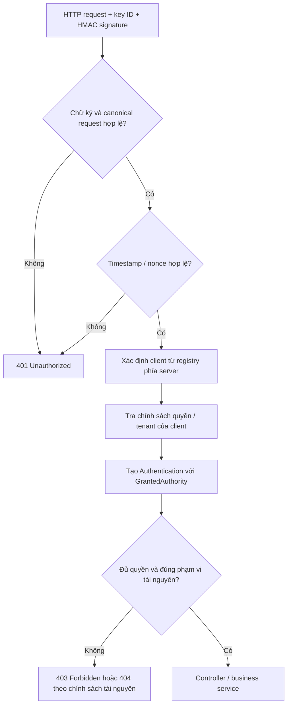

# GrantedAuthority trong Spring Security: quyền của client sau khi xác thực HMAC

## 1. Bối cảnh và mục tiêu

Trong một API tích hợp giữa các hệ thống, client gửi HTTP request kèm chữ ký HMAC được tính từ shared secret và một **canonical request** đã thỏa thuận. Canonical request có thể bao gồm HTTP method, URI, các header được chọn, hash của body, timestamp và nonce. Server kiểm tra chữ ký và cơ chế chống replay để xác định request có đến từ client sở hữu khóa hợp lệ hay không.

**Xác thực thành công chưa có nghĩa client được phép thực hiện mọi thao tác.** Ví dụ, client `partner-reporting` được phép đọc đơn hàng nhưng không được tạo hoặc hủy đơn hàng. Spring Security biểu diễn các quyền đã cấp bằng giao diện `GrantedAuthority`, sau đó dùng chúng để đưa ra quyết định phân quyền ở tầng HTTP hoặc phương thức.

Bài này thuộc chương **Spring Security**, tập trung vào câu hỏi: **`GrantedAuthority` là gì, lấy quyền từ đâu, gắn quyền vào đối tượng `Authentication` như thế nào và dùng quyền đó để bảo vệ API xác thực bằng HMAC ra sao?**

Sau bài học, người học có thể:

- Phân biệt danh tính đã xác thực (`principal`), kết quả xác thực (`Authentication`), quyền (`GrantedAuthority`) và quyết định truy cập.
- Sử dụng `SimpleGrantedAuthority`, `hasAuthority`, `hasRole` và `@PreAuthorize` đúng ngữ nghĩa.
- Thiết kế ánh xạ quyền từ cấu hình đáng tin cậy của server cho client HMAC, kể cả khi có nhiều tenant hoặc xoay vòng khóa.
- Kiểm thử các trường hợp chữ ký sai, replay, thiếu quyền và truy cập chéo tenant.

## 2. `GrantedAuthority` nằm ở đâu trong luồng bảo mật?

Spring Security định nghĩa giao diện:

```java
public interface GrantedAuthority extends java.io.Serializable {
    String getAuthority();
}
```

Đối tượng `GrantedAuthority` biểu diễn **một quyền hoặc vai trò đã được hệ thống cấp** cho một danh tính. Cách cài đặt phổ biến là `SimpleGrantedAuthority`, giữ một chuỗi quyền như `ORDER_READ` hoặc `ROLE_INTEGRATION`.

Các thành phần có trách nhiệm khác nhau:

| Thành phần | Trả lời câu hỏi | Ví dụ ở API HMAC |
| --- | --- | --- |
| HMAC verifier | Request có chữ ký hợp lệ, còn thời hạn và chưa bị replay không? | Kiểm tra signature, timestamp, nonce và canonical request |
| `Principal` | Ai đang gọi API? | `clientId=partner-reporting`, `tenantId=tenant-a` |
| `Authentication` | Danh tính nào đã được xác thực và hiện có những quyền gì? | `isAuthenticated() == true`, danh sách authorities |
| `GrantedAuthority` | Client được cấp những khả năng nào? | `ORDER_READ`, `REPORT_EXPORT` |
| Authorization rule | Thao tác được yêu cầu có phù hợp các quyền và ràng buộc tài nguyên không? | `GET /integrations/orders/42` cần `ORDER_READ` |

Một `Authentication` đã được xác thực thường cung cấp:

```java
Authentication authentication =
        SecurityContextHolder.getContext().getAuthentication();

Object principal = authentication.getPrincipal();
boolean authenticated = authentication.isAuthenticated();
Collection<? extends GrantedAuthority> permissions =
        authentication.getAuthorities();
```

Ở đây, `getAuthorities()` trả về **tập quyền đang được framework dùng để kiểm tra truy cập**, không phải bằng chứng mật mã rằng request đã được ký đúng. Bằng chứng HMAC phải được xác minh **trước khi** tạo `Authentication` đáng tin cậy.



> **Ranh giới tin cậy:** Chỉ đưa authority vào `SecurityContext` sau khi đã xác thực request và lấy chính sách quyền từ nguồn server kiểm soát. Header do client tự khai như `X-Role: ADMIN` hoặc `X-Permissions: ORDER_WRITE` không tự động trở thành quyền, kể cả khi request có chữ ký hợp lệ.

## 3. Quyền cụ thể và vai trò: `hasAuthority` khác `hasRole`

Spring Security không gán ý nghĩa nghiệp vụ đặc biệt cho chuỗi trong `SimpleGrantedAuthority`. Ứng dụng phải thống nhất cách đặt tên và cách đối chiếu quyền.

```java
GrantedAuthority readOrder =
        new SimpleGrantedAuthority("ORDER_READ");
GrantedAuthority integrationRole =
        new SimpleGrantedAuthority("ROLE_INTEGRATION");

System.out.println(readOrder.getAuthority()); // ORDER_READ
```

| Cách khai báo rule | Authority tương ứng cần có | Ý nghĩa |
| --- | --- | --- |
| `hasAuthority("ORDER_READ")` | `ORDER_READ` | So khớp chuỗi quyền trực tiếp |
| `hasAuthority("ROLE_INTEGRATION")` | `ROLE_INTEGRATION` | Vẫn là phép so khớp trực tiếp |
| `hasRole("INTEGRATION")` | `ROLE_INTEGRATION` | Với cấu hình tiền tố mặc định `ROLE_` |
| `hasAnyAuthority("ORDER_READ", "REPORT_EXPORT")` | Có ít nhất một trong hai chuỗi | Điều kiện **hoặc** |
| `hasAnyRole("INTEGRATION", "ADMIN")` | `ROLE_INTEGRATION` hoặc `ROLE_ADMIN` | Điều kiện **hoặc**, dùng tiền tố role mặc định |

**Lỗi thường gặp:** Tạo `new SimpleGrantedAuthority("ADMIN")` nhưng viết `hasRole("ADMIN")`. Với tiền tố role mặc định, rule này tìm `ROLE_ADMIN` nên không khớp. Tương tự, `hasAuthority("ORDER_READ")` không tự thay thế được bằng `hasRole("ORDER_READ")`.

Với API HMAC giữa các dịch vụ, các quyền chi tiết như `ORDER_READ`, `ORDER_CREATE`, `ORDER_CANCEL` thường dễ áp dụng nguyên tắc quyền tối thiểu hơn một role quá rộng như `ROLE_ADMIN`. Role vẫn hữu ích khi cần gom nhiều quyền, nhưng việc ánh xạ role sang quyền phải được định nghĩa rõ trong chính sách server.

## 4. Ví dụ: cấp authority cho client HMAC từ registry của server

Giả sử dịch vụ quản lý đơn hàng cho phép hai đối tác gọi API:

| Client được nhận diện sau HMAC | Tenant được phép | Quyền từ cấu hình server |
| --- | --- | --- |
| `partner-reporting` | `tenant-a` | `ORDER_READ`, `REPORT_EXPORT` |
| `partner-fulfillment` | `tenant-b` | `ORDER_READ`, `ORDER_WRITE` |

Client `partner-reporting` ký hợp lệ request `POST /integrations/orders` vẫn phải bị từ chối vì không có `ORDER_WRITE`. HMAC xác minh **ai gửi request và tính toàn vẹn dữ liệu đã ký**; `GrantedAuthority` phục vụ câu hỏi **người gửi được phép làm gì**.

Một mô hình dữ liệu tối giản:

```java
// Chỉ được tạo bởi verifier sau khi chữ ký và chống replay thành công.
public record VerifiedHmacClient(String clientId, String tenantId) {}

// Danh tính đưa vào SecurityContext.
public record HmacPrincipal(String clientId, String tenantId) {}

// Bản ghi quyền lấy từ kho dữ liệu/cấu hình do server quản lý.
public record ClientAccess(
        String clientId,
        String tenantId,
        Set<String> permissions
) {}

public interface ClientAccessRepository {
    Optional<ClientAccess> findActive(String clientId, String tenantId);
}
```

Factory dưới đây nhận một danh tính **đã xác minh**, kiểm tra client có còn hoạt động và được cấp quyền ở tenant tương ứng hay không, rồi chuyển các quyền thành `GrantedAuthority`:

```java
public final class HmacAuthenticationFactory {
    private final ClientAccessRepository repository;

    public HmacAuthenticationFactory(ClientAccessRepository repository) {
        this.repository = repository;
    }

    public Authentication fromVerified(VerifiedHmacClient verified) {
        ClientAccess access = repository
                .findActive(verified.clientId(), verified.tenantId())
                .orElseThrow(() ->
                        new BadCredentialsException("HMAC client khong hop le"));

        List<GrantedAuthority> authorities = access.permissions()
                .stream()
                .map(permission ->
                        (GrantedAuthority) new SimpleGrantedAuthority(permission))
                .toList();

        HmacPrincipal principal =
                new HmacPrincipal(access.clientId(), access.tenantId());

        return UsernamePasswordAuthenticationToken.authenticated(
                principal, null, authorities);
    }
}
```

Đoạn code giả định các import Java và Spring Security cần thiết đã được thêm. `UsernamePasswordAuthenticationToken.authenticated(...)` là một cách dùng token sẵn có để minh họa việc gắn principal và authorities; hệ thống lớn có thể tạo một `Authentication` chuyên biệt cho HMAC.

Các điều kiện bắt buộc để factory an toàn:

1. `VerifiedHmacClient` chỉ được cấp phát sau khi verifier đã so khớp chữ ký bằng secret đúng, kiểm tra canonical request, giới hạn độ lệch timestamp và chặn nonce đã dùng.
2. `clientId` phải được ràng buộc với key ID/secret hợp lệ; `tenantId` lấy từ thông tin đã được ký hoặc từ registry và **phải** được kiểm tra lại với bản ghi mà server quản lý.
3. `ClientAccessRepository` trả về quyền thực tế của client đang hoạt động. Không lấy `permissions` trực tiếp từ header, query, JSON body hoặc claim chưa được server kiểm soát.
4. Không cấp quyền mặc định ở mức cao nếu không tìm được client, tenant hoặc policy. Trường hợp không hợp lệ phải thất bại đóng (`fail closed`).

Nếu một client dùng nhiều key trong thời kỳ key rotation, mỗi key vẫn phải trỏ tới đúng danh tính và chính sách của nó. Thu hồi key phải chặn xác thực ngay theo cơ chế thu hồi đã thiết kế; việc đổi permission cũng cần vô hiệu hóa cache chính sách cũ đúng thời hạn.

## 5. Đưa `Authentication` vào `SecurityContext` trong luồng filter

Sau khi kiểm tra HMAC thành công và gọi factory, filter có thể thiết lập một `SecurityContext` riêng cho request:

```java
VerifiedHmacClient verified = hmacVerifier.verify(request);
Authentication authentication = authenticationFactory.fromVerified(verified);

SecurityContext context = SecurityContextHolder.createEmptyContext();
context.setAuthentication(authentication);
SecurityContextHolder.setContext(context);

filterChain.doFilter(request, response);
```

Đây là phần cốt lõi của filter, chưa phải lớp filter hoàn chỉnh. `hmacVerifier.verify(request)` ở đây là thành phần do ứng dụng phải cài đặt theo hợp đồng ký; nó cần báo lỗi xác thực nếu signature, timestamp, nonce hoặc payload không đạt yêu cầu. Đặc biệt, body đã đọc để kiểm tra chữ ký phải vẫn dùng được cho controller (ví dụ dùng request wrapper có cache body). Cần quy định chính xác cách chuẩn hóa URI, query, header và body khi có proxy/gateway để client và server ký cùng một chuỗi byte.

Một filter hoàn chỉnh cần bắt lỗi `AuthenticationException` phát sinh ở **giai đoạn xác thực**, xóa context và trả `401` hoặc gọi `AuthenticationEntryPoint`; không để request lỗi tiếp tục như một client đã xác thực. Sau khi xử lý request, context cần được dọn theo vòng đời filter của Spring Security để tránh ảnh hưởng request khác trên cùng thread.

Không gọi `setAuthenticated(true)` trên token hình thành từ dữ liệu chưa được kiểm chứng rồi coi đó là xác thực thành công. Chỉ thành phần xác thực đáng tin cậy mới được phép tạo đối tượng `Authentication` đã xác thực.

## 6. Áp dụng authority ở tầng HTTP

Ví dụ với Spring Security theo kiểu `SecurityFilterChain` và `authorizeHttpRequests` (phong cách Spring Security 6.x):

```java
@Bean
SecurityFilterChain integrationSecurity(
        HttpSecurity http,
        HmacAuthenticationFilter hmacFilter
) throws Exception {
    return http
            .securityMatcher("/integrations/**")
            .csrf(csrf -> csrf.disable())
            .sessionManagement(session -> session
                    .sessionCreationPolicy(SessionCreationPolicy.STATELESS))
            .authorizeHttpRequests(auth -> auth
                    .requestMatchers(HttpMethod.GET, "/integrations/orders/**")
                        .hasAuthority("ORDER_READ")
                    .requestMatchers(HttpMethod.POST, "/integrations/orders/**")
                        .hasAuthority("ORDER_WRITE")
                    .anyRequest().denyAll())
            .addFilterBefore(
                    hmacFilter, UsernamePasswordAuthenticationFilter.class)
            .build();
}
```

Ở đây `HmacAuthenticationFilter` là filter ứng dụng tự cài đặt để chạy verifier, factory và gắn `Authentication` vào `SecurityContext`. Cần đăng ký filter một lần trong security chain; nếu dùng Spring Boot và filter cũng là một servlet `Filter` bean, phải tránh việc nó bị tự động đăng ký thêm ở cấp servlet container. Ví dụ trên chỉ áp dụng cho các request dưới `/integrations/**`; các endpoint còn lại cần cấu hình security chain phù hợp.

Vì đây là ví dụ API máy gọi máy không dựa trên cookie phiên trình duyệt, chain này dùng `STATELESS` và tắt CSRF **trong phạm vi chain đó**. Không áp dụng cấu hình ấy một cách máy móc cho ứng dụng web dùng cookie session.

Các kết quả kỳ vọng:

- `GET /integrations/orders/42` với signature hợp lệ và `ORDER_READ`: có thể qua bước kiểm tra quyền ở HTTP.
- `POST /integrations/orders` với signature hợp lệ nhưng chỉ có `ORDER_READ`: `403 Forbidden`.
- Request có chữ ký sai, timestamp ngoài cửa sổ hoặc nonce đã dùng: `401 Unauthorized` từ bước xác thực.
- Path/method chưa được cấp phép trong chain: bị từ chối vì `anyRequest().denyAll()`.

**Phân biệt mã trạng thái:** `401` thể hiện chưa có xác thực hợp lệ; `403` thể hiện đã xác thực nhưng bị chặn bởi chính sách phân quyền. Endpoint tra tài nguyên có thể chủ động trả `404` để tránh lộ sự tồn tại của tài nguyên khác tenant, nhưng quy tắc phải nhất quán.

## 7. Phân quyền ở tầng phương thức và ràng buộc tenant

Authority thường mới mô tả **loại thao tác**. Đối với hệ thống nhiều tenant, chỉ có `ORDER_READ` vẫn chưa đủ để đọc đơn hàng của tenant khác. Có thể kết hợp method security với kiểm tra ownership trong service:

```java
@Configuration
@EnableMethodSecurity
class MethodSecurityConfiguration {
}

@Service
public class OrderService {
    private final OrderRepository orderRepository;

    public OrderService(OrderRepository orderRepository) {
        this.orderRepository = orderRepository;
    }

    @PreAuthorize("hasAuthority('ORDER_READ')")
    public OrderDto getOrder(String orderId) {
        HmacPrincipal caller = (HmacPrincipal) SecurityContextHolder
                .getContext().getAuthentication().getPrincipal();

        Order order = orderRepository.findByIdAndTenantId(
                        orderId, caller.tenantId())
                .orElseThrow(OrderNotFoundException::new);

        return OrderDto.from(order);
    }
}
```

Các kiểu `OrderRepository`, `OrderDto` và `OrderNotFoundException` là kiểu minh họa của ứng dụng. Điểm then chốt là truy vấn dùng tenant từ **principal đã được server xác minh**, không dùng tenant từ query parameter do client tùy ý nhập. Nên đặt kiểm tra ownership tại lớp service/repository đối với mọi cách gọi vào nghiệp vụ, kể cả khi controller đã có rule.

Nếu `ORDER_READ` chỉ được cấp cho một nhóm tài nguyên nhất định, có thể bổ sung kiểm tra theo đối tượng hoặc sử dụng `AuthorizationManager`/permission evaluator tùy thiết kế. `GrantedAuthority` là dữ liệu đầu vào cho chính sách phân quyền; nó không tự kiểm soát hàng dữ liệu, tenant, thời gian hay trạng thái đối tượng.

## 8. Những sai lầm dễ tạo lỗ hổng

| Sai lầm | Vì sao có vấn đề | Cách xử lý |
| --- | --- | --- |
| Chữ ký hợp lệ thì cấp `ROLE_ADMIN` | Đồng nhất xác thực với toàn quyền truy cập | Tra quyền từ policy đáng tin cậy, cấp tối thiểu |
| Dùng `hasRole("ORDER_READ")` với authority `ORDER_READ` | `hasRole` áp tiền tố `ROLE_` mặc định | Dùng `hasAuthority("ORDER_READ")` |
| Đọc `X-Authorities` từ request rồi đưa vào token | Client có thể tự nâng quyền | Bỏ qua khai báo quyền từ client hoặc chỉ coi là yêu cầu thu hẹp quyền có kiểm tra |
| Dùng tenant từ path/header làm nguồn quyền duy nhất | Client có thể truy cập tài nguyên tenant khác | Gắn tenant với danh tính đã xác minh và lọc dữ liệu theo tenant |
| Không chặn replay vì “chữ ký đã đúng” | Request cũ vẫn có chữ ký đúng | Kiểm tra timestamp, nonce và lưu vết nonce chống dùng lại |
| Cache authority mãi sau khi thu hồi client hoặc đổi policy | Quyền cũ tiếp tục có hiệu lực | Thiết kế TTL/invalidation và kiểm soát phiên bản chính sách |
| Secret hoặc signature xuất hiện trong log | Tăng nguy cơ lộ dữ liệu xác thực | Che thông tin nhạy cảm, log client ID và mã lỗi an toàn |
| Proxy thay đổi URI/header/body trước khi verifier dựng canonical request | Hai đầu ký dữ liệu không giống nhau hoặc xuất hiện vùng không được ký | Định nghĩa canonicalization theo hợp đồng; kiểm thử đường đi qua gateway |
| Chỉ kiểm tra quyền ở controller, bỏ qua service dùng chung | Các đường gọi khác có thể vượt kiểm tra | Bảo vệ các thao tác nghiệp vụ nhạy cảm ở service |

Đặc biệt, **quyền không sửa được một hợp đồng HMAC sai**: nếu method, URI, query, body hoặc header quan trọng không nằm trong phạm vi ký, kẻ tấn công có thể thay đổi phần không được bảo vệ tùy mô hình đe dọa. Phải giải quyết cả tính toàn vẹn request và kiểm tra authorization.

## 9. Bài thực hành: hai client, ba thao tác

Xây một API `/integrations/orders` có ba quyền: `ORDER_READ`, `ORDER_WRITE` và `ORDER_CANCEL`. Cấu hình phía server:

- `partner-reporting` thuộc `tenant-a`, chỉ có `ORDER_READ`.
- `partner-fulfillment` thuộc `tenant-b`, có `ORDER_READ` và `ORDER_WRITE`.
- Không client nào được cấp `ORDER_CANCEL`.

Yêu cầu thực hiện:

1. Tạo dữ liệu policy và ánh xạ `Set<String>` thành `List<GrantedAuthority>` thông qua `SimpleGrantedAuthority`.
2. Sau khi HMAC verifier xác nhận signature, canonical request, timestamp và nonce, tạo `Authentication` có principal và authorities lấy từ policy.
3. Áp `hasAuthority` cho `GET`, `POST` và `DELETE`; với thao tác hủy đơn, yêu cầu `ORDER_CANCEL`.
4. Đảm bảo repository chỉ đọc/ghi đơn hàng thuộc tenant của principal.
5. Thực hiện các ca kiểm thử dưới đây; khẳng định cả HTTP status và việc nghiệp vụ có/không được gọi.

| Kịch bản | Kỳ vọng |
| --- | --- |
| `partner-reporting` ký đúng `GET` của `tenant-a` | Được phép, nếu đơn hàng tồn tại |
| `partner-reporting` ký đúng `POST` | `403`, không tạo đơn hàng |
| `partner-fulfillment` ký đúng `POST` thuộc `tenant-b` | Được phép, nếu dữ liệu hợp lệ |
| Bất kỳ client nào ký đúng `DELETE` | `403` do thiếu `ORDER_CANCEL` |
| Request có HMAC sai | `401`, không gắn authentication hợp lệ |
| Gửi lại cùng request với nonce đã dùng | `401`, không thực hiện nghiệp vụ lần hai |
| Client `tenant-a` yêu cầu đơn thuộc `tenant-b` | Bị từ chối hoặc trả `404` theo chính sách |
| Ký hợp lệ nhưng gửi thêm `X-Role: ADMIN` | Quyền vẫn theo policy của server |
| Thu hồi client/key hoặc bỏ `ORDER_WRITE` khỏi policy | Request tiếp theo không được dùng quyền đã thu hồi theo cơ chế cập nhật chính sách |
| Request đi qua gateway có chuẩn hóa path/query/header | Client và server thống nhất canonical request hoặc từ chối có kiểm soát |

Khi debug, có thể log các trường không bí mật như `clientId`, `tenantId` đã xác minh, endpoint, mã quyết định và tên authority thiếu. Không log shared secret, raw Authorization header, signature đầy đủ, body nhạy cảm hoặc dữ liệu nonce có thể hỗ trợ replay.

## 10. Câu hỏi tự kiểm tra

**1. Tại sao một request HMAC hợp lệ vẫn có thể bị `403`?** Vì xác thực chỉ chứng minh danh tính/tính toàn vẹn theo hợp đồng ký. Request vẫn cần authority phù hợp và thỏa các ràng buộc tài nguyên.

**2. `GrantedAuthority` có phải là role không?** Không nhất thiết. Nó biểu diễn một authority; role thường được mã hóa bằng quy ước chuỗi `ROLE_*`, còn quyền nghiệp vụ có thể là `ORDER_READ` hay `REPORT_EXPORT`.

**3. `getAuthorities()` có tự kiểm tra chữ ký HMAC không?** Không. Nó chỉ trả tập quyền trong đối tượng `Authentication`. Thành phần xác minh chữ ký và chống replay là bước riêng.

**4. Tại sao không lấy danh sách quyền từ JSON request đã ký?** HMAC chứng minh request được bên sở hữu secret gửi và phần dữ liệu được ký chưa bị sửa, nhưng không chứng minh bên đó có quyền **tự cấp quyền**. Policy cấp quyền vẫn thuộc quyền quản lý của server.

**5. Key rotation có nhất thiết đổi authority không?** Không. Key là phương tiện xác thực; authority gắn với client và chính sách có hiệu lực. Nếu mỗi key có phạm vi riêng, registry phải biểu diễn và kiểm tra phạm vi ấy một cách tường minh.

**6. Có `ORDER_READ` là đọc được mọi đơn hàng không?** Không. Quyền cho phép loại thao tác đọc; giới hạn tenant, ownership và trạng thái tài nguyên vẫn phải được kiểm tra.

## 11. Ghi nhớ

`GrantedAuthority` là cách Spring Security mang thông tin **quyền đã cấp** theo `Authentication` để các rule như `hasAuthority`, `hasRole` và `@PreAuthorize` quyết định truy cập. Trong thiết kế HMAC request authentication, luồng đúng là: **xác minh chữ ký và chống replay → xác định client đáng tin cậy → tra policy phía server → tạo `Authentication` chứa authorities → kiểm tra quyền và phạm vi tài nguyên**. Chính sự tách biệt này giúp một shared secret bị lạm dụng hoặc một client chỉ có quyền hạn hẹp không tự động trở thành quyền truy cập mọi API.
