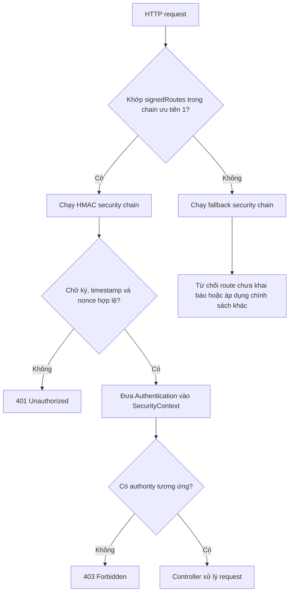

# Request matcher trong Spring Security: xác định chính xác HTTP request cần xác thực HMAC

## 1. Bối cảnh và mục tiêu

Trong module `SECURITY_AUTHENTICATION_HMAC_REQUEST_AUTHENTICATION`, một HTTP client ký request bằng shared secret và server xác minh chữ ký trên **canonical request** đã thỏa thuận (method, URI, những header được ký và/hoặc body). Bên cạnh việc tính toán HMAC đúng, server phải trả lời câu hỏi quan trọng: **request nào bắt buộc đi qua cơ chế HMAC?**

Đó là vai trò của **RequestMatcher** trong Spring Security. Đây là một cơ chế so khớp request để quyết định áp dụng chuỗi filter hoặc quy tắc bảo mật nào. RequestMatcher **không tự kiểm tra chữ ký HMAC** và **không tự cấp quyền truy cập**.

Sau bài học, người học có thể:

- Phân biệt `securityMatcher(...)`, `requestMatchers(...)` và `OncePerRequestFilter.shouldNotFilter(...)`.
- Thiết kế phạm vi endpoint HMAC theo HTTP method, path và, khi cần, đặc điểm khác của request.
- Cấu hình thứ tự `SecurityFilterChain` để request không rơi ra ngoài vùng bảo vệ.
- Kết hợp xác thực HMAC với `Authentication`, `SecurityContext` và kiểm tra authority.
- Viết các kiểm thử cho request hợp lệ, sai chữ ký, sai method, sai path và tình huống qua proxy/gateway.

> **Phạm vi phiên bản:** Ví dụ Java dùng phong cách cấu hình Spring Security 6.x, Spring MVC và Spring Boot 3.x. API matcher cụ thể có thể thay đổi giữa các dòng Spring Security; phải đối chiếu phiên bản dự án khi áp dụng.

## 2. RequestMatcher thực sự làm gì?

`RequestMatcher` là interface có phép kiểm tra gần với ý tưởng sau:

```java
boolean matches(HttpServletRequest request);
```

Kết quả `true` chỉ nói rằng request **thuộc phạm vi** của một matcher. Việc chặn hay cho phép còn phụ thuộc vào thành phần đang sử dụng matcher.

Xem xét API nội bộ:

| HTTP request | Chính sách ví dụ | Vì sao |
| --- | --- | --- |
| `POST /internal/orders` | Bắt buộc HMAC và quyền `ORDERS_CREATE` | Tạo đơn hàng |
| `PUT /internal/orders/42` | Bắt buộc HMAC và quyền `ORDERS_UPDATE` | Sửa đơn hàng |
| `GET /internal/orders` | Không nằm trong nhóm endpoint ký; từ chối theo mặc định | Method chưa được công bố |
| `POST /internal/orders/42` | Từ chối theo mặc định | Khác hợp đồng định tuyến |
| `GET /actuator/health` | Có chính sách riêng nếu muốn công bố | Không phải tác vụ ghi đơn hàng |

Nếu chỉ so khớp `/internal/**` rồi tin rằng mọi đường dẫn dưới đó giống nhau, hệ thống có thể buộc ký cả endpoint public hoặc vô tình bỏ qua kiểm tra method/permission. Vì vậy hợp đồng route phải được xác định rõ trước khi triển khai.

### Ba nơi RequestMatcher xuất hiện

| Vị trí | Câu hỏi được giải quyết | Hệ quả |
| --- | --- | --- |
| `http.securityMatcher(matcher)` | Chuỗi `SecurityFilterChain` này có xử lý request không? | Chọn **một** chuỗi filter phù hợp đầu tiên |
| `authorizeHttpRequests(a -> a.requestMatchers(matcher)...)` | Quy tắc phân quyền nào áp dụng trong chuỗi đã chọn? | Chọn quy tắc ủy quyền theo thứ tự khai báo |
| `OncePerRequestFilter.shouldNotFilter(...)` | Filter tự viết có bỏ qua request này không? | Bỏ qua hoặc chạy **riêng filter đó**, không thay đổi quy tắc ủy quyền |

Ví dụ, `permitAll()` trong cấu hình authorization không bảo đảm custom HMAC filter sẽ ngừng chạy: filter vẫn có thể kiểm tra chữ ký và trả 401 trước khi đến bước cấp quyền. Tương tự, bỏ qua filter bằng `shouldNotFilter(...)` không khiến một route tự động trở thành an toàn.

## 3. Luồng xử lý: chọn chain, xác thực, phân quyền

Spring Security sử dụng `FilterChainProxy` để tìm **SecurityFilterChain đầu tiên** có matcher phù hợp. Chỉ các filter thuộc chain được chọn mới chạy; các chain phía sau không tiếp tục xét cho cùng request.



Hai nguyên tắc quan trọng:

1. **Thứ tự chain là một phần của chính sách bảo mật.** Chain có phạm vi cụ thể nên đứng trước chain tổng quát. Một chain khớp `/**` đặt quá sớm có thể nuốt toàn bộ request trước khi HMAC chain được chọn.
2. **Luôn xác định cách xử lý request không khớp chain nào.** Nếu không có `SecurityFilterChain` phù hợp, Spring Security không áp các filter của nó lên request đó. Một fallback chain với `anyRequest().denyAll()` giúp tránh khoảng trống bảo vệ trong ví dụ API kín.

Trong từng chain, các quy tắc `requestMatchers(...)` của `authorizeHttpRequests` cũng được xét theo thứ tự. Quy tắc cụ thể phải đứng trước quy tắc tổng quát; thường kết thúc bằng `anyRequest().denyAll()` hoặc chính sách tường minh khác.

## 4. Các kiểu matcher và cách chọn

### 4.1. So khớp method kết hợp path

Đối với HTTP API ký HMAC, method là một phần của hợp đồng. `POST /internal/orders` và `GET /internal/orders` là hai request khác nhau, dù cùng path. Có thể dùng overload nhận `HttpMethod` để diễn đạt rõ:

```java
requestMatchers(HttpMethod.POST, "/internal/orders")
requestMatchers(HttpMethod.PUT, "/internal/orders/{id}")
```

Đây là các ví dụ lời gọi trong DSL authorization; ở nơi cần tái sử dụng cùng đối tượng matcher, ta sẽ tạo `MvcRequestMatcher` cụ thể như phần sau.

### 4.2. MVC matcher, path pattern và servlet path

Với Spring MVC, `MvcRequestMatcher` bám theo cách Spring MVC ánh xạ đường dẫn. Điều này hữu ích khi endpoint có path variable như `/internal/orders/{id}`. Một số lưu ý:

- Path dùng để so khớp thường được hiểu theo phạm vi servlet/application, không phải tùy ý nối chuỗi với URL tuyệt đối; phải xem cấu hình context path và servlet path thực tế.
- Nếu `DispatcherServlet` dùng servlet path tùy chỉnh, cấu hình builder/matcher với servlet path tương ứng; nếu không, matcher có thể lệch so với controller.
- `/orders/{id}`, `/orders/*` và `/orders/**` thể hiện độ rộng khác nhau. Không dùng wildcard rộng nếu hợp đồng chỉ cho phép một cấp tài nguyên.
- Cách xử lý slash cuối, ký tự đã mã hóa, dấu chấm phẩy và path bị chuẩn hóa phụ thuộc cơ chế matching, servlet container và firewall. Cần kiểm thử theo đúng stack triển khai.

Trong các phiên bản Spring Security mới hơn, một số ứng dụng dùng `PathPatternRequestMatcher`. Không nên trộn nhiều kiểu matcher với các quy tắc path khác nhau mà chưa kiểm thử hành vi tương ứng.

### 4.3. Tổ hợp matcher

`OrRequestMatcher` phù hợp khi **một** chain HMAC bảo vệ nhiều endpoint được khai báo rõ. `AndRequestMatcher` kết hợp nhiều điều kiện, còn `NegatedRequestMatcher` đảo kết quả.

```java
RequestMatcher signedRoutes = new OrRequestMatcher(
    createOrderMatcher,
    updateOrderMatcher
);
```

Có thể viết matcher dựa trên header hoặc predicate tùy chỉnh, nhưng **không nên dùng sự hiện diện của `X-Signature` làm điều kiện duy nhất để đưa request vào HMAC chain**. Kẻ tấn công chỉ cần bỏ header sẽ khiến request không khớp chain nếu route không được bảo vệ bởi fallback. HMAC route phải được xác định chủ yếu từ **endpoint được bảo vệ**, còn header là dữ liệu để *xác minh*.

## 5. Ví dụ triển khai: chain HMAC dành riêng cho endpoint nội bộ

Giả sử dịch vụ Java công bố hai thao tác:

- `POST /internal/orders`: chỉ client được cấp quyền `ORDERS_CREATE`.
- `PUT /internal/orders/{id}`: chỉ client được cấp quyền `ORDERS_UPDATE`.

HMAC verifier lấy key theo `keyId` do request cung cấp, xác minh canonical request và kiểm tra timestamp/nonce chống replay. Sau khi xác thực, verifier trả về một `Authentication` đã xác thực; authorities được tra từ **thông tin cấp quyền phía server** gắn với key/client, không lấy từ header mà client tự khai báo.

### 5.1. Định nghĩa và tái sử dụng matcher

```java
import org.springframework.context.annotation.Bean;
import org.springframework.context.annotation.Configuration;
import org.springframework.core.annotation.Order;
import org.springframework.http.HttpMethod;
import org.springframework.security.config.annotation.web.builders.HttpSecurity;
import org.springframework.security.config.annotation.web.configurers.AbstractHttpConfigurer;
import org.springframework.security.config.http.SessionCreationPolicy;
import org.springframework.security.web.SecurityFilterChain;
import org.springframework.security.web.authentication.UsernamePasswordAuthenticationFilter;
import org.springframework.security.web.servlet.util.matcher.MvcRequestMatcher;
import org.springframework.security.web.util.matcher.OrRequestMatcher;
import org.springframework.security.web.util.matcher.RequestMatcher;
import org.springframework.web.servlet.handler.HandlerMappingIntrospector;

@Configuration
class HmacSecurityConfiguration {

    record HmacRoutes(
        RequestMatcher create,
        RequestMatcher update,
        RequestMatcher all
    ) {}

    @Bean
    HmacRoutes hmacRoutes(HandlerMappingIntrospector introspector) {
        var mvc = new MvcRequestMatcher.Builder(introspector);

        RequestMatcher create =
            mvc.pattern(HttpMethod.POST, "/internal/orders");
        RequestMatcher update =
            mvc.pattern(HttpMethod.PUT, "/internal/orders/{id}");

        return new HmacRoutes(
            create,
            update,
            new OrRequestMatcher(create, update)
        );
    }

    @Bean
    @Order(1)
    SecurityFilterChain signedEndpointChain(
        HttpSecurity http,
        HmacRoutes routes,
        HmacAuthenticationFilter hmacFilter
    ) throws Exception {
        http
            // Chỉ route đã ký thuộc chain này.
            .securityMatcher(routes.all())
            .sessionManagement(session ->
                session.sessionCreationPolicy(SessionCreationPolicy.STATELESS))
            // API machine-to-machine stateless, không dùng cookie đăng nhập.
            .csrf(AbstractHttpConfigurer::disable)
            .httpBasic(AbstractHttpConfigurer::disable)
            .formLogin(AbstractHttpConfigurer::disable)
            .authorizeHttpRequests(auth -> auth
                .requestMatchers(routes.create())
                    .hasAuthority("ORDERS_CREATE")
                .requestMatchers(routes.update())
                    .hasAuthority("ORDERS_UPDATE")
                .anyRequest().denyAll()
            )
            .addFilterBefore(
                hmacFilter,
                UsernamePasswordAuthenticationFilter.class
            );
        return http.build();
    }

    @Bean
    @Order(2)
    SecurityFilterChain fallbackChain(HttpSecurity http) throws Exception {
        return http
            // Không gọi securityMatcher: chain này là catch-all.
            .authorizeHttpRequests(auth -> auth
                .anyRequest().denyAll())
            .build();
    }
}
```

Đoạn trên minh họa cách phối hợp matcher. Những điểm cần hiểu:

1. Cùng đối tượng `routes.all()` được dùng để chọn chain, còn `routes.create()` và `routes.update()` dùng để phân quyền. Điều này giảm nguy cơ hai nơi khai báo phạm vi khác nhau.
2. `@Order(1)` đứng trước `@Order(2)`; fallback xử lý các request nằm ngoài hợp đồng endpoint ký.
3. HMAC là cơ chế **authentication**; `hasAuthority(...)` là **authorization**. Một client có chữ ký đúng nhưng chỉ được phép tạo đơn hàng vẫn không được sửa đơn hàng.
4. CSRF được tắt **trong chain stateless dành riêng cho machine-to-machine API**. Không suy rộng thao tác này sang các luồng đăng nhập bằng browser/cookie.
5. Trong ứng dụng thực, nếu còn API công khai hoặc endpoint vận hành, hãy thêm chain/quy tắc cụ thể cho chúng trước fallback và kiểm tra thứ tự. Ví dụ này cố ý từ chối mọi route khác.

Lưu ý: nếu ứng dụng có nhiều servlet hoặc mapping đặc biệt, cấu hình matcher theo servlet tương ứng và xác minh lại trên `MockMvc`/môi trường tích hợp. Không sao chép pattern mà chưa xét prefix do gateway và servlet cung cấp.

### 5.2. HMAC filter: nhận diện danh tính, không tự quyết định quyền

Một verifier nên có hợp đồng rõ ràng: chỉ trả về `Authentication` với `isAuthenticated() == true` sau khi **toàn bộ** điều kiện xác thực đã thành công.

```java
import jakarta.servlet.http.HttpServletRequest;
import org.springframework.security.core.Authentication;
import org.springframework.security.core.AuthenticationException;

public interface HmacVerifier {
    Authentication authenticate(HttpServletRequest request)
        throws AuthenticationException;
}
```

Filter đặt kết quả vào `SecurityContext` và trả 401 nếu xác thực thất bại:

```java
import jakarta.servlet.FilterChain;
import jakarta.servlet.ServletException;
import jakarta.servlet.http.HttpServletRequest;
import jakarta.servlet.http.HttpServletResponse;
import java.io.IOException;
import org.springframework.security.core.Authentication;
import org.springframework.security.core.AuthenticationException;
import org.springframework.security.core.context.SecurityContext;
import org.springframework.security.core.context.SecurityContextHolder;
import org.springframework.web.filter.OncePerRequestFilter;

public final class HmacAuthenticationFilter extends OncePerRequestFilter {

    private final HmacVerifier verifier;

    public HmacAuthenticationFilter(HmacVerifier verifier) {
        this.verifier = verifier;
    }

    @Override
    protected void doFilterInternal(
        HttpServletRequest request,
        HttpServletResponse response,
        FilterChain chain
    ) throws ServletException, IOException {
        Authentication authentication;
        try {
            authentication = verifier.authenticate(request);
        } catch (AuthenticationException ex) {
            SecurityContextHolder.clearContext();
            response.sendError(
                HttpServletResponse.SC_UNAUTHORIZED,
                "Invalid HMAC request"
            );
            return;
        }

        SecurityContext context = SecurityContextHolder.createEmptyContext();
        context.setAuthentication(authentication);
        SecurityContextHolder.setContext(context);
        chain.doFilter(request, response);
    }
}
```

Đây là lớp tích hợp, **không phải** hiện thực thuật toán HMAC. Trong `HmacVerifier` thực tế cần thực hiện đầy đủ: xác định key còn hiệu lực, chuẩn hóa canonical request theo hợp đồng chung, tính/xác minh HMAC bằng phép so sánh phù hợp chống rò rỉ thời gian, xác nhận timestamp trong cửa sổ cho phép, và ghi nhận nonce một cách nguyên tử để chặn replay. Nếu các bước này thiếu, có RequestMatcher đúng cũng không tạo ra xác thực an toàn.

Lỗi xác thực nên được xử lý tại filter hoặc qua entry point thích hợp: custom filter nằm trước một số thành phần xử lý exception của Spring Security có thể không được chúng tự động bắt lỗi. Không trả chi tiết như “key nào tồn tại”, chữ ký kỳ vọng hoặc shared secret cho client.

Nếu đăng ký `HmacAuthenticationFilter` dưới dạng Spring bean và đồng thời gắn bằng `addFilterBefore(...)`, Spring Boot có thể tự đăng ký nó như servlet filter chạy ngoài Spring Security chain. Trong trường hợp đó, cần vô hiệu hóa **servlet auto-registration** cho bean filter để tránh thực thi hai lần và chạy trên endpoint ngoài ý muốn:

```java
import org.springframework.boot.web.servlet.FilterRegistrationBean;
import org.springframework.context.annotation.Bean;

@Bean
HmacAuthenticationFilter hmacAuthenticationFilter(HmacVerifier verifier) {
    return new HmacAuthenticationFilter(verifier);
}

@Bean
FilterRegistrationBean<HmacAuthenticationFilter> hmacFilterRegistration(
    HmacAuthenticationFilter filter
) {
    var registration = new FilterRegistrationBean<>(filter);
    registration.setEnabled(false);
    return registration;
}
```

Hai bean cuối có thể khai báo trong cùng class cấu hình ở mục 5.1; chúng được tách ra chỉ để làm rõ vấn đề đăng ký filter.

### 5.3. Khi nào dùng shouldNotFilter?

Nếu hệ thống có **một chain** nhưng HMAC filter chỉ áp dụng cho vài route, có thể dùng cùng `RequestMatcher` bên trong filter:

```java
private final RequestMatcher signedRoutes;

@Override
protected boolean shouldNotFilter(HttpServletRequest request) {
    return !signedRoutes.matches(request);
}
```

Đây là đoạn bổ sung minh họa (cần field và constructor tương ứng). Nó chỉ quyết định filter có chạy hay không. Vẫn phải cấu hình `authorizeHttpRequests` để các endpoint cần ký **đòi hỏi Authentication/authority HMAC**, đồng thời bảo đảm không có cơ chế xác thực khác vô tình vượt qua điều kiện đó. Với chain HMAC riêng ở mục 5.1, `shouldNotFilter` không cần thiết vì `securityMatcher` đã thu hẹp phạm vi toàn chain.

## 6. Đừng nhầm route matcher với canonical request

RequestMatcher dùng để chọn **chính sách bảo vệ**. Canonical request dùng để tạo **thông điệp được ký**. Hai khái niệm liên quan nhưng có quy tắc riêng.

Giả sử client ký:

```text
POST
/internal/orders
include=items&tenant=acme
x-client-id:worker-17
x-request-timestamp:2026-11-28T03:00:00Z
x-request-nonce:6f0a1c...
sha256:<digest-cua-raw-body>
```

Đây chỉ là ví dụ minh họa các trường; trong một giao thức thật phải định nghĩa **chính xác byte**, thứ tự field, ký tự xuống dòng, cách escape/encode URI, quy tắc sắp xếp query, header nào được ký và cách tạo digest. Phía client và server phải cùng thực hiện một hợp đồng canonicalization có phiên bản.

Request `POST /internal/orders?tenant=acme&include=items` vẫn có thể khớp cùng endpoint matcher, nhưng chữ ký chỉ hợp lệ nếu verifier diễn giải và chuẩn hóa query đúng hợp đồng. Không coi query “không quan trọng với router” là “không cần được ký”. Với API có tenant, danh tính tenant trong path/query/body còn cần được **ràng buộc với key/client được cấp quyền**.

### Những điểm dễ lệch khi qua proxy hoặc gateway

| Yếu tố | Tác động đến matcher | Tác động đến chữ ký |
| --- | --- | --- |
| Đổi prefix `/gateway/internal` thành `/internal` | Server có thể chỉ thấy đường dẫn sau rewrite | Client và server phải thống nhất path nào là đối tượng ký |
| Encode `%2F`, dấu `+`, đường dẫn có `..` | Firewall/container có thể từ chối hoặc chuẩn hóa | Ký trên representation khác nhau làm lệch signature, hoặc tạo cách hiểu mơ hồ |
| Context path/servlet path | MVC matcher cần đúng phạm vi | Canonical URI phải theo hợp đồng, không đoán từ pattern |
| Đổi/thêm header ở gateway | Matcher header (nếu có) có thể đổi kết quả | Header nằm trong canonical request phải ổn định |
| Body parser hoặc middleware đọc body trước | Matcher path thường không bị ảnh hưởng | Digest phải dùng đúng byte body; downstream còn phải đọc được body |

Không tin mù quáng các header `X-Forwarded-*` do internet client gửi. Nếu ứng dụng cần dùng thông tin forwarded, chỉ chấp nhận từ proxy đáng tin, cấu hình rõ ràng điểm xác thực và kiểm thử đường đi request thực tế.

Khi verifier đọc request body để tính digest, hãy thiết kế wrapper/buffering phù hợp và có giới hạn dung lượng để controller vẫn đọc được body sau xác thực. `ContentCachingRequestWrapper` không mặc nhiên biến input stream đã tiêu thụ thành stream có thể đọc lại; phải kiểm thử với payload thực.

## 7. Những sai lầm có thể gây bypass

### 7.1. Match theo header “có chữ ký”

```java
// Sai ý tưởng: request không có header sẽ không thuộc HMAC chain.
RequestMatcher wrong = request ->
    request.getHeader("X-Signature") != null;
```

Khi header bị bỏ, route nghiệp vụ có thể chuyển sang chain khác. Quy tắc an toàn là chọn route cần HMAC bằng method/path, rồi yêu cầu verifier bác bỏ request thiếu header. Fallback vẫn phải từ chối những route không có chính sách được công bố.

### 7.2. Dùng permitAll để “bỏ qua filter”

`permitAll()` quyết định **ủy quyền**. Nó không thay đổi việc custom filter chạy trước đó. Nếu một endpoint cần public, hãy đặt nó ngoài HMAC chain, hoặc có quy tắc bỏ qua filter được kiểm soát và kiểm thử đầy đủ.

### 7.3. Có chữ ký hợp lệ nên cấp mọi quyền

Chữ ký hợp lệ chứng minh bên gửi biết secret tương ứng và nội dung được ký không bị thay đổi theo hợp đồng. Nó **không** chứng minh client có quyền sửa mọi order/tenant. `Authentication` phải mang authorities từ server; `requestMatchers(...)` và kiểm tra quyền đối với tài nguyên cụ thể vẫn cần thiết.

### 7.4. Chỉ kiểm path, bỏ HTTP method

Nếu matcher `/internal/orders/**` bảo vệ mọi method, chính sách có thể khó quản lý khi thêm endpoint mới. Nếu matcher chỉ bảo vệ `POST` nhưng controller lại thêm `PATCH` và fallback không chặn, `PATCH` có thể đi vào nhánh thiếu HMAC. Hãy quản lý method/path như một hợp đồng, bổ sung kiểm thử khi route thay đổi.

### 7.5. Dựa vào pattern để chống replay

Matcher không xử lý timestamp, nonce, key rotation, hay so sánh chữ ký. Chống replay cần ghi nhận nonce **nguyên tử** theo key/client, trong khoảng thời gian phù hợp, kể cả khi chạy nhiều instance. Với yêu cầu idempotency, nonce/replay và idempotency key phục vụ mục tiêu khác nhau; không đánh đồng chúng.

### 7.6. Bỏ qua error dispatch, async và đăng ký filter trùng

`OncePerRequestFilter` có quy tắc về dispatch loại async/error và phạm vi “once” theo một lần xử lý. Không nên giả định mọi dispatch đều được ký lại như HTTP request mới. Xác định rõ điểm kiểm tra request gốc, filter registration và hành vi khi xảy ra forward/error trong ứng dụng.

## 8. Kiểm thử RequestMatcher và chính sách HMAC

Cần kiểm cả **route chọn chain nào** lẫn **kết quả xác thực/phân quyền**. `MockMvc` với Spring Security filter chain giúp kiểm tra tầng HTTP; thêm kiểm thử tích hợp sau proxy nếu production có rewrite.

| Tình huống | Matcher/chain mong đợi | Kết quả mong đợi |
| --- | --- | --- |
| `POST /internal/orders`, chữ ký đúng, key có `ORDERS_CREATE` | HMAC chain | Controller xử lý thành công |
| `POST /internal/orders`, thiếu hoặc sai chữ ký | HMAC chain | 401 |
| `POST /internal/orders`, chữ ký đúng nhưng thiếu `ORDERS_CREATE` | HMAC chain | 403 |
| `PUT /internal/orders/42`, chữ ký đúng, có `ORDERS_UPDATE` | HMAC chain | Controller xử lý thành công |
| `PUT /internal/orders/42`, timestamp hết hạn | HMAC chain | 401 |
| Cùng key/nonce được gửi lại trong cửa sổ kiểm tra | HMAC chain | 401 hoặc mã lỗi đã quy ước cho replay |
| `GET /internal/orders` hoặc `PATCH /internal/orders/42` | Fallback chain | Bị từ chối |
| `POST /internal/orders/42` | Fallback chain | Bị từ chối |
| Path có encoding/slash bất thường | Theo firewall và hợp đồng route | Từ chối nếu không được hỗ trợ; không được bypass |
| Request đi qua gateway có rewrite prefix | Đúng chain sau rewrite | Verifier và client vẫn khớp canonical request |

Ví dụ kiểm tra request thiếu chữ ký:

```java
@Test
void createOrderWithoutSignatureIsUnauthorized() throws Exception {
    mockMvc.perform(post("/internal/orders")
            .contentType(MediaType.APPLICATION_JSON)
            .content("{\"sku\":\"A-001\",\"quantity\":1}"))
        .andExpect(status().isUnauthorized());
}
```

Để test này có ý nghĩa, cấu hình test phải nạp **filter chain thực** và sử dụng HMAC verifier từ chối header thiếu. Không dùng `@WithMockUser` để thay thế cho việc kiểm tra chữ ký ở những ca kiểm thử tích hợp HMAC; annotation đó không chứng minh verifier đã chạy. Có thể dùng fake key registry và đồng hồ cố định để tạo signature hợp lệ, kiểm tra replay, và mô phỏng quyền khác nhau giữa các client.

Khi debug, bật logging của Spring Security ở mức phù hợp trong môi trường kiểm thử để quan sát chain/rule nào được chọn. Log các thông tin như HTTP method, route đã chuẩn hóa, keyId đã che bớt, lý do từ chối dạng mã; **không log shared secret, canonical body nhạy cảm hoặc chữ ký kỳ vọng**.

## 9. Quy trình thiết kế áp dụng cho dự án

1. **Lập bảng endpoint** ghi rõ method, path, loại client, bắt buộc HMAC hay không, authority cần có và chính sách mặc định.
2. **Tạo RequestMatcher theo hợp đồng route**, ưu tiên một nguồn khai báo được tái sử dụng để chọn chain và xét quyền.
3. **Xếp chain cụ thể trước chain tổng quát**; có fallback tường minh và test các method/route chưa được hỗ trợ.
4. **Triển khai HMAC verifier độc lập với matcher**: kiểm canonical bytes, key status/rotation, clock skew, timestamp, nonce, body digest và điều kiện replay.
5. **Gắn Authentication đã xác minh với authority phía server**, sau đó kiểm phân quyền ở request matcher và ở tầng dữ liệu khi liên quan tài nguyên/tenant cụ thể.
6. **Kiểm thử ma trận method/path cùng biến thể chữ ký**, gồm qua proxy, URI encoding, request body và các trường hợp 401/403.

**Điểm cần nhớ:** RequestMatcher trả lời “request này đi vào chính sách bảo vệ nào?”, HMAC verifier trả lời “ai gửi request và nội dung ký có hợp lệ không?”, còn authorization trả lời “danh tính đó được phép thực hiện hành động này không?”. Cả ba phải khớp với nhau để tránh route lọt khỏi cơ chế xác thực hoặc bị cấp quyền quá rộng.
