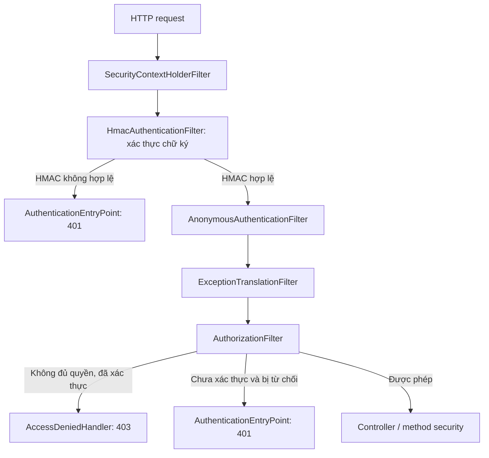

# Exception translation trong Spring Security khi xác thực HTTP request bằng HMAC

## 1. Exception translation giải quyết vấn đề gì?

Trong một API sử dụng HMAC (*Hash-based Message Authentication Code*), client và server có một shared secret, hoặc có những khóa khác nhau được quản lý theo `keyId`. Client ký một **canonical request** theo hợp đồng đã thống nhất; server tái tạo chính xác dữ liệu được ký và kiểm tra chữ ký. Hợp đồng có thể bao gồm HTTP method, URI, các header đã chọn, hash của body, timestamp và nonce. Sau khi xác thực thành công, ứng dụng vẫn phải kiểm tra quyền truy cập tài nguyên.

Một request thất bại có thể thuộc nhiều loại:

- **Chưa xác thực hoặc xác thực thất bại:** thiếu chữ ký, chữ ký không hợp lệ, timestamp ngoài cửa sổ chấp nhận, nonce đã được sử dụng, khóa không còn hiệu lực.
- **Đã xác thực nhưng không đủ quyền:** client có chữ ký hợp lệ nhưng không được đọc báo cáo, ghi dữ liệu hoặc truy cập tài nguyên của tenant khác.
- **Lỗi đầu vào/nghiệp vụ:** JSON sai cú pháp, thiếu trường bắt buộc, tài nguyên không tồn tại.
- **Lỗi hạ tầng:** key store hoặc kho nonce gặp sự cố; việc xác thực không thể được kiểm tra tin cậy.

Nếu tất cả lỗi đều trả về `500`, client không biết cần sửa chữ ký hay xin cấp quyền. Nếu tất cả đều trả về `403`, hệ thống đánh đồng xác thực và phân quyền. Nếu trả chi tiết như “khóa có tồn tại nhưng HMAC lệch ở byte 18”, API làm lộ thông tin không cần thiết.

**Exception translation** là cơ chế chuyển các ngoại lệ bảo mật của Spring Security thành hành động HTTP phù hợp, thường qua hai hợp đồng chính:

| Tình huống | Ngoại lệ/mốc xử lý | Phản hồi thường dùng |
| --- | --- | --- |
| Không có danh tính hợp lệ hoặc xác thực thất bại | `AuthenticationException` | `401 Unauthorized` qua `AuthenticationEntryPoint` |
| Chưa xác thực mà truy cập endpoint yêu cầu quyền | `AccessDeniedException` với principal anonymous | `401 Unauthorized` qua `AuthenticationEntryPoint` |
| Đã xác thực nhưng không đủ quyền | `AccessDeniedException` | `403 Forbidden` qua `AccessDeniedHandler` |
| Request sai định dạng độc lập với việc có quyền hay không | Lỗi validation/parsing | `400 Bad Request` qua lớp xử lý lỗi phù hợp |
| Dịch vụ phụ thuộc ngừng hoạt động | Lỗi vận hành/hạ tầng | Phản hồi `5xx` phù hợp, không biến thành “sai mật khẩu” |

Điểm then chốt: **xác thực trả lời “client là ai?”; phân quyền trả lời “client này được làm gì?”**. Exception translation quyết định cách trình bày thất bại của hai bước đó cho HTTP client; nó không thực hiện phép tính HMAC và không quyết định permission.

## 2. Các thành phần của Spring Security

### 2.1. `AuthenticationException`

`AuthenticationException` là lớp cha cho những thất bại khi nhận diện/xác minh danh tính. Trong một module HMAC, tầng xác thực có thể biểu diễn:

- Thiếu credential hoặc chữ ký sai bằng `BadCredentialsException`.
- Credential hết hiệu lực bằng một loại `AuthenticationException` thích hợp, chẳng hạn `CredentialsExpiredException` khi ngữ nghĩa phù hợp.
- Một ngoại lệ chuyên biệt `InvalidHmacRequestException extends AuthenticationException` nếu cần phân loại nội bộ; response cho bên ngoài vẫn nên thống nhất.

Không nên đưa raw shared secret, canonical request đầy đủ chứa dữ liệu nhạy cảm, chữ ký kỳ vọng hoặc thông tin tồn tại của `keyId` vào message được gửi về client.

### 2.2. `AccessDeniedException`

`AccessDeniedException` biểu diễn quyết định từ chối quyền truy cập. Ví dụ sau khi xác minh HMAC thành công, principal có authority `payments:read` nhưng endpoint yêu cầu `payments:write`.

Đây không phải lỗi tính chữ ký. Thay vì cho client ký lại, hệ thống cần kiểm tra chính sách quyền, scope, mapping client–tenant hoặc cấp quyền của danh tính đã xác thực.

### 2.3. `ExceptionTranslationFilter`

`ExceptionTranslationFilter` là filter thuộc Spring Security, bao quanh phần **phía sau nó** trong filter chain và xử lý các `AuthenticationException` hoặc `AccessDeniedException` phát sinh khi thực thi phần đó.

- Gặp `AuthenticationException`: bắt đầu quá trình xử lý thất bại xác thực bằng `AuthenticationEntryPoint`.
- Gặp `AccessDeniedException`: dùng cơ chế nhận diện anonymous/remember-me của Spring Security để quyết định yêu cầu xác thực lại hay gọi `AccessDeniedHandler`.
- Có thể tương tác `RequestCache` để lưu request trước khi bắt đầu quá trình xác thực; hành vi này hữu ích ở web login nhưng thường không cần cho API HMAC không lưu session.

`ExceptionTranslationFilter` không phải bộ bắt toàn bộ ngoại lệ trong ứng dụng. Nó không biến mọi `RuntimeException` thành `401`, và cũng không tự bắt ngoại lệ phát sinh **trước vị trí của nó** trong chain.

### 2.4. `AuthenticationEntryPoint` và `AccessDeniedHandler`

`AuthenticationEntryPoint` quyết định phản hồi khi cần xác thực: với REST API HMAC, thường là `401` với body JSON ngắn gọn. Theo ngữ nghĩa HTTP authentication, phản hồi `401` nên có `WWW-Authenticate` chứa challenge phù hợp với cơ chế mà API công bố. Nếu dùng scheme riêng như `HMAC`, client/server phải thống nhất cụ thể về scheme đó; đây không phải một scheme HMAC phổ dụng có thể tự suy ra.

`AccessDeniedHandler` quyết định phản hồi khi principal đã có danh tính hợp lệ nhưng bị từ chối quyền: với API, thường là `403`. Tránh redirect sang trang login HTML trong luồng giao tiếp machine-to-machine.

## 3. Vị trí filter quyết định ai bắt được ngoại lệ

Mô hình giản lược cho API dùng filter xác thực HMAC tự viết:



Sơ đồ minh họa đường xử lý logic; Spring Security còn nhiều filter khác và vị trí cụ thể có thể thay đổi theo cấu hình.

Một bẫy thường gặp:

```java
// Ví dụ lỗi: ngoại lệ có thể xuất phát trước ExceptionTranslationFilter.
protected void doFilterInternal(
        HttpServletRequest request,
        HttpServletResponse response,
        FilterChain chain) throws ServletException, IOException {

    if (!verifyHmac(request)) {
        throw new BadCredentialsException("Invalid HMAC");
    }

    chain.doFilter(request, response);
}
```

Nếu filter HMAC được đặt trước `ExceptionTranslationFilter`, ngoại lệ ném ngay tại đây không nằm trong phần chain mà `ExceptionTranslationFilter` bao quanh. Không thể mặc nhiên kỳ vọng filter đó chuyển ngoại lệ thành `401`. Tùy cấu hình, request có thể đi vào servlet error handling và sinh response không thống nhất, thậm chí `500`.

Hai hướng thiết kế hợp lệ là:

1. **Filter xác thực tự xử lý lỗi xác thực:** bắt `AuthenticationException` khi gọi verifier, xóa `SecurityContext`, gọi `AuthenticationEntryPoint`, kết thúc request. Đây là hướng được minh họa ở phần sau.
2. **Đặt logic có thể ném ngoại lệ ở phần được `ExceptionTranslationFilter` bao quanh:** chỉ làm khi đã kiểm tra rõ vị trí, tương tác với `AnonymousAuthenticationFilter` và thứ tự các filter liên quan. Việc thêm filter sau `ExceptionTranslationFilter` chỉ để “được bắt lỗi” có thể làm thay đổi ngữ nghĩa xác thực; cần kiểm thử kỹ.

Các filter tiêu chuẩn như `BasicAuthenticationFilter` và `AbstractAuthenticationProcessingFilter` có cơ chế xử lý xác thực thất bại riêng. Khi xây filter HMAC riêng, phải chủ động chọn cơ chế tương ứng.

## 4. Ví dụ tích hợp thực tế: HMAC filter + phản hồi 401/403

Giả sử hệ thống chỉ bảo vệ `/api/**` theo HMAC. Một thành phần `HmacRequestAuthenticator` thực hiện:

1. Đọc `keyId`, timestamp, nonce và chữ ký theo **một hợp đồng header rõ ràng**.
2. Lấy secret phiên bản hợp lệ, không suy luận khóa từ dữ liệu không đáng tin cậy.
3. Tái tạo canonical request theo quy tắc bất biến về method, URI, header, body và encoding.
4. Kiểm tra cửa sổ thời gian, chữ ký bằng so sánh không phụ thuộc thời gian theo nội dung, và chặn nonce dùng lại bằng thao tác lưu/đánh dấu mang tính nguyên tử.
5. Tạo `Authentication` đã xác thực, chứa principal và authorities phía server đã xác minh.

Đây là giao diện để tách việc xác thực HMAC khỏi trách nhiệm chuyển ngoại lệ. Ví dụ dưới đây tập trung vào Spring Security; phần tính chữ ký, anti-replay và key rotation cần được triển khai theo hợp đồng riêng của module.

```java
@FunctionalInterface
interface HmacRequestAuthenticator {
    Authentication authenticate(HttpServletRequest request)
            throws AuthenticationException;
}
```

Filter chuyển lỗi xác thực đầu vào sang `AuthenticationEntryPoint`, còn lỗi phân quyền của các filter phía sau vẫn để `ExceptionTranslationFilter` xử lý:

```java
final class HmacAuthenticationFilter extends OncePerRequestFilter {
    private final HmacRequestAuthenticator authenticator;
    private final AuthenticationEntryPoint entryPoint;

    HmacAuthenticationFilter(
            HmacRequestAuthenticator authenticator,
            AuthenticationEntryPoint entryPoint) {
        this.authenticator = authenticator;
        this.entryPoint = entryPoint;
    }

    @Override
    protected void doFilterInternal(
            HttpServletRequest request,
            HttpServletResponse response,
            FilterChain chain) throws ServletException, IOException {

        final Authentication authentication;
        try {
            authentication = authenticator.authenticate(request);
            if (authentication == null || !authentication.isAuthenticated()) {
                throw new BadCredentialsException("HMAC authentication failed");
            }
        } catch (AuthenticationException ex) {
            SecurityContextHolder.clearContext();
            entryPoint.commence(request, response, ex);
            return; // Không chạy controller khi chưa xác thực.
        }

        SecurityContext context = SecurityContextHolder.createEmptyContext();
        context.setAuthentication(authentication);
        SecurityContextHolder.setContext(context);

        // Đặt ngoài khối catch để lỗi quyền truy cập phía sau
        // tiếp tục được ExceptionTranslationFilter xử lý.
        chain.doFilter(request, response);
    }
}
```

Lưu ý:

- `authenticator.authenticate()` **phải xác minh** HMAC, timestamp, nonce, key state và principal trước khi trả về một `Authentication` đáng tin cậy. Chỉ kiểm tra `isAuthenticated()` không thay cho các bước đó.
- Không bao `chain.doFilter(...)` trong khối `catch (AuthenticationException)` trên. Khi bắt quá rộng, custom filter có thể vô tình thay thế hành vi của các filter xử lý lỗi phía sau.
- Dùng `SecurityContextHolder.createEmptyContext()` để không chỉnh sửa một context đang chia sẻ. `SecurityContextHolderFilter` sẽ dọn context theo vòng đời request trong cấu hình Spring Security thông thường.
- Nếu endpoint nào dưới `/api/**` cho phép anonymous, phải quy định rõ việc bỏ qua HMAC filter đối với endpoint đó (ví dụ `shouldNotFilter` với `RequestMatcher` tin cậy) hoặc dùng filter chain tách biệt. Ví dụ này yêu cầu HMAC ở toàn bộ `/api/**`.

Cấu hình phản hồi thống nhất. Body dùng định dạng `application/problem+json`, thông điệp trả ra là hằng số để không lộ chi tiết xác minh:

```java
@Configuration
class HmacSecurityConfiguration {

    @Bean
    SecurityFilterChain apiSecurity(
            HttpSecurity http,
            HmacRequestAuthenticator authenticator) throws Exception {

        AuthenticationEntryPoint entryPoint = (request, response, ex) -> {
            response.setStatus(HttpServletResponse.SC_UNAUTHORIZED);
            // Scheme HMAC và realm là một phần hợp đồng API riêng.
            response.setHeader(
                    HttpHeaders.WWW_AUTHENTICATE, "HMAC realm=\"service-api\"");
            response.setContentType(MediaType.APPLICATION_PROBLEM_JSON_VALUE);
            response.setCharacterEncoding(StandardCharsets.UTF_8.name());
            response.getWriter().write("""
                    {"type":"about:blank","title":"Unauthorized","status":401}
                    """);
        };

        AccessDeniedHandler deniedHandler = (request, response, ex) -> {
            response.setStatus(HttpServletResponse.SC_FORBIDDEN);
            response.setContentType(MediaType.APPLICATION_PROBLEM_JSON_VALUE);
            response.setCharacterEncoding(StandardCharsets.UTF_8.name());
            response.getWriter().write("""
                    {"type":"about:blank","title":"Forbidden","status":403}
                    """);
        };

        HmacAuthenticationFilter hmacFilter =
                new HmacAuthenticationFilter(authenticator, entryPoint);

        return http
                .securityMatcher("/api/**")
                .csrf(csrf -> csrf.disable())
                .sessionManagement(session -> session.sessionCreationPolicy(
                        SessionCreationPolicy.STATELESS))
                .requestCache(cache -> cache.requestCache(new NullRequestCache()))
                .exceptionHandling(errors -> errors
                        .authenticationEntryPoint(entryPoint)
                        .accessDeniedHandler(deniedHandler))
                .authorizeHttpRequests(authz -> authz
                        .requestMatchers(HttpMethod.GET, "/api/reports/**")
                            .hasAuthority("reports:read")
                        .anyRequest().authenticated())
                .addFilterBefore(
                        hmacFilter, UsernamePasswordAuthenticationFilter.class)
                .build();
    }
}
```

Các import được lược để tập trung vào luồng xử lý. Các type chính nằm trong `jakarta.servlet.*`, `org.springframework.security.*`, `org.springframework.http.*` và `java.nio.charset.StandardCharsets`. Cấu hình mẫu dành cho Spring Security 6 với namespace Jakarta; `HmacRequestAuthenticator` là thành phần ứng dụng phải cung cấp.

Tắt CSRF trong ví dụ chỉ hợp lý cho API stateless dùng HMAC trong header, không dựa vào cookie của trình duyệt để xác thực. Nếu ứng dụng còn có session/login qua trình duyệt, hãy dùng `SecurityFilterChain` riêng với CSRF phù hợp. `NullRequestCache` tránh việc lưu request để redirect đăng nhập trong luồng API.

Mã trên khởi tạo `HmacAuthenticationFilter` trực tiếp trong security chain. Nếu thay bằng một bean `Filter` do Spring Boot tự đăng ký ở servlet container, cần bảo đảm filter không bị đăng ký chạy hai lần bên ngoài và bên trong Spring Security chain.

## 5. Phân tích chi tiết các nhánh 401 và 403

### Trường hợp A: thiếu chữ ký hoặc signature mismatch

Ví dụ client gửi:

```http
GET /api/reports/42 HTTP/1.1
Host: api.example.test
X-Key-Id: client-a
X-Request-Timestamp: 2026-11-28T03:00:00Z
X-Request-Nonce: nonce-7f3a
X-Signature: <gia-tri-khong-hop-le>
```

Verifier dùng `keyId` để tra đúng secret và phiên bản, tái tạo canonical request, phát hiện chữ ký sai và ném `BadCredentialsException`. Filter bắt lỗi, xóa context, gọi entry point.

Phản hồi ví dụ:

```http
HTTP/1.1 401 Unauthorized
WWW-Authenticate: HMAC realm="service-api"
Content-Type: application/problem+json;charset=UTF-8

{"type":"about:blank","title":"Unauthorized","status":401}
```

Client có thể kiểm tra lại key version, cách dựng method/URI, danh sách header được ký, hash body, charset và timestamp theo đặc tả. Response không nói khóa có tồn tại hay không hoặc bên nào tính ra chữ ký nào.

### Trường hợp B: HMAC hợp lệ nhưng không có permission

Verifier tạo principal `client-a` với authority `reports:summary:read`. Client gọi `GET /api/reports/42`, trong khi cấu hình yêu cầu `reports:read`. `AuthorizationFilter` từ chối, phát sinh `AccessDeniedException`. Khi request đã xác thực, `ExceptionTranslationFilter` chuyển sang `AccessDeniedHandler`, trả:

```http
HTTP/1.1 403 Forbidden
Content-Type: application/problem+json;charset=UTF-8

{"type":"about:blank","title":"Forbidden","status":403}
```

Ký lại cùng request sẽ không sửa được thiếu quyền. Ứng dụng cần cập nhật policy hoặc cách ánh xạ authority, đồng thời duy trì kiểm tra ownership/tenant ở tầng nghiệp vụ hoặc method security.

### Trường hợp C: anonymous bị authorization từ chối

Nếu request đi tới `AuthorizationFilter` mà `SecurityContext` chưa có principal hợp lệ, `AnonymousAuthenticationFilter` có thể gắn anonymous authentication. Khi có `AccessDeniedException`, Spring Security dùng `AuthenticationTrustResolver` để xem đây có phải anonymous/remember-me cần xác thực mạnh hơn không. Nếu cần xác thực, entry point được gọi và thông thường trả `401` trong API này.

Không dùng riêng `authentication.isAuthenticated()` để quyết định “anonymous hay client HMAC hợp lệ”, vì token anonymous trong Spring Security có thể báo `isAuthenticated() == true`. Hãy dựa vào cơ chế trust resolver/authorization tiêu chuẩn và principal do verifier tin cậy tạo ra.

### Trường hợp D: vấn đề xảy ra sau controller

Một lỗi validation request body (`400`), một `404`, hay lỗi hệ thống (`5xx`) không nên tự động được xử lý như `AuthenticationException`. `@ControllerAdvice` và `HandlerExceptionResolver` thường phù hợp với lỗi của Spring MVC; chúng không mặc nhiên bao phủ các ngoại lệ ném ngay tại servlet/security filter trước khi vào MVC.

Nếu dùng method security (`@PreAuthorize`) phát sinh `AccessDeniedException`, kết quả còn phụ thuộc việc ngoại lệ đã được xử lý ở MVC hay được truyền ra security chain. Cần kiểm tra end-to-end rằng mọi vị trí kiểm tra quyền đều trả cùng chính sách `403` hoặc `401`.

## 6. Mapping lỗi HMAC: rõ ràng cho client, kín đáo với attacker

Exception translation phải phản ánh chính sách API đã được định nghĩa trước, đặc biệt với timestamp/nonce, key rotation và multi-client/multi-tenant.

| Điều kiện phát hiện | Phân loại hợp lý | Response công khai | Điều nên ghi trong log bảo mật |
| --- | --- | --- | --- |
| Thiếu credential trên endpoint bắt buộc HMAC | Chưa xác thực | `401` chung | Mã lỗi `missing_credential`, route, request ID |
| Key không xác định, key bị thu hồi hoặc signature mismatch | Xác thực thất bại | `401` chung | Mã lỗi nội bộ tách biệt; không log secret/chữ ký kỳ vọng |
| Timestamp ngoài cửa sổ cho phép | Không đáp ứng yêu cầu freshness | Thường `401` theo hợp đồng HMAC | Delta thời gian đã làm tròn, server clock, request ID |
| Nonce đã dùng trong cùng không gian định danh và thời gian hiệu lực | Replay bị từ chối | Thường `401` theo hợp đồng HMAC | `replay_detected`, key ID đã giảm nhạy cảm, request ID |
| Timestamp/header sai cú pháp | Malformed request hoặc thất bại xác thực, tùy hợp đồng | `400` hoặc `401` nhất quán | Loại lỗi parse; tránh echo dữ liệu nhạy cảm |
| Khóa đúng nhưng principal không có quyền thao tác | Phân quyền | `403` | Principal ID, action, resource/tenant ở mức an toàn |
| Kho lưu nonce không phản hồi, không kiểm chứng được replay | Lỗi dịch vụ | `503`/`5xx` phù hợp; từ chối xử lý an toàn | Trạng thái dependency, trace ID, alert |

Không có quy tắc chung yêu cầu mọi API phải dùng chính xác cùng mã cho timestamp/nonce. Điều cần làm là định nghĩa hợp đồng rõ ràng, phản hồi nhất quán và kiểm thử. Không trả về `200` hoặc cho request đi tiếp khi thiếu khả năng xác minh chữ ký hoặc replay.

Cần phân biệt **khả năng quan sát nội bộ** với **thông tin công khai**: bên ngoài chỉ thấy thông điệp ổn định như “Unauthorized”; log có thể giữ lý do có cấu trúc để vận hành, nhưng phải loại bỏ shared secret, authorization header đầy đủ, canonical body chứa thông tin cá nhân và giá trị chữ ký kỳ vọng. Giới hạn log theo retention và phân quyền đọc.

## 7. Những điểm đặc biệt khi API đi qua gateway hoặc proxy

Một chữ ký HMAC chỉ đúng khi phía ký và phía xác minh thống nhất **chính xác byte hoặc biểu diễn canonical**. Proxy/gateway có thể thay đổi đường dẫn, query string, host, scheme, header hoặc body.

Ví dụ:

- Client ký `/v1/payments?id=7` nhưng gateway rewrite thành `/internal/payments?id=7`; server xác minh URI sau rewrite dù hợp đồng yêu cầu URI gốc.
- Gateway nén/giải nén body, chuẩn hóa whitespace JSON hoặc thay đổi cách encode query; body hash không còn khớp.
- Một header có thể xuất hiện nhiều lần hoặc bị gateway ghép lại; hai bên canonicalize khác nhau.
- Ứng dụng tin trực tiếp `X-Forwarded-*` do client gửi, cho phép thay đổi dữ liệu được dùng để xác minh.

Những lỗi này có thể biểu hiện thành `401` giống chữ ký giả mạo, nhưng nguyên nhân là không tương thích hợp đồng ký. Cần kiểm thử từ client qua **đúng chuỗi proxy/gateway production**, với bộ test vectors cho method, path, query, encoding, header, body và key version. Nếu dùng forwarding header, chỉ tin các giá trị do proxy đã được xác thực và cấu hình tin cậy cung cấp; không lấy header do bất kỳ client nào tự gửi làm nguồn sự thật.

Exception translation chỉ định dạng phản hồi. Nó không thể khôi phục một canonical request đã bị biến đổi nếu hệ thống không bảo toàn thông tin cần thiết.

## 8. Kiểm thử có chủ đích

Dùng `MockMvc` hoặc integration test đi qua security filter chain thực, với verifier giả lập theo từng kịch bản. Các ca tối thiểu:

| Kịch bản | Kết quả cần kiểm tra |
| --- | --- |
| Không có HMAC header | `401`, có challenge nếu hợp đồng yêu cầu; controller không chạy |
| Signature sai hoặc key bị thu hồi | `401`, response không lộ trạng thái key |
| Timestamp quá hạn/ở tương lai ngoài tolerance | `401` hoặc mã theo hợp đồng; controller không chạy |
| Nonce được gửi lại | Request đầu có thể thành công, request lặp bị chặn; không có race khi gửi song song |
| HMAC hợp lệ, đủ quyền | `2xx` phù hợp và principal/authority đúng |
| HMAC hợp lệ, thiếu quyền | `403`; không đổi thành `401` |
| HMAC hợp lệ nhưng tenant không được phép | `403` hoặc chính sách che giấu tài nguyên đã xác định, không đọc chéo tenant |
| Error phát sinh tại custom filter trước ExceptionTranslationFilter | Được entry point xử lý, không thành `500` |
| Error phân quyền do `AuthorizationFilter` | Được denied handler xử lý với response chung |
| Key/nonce dependency hỏng | Fail closed; response vận hành thích hợp, không giả làm HMAC hợp lệ |
| Đường dẫn/headers/body qua proxy thay đổi | Chữ ký được xác minh theo canonicalization đúng hợp đồng |
| Có security chain cho web login bên cạnh HMAC API | CSRF/session/redirect của web không bị cấu hình API ghi đè |

Một ví dụ assertion với Spring Security Test và MockMvc (giả định đã dựng fixture cho verifier và endpoint):

```java
mockMvc.perform(get("/api/reports/42"))
        .andExpect(status().isUnauthorized())
        .andExpect(header().string(
                HttpHeaders.WWW_AUTHENTICATE, "HMAC realm=\"service-api\""))
        .andExpect(content().contentTypeCompatibleWith(
                MediaType.APPLICATION_PROBLEM_JSON));

mockMvc.perform(get("/api/reports/42")
                .header("X-Key-Id", "client-a")
                .header("X-Request-Timestamp", validTimestamp)
                .header("X-Request-Nonce", uniqueNonce)
                .header("X-Signature", validSignatureForClientWithoutPermission))
        .andExpect(status().isForbidden());
```

`validSignatureForClientWithoutPermission` phải là chữ ký được tính đúng theo fixture; gắn một giá trị giả vào header không chứng minh được nhánh `403`. Cần bổ sung test với chữ ký thật hoặc verifier test-double để xác minh principal và authorities được thiết lập trước khi authorization diễn ra.

Đặc biệt kiểm tra **idempotency và replay**: nonce chống phát lại request có chữ ký không đồng nghĩa với idempotency key ở nghiệp vụ. Retry do timeout có thể bị từ chối vì nonce đã sử dụng, dù server đã xử lý request đầu; client cần cơ chế retry và idempotency riêng theo hợp đồng.

## 9. Những sai lầm cần tránh

1. **Cho rằng `ExceptionTranslationFilter` bắt tất cả ngoại lệ ở mọi filter.** Nó chỉ xử lý lỗi trong phạm vi downstream của chính nó. Custom HMAC filter đặt trước phải dùng failure handling rõ ràng.
2. **Luôn trả `403` khi chữ ký sai.** Khi chưa có principal hợp lệ, đây là thất bại xác thực và thông thường cần `401`.
3. **Trả `401` cho principal đã xác thực nhưng thiếu permission.** Điều này khiến client ký lại hoặc thay key không cần thiết; `403` mô tả rõ quyết định phân quyền.
4. **Bắt mọi `Exception` và biến thành `BadCredentialsException`.** Điều đó che lỗi code, lỗi kho khóa, lỗi nonce store hoặc lỗi kết nối; có thể khiến giám sát hiểu nhầm và tạo retry sai.
5. **Tin dữ liệu tenant/role do client tự khai.** HMAC chứng minh quyền sở hữu shared secret cho credential được xác minh; quyền và tenant vẫn phải được ràng buộc với identity/policy phía server.
6. **Trả thông tin HMAC nội bộ về client.** Không lộ secret, expected signature, danh sách key tồn tại, canonical string đầy đủ hoặc nguyên nhân chi tiết của việc khóa bị từ chối.
7. **Bỏ qua thứ tự filter và đăng ký filter hai lần.** Kiểm tra chain thực tế và chỉ đăng ký filter ở nơi được thiết kế.
8. **Dùng cấu hình login/session của web cho HMAC API.** Client machine-to-machine cần status/JSON thống nhất, không nhận `302` redirect login hay lưu request trong session.
9. **Chỉ kiểm thử trực tiếp ứng dụng.** Proxy rewrite, normalize URI/header và những thay đổi body là nguồn lỗi chữ ký phổ biến trong triển khai thật.

## 10. Bài thực hành gợi ý

Xây endpoint `GET /api/reports/{id}`, yêu cầu chữ ký HMAC-SHA256 còn hạn, nonce chưa dùng và authority `reports:read`. Chuẩn hóa phương thức, URI, các header đã ký và body theo hợp đồng đã ghi thành test vectors; cố định thuật toán và key version trong fixture.

Thực hiện lần lượt:

1. Gửi request thiếu `X-Signature` và request với HMAC sai: nhận `401`, body problem JSON và không vào controller.
2. Gửi HMAC đúng cho client chỉ có `reports:summary:read`: nhận `403`.
3. Gửi HMAC đúng với `reports:read`: nhận dữ liệu `200`, principal/tenant khớp thông tin server.
4. Phát lại cùng timestamp/nonce: nhận phản hồi từ chối theo hợp đồng, ngay cả khi gửi hai request song song.
5. Giả lập proxy đổi path/header hoặc body: xác định chính xác quy tắc canonicalization gây lệch chữ ký.
6. Giả lập kho nonce không hoạt động: hệ thống từ chối xử lý an toàn, có log/metric đầy đủ và không tạo ra phản hồi đánh lừa rằng mật khẩu sai.

**Tiêu chí đạt:** lỗi xác thực đi tới `AuthenticationEntryPoint`, lỗi phân quyền đi tới `AccessDeniedHandler`, mapping `401/403` nhất quán, không tiết lộ dữ liệu nhạy cảm, và không có request HMAC chưa xác minh nào đi tới business handler. Khi đó exception translation hoàn thành vai trò của nó trong Spring Security, phối hợp với xác thực HMAC và kiểm soát quyền truy cập nhưng không thay thế hai cơ chế này.
