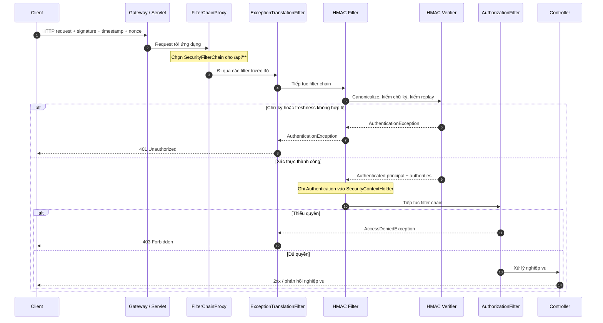

# Luồng Spring Security trong xác thực HTTP request bằng HMAC

## 1. Mục tiêu và bối cảnh

Trong chương **Spring Security**, bài **Luồng Spring Security** giải thích cách một HTTP request đi qua hệ thống filter của Spring Security trước khi tới controller, cách ứng dụng xác thực request bằng **HMAC với shared secret**, và cách kết quả xác thực trở thành danh tính để hệ thống thực thi phân quyền.

Với mô-đun `SECURITY_AUTHENTICATION_HMAC_REQUEST_AUTHENTICATION`, hai bên gửi và nhận request chia sẻ khóa bí mật; client tạo chữ ký từ một **canonical request** theo hợp đồng thống nhất (HTTP method, URI, các header được chọn và/hoặc body), còn server tái tạo chính xác dữ liệu được ký để kiểm tra chữ ký. Luồng còn phải kiểm soát `timestamp`/`nonce` để chống replay, xử lý thay khóa và hoạt động nhất quán khi request đi qua proxy/gateway.

Sau bài này, người học cần:

- Mô tả đường đi từ Servlet container qua `FilterChainProxy`, `SecurityFilterChain`, `SecurityContextHolder` và `AuthorizationFilter` tới controller.
- Đặt điểm kiểm tra HMAC đúng vị trí; phân biệt lỗi xác thực (`401`) và lỗi thiếu quyền (`403`).
- Hiểu dữ liệu cần đưa vào chữ ký, cách xác thực an toàn và vị trí của chống replay trong luồng.
- Tách việc xác thực danh tính client khỏi quyết định client có được gọi tài nguyên hay không.
- Kiểm thử luồng trên request hợp lệ, request bị sửa đổi, request phát lại, nhiều key và các cấu hình proxy/gateway.

## 2. Request đi qua Spring Security như thế nào?

Ứng dụng Spring MVC chạy trên Servlet container (ví dụ Tomcat). Container gọi chuỗi Servlet filter trước khi chuyển request vào `DispatcherServlet`. Spring Security cung cấp `DelegatingFilterProxy` để ủy quyền cho `FilterChainProxy`; đối tượng này chọn **một `SecurityFilterChain` đầu tiên khớp request** trong các chain đã cấu hình.

Các thành phần có vai trò khác nhau:

| Thành phần | Vai trò trong luồng |
| --- | --- |
| `DelegatingFilterProxy` | Cầu nối từ Servlet container đến các Spring Security bean. |
| `FilterChainProxy` | Chọn `SecurityFilterChain` phù hợp và thực thi các security filter theo thứ tự. |
| `SecurityContextHolderFilter` | Thiết lập ngữ cảnh bảo mật cho lần xử lý request và dọn dẹp ngữ cảnh sau khi kết thúc. |
| **HMAC authentication filter** do ứng dụng viết | Thu thập thông tin đã ký, kích hoạt xác minh HMAC và đặt kết quả xác thực vào security context. |
| `AuthenticationManager` / `AuthenticationProvider` (khi sử dụng) | Cơ chế mở rộng của Spring Security để chuyển thông tin xác thực chưa tin cậy thành `Authentication` đã được xác minh. |
| `SecurityContextHolder` | Cung cấp `SecurityContext` chứa `Authentication` của request hiện hành. |
| `ExceptionTranslationFilter` | Chuyển `AuthenticationException` / `AccessDeniedException` từ các filter chạy phía sau thành phản hồi bảo mật tương ứng. |
| `AuthorizationFilter` | Đánh giá quy tắc truy cập: authenticated, authority, role hoặc policy theo tài nguyên. |
| `DispatcherServlet` / controller | Xử lý nghiệp vụ sau khi request vượt qua các kiểm tra ở security chain. |

Luồng khái niệm cho một API chỉ chấp nhận HMAC:



Sơ đồ rút gọn các filter khác, chẳng hạn `CorsFilter`, `HeaderWriterFilter` hay `AnonymousAuthenticationFilter`. Thứ tự cụ thể phụ thuộc cấu hình và phiên bản Spring Security. Điểm quan trọng: nếu muốn `ExceptionTranslationFilter` bắt lỗi do HMAC filter ném ra, HMAC filter cần nằm **phía sau `ExceptionTranslationFilter` và phía trước `AuthorizationFilter`**.

## 3. Thiết kế hợp đồng ký trước khi viết filter

HMAC chỉ có ý nghĩa khi client và server tính MAC trên **cùng một chuỗi byte**. Hai bên phải thống nhất phiên bản hợp đồng ký, charset (thường là UTF-8), thuật toán (ví dụ HmacSHA256), cách ghép dòng, cách biểu diễn URI/query, các header bắt buộc, chuẩn hóa giá trị và cách đưa body vào phép ký.

Ví dụ minh họa một hợp đồng tự định nghĩa `HMAC-V1`:

```text
HMAC-V1
POST
/api/orders?item=123
x-client-id:client-42
x-key-id:key-2026-11
x-timestamp:2026-11-28T03:00:00Z
x-nonce:8c74d1d2-4a42-48e9-991e-a311ec24fd71
body-sha256:<64 ký tự hex của SHA-256 trên byte body gốc>
```

Client gửi các trường `X-Client-Id`, `X-Key-Id`, `X-Timestamp`, `X-Nonce` và `X-Signature` (chữ ký được mã hóa Base64/hex theo hợp đồng). `X-Signature` không tự xuất hiện trong canonical request để tránh phụ thuộc vòng. Client tính:

```text
canonicalBytes = UTF8(canonicalRequest)
mac = HMAC_SHA256(sharedSecretForKeyId, canonicalBytes)
signature = Base64(mac)
```

Đây là **ví dụ hợp đồng**, không phải định dạng tiêu chuẩn do Spring Security tự cung cấp. Hệ thống thực tế phải quyết định rõ:

1. URI được ký là raw path + raw query theo thứ tự client gửi, hay query được sort và percent-encode theo một thuật toán xác định. Không được tùy tiện trộn hai cách.
2. Header name có thể được chuẩn hóa sang chữ thường; quy tắc gộp khoảng trắng, header trùng tên, header nhiều giá trị phải giống nhau ở hai phía.
3. Body hash tính trên **byte được truyền theo hợp đồng ký**, trước mọi bước parse JSON hoặc chuyển đổi charset có thể làm thay đổi byte. JSON có cùng ý nghĩa nhưng khác dấu cách vẫn có hash khác.
4. Client ID, key ID, tenant ID (nếu có), timestamp và nonce phải được ràng buộc mật mã với chữ ký. Không dựa vào header danh tính chưa ký để cấp quyền.
5. Phiên bản canonicalization và thuật toán phải được định nghĩa rõ; không tự động fallback sang phiên bản yếu hơn khi xác minh thất bại.

HMAC bảo đảm tính toàn vẹn và chứng minh bên gửi biết shared secret trong phạm vi hợp đồng ký. HMAC **không mã hóa nội dung**, vì vậy vẫn cần HTTPS và bảo vệ khóa bí mật.

## 4. Luồng xác thực HMAC từ góc nhìn server

Một verifier đáng tin cậy nên thực hiện theo thứ tự có kiểm soát:

1. **Kiểm tra hình thức request.** Yêu cầu đầy đủ các trường bắt buộc, giới hạn kích thước header/body, kiểm tra định dạng timestamp, nonce và signature; từ chối trường mơ hồ hoặc trùng gây khác cách diễn giải.
2. **Xác định key một cách có ràng buộc.** Tra `keyId` trong kho credential thuộc client/tenant hợp lệ, lấy trạng thái và khoảng hiệu lực. Không tin client ID/tenant ID chỉ vì client tự khai báo.
3. **Kiểm tra cửa sổ thời gian.** Chuyển timestamp sang một mốc thời gian thống nhất (UTC), áp dụng ngưỡng lệch đồng hồ có giới hạn, đồng thời từ chối timestamp quá xa trong tương lai.
4. **Tái tạo canonical bytes.** Dùng đúng method, URI, header và raw body theo hợp đồng đã công bố; tính body digest trên byte gốc.
5. **Xác minh chữ ký.** Tính HMAC bằng key đã chọn, decode chữ ký đúng định dạng và so sánh byte theo cách chống rò rỉ thời gian (ví dụ `MessageDigest.isEqual`); không so sánh chuỗi bí mật bằng `String.equals`.
6. **Chặn replay bằng thao tác nguyên tử.** Sau khi chữ ký hợp lệ, ghi dấu `(tenant/client, keyId, nonce)` vào kho dùng chung với TTL phù hợp. Chỉ request đầu tiên đặt được key mới qua. Một thao tác “kiểm tra rồi mới ghi” tách rời có thể bị race condition.
7. **Tạo `Authentication` đã xác thực.** Principal là client/service xác định từ credential server-side; authorities/permissions được lấy từ chính sách tin cậy của server. Đặt `Authentication` vào một `SecurityContext` mới.
8. **Chuyển sang phân quyền.** Gọi `FilterChain.doFilter` để `AuthorizationFilter` và các thành phần phía sau xử lý request.

Ví dụ lưu replay key trong kho dùng chung như Redis có thể dùng thao tác nguyên tử tương đương `SET replay:<client>:<keyId>:<nonce> 1 NX PX <ttlMillis>`. TTL phải bao phủ cửa sổ chấp nhận timestamp và phần lệch thời gian đã tính; tất cả node xử lý request phải chia sẻ cùng trạng thái. Nếu kho replay không hoạt động, cần chính sách **fail closed** cho endpoint có yêu cầu chống replay, thay vì bỏ qua kiểm tra.

Một nonce mới và timestamp nằm trong cửa sổ hợp lệ **chưa đủ** để chứng minh request hợp lệ: server vẫn phải xác minh HMAC. Chỉ đánh dấu nonce đã dùng sau khi chữ ký hợp lệ để giảm khả năng kẻ tấn công làm cạn kho bằng request giả.

## 5. Gắn HMAC vào `SecurityFilterChain`

Đoạn dưới minh họa cấu hình Spring Security theo phong cách hiện đại (Java DSL). `HmacAuthenticationFilter`, `HmacVerifier` và `BufferedBodyRequest` là **các lớp ứng dụng cần tự triển khai**; đây là ví dụ về cách phối hợp thành phần, chưa phải mã đầy đủ có thể chạy ngay.

```java
@Configuration
@EnableWebSecurity
class ApiSecurityConfig {

    @Bean
    @Order(1)
    SecurityFilterChain hmacApi(HttpSecurity http, HmacVerifier verifier)
            throws Exception {

        http
            .securityMatcher("/api/**")
            .sessionManagement(session -> session
                .sessionCreationPolicy(SessionCreationPolicy.STATELESS))
            // Chỉ phù hợp khi chain này dùng HMAC, không dùng cookie
            // trình duyệt để xác thực các thao tác thay đổi trạng thái.
            .csrf(AbstractHttpConfigurer::disable)
            .httpBasic(AbstractHttpConfigurer::disable)
            .formLogin(AbstractHttpConfigurer::disable)
            .exceptionHandling(errors -> errors
                .authenticationEntryPoint((req, res, ex) ->
                    res.sendError(HttpServletResponse.SC_UNAUTHORIZED))
                .accessDeniedHandler((req, res, ex) ->
                    res.sendError(HttpServletResponse.SC_FORBIDDEN)))
            .authorizeHttpRequests(auth -> auth
                .requestMatchers(HttpMethod.POST, "/api/orders/**")
                    .hasAuthority("orders:write")
                .anyRequest().authenticated())
            // Chạy sau ExceptionTranslationFilter, trước AuthorizationFilter.
            .addFilterBefore(
                new HmacAuthenticationFilter(verifier),
                AuthorizationFilter.class
            );

        return http.build();
    }
}
```

`securityMatcher("/api/**")` dùng để **chọn chain**. Ngược lại, `requestMatchers(...)` bên trong `authorizeHttpRequests` dùng để **chọn quy tắc phân quyền** của chain đã được chọn. Nếu ứng dụng có nhiều `SecurityFilterChain`, `@Order` và phạm vi `securityMatcher` phải được kiểm tra để request không rơi vào chain không mong muốn. Ví dụ chain dành cho giao diện web có cookie/CSRF nên được cấu hình riêng.

Ví dụ logic filter:

```java
final class HmacAuthenticationFilter extends OncePerRequestFilter {

    private static final int MAX_BODY_BYTES = 1024 * 1024;
    private final HmacVerifier verifier;

    HmacAuthenticationFilter(HmacVerifier verifier) {
        this.verifier = verifier;
    }

    @Override
    protected void doFilterInternal(
            HttpServletRequest request,
            HttpServletResponse response,
            FilterChain filterChain) throws ServletException, IOException {

        // Lớp ứng dụng tự viết: đọc byte body có giới hạn,
        // đồng thời cho controller đọc lại được body đó.
        HttpServletRequest replayable =
            BufferedBodyRequest.wrap(request, MAX_BODY_BYTES);

        // Bắt buộc kiểm signature, freshness, nonce và key state.
        // Khi sai, ném AuthenticationException thích hợp.
        // Chỉ trả về Authentication đã xác thực khi tất cả đều PASS.
        Authentication verified = verifier.authenticate(replayable);

        if (verified == null || !verified.isAuthenticated()) {
            throw new BadCredentialsException("Invalid HMAC credentials");
        }

        SecurityContext context =
            SecurityContextHolder.createEmptyContext();
        context.setAuthentication(verified);
        SecurityContextHolder.setContext(context);

        filterChain.doFilter(replayable, response);
    }
}
```

Các nguyên tắc khi hoàn thiện ví dụ:

- `verifier.authenticate` không phải API mặc định của Spring; ứng dụng phải viết phần truy xuất key, canonicalization, HMAC, timestamp/nonce và mapping principal/authorities. Với kiến trúc có nhiều kiểu xác thực, có thể tách thành `AuthenticationManager` + `AuthenticationProvider` và để filter gọi `authenticate(...)`; provider chỉ tạo token đã xác thực sau khi qua toàn bộ bước kiểm tra.
- `BufferedBodyRequest` phải giới hạn byte đầu vào và cung cấp `getInputStream()`/`getReader()` cho downstream. `ContentCachingRequestWrapper` đơn thuần **không tự làm cho body đã bị filter đọc trở nên đọc lại được**. Nếu payload lớn hoặc streaming, cần giải pháp đọc/hash và lưu tạm có kiểm soát, cùng chính sách từ chối vượt ngưỡng (`413`).
- Đoạn code dùng `new HmacAuthenticationFilter(...)` trong chain để tránh vô tình đăng ký cùng filter hai lần. Nếu đăng ký filter như Servlet `Filter` bean riêng, phải kiểm soát cơ chế auto-registration (ví dụ `FilterRegistrationBean` disable) để filter chỉ chạy tại vị trí mong muốn.
- Không đưa raw shared secret, body chứa thông tin nhạy cảm hay chữ ký vào `Authentication` được lưu trong context. Authorities phải xuất phát từ dữ liệu server đã xác minh.
- Dùng `SessionCreationPolicy.STATELESS` để ứng dụng không dựa vào `HttpSession` lưu security context cho API này. Spring Security quản lý việc dọn `SecurityContextHolder` ở cuối request; không dùng biến tĩnh để lưu principal giữa các request.

### Vị trí filter và xử lý ngoại lệ

Spring Security chỉ dịch `AuthenticationException`/`AccessDeniedException` thành lỗi HTTP thông qua `ExceptionTranslationFilter` khi ngoại lệ được ném ra từ **phần chain mà filter này bao quanh**. Nếu chèn HMAC filter ở phía trước `ExceptionTranslationFilter` (chẳng hạn trước `UsernamePasswordAuthenticationFilter` trong nhiều cấu hình thông thường), ngoại lệ ném trực tiếp từ HMAC filter có thể **không được `ExceptionTranslationFilter` bắt**.

Có hai cách nhất quán:

- Đặt HMAC filter phía sau `ExceptionTranslationFilter` và trước `AuthorizationFilter` như ví dụ, rồi ném `AuthenticationException` để entry point xử lý.
- Nếu buộc phải chạy sớm hơn vì yêu cầu kỹ thuật, tự bắt lỗi ở filter và gọi `AuthenticationEntryPoint` một cách nhất quán; không vừa ghi response vừa ném lỗi khiến xử lý lặp.

Sau khi HMAC thành công, `AuthorizationFilter` vẫn phải kiểm tra quyền, chẳng hạn `orders:write` cho một endpoint tạo đơn hàng. Authentication có thể thành công nhưng request vẫn bị từ chối vì thiếu quyền.

## 6. Phân biệt xác thực, phân quyền và phản hồi lỗi

| Tình huống | Tầng phát hiện | Phản hồi thường dùng |
| --- | --- | --- |
| Thiếu `X-Signature` hoặc không nhận diện credential hợp lệ | HMAC verifier / authentication filter | `401 Unauthorized` |
| Signature sai, timestamp ngoài cửa sổ, nonce đã dùng | HMAC verifier | `401 Unauthorized` |
| HMAC đúng, principal không có `orders:write` | `AuthorizationFilter` hoặc policy tương đương | `403 Forbidden` |
| Request xác thực thành công nhưng JSON nghiệp vụ sai | Controller / validation | `400 Bad Request` |
| Body vượt giới hạn cấu hình | Lớp đọc request/body | `413 Content Too Large` |
| Hệ thống replay store lỗi và không thể bảo đảm chống replay | Tầng xác thực / hạ tầng | Từ chối theo chính sách fail closed; có thể ánh xạ thành `503 Service Unavailable` |

Không tiết lộ client ID có tồn tại, key đã hết hạn hay chữ ký kỳ vọng trong phản hồi. Trả mã lỗi và message ổn định, còn log nội bộ có thể ghi mã nguyên nhân không nhạy cảm như `HMAC_SIGNATURE_INVALID`, `HMAC_TIMESTAMP_EXPIRED`, `HMAC_NONCE_REPLAY`, `HMAC_KEY_DISABLED`.

## 7. Multi-client, multi-tenant, key rotation và gateway

**Multi-client / multi-tenant.** Không dùng key ID như một mã định danh toàn cục không kiểm soát phạm vi. Ánh xạ credential theo chủ sở hữu server-side; xác minh rằng client đang dùng đúng key được cấp cho client/tenant đó. Nếu tenant xuất hiện trong URI/header, trường này cần được ký theo hợp đồng và khớp với tenant gắn với credential. Chống replay cần có namespace thích hợp để tránh va chạm và ngăn dùng nonce ở sai phạm vi.

**Key rotation.** Credential nên có `keyId`, phiên bản/thuật toán, trạng thái (`ACTIVE`, `VERIFY_ONLY`, `REVOKED`), thời điểm hiệu lực và thời điểm hết hiệu lực. Client ký bằng key hiện hành; server có thể xác minh bằng key cũ trong khoảng chuyển tiếp cho phép. Hết khoảng chuyển tiếp thì từ chối key cũ. Không “thử lần lượt mọi secret của mọi tenant” để tìm chữ ký khớp; lookup key phải có phạm vi rõ ràng và log/audit được việc dùng key cũ.

**Proxy/gateway.** Client ký vào địa chỉ mà client nhìn thấy, nhưng Spring có thể nhận method/path/query/header sau khi proxy rewrite. Cần thỏa thuận tầng nào là nguồn chân lý của canonical request: gateway xác minh trực tiếp trước rewrite, hoặc gateway truyền dữ liệu đã chuẩn hóa qua đường tin cậy, hoặc proxy được cấu hình bảo toàn các thành phần được ký. Chỉ tin `Forwarded`/`X-Forwarded-*` từ proxy đã được xác thực và nằm trong trust boundary; không chấp nhận các header này do client bất kỳ tự gắn. Kiểm thử các tình huống thay đổi prefix, percent-encoding, thứ tự query, duplicate header, lowercase header và body transformation.

**CSRF/CORS.** Trong API máy-gọi-máy stateless xác thực bằng HMAC header, có thể vô hiệu hóa CSRF theo phạm vi chain. Nếu cùng endpoint dựa vào cookie/session trình duyệt, phải đánh giá CSRF theo cơ chế đó. CORS không thay thế xác thực HMAC: CORS là chính sách của trình duyệt, còn service khác vẫn có thể gọi HTTP trực tiếp.

**Async/error dispatch.** `OncePerRequestFilter` có các cơ chế liên quan đến ASYNC/ERROR dispatch. Khi ứng dụng dùng async processing hoặc error dispatch, hãy kiểm tra filter có chạy lại hay không và tránh tiêu thụ nonce lần thứ hai cho cùng một lần xử lý logic; đồng thời bảo đảm `SecurityContext` được truyền và dọn đúng với mô hình async được chọn.

## 8. Ví dụ thực tế: client tạo đơn hàng

Giả sử service `client-42` có quyền `orders:write` và cần gửi `POST /api/orders?item=123` với body JSON. Client tạo hash body, canonicalize request, gắn timestamp/nonce mới, chọn `keyId` hiện hành rồi gửi chữ ký HMAC. Server chọn chain `/api/**`, tái tạo canonical bytes, xác minh key và MAC, kiểm tra timestamp, ghi nonce nguyên tử, sau đó tạo principal `client-42` với authority `orders:write`. `AuthorizationFilter` cho request vào controller để tạo đơn hàng.

Nếu một trung gian sửa `item=123` thành `item=999` hoặc sửa một byte của body đã ký, chữ ký không còn đúng và server trả `401`. Nếu cùng một request hoàn toàn hợp lệ bị gửi lại trong cửa sổ thời gian, nonce đã tồn tại trong replay store và request cũng bị từ chối. Nếu client ký đúng nhưng chỉ có quyền `orders:read`, xác thực thành công song phân quyền trả `403`.

Quá trình này minh họa ba kết quả độc lập: **signature đúng**, **request còn mới/chưa được dùng** và **client có quyền**. Chỉ khi cả ba điều kiện phù hợp, controller mới được phép thực hiện thao tác được bảo vệ.

## 9. Kiểm thử và quan sát luồng

| Nhóm kiểm thử | Kỳ vọng |
| --- | --- |
| Happy path | Signature, timestamp và nonce hợp lệ; trả kết quả nghiệp vụ khi đủ quyền. |
| Toàn vẹn | Đổi method, path/query, header được ký hoặc một byte body làm xác thực thất bại. |
| Canonicalization | Header khác chữ hoa/thường, query có ký tự percent-encode, khoảng trắng, duplicate header được xử lý đúng hợp đồng. |
| Replay | Gửi hai request cùng nonce, kể cả gần như đồng thời trên hai node; tối đa một request được chấp nhận. |
| Đồng hồ | Timestamp cũ, quá xa tương lai, đúng sát biên thời gian được xử lý nhất quán. |
| Key lifecycle | Key hiện hành hợp lệ, key chuyển tiếp chỉ có hiệu lực trong cửa sổ quy định, key bị revoke luôn bị từ chối. |
| Tenant/client isolation | Key của tenant A không thể được dùng để mạo danh tenant B. |
| Authorization | Signature đúng nhưng thiếu quyền trả `403`; signature sai trả `401`. |
| Body và proxy | Controller vẫn đọc được body; gateway rewrite/truyền header không khiến hai bên ký khác bytes một cách âm thầm. |
| Filter chain và dispatch | Request đi đúng chain một lần, không đăng ký filter lặp; ASYNC/ERROR không gây xác minh replay ngoài ý muốn. |
| Failure mode | Replay store gặp sự cố thì request không được phép đi qua nếu yêu cầu chống replay bắt buộc. |

Trong quan sát vận hành, ghi metric số lần xác thực thành công/thất bại theo **nhóm nguyên nhân** và latency của key lookup/replay store. Dùng request correlation ID, che signature, shared secret, nonce chi tiết và body nhạy cảm; tránh gắn client ID/nonce vào nhãn metric có cardinality cao. Có thể bật log debug của Spring Security trong môi trường kiểm thử để quan sát chain được chọn và thứ tự filter, nhưng phải tắt log quá chi tiết ở môi trường chứa dữ liệu thật.

## 10. Những lỗi thiết kế thường gặp

1. **Chỉ kiểm chữ ký mà bỏ replay.** Request hợp lệ có thể bị gửi lại nhiều lần trong khoảng thời gian signature còn dùng được.
2. **Ký đối tượng JSON đã parse.** Client và server có thể serialize khác nhau; phải thống nhất ký raw bytes hoặc một chuẩn canonical JSON chính thức.
3. **Đọc body một lần trong filter rồi để controller đọc tiếp.** Controller nhận body rỗng nếu không có request wrapper thực sự hỗ trợ đọc lại.
4. **Đánh đồng `authenticated` với đủ quyền.** HMAC chứng minh client biết secret, không cho phép client truy cập mọi endpoint.
5. **Đặt HMAC filter ở vị trí bất kỳ.** Lỗi kiểm chữ ký có thể thoát khỏi `ExceptionTranslationFilter` và biến thành response không mong muốn.
6. **Dùng map nonce chỉ trong bộ nhớ một instance.** Replay có thể qua node khác hoặc sau restart; cần kho dùng chung và thao tác nguyên tử.
7. **Tin trực tiếp host/path do header proxy chưa kiểm chứng cung cấp.** Kẻ gọi có thể thao túng canonical input hoặc tạo lỗi lệch chữ ký.
8. **Tự động thử mọi key hay chấp nhận thuật toán tùy client yêu cầu.** Làm mất ranh giới tenant và khó kiểm soát rotation/thu hồi.

## 11. Tự kiểm tra kiến thức

- Vì sao `securityMatcher` và `requestMatchers` có nhiệm vụ khác nhau?
- Khi một HMAC filter ném `BadCredentialsException`, phải đặt filter ở đâu để `ExceptionTranslationFilter` xử lý lỗi?
- Tại sao cùng một JSON về mặt ngữ nghĩa vẫn có thể tạo HMAC khác nhau?
- Tại sao kiểm timestamp hợp lệ mà không lưu nonce vẫn chưa đủ chống replay?
- Khi key hợp lệ nhưng thiếu authority, Spring Security nên trả `401` hay `403`?
- Gateway đổi path từ `/public/api/orders` thành `/api/orders` thì hợp đồng ký phải xử lý ra sao?

**Thông điệp cốt lõi:** Spring Security cung cấp luồng filter, security context, xử lý ngoại lệ và phân quyền; ứng dụng phải bổ sung verifier HMAC và hợp đồng canonical request nhất quán. Request chỉ được thực thi khi xác thực mật mã, freshness/chống replay và chính sách truy cập đều đạt yêu cầu.
