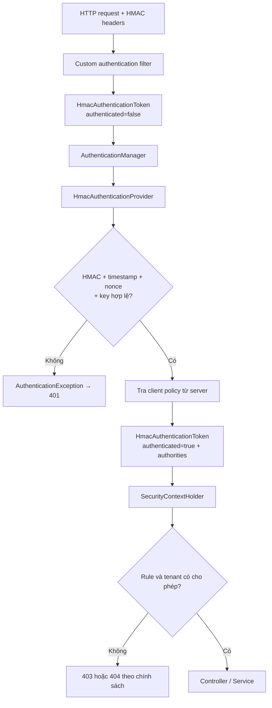

# Tạo authentication token trong Custom Authentication Filter cho HTTP HMAC

## 1. Mục tiêu bài học

Khi một hệ thống tích hợp gửi HTTP request được ký bằng HMAC, server phải kiểm tra shared secret gián tiếp qua chữ ký trên **canonical request**. Hợp đồng ký có thể bao gồm HTTP method, URI, query, một số header, nội dung body hoặc hash của body. Server còn phải kiểm tra timestamp, nonce để hạn chế replay và xác định key còn hiệu lực trong giai đoạn key rotation.

Spring Security cần một đối tượng mô tả kết quả của quá trình đó để các thành phần khác biết **ai đang gọi API, đã xác thực hay chưa và được cấp những quyền gì**. Đối tượng ấy triển khai giao diện `Authentication`; trong bài này gọi là **authentication token**. Đây là chủ đề **Tạo authentication token** thuộc chương **Custom authentication filter** của module xác thực HMAC request.

Sau bài học, người học có thể:

- Phân biệt authentication token **chưa xác thực** với token **đã xác thực** và biết lúc nào được tạo từng loại.
- Tạo một kiểu token dựa trên `AbstractAuthenticationToken`, quản lý `principal`, `credentials`, `authorities` và cờ `authenticated`.
- Kết nối `OncePerRequestFilter`, `AuthenticationManager`, `AuthenticationProvider` và `SecurityContextHolder` theo một luồng xác thực HMAC.
- Đảm bảo authorities đến từ chính sách của server, ràng buộc đúng client/tenant, bảo vệ dữ liệu ký và chặn replay.
- Kiểm thử những trường hợp thành công, chữ ký không hợp lệ, thiếu quyền, lỗi gateway và key rotation.

## 2. Authentication token thực sự là gì?

Trong Spring Security, `Authentication` vừa là **yêu cầu xác thực** được đưa tới `AuthenticationManager`, vừa là **kết quả xác thực** mà manager trả về khi thành công.

Các phương thức quan trọng:

| Thành phần của `Authentication` | Vai trò | Giá trị ví dụ trong HMAC |
| --- | --- | --- |
| `getPrincipal()` | Danh tính được nêu hoặc đã xác minh | Trước: `keyId` chưa đáng tin; sau: `HmacPrincipal(clientId, tenantId)` |
| `getCredentials()` | Dữ liệu để kiểm tra danh tính | Trước: chữ ký, timestamp, nonce và canonical bytes; sau: `null` |
| `getAuthorities()` | Tập quyền đã được cấp | Trước: rỗng; sau: `ORDER_READ`, `ORDER_CREATE` |
| `isAuthenticated()` | Trạng thái xác thực của token | Trước: `false`; sau: `true` |
| `getDetails()` | Ngữ cảnh bổ sung nếu cần | Thông tin request không nhạy cảm hoặc đối tượng detail được kiểm soát |

Một token **không phải** là JWT, không bắt buộc là một chuỗi HTTP header và không tự chứng minh chữ ký HMAC hợp lệ. Nó là **đối tượng Java** trong tiến trình server, được Spring Security sử dụng để biểu diễn yêu cầu hoặc kết quả xác thực.

Giả sử client `partner-a` ký request `GET /integrations/orders/17`:

1. Filter trích xuất thông tin HMAC; token ban đầu mang `keyId` và dữ liệu ký, với `authenticated=false`.
2. `AuthenticationManager` chuyển token tới `AuthenticationProvider` phù hợp.
3. Provider yêu cầu verifier kiểm tra chữ ký, canonical request, thời gian, nonce và tra registry khóa.
4. Sau khi xác minh, provider tra chính sách của client/tenant, tạo token mới với `authenticated=true` và các `GrantedAuthority` do server cấp.
5. Filter đưa token kết quả vào `SecurityContext`; rule phân quyền kiểm tra `hasAuthority` và ràng buộc tài nguyên.



> Chỉ đặt `isAuthenticated=true` sau khi request đã được xác minh đầy đủ. Giá trị `keyId`, `clientId` hoặc role client tự gửi trong header chưa phải danh tính/quyền đáng tin cậy.

## 3. Chọn loại token: có sẵn hay tự tạo?

Spring Security cung cấp sẵn `UsernamePasswordAuthenticationToken` với các factory `unauthenticated(...)` và `authenticated(...)`. Có thể dùng nó cho ví dụ tối giản:

```java
// Chỉ là minh họa hai trạng thái; token này vốn được đặt tên cho username/password.
Authentication requestToken =
        UsernamePasswordAuthenticationToken.unauthenticated(
                "key-2026-01", "signature-base64");

Authentication resultToken =
        UsernamePasswordAuthenticationToken.authenticated(
                new HmacPrincipal("partner-a", "tenant-a"),
                null,
                List.of(new SimpleGrantedAuthority("ORDER_READ")));
```

Với HMAC, dùng một lớp riêng như `HmacAuthenticationToken` thường làm rõ rằng credentials là **bằng chứng trên từng HTTP request**, thay vì mật khẩu đăng nhập; đồng thời dễ ràng buộc trạng thái trước/sau xác thực và tránh nhầm dữ liệu do client khai với dữ liệu do server xác minh.

**Đặc điểm cần có của custom token:**

- Kế thừa `AbstractAuthenticationToken` và triển khai `getPrincipal()`, `getCredentials()`.
- Giai đoạn chưa xác thực: không có authorities đáng tin cậy, `isAuthenticated=false`.
- Giai đoạn đã xác thực: principal là danh tính đã xác minh, credentials đã loại bỏ, authorities từ registry/policy server.
- Không cho gọi tùy tiện `setAuthenticated(true)` để biến token chưa được kiểm tra thành token đã xác thực.
- Không giữ shared secret trong token hay ghi chữ ký, canonical request, nonce vào `toString()`/log.

## 4. Mô hình dữ liệu cho HMAC token

Ví dụ giả định client gửi các trường `X-Key-Id`, `X-Timestamp`, `X-Nonce` và `X-Signature`. Tên header và cách chuẩn hóa nội dung ký phải được quy định chính xác trong hợp đồng của hai bên; đây không phải tiêu chuẩn header chung cho mọi HMAC API.

```java
// Thông tin trình bày bởi client và canonical bytes do server dựng.
// Parser phải xác định method, URI, query, signed headers, body theo hợp đồng ký.
public record SignedRequest(
        String keyId,
        String timestamp,
        String nonce,
        String signature,
        byte[] canonicalBytes
) {
    public SignedRequest {
        canonicalBytes = canonicalBytes.clone();
    }

    @Override
    public byte[] canonicalBytes() {
        return canonicalBytes.clone();
    }
}

// Danh tính đã được kiểm chứng và cấp từ thành phần xác thực đáng tin cậy.
public record HmacPrincipal(String clientId, String tenantId) {}
```

`SignedRequest` chỉ là dữ liệu cần xác minh. `keyId` ban đầu là tên khóa mà client **tự khai**. Registry phía server phải tìm đúng secret/key version, kiểm tra trạng thái khóa, đối chiếu chữ ký và xác định client/tenant của khóa đó. Vì `byte[]` có thể thay đổi, ví dụ chủ động sao chép `canonicalBytes` ở cả constructor lẫn accessor.

Việc dựng `canonicalBytes` phải có một quy tắc **byte-level** thống nhất: mã hóa ký tự, phương thức viết hoa, đường dẫn/query, thứ tự tham số, header nào được ký, khoảng trắng, hash body và dấu xuống dòng. Không được tự động dùng `request.toString()` làm chuỗi ký. Trường timestamp/nonce cũng phải nằm trong phạm vi bảo vệ chống sửa đổi theo hợp đồng ký.

## 5. Cài đặt `HmacAuthenticationToken` hai trạng thái

Lớp dưới đây tách việc tạo token **chưa xác thực** (`unauthenticated`) khỏi token **đã xác thực** (`authenticated`). Hai factory trả về cùng kiểu nhưng có dữ liệu và trách nhiệm khác nhau.

```java
import java.util.Collection;
import java.util.List;
import org.springframework.security.authentication.AbstractAuthenticationToken;
import org.springframework.security.core.GrantedAuthority;

public final class HmacAuthenticationToken
        extends AbstractAuthenticationToken {

    private final Object principal;
    private Object credentials;

    private HmacAuthenticationToken(SignedRequest signedRequest) {
        super(List.of());
        this.principal = signedRequest.keyId(); // Chưa được xác minh!
        this.credentials = signedRequest;
        super.setAuthenticated(false);
    }

    private HmacAuthenticationToken(
            HmacPrincipal principal,
            Collection<? extends GrantedAuthority> authorities) {
        super(authorities);
        this.principal = principal;
        this.credentials = null;
        super.setAuthenticated(true);
    }

    public static HmacAuthenticationToken unauthenticated(
            SignedRequest signedRequest) {
        return new HmacAuthenticationToken(signedRequest);
    }

    // Chỉ code xác thực tin cậy trong server được gọi factory này.
    public static HmacAuthenticationToken authenticated(
            HmacPrincipal principal,
            Collection<? extends GrantedAuthority> authorities) {
        return new HmacAuthenticationToken(principal, authorities);
    }

    @Override
    public Object getPrincipal() {
        return principal;
    }

    @Override
    public Object getCredentials() {
        return credentials;
    }

    @Override
    public void eraseCredentials() {
        super.eraseCredentials();
        credentials = null;
    }

    @Override
    public void setAuthenticated(boolean authenticated) {
        if (authenticated) {
            throw new IllegalArgumentException(
                    "Không được tự đánh dấu token đã xác thực");
        }
        super.setAuthenticated(false);
    }
}
```

**Tại sao constructor dùng `super.setAuthenticated(true)`?** Đó là nhánh duy nhất do factory tạo kết quả xác thực chủ động sử dụng, sau khi provider đã gọi verifier và tra policy. Override `setAuthenticated(...)` từ chối việc một nơi khác tùy tiện bật cờ trên token được đưa vào. Không chuyển factory `authenticated(...)` thành hàm nhận dữ liệu chưa kiểm chứng trực tiếp từ HTTP request.

`AbstractAuthenticationToken` đã lưu authorities và cung cấp nhiều hành vi cơ bản. Với yêu cầu nghiêm ngặt hơn, ứng dụng có thể giới hạn phạm vi truy cập tới factory tạo token đã xác thực để chỉ provider nội bộ được sử dụng.

Token trước xác thực chứa `SignedRequest` trong credentials nên có dữ liệu nhạy cảm về request. Chỉ giữ nó trong thời gian cần xác minh, không đưa vào log, exception message, session hoặc phản hồi HTTP. Token kết quả có `credentials=null` và principal an toàn để phục vụ kiểm tra quyền.

## 6. Tạo token kết quả trong `AuthenticationProvider`

Provider là nơi phù hợp để chuyển từ token chưa xác thực sang token đã xác thực. Để minh họa, giả định ứng dụng đã định nghĩa ba thành phần có hợp đồng sau:

```java
// Verifier kiểm tra HMAC, timestamp, nonce, key rotation và trả danh tính tin cậy.
public record VerifiedClient(String clientId, String tenantId) {}

public interface HmacVerifier {
    VerifiedClient verify(SignedRequest request);
}

// Policy do server quản lý; method phải từ chối client không còn hoạt động.
public record ClientPolicy(java.util.Set<String> permissions) {}

public interface ClientPolicyStore {
    ClientPolicy requireActive(String clientId, String tenantId);
}
```

Đối với HMAC verifier, hợp đồng `verify(...)` cần đảm bảo: tìm đúng key theo `keyId`, chấp nhận key version hợp lệ trong thời kỳ rotation, tính HMAC từ **canonical bytes** và secret phía server, so sánh chữ ký an toàn về thời gian, kiểm tra giới hạn lệch đồng hồ và chống nonce lặp lại bằng một thao tác ghi nhận nguyên tử có TTL. Mọi lỗi xác thực phải được chuyển thành `AuthenticationException` thích hợp và không lộ secret hoặc dấu hiệu cho phép dò khóa.

```java
import java.util.List;
import org.springframework.security.authentication.BadCredentialsException;
import org.springframework.security.authentication.AuthenticationProvider;
import org.springframework.security.core.Authentication;
import org.springframework.security.core.GrantedAuthority;
import org.springframework.security.core.authority.SimpleGrantedAuthority;

public final class HmacAuthenticationProvider
        implements AuthenticationProvider {

    private final HmacVerifier verifier;
    private final ClientPolicyStore policies;

    public HmacAuthenticationProvider(
            HmacVerifier verifier,
            ClientPolicyStore policies) {
        this.verifier = verifier;
        this.policies = policies;
    }

    @Override
    public Authentication authenticate(Authentication authentication) {
        if (!(authentication instanceof HmacAuthenticationToken token)
                || token.isAuthenticated()
                || !(token.getCredentials() instanceof SignedRequest request)) {
            throw new BadCredentialsException("Invalid HMAC request");
        }

        VerifiedClient verified = verifier.verify(request);
        ClientPolicy policy = policies.requireActive(
                verified.clientId(), verified.tenantId());

        List<GrantedAuthority> authorities = policy.permissions()
                .stream()
                .map(name -> (GrantedAuthority) new SimpleGrantedAuthority(name))
                .toList();

        return HmacAuthenticationToken.authenticated(
                new HmacPrincipal(verified.clientId(), verified.tenantId()),
                authorities);
    }

    @Override
    public boolean supports(Class<?> authenticationType) {
        return HmacAuthenticationToken.class
                .isAssignableFrom(authenticationType);
    }
}
```

Provider **không tự tin** vào danh tính, tenant hay quyền do request gửi lên. Nó nhận `VerifiedClient` từ verifier đã xác thực, rồi lấy `ClientPolicy` từ server. Nếu client/key/tenant không hợp lệ, cả verifier lẫn policy store phải thất bại đóng (`fail closed`). Trong triển khai thực tế, provider cần chuẩn hóa lỗi truy cập registry, khóa hết hạn và dữ liệu sai thành lỗi xác thực không tiết lộ nguyên nhân cụ thể cho client.

`AuthenticationManager` có thể được cấu hình bằng `ProviderManager`:

```java
@Bean
AuthenticationManager hmacAuthenticationManager(
        HmacAuthenticationProvider hmacProvider) {
    return new ProviderManager(List.of(hmacProvider));
}
```

Các đoạn mã minh họa dùng Java hỗ trợ `record` và kiểu cấu hình Spring Security hiện đại; import ở các đoạn chỉ được liệt kê khi có ích. `HmacVerifier`, `ClientPolicyStore` và parser ở phần sau là các abstraction của ứng dụng, cần triển khai theo hợp đồng ký thật.

## 7. Gắn token vào `SecurityContext` trong custom filter

Filter được gọi trước khi Spring Security chạy các rule phân quyền. Với API chỉ dùng HMAC, filter thường kế thừa `OncePerRequestFilter`, tạo token đầu vào, gọi `AuthenticationManager` và đặt token trả về trong một `SecurityContext` mới.

```java
public final class HmacAuthenticationFilter extends OncePerRequestFilter {
    private final SignedRequestParser parser;
    private final AuthenticationManager authenticationManager;
    private final AuthenticationEntryPoint entryPoint;

    public HmacAuthenticationFilter(
            SignedRequestParser parser,
            AuthenticationManager authenticationManager,
            AuthenticationEntryPoint entryPoint) {
        this.parser = parser;
        this.authenticationManager = authenticationManager;
        this.entryPoint = entryPoint;
    }

    @Override
    protected void doFilterInternal(
            HttpServletRequest request,
            HttpServletResponse response,
            FilterChain chain) throws ServletException, IOException {

        Authentication authenticated;
        try {
            SignedRequest signed = parser.parse(request);
            Authentication candidate =
                    HmacAuthenticationToken.unauthenticated(signed);
            authenticated = authenticationManager.authenticate(candidate);
        } catch (AuthenticationException ex) {
            SecurityContextHolder.clearContext();
            entryPoint.commence(request, response, ex); // Ví dụ: HTTP 401
            return;
        }

        SecurityContext context = SecurityContextHolder.createEmptyContext();
        context.setAuthentication(authenticated);
        SecurityContextHolder.setContext(context);
        try {
            chain.doFilter(request, response);
        } finally {
            SecurityContextHolder.clearContext();
        }
    }
}
```

`SignedRequestParser` là giao diện ứng dụng tự xây dựng, ví dụ có `SignedRequest parse(HttpServletRequest request)`. Parser phải báo `AuthenticationException` khi thiếu/sai header ký, sai định dạng thời gian, chữ ký hoặc body vượt giới hạn được phép. Lỗi I/O và request wrapper cần xử lý riêng theo loại lỗi; không giả định mọi ngoại lệ đều là `AuthenticationException`.

Tại sao filter **không** tự tạo token `authenticated`? Vì nó chỉ chịu trách nhiệm đọc HTTP request và giao việc xác thực cho manager/provider. Nếu filter lập tức tạo token đã xác thực chỉ từ `X-Key-Id` hoặc `X-Signature`, toàn bộ kiểm tra HMAC sẽ bị bỏ qua.

Đoạn filter trên giả định được gắn **chỉ vào SecurityFilterChain dành cho API HMAC**, chẳng hạn `/integrations/**`. Nếu cùng filter áp dụng cho nhiều chain, phải thêm điều kiện chọn request và tránh can thiệp endpoint login hoặc API không dùng HMAC. Lớp filter cũng không nên bị đăng ký lần thứ hai ở servlet container.

**Lưu ý body:** nếu parser đọc body để tạo canonical bytes, request đến controller vẫn phải có thể đọc được body, thường thông qua một wrapper cache bytes có giới hạn kích thước. Tránh dựng canonical request từ body đã bị biến đổi bởi serializer, gateway hoặc content decoding mà hai bên chưa thống nhất.

## 8. Cấu hình quyền sau khi xác thực

Ví dụ chain chỉ bảo vệ API `/integrations/**`, không duy trì HTTP session và yêu cầu authorities khác nhau cho GET và POST:

```java
@Bean
SecurityFilterChain hmacSecurityChain(
        HttpSecurity http,
        HmacAuthenticationFilter hmacFilter) throws Exception {
    return http
            .securityMatcher("/integrations/**")
            .csrf(csrf -> csrf.disable())
            .sessionManagement(session -> session
                    .sessionCreationPolicy(SessionCreationPolicy.STATELESS))
            .authorizeHttpRequests(auth -> auth
                    .requestMatchers(HttpMethod.GET, "/integrations/orders/**")
                        .hasAuthority("ORDER_READ")
                    .requestMatchers(HttpMethod.POST, "/integrations/orders")
                        .hasAuthority("ORDER_CREATE")
                    .anyRequest().denyAll())
            .addFilterBefore(
                    hmacFilter, UsernamePasswordAuthenticationFilter.class)
            .build();
}
```

Cấu hình `csrf.disable()` ở đây chỉ là lựa chọn có điều kiện cho API máy gọi máy không dùng cookie session để xác thực. Các ứng dụng web dựa trên cookie cần đánh giá CSRF riêng. Nếu còn endpoint khác ngoài `/integrations/**`, chúng phải có chain phù hợp. Đối với ứng dụng có nhiều SecurityFilterChain, cần quản lý thứ tự/độ bao phủ matcher.

**Ví dụ ủy quyền:**

| Client HMAC | Policy server | Request | Kết quả |
| --- | --- | --- | --- |
| `report-reader` | `ORDER_READ` | GET đơn hàng thuộc tenant được cấp | Qua bước kiểm tra authority |
| `report-reader` | `ORDER_READ` | POST tạo đơn hàng | `403 Forbidden` |
| `order-writer` | `ORDER_READ`, `ORDER_CREATE` | POST tạo đơn hàng đúng tenant | Qua bước kiểm tra authority |
| `order-writer` | `ORDER_READ`, `ORDER_CREATE` | DELETE đơn hàng | Bị `denyAll` từ chối |
| Bất kỳ client nào | Bất kỳ | HMAC sai hoặc nonce đã dùng | `401 Unauthorized` |

Quyền `ORDER_READ` không đồng nghĩa đọc mọi tenant. Service/repository còn phải giới hạn tài nguyên theo `tenantId` lấy từ `HmacPrincipal` **đã xác minh**, và có thể cần kiểm tra ownership hoặc thuộc tính tài nguyên. `Authentication` chứng minh kết quả xác thực; `GrantedAuthority` là dữ liệu phục vụ quyết định phân quyền.

## 9. Các bẫy thiết kế khi tạo token

### 9.1. Bật cờ authenticated quá sớm

**Sai:**

```java
// NGUY HIEM: keyId client khai chưa chứng minh danh tính.
Authentication token = UsernamePasswordAuthenticationToken.authenticated(
        request.getHeader("X-Key-Id"), null,
        List.of(new SimpleGrantedAuthority("ROLE_ADMIN")));
SecurityContextHolder.getContext().setAuthentication(token);
```

Trong cách làm trên, mọi client tự gửi một `keyId` đều có thể được coi là đã xác thực và được cấp quyền quản trị. Chỉ provider/verifier được tạo kết quả đã xác thực sau kiểm tra đầy đủ.

### 9.2. Tin authority trong header

Header `X-Role: ADMIN`, `X-Tenant: tenant-b` hoặc body `"permissions": ["ORDER_CREATE"]` không trực tiếp quyết định quyền trong token, ngay cả khi dữ liệu đó được ký bằng HMAC. Chữ ký xác minh quyền sở hữu key và tính toàn vẹn phần đã ký; server vẫn phải kiểm tra client có **quyền được yêu cầu** và truy cập **tenant được cấp phép** hay không.

### 9.3. Chưa xử lý replay và clock skew

Signature của request cũ vẫn có thể hợp lệ nếu secret chưa đổi. Verifier cần giới hạn thời gian dựa trên timestamp đã ký, đồng thời ghi nhận nonce dùng một lần với thao tác nguyên tử trên kho chia sẻ nếu có nhiều instance. Key để chống trùng nonce thường ràng buộc tối thiểu với danh tính/key và phạm vi hợp đồng; TTL phải bao phủ khoảng thời gian chấp nhận request. Không chỉ dựa trên cache nội bộ từng máy trong hệ thống nhiều node.

### 9.4. Không nhất quán qua proxy/gateway

Nếu client ký `/api/v1/orders?a=1&b=2` nhưng gateway đổi path, query order, Host hoặc một signed header trước khi backend kiểm tra, hai phía có thể dựng canonical bytes khác nhau. Hợp đồng cần chỉ rõ request-target nào được ký, header nào được proxy phép sửa và đâu là trust boundary của forwarded headers. Không tin trực tiếp `X-Forwarded-*` từ Internet nếu gateway chưa làm sạch và thiết lập lại những header đó.

### 9.5. Rotation và thu hồi key

`keyId` giúp verifier tìm đúng key version trong registry. Trong thời gian rotation có thể tồn tại nhiều key còn hiệu lực, nhưng mỗi key phải ánh xạ tới danh tính/chính sách được phép. Việc thu hồi key hoặc client cần có hiệu lực trong các thành phần xác thực; cache policy và cache key phải có TTL hoặc cơ chế invalidation phù hợp. Không tự gán quyền mới cho client chỉ vì client đổi sang key mới.

### 9.6. Xử lý lỗi và trạng thái HTTP

Đối với API chỉ nhận HMAC, request thiếu signature, sai chữ ký, timestamp quá hạn hay nonce bị dùng lại thường trả `401` qua `AuthenticationEntryPoint`; request đã xác thực nhưng thiếu quyền thường trả `403` qua cơ chế authorization. Nên giữ thông báo cho client đủ chung để tránh lộ secret, key tồn tại hay nội dung chính sách. Nếu chính sách che giấu tài nguyên tenant khác, service có thể trả `404` khi không tìm thấy tài nguyên trong phạm vi tenant.

### 9.7. Không giữ hoặc ghi lộ credentials

Token chưa xác thực có thể chứa signature và canonical bytes; đừng lưu nó vào session, log nguyên token hoặc đưa dữ liệu đó vào exception. Tránh lưu shared secret vào `principal`, `credentials` hay `details`. Khi cần quan sát hệ thống, chỉ log mã yêu cầu, `clientId` đã xác minh, lý do lỗi đã chuẩn hóa và kết quả quyết định truy cập.

## 10. Bài thực hành

Thiết kế `POST /integrations/orders` và `GET /integrations/orders/{id}` cho hai client:

- `partner-reporting` thuộc `tenant-a`, được cấp `ORDER_READ`.
- `partner-fulfillment` thuộc `tenant-b`, được cấp `ORDER_READ` và `ORDER_CREATE`.

Yêu cầu triển khai:

1. Định nghĩa `SignedRequest` chứa evidence HMAC theo hợp đồng ký; chỉ số `keyId`, timestamp, nonce và signature từ request ban đầu là dữ liệu chưa được tin cậy.
2. Cài `HmacAuthenticationToken` có hai factory: token request `authenticated=false` và token kết quả `authenticated=true` với `HmacPrincipal`.
3. Tạo `AuthenticationProvider` gọi verifier và policy store. Đảm bảo mọi đường thất bại đều ném lỗi xác thực thay vì cấp authority mặc định.
4. Viết `OncePerRequestFilter` parse request, gọi `AuthenticationManager`, đưa token kết quả vào `SecurityContext`, xóa context sau request.
5. Cấu hình `hasAuthority` và truy vấn repository theo tenant từ principal. Thêm kiểm thử cho những tình huống dưới đây.

| Ca thử | Token và phản hồi mong đợi |
| --- | --- |
| `partner-reporting` ký đúng GET thuộc `tenant-a` | Token xác thực có `ORDER_READ`; truy cập được nếu tài nguyên tồn tại |
| `partner-reporting` ký đúng POST | Token có `ORDER_READ` nhưng bị `403` do thiếu `ORDER_CREATE` |
| `partner-fulfillment` ký đúng POST đúng tenant | Token có `ORDER_CREATE`; tới nghiệp vụ |
| Header thiếu signature, chữ ký sai hoặc key bị thu hồi | Không tạo token xác thực; `401` |
| Gửi lại timestamp/nonce đã sử dụng | `401`, không có side effect lần hai |
| `tenant-a` cố truy cập đơn hàng `tenant-b` | Không thấy hoặc không được phép, không lộ dữ liệu |
| Thêm `X-Role: ADMIN` vào request có chữ ký hợp lệ | Authorities vẫn chỉ theo policy server |
| Key rotation với key cũ còn hiệu lực | Được xác thực theo policy của client trong thời gian overlap |
| Key cũ bị thu hồi | Request bằng key cũ bị `401` |
| Gateway thay đổi path/header thuộc phạm vi ký | Verifier phát hiện không khớp hoặc hợp đồng canonicalization quy định xử lý rõ |

Khi kiểm thử filter nên khẳng định thêm: `AuthenticationManager` nhận **token chưa xác thực**; provider trả **token đã xác thực**; request lỗi **không tới controller**; `SecurityContext` được dọn sau request; không có double filter registration; xử lý body vẫn đọc được ở controller.

## 11. Câu hỏi tự kiểm tra

**1. Tại sao cần hai trạng thái token?** Trước khi xác minh, token chỉ là yêu cầu chứa dữ liệu do client cung cấp. Sau xác minh, token mới mang principal và authorities đáng tin cậy để hệ thống quyết định truy cập.

**2. Filter có thể tự gọi `HmacAuthenticationToken.authenticated(...)` ngay sau khi đọc header không?** Không. Đọc header chưa chứng minh chữ ký, tính toàn vẹn payload, timestamp, nonce hay tình trạng key. Provider/verifier phải xác minh các điều kiện ấy trước.

**3. `getCredentials()` sau xác thực nên chứa gì?** Thông thường là `null` đối với token kết quả HMAC; dữ liệu ký không cần tồn tại trong `SecurityContext` của nghiệp vụ.

**4. `AuthenticationManager` có tự tính HMAC không?** Không. Nó điều phối tới một `AuthenticationProvider` phù hợp; provider sử dụng verifier do ứng dụng cài đặt cho hợp đồng HMAC.

**5. Vì sao không gán `ROLE_ADMIN` cho mọi HMAC client hợp lệ?** Xác thực chỉ chứng minh danh tính và tính toàn vẹn request trong phạm vi ký. Quyền phải lấy từ chính sách cấp cho client đã xác minh.

**6. Dùng `isAuthenticated()` để thay thế `hasAuthority()` được không?** Không. `isAuthenticated()` xác nhận trạng thái đăng nhập/xác thực, còn `hasAuthority()` kiểm tra quyền thực hiện thao tác.

**7. Nếu nhiều server xử lý request HMAC, nonce được lưu ở đâu?** Trong kho có khả năng ghi nhận duy nhất một cách nguyên tử giữa các instance (hoặc cơ chế chống replay tương đương), với TTL và phạm vi khóa phù hợp.

## 12. Ghi nhớ

Tạo authentication token cho custom HMAC filter là thiết kế **hai đối tượng ở hai giai đoạn tin cậy**: token đầu vào chứa dữ liệu để xác minh và chưa được xác thực; token kết quả chỉ được tạo sau khi verifier kiểm tra signature/canonical request/timestamp/nonce/key và server tra chính sách client/tenant. `AuthenticationProvider` thực hiện chuyển đổi này; filter đặt kết quả vào `SecurityContextHolder` để Spring Security và lớp nghiệp vụ sử dụng authorities kiểm tra quyền. Cách thiết kế ấy tách xác thực HMAC khỏi phân quyền, hỗ trợ key rotation, chống replay và giới hạn truy cập theo tenant.
