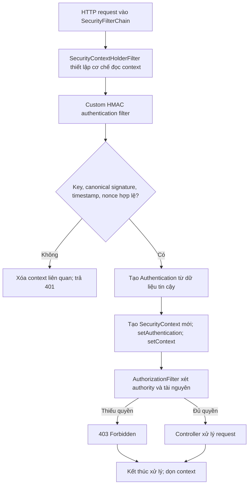

# Đặt SecurityContext trong Custom Authentication Filter cho HTTP HMAC

## 1. Mục tiêu và bối cảnh

Trong module `SECURITY_AUTHENTICATION_HMAC_REQUEST_AUTHENTICATION`, server xác thực HTTP request bằng **HMAC với shared secret**. Client và server phải thống nhất cách xây dựng **canonical request** từ method, URI, header và/hoặc body; server xác minh chữ ký, timestamp, nonce, trạng thái key và chính sách key rotation. Sau khi các điều kiện này đều hợp lệ, ứng dụng cần chuyển kết quả xác minh thành một danh tính mà Spring Security có thể sử dụng để ra quyết định phân quyền.

Điểm chuyển tiếp đó là thao tác **đặt `Authentication` vào `SecurityContext`**. Nếu chỉ xác minh chữ ký trong một custom filter rồi gọi tiếp `filterChain.doFilter(...)` mà không thiết lập context, các thành phần phía sau có thể vẫn nhìn thấy request là anonymous. Ngược lại, nếu đặt một `Authentication` “đã xác thực” trước khi thực sự xác minh chữ ký, hệ thống có thể tạo lỗ hổng nghiêm trọng.

Bài này thuộc chương **Custom authentication filter**, tập trung trực tiếp vào cách tạo, đặt, dùng và kết thúc vòng đời `SecurityContext` trong ứng dụng Servlet sử dụng Spring Security 6.x.

Sau bài học, người học có thể:

- Giải thích mối liên hệ giữa `Authentication`, `SecurityContext` và `SecurityContextHolder`.
- Đặt context đúng thời điểm sau khi xác thực HMAC, trước khi request đi vào bước authorization/controller.
- Cấp `GrantedAuthority` dựa trên dữ liệu tin cậy phía server và phân biệt **authentication** với **authorization**.
- Chọn hành vi lưu trữ, xóa và truyền context phù hợp API machine-to-machine stateless.
- Kiểm thử request được xác thực, lỗi 401/403, nguy cơ context bị sót và xử lý async/error dispatch.

> **Phạm vi kỹ thuật:** Các ví dụ dùng ứng dụng Spring MVC/Servlet, Spring Boot 3.x và phong cách Spring Security 6.x. Đây là bài về tích hợp `SecurityContext`, không phải đặc tả đầy đủ một giao thức HMAC; thuật toán/canonicalization thực tế phải tuân theo hợp đồng đã thống nhất giữa các bên.

## 2. Ba thành phần cần hiểu

### 2.1. Authentication: danh tính và quyền đã được xác minh

`Authentication` đại diện kết quả xác thực, thường bao gồm:

| Thuộc tính | Ý nghĩa trong ví dụ HMAC |
| --- | --- |
| `getPrincipal()` | Danh tính client/service đã được key registry xác minh, ví dụ `payments-bot` |
| `getCredentials()` | Thường đặt `null` khi đã xác thực; không để lộ shared secret |
| `getAuthorities()` | Quyền phía server cấp cho client, ví dụ `PAYMENT_CREATE` |
| `isAuthenticated()` | `true` sau khi xác thực thành công, `false` ở giai đoạn chưa xác thực |
| `getDetails()` | Metadata được phép lưu như request ID hoặc thông tin nguồn đã kiểm chứng; tránh dữ liệu bí mật |

Không lấy authorities trực tiếp từ một header do client tự khai báo. Có chữ ký HMAC đúng chỉ chứng minh request được gửi bởi một bên biết key tương ứng và dữ liệu ký được bảo vệ theo hợp đồng; **không mặc nhiên có quyền truy cập mọi endpoint hoặc mọi tenant**.

### 2.2. SecurityContext: vùng chứa Authentication

`SecurityContext` lưu `Authentication` của luồng xử lý hiện tại:

```java
SecurityContext context = SecurityContextHolder.createEmptyContext();
context.setAuthentication(authentication);
SecurityContextHolder.setContext(context);
```

Nên tạo context mới khi một cơ chế xác thực mới thành công. Điều này tránh thay đổi trực tiếp context cũ có thể được chia sẻ qua cơ chế lưu trữ hoặc wrapper. Trong trường hợp kết hợp nhiều cơ chế xác thực, cần thiết kế rõ cơ chế nào có quyền ghi đè danh tính đã được xác thực.

### 2.3. SecurityContextHolder: cách truy xuất context hiện tại

`SecurityContextHolder` giữ context qua một chiến lược lưu trữ; trên ứng dụng Servlet thông thường, chiến lược mặc định là **ThreadLocal**. Thành phần chạy tiếp trên cùng request thread có thể đọc:

```java
Authentication current =
    SecurityContextHolder.getContext().getAuthentication();
```

Spring Security và controller có thể dùng danh tính đó để xét `authenticated()`, `hasAuthority(...)`, `@PreAuthorize`, `@AuthenticationPrincipal` hoặc tham số `Authentication`. Việc đọc được danh tính **không thay thế** quy tắc authorization.

`SecurityContextHolder` không phải một biến toàn cục chứa danh tính chung cho mọi HTTP request. Vòng đời context phải được ràng buộc với request và thread/dispatch tương ứng.

## 3. Đặt context ở đâu trong chuỗi filter?

Một luồng xử lý điển hình:



Nguyên tắc là đặt context **sau khi toàn bộ xác thực HMAC thành công** và **trước thành phần authorization**. Nếu custom filter chạy quá sớm, context có thể bị thay bởi cơ chế nạp context; nếu chạy quá muộn, authorization đã quyết định request là anonymous hoặc không đủ quyền.

Ví dụ thường gặp:

```java
http.addFilterBefore(
    hmacAuthenticationFilter,
    UsernamePasswordAuthenticationFilter.class
);
```

Đây là cách định vị tương đối trong thứ tự filter của Spring Security, kể cả khi ứng dụng không bật form login. Khi hệ thống có nhiều chain hoặc filter tùy chỉnh, phải kiểm tra thứ tự thực tế: HMAC filter cần nằm **sau quá trình thiết lập context** và **trước authorization**. Không đăng ký cùng một filter vừa ở servlet container vừa trong Spring Security chain khiến nó chạy ngoài phạm vi dự định.

## 4. Hiện thực một filter đặt SecurityContext

### 4.1. Ranh giới trách nhiệm của verifier

Filter chỉ nên điều phối xử lý HTTP; mọi quy tắc kiểm chứng chữ ký đặt trong một thành phần `HmacRequestAuthenticator`:

```java
import jakarta.servlet.http.HttpServletRequest;
import org.springframework.security.core.Authentication;
import org.springframework.security.core.AuthenticationException;

public interface HmacRequestAuthenticator {
    Authentication authenticate(HttpServletRequest request)
        throws AuthenticationException;
}
```

Hợp đồng của `authenticate(...)`:

1. Xác định client/key theo `keyId`; chỉ sử dụng secret thuộc key còn hiệu lực và đúng phạm vi.
2. Dựng **cùng canonical request** mà client đã ký: method, URI, query, header được ký, body digest theo phiên bản giao thức.
3. Xác minh chữ ký HMAC, sử dụng phép so sánh an toàn cho dữ liệu chữ ký.
4. Xác minh timestamp trong khoảng clock skew cho phép; kiểm tra nonce chưa sử dụng và ghi nhận nonce **nguyên tử**, chia sẻ trạng thái giữa các instance để ngăn replay.
5. Chỉ sau khi toàn bộ bước trên thành công, tạo `Authentication` đã xác thực bằng principal và authorities **từ nguồn tin cậy phía server**.

Verifier phải từ chối header thiếu/sai, key bị thu hồi, replay, chữ ký sai và request có body/canonicalization không khớp; không được trả một `Authentication` đã xác thực trong các trường hợp này. Khóa xoay vòng cần chính sách chấp nhận key cũ/mới và thời điểm thu hồi rõ ràng.

### 4.2. Filter hoàn chỉnh cho chuỗi HMAC riêng

```java
import jakarta.servlet.FilterChain;
import jakarta.servlet.ServletException;
import jakarta.servlet.http.HttpServletRequest;
import jakarta.servlet.http.HttpServletResponse;
import java.io.IOException;
import org.springframework.security.core.Authentication;
import org.springframework.security.core.AuthenticationException;
import org.springframework.security.core.context.SecurityContext;
import org.springframework.security.core.context.SecurityContextHolder;
import org.springframework.web.filter.OncePerRequestFilter;

public final class HmacRequestAuthenticationFilter
    extends OncePerRequestFilter {

    private final HmacRequestAuthenticator authenticator;

    public HmacRequestAuthenticationFilter(
        HmacRequestAuthenticator authenticator
    ) {
        this.authenticator = authenticator;
    }

    @Override
    protected void doFilterInternal(
        HttpServletRequest request,
        HttpServletResponse response,
        FilterChain chain
    ) throws ServletException, IOException {
        Authentication authentication;

        try {
            authentication = authenticator.authenticate(request);
        } catch (AuthenticationException ex) {
            SecurityContextHolder.clearContext();
            response.sendError(HttpServletResponse.SC_UNAUTHORIZED,
                               "HMAC authentication failed");
            return;
        }

        // Không để kết quả null/chưa authenticated đi vào controller.
        if (authentication == null || !authentication.isAuthenticated()) {
            SecurityContextHolder.clearContext();
            response.sendError(HttpServletResponse.SC_UNAUTHORIZED,
                               "HMAC authentication required");
            return;
        }

        SecurityContext context =
            SecurityContextHolder.createEmptyContext();
        context.setAuthentication(authentication);
        SecurityContextHolder.setContext(context);

        try {
            chain.doFilter(request, response);
        } finally {
            // Mô hình HMAC stateless: không giữ danh tính sang request sau.
            SecurityContextHolder.clearContext();
        }
    }
}
```

Điểm mấu chốt là ba dòng **`createEmptyContext()` → `setAuthentication()` → `setContext()`**. Chúng chỉ chạy sau khi verifier đã trả về danh tính hợp lệ. `chain.doFilter(...)` cho phép các filter còn lại, đặc biệt `AuthorizationFilter`, nhận biết Authentication vừa thiết lập.

Trong ví dụ, filter trả 401 trực tiếp cho lỗi xác thực và kết thúc request. Điều này có chủ ý: `ExceptionTranslationFilter` có thể nằm phía sau custom filter trong chain, nên không nhất thiết bắt được `AuthenticationException` ném ra trước nó. Trong dự án thực tế, có thể dùng `AuthenticationEntryPoint` được cấu hình phù hợp để thống nhất response và log. Không trả cho client chữ ký kỳ vọng, shared secret hoặc trạng thái tồn tại của key.

`finally` dọn context khi xử lý downstream thành công hoặc ném exception. Spring Security cũng có cơ chế tự dọn context ở ranh giới filter chain; thao tác này làm hành vi của **filter HMAC stateless chuyên biệt** trở nên rõ ràng. Nếu thiết kế có cơ chế đăng nhập khác hoặc muốn lưu context giữa các request, không sao chép cách xóa context này mà chưa xem xét vòng đời của toàn chain.

### 4.3. Chuyển kết quả HMAC thành Authentication

Sau xác thực, một client dịch vụ có thể được biểu diễn như sau:

```java
import java.util.List;
import org.springframework.security.authentication.UsernamePasswordAuthenticationToken;
import org.springframework.security.core.Authentication;
import org.springframework.security.core.authority.SimpleGrantedAuthority;

record ServiceClientPrincipal(String clientId, String tenantId) {}

// Chỉ thực hiện đoạn sau KHI HMAC, timestamp, nonce và key đã hợp lệ.
ServiceClientPrincipal principal =
    new ServiceClientPrincipal("payments-bot", "tenant-a");

Authentication authentication =
    UsernamePasswordAuthenticationToken.authenticated(
        principal,
        null,
        List.of(new SimpleGrantedAuthority("PAYMENT_CREATE"))
    );
```

Đây là ví dụ dựng đối tượng, không phải đoạn mã được phép tin dữ liệu `"payments-bot"`, `"tenant-a"` hay `"PAYMENT_CREATE"` từ HTTP header. Trong triển khai thật, principal và quyền phải được tra cứu theo key/client đã xác minh, cùng điều kiện tenant được cấp phép. Nếu request ký tenant khác, bước kiểm tra quyền tài nguyên phải chặn truy cập chéo tenant.

`UsernamePasswordAuthenticationToken.authenticated(...)` được dùng để tạo token đã xác thực với authorities; tên class có chữ “Password” không có nghĩa hệ thống đang xác thực bằng mật khẩu. Có thể định nghĩa một `Authentication` riêng cho HMAC khi cần biểu diễn rõ loại credential, keyId an toàn để log hoặc metadata của client.

## 5. Cấu hình SecurityFilterChain để context phát huy tác dụng

Giả sử chỉ endpoint `POST /internal/payments` cần quyền `PAYMENT_CREATE`. Một chain dành riêng cho API nội bộ có thể được viết như sau:

```java
import org.springframework.context.annotation.Bean;
import org.springframework.context.annotation.Configuration;
import org.springframework.core.annotation.Order;
import org.springframework.http.HttpMethod;
import org.springframework.security.config.annotation.web.builders.HttpSecurity;
import org.springframework.security.config.annotation.web.configurers.AbstractHttpConfigurer;
import org.springframework.security.config.http.SessionCreationPolicy;
import org.springframework.security.web.SecurityFilterChain;
import org.springframework.security.web.authentication.UsernamePasswordAuthenticationFilter;

@Configuration
class HmacFilterSecurityConfig {

    @Bean
    @Order(1)
    SecurityFilterChain hmacChain(
        HttpSecurity http,
        HmacRequestAuthenticator authenticator
    ) throws Exception {
        var hmacFilter = new HmacRequestAuthenticationFilter(authenticator);

        http
            .securityMatcher("/internal/**")
            .sessionManagement(session ->
                session.sessionCreationPolicy(SessionCreationPolicy.STATELESS))
            .csrf(AbstractHttpConfigurer::disable)
            .httpBasic(AbstractHttpConfigurer::disable)
            .formLogin(AbstractHttpConfigurer::disable)
            .authorizeHttpRequests(auth -> auth
                .requestMatchers(HttpMethod.POST, "/internal/payments")
                    .hasAuthority("PAYMENT_CREATE")
                .anyRequest().denyAll()
            )
            .addFilterBefore(
                hmacFilter,
                UsernamePasswordAuthenticationFilter.class
            );

        return http.build();
    }

    @Bean
    @Order(2)
    SecurityFilterChain fallbackChain(HttpSecurity http) throws Exception {
        return http
            .authorizeHttpRequests(auth -> auth
                .anyRequest().denyAll())
            .build();
    }
}
```

Phân tích:

1. `securityMatcher("/internal/**")` chọn chain HMAC theo route; có/không có `X-Signature` không quyết định request có được bảo vệ hay không.
2. `addFilterBefore(...)` đưa custom filter vào chain. Filter tạo context trước lúc authorization xét `hasAuthority("PAYMENT_CREATE")`.
3. `SessionCreationPolicy.STATELESS` phù hợp HTTP request ký độc lập: mỗi request phải xác thực lại. Việc đặt context cho request hiện tại **không có nghĩa** đăng nhập được lưu sang request kế tiếp.
4. `anyRequest().denyAll()` trong HMAC chain từ chối method/path khác dưới `/internal/**`, dù client sở hữu key hợp lệ. Fallback từ chối các route không được công bố trong ví dụ.
5. `csrf.disable()` chỉ áp dụng chain API machine-to-machine không dựa vào cookie đăng nhập. Nếu ứng dụng có các trang/web session, các chain đó cần chính sách CSRF thích hợp.

Vì `hmacFilter` được tạo ngay trong cấu hình chain thay vì đăng ký như một servlet filter bean, ví dụ tránh nguy cơ filter bị Spring Boot tự đăng ký thêm ở container bên ngoài Spring Security. Nếu cần inject filter dưới dạng bean, cấu hình `FilterRegistrationBean` với `setEnabled(false)` để vô hiệu hóa đăng ký servlet tự động, rồi thêm filter vào Spring Security chain đúng một lần.

**Lưu ý 401/403:** Không có hoặc sai xác thực HMAC phải trả **401 Unauthorized**. Khi HMAC hợp lệ nhưng client không có `PAYMENT_CREATE`, authorization từ chối với **403 Forbidden** (với cơ chế xử lý access denied phù hợp). Đừng biến mọi lỗi thành 401, vì như vậy che khuất khác biệt giữa xác thực và phân quyền.

## 6. Vòng đời SecurityContext: request, persistence và cleanup

### 6.1. Đặt context không đồng nghĩa lưu phiên đăng nhập

Trong Spring Security, cần phân biệt:

| Thao tác | Ý nghĩa |
| --- | --- |
| `SecurityContextHolder.setContext(context)` | Context có hiệu lực cho luồng xử lý hiện tại |
| `SecurityContextRepository.loadDeferredContext(...)` và cơ chế liên quan | Đọc context theo chính sách của ứng dụng khi bắt đầu request |
| `SecurityContextRepository.saveContext(...)` | Lưu context vào repository đã chọn để có thể sử dụng ở thời điểm phù hợp sau đó |
| `SecurityContextHolder.clearContext()` | Xóa context khỏi holder của luồng hiện tại |

Trong cấu hình Spring Security 6 sử dụng `SecurityContextHolderFilter` với chính sách **explicit save**, việc gọi `setContext(...)` tự nó không bảo đảm `SecurityContextRepository` sẽ lưu giá trị sang request sau. Các cấu hình cũ hoặc tùy chỉnh với `SecurityContextPersistenceFilter` có thể có hành vi lưu khác.

Với HTTP HMAC machine-to-machine, lựa chọn thông thường là **stateless**: server không dùng session làm bằng chứng xác thực request kế tiếp. Request sau phải gửi timestamp/nonce/signature mới và được xác minh lại. Không gọi `saveContext(...)` để vô tình biến chữ ký của một request thành phiên đăng nhập lâu dài.

Khi sản phẩm thực sự cần lưu context (ví dụ luồng đăng nhập tương tác), phải chọn `SecurityContextRepository` và chính sách persistence riêng, gọi `saveContext(...)` ở đúng thời điểm nếu chế độ yêu cầu explicit save. Thiết kế đó nằm ngoài phạm vi một HMAC API stateless.

### 6.2. Vì sao phải dọn context?

Application server có thể tái sử dụng thread cho nhiều request. Nếu tự quản lý `ThreadLocal` hoặc custom filter mà quên dọn context, danh tính của request trước có nguy cơ xuất hiện trong tác vụ không liên quan. Filter chain mặc định của Spring Security có cơ chế clear context, nhưng filter tùy chỉnh vẫn nên xử lý vòng đời đầy đủ và tránh giữ danh tính trong biến static hoặc singleton.

Không đặt `Authentication` vào field của filter: filter là đối tượng dùng chung giữa nhiều request. Thông tin xác thực phải nằm trong context theo luồng xử lý và các thành phần được thiết kế cho request.

### 6.3. Async, background task và error dispatch

Mặc định `SecurityContextHolder` thường dựa trên thread, nên `@Async`, `CompletableFuture` hoặc một executor riêng không tự động nhận context từ request ban đầu. Nếu thực sự cần ủy nhiệm danh tính sang tác vụ khác, có thể dùng các wrapper Spring Security như `DelegatingSecurityContextRunnable` hoặc `DelegatingSecurityContextExecutor`, đồng thời giới hạn phạm vi và thời gian sống của context.

Không truyền shared secret, chữ ký hoặc raw HTTP request sang background worker chỉ để “giữ đăng nhập”. Nếu tác vụ cần danh tính, truyền dữ liệu tối thiểu đã được xác thực và cân nhắc phân quyền độc lập tại nơi thực thi.

`OncePerRequestFilter` có hành vi mặc định liên quan đến async/error dispatch. Không giả định việc gọi `doFilterInternal(...)` xảy ra mọi lần dispatch, cũng không giả định context ở request gốc tự có mặt trong các dispatch khác. Nếu ứng dụng dùng Servlet async hoặc custom error controller, phải kiểm thử ngữ cảnh an ninh cho từng kiểu dispatch và cấu hình `shouldNotFilterAsyncDispatch()`/`shouldNotFilterErrorDispatch()` có chủ đích.

## 7. Các lỗi thường gặp khi đặt SecurityContext

### 7.1. Đặt context trước khi xác thực hoàn tất

```java
// Không an toàn: đánh dấu authenticated trước khi kiểm HMAC.
Authentication auth = UsernamePasswordAuthenticationToken.authenticated(
    request.getHeader("X-Client-Id"),
    null,
    List.of(new SimpleGrantedAuthority("PAYMENT_CREATE"))
);
SecurityContextHolder.getContext().setAuthentication(auth);
// ... sau đó mới kiểm signature
```

Nếu validation ném exception hoặc rẽ nhánh bất ngờ, request có thể đã mang danh tính giả. Giải pháp: **xác minh trước, dựng Authentication sau**.

### 7.2. Xác minh chữ ký xong nhưng quên setContext

```java
authenticator.authenticate(request);
chain.doFilter(request, response);
```

Lời gọi verifier có thể xác thực thành công, nhưng nếu không đặt kết quả vào `SecurityContextHolder`, `AuthorizationFilter` có thể coi request là anonymous. Cần lấy `Authentication` trả về và đặt context trước `chain.doFilter(...)`.

### 7.3. Chỉ gán context mà không đi tiếp filter chain

`setContext(...)` không tự chạy controller. Phải gọi `chain.doFilter(request, response)` khi và chỉ khi request đủ điều kiện xác thực; nếu thiếu, kết thúc bằng response lỗi thích hợp.

### 7.4. Nhầm authenticated với authorized

`Authentication.isAuthenticated() == true` chưa đủ để tạo payment. Cần kiểm authority theo endpoint; với dữ liệu đa tenant còn kiểm quyền trên đối tượng cụ thể. Client có secret hợp lệ không đương nhiên được dùng tài nguyên tenant khác.

### 7.5. Dùng “header có chữ ký” để chọn route bắt buộc HMAC

Nếu một chain chỉ chạy khi request có `X-Signature`, kẻ tấn công có thể bỏ header để chuyển sang chain khác. Chọn chain bằng hợp đồng **method/path**, để filter từ chối request thiếu header, và có fallback bảo vệ các route còn lại.

### 7.6. Quên kết thúc context sau exception

Nếu đặt context xong nhưng không có cơ chế dọn trong tình huống downstream ném exception, ứng dụng có thể giữ context trong luồng không mong muốn. Dùng `try/finally` cho vòng đời filter stateless và dựa vào cơ chế clear của Spring Security ở ranh giới chain.

### 7.7. Filter chạy hai lần hoặc chạy sai chain

Một filter bean được servlet container auto-register **và** được thêm vào `SecurityFilterChain` có thể chạy hai lần, thậm chí chạy trên route public. Kiểm tra cấu hình đăng ký filter, thứ tự chain và các trường hợp dispatch trong integration test. Chỉ gắn HMAC filter ở chain có trách nhiệm bảo vệ endpoint ký.

## 8. Kiểm thử SecurityContext được đặt đúng

### 8.1. Unit test: quan sát context ngay trong filter chain

Một test nhỏ có thể chứng minh đối tượng `Authentication` đã đến được thành phần downstream, đồng thời context bị dọn khi filter kết thúc. Ví dụ dùng JUnit 5 và Spring Mock Servlet:

```java
import java.util.List;
import java.util.concurrent.atomic.AtomicReference;
import org.junit.jupiter.api.Test;
import org.springframework.mock.web.MockHttpServletRequest;
import org.springframework.mock.web.MockHttpServletResponse;
import org.springframework.security.authentication.UsernamePasswordAuthenticationToken;
import org.springframework.security.core.Authentication;
import org.springframework.security.core.authority.SimpleGrantedAuthority;
import org.springframework.security.core.context.SecurityContextHolder;

import static org.junit.jupiter.api.Assertions.*;

class HmacRequestAuthenticationFilterTest {

    @Test
    void successMakesAuthenticationVisibleThenClearsContext()
        throws Exception {
        HmacRequestAuthenticator verifier = request ->
            UsernamePasswordAuthenticationToken.authenticated(
                "payments-bot",
                null,
                List.of(new SimpleGrantedAuthority("PAYMENT_CREATE"))
            );

        var filter = new HmacRequestAuthenticationFilter(verifier);
        var request =
            new MockHttpServletRequest("POST", "/internal/payments");
        var response = new MockHttpServletResponse();
        var observed = new AtomicReference<Authentication>();

        filter.doFilter(request, response, (req, res) ->
            observed.set(
                SecurityContextHolder.getContext().getAuthentication()
            )
        );

        assertNotNull(observed.get());
        assertEquals("payments-bot", observed.get().getPrincipal());
        assertTrue(observed.get().isAuthenticated());
        assertNull(SecurityContextHolder.getContext().getAuthentication());
    }
}
```

Trong test này, fake verifier chỉ giúp kiểm tra **cách filter đặt context**, không chứng minh thuật toán HMAC đúng. Các test HMAC thực cần ký request theo giao thức và kiểm xác thực trong filter chain thật.

### 8.2. Ma trận kiểm thử tích hợp

| Tình huống | Kỳ vọng |
| --- | --- |
| HMAC hợp lệ, timestamp/nonce hợp lệ, client có `PAYMENT_CREATE` | Context có principal và authority tương ứng; endpoint xử lý thành công |
| Không có signature hoặc keyId | 401, không vào controller |
| Signature sai hoặc body bị sửa | 401 |
| Timestamp quá hạn hoặc nonce bị replay | 401 theo hợp đồng lỗi xác thực |
| Key hết hiệu lực hoặc bị thu hồi | 401 |
| Signature đúng, client không có `PAYMENT_CREATE` | 403; không tạo payment |
| Signature đúng, client khác tenant với dữ liệu yêu cầu | Bị từ chối bởi kiểm tra quyền tenant/tài nguyên |
| Method/path ngoài hợp đồng bảo vệ | Fallback/quy tắc tương ứng từ chối, không bypass HMAC |
| Hai request liên tiếp của hai client khác nhau | Context từng request chứa đúng principal; không rò danh tính |
| Downstream ném exception | Context được dọn; trạng thái HTTP do xử lý exception quyết định |
| Gateway rewrite URI hoặc thay header được ký | Verifier dùng canonical representation theo hợp đồng; không âm thầm chấp nhận chữ ký lệch |
| Spring MVC async/error dispatch | Không xuất hiện danh tính sai do context bị mất hoặc lộ sang dispatch khác |

Trong `MockMvc`, nạp cấu hình Spring Security thật (ví dụ `@SpringBootTest` kết hợp `@AutoConfigureMockMvc`), tạo request ký bằng fixture dùng secret kiểm thử, và kiểm principal/authorities ở controller hoặc service. Không dùng duy nhất `@WithMockUser` để kết luận HMAC hoạt động: annotation đó có thể dựng Authentication mà không hề đi qua HMAC verifier.

Để kiểm callback phân quyền, xác nhận endpoint trả 403 khi client có chữ ký hợp lệ nhưng thiếu authority. Để kiểm cleanup, gửi các request độc lập với nhiều danh tính, bao gồm request thất bại, và xác minh không có quyền của request trước trong request sau. Khi kiểm sau proxy, so sánh URI/header mà client ký với dữ liệu thực server nhìn thấy.

## 9. Quy trình áp dụng vào dịch vụ thật

1. **Chọn endpoint bắt buộc HMAC** theo method/path, cấu hình `SecurityFilterChain` và quy tắc authorization tường minh.
2. **Tách verifier khỏi filter** để thuật toán ký, canonicalization, timestamp, nonce, key rotation và tra cứu client được kiểm thử độc lập.
3. **Tạo Authentication từ kết quả xác minh tin cậy**: principal là client đã xác nhận, credentials được loại bỏ, authorities lấy từ nguồn phía server.
4. **Tạo SecurityContext mới và đặt Authentication** ngay trước khi chuyển request đến authorization/controller.
5. **Giữ vòng đời context đúng phạm vi**: HMAC stateless không cần session persistence; dọn context khi kết thúc xử lý và xem xét async/error nếu ứng dụng sử dụng.
6. **Kiểm chứng bằng cả unit test lẫn integration test**: xác minh danh tính trong downstream, phân biệt 401 và 403, thử replay, body bị sửa, đường đi qua proxy và khả năng không rò context.

Điều quan trọng nhất là `SecurityContext` chỉ thể hiện **kết quả đã được xác thực**, không thay thế công việc xác thực. Trong một API HMAC an toàn, matcher chọn đúng request phải kiểm, verifier kiểm đúng chữ ký và chống replay, custom filter chuyển danh tính vào `SecurityContext`, rồi authorization quyết định client được thực hiện thao tác nào.
