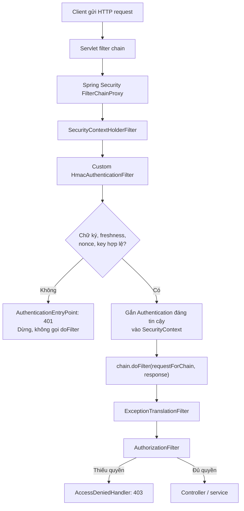

# Tiếp tục filter chain trong custom authentication filter

## 1. Bài toán: khi nào filter HMAC được cho request đi tiếp?

Trong Spring Security, một HTTP request thường đi qua nhiều filter trước khi đến controller. Khi tự viết **custom authentication filter** để xác thực HMAC (*Hash-based Message Authentication Code*), câu lệnh `chain.doFilter(request, response)` là điểm quyết định liệu request có được chuyển tới phần xử lý tiếp theo hay không.

Module `SECURITY_AUTHENTICATION_HMAC_REQUEST_AUTHENTICATION` tập trung vào xác thực HTTP request bằng **shared secret** và **canonical request** được định nghĩa rõ ràng. Hợp đồng ký có thể bao gồm HTTP method, URI, header đã chọn và hash hoặc bytes của body; client và server còn phải thống nhất timestamp, nonce, cách chọn khóa trong key rotation. Spring Security cần nhận được danh tính đã xác minh để phân quyền, nhưng **bản thân chữ ký hợp lệ không đồng nghĩa được phép thực hiện mọi thao tác**.

Hai hành vi trái ngược cần phân biệt:

- **Tiếp tục chain**: request đã đạt điều kiện của filter hiện tại hoặc được cấu hình bỏ qua bước xác thực HMAC; các filter và controller phía sau vẫn được quyền kiểm tra tiếp.
- **Dừng chain**: request bị từ chối xác thực HMAC, tái sử dụng nonce hoặc không đáp ứng điều kiện an toàn. Filter tạo phản hồi thất bại rồi `return`, không gọi controller.

`chain.doFilter(...)` không có nghĩa “chấp nhận request” hoặc “bỏ qua kiểm soát quyền”. Nó chỉ trao quyền xử lý cho thành phần tiếp theo. Quyết định `401`/`403` và các quy tắc authorization còn ở các bước thích hợp của Spring Security.

### Kết quả học tập

Sau bài này, người học cần giải thích được:

1. Vì sao một request hợp lệ phải gọi `chain.doFilter(...)` **đúng một lần trong một lần thực thi filter**.
2. Vì sao request HMAC không hợp lệ phải được chặn trước khi gọi downstream.
3. Khi nào custom filter nên thiết lập `SecurityContext` và khi nào chỉ bỏ qua xác thực.
4. Vì sao đọc body để tính HMAC có thể làm controller không đọc được body.
5. Cách phối hợp custom filter với `ExceptionTranslationFilter`, `AuthorizationFilter`, chống replay và proxy/gateway.

## 2. Mô hình filter chain và vai trò của `doFilter`

Spring Security sử dụng `FilterChainProxy` để chọn và chạy security filter chain phù hợp với request. Các filter được gọi theo thứ tự; tại mỗi bước, filter có thể xử lý request trước, giao cho thành phần kế tiếp qua `chain.doFilter`, rồi xử lý thêm khi lời gọi trở về. Bộ lọc có thể chủ động kết thúc request khi phát hiện lỗi.



Đây là đường xử lý minh họa, không liệt kê toàn bộ filter của Spring Security. Khi HMAC filter nằm trước `ExceptionTranslationFilter`, exception xuất hiện ngay trong HMAC filter nằm **ngoài vùng mà `ExceptionTranslationFilter` bao quanh**. Vì vậy custom HMAC filter nên chủ động chuyển lỗi xác thực của nó sang `AuthenticationEntryPoint` hoặc dùng failure handler phù hợp.

Câu lệnh cơ bản:

```java
chain.doFilter(request, response);
```

là lời gọi **đồng bộ** theo mô hình servlet thông thường: downstream xử lý, sau đó quyền điều khiển trở về đoạn code phía sau câu lệnh. Với async servlet hoặc async dispatch, vòng đời có thêm bước xử lý và không được suy diễn rằng toàn bộ response đã hoàn tất khi lời gọi trả về.

### Phân biệt ba trường hợp thường bị nhầm

| Trường hợp | Có gọi `chain.doFilter`? | Kết quả |
| --- | --- | --- |
| HMAC hợp lệ, đã xác định principal | Có, đúng một lần | Filter phía sau tiếp tục authorization; có thể `2xx` hoặc `403` |
| HMAC không hợp lệ, hết hạn, nonce lặp | Không | Trả lỗi xác thực theo hợp đồng (thường `401`) |
| Endpoint công khai được xác định trước, không áp dụng HMAC | Có, do cơ chế skip của filter | Filter phía sau xử lý theo policy endpoint; `permitAll` không tự loại bỏ custom filter |

Không “gọi tiếp cho chắc” sau khi đã viết `401`. Nếu `doFilter` chạy sau khi phản hồi thất bại đã được thiết lập, controller có thể vẫn thực thi, gây side effect hoặc cố ghi vào response đã commit.

## 3. Quy tắc kiểm soát luồng cho filter HMAC

Có thể xem mỗi request là một trong các nhánh sau:

| Điều kiện | Hành động của filter | Có đi tiếp? |
| --- | --- | --- |
| Request nằm ngoài `SecurityFilterChain` dành cho HMAC | HMAC chain không được chọn | Có, theo chain khác hoặc ứng dụng |
| Path đã được cấu hình rõ ràng không yêu cầu HMAC, ví dụ health check | `shouldNotFilter` cho phép skip HMAC | Có |
| Header chữ ký thiếu trên endpoint yêu cầu HMAC | Gọi `AuthenticationEntryPoint` và `return` | Không |
| Không tìm được khóa hợp lệ, chữ ký sai, timestamp ngoài cửa sổ | Từ chối xác thực | Không |
| Nonce đã được sử dụng | Từ chối replay | Không |
| Kiểm tra chữ ký hợp lệ nhưng client không có authority thao tác | Thiết lập `Authentication`, gọi downstream | Có, rồi authorization trả `403` |
| Chữ ký hợp lệ và client đủ quyền | Thiết lập `Authentication`, gọi downstream | Có |
| Kho khóa/kho nonce lỗi, không thể kiểm tra an toàn | Fail closed, trả lỗi dịch vụ thích hợp | Không |
| Request body ký không còn đọc được do verifier đã tiêu thụ stream | Lỗi thiết kế wrapper/canonicalization, cần sửa | Không thể coi là luồng đúng |

**Thứ tự là bắt buộc:** xác minh credential, giới hạn freshness, chống replay theo hợp đồng, xác lập principal/authorities, rồi mới chuyển tiếp request. Không tạo `Authentication` “đã đăng nhập” chỉ vì request có header `X-Signature`.

Cần tránh nhầm lẫn giữa **bỏ qua xác thực** và **xác thực thất bại**. Trong endpoint bảo vệ bằng HMAC, credential thiếu là lỗi. Chỉ những endpoint thực sự cho phép anonymous mới nên skip filter theo matcher được định nghĩa rõ.

## 4. Viết filter với `OncePerRequestFilter`

`OncePerRequestFilter` là lớp tiện ích phù hợp cho nhiều custom servlet filter. Nó cung cấp cơ chế tránh chạy lặp cùng filter trong một **request dispatch**; tên lớp không phải cam kết “chỉ đúng một lần trên toàn bộ vòng đời async/error dispatch”. Cần xem cách cấu hình dispatch type khi ứng dụng sử dụng async hoặc error processing.

### 4.1. Hợp đồng verifier tách khỏi filter

Verifier phụ trách an toàn mật mã, còn filter quyết định việc gọi phần còn lại của chain.

```java
public record VerifiedHmacRequest(
        Authentication authentication,
        HttpServletRequest requestForChain) {
}

@FunctionalInterface
public interface HmacRequestVerifier {
    VerifiedHmacRequest verify(HttpServletRequest request)
            throws AuthenticationException;
}
```

Khi thành công, verifier phải trả về:

- Một `Authentication` **đã được xác thực bởi server**, chứa principal và authorities được ánh xạ từ credential, key version, client/tenant đã xác minh.
- Một `HttpServletRequest` còn có thể đọc bình thường bởi filter/controller tiếp theo. Đó có thể là request gốc nếu verifier không tiêu thụ body hoặc wrapper có khả năng phát lại body nếu verifier đọc stream.

Khi credential không hợp lệ, verifier ném `AuthenticationException` hoặc lớp con tương ứng. Các lỗi dịch vụ như nonce store không khả dụng cần được xử lý riêng và fail closed, không giả làm một `AuthenticationException` “chữ ký sai” nếu việc phân loại đó che khuất outage.

### 4.2. Cấu trúc filter

```java
public final class HmacAuthenticationFilter extends OncePerRequestFilter {

    private final HmacRequestVerifier verifier;
    private final AuthenticationEntryPoint entryPoint;

    public HmacAuthenticationFilter(
            HmacRequestVerifier verifier,
            AuthenticationEntryPoint entryPoint) {
        this.verifier = verifier;
        this.entryPoint = entryPoint;
    }

    @Override
    protected boolean shouldNotFilter(HttpServletRequest request) {
        // Phải nhất quán với quyền truy cập của endpoint công khai.
        return "/api/health".equals(request.getServletPath());
    }

    @Override
    protected void doFilterInternal(
            HttpServletRequest request,
            HttpServletResponse response,
            FilterChain chain) throws ServletException, IOException {

        final VerifiedHmacRequest verified;
        try {
            verified = verifier.verify(request);
        } catch (AuthenticationException ex) {
            SecurityContextHolder.clearContext();
            entryPoint.commence(request, response, ex);
            return; // Không chuyển tiếp một request xác thực thất bại.
        }

        if (verified == null
                || verified.authentication() == null
                || !verified.authentication().isAuthenticated()
                || verified.requestForChain() == null) {
            // Đây là lỗi hợp đồng nội bộ của verifier, không phải
            // một chữ ký client sai để âm thầm chuyển thành 401.
            SecurityContextHolder.clearContext();
            throw new ServletException(
                    "HMAC verifier did not provide a valid result");
        }

        SecurityContext context = SecurityContextHolder.createEmptyContext();
        context.setAuthentication(verified.authentication());
        SecurityContextHolder.setContext(context);

        // Đặt BÊN NGOÀI catch (AuthenticationException).
        // Các bộ lọc downstream tự áp dụng authorization và xử lý lỗi.
        chain.doFilter(verified.requestForChain(), response);
    }
}
```

**Điểm mấu chốt của đoạn code:** chỉ có một lời gọi `chain.doFilter` trong nhánh xác thực thành công. Với đường đi lỗi, `return` ngăn mọi bước phía sau chạy. Khi `shouldNotFilter` trả về `true`, phần triển khai của `OncePerRequestFilter` sẽ chuyển tiếp request mà không chạy `doFilterInternal`.

Không đặt `chain.doFilter(...)` bên trong khối `catch (AuthenticationException)` của verifier. Ví dụ sau là một lỗi tinh vi:

```java
// KHÔNG NÊN: catch bao cả downstream filter/controller.
try {
    Authentication auth = verifier.verify(request).authentication();
    SecurityContextHolder.getContext().setAuthentication(auth);
    chain.doFilter(request, response);
} catch (AuthenticationException ex) {
    entryPoint.commence(request, response, ex);
}
```

Một `AuthenticationException` từ một thành phần phía sau có thể bị custom filter bắt lại sau khi response đã được thay đổi, khiến logic dịch ngoại lệ bị chồng chéo. Hãy giữ catch **chỉ quanh thao tác xác thực do filter sở hữu**.

### 4.3. Vì sao cần tạo `SecurityContext` mới?

`SecurityContextHolder` giữ `Authentication` để các thành phần downstream đọc trong phạm vi xử lý request. Tạo context mới trước khi gắn danh tính giảm nguy cơ vô tình sửa context được chia sẻ:

```java
SecurityContext context = SecurityContextHolder.createEmptyContext();
context.setAuthentication(verified.authentication());
SecurityContextHolder.setContext(context);
```

Trong chain chuẩn với `SecurityContextHolderFilter`, context được dọn ở thời điểm phù hợp khi request kết thúc. Với API stateless, đừng mặc nhiên lưu context vào HTTP session. Không dùng giá trị do client tự gửi, chẳng hạn `X-Tenant-Id` hoặc `X-Role`, như principal/authority đáng tin cậy nếu chúng chưa được ràng buộc và xác minh bởi chính sách server.

## 5. Cấu hình Spring Security để filter chạy đúng vị trí

Ví dụ Spring Security 6, Java 17+, endpoint `GET /api/orders/{id}` yêu cầu `orders:read`. `/api/health` là endpoint công khai và được skip HMAC theo `shouldNotFilter` ở trên.

```java
@Configuration
public class ApiSecurityConfiguration {

    @Bean
    SecurityFilterChain apiSecurity(
            HttpSecurity http,
            HmacRequestVerifier hmacVerifier) throws Exception {

        AuthenticationEntryPoint entryPoint = (request, response, ex) -> {
            response.setStatus(HttpServletResponse.SC_UNAUTHORIZED);
            // Chỉ dùng HMAC challenge nếu API đã định nghĩa scheme này.
            response.setHeader(
                    HttpHeaders.WWW_AUTHENTICATE,
                    "HMAC realm=\"service-api\"");
            response.setContentType(MediaType.APPLICATION_PROBLEM_JSON_VALUE);
            response.setCharacterEncoding(StandardCharsets.UTF_8.name());
            response.getWriter().write(
                    "{\"type\":\"about:blank\",\"title\":\"Unauthorized\",\"status\":401}");
        };

        AccessDeniedHandler accessDeniedHandler = (request, response, ex) -> {
            response.setStatus(HttpServletResponse.SC_FORBIDDEN);
            response.setContentType(MediaType.APPLICATION_PROBLEM_JSON_VALUE);
            response.setCharacterEncoding(StandardCharsets.UTF_8.name());
            response.getWriter().write(
                    "{\"type\":\"about:blank\",\"title\":\"Forbidden\",\"status\":403}");
        };

        return http
                .securityMatcher("/api/**")
                .sessionManagement(sm -> sm.sessionCreationPolicy(
                        SessionCreationPolicy.STATELESS))
                .requestCache(cache -> cache.requestCache(
                        new NullRequestCache()))
                .csrf(csrf -> csrf.disable())
                .httpBasic(AbstractHttpConfigurer::disable)
                .formLogin(AbstractHttpConfigurer::disable)
                .exceptionHandling(errors -> errors
                        .authenticationEntryPoint(entryPoint)
                        .accessDeniedHandler(accessDeniedHandler))
                .authorizeHttpRequests(authz -> authz
                        .requestMatchers("/api/health").permitAll()
                        .requestMatchers(
                                HttpMethod.GET, "/api/orders/**")
                            .hasAuthority("orders:read")
                        .anyRequest().authenticated())
                .addFilterBefore(
                        new HmacAuthenticationFilter(
                                hmacVerifier, entryPoint),
                        UsernamePasswordAuthenticationFilter.class)
                .build();
    }
}
```

Các import đã được lược; ví dụ sử dụng `jakarta.servlet.*`, `org.springframework.security.*`, `org.springframework.http.*`, `java.nio.charset.StandardCharsets`. `HmacRequestVerifier` là thành phần ứng dụng phải hiện thực, không phải bean có sẵn của Spring Security.

Một số nguyên tắc của cấu hình:

- `addFilterBefore(..., UsernamePasswordAuthenticationFilter.class)` chỉ định vị trí filter trong chuỗi tiêu chuẩn, trước các filter authorization ở phía sau. **Không suy ra** rằng `ExceptionTranslationFilter` sẽ bắt lỗi phát sinh ngay tại HMAC filter; ví dụ xử lý lỗi ở filter chủ động gọi entry point.
- `authorizeHttpRequests` là nơi quyết định policy theo endpoint. `SecurityContext` chứa principal; `AuthorizationFilter` kiểm tra danh tính đó có quyền tương ứng hay không.
- `SessionCreationPolicy.STATELESS` và `NullRequestCache` phù hợp cho API HMAC machine-to-machine không cần session/redirect đăng nhập.
- Việc tắt CSRF ở đây chỉ dành cho chuỗi API stateless không dựa vào cookie tự gửi của trình duyệt để xác thực. Ứng dụng có giao diện đăng nhập/session nên dùng security chain thích hợp riêng.
- `HmacAuthenticationFilter` được tạo trong cấu hình chain. Nếu cũng đăng ký nó làm servlet `Filter` tự động ở container, có nguy cơ filter chạy ngoài vị trí dự kiến hoặc chạy hai lần; cần kiểm soát đăng ký bean/container.
- `WWW-Authenticate: HMAC ...` minh họa scheme theo **hợp đồng API riêng**; không mặc định mọi hệ thống HMAC dùng scheme này.

### Một tình huống dễ sai: `permitAll` nhưng vẫn bị trả 401

Giả sử cấu hình:

```java
.requestMatchers("/api/health").permitAll()
```

nhưng filter vẫn áp dụng HMAC cho `/api/health`. Nếu thiếu chữ ký và filter trả `401` trước khi `AuthorizationFilter` chạy, policy `permitAll` không có cơ hội phát huy tác dụng. Giải pháp là **đồng bộ chính sách skip HMAC với policy authorization**. Không giải quyết bằng cách cho mọi request thiếu HMAC đi tiếp.

Nếu API chỉ bảo vệ một số đường dẫn, hãy định nghĩa `RequestMatcher` minh bạch và kiểm thử các biến thể path, context path, proxy rewrite, method và dispatch type.

## 6. Bảo toàn request body khi đi tiếp

Đây là vấn đề quan trọng nhất khi HMAC ký cả body.

Trong Servlet API, body được đọc qua `request.getInputStream()` hoặc `request.getReader()`. Nếu verifier đã đọc hết stream để tính SHA-256/HMAC, việc gọi:

```java
chain.doFilter(request, response);
```

không tự phục hồi body đã tiêu thụ. Controller có thể nhận body rỗng, lỗi JSON mapping, hoặc kết quả khác với dữ liệu mà server vừa xác thực. Ngược lại, nếu verifier chỉ ký hash do client gửi trong header nhưng **không tự tính lại hash từ body thực**, attacker có thể sửa body mà không bị phát hiện.

### Thiết kế luồng đúng khi ký body

1. Giới hạn kích thước body theo policy API, tránh đọc không giới hạn vào RAM.
2. Thu thập **raw bytes** của body đúng theo hợp đồng, trước khi JSON parser hoặc middleware làm thay đổi biểu diễn.
3. Xây canonical request từ method, URI, header đã ký, hash body, timestamp, nonce và metadata bắt buộc.
4. Xác minh chữ ký và kiểm soát freshness/replay/key.
5. Tạo request wrapper có thể cấp lại **đúng body bytes đã xác minh** cho downstream hoặc sử dụng cơ chế buffering tin cậy sẵn có.
6. Gọi `chain.doFilter(replayableRequest, response)` sau khi danh tính đã được xác lập.

Minh họa ranh giới thiết kế (tên wrapper là ví dụ, cần cung cấp implementation Servlet API đầy đủ và kiểm thử):

```java
// Trong HmacRequestVerifier:
byte[] body = readBodyWithSizeLimit(request, MAX_SIGNED_BODY_BYTES);
String bodySha256 = sha256Base64(body);
verifyCanonicalRequestAndReplay(request, bodySha256);
Authentication auth = trustedAuthenticationForVerifiedClient(request);

// Wrapper phải trả lại đúng bytes trên qua getInputStream/getReader.
HttpServletRequest replayableRequest =
        new ReplayableBodyRequest(request, body);

return new VerifiedHmacRequest(auth, replayableRequest);
```

**Lưu ý:** `ContentCachingRequestWrapper` của Spring Web có chức năng cache khi body được đọc, nhưng nó **không mặc nhiên làm cho body đã tiêu thụ đọc lại được** bởi controller bằng cách gọi `getInputStream()` lần nữa. Không thể chỉ bọc request bằng lớp này rồi giả định downstream đọc lại bình thường. Wrapper phát lại body cần thực hiện đúng `getInputStream`, `getReader`, encoding và các giao ước của `ServletInputStream`, đặc biệt khi có async/nonblocking IO.

Nếu hợp đồng HMAC chỉ ký metadata/header và **không** ký body, verifier có thể không cần đọc body; nhưng phải xác định rõ phạm vi bảo vệ: nội dung body khi đó không nhận được bảo đảm integrity từ chữ ký ấy.

### Không thay đổi request đã ký trước khi chuyển tiếp

Ngoài body, proxy/gateway có thể rewrite path, thay đổi query encoding, merge duplicate headers, chuyển compression hoặc làm khác biệt host/scheme. Verifier và client phải thống nhất request ở *điểm quan sát nào* được dùng để canonicalize. Sau khi xác minh, không nên tạo sự khác biệt không kiểm soát giữa nội dung đã xác thực và nội dung mà controller sử dụng.

Chỉ tin `Forwarded`/`X-Forwarded-*` từ proxy được chỉ định tin cậy; không dùng trực tiếp giá trị do client tùy ý khai để xây dữ liệu ký. Test vectors phải bao gồm encoded path, Unicode/charset, query lặp, header lặp, body rỗng và body nhị phân nếu được hỗ trợ.

## 7. Đảm bảo không có lỗi replay lọt qua `doFilter`

HMAC chứng minh rằng request do bên có shared secret hợp lệ tạo ra và các trường **đã được ký** không bị đổi, nhưng bản thân phép HMAC không tự ngăn người khác phát lại một request hợp lệ.

Thông thường client gửi các trường như:

```http
POST /api/orders HTTP/1.1
Host: api.example.test
X-Key-Id: client-42
X-Request-Timestamp: 2026-11-28T03:00:00Z
X-Request-Nonce: a1b2c3-unique
X-Signature: <chu-ky-HMAC-base64>
Content-Type: application/json

{"itemId":"sku-7","quantity":1}
```

Trước khi đi tiếp, verifier phải kiểm tra:

- Timestamp nằm trong cửa sổ cho phép, với chính sách clock skew rõ ràng.
- Nonce là duy nhất trong **không gian khóa/credential thích hợp** và cửa sổ sống, tránh chặn nhầm nonce của client khác.
- Việc đánh dấu nonce đã dùng là **atomic** để hai request song song cùng nonce không cùng vượt qua.
- `keyId` chọn đúng phiên bản shared secret đang hợp lệ; key rotation không làm bỏ qua quy tắc anti-replay.
- Signature được so sánh theo cách chống rò rỉ thông tin qua thời gian và xác minh trên canonical representation thống nhất.

Có hệ thống chọn kiểm tra/tạm giữ nonce trước khi kiểm tra chữ ký để chống flood, hoặc đánh dấu sau khi chữ ký hợp lệ. Thứ tự và cơ chế reservation cần thiết kế với các yêu cầu DoS, race, lưu lượng và rollback; **bất kể cách triển khai**, phải bảo đảm request replay không thể vượt qua bước xác minh để đến `chain.doFilter`.

Nếu nonce store không khả dụng, hệ thống không được tùy ý cho request đi tiếp để “tăng availability”. Hãy **fail closed** và trả mã lỗi dịch vụ phù hợp (ví dụ `503`) thông qua lớp xử lý lỗi vận hành được thiết kế cho filter. Không cố gắng phân loại outage thành `403` thiếu quyền hay coi verifier trả null nghĩa là thành công.

Chống replay cũng không thay thế **idempotency** ở nghiệp vụ: retry một lệnh ghi sau timeout với nonce cũ có thể bị từ chối, còn retry với nonce mới có thể tạo giao dịch lặp nếu thiếu idempotency key.

## 8. Exception translation xảy ra ở đâu?

HMAC filter và authorization filter giải quyết hai câu hỏi khác nhau:

- `AuthenticationException`: request không có credential HMAC hợp lệ. HMAC filter đặt trước `ExceptionTranslationFilter` nên tự gọi `AuthenticationEntryPoint` và kết thúc request.
- `AccessDeniedException`: request có danh tính nhưng thiếu quyền. Nếu phát sinh ở `AuthorizationFilter` phía sau `ExceptionTranslationFilter`, ngoại lệ sẽ được chuyển sang `AccessDeniedHandler`, trả `403` theo hợp đồng API.

Ví dụ:

```text
HMAC sai
  -> HmacAuthenticationFilter
  -> AuthenticationEntryPoint
  -> 401 (không gọi chain.doFilter)

HMAC đúng, principal thiếu orders:read
  -> HmacAuthenticationFilter
  -> chain.doFilter(...)
  -> AuthorizationFilter
  -> AccessDeniedException
  -> ExceptionTranslationFilter / AccessDeniedHandler
  -> 403

HMAC đúng, đủ orders:read
  -> HmacAuthenticationFilter
  -> chain.doFilter(...)
  -> AuthorizationFilter cho qua
  -> Controller trả kết quả nghiệp vụ
```

Với principal anonymous, `ExceptionTranslationFilter` có thể chuyển một `AccessDeniedException` thành yêu cầu xác thực qua entry point thay vì `403`; cơ chế này dùng `AuthenticationTrustResolver`, không chỉ kiểm tra `Authentication.isAuthenticated()` của token anonymous.

Nếu code trong filter tự trả response, hãy đảm bảo:

- Mỗi lỗi chỉ được xử lý bởi **một** handler có trách nhiệm.
- Không ghi response body sau khi `sendError` hoặc response đã commit.
- Không gọi tiếp chain sau khi trả lỗi.
- Không log secret, chữ ký kỳ vọng hay canonical request chứa dữ liệu nhạy cảm.
- Lỗi lập trình và hạ tầng không bị catch rộng để biến thành `401`.

Nếu custom filter đặt **sau** `ExceptionTranslationFilter` trong một thiết kế đặc biệt, có thể có khác biệt về việc ngoại lệ được bắt và thứ tự thiết lập principal. Cần kiểm tra filter order thực tế thay vì áp dụng một quy tắc chung cho mọi thứ tự.

## 9. `return` sau `chain.doFilter` có bắt buộc không?

Xem ví dụ:

```java
// Đúng: logic trước/ sau downstream có mục đích rõ.
auditStart(request);
chain.doFilter(request, response);
auditFinish(request, response);
```

Ở đây `auditFinish` chỉ chạy sau khi lời gọi đồng bộ trả về, hoặc vào `finally` nếu cần chạy cả khi downstream ném lỗi. Tuy nhiên với async, downstream có thể chưa xử lý xong. Và nếu response đã commit, phần hậu xử lý không thể tùy ý đổi status hoặc header.

`return` sau `chain.doFilter(...)` **không bắt buộc về cú pháp** nếu đó là lệnh cuối của phương thức. Dùng `return` khi muốn chặn code phía sau trong một nhánh rõ ràng:

```java
if (isPublicEndpoint(request)) {
    chain.doFilter(request, response);
    return;
}

// Chỉ xác thực nếu request nằm ngoài nhánh public.
authenticateProtectedRequest(request);
```

Trong `OncePerRequestFilter`, ưu tiên `shouldNotFilter` cho nhánh skip để tránh tự viết nhiều đường gọi `doFilter` không cần thiết.

### Tránh gọi hai lần

```java
// SAI: request có thể chạy downstream hai lần.
if (signatureValid) {
    chain.doFilter(request, response);
}
chain.doFilter(request, response);
```

Hai lời gọi có thể tạo side effect hai lần ở controller, sinh hai response hoặc lỗi “response already committed”. Một request xác thực thành công nên chỉ được **một lần chuyển tiếp từ một lần thực thi filter**.

### Tránh bỏ quên lời gọi

```java
// SAI: xác thực thành công nhưng không chuyển tiếp.
Authentication authentication = verify(request);
SecurityContextHolder.getContext().setAuthentication(authentication);
return;
```

Nếu response chưa được ghi và không gọi chain, request có thể kết thúc rỗng hoặc treo logic ứng dụng tùy ngữ cảnh. Kiểm tra signature thành công không tự kích hoạt controller.

### Tránh ghi response rồi lại đi tiếp

```java
// SAI: request lỗi vẫn đi tới controller.
if (!signatureValid) {
    response.setStatus(401);
    response.getWriter().write("Invalid signature");
}
chain.doFilter(request, response);
```

Cần gọi entry point rồi `return`, hoặc dùng cơ chế failure handling tương đương được thiết kế rõ.

## 10. Thứ tự filter, dispatcher và những trường hợp biên

### 10.1. Filter chain nào được chọn?

Nếu có nhiều `SecurityFilterChain`, Spring Security chọn chain **đầu tiên khớp request** theo thứ tự cấu hình. Một chain dành cho `/api/**` và một chain cho trình duyệt cần được sắp xếp để không vô tình bỏ qua HMAC trên API. Một route có thể nằm ngoài phạm vi security chain nếu matcher cấu hình sai; cần có integration test cho các route nhạy cảm.

### 10.2. Async và error dispatch

`OncePerRequestFilter` sử dụng marker theo request để tránh lặp không chủ đích trong cùng dispatch. Theo hành vi mặc định, filter thường bỏ qua async dispatch tiếp theo và error dispatch; nhưng servlet container, loại dispatcher và overrides có thể thay đổi luồng thực tế. Nếu ứng dụng dùng `DeferredResult`, `Callable`, `AsyncContext` hoặc chuyển sang `/error`, cần xác minh context propagation, policy và xử lý response với cấu hình cụ thể.

Không tự gọi `chain.doFilter` lần thứ hai để “xử lý tiếp” một async request. Việc tiếp tục async được quản lý bởi Servlet container và cơ chế tích hợp của Spring.

### 10.3. Exception từ downstream

Khi `chain.doFilter(...)` ném `IOException` hoặc `ServletException`, hãy để ngoại lệ lan truyền trừ khi filter thực sự sở hữu trách nhiệm xử lý. Dùng `try/finally` cho cleanup tài nguyên cần thiết, nhưng không biến mọi exception từ controller thành lỗi HMAC. `SecurityContextHolderFilter` chịu trách nhiệm dọn context trong chuỗi chuẩn sau request.

### 10.4. Request/response wrapper

Nếu đã wrap request để bảo toàn body, filter phải truyền **đúng wrapper** xuống chain. Nếu response được wrap để ghi log, mã hóa, nén hoặc quan sát, cần truyền đúng response object và tuân thủ quy tắc commit/buffering. Việc thay wrapper giữa xác minh và controller phải có lý do rõ ràng và được test.

## 11. Kiểm thử việc tiếp tục và dừng chain

Chỉ kiểm tra “chữ ký đúng/sai” là chưa đủ. Test phải chứng minh **controller có chạy hay không**, danh tính có đúng hay không, và downstream nhận được request body đã xác minh.

| Kịch bản | Assertion chính |
| --- | --- |
| HMAC hợp lệ, đủ authority | `chain.doFilter` được gọi đúng một lần; endpoint thành công |
| HMAC hợp lệ, thiếu authority | Filter vẫn gọi chain đúng một lần; `AuthorizationFilter` trả `403` |
| Không có chữ ký trên API bắt buộc HMAC | `401`; downstream không chạy |
| Chữ ký sai hoặc key đã thu hồi | `401`; downstream không chạy; không tiết lộ trạng thái key |
| Timestamp quá hạn hoặc nonce đã dùng | Request bị chặn trước controller |
| Hai request đồng thời cùng nonce | Không có trường hợp cả hai cùng được xử lý thành công |
| Endpoint `/api/health` công khai | Skip verifier; downstream chạy |
| Request JSON body có ký | Body controller nhận đúng bytes đã được xác minh; không bị đọc mất |
| Proxy rewrite URI hoặc header đã ký | Hợp đồng canonicalization đúng; mismatch được phát hiện |
| Key store/nonce store không khả dụng | Fail closed; không gọi downstream |
| Downstream ném `AccessDeniedException` | Không bị HMAC filter bắt nhầm; trả `403` khi authenticated |
| Filter bị đăng ký ngoài security chain hoặc chain matcher sai | Integration test phát hiện route bị bypass/chạy lặp |

### 11.1. Unit test với chain giả

Có thể dùng Mockito để kiểm tra chính xác số lần gọi `doFilter` khi verifier được mock. Ví dụ tối giản, giả sử `request` không thuộc `/api/health` và các biến đã được dựng từ test fixture:

```java
VerifiedHmacRequest verified =
        new VerifiedHmacRequest(authenticatedPrincipal, request);

when(verifier.verify(request)).thenReturn(verified);

filter.doFilter(request, response, chain);

verify(chain, times(1)).doFilter(same(request), same(response));
```

Trong nhánh lỗi, verifier ném `BadCredentialsException` và ta kiểm tra entry point được gọi cùng với việc không chuyển tiếp:

```java
when(verifier.verify(request))
        .thenThrow(new BadCredentialsException("Invalid HMAC"));

filter.doFilter(request, response, chain);

verify(entryPoint, times(1)).commence(
        same(request), same(response), any(AuthenticationException.class));
verifyNoInteractions(chain);
```

Đây là đoạn minh họa, không phải một lớp test độc lập: `filter`, `verifier`, `entryPoint`, `chain`, `request`, `response` và `authenticatedPrincipal` phải được khởi tạo trong fixture. Khi test `OncePerRequestFilter` bằng `MockHttpServletRequest`, đặt đúng servlet path và điều kiện dispatch để trúng nhánh đang kiểm thử.

### 11.2. Integration test qua security filter chain thực

Với `MockMvc` hoặc bài test HTTP thực, cần chạy Spring Security filters, không chỉ gọi trực tiếp controller. Một phép thử `403` phải dùng **HMAC thật sự hợp lệ** nhưng principal thiếu authority; nếu chỉ đính kèm một chuỗi signature giả, request sẽ bị chặn ở `401` và không kiểm tra được authorization.

Ví dụ các expectation:

```java
mockMvc.perform(get("/api/orders/123"))
        .andExpect(status().isUnauthorized());

mockMvc.perform(get("/api/health"))
        .andExpect(status().isOk());

// Header HMAC được tính từ fixture ký hợp lệ cho principal
// thiếu orders:read; không dùng chữ ký giả.
mockMvc.perform(signedGetForReadOnlyWrongScope("/api/orders/123"))
        .andExpect(status().isForbidden());

mockMvc.perform(signedGetWithOrdersRead("/api/orders/123"))
        .andExpect(status().isOk());
```

Các helper `signedGetForReadOnlyWrongScope`, `signedGetWithOrdersRead` do test fixture hiện thực. Đừng lưu cố định nonce rồi tái sử dụng trong các test yêu cầu thành công; nonce phải duy nhất hoặc replay store phải được reset theo isolation của test.

Có thể gắn counter vào controller/service test-double để chứng minh request bị `401` hoặc replay **không tạo side effect**. Đối với API ghi dữ liệu, thêm bài test idempotency và retry sau timeout.

## 12. Thực hành: hoàn thiện một filter HMAC an toàn

Giả sử API có ba endpoint:

| Endpoint | Quy tắc xác thực | Quy tắc quyền |
| --- | --- | --- |
| `GET /api/health` | Không yêu cầu HMAC | Public |
| `GET /api/orders/{id}` | HMAC bắt buộc | `orders:read` và kiểm tra ownership/tenant |
| `POST /api/orders` | HMAC bắt buộc, ký cả body | `orders:write`, chống replay và idempotency |

Hoàn thiện các yêu cầu:

1. Cài `HmacRequestVerifier` với canonical request rõ ràng, key rotation, timestamp và nonce store atomic; chuẩn bị test vectors cho URI/header/body.
2. Cài custom `OncePerRequestFilter` theo hai nhánh: xác thực thành công thì gắn `Authentication` và đi tiếp; thất bại thì gọi entry point và dừng.
3. Cấu hình `SecurityFilterChain` cho `/api/**`, quy tắc skip đúng cho health và `AuthorizationFilter` kiểm tra authority.
4. Nếu có body, cung cấp request wrapper đọc lại đúng bytes đã dùng để kiểm tra chữ ký.
5. Kiểm tra với các trường hợp `401`, `403`, `2xx`, replay, outage nonce store, đồng thời và request đi qua gateway.

**Tiêu chí hoàn thành:** Trong từng lần thực thi HMAC filter, protected request chỉ đi qua `chain.doFilter` sau khi được xác thực thành công; đường thất bại không gọi downstream; request công khai được skip bằng matcher rõ ràng; request body và identity được bảo toàn cho phần xử lý phía sau; các bước authorization vẫn có quyền trả `403`. Nhờ đó custom authentication filter tích hợp đúng với Spring Security mà không làm đứt luồng request hoặc vô tình cho request chưa được xác minh chạy vào nghiệp vụ.
