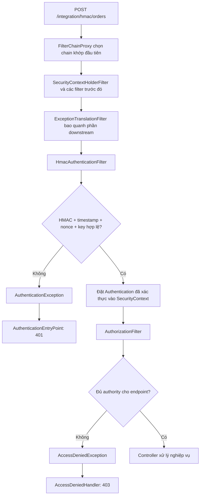

# Đảm bảo filter order cho Custom Authentication Filter xác thực HMAC

## 1. Bối cảnh và mục tiêu

Trong chương **Custom authentication filter**, bài **Đảm bảo filter order** tập trung vào việc sắp xếp filter xác thực tự viết trong Spring Security sao cho HTTP request được kiểm tra đúng trình tự, lỗi được chuyển thành phản hồi hợp lý và quy tắc phân quyền chỉ chạy sau khi server đã xác định danh tính client.

Bài thuộc mô-đun `SECURITY_AUTHENTICATION_HMAC_REQUEST_AUTHENTICATION`: thiết kế xác thực HTTP request bằng HMAC với **shared secret** và **canonical request** gồm HTTP method, URI, header và/hoặc body theo hợp đồng ký. Trong luồng này, server phải xác minh chữ ký, kiểm soát timestamp/nonce để chống replay, quản lý key rotation, xử lý các thay đổi do proxy/gateway gây ra và tách biệt **authentication** với **authorization**.

Sau bài học, người học có thể:

- Phân biệt ba khái niệm thứ tự thường bị nhầm: thứ tự Servlet filter, thứ tự lựa chọn `SecurityFilterChain` và thứ tự các security filter **bên trong** chain.
- Chọn vị trí phù hợp cho `HmacAuthenticationFilter`, giải thích vì sao `ExceptionTranslationFilter` cần bao quanh filter ném `AuthenticationException` và vì sao `AuthorizationFilter` phải chạy sau bước xác thực.
- Sử dụng `addFilterBefore`, `addFilterAfter`, `addFilterAt` và `@Order` đúng mục đích.
- Ngăn custom filter bị đăng ký hai lần giữa Servlet container và Spring Security.
- Kiểm chứng thứ tự thực tế bằng test, log và các tình huống lỗi chữ ký, replay, thiếu quyền, nhiều chain và reverse proxy.

**Phạm vi kỹ thuật:** ví dụ dùng Spring Security trên **Servlet/Spring MVC**, theo DSL phổ biến của Spring Security 6 với `SecurityFilterChain` bean. Với WebFlux/reactive security, cơ chế filter và API cấu hình khác; không áp dụng nguyên xi ví dụ Servlet bên dưới.

## 2. Vì sao filter order ảnh hưởng trực tiếp tới bảo mật?

Giả sử hệ thống nhận `POST /integration/hmac/orders`. Client gửi `X-Client-Id`, `X-Key-Id`, `X-Timestamp`, `X-Nonce`, `X-Signature` và body của đơn hàng. Server dùng metadata đã ký để tái tạo canonical request, tìm shared secret phù hợp, tính HMAC, kiểm nonce và tạo một `Authentication` đại diện cho client đã được xác minh.

Nếu thứ tự sai, có thể xảy ra các lỗi sau:

| Thứ tự hoặc vị trí sai | Hệ quả |
| --- | --- |
| `AuthorizationFilter` chạy trước HMAC filter | Request chưa có principal/authorities đã xác thực; bị từ chối nhầm, hoặc rơi vào chính sách khác ngoài dự kiến. |
| HMAC filter ném `AuthenticationException` khi đang đứng **trước** `ExceptionTranslationFilter` | Exception translation không bao quanh lỗi này; có thể thành phản hồi 500 hoặc bị xử lý không thống nhất. |
| Servlet container tự đăng ký HMAC filter bên ngoài Spring Security | Filter có thể chạy trước chuỗi Spring Security, không nhận đúng security context và error handler. |
| Một chain khác khớp `/integration/hmac/**` sớm hơn chain HMAC | HMAC filter của chain dự định có thể không được gọi; endpoint được bảo vệ bằng chain không phù hợp. |
| HMAC filter chạy trước lớp xử lý body cần thiết, nhưng đọc hết input stream | Filter sau hoặc controller có thể không đọc lại được body; chữ ký/body nghiệp vụ không khớp. |
| Một cơ chế xác thực khác tự ghi đè security context sau HMAC | Principal được downstream dùng có thể khác client đã xác minh HMAC. |

Tính an toàn cần được kiểm chứng trên **đường đi thực tế của request**, không chỉ nhìn vào tên lớp filter hay một annotation.

## 3. Ba lớp thứ tự phải phân biệt

### 3.1. Servlet container filter order

Servlet container gọi các `Filter` đã được đăng ký ở tầng web. Spring Security thường tham gia thông qua một `DelegatingFilterProxy` trỏ đến bean `springSecurityFilterChain` (thực chất thường là `FilterChainProxy`).

Nếu tự đánh dấu `@Component` trên một lớp vừa `implements Filter` / `extends OncePerRequestFilter`, Spring Boot có thể đăng ký nó như **Servlet filter độc lập**. Khi ấy, filter có thể chạy bên ngoài SecurityFilterChain, bất chấp bạn đã thêm nó bằng `http.addFilterBefore(...)`.

> `@Order` trên một Servlet filter/`FilterRegistrationBean` điều khiển thứ tự **đăng ký Servlet filters**, chứ không thay thế thứ tự filter trong `HttpSecurity`.

### 3.2. Thứ tự lựa chọn `SecurityFilterChain`

`FilterChainProxy` duyệt các `SecurityFilterChain` theo thứ tự ưu tiên và chọn **chain đầu tiên khớp** request. Cấu hình `securityMatcher(...)` xác định request nào thuộc chain; `@Order(1)`, `@Order(2)` trên các bean chain xác định độ ưu tiên giữa các chain.

Ví dụ:

- Chain có `@Order(1)` và `securityMatcher("/integration/hmac/**")` được chọn cho endpoint HMAC.
- Chain có `@Order(2)` và matcher mặc định xử lý các request còn lại.

Nếu chain ưu tiên cao lại có `securityMatcher("/**")`, nó khớp cả API HMAC và có thể khiến chain HMAC phía sau **không bao giờ được chọn**.

**Lưu ý:** `requestMatchers(...)` trong `authorizeHttpRequests(...)` chỉ chọn **chính sách phân quyền** sau khi chain đã được chọn; nó không thêm filter mới và không chuyển request sang chain khác.

### 3.3. Thứ tự các filter trong một `SecurityFilterChain`

Các security filter thực thi theo thứ tự nội bộ do Spring Security xác định. Các filter quan trọng cho bài này gồm:

| Filter | Vai trò liên quan |
| --- | --- |
| `SecurityContextHolderFilter` | Chuẩn bị security context của request và dọn dẹp theo vòng đời xử lý. |
| Các filter xác thực được bật, chẳng hạn Basic/Bearer | Có thể xác định principal theo cơ chế xác thực khác; cần thiết kế rõ nếu chain đồng thời hỗ trợ nhiều cơ chế. |
| `AnonymousAuthenticationFilter` | Cung cấp anonymous authentication khi chưa có authentication thực sự. |
| `ExceptionTranslationFilter` | Bắt `AuthenticationException` và `AccessDeniedException` từ phần chain chạy sau nó để ủy quyền cho entry point/handler. |
| **`HmacAuthenticationFilter` (custom)** | Xác minh HMAC, freshness, nonce, key; tạo authentication đã xác thực. |
| `AuthorizationFilter` | Kiểm tra principal/authorities theo quy tắc truy cập đã cấu hình. |

Một **đích thiết kế hợp lý** đối với API chỉ dùng HMAC là:

```text
... SecurityContextHolderFilter
            |
... AnonymousAuthenticationFilter
            |
    ExceptionTranslationFilter
            |
    HmacAuthenticationFilter       <-- Custom filter
            |
       AuthorizationFilter
            |
    DispatcherServlet / Controller
```

Đây là sơ đồ rút gọn, không phải danh sách đầy đủ mọi filter mặc định. Từng chain có thể bao gồm thêm CORS, CSRF, headers, session, logout hoặc filter nghiệp vụ khác. Thứ tự cụ thể cần đọc từ chain **đang chạy**.

## 4. Chọn vị trí cho HMAC filter và hiểu ranh giới xử lý lỗi

`ExceptionTranslationFilter` hoạt động theo mẫu bao quanh: nó gọi `filterChain.doFilter(...)` cho các filter **ở phía sau** rồi bắt những security exception phù hợp từ phần xử lý đó. Do vậy, với HMAC verifier có thể ném `BadCredentialsException` hoặc `AuthenticationException`, hãy bố trí:

```text
ExceptionTranslationFilter  <  HmacAuthenticationFilter  <  AuthorizationFilter
```

Dấu `<` ở đây có nghĩa là **chạy trước**, không phải toán tử của API.

Luồng thành công và thất bại:



Hai nhánh lỗi trong sơ đồ được `ExceptionTranslationFilter` chuyển đến handler tương ứng. Trên một request thiếu xác thực/anonymous bị từ chối quyền, Spring Security thường khởi động `AuthenticationEntryPoint`; bảng `401`/`403` dưới đây giả định principal HMAC đã xác thực khi xét lỗi thiếu authority.

| Trạng thái request | Nơi phát hiện | Kết quả mong đợi |
| --- | --- | --- |
| Thiếu chữ ký, chữ ký sai, timestamp quá hạn, nonce lặp | HMAC filter/verifier | `401 Unauthorized` |
| Chữ ký hợp lệ, client chưa có quyền `orders:write` | AuthorizationFilter | `403 Forbidden` |
| Chữ ký hợp lệ, client có `orders:write` | Controller | Phản hồi nghiệp vụ, ví dụ `201 Created` |
| Body quá giới hạn đã công bố | Tầng giới hạn body | `413 Content Too Large` |
| Kho chống replay gặp sự cố | HMAC verifier / tầng hạ tầng | Fail closed; có thể dùng `503 Service Unavailable` theo chính sách lỗi của API |

Chú ý hai vấn đề độc lập:

1. **HMAC thành công** chỉ chứng minh phía gửi biết shared secret và request chưa bị sửa đổi trong phạm vi các trường đã ký; xác thực còn phải ràng buộc đúng credential/client và chống replay.
2. **Phân quyền** đọc principal và authorities do server tin cậy tạo ra; client không được tự quyết định authorities bằng một header chưa được kiểm chứng.

## 5. Cấu hình `SecurityFilterChain` có kiểm soát thứ tự

Đoạn mã sau minh họa một chain riêng cho API HMAC. Các lớp `HmacVerifier` và `HmacAuthenticationFilter` là phần ứng dụng tự triển khai. Không có filter HMAC tích hợp sẵn chỉ bằng một dòng cấu hình Spring Security.

```java
@Configuration
@EnableWebSecurity
public class HmacSecurityConfig {

    @Bean
    @Order(1)
    SecurityFilterChain hmacChain(
            HttpSecurity http,
            HmacVerifier verifier) throws Exception {

        http
            // Chọn chain dành riêng cho API HMAC.
            .securityMatcher("/integration/hmac/**")
            .sessionManagement(session -> session
                .sessionCreationPolicy(SessionCreationPolicy.STATELESS))
            // Chỉ dùng cho API máy-gọi-máy không dựa vào
            // cookie/session browser để xác thực thao tác.
            .csrf(AbstractHttpConfigurer::disable)
            .httpBasic(AbstractHttpConfigurer::disable)
            .formLogin(AbstractHttpConfigurer::disable)
            .exceptionHandling(errors -> errors
                .authenticationEntryPoint((request, response, error) ->
                    response.sendError(
                        HttpServletResponse.SC_UNAUTHORIZED))
                .accessDeniedHandler((request, response, error) ->
                    response.sendError(
                        HttpServletResponse.SC_FORBIDDEN)))
            .authorizeHttpRequests(auth -> auth
                .requestMatchers(
                    HttpMethod.POST,
                    "/integration/hmac/orders"
                ).hasAuthority("orders:write")
                .anyRequest().authenticated())
            // Anchor sau ExceptionTranslationFilter
            // và trước AuthorizationFilter.
            .addFilterBefore(
                new HmacAuthenticationFilter(verifier),
                AuthorizationFilter.class
            );

        return http.build();
    }

    @Bean
    @Order(2)
    SecurityFilterChain fallbackChain(HttpSecurity http)
            throws Exception {
        // Minh họa fail closed cho request không thuộc API HMAC.
        return http
            .authorizeHttpRequests(auth -> auth
                .anyRequest().denyAll())
            .build();
    }
}
```

Các điểm cần giải thích:

- `@Order(1)`, `@Order(2)` chỉ sắp xếp **hai `SecurityFilterChain` bean**.
- `securityMatcher("/integration/hmac/**")` giới hạn phạm vi request có thể vào chain HMAC.
- `addFilterBefore(custom, AuthorizationFilter.class)` chỉ định thứ tự **bên trong chain HMAC**. Trong cấu hình chuẩn có `ExceptionTranslationFilter` trước `AuthorizationFilter`, custom filter này cũng đứng sau `ExceptionTranslationFilter`.
- `exceptionHandling(...)` thiết lập đường trả về `401` và `403` khi exception được bộ dịch lỗi bắt và phân loại theo trạng thái xác thực.
- `STATELESS` tránh phụ thuộc HTTP session để duy trì danh tính giữa các request. CSRF chỉ được vô hiệu hóa trong chain API máy-gọi-máy đã xác định rõ; nếu dùng cookie xác thực trình duyệt cần đánh giá lại.
- Fallback chain `denyAll()` chỉ là lựa chọn minh họa nhằm biểu diễn phân vùng chain. Ứng dụng có web UI/OAuth2 hoặc endpoints khác phải thay bằng policy phù hợp nhưng vẫn giữ quy tắc **first matching chain**.

Các import quan trọng trong ví dụ là `org.springframework.security.web.access.intercept.AuthorizationFilter`, `org.springframework.security.config.annotation.web.builders.HttpSecurity`, `org.springframework.security.config.annotation.web.configurers.AbstractHttpConfigurer`, `org.springframework.security.config.http.SessionCreationPolicy` và `jakarta.servlet.http.HttpServletResponse`.

### Vì sao không đặt HMAC filter trước `UsernamePasswordAuthenticationFilter` theo thói quen?

Nhiều ví dụ custom filter trên Internet dùng:

```java
http.addFilterBefore(customFilter, UsernamePasswordAuthenticationFilter.class);
```

Vị trí này không bảo đảm `ExceptionTranslationFilter` đứng trước custom filter. Nếu custom filter **tự ném** `AuthenticationException`, `ExceptionTranslationFilter` phía sau sẽ không bao quanh exception. Vì vậy “đặt trước UsernamePasswordAuthenticationFilter” không tự động là đáp án đúng cho filter HMAC tự xác minh và chủ động báo lỗi.

Nếu kiến trúc buộc custom filter phải chạy trước `ExceptionTranslationFilter`, filter cần **tự bắt** lỗi xác thực ở vị trí đó, gọi `AuthenticationEntryPoint` một cách nhất quán và kết thúc request. Không vừa gửi response vừa ném lại exception gây hai lần xử lý.

## 6. Triển khai trách nhiệm filter theo đúng thứ tự nội bộ

Ví dụ dưới đây chủ yếu làm rõ chỗ thiết lập `SecurityContext`. `ReplayableRequest`, `HmacVerifier` và phần đọc body có giới hạn là các thành phần **do ứng dụng tự viết**; muốn chạy cần triển khai và kiểm thử các lớp này.

```java
public final class HmacAuthenticationFilter
        extends OncePerRequestFilter {

    private final HmacVerifier verifier;

    public HmacAuthenticationFilter(HmacVerifier verifier) {
        this.verifier = verifier;
    }

    @Override
    protected void doFilterInternal(
            HttpServletRequest request,
            HttpServletResponse response,
            FilterChain chain)
            throws ServletException, IOException {

        // Wrapper tự viết để tính digest body theo byte gốc,
        // giới hạn payload và cho controller đọc lại được body.
        HttpServletRequest wrapped =
            ReplayableRequest.wrapWithLimit(request, 1024 * 1024);

        // Phải xác minh: canonical request, HMAC, timestamp,
        // nonce/replay, trạng thái key, ràng buộc client/tenant.
        // Chỉ trả token "authenticated" nếu mọi bước đều đạt.
        Authentication result = verifier.authenticate(wrapped);

        if (result == null || !result.isAuthenticated()) {
            throw new BadCredentialsException(
                "Invalid HMAC credentials");
        }

        SecurityContext context =
            SecurityContextHolder.createEmptyContext();
        context.setAuthentication(result);
        SecurityContextHolder.setContext(context);

        chain.doFilter(wrapped, response);
    }
}
```

Với cách đặt filter đã chọn, `ExceptionTranslationFilter` có thể xử lý `AuthenticationException` từ `verifier.authenticate(...)`. Spring Security chịu trách nhiệm dọn `SecurityContextHolder` theo vòng đời request; không giữ principal trong biến `static` hay `ThreadLocal` do ứng dụng tự quản lý. Nếu ứng dụng sử dụng async dispatch, cần đánh giá cách truyền context qua luồng thực thi khác.

Thứ tự nghiệp vụ **bên trong** verifier cũng quan trọng:

1. **Kiểm tra dữ liệu đầu vào**: đủ header, độ dài hợp lệ, key ID và timestamp đúng định dạng; từ chối header lặp/mơ hồ theo hợp đồng.
2. **Tra credential**: ánh xạ key ID về đúng client/tenant theo nguồn tin cậy của server, kiểm trạng thái key (`ACTIVE`, `VERIFY_ONLY`, `REVOKED`) và khoảng hiệu lực.
3. **Kiểm tra timestamp**: ràng buộc cửa sổ thời gian và độ lệch đồng hồ theo UTC, từ chối timestamp quá cũ hoặc quá xa tương lai.
4. **Dựng canonical bytes**: method, raw/normalized URI/query, header được ký, body hoặc body digest theo **cùng một đặc tả** của client và server. Dùng byte UTF-8/byte body đúng hợp đồng, không ngầm parse rồi serialize lại JSON.
5. **Kiểm MAC**: tính HMAC-SHA256 với secret tương ứng, decode chữ ký đúng định dạng, so sánh byte phù hợp để tránh rò rỉ thời gian, chẳng hạn `MessageDigest.isEqual`.
6. **Đánh dấu nonce nguyên tử**: chỉ sau chữ ký hợp lệ, ghi khóa replay gồm client/tenant + key ID + nonce vào kho dùng chung bằng thao tác atomic insert-if-absent, có TTL bao phủ cửa sổ hợp lệ. Nếu nonce đã có thì từ chối.
7. **Cấp principal và authorities**: suy từ thông tin server đã xác minh, tránh tin quyền do client gửi. Chỉ đến đây mới trả về `Authentication` đã xác thực.

Không lưu nonce chỉ trong RAM một node khi load balancer có nhiều backend. Với Redis có thể dùng phép tương đương `SET replay:<scope>:<key-id>:<nonce> 1 NX PX <ttl>`. Khi kho replay lỗi, API đòi hỏi bảo vệ chống replay nên từ chối request theo chính sách **fail closed**.

Với body lớn, streaming hoặc file upload, yêu cầu đọc lại toàn bộ body trong RAM có thể không phù hợp. Cần giới hạn kích thước và dùng chiến lược hash, buffer hay lưu tạm riêng, không đánh đổi an toàn vì muốn đặt filter sớm. `ContentCachingRequestWrapper` không tự biến một body đã bị đọc hết thành input stream có thể đọc lại; phải hiểu cách wrapper hoạt động.

## 7. Hiểu chính xác `addFilterBefore`, `addFilterAfter` và `addFilterAt`

| API | Ý nghĩa | Khi nào dùng trong bài này |
| --- | --- | --- |
| `http.addFilterBefore(hmac, AuthorizationFilter.class)` | Xếp HMAC ngay trước vị trí của filter làm mốc trong bảng thứ tự security filter. | Cách minh họa ưu tiên khi muốn HMAC chạy sau exception translation và trước phân quyền. |
| `http.addFilterAfter(hmac, ExceptionTranslationFilter.class)` | Xếp HMAC ngay sau vị trí của `ExceptionTranslationFilter`. | Cũng có thể phù hợp, **nếu kiểm chứng** nó còn đứng trước `AuthorizationFilter` trong chain cụ thể. |
| `http.addFilterAt(hmac, SomeKnownFilter.class)` | Xếp custom filter vào cùng vị trí thứ tự với một loại filter đã biết. | Tránh dùng khi không chủ đích thay thế cơ chế tương đương; nhiều filter cùng vị trí không có quan hệ trước/sau được bảo đảm. |
| `@Order` trên bean `SecurityFilterChain` | Sắp thứ tự **các chain** để chọn chain khớp đầu tiên. | Quy định chain HMAC có ưu tiên cao hơn chain fallback. |
| `@Order`/`FilterRegistrationBean#setOrder` ở Servlet layer | Sắp thứ tự Servlet filters do container gọi. | Không dùng để sắp xếp vị trí một filter trong `HttpSecurity`. |

`addFilterBefore/After` làm việc theo **vị trí thứ tự đã đăng ký của loại filter làm mốc**; không nên suy luận rằng filter làm mốc nhất thiết đang bật trong tất cả chain. Kiểm chứng danh sách filter **thực tế** khi có nhiều cấu hình, starter hoặc thư viện can thiệp.

Nếu đồng thời bật Basic, Bearer token hoặc custom authentication khác trong **cùng một chain**, phải định nghĩa rõ ai có quyền xác thực endpoint nào. Khi chỉ có HMAC, cấu hình tắt các cơ chế không dùng trong chain giảm khả năng một request vô tình được xác thực qua đường khác.

## 8. Ngăn double registration của custom filter

Một lỗi phổ biến trong Spring Boot là khai báo:

```java
@Component
public class HmacAuthenticationFilter extends OncePerRequestFilter {
    // ...
}
```

sau đó thêm chính bean đó vào `HttpSecurity`:

```java
http.addFilterBefore(hmacFilter, AuthorizationFilter.class);
```

Boot có thể tự đăng ký `Filter` bean ở Servlet container. Kết quả là cùng một filter được container gọi ngoài chain và được tham chiếu bên trong Spring Security. `OncePerRequestFilter` chỉ ngăn một số lần chạy lặp trên cùng request/dispatch; nó **không sửa được sai thứ tự tầng đăng ký**. Thậm chí khi marker “already filtered” làm phương thức `doFilterInternal` chỉ chạy một lần, lần chạy đó có thể diễn ra ở vị trí bên ngoài security chain.

Có hai cách kiểm soát rõ ràng:

**Cách A – tạo filter trực tiếp trong chain.** Dùng `new HmacAuthenticationFilter(verifier)` như cấu hình ở mục 5; filter này không tự trở thành Servlet filter bean do component scanning.

**Cách B – giữ filter là bean để inject nhưng vô hiệu hóa đăng ký Servlet container.** Ví dụ:

```java
@Bean
FilterRegistrationBean<HmacAuthenticationFilter> hmacServletRegistration(
        HmacAuthenticationFilter filter) {
    FilterRegistrationBean<HmacAuthenticationFilter> registration =
        new FilterRegistrationBean<>(filter);
    registration.setEnabled(false);
    return registration;
}
```

Khi chọn cách B, chỉ add bean vào đúng `SecurityFilterChain` và kiểm tra đường đi thực tế. Không áp dụng đồng thời cách A và B mà tạo ra hai instance HMAC không chủ ý.

## 9. Bảo đảm đúng thứ tự khi dùng nhiều `SecurityFilterChain`

Đường dẫn `/integration/hmac/orders` có thể đồng thời khớp `/integration/**`, `/integration/hmac/**` và `/**`. Spring Security chỉ chạy filter của **chain đầu tiên khớp**, nên cần đảm bảo:

- Chain HMAC có `securityMatcher` đủ hẹp, đúng endpoint cần ký.
- `@Order` của chain HMAC đứng trước các chain có matcher rộng hơn.
- Một endpoint HMAC không lọt vào fallback hoặc chain có `permitAll` khi chain HMAC bị bỏ qua.
- Một request bình thường ngoài vùng HMAC không bị HMAC filter xử lý nhầm, trừ khi đây là hợp đồng cố ý.
- Thêm, xóa hoặc thay đổi một chain khác luôn đi kèm test đường dẫn chồng lấn.

Ví dụ đường đi:

| Request | Chain được kỳ vọng | Cách xác thực |
| --- | --- | --- |
| `POST /integration/hmac/orders` | HMAC chain, `@Order(1)` | HMAC có timestamp và nonce |
| `GET /integration/hmac/status` | HMAC chain, `@Order(1)` | HMAC (trừ khi thiết kế route và policy riêng) |
| `GET /public/info` | Fallback/chain công khai được cấu hình phù hợp | Theo policy riêng của endpoint |
| `POST /integration/other/orders` | Chain khác hoặc fallback | Không tự nhiên đi qua HMAC chain |

Thay đổi từ `securityMatcher("/integration/hmac/**")` sang `securityMatcher("/integration/**")` có thể làm phạm vi HMAC filter lớn hơn dự tính; thay đổi `@Order` có thể làm cả chain mất hiệu lực. Đây là các thay đổi security behavior cần kiểm thử sau khi cấu hình.

## 10. Kiểm chứng filter order bằng kiểm thử và quan sát

### 10.1. Kiểm tra thứ tự filter từ chain đã được chọn

Một integration test có thể lấy danh sách filter ở chain khớp request và so sánh chỉ số tương đối. Ví dụ dưới dùng Spring Security Test/Mock Servlet, JUnit và AssertJ:

```java
@SpringBootTest
class HmacFilterOrderTest {

    @Autowired
    FilterChainProxy springSecurityFilterChain;

    @Test
    void hmacIsInsideExceptionBoundaryAndBeforeAuthorization() {
        MockHttpServletRequest request =
            new MockHttpServletRequest(
                "POST", "/integration/hmac/orders");
        request.setServletPath("/integration/hmac/orders");

        SecurityFilterChain selected =
            springSecurityFilterChain.getFilterChains()
                .stream()
                .filter(chain -> chain.matches(request))
                .findFirst()
                .orElseThrow();

        List<Filter> filters = selected.getFilters();

        assertThat(indexOf(filters, SecurityContextHolderFilter.class))
            .isLessThan(indexOf(filters, HmacAuthenticationFilter.class));
        assertThat(indexOf(filters, ExceptionTranslationFilter.class))
            .isLessThan(indexOf(filters, HmacAuthenticationFilter.class));
        assertThat(indexOf(filters, HmacAuthenticationFilter.class))
            .isLessThan(indexOf(filters, AuthorizationFilter.class));
    }

    private static int indexOf(
            List<Filter> filters,
            Class<? extends Filter> type) {
        for (int i = 0; i < filters.size(); i++) {
            if (type.isInstance(filters.get(i))) {
                return i;
            }
        }
        throw new AssertionError(
            "Missing filter in selected chain: " + type.getName());
    }
}
```

Để chạy test này cần các dependency Spring Boot Test, Spring Security Test/JUnit/AssertJ thích hợp và imports (chẳng hạn `jakarta.servlet.Filter`, `FilterChainProxy`, `MockHttpServletRequest`). Mục tiêu là xác minh **vị trí tương đối**; không hardcode chỉ số tuyệt đối vì các filter khác có thể xuất hiện khi cấu hình/phiên bản thay đổi.

Nên bổ sung assertion để chain cho `/integration/hmac/orders` có đúng **một instance** HMAC filter và để một URL không thuộc phạm vi không chọn chain HMAC. Test thứ tự nội bộ vẫn chưa chứng minh không có **Servlet filter registration bên ngoài**; cần kiểm tra cấu hình đăng ký hoặc kiểm thử end-to-end.

### 10.2. Integration test phải chứng minh phản hồi đúng

| Tình huống | Điều cần quan sát |
| --- | --- |
| Request có HMAC đúng, nonce mới, quyền phù hợp | Controller được gọi; phản hồi nghiệp vụ đúng. |
| Chữ ký sai hoặc thiếu, key bị thu hồi | HTTP `401`; controller không được gọi. |
| Timestamp quá cũ hoặc quá xa tương lai | HTTP `401` theo hợp đồng; controller không chạy. |
| Request hợp lệ bị replay, kể cả gửi đồng thời trên hai node | Chỉ request đầu tiên có thể được nhận theo chính sách; các bản sao bị từ chối. |
| HMAC hợp lệ, authorities không đủ | HTTP `403`; chứng minh authorization chạy sau authentication. |
| Cùng method/path nhưng thay query, header được ký hoặc body | HMAC verification thất bại. |
| URL được nhiều chain match | Chọn đúng chain HMAC ưu tiên; endpoint không thể đi qua chain công khai. |
| Spring Boot quét filter bean | HMAC filter chạy trong security chain đúng vị trí, không bị Servlet auto-registration. |
| Proxy rewrite path/prefix/query | Hai đầu tái tạo canonical request nhất quán theo hợp đồng ký. |
| Request sử dụng body | Controller vẫn đọc được byte body cần thiết, không bị HMAC filter tiêu thụ hết. |
| Key rotation | `keyId` cũ chỉ dùng trong giai đoạn chuyển tiếp, key bị revoke bị từ chối. |
| Replay store ngừng hoạt động | Fail closed, không cho qua xác thực vì thiếu khả năng chặn replay. |

Các kiểm thử nên xác nhận mã HTTP **và** việc controller có thực sự bị chặn, tránh trường hợp lỗi 401/403 được gửi sau khi nghiệp vụ đã chạy.

### 10.3. Log thứ tự thực thi, nhưng bảo vệ dữ liệu nhạy cảm

Trong môi trường phát triển, có thể bật TRACE tạm thời cho `org.springframework.security.web.FilterChainProxy` để xem filter nào được gọi theo thứ tự và DEBUG cho cấu hình security tương ứng. Khi troubleshooting, ghi log mã lỗi không nhạy cảm như `HMAC_INVALID_SIGNATURE`, `HMAC_REPLAY`, `HMAC_UNKNOWN_KEY`, `HMAC_MISSING_AUTHORITY`.

Không ghi raw shared secret, chữ ký toàn phần, raw body nhạy cảm hay toàn bộ thông tin định danh vào log. Nên liên kết sự kiện với request ID để theo dõi luồng qua gateway, backend và replay store mà không làm lộ credential.

## 11. Những tình huống nâng cao cần để ý

### 11.1. Proxy/gateway thay đổi request trước khi filter chạy

Filter có thể được đặt đúng thứ tự nhưng vẫn từ chối request hợp lệ nếu client ký `/public/integration/hmac/orders` còn gateway chuyển thành `/integration/hmac/orders` trước khi ứng dụng nhận. Hợp đồng ký phải xác định **URI nào được ký**, cách xử lý query, percent-encoding, header được giữ lại và thay đổi body. Chỉ dùng `Forwarded` / `X-Forwarded-*` từ proxy đáng tin cậy, tuyệt đối không tự tin header client cung cấp để tái tạo URI tùy ý.

Khi gateway tự xác minh HMAC, phải thiết kế lại ranh giới tin cậy: backend tin kết quả gateway qua kết nối đã xác thực và không nhận cùng một header xác nhận từ client ngoài. Đây là mô hình khác với backend tự kiểm HMAC và cần threat model riêng.

### 11.2. Body buffering và canonical request

Nếu chữ ký bao gồm body, wrapper phải đọc **byte gốc** theo giới hạn, tính digest trên đúng byte đã được ký rồi cung cấp lại stream cho controller. Parse JSON trước rồi serialize lại có thể đổi khoảng trắng, thứ tự thuộc tính hoặc encoding và phá vỡ chữ ký. Cần bảo đảm lọc/gzip/body transformation xảy ra tại tầng đã thỏa thuận.

### 11.3. Key rotation và multi-client

Việc tra key theo `X-Key-Id` cần bị ràng buộc với client/tenant server-side, trạng thái key và giới hạn hiệu lực. Trong quá trình rotation, key cũ có thể `VERIFY_ONLY` một thời gian nhưng không tiếp tục được dùng để ký request mới; quy tắc cụ thể phải nằm trong hợp đồng credential. Đừng để header `clientId` chưa được ký xác định authority mà server gán vào `Authentication`.

### 11.4. Async/error dispatch

`OncePerRequestFilter` cung cấp cơ chế đánh dấu request đã xử lý trong một dispatch và các hook như `shouldNotFilterAsyncDispatch`, `shouldNotFilterErrorDispatch`. Nếu có `ASYNC`/`ERROR` dispatch, hãy kiểm tra filter có chạy lại hay không. Không được vô tình đánh dấu nonce lần hai khi cùng một request logic được dispatch lại; đồng thời cần quản lý security context qua async execution thích hợp.

### 11.5. Exception ngoài phạm vi `ExceptionTranslationFilter`

`ExceptionTranslationFilter` xử lý các **security exception** ở phần downstream của nó; nó không tự động chuyển mọi lỗi thành 401/403. Lỗi body vượt ngưỡng, sai định dạng HTTP, lỗi Redis, timeout hoặc `IOException` cần được ánh xạ riêng theo hợp đồng API. Không gom lỗi hạ tầng thành “signature invalid” vì sẽ che mất nguyên nhân vận hành và làm sai semantics của phản hồi.

## 12. Checklist review cấu hình trước khi triển khai

- [ ] Xác định đúng endpoint cần HMAC, `securityMatcher` của chain đủ chính xác.
- [ ] Kiểm tra `@Order` giữa các chain và test URL chồng lấn.
- [ ] Bảo đảm `ExceptionTranslationFilter` chạy trước HMAC filter khi filter ném `AuthenticationException`.
- [ ] Bảo đảm HMAC filter chạy trước `AuthorizationFilter` và chỉ cấp `Authentication` sau khi verifier thành công.
- [ ] Kiểm tra filter không bị Spring Boot đăng ký thêm ở Servlet container.
- [ ] Xác minh raw body có thể được đọc lại và canonicalization client/server giống nhau.
- [ ] Xác minh nonce được lưu nguyên tử trên kho dùng chung, có TTL phù hợp.
- [ ] Kiểm thử 401/403, key rotation, proxy rewrite, request replay và error/async dispatch.
- [ ] Có log/metric đủ theo dõi chain và lỗi, nhưng che dữ liệu nhạy cảm.

## 13. Câu hỏi củng cố

1. `@Order(1)` trên `SecurityFilterChain` khác `http.addFilterBefore(...)` ở điểm nào?
2. Vì sao HMAC filter được thêm trước `UsernamePasswordAuthenticationFilter` có thể không được `ExceptionTranslationFilter` xử lý lỗi?
3. Khi cùng một lớp `OncePerRequestFilter` vừa là bean Servlet filter vừa được thêm vào `HttpSecurity`, điều gì có thể xảy ra dù filter dường như chỉ chạy một lần?
4. Vì sao kiểm tra index của filter trong đúng `SecurityFilterChain` vẫn chưa đủ để phát hiện mọi lỗi double registration?
5. Tại sao HMAC signature hợp lệ nhưng thiếu authority `orders:write` phải được xử lý như lỗi phân quyền?
6. Một gateway sửa URI đã ký trước khi backend nhận request. Bạn sẽ kiểm chứng hợp đồng ký và thứ tự filter như thế nào?

**Ghi nhớ:** Để đảm bảo filter order cho xác thực HMAC, cần kiểm soát đồng thời việc **chọn đúng SecurityFilterChain**, **đặt custom filter ở đúng vị trí giữa xử lý ngoại lệ và phân quyền**, và **chỉ chạy filter trong tầng đăng ký mong muốn**. Kết quả xác thực phải có đủ HMAC, thời gian, nonce và key hợp lệ trước khi Spring Security cho phép ra quyết định quyền truy cập.
