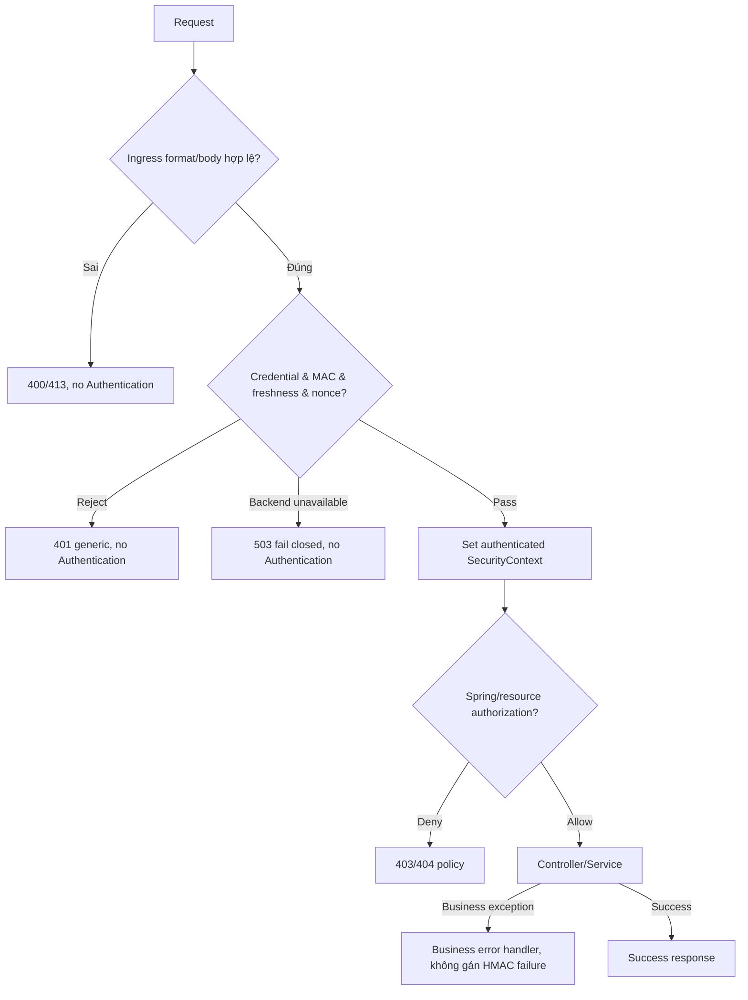
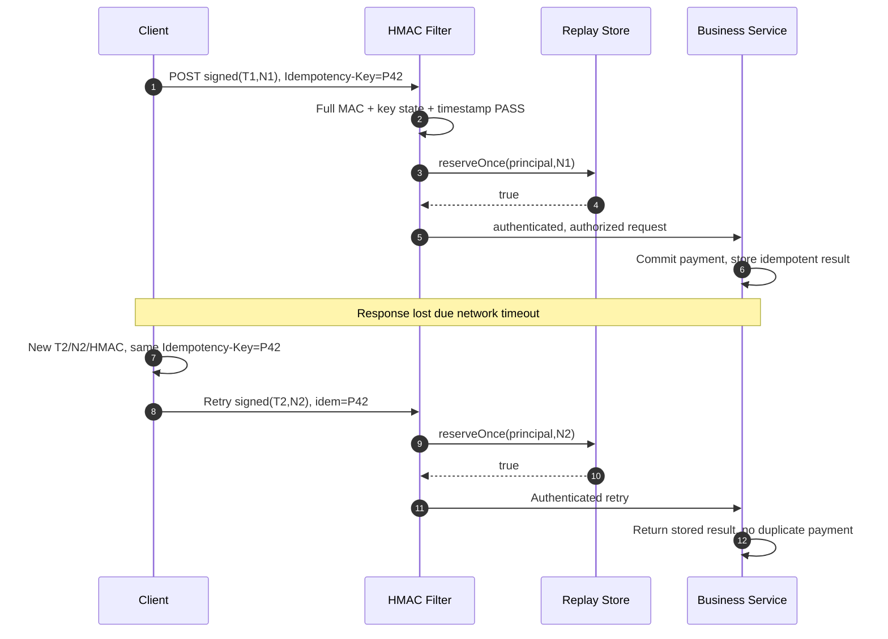

# Xử lý exception

## 1. Xử lý exception là một phần của bảo mật HMAC, không chỉ là trả mã HTTP

Một **custom authentication filter** trong Spring Security nằm ở ranh giới giữa HTTP request chưa tin cậy và **`SecurityContext`** chứa principal đã xác thực. Nếu filter bắt exception không đúng, có thể xảy ra hai loại sự cố trái ngược: **fail open** (request chưa được xác minh vẫn có quyền truy cập), hoặc **fail closed nhưng không vận hành được** (request hợp lệ trả 500/401 sai nguyên nhân, không có khả năng chẩn đoán).

Với **HMAC request authentication**, lỗi có thể xuất hiện ở nhiều giai đoạn:

```text
Client
  |
  | POST /v1/payments
  | X-Client-Id, X-Key-Id, X-Timestamp, X-Nonce, X-Signature
  v
HTTP adapter / request body reader
  |  lỗi cấu trúc HTTP, duplicate headers, body quá lớn
  v
HMAC verifier
  |  unknown/revoked key, MAC mismatch, timestamp stale,
  |  nonce replay, secret manager hoặc replay store unavailable
  v
Spring Security custom authentication filter
  |  VerifiedCaller -> Authentication -> SecurityContext
  v
AuthorizationFilter / Method security
  |  role, scope, merchant, tenant, resource policy
  v
Business endpoint
```

**Không được** coi mọi exception là `401`, cũng không được vì secret manager hoặc Redis bị lỗi mà bỏ qua kiểm MAC.

Bài **“Xử lý exception”** thuộc chương **Custom authentication filter** của mô-đun **`SECURITY_AUTHENTICATION_HMAC_REQUEST_AUTHENTICATION`**. Mô-đun tập trung vào xác thực HTTP request bằng HMAC với shared secret và canonical request có method, URI, header hoặc body theo hợp đồng ký; xác minh chữ ký, chống replay bằng timestamp/nonce, key rotation, kiểm thử proxy/gateway và phân biệt authentication với authorization.

**Sau bài này, người học cần:**

- Phân loại lỗi **HTTP/protocol**, **authentication**, **authorization**, **availability** và **application**.
- Hiểu vai trò của `AuthenticationException`, `AccessDeniedException`, `AuthenticationEntryPoint`, `AccessDeniedHandler` và `ExceptionTranslationFilter`.
- Giải thích vì sao thứ tự custom HMAC filter trong `SecurityFilterChain` quyết định ai bắt exception.
- Tạo **authenticated `SecurityContext` chỉ sau khi** key policy, full HMAC, timestamp và nonce đã đạt.
- Trả phản hồi đúng tình huống (`400/401/403/413/429/503`), không tiết lộ key existence, secret hoặc expected signature.
- Giữ **fail-closed** khi Vault/KMS, database hay replay store lỗi; vẫn có telemetry cho vận hành.
- Dọn `SecurityContextHolder` trên mọi đường success, reject, runtime exception và downstream failure.
- Bảo vệ raw-body handling, error dispatch, response-committed, async/ThreadLocal, multi-tenant và key rotation.
- Viết Java 17, Spring Security servlet filter và JUnit 5/MockMvc tests cho positive/negative/fault-injection paths.

**Bất biến đầu tiên:** nếu HMAC, key state, freshness hoặc replay không được xác minh, **không có authenticated principal** được tạo ra cho request đó — bất kể exception bị chuyển thành HTTP status nào.

## 2. Phân biệt “authentication failure” với “authorization failure”

Ví dụ `client-42` gửi request ký HMAC đến API payment:

```http
POST /v1/payments?merchantId=m-42 HTTP/1.1
Content-Type: application/json
X-Client-Id: client-42
X-Key-Id: k-demo-01
X-Timestamp: 1795856400
X-Nonce: AAAAAAAAAAAAAAAAAAAAAA
X-Signature: <base64-hmac-sha256>

{"orderId":"O-42","amountMinor":250000,"currency":"VND"}
```

Trước MAC, `X-Client-Id` và `X-Key-Id` chỉ là **lookup hints do caller tự khai**. Sau MAC cùng timestamp/nonce hợp lệ, server có thể xây:

```text
Authenticated principal:
  tenantId    = tenant-42
  principalId = svc-payments-42
  clientId    = client-42
  authorities = [payments:create]
```

Khi principal đó gọi `merchantId=m-99` không thuộc tenant-42:

- **Authentication:** đã thành công vì MAC và credential hợp lệ.
- **Authorization:** thất bại vì principal không được phép thao tác merchant m-99.
- **Đáp ứng thông thường:** **403 Forbidden**, không phải “HMAC sai”.

Nếu signature không đúng, chưa có authenticated principal — đáp ứng thông thường là **401 Unauthorized**.

### 2.1. Bảng quyết định theo trạng thái đáng tin

| Tình trạng | Được tạo `Authentication`? | Kết quả thường gặp |
| --- | --- | --- |
| Missing `X-Signature` cho API bắt buộc HMAC | Không | 401 |
| Chữ ký Base64 đúng format nhưng MAC không khớp | Không | 401 |
| `clientId/keyId` không tồn tại hoặc key revoked | Không | 401 |
| Timestamp ngoài replay window / nonce đã được dùng | Không | 401 |
| HMAC đúng và principal có đủ quyền | Có | Chuyển tới business |
| HMAC đúng nhưng thiếu authority | Có | 403 |
| HMAC đúng nhưng truy cập resource tenant khác | Có | 403, hoặc 404 che giấu resource theo API policy |
| Secret manager/replay store không thể hoạt động | Không | 503 hoặc lỗi hạ tầng đã định nghĩa; không accept |

**Không lấy số HTTP code làm bằng chứng duy nhất.** Một response `401` không tự chứng minh application chưa set `SecurityContext`; tests cần assert **controller không chạy, principal không tồn tại và nonce/business side effect không xảy ra**.

## 3. Bản đồ exception theo từng tầng

Spring Security và HMAC domain có những lỗi khác nguồn gốc:

| Tầng | Ví dụ | Loại lỗi | Xử lý phù hợp |
| --- | --- | --- | --- |
| Ingress HTTP | URL sai cấu trúc, duplicate signed header | Malformed request | 400 hoặc auth-error theo contract, không set principal |
| Body reader | Body vượt hard limit | Payload-too-large | 413, không gọi verifier/controller |
| Credential resolver | Unknown client/key | Authentication rejected | Public 401 đồng nhất |
| Credential lifecycle | PENDING, REVOKED, EXPIRED | Authentication rejected | Public 401 đồng nhất |
| Canonical/HMAC | MAC mismatch, tag truncation | Authentication rejected | Public 401 đồng nhất |
| Freshness/replay | Stale timestamp, used nonce | Authentication rejected | Public 401 đồng nhất |
| Secret manager/KMS | Timeout, unavailable | Infrastructure unavailable | 503; fail closed |
| Replay store | Timeout / lost atomic reservation | Infrastructure unavailable | 503; fail closed |
| Spring authorization | Authenticated nhưng thiếu `GrantedAuthority` | `AccessDeniedException` | 403 |
| Resource policy | Authenticated nhưng sai merchant | Domain authorization denied | 403/404 theo policy |
| Controller/service | Validation thất bại | Domain input error | 400/422 theo API contract |
| Controller/service | Lỗi DB nghiệp vụ | Server error | 5xx, không đổi thành “HMAC invalid” |
| Rate limiter | Vượt quota trước khi kiểm HMAC | Throttling | 429, giới hạn thông tin |
| Network | Client disconnect/response committed | I/O or terminal state | Abort/log an toàn, không viết response lần hai |

Một sơ đồ xử lý:



### 3.1. Không đồng nhất lỗi cấu trúc và lỗi HMAC

Một input có header thiếu dấu phân cách, body quá lớn hoặc method không hỗ trợ có thể bị từ chối **trước bước crypto**. Response có thể là 400/405/413 tùy ingress và API contract; đây **không có nghĩa request đã authenticated**.

Đối với key enumeration, nên **giữ public error thống nhất** giữa unknown key, revoked key, bad MAC và các lỗi auth tương đương, kể cả trong trường hợp nội bộ có reason code riêng.

### 3.2. Phân biệt reject và unavailable

**Reject:** hệ thống biết request **không đáp ứng policy**, ví dụ HMAC sai, timestamp hết hạn, nonce trùng.

**Unavailable:** hệ thống **không xác minh được** vì dependency lỗi, ví dụ Vault/KMS/Redis timeout.

Không được chuyển unavailable thành authenticated success, cũng không mặc định che toàn bộ outage thành `401` khiến đối tác luân phiên đổi key dù secret hoàn toàn đúng. Với outage có thể dùng 503 và `Retry-After` nếu có backoff policy.

## 4. ExceptionTranslationFilter thực sự bắt exception ở đâu?

Spring Security servlet sử dụng **security filter chain**. `ExceptionTranslationFilter` thường là filter dịch một số `AuthenticationException` hoặc `AccessDeniedException` phát sinh từ **phần downstream của filter chain** mà nó bao quanh.

Sơ đồ minh họa thứ tự tương đối:

```text
SecurityContextHolderFilter
          |
          v
CustomHmacAuthenticationFilter    <-- ví dụ addFilterBefore(...,
          |                              UsernamePasswordAuthenticationFilter.class)
          v
... các security filters ...
          |
          v
ExceptionTranslationFilter
          |
          v
AuthorizationFilter / controller
```

Đặc điểm quan trọng:

- `ExceptionTranslationFilter` xử lý exception nó **nhìn thấy khi gọi downstream chain**.
- Một exception ném trực tiếp **từ custom HMAC filter đứng phía trước nó** không nhất thiết được `ExceptionTranslationFilter` bắt.
- Một exception `AccessDeniedException` ném **sau** `ExceptionTranslationFilter` thường được dịch theo trạng thái authentication: principal chưa xác thực có thể được chuyển tới `AuthenticationEntryPoint`; principal đã xác thực nhưng thiếu quyền được chuyển tới `AccessDeniedHandler`.
- `ExceptionTranslationFilter` **không** phải một `@ControllerAdvice` hoặc handler toàn cục cho mọi exception trong ứng dụng.

### 4.1. Vì sao chỉ “throw BadCredentialsException” thường không đủ?

```java
// Trong custom HMAC filter đứng trước ExceptionTranslationFilter:
if (!signatureMatches) {
    throw new BadCredentialsException("invalid signature");
}
```

Nếu không có thành phần upstream bắt exception, filter container có thể trả 500 hoặc fallback error response thay vì 401 mong muốn. Không nên dựa vào suy đoán filter order.

Hai kiến trúc chính:

1. Filter **tự gọi `AuthenticationEntryPoint.commence(...)`** cho HMAC reject rồi dừng chain.
2. Thiết kế `AuthenticationManager/AuthenticationProvider` với **authentication filter có failure handler** hoặc vị trí/exception handling được kiểm thử để framework thực hiện đúng.

**Bài này dùng phương án 1** để học rõ ranh giới và response semantics; không khẳng định đó là cách duy nhất.

### 4.2. Vì sao không catch mọi `AccessDeniedException` trong HMAC filter?

Nếu custom filter bọc cả `chain.doFilter(...)` trong một `catch (Exception)` rồi trả 401, một lỗi authorization `403` có thể bị biến thành “MAC invalid”; lỗi business 500 cũng có thể bị biến thành 401.

**Chỉ bắt đúng lỗi được tạo ở giai đoạn parse/verify của HMAC filter.** Để exception từ downstream đi đến handler thích hợp trong chain/application.

## 5. AuthenticationEntryPoint, AccessDeniedHandler và HTTP contract

**`AuthenticationEntryPoint`** khởi tạo response khi request cần xác thực hoặc bằng chứng xác thực không hợp lệ. **`AccessDeniedHandler`** xử lý khi đã authenticated nhưng không có quyền.

```text
HMAC rejected
  -> AuthenticationEntryPoint
  -> 401 + generic auth error

HMAC verified, Spring authorization denied
  -> AccessDeniedHandler
  -> 403 + generic forbidden error
```

`AuthenticationEntryPoint.commence(HttpServletRequest, HttpServletResponse, AuthenticationException)` có thể ném `IOException`/`ServletException`; filter cần gọi từ đường reject, **không** gọi lại `chain.doFilter` sau khi đã gửi response.

### 5.1. `WWW-Authenticate` ở 401

Theo HTTP authentication semantics, response `401` có **`WWW-Authenticate` challenge**. Một giao thức HMAC **tự định nghĩa** có thể sử dụng ví dụ:

```http
HTTP/1.1 401 Unauthorized
WWW-Authenticate: HMAC realm="payments"
Content-Type: application/json
Cache-Control: no-store

{"error":"invalid_request_authentication"}
```

**`HMAC` ở ví dụ là tên scheme nội bộ được contract định nghĩa, không phải tên một scheme HMAC chuẩn áp dụng cho mọi nhà cung cấp.** Nếu API dùng một contract khác, chọn challenge phù hợp; không ngẫu nhiên trả `Basic` rồi yêu cầu client gửi password.

### 5.2. `403` không phải 401 trá hình

Một principal đã được HMAC xác thực nhưng thiếu quyền `payments:create`:

```http
HTTP/1.1 403 Forbidden
Content-Type: application/json
Cache-Control: no-store

{"error":"access_denied"}
```

Không thử lại bằng secret khác để “tìm ra” key có quyền rộng hơn. Một credential hợp lệ vẫn có thể bị authorization từ chối.

### 5.3. Server error không có nghĩa được cho qua

Nếu secret manager timeout, 503 có thể là status phù hợp:

```http
HTTP/1.1 503 Service Unavailable
Content-Type: application/json
Cache-Control: no-store
Retry-After: 5

{"error":"authentication_temporarily_unavailable"}
```

`Retry-After: 5` chỉ là ví dụ khi server thực sự có backoff estimate/policy. Không tự công bố thời gian khôi phục không có cơ sở. Caller cần retry có backoff/jitter và **timestamp/nonce/signature mới**, nhưng business `Idempotency-Key` vẫn giữ cho cùng intent.

## 6. Thiết kế taxonomy exception rõ ràng trong Java 17

Ta tách **lỗi HMAC đã biết**, **lỗi HTTP malformed/size** và **lỗi backend unavailable**. Tên/enum dưới đây là **domain contract minh họa**, không phải built-in exception của Spring Security.

### 6.1. Lỗi xác thực: HmacRejectedException

```java
import java.util.Objects;
import org.springframework.security.core.AuthenticationException;

public final class HmacRejectedException
        extends AuthenticationException {

    public enum Reason {
        MISSING_CREDENTIAL,
        INVALID_HEADER_FORMAT,
        UNKNOWN_OR_INACTIVE_KEY,
        BAD_MAC,
        STALE_TIMESTAMP,
        NONCE_REPLAY
    }

    private final Reason reason;

    public HmacRejectedException(Reason reason) {
        // Public message giống nhau, không tiết lộ key existence.
        super("HMAC request authentication rejected");
        this.reason = Objects.requireNonNull(reason);
    }

    public Reason reason() {
        // Chỉ dùng cho internal metrics/audit.
        return reason;
    }
}
```

**Phân biệt** `reason()` cho nội bộ với **public error body**. Không render `reason.name()` ra response và cũng không log raw secret/signature để chẩn đoán BAD_MAC.

### 6.2. Lỗi backend: HmacVerificationUnavailableException

```java
public final class HmacVerificationUnavailableException
        extends RuntimeException {

    public enum Backend {
        KEY_CATALOG, SECRET_STORE, REPLAY_STORE
    }

    private final Backend backend;

    public HmacVerificationUnavailableException(
            Backend backend, Throwable cause) {
        super("Required HMAC verifier backend unavailable", cause);
        this.backend =
                java.util.Objects.requireNonNull(backend);
    }

    public Backend backend() {
        return backend;
    }
}
```

Nếu Redis `SET NX` timeout, không biết nonce đã ghi hay chưa — nhưng chắc chắn **chưa có đủ bằng chứng để cho request vào controller**. Caller retry nên tạo nonce mới và ký lại theo API contract; không bỏ qua anti-replay khi phụ thuộc gặp lỗi.

### 6.3. Lỗi malformed/size

```java
public final class HmacMalformedRequestException
        extends RuntimeException {
    public HmacMalformedRequestException() {
        super("Malformed HMAC HTTP request");
    }
}

public final class HmacBodyTooLargeException
        extends RuntimeException {
    public HmacBodyTooLargeException() {
        super("HMAC request body exceeds configured bound");
    }
}
```

**Chọn chính sách:** input `X-Signature` không đúng Base64 có thể là **400 malformed** hoặc **401 invalid auth**; bài dùng **401 generic** cho credential fields để hạn chế enumeration, còn malformed HTTP framing/duplicate headers được từ chối sớm tại ingress theo `400`. Quan trọng hơn mã cụ thể là **nhất quán** và không cấp authentication.

### 6.4. Đừng sử dụng một catch chung cho tất cả

```java
// ANTI-PATTERN: 5xx backend outage bị che thành auth failure,
// 403 downstream bị che thành 401, và lỗi lập trình khó phát hiện.
try {
    verifyAndCallEverything();
} catch (Exception any) {
    returnAuthenticationFailure401();
}
```

Mỗi exception có **nghĩa an ninh và vận hành khác nhau**. Phân loại tại tầng sở hữu thông tin; không lộ chi tiết nội bộ qua public response.

## 7. Trusted verification result: chỉ tạo Authentication khi đầy đủ bằng chứng

Service xác minh HMAC nên trả một object đã được tin từ credential catalog, không trả raw key. Ví dụ:

```java
import java.security.Principal;
import java.util.List;
import java.util.Objects;
import org.springframework.security.core.GrantedAuthority;

public final class HmacVerifierContractsV1 {
    private HmacVerifierContractsV1() {}

    public record HmacPrincipal(
            String tenantId,
            String principalId,
            String clientId) implements Principal {

        public HmacPrincipal {
            Objects.requireNonNull(tenantId);
            Objects.requireNonNull(principalId);
            Objects.requireNonNull(clientId);
            if (tenantId.isBlank() || principalId.isBlank()
                    || clientId.isBlank()) {
                throw new IllegalArgumentException(
                        "Invalid verified identity");
            }
        }

        @Override
        public String getName() {
            return tenantId + ":" + principalId;
        }
    }

    public record VerifiedCaller(
            HmacPrincipal principal,
            String keyId,
            List<GrantedAuthority> authorities) {

        public VerifiedCaller {
            Objects.requireNonNull(principal);
            Objects.requireNonNull(keyId);
            Objects.requireNonNull(authorities);
            if (keyId.isBlank()) {
                throw new IllegalArgumentException(
                        "Missing verified key ID");
            }
            authorities = List.copyOf(authorities);
        }
    }
}
```

Contract `VerifiedCaller` **chỉ được trả về** khi tất cả điều kiện đã qua:

1. Request strict parse, đúng canonical signing profile.
2. Credential lookup **đúng tenant/client/purpose/environment/keyId**.
3. Key version còn verify-eligible (current hoặc verify-only trong grace), không revoked.
4. Secret material đến từ trusted catalog/Vault/KMS; **không** lấy secret từ HTTP header.
5. Canonical bytes dựa trên HTTP request **thực nhận** theo hợp đồng đã công bố.
6. Full HMAC-SHA-256 tag đúng byte và encoding canonical; so bằng `MessageDigest.isEqual` hoặc primitive tương đương.
7. Timestamp signed còn trong freshness window.
8. Atomic nonce reservation thành công cho authenticated principal.

`GrantedAuthority` phải từ **trusted registration/authorization store**, không lấy từ `X-Roles` hay `X-Scopes` tự khai.

### 7.1. HMAC authentication không thay thế authorization

`VerifiedCaller.principal()` cho biết ai đang gọi. Việc **có được tạo payment** cho `merchantId=m-99` hay không phải do **authorization policy** quyết định sau khi context được thiết lập.

Một request có HMAC đúng nhưng sai business resource có thể trả 403 **trong `AccessDeniedHandler`**, không chuyển thành `HmacRejectedException(BAD_MAC)`.

## 8. HMAC verification service: hợp đồng exception tại boundary

Filter nhận `HttpServletRequest` và raw body bytes, nhưng không trực tiếp biết quá trình lookup secret hay Redis:

```java
import jakarta.servlet.http.HttpServletRequest;

public interface HmacVerificationServiceV1 {
    // Chỉ return khi full HMAC, credential policy,
    // timestamp và atomic nonce đều đã PASS.
    HmacVerifierContractsV1.VerifiedCaller verify(
            HttpServletRequest request,
            byte[] rawBody)
            throws HmacRejectedException,
                   HmacMalformedRequestException,
                   HmacVerificationUnavailableException;
}
```

Ví dụ dependency implementations của service có thể throw checked/unchecked exceptions khác. **Ở domain service boundary**, phải **map có chọn lọc**:

```java
// PSEUDO-CODE, không phải file Java buildable độc lập:
try {
    KeyRecord record = catalog.lookup(
            tenant, client, purpose, keyId);
    // Check ownership, algorithm, key state; HMAC; timestamp.
    replayStore.reserveOnce(record.principal(), nonce);
    return trustedVerifiedCaller(record);
} catch (VaultTimeoutException e) {
    throw new HmacVerificationUnavailableException(
            Backend.SECRET_STORE, e);
} catch (ReplayStorageException e) {
    throw new HmacVerificationUnavailableException(
            Backend.REPLAY_STORE, e);
}
```

**Không** catch `Exception` rồi biến mọi lỗi thành `HmacRejectedException`, vì các lỗi programming/DB outage cần 5xx và internal alert. Ngược lại, không để một exception chứa raw credential trong message bị ghi trực tiếp vào response.

### 8.1. Không coi lookup thành công là authenticated

```java
// SAI: chỉ cần keyId có trong catalog là set principal.
var record = catalog.lookup(clientId, keyId);
return new VerifiedCaller(record.principal(), keyId, ...);
```

Catalog lookup sử dụng **untrusted lookup hints**. Cần proof-of-possession bằng HMAC hợp lệ trước khi xác thực principal.

### 8.2. Không lấy cause text làm client-facing message

Message từ `SQLException`, Vault SDK hoặc HTTP client có thể chứa host, secret path hoặc query parameters. Public response chỉ nên dùng **constant error codes**. Internal logging cũng cần sanitizer và retention policy.

## 9. Viết response lỗi an toàn và nhất quán

Một writer tập trung tránh mỗi nhánh tự trả JSON khác nhau và lỡ tiết lộ chi tiết:

```java
import java.io.IOException;
import java.nio.charset.StandardCharsets;
import jakarta.servlet.http.HttpServletResponse;

public final class HmacErrorResponsesV1 {
    private HmacErrorResponsesV1() {}

    public static void write(
            HttpServletResponse response,
            int status,
            String publicCode)
            throws IOException {

        if (response.isCommitted()) {
            // Không thể sửa status/header/body đã gửi.
            return;
        }

        // Không truyền exception.getMessage() vào publicCode.
        if (!"invalid_request_authentication".equals(publicCode)
                && !"invalid_request".equals(publicCode)
                && !"payload_too_large".equals(publicCode)
                && !"authentication_temporarily_unavailable".equals(publicCode)
                && !"access_denied".equals(publicCode)) {
            throw new IllegalArgumentException(
                    "Public error code is not allowlisted");
        }

        response.setStatus(status);
        response.setCharacterEncoding(
                StandardCharsets.UTF_8.name());
        response.setContentType("application/json");
        response.setHeader("Cache-Control", "no-store");
        response.setHeader("Pragma", "no-cache");
        response.getWriter().write(
                "{\"error\":\"" + publicCode + "\"}");
    }

    public static void unauthorized(
            HttpServletResponse response)
            throws IOException {
        if (!response.isCommitted()) {
            // HMAC ở đây là illustrative private scheme.
            response.setHeader(
                    "WWW-Authenticate", "HMAC realm=\"payments\"");
        }
        write(response, 401,
                "invalid_request_authentication");
    }
}
```

**Lưu ý kỹ thuật:**

- Các chuỗi `publicCode` là **allowlist constants**; không có exception message, secret/key locator hay stacktrace.
- Dùng `setStatus` + `getWriter` cho JSON thay vì `sendError` nếu không muốn container error page/dispatch làm thay đổi body. Điều này không phủ nhận `sendError` là API hợp lệ trong kiến trúc khác.
- `response.isCommitted()` báo đã gửi headers/body. Không ghi response thứ hai; cần log/metric sự cố nếu failure xảy ra sau commit.
- Trong thiết kế async streaming, cần quản lý **partial response** và không hứa có thể chuyển bất kỳ lỗi muộn thành 401.
- Không nên cho phép caching các phản hồi auth nhạy cảm; `Cache-Control: no-store` hữu ích cho error response.

### 9.1. AuthenticationEntryPoint và AccessDeniedHandler riêng

```java
import org.springframework.security.web.AuthenticationEntryPoint;
import org.springframework.security.web.access.AccessDeniedHandler;

public final class HmacErrorHandlersV1 {
    private HmacErrorHandlersV1() {}

    public static AuthenticationEntryPoint entryPoint() {
        return (request, response, failure) ->
                HmacErrorResponsesV1.unauthorized(response);
    }

    public static AccessDeniedHandler accessDenied() {
        return (request, response, denied) ->
                HmacErrorResponsesV1.write(
                        response, 403, "access_denied");
    }
}
```

Filter gọi `entryPoint.commence` **chỉ khi HMAC authentication bị reject**. Spring authorization layer gọi `AccessDeniedHandler` khi authenticated principal không có quyền.

### 9.2. Correlation ID là dữ liệu vận hành, không phải secret

Có thể đưa server-generated `requestId` vào header/log để tìm trace tương ứng. Đừng lấy một header `X-Request-Id` từ Internet rồi coi là đã trusted; nếu cho client gửi ID, cần kiểm cú pháp/độ dài và chống log injection.

Không cung cấp stacktrace hoặc internal key-catalog paths trong response.

## 10. Raw-body handling: exception trước khi có Authentication

Nhiều HMAC contracts ký `SHA-256(raw HTTP body bytes)`. Nếu filter đọc `ServletInputStream` rồi chuyển request gốc xuống Spring MVC, `@RequestBody` có thể thấy body rỗng. **`ContentCachingRequestWrapper` cache nội dung được đọc nhưng không tự bảo đảm downstream sẽ có một stream mới để đọc lại sau khi filter consume.**

Một adapter minh họa cho **blocking/synchronous JSON API với body nhỏ**:

```java
import java.io.ByteArrayInputStream;
import java.io.BufferedReader;
import java.io.IOException;
import java.io.InputStreamReader;
import java.nio.charset.StandardCharsets;
import jakarta.servlet.ReadListener;
import jakarta.servlet.ServletInputStream;
import jakarta.servlet.http.HttpServletRequest;
import jakarta.servlet.http.HttpServletRequestWrapper;

public final class ReplayableHmacRequestV1
        extends HttpServletRequestWrapper {

    public static final int MAX_BODY_BYTES = 1_048_576;
    private final byte[] capturedBody;

    public ReplayableHmacRequestV1(
            HttpServletRequest source)
            throws IOException {

        super(source);

        // Đếm bytes thực đọc; không chỉ tin Content-Length.
        byte[] bytes = source.getInputStream()
                .readNBytes(MAX_BODY_BYTES + 1);

        if (bytes.length > MAX_BODY_BYTES) {
            throw new HmacBodyTooLargeException();
        }
        this.capturedBody = bytes;
    }

    public byte[] copyRawBody() {
        return capturedBody.clone();
    }

    @Override
    public int getContentLength() {
        return capturedBody.length;
    }

    @Override
    public long getContentLengthLong() {
        return capturedBody.length;
    }

    @Override
    public ServletInputStream getInputStream() {
        var in = new ByteArrayInputStream(capturedBody);
        return new ServletInputStream() {
            @Override public int read() {
                return in.read();
            }

            @Override public boolean isFinished() {
                return in.available() == 0;
            }

            @Override public boolean isReady() {
                return true;
            }

            @Override public void setReadListener(
                    ReadListener listener) {
                throw new IllegalStateException(
                        "V1 does not support async body reads");
            }
        };
    }

    @Override
    public BufferedReader getReader() throws IOException {
        // Hợp đồng V1 chỉ hỗ trợ UTF-8 text JSON.
        return new BufferedReader(new InputStreamReader(
                getInputStream(), StandardCharsets.UTF_8));
    }
}
```

### 10.1. Body vượt hạn nên trả 413 ở đâu?

Nếu body > `1 MiB` (theo profile mẫu), wrapper ném `HmacBodyTooLargeException`, filter trả **413** và **không gọi verifier**, **không tạo `SecurityContext`**, **không gọi controller**.

Cần có **ingress/gateway hard limit** trước filter để tránh attacker khai `Content-Length` gian dối hoặc gửi streaming/chunked body vô hạn. Mẫu `readNBytes(MAX+1)` chỉ tạo một **bound cục bộ**; streaming/async/multipart cần adapter khác.

### 10.2. Network IOException khác body quá lớn

Nếu socket client ngắt khi đang đọc body, `getInputStream` có thể ném `IOException`. Không nên catch rồi tạo authenticated principal hoặc cố gửi một JSON 401 trong khi connection đã mất. **Để lỗi truyền lên servlet I/O boundary**, context phải được dọn; application metrics cần ghi nguyên nhân ở mức an toàn.

### 10.3. Không serialize lại JSON trước HMAC

Body:

```json
{"orderId":"O-42","amountMinor":250000,"currency":"VND"}
```

và body có spaces/field order khác có **raw bytes khác**. Nếu contract ký raw-body SHA-256, không dùng ObjectMapper parse rồi serialize lại trước HMAC; đó có thể làm mismatch hoặc tạo hai cách hiểu body giữa verifier và business code.

## 11. OncePerRequestFilter: bắt đúng exception từ giai đoạn HMAC

Một implementation minh họa:

```java
import java.io.IOException;
import java.util.Arrays;
import jakarta.servlet.FilterChain;
import jakarta.servlet.ServletException;
import jakarta.servlet.http.HttpServletRequest;
import jakarta.servlet.http.HttpServletResponse;
import org.springframework.security.authentication.UsernamePasswordAuthenticationToken;
import org.springframework.security.core.Authentication;
import org.springframework.security.core.context.SecurityContext;
import org.springframework.security.core.context.SecurityContextHolder;
import org.springframework.security.web.AuthenticationEntryPoint;
import org.springframework.web.filter.OncePerRequestFilter;

public final class HmacExceptionHandlingFilterV1
        extends OncePerRequestFilter {

    private final HmacVerificationServiceV1 verifier;
    private final AuthenticationEntryPoint entryPoint;

    public HmacExceptionHandlingFilterV1(
            HmacVerificationServiceV1 verifier,
            AuthenticationEntryPoint entryPoint) {

        this.verifier = java.util.Objects.requireNonNull(verifier);
        this.entryPoint = java.util.Objects.requireNonNull(entryPoint);
    }

    @Override
    protected void doFilterInternal(
            HttpServletRequest request,
            HttpServletResponse response,
            FilterChain chain)
            throws ServletException, IOException {

        // Dedicated HMAC chain: không tái dùng auth của
        // request/thread trước.
        SecurityContextHolder.clearContext();

        byte[] bodyForVerifier = null;
        try {
            final ReplayableHmacRequestV1 wrapped;
            try {
                wrapped = new ReplayableHmacRequestV1(request);
            } catch (HmacBodyTooLargeException tooLarge) {
                HmacErrorResponsesV1.write(
                        response, 413, "payload_too_large");
                return;
            }

            bodyForVerifier = wrapped.copyRawBody();

            // Catch chỉ quanh verifier, KHÔNG quanh chain.doFilter.
            final HmacVerifierContractsV1.VerifiedCaller verified;
            try {
                verified = verifier.verify(wrapped, bodyForVerifier);
            } catch (HmacMalformedRequestException malformed) {
                HmacErrorResponsesV1.write(
                        response, 400, "invalid_request");
                return;
            } catch (HmacRejectedException rejected) {
                entryPoint.commence(wrapped, response, rejected);
                return;
            } catch (HmacVerificationUnavailableException unavailable) {
                HmacErrorResponsesV1.write(
                        response, 503,
                        "authentication_temporarily_unavailable");
                return;
            }

            // null không bao giờ là success.
            if (verified == null) {
                entryPoint.commence(
                        wrapped, response,
                        new HmacRejectedException(
                            HmacRejectedException.Reason.BAD_MAC));
                return;
            }

            Authentication authentication =
                    UsernamePasswordAuthenticationToken.authenticated(
                            verified.principal(),
                            null,                   // Không giữ HMAC secret.
                            verified.authorities());

            SecurityContext context =
                    SecurityContextHolder.createEmptyContext();
            context.setAuthentication(authentication);
            SecurityContextHolder.setContext(context);

            // Spring authorization và controller chạy ở đây.
            // Downstream AccessDeniedException/Business exception
            // KHÔNG bị catch như HMAC auth failure.
            chain.doFilter(wrapped, response);
        } finally {
            if (bodyForVerifier != null) {
                Arrays.fill(bodyForVerifier, (byte) 0);
            }
            SecurityContextHolder.clearContext();
        }
    }
}
```

**Các ranh giới chính xác:**

- `HmacRejectedException` → gọi `entryPoint` → `401`, **không** `chain.doFilter`.
- `HmacMalformedRequestException` → `400`; `HmacBodyTooLargeException` → `413`.
- `HmacVerificationUnavailableException` → `503`, **không fail open**.
- `verified == null` dù sai contract cũng **không được** tạo token.
- `SecurityContextHolder.createEmptyContext()` + `UsernamePasswordAuthenticationToken.authenticated(...)` chỉ ở nhánh verification thành công.
- `chain.doFilter(...)` nằm **ngoài catch cho verifier**; exception downstream được xử lý ở tầng phù hợp.
- `finally` bảo đảm clear context ngay cả khi entry point/write response hoặc downstream ném exception.
- `Arrays.fill` chỉ là best-effort cho **bản sao** body; wrapper/MVC/JVM có thể vẫn giữ raw body.
- Nếu `IOException` xảy ra khi đọc stream, nó đi lên servlet boundary; context **chưa được set**.
- Filter **không được tự đăng ký như global Servlet Filter đồng thời với security chain filter** để tránh double processing/double nonce reservation.

### 11.1. Vì sao không catch `AccessDeniedException` ở filter này?

Nếu controller hoặc `AuthorizationFilter` từ chối quyền, `ExceptionTranslationFilter`/`AccessDeniedHandler` có thể phản hồi `403`. Bọc `chain.doFilter` bằng `catch (Exception)` và đổi mọi exception thành 401 sẽ làm sai cả semantics, metrics và debug.

### 11.2. Unexpected verifier exception xử lý ra sao?

Một `NullPointerException`/lỗi lập trình từ verifier **không nằm** trong các catch có chọn lọc, nên tự truyền lên servlet/error pipeline; `finally` vẫn clear context. Hãy cấu hình **generic 500 handler** ở application/server boundary, ghi alert, không trả stacktrace hay secret. **Không** chuyển lỗi lập trình thành thành công hoặc 401 nhằm che bug.

### 11.3. Khi nào filter này không phù hợp nguyên bản?

Mẫu là **servlet synchronous, backend API chỉ dùng HMAC**. Với async, streaming upload, WebFlux, mixed cookie/OAuth2 authentication, gateway-verified assertions hoặc multi-chain có nhiều mechanisms, cần điều chỉnh body/context/exception handling. Không copy trực tiếp để bảo vệ mọi endpoint.

## 12. Cấu hình SecurityFilterChain, EntryPoint và AccessDeniedHandler

Cấu hình Java (Spring Security servlet-style với `jakarta.servlet`, Java 17) minh họa:

```java
import org.springframework.context.annotation.Bean;
import org.springframework.context.annotation.Configuration;
import org.springframework.core.annotation.Order;
import org.springframework.http.HttpMethod;
import org.springframework.security.config.annotation.web.builders.HttpSecurity;
import org.springframework.security.config.annotation.web.configurers.AbstractHttpConfigurer;
import org.springframework.security.config.http.SessionCreationPolicy;
import org.springframework.security.web.AuthenticationEntryPoint;
import org.springframework.security.web.SecurityFilterChain;
import org.springframework.security.web.authentication.UsernamePasswordAuthenticationFilter;
import org.springframework.security.web.context.NullSecurityContextRepository;

@Configuration
public class HmacExceptionSecurityConfigV1 {

    @Bean
    @Order(1)
    SecurityFilterChain hmacApi(
            HttpSecurity http,
            HmacVerificationServiceV1 verifier)
            throws Exception {

        AuthenticationEntryPoint entryPoint =
                HmacErrorHandlersV1.entryPoint();

        var filter = new HmacExceptionHandlingFilterV1(
                verifier, entryPoint);

        http
            .securityMatcher("/v1/**")
            .securityContext(sc ->
                    sc.securityContextRepository(
                            new NullSecurityContextRepository()))
            .sessionManagement(sm ->
                    sm.sessionCreationPolicy(
                            SessionCreationPolicy.STATELESS))
            .csrf(AbstractHttpConfigurer::disable)
            .httpBasic(AbstractHttpConfigurer::disable)
            .formLogin(AbstractHttpConfigurer::disable)
            .exceptionHandling(ex -> ex
                    .authenticationEntryPoint(entryPoint)
                    .accessDeniedHandler(
                            HmacErrorHandlersV1.accessDenied()))
            .authorizeHttpRequests(auth -> auth
                    .requestMatchers(
                            HttpMethod.POST, "/v1/payments")
                        .hasAuthority("payments:create")
                    .anyRequest().authenticated())
            .addFilterBefore(
                    filter, UsernamePasswordAuthenticationFilter.class);

        return http.build();
    }
}
```

### 12.1. Những giả định cần ghi rõ

- `securityMatcher("/v1/**")` chỉ chọn các routes tương ứng. **Các route ngoài `/v1/**` phải có security chain/fallback riêng**; không mặc nhiên được bảo vệ.
- Cấu hình minh họa dành cho **backend HMAC API không dùng browser cookie/session authentication**. Nếu dùng session/cookie, cần thiết kế **CSRF** và security chains khác, không tắt CSRF toàn ứng dụng một cách mù quáng.
- `STATELESS` và `NullSecurityContextRepository` ngăn reuse authenticated context qua `HttpSession`. Replay store vẫn **có trạng thái** và phải dùng chung giữa nodes.
- Filter tạo qua `new` trong security config. **Đừng annotate `@Component` rồi để Boot tự đăng ký filter lần thứ hai**, trừ khi đã tắt global filter registration có chủ đích.
- `addFilterBefore(..., UsernamePasswordAuthenticationFilter.class)` xác định vị trí dựa trên filter order của Spring Security; khi có nhiều custom filters, cần kiểm thứ tự thực tế bằng integration tests.
- `ExceptionTranslationFilter` vẫn xử lý các downstream authorization failures, trong khi HMAC filter tự gọi entry point trên những lỗi do nó sở hữu.

### 12.2. `@ControllerAdvice` có xử lý exception ném từ filter không?

**Không được giả định.** `@ControllerAdvice` xử lý những exception đi qua cơ chế Spring MVC `HandlerExceptionResolver`; custom filter chạy ngoài Controller/MVC invocation có thể ném exception trước khi request tới `DispatcherServlet`.

Vì vậy lỗi expected từ custom HMAC filter nên được xử lý **ngay tại filter hoặc qua Spring Security handler** được thiết kế cho chain đó. Unexpected exceptions có thể đi qua servlet container error pipeline; đừng bắt chúng chỉ để “ép” đi vào controller advice.

### 12.3. Tránh tự bật formLogin/httpBasic ngoài ý muốn

Với một endpoint bắt buộc HMAC, nếu `formLogin` hoặc `httpBasic` được bật song song nhưng thiếu policy, một request có thể được xác thực bằng mechanism khác, trái contract. Kiểm chain/matcher và disable những mechanisms không cho phép cho route HMAC.

## 13. Mẫu response mapping: từ domain reason đến HTTP status

Một bảng “quyết định có thể test”:

| Domain / Spring outcome | Public HTTP | Public body | Context? |
| --- | ---: | --- | --- |
| `HmacRejectedException(MISSING_CREDENTIAL)` | 401 | `invalid_request_authentication` | Không |
| `HmacRejectedException(UNKNOWN_OR_INACTIVE_KEY)` | 401 | `invalid_request_authentication` | Không |
| `HmacRejectedException(BAD_MAC)` | 401 | `invalid_request_authentication` | Không |
| `HmacRejectedException(STALE_TIMESTAMP)` | 401 | `invalid_request_authentication` | Không |
| `HmacRejectedException(NONCE_REPLAY)` | 401 | `invalid_request_authentication` | Không |
| `HmacMalformedRequestException` | 400 | `invalid_request` | Không |
| `HmacBodyTooLargeException` | 413 | `payload_too_large` | Không |
| `HmacVerificationUnavailableException` | 503 | `authentication_temporarily_unavailable` | Không |
| Authenticated but `AccessDeniedException` | 403 | `access_denied` | Có trong downstream chain |
| Business validation (controller/service) | 400/422 | Business-specific | Có thể có |
| Unexpected programming error | 500 | Generic server error | Không được mượn để bypass auth |
| Rate limit exceeded | 429 | Generic throttled code | Không cấp auth |

Các status là **một API contract minh họa**, không phải khẳng định mọi HMAC API đều bắt buộc chọn cùng mã. 401 theo HTTP auth cần challenge phù hợp. Bảo mật dựa vào việc **không truy cập nghiệp vụ khi chưa xác thực** và **không cấp thêm quyền**, không dựa vào chính con số status.

### 13.1. Đừng trả khác nhau cho unknown vs revoked vs bad MAC

```json
{"error":"invalid_request_authentication"}
```

Nếu public API trả:

```json
{"error":"client-42 key k-demo-01 exists but is revoked"}
```

attacker có thể thăm dò tồn tại của clients/keys hoặc trạng thái rotation. Giữ **public response thống nhất**, chỉ phân loại chi tiết qua private metrics/audit.

### 13.2. Constant-time compare không đồng nghĩa constant-time toàn bộ endpoint

So MAC bằng `MessageDigest.isEqual(expectedBytes, providedBytes)` khi **cả hai đều full 32-byte tags theo contract** giúp giảm timing leak khi so secret-derived bytes. Nhưng credential lookup, parser, Vault cache, retry và HTTP processing vẫn có thời gian khác nhau.

Không tuyên bố mọi 401 có latency giống nhau tuyệt đối; kết hợp giới hạn tốc độ, chuẩn hóa lỗi public, chống enumeration và review timing theo threat model.


## 14. Golden HMAC vector: phân biệt request hợp lệ và MAC mismatch

Bài về exception handling vẫn cần một **golden cryptographic vector** để chắc chắn test `401 BAD_MAC` xuất phát từ chữ ký thực sự sai, không phải do ví dụ tự bịa giá trị.

**Hợp đồng riêng cho ví dụ:** `HMAC-FILTER-ERROR-V1`, 10 dòng canonical, nối bằng **LF `\n`**, **không có LF cuối**; HMAC-SHA-256 raw tag 32 bytes, signature là **Base64 Basic padded 44 chars**.

Request body là **56 bytes UTF-8**, không LF cuối:

```json
{"orderId":"O-42","amountMinor":250000,"currency":"VND"}
```

Body SHA-256 lowercase hex:

```text
eaeb86c57439a64c80d023bc882535c45ebfcabb7617add8d2a628637faab41a
```

Raw secret **32 byte**, hiển thị ở dạng **hex chỉ cho test**:

```text
00112233445566778899aabbccddeeff00112233445566778899aabbccddeeff
```

Canonical bytes **240 bytes UTF-8**:

```text
HMAC-FILTER-ERROR-V1
POST
/v1/payments
merchantId=m-42
content-type:application/json
client-id:client-42
key-id:k-demo-01
x-timestamp:1795856400
x-nonce:AAAAAAAAAAAAAAAAAAAAAA
eaeb86c57439a64c80d023bc882535c45ebfcabb7617add8d2a628637faab41a
```

**HMAC hợp lệ:**

```text
Raw tag hex (32 bytes):
a9c09e109feacb67f8e5e04f9a98f9df960f49e6d32601aeca82725eed8d9952

Base64 Basic padded:
qcCeEJ/qy2f45eBPmpj535YPSebTJgGuyoJyXu2NmVI=
```

Nếu chỉ đổi `amountMinor` từ `250000` thành `250001`, nhưng không ký lại:

```json
{"orderId":"O-42","amountMinor":250001,"currency":"VND"}
```

Body SHA-256 mới:

```text
db14082abf9cce1c093d31baca5cb661e24b54afe5650eb13f5bef67bb217d28
```

Expected tag của canonical bytes **mới** sẽ là:

```text
G+au61CHVxQYKztCfv3l2K8No8nifR5Gc3lO8kS8njs=
```

Nếu attacker vẫn gửi signature cũ `qcCe...` thì MAC mismatch → **401 generic**, không tạo `SecurityContext`.

### 14.1. Golden vector không thay thế timestamp/replay verification

Timestamp `1795856400` và nonce `AAAAAAAAAAAAAAAAAAAAAA` là **fixed test fixtures**. Không dùng chúng để ký production requests; test case HMAC nên tính riêng ở một **clock cố định** hoặc chỉ kiểm primitive, còn test freshness dùng `Clock.fixed` với thời gian phù hợp.

Một golden MAC đúng vẫn bị từ chối nếu key đã revoked, timestamp ngoài window hoặc nonce đã dùng.

### 14.2. JUnit 5 tính MAC độc lập

```java
import static org.junit.jupiter.api.Assertions.*;
import java.nio.charset.StandardCharsets;
import java.security.MessageDigest;
import java.util.Base64;
import java.util.HexFormat;
import javax.crypto.Mac;
import javax.crypto.spec.SecretKeySpec;
import org.junit.jupiter.api.Test;

class HmacFilterExceptionGoldenV1Test {

    private static final byte[] KEY =
            HexFormat.of().parseHex(
                "00112233445566778899aabbccddeeff"
              + "00112233445566778899aabbccddeeff");

    static byte[] body(long amountMinor) {
        return ("{\"orderId\":\"O-42\",\"amountMinor\":"
              + amountMinor + ",\"currency\":\"VND\"}")
                .getBytes(StandardCharsets.UTF_8);
    }

    static byte[] canonical(byte[] body)
            throws Exception {

        String sha = HexFormat.of().formatHex(
                MessageDigest.getInstance("SHA-256")
                        .digest(body));

        return String.join("\n",
                "HMAC-FILTER-ERROR-V1",
                "POST",
                "/v1/payments",
                "merchantId=m-42",
                "content-type:application/json",
                "client-id:client-42",
                "key-id:k-demo-01",
                "x-timestamp:1795856400",
                "x-nonce:AAAAAAAAAAAAAAAAAAAAAA",
                sha)
            .getBytes(StandardCharsets.UTF_8);
    }

    static String hmacB64(byte[] canonical)
            throws Exception {
        Mac mac = Mac.getInstance("HmacSHA256");
        mac.init(new SecretKeySpec(KEY, "HmacSHA256"));
        return Base64.getEncoder()
                .encodeToString(mac.doFinal(canonical));
    }

    @Test
    void originalMatchesKnownGoldenVector()
            throws Exception {

        byte[] content = body(250000L);
        assertEquals(56, content.length);

        byte[] c = canonical(content);
        assertEquals(240, c.length);

        assertEquals(
                "qcCeEJ/qy2f45eBPmpj535YPSebTJgGuyoJyXu2NmVI=",
                hmacB64(c));
    }

    @Test
    void tamperedBodyChangesExpectedMac()
            throws Exception {

        byte[] altered = body(250001L);
        assertEquals(
                "G+au61CHVxQYKztCfv3l2K8No8nifR5Gc3lO8kS8njs=",
                hmacB64(canonical(altered)));

        assertNotEquals(
                hmacB64(canonical(body(250000L))),
                hmacB64(canonical(altered)));
    }
}
```

Hai kết quả đã được **tính độc lập bằng SHA-256/HMAC-SHA-256** từ raw bytes. Phép tính cho `body(250001)` chỉ chứng minh MAC mới khác; integration test phải xác nhận **request bị sửa nhưng giữ signature cũ** sẽ bị verifier reject.

## 15. Exception trong key resolver, signature decoding và anti-replay

Trong `HmacVerificationServiceV1`, không biến mọi tình huống thành một boolean `false`. Cần reason internals và sự phân biệt dependency outage.

### 15.1. Resolver chỉ tra đúng credential scope

```text
Untrusted request:
  clientId = client-42
  keyId    = k-demo-01

Server-determined scope:
  tenantRealm = tenant-42
  environment = PRODUCTION
  purpose     = PAYMENT_REQUEST_AUTH

Trusted catalog lookup:
  (realm, environment, purpose, clientId, keyId)
    -> matching key record or no record
```

Nếu catalog không trả record → `HmacRejectedException(UNKNOWN_OR_INACTIVE_KEY)`. Nếu catalog/DB không truy cập được → `HmacVerificationUnavailableException(KEY_CATALOG, cause)`.

**Không** khi không tìm được key A lại tự thử mọi key của tenant hoặc key của client khác; revocation mất tác dụng và dễ gây DoS/side-channel.

### 15.2. Parse signature cố định 32 bytes trước khi so

Ví dụ helper cho profile V1:

```java
import java.security.MessageDigest;
import java.util.Base64;

public final class FullTagComparisonV1 {
    private FullTagComparisonV1() {}

    public static boolean equalsExpected(
            byte[] expectedFullTag, String signatureB64) {

        if (expectedFullTag == null
                || expectedFullTag.length != 32
                || signatureB64 == null
                || !signatureB64.matches(
                        "[A-Za-z0-9+/]{43}=")) {
            return false;
        }

        final byte[] received;
        try {
            received = Base64.getDecoder().decode(signatureB64);
        } catch (IllegalArgumentException malformed) {
            return false;
        }

        boolean canonical = received.length == 32
                && Base64.getEncoder()
                    .encodeToString(received)
                    .equals(signatureB64);

        return canonical
                && MessageDigest.isEqual(
                    expectedFullTag, received);
    }
}
```

Không cho caller tự quyết định `tagLength`; đặc biệt **không** làm:

```java
// SAI: attacker gửi tag rỗng/1 byte, rồi so
// expected prefix với received prefix.
MessageDigest.isEqual(
        java.util.Arrays.copyOf(expected, received.length),
        received);
```

Nếu rút ngắn tag sai contract, brute-force/empty-tag bypass có thể xảy ra. HMAC-SHA-256 ở profile này yêu cầu **đủ 32 raw bytes**.

### 15.3. Timestamp exception

- Timestamp không parse được, dạng không canonical: reject, không default về `Instant.now()`.
- Timestamp đã ký ngoài `serverNow - maxPast <= signedAt <= serverNow + maxFuture`: reject.
- Timestamp hợp lệ nhưng key đã hết `verifyUntil` theo **server clock**: reject.
- Parse overflow/negative epoch ngoài contract: reject; không làm arithmetic wrap-around.
- Clock skew vượt giới hạn: alert/synchronize; không mở vô hạn cửa sổ chấp nhận.

Không dùng signed timestamp do client tự khai để “hồi sinh” key đã REVOKED.

### 15.4. Nonce store exception: điều gì là replay?

Replay store atomic `insert-if-absent` cần phân biệt:

```text
reserveOnce(...) returns true:
    -> nonce mới, có thể tiếp tục auth

reserveOnce(...) returns false:
    -> nonce đã tồn tại, reject 401

reserveOnce(...) throws timeout/unavailable:
    -> không biết đã reserve thành công chưa
    -> reject processing / 503 fail closed
```

**Không** giải quyết Redis outage bằng local `HashSet` khi nhiều nodes, vì một signed request có thể được chấp nhận ở node khác. Khi caller retry sau timeout, tạo **nonce và MAC mới**; giữ `Idempotency-Key` của cùng business operation.

### 15.5. Replay namespace khi key rotation

Nếu policy nonce single-use theo authenticated principal, replay key nên dựa trên `(tenantId, principalId, nonce)` **không thêm `keyId` mặc định**. Nếu thêm key ID, cùng nonce có thể tái sử dụng qua rotation A→B trong khi cả hai keys verify-eligible.

## 16. Key rotation: lỗi active/verify-only/revoked đi theo nhánh nào?

Planned rotation thường có:

```text
client-42
  k-old-01   -> VERIFY_ONLY  (grace chưa kết thúc)
  k-new-02   -> CURRENT_SIGNER
```

- Request ký với `k-new-02` và MAC đúng → có thể authenticating.
- Request ký với `k-old-01`, MAC đúng, key còn `VERIFY_ONLY` và chưa hết grace → có thể authenticating.
- Request ký với `k-old-01` sau `verifyUntil` → **401**, không tạo context.
- Request ký với `k-old-01` đã `REVOKED` vì compromise → **401 ngay**, không cho phép grace cứu.
- Request ký với `k-new-02` nhưng Vault chưa có secret → **503/fail closed**, không fallback secret k-old.
- Catalog sai consistency / key ID collision giữa clients → reject hoặc infrastructure failure, không “chọn đại” một secret.

### 16.1. Vì sao `keyId` phải được ký vào canonical request?

Client gửi `X-Key-Id` để verifier chọn secret. Nếu key ID không được ràng buộc bởi MAC, có thể tạo ambiguity trong diễn giải credential, nhất là key rotation hoặc multi-client.

Trong profile bài, ký `client-id`, `key-id`, method/path/query/Content-Type/body hash, timestamp và nonce.

### 16.2. Một request dùng key revoked có cần 403?

Không. **Key revoked là credential không còn đủ điều kiện xác thực**, nên chưa có authenticated principal và thường trả **401**. `403` dành cho principal đã xác thực nhưng không được phép thực hiện thao tác theo policy.

### 16.3. Revocation propagation và stale cache

Nếu cache metadata vẫn thấy `VERIFY_ONLY` sau khi key bị revoke, node có thể **sai lầm chấp nhận** một request HMAC hợp lệ. Vì vậy cần cache invalidation, TTL/fencing, authoritative revocation checks và kiểm thử **revocation SLO**; Spring Security `SecurityContext` không tự biết key đang bị thu hồi.

## 17. Malformed headers, proxy và gateway có thể dẫn đến exception khác nhau

Ví dụ request ambiguity:

```http
X-Client-Id: client-42
x-client-id: client-99
X-Key-Id: k-demo-01
X-Timestamp: 1795856400
X-Nonce: AAAAAAAAAAAAAAAAAAAAAA
```

Tên HTTP field **case-insensitive**. Nếu gateway dùng một giá trị, backend dùng giá trị khác, canonical request và identity mapping có thể khác nhau.

### 17.1. Header reader kiểm cardinality

```java
import java.util.Collections;
import jakarta.servlet.http.HttpServletRequest;

public final class SingletonHmacHeaderV1 {
    private SingletonHmacHeaderV1() {}

    public static String get(
            HttpServletRequest request,
            String name) {

        var values = request.getHeaders(name);
        var headers = values == null
                ? java.util.List.<String>of()
                : Collections.list(values);

        if (headers.size() != 1) {
            throw new HmacRejectedException(
                    HmacRejectedException.Reason.INVALID_HEADER_FORMAT);
        }

        String value = headers.get(0);
        if (value == null || value.isBlank()
                || value.indexOf('\r') >= 0
                || value.indexOf('\n') >= 0) {
            throw new HmacRejectedException(
                    HmacRejectedException.Reason.INVALID_HEADER_FORMAT);
        }

        return value;
    }
}
```

**Giới hạn:** nếu gateway/container đã merge duplicate headers thành **một chuỗi** trước servlet layer, `getHeaders` không đủ chứng minh wire request chỉ có một field. Ingress phải reject ambiguous/duplicate signed fields theo contract và kiểm thử end-to-end.

### 17.2. Không tin `X-Original-URI` từ Internet

Nếu gateway rewrite:

```text
Public:  /v1/payments?merchantId=m-42
Backend: /internal/payments?merchantId=m-42
```

backend cần metadata về **public raw request target được gateway bảo vệ** hoặc phải verify HMAC trước rewrite. Không coi `X-Original-URI` hay `X-Authenticated-Principal` tự khai là authority.

Một gateway-metadata mismatch có thể biểu hiện thành `BAD_MAC`/401; nhưng root cause là **proxy contract/configuration**, không phải client secret sai. Metrics/audit nội bộ cần phân biệt để vận hành.

### 17.3. 400, 401 hay 403 cho tenant mismatch?

Nếu request chứa `X-Tenant-Id: tenant-42` nhưng URL path trỏ `tenant-99`:

- Mismatch format/routing có thể bị reject `400`.
- Mismatch signed identity hoặc lookup credential không hợp lệ có thể được map thành `401` generic.
- Khi đã authenticated tenant-42 mà cố truy cập resource tenant-99, authorization có thể trả `403`/`404` theo policy.

Không trả chi tiết nào tiết lộ tenant khác có tồn tại hoặc được cấp key nào.

## 18. Response đã commit: exception handler không thể “quay lại 401”

Một servlet response trở thành **committed** khi headers/body bắt đầu được gửi đi theo container semantics. Nếu controller đã stream một phần dữ liệu rồi ném exception, filter **không thể đáng tin** đổi status thành 401.

```text
Auth filter verified MAC -> SecurityContext set
  -> controller streams 200 OK + bytes ...
  -> downstream IOException after response committed
  -> cannot replace prior 200 with a new HTTP 401
```

Trong mẫu `HmacErrorResponsesV1.write`, kiểm `response.isCommitted()` tránh cố ghi response lần hai. Nhưng điều đó **không biến lỗi muộn thành thành công**.

### 18.1. Không gửi response trước khi verify

HMAC filter phải **xác thực hoàn toàn trước `chain.doFilter`**. Nếu code làm:

```java
chain.doFilter(request, response);
// SAI: quá muộn, business có thể đã trả data/ghi DB.
verifyHmac(request);
```

thì một exception 401 sau đó không hoàn tác được information disclosure hoặc business side effects. Authentication là **cổng trước business**, không phải bước kiểm cuối.

### 18.2. Exception khi writer đang ghi

`response.getWriter().write(...)` có thể ném `IOException` (client disconnect). Để nó truyền lên container I/O handling, **đừng** catch rồi gọi lại writer hoặc tạo authenticated principal. `finally` vẫn clear context.

### 18.3. Error dispatch không được xác thực lại mù quáng

Khi gọi `sendError` hoặc container xử lý 5xx, Servlet có thể có **`DispatcherType.ERROR`** với đường dẫn lỗi khác. Tùy `OncePerRequestFilter` hooks/security filter registration, một filter có thể bị skip hoặc chạy lại theo dispatch.

Nếu HMAC verifier chạy lại trên error dispatch với cùng nonce, lần thứ hai sẽ bị coi là replay. Nếu error endpoint không được bảo vệ, nó cũng không được tiết lộ principal/secret từ request ban đầu. Cần định nghĩa **ERROR dispatch policy** và kiểm thử riêng; không coi `OncePerRequestFilter` là bảo đảm tuyệt đối “chỉ xác thực đúng một lần cho mọi dispatch/thread”.

## 19. Async, thread pools và exception propagation

`SecurityContextHolder` mặc định dùng `ThreadLocal` trong Spring Security servlet applications. Nếu chuyển xử lý sang `CompletableFuture`/`@Async`, context **không tự động** đi theo mọi worker threads.

### 19.1. Không lưu Authentication vào biến global để xử lý exception async

```java
// SAI: một Filter instance phục vụ nhiều requests song song.
private Authentication lastAuthenticatedUser;

void onSuccess(Authentication auth) {
    this.lastAuthenticatedUser = auth;
}
```

Nếu request A và B dùng chung instance, một exception async của B có thể báo user A hoặc sinh authorization sai. Context phải có scope rõ và không phụ thuộc mutable field toàn cục.

### 19.2. Spring Security propagation helpers

`DelegatingSecurityContextRunnable` / `DelegatingSecurityContextExecutor` có thể giúp truyền context có chủ đích sang worker rồi cleanup trong phạm vi task. Nhưng việc giữ context từ request cũ **không làm role/tenant permission bất biến mãi**.

Với job dài, nên truyền **job identity có scope** và thực hiện **server-side reauthorization** khi cần, không dùng request HMAC context mãi sau khi caller ngắt kết nối.

### 19.3. Async exception không được giả 401 của request đã xong

Nếu HTTP response đã 202 Accepted, một background job fail lúc truy cập DB, không thể sửa HTTP response trước đó thành 401. Hãy dùng job status/audit/dead-letter queues và bảo vệ error data riêng.

### 19.4. WebFlux là mô hình khác

Spring WebFlux sử dụng `WebFilter`, `SecurityWebFilterChain` và `ReactiveSecurityContextHolder`/Reactor Context. Đừng copy `OncePerRequestFilter`, `SecurityContextHolder` ThreadLocal và `HttpServletRequestWrapper` sync-only vào WebFlux.

Dù adapter khác, nguyên tắc vẫn giữ: **fail closed, set authenticated identity sau HMAC và nonce, tách authorization, không rò context**.

## 20. Logging và metrics: chẩn đoán exception mà không lộ secret

Khi HMAC filter bắt `HmacRejectedException`, nên ghi **internal reason category** với request ID, latency và key state mã hóa an toàn. Nhưng không trả reason đó thẳng ra public JSON.

Một log an toàn ở mức ý tưởng:

```text
event=HMAC_AUTH_REJECTED
requestId=req-6f3
route=/v1/payments
reason=BAD_MAC
lookupOutcome=FOUND
region=region-a
canonicalProfile=HMAC-FILTER-ERROR-V1
responseStatus=401
```

Không log:

```text
sharedSecret=...
base64Secret=...
expectedFullHmacTag=...
fullSignedRequestHeaders=...
vaultAccessToken=...
```

### 20.1. Vì sao không log exception object nguyên xi?

SDK exceptions hoặc custom `toString()` có thể chứa secret locator, raw HTTP data, credential IDs hay stacktrace. Log structured fields đã allowlist, cắt giới hạn chiều dài và mask metadata nhạy cảm theo chính sách.

Trong nội bộ có thể cần stacktrace của **infrastructure failures**, nhưng nên qua secured logging/sanitization và không gửi sang client response.

### 20.2. Phân loại metrics

```text
hmac_auth_rejected_total{reason="bad_mac"}
hmac_auth_rejected_total{reason="nonce_replay"}
hmac_auth_backend_unavailable_total{backend="secret_store"}
hmac_auth_backend_unavailable_total{backend="replay_store"}
hmac_auth_body_too_large_total
hmac_authorization_denied_total
hmac_auth_response_committed_total
hmac_auth_verifier_latency_seconds
hmac_key_revocation_propagation_seconds
```

Tránh high-cardinality labels theo raw `clientId`, `nonce`, signature hoặc toàn bộ key IDs nếu quy mô lớn. Dùng aggregated metrics và audit logs có phân quyền để drill down.

### 20.3. Không khẳng định “mọi 401 cùng latency tuyệt đối”

Public auth error có thể cần thống nhất body/status và che thông tin nhạy cảm. Tuy vậy database lookup, key cache và cryptographic work có khác thời gian. Rate limiting, chuẩn hóa xử lý và review timing theo threat model hỗ trợ giảm enumeration; **không** tuyên bố toàn bộ endpoint constant-time chỉ vì dùng `MessageDigest.isEqual`.

## 21. DoS, rate limiting và exception storms

HMAC verification có thể tốn CPU, secret-store I/O và replay-store writes. Một attacker gửi rất nhiều request sai có thể làm cạn resources.

Các lớp bảo vệ:

1. **Ingress hard limits**: header/body sizes, request timeout, connection limits.
2. **Rate limiting**: theo IP/route/đối tác khi đã xác thực; trước xác thực chỉ dựa trên dimensions ít bị spoof.
3. **Bounded secret lookups**: không thử mọi key/tenant, không dùng untrusted secret locator.
4. **Short timeouts/bulkheads** cho Vault/KMS/replay store.
5. **Circuit breaker**: nếu dependency lỗi thì trả 503/fail closed, không tự accept.
6. **Controlled audit volume**: không log full stacktrace cho mỗi BAD_MAC request.
7. **Alert thresholds**: spikes ở bad_mac/nonce_replay/unknown_key, backend outage.
8. **Recovery/backoff**: hạn chế retry storms khi một dependency down.

`429 Too Many Requests` là **throttling**, không phải xác thực thành công. Nếu rate limiter chặn request **trước HMAC**, không có `Authentication` từ request đó.

### 21.1. Retry-After và client behavior

Nếu server trả 429/503 với `Retry-After` theo policy, client nên backoff và **ký lại request với timestamp/nonce mới** trong mỗi retry attempt. Không phát lại nguyên HTTP message đã ký cũ chỉ vì đang retry. Đồng thời giữ `Idempotency-Key` cho cùng business intent nếu API yêu cầu.

### 21.2. Key-lookup caching cần revocation semantics

Cache secret material có thể giảm I/O, nhưng không được cho key revoked tiếp tục được verify vô hạn. Cần TTL/invalidation/authoritative revocation strategy, đặc biệt khi key compromise. Một outage không cho phép bypass key validity.

## 22. Authentication exception, idempotency và business effects

Một request HMAC có thể fail ở thời điểm nào so với payment commit?



**Phân biệt ba trách nhiệm:**

- HMAC authentication xác minh identity và toàn vẹn **một HTTP attempt**.
- Timestamp/nonce replay protection chặn **cùng attempt** bị gửi lại.
- Business idempotency chặn **một business intent** bị thực hiện nhiều lần.

Nếu retry sau key rotation A→B:

```text
Changed: keyId, secret, timestamp, nonce, signature.
Stable:  authenticated principal (nếu policy không đổi),
         Idempotency-Key của cùng business intent.
```

### 22.1. Tránh side effect trong verifier

Nếu HMAC filter tạo payment hoặc ghi business database **trước khi kiểm nonce**, một replay request có thể đã sinh tác dụng phụ trước khi trả 401. Domain verifier chỉ nên thực hiện những operations phục vụ xác thực (key lookup, MAC verification, replay reservation, audit), còn business side effect phải sau authentication và authorization.

### 22.2. Khi backend fail sau nonce reservation

Nếu nonce đã được reserve nhưng business DB fail, client không nên gửi lại **nguyên signature/nonce cũ** vì sẽ bị replay reject. Retry với **nonce mới**, MAC mới và giữ business idempotency key. Replay store không cung cấp semantics “exactly once payment”; idempotency ledger/transaction management cần giải quyết phần đó.

## 23. JUnit 5: test filter response, SecurityContext cleanup và isolation

Test phần filter có thể dùng **fake verification service** để tập trung vào exception mapping. Fake đó **không chứng minh HMAC cryptography đúng**; mục 14 kiểm primitive riêng.

### 23.1. Test authentication success và rejection

```java
import static org.junit.jupiter.api.Assertions.*;
import java.nio.charset.StandardCharsets;
import java.util.List;
import java.util.concurrent.atomic.AtomicBoolean;
import jakarta.servlet.FilterChain;
import org.junit.jupiter.api.Test;
import org.springframework.mock.web.MockHttpServletRequest;
import org.springframework.mock.web.MockHttpServletResponse;
import org.springframework.security.access.AccessDeniedException;
import org.springframework.security.core.authority.SimpleGrantedAuthority;
import org.springframework.security.core.context.SecurityContextHolder;

class HmacExceptionHandlingFilterV1Test {

    static HmacVerifierContractsV1.VerifiedCaller verified() {
        return new HmacVerifierContractsV1.VerifiedCaller(
                new HmacVerifierContractsV1.HmacPrincipal(
                        "tenant-42", "svc-payments-42", "client-42"),
                "k-demo-01",
                List.of(new SimpleGrantedAuthority(
                        "payments:create")));
    }

    static MockHttpServletRequest request() {
        var r = new MockHttpServletRequest(
                "POST", "/v1/payments");
        r.setContentType("application/json");
        r.setContent("{}".getBytes(StandardCharsets.UTF_8));
        return r;
    }

    static HmacExceptionHandlingFilterV1 filter(
            HmacVerificationServiceV1 service) {
        return new HmacExceptionHandlingFilterV1(
                service, HmacErrorHandlersV1.entryPoint());
    }

    @Test
    void verifiedCallerVisibleOnlyInsideChain()
            throws Exception {

        var f = filter((r, body) -> verified());
        var response = new MockHttpServletResponse();
        AtomicBoolean reached = new AtomicBoolean(false);

        FilterChain downstream = (r, res) -> {
            reached.set(true);
            var auth = SecurityContextHolder
                    .getContext().getAuthentication();
            assertNotNull(auth);
            assertTrue(auth.isAuthenticated());
            assertEquals(
                    "tenant-42:svc-payments-42", auth.getName());
            assertNull(auth.getCredentials());
        };

        f.doFilter(request(), response, downstream);

        assertTrue(reached.get());
        assertNull(SecurityContextHolder.getContext()
                .getAuthentication());
    }

    @Test
    void rejectedRequestReturns401AndStopsChain()
            throws Exception {

        var f = filter((r, body) -> {
            throw new HmacRejectedException(
                    HmacRejectedException.Reason.BAD_MAC);
        });

        var response = new MockHttpServletResponse();

        f.doFilter(request(), response,
                (r, res) -> fail("Must not call downstream"));

        assertEquals(401, response.getStatus());
        assertEquals(
                "{\"error\":\"invalid_request_authentication\"}",
                response.getContentAsString());
        assertEquals(
                "HMAC realm=\"payments\"",
                response.getHeader("WWW-Authenticate"));
        assertNull(SecurityContextHolder.getContext()
                .getAuthentication());
    }

    @Test
    void backendOutageReturns503AndNeverAuthenticates()
            throws Exception {

        var f = filter((r, body) -> {
            throw new HmacVerificationUnavailableException(
                    HmacVerificationUnavailableException.Backend.REPLAY_STORE,
                    new IllegalStateException("test outage"));
        });

        var response = new MockHttpServletResponse();

        f.doFilter(request(), response,
                (r, res) -> fail("Must not call downstream"));

        assertEquals(503, response.getStatus());
        assertNull(SecurityContextHolder.getContext()
                .getAuthentication());
    }

    @Test
    void malformedRequestReturns400AndNeverAuthenticates()
            throws Exception {

        var f = filter((r, body) -> {
            throw new HmacMalformedRequestException();
        });

        var response = new MockHttpServletResponse();
        f.doFilter(request(), response,
                (r, res) -> fail("Must not call downstream"));

        assertEquals(400, response.getStatus());
        assertNull(SecurityContextHolder.getContext()
                .getAuthentication());
    }

    @Test
    void downstreamDeniedIsNotConvertedInto401()
            throws Exception {

        var f = filter((r, body) -> verified());
        var response = new MockHttpServletResponse();

        // Unit test chưa có ExceptionTranslationFilter thực.
        // AccessDeniedException phải được propagate để handler
        // downstream trong security chain thật dịch sang 403.
        assertThrows(AccessDeniedException.class,
                () -> f.doFilter(
                        request(), response,
                        (r, res) -> {
                            throw new AccessDeniedException(
                                    "test downstream denied");
                        }));

        assertNull(SecurityContextHolder.getContext()
                .getAuthentication());
    }

    @Test
    void tooLargeBodyIs413BeforeVerification()
            throws Exception {

        var f = filter((r, body) -> {
            fail("Verifier must not run");
            return verified();
        });

        var r = request();
        r.setContent(new byte[
                ReplayableHmacRequestV1.MAX_BODY_BYTES + 1]);

        var response = new MockHttpServletResponse();
        f.doFilter(r, response,
                (req, res) -> fail("Must not run downstream"));

        assertEquals(413, response.getStatus());
        assertNull(SecurityContextHolder.getContext()
                .getAuthentication());
    }
}
```

**Điểm kiểm chứng:** test `downstreamDeniedIsNotConvertedInto401` cố ý không cài `ExceptionTranslationFilter`, nên `AccessDeniedException` **phải propagate** thay vì được filter này bắt và đổi thành HMAC 401. Integration test với Spring security chain đầy đủ mới kiểm response 403.

### 23.2. Request liên tiếp trên cùng thread

Test một request success rồi request reject sử dụng cùng thread/test process, assert `SecurityContextHolder.getContext().getAuthentication()` là `null` sau mỗi lần.

Thử thêm test downstream ném `ServletException` và verifier ném unexpected runtime exception; cả hai trường hợp **context đều phải clear**.

### 23.3. Vì sao không dùng @WithMockUser làm HMAC test?

`@WithMockUser` hoặc `user(...)` từ spring-security-test tạo authenticated principal giả để kiểm authorization. Chúng **không gửi MAC thật qua verifier**. Muốn kiểm HMAC phải dùng key fixture, canonical request, timestamp/nonce deterministic và replay store test phù hợp.

## 24. MockMvc và integration tests: filter order, 401/403 và tenant boundary

Một unit test filter không đủ để chứng minh `SecurityFilterChain` được đăng ký đúng hoặc `ExceptionTranslationFilter` xử lý downstream.

Ví dụ skeleton với application đã cấu hình `HmacExceptionSecurityConfigV1` và mock dependencies:

```java
import static org.springframework.test.web.servlet.request.MockMvcRequestBuilders.*;
import static org.springframework.test.web.servlet.result.MockMvcResultMatchers.*;
import org.junit.jupiter.api.Test;
import org.springframework.beans.factory.annotation.Autowired;
import org.springframework.boot.test.autoconfigure.web.servlet.AutoConfigureMockMvc;
import org.springframework.boot.test.context.SpringBootTest;
import org.springframework.test.web.servlet.MockMvc;

@SpringBootTest
@AutoConfigureMockMvc
class HmacExceptionChainIT {
    @Autowired MockMvc mvc;

    @Test
    void missingRequiredHmacIs401() throws Exception {
        mvc.perform(post("/v1/payments")
                .contentType("application/json")
                .content("{}"))
            .andExpect(status().isUnauthorized());
    }

    // Bổ sung tests setup:
    // - Test verifier stub chỉ trong chain tests, trả principal
    //   có/không có payments:create -> assert 2xx/403.
    // - Test domain verifier thật bằng signed golden fixtures.
    // - Redis/Vault test doubles tạo timeout -> assert 503.
    // - Replay/invalid MAC -> assert controller không chạy.
}
```

Đây là **skeleton**, không bảo đảm chạy ngay trong mọi dự án nếu thiếu Spring Boot test configuration, controller bean hoặc verification service implementation. **STEP 4 không chạy Gradle/JUnit**; STEP 6 sẽ đánh giá chi tiết học thuật và test harness.

### 24.1. Test route coverage

Nếu security matcher chỉ bảo vệ `/v1/**` nhưng developer thêm endpoint `/v2/payments` mà không bổ sung chain, request đó có thể bypass HMAC.

Nên có **route inventory + tests**:

```text
POST /v1/payments -> HMAC required
POST /v2/payments -> HMAC required (nếu mới thêm)
GET  /actuator/health -> policy riêng
POST /admin/rotate-key -> admin auth + authorization riêng
```

### 24.2. Authenticated-but-denied phải đúng 403

Khi stub verifier trả `VerifiedCaller` nhưng không có `payments:create`, Spring authorization phải từ chối theo rule:

```java
.requestMatchers(HttpMethod.POST, "/v1/payments")
.hasAuthority("payments:create")
```

Response 403 sau verified là **authorization denial**. Nếu custom filter catch nó rồi trả 401, integration test sẽ phát hiện lỗi.

### 24.3. Test SecurityContext không lưu qua session

Gửi request A HMAC đúng, rồi request B thiếu HMAC nhưng tái dùng session/cookie. B phải **401** theo HMAC-per-request contract. Nếu B thành công do `SecurityContextRepository` phục hồi principal, cấu hình `STATELESS/NullSecurityContextRepository` hoặc chain matchers bị sai.

### 24.4. Test tenant isolation và key version

Hai tenants có thể có cùng `clientId`/`keyId` text nhưng **khác secret**. Verifier chỉ lookup theo đúng tuple tenant/client/environment/purpose/keyId; request tenant-42 không được auth bằng key tenant-99. Key revoked/expired không được authenticating dù MAC khớp.

## 25. Ma trận kiểm thử exception handling toàn diện

### 25.1. Unit tests cho filter

| ID | Input/condition | Expected |
| --- | --- | --- |
| U01 | VerifiedCaller đầy đủ | `Authentication` được set trong chain, clear sau đó |
| U02 | Missing signature | 401, no downstream |
| U03 | Wrong HMAC | 401, generic public error |
| U04 | Unknown key | 401, giống body của BAD_MAC |
| U05 | Revoked key | 401 dù MAC đúng |
| U06 | Timestamp stale | 401, không set context |
| U07 | Timestamp overflow/noncanonical | 401 hoặc 400 theo explicit contract |
| U08 | Nonce replay | 401, không business side effect |
| U09 | Tag Base64 malformed | 401, không tiết lộ parser details |
| U10 | Tag truncation 16 bytes | Reject, không chấp nhận prefix |
| U11 | Body >1MiB | 413 trước verifier |
| U12 | Malformed HTTP metadata | 400 theo contract |
| U13 | Secret catalog unavailable | 503, fail closed |
| U14 | Secret manager timeout | 503, fail closed |
| U15 | Replay store timeout | 503, fail closed |
| U16 | Verifier trả null | 401, fail closed |
| U17 | Verifier unexpected exception | Không tạo auth, clear context, generic 500 boundary |
| U18 | Downstream AccessDeniedException | HMAC filter không đổi thành 401 |
| U19 | Downstream RuntimeException | HMAC filter không đổi thành BAD_MAC |
| U20 | Downstream exception sau context set | `finally` clear holder |
| U21 | Hai requests cùng thread | Không rò principal |
| U22 | Fake verifier returns low privilege | Không tự thêm ADMIN |
| U23 | Response đã committed | Không viết public JSON lỗi lần hai |
| U24 | Public body chứa stacktrace/secret | Test fail; chỉ error codes allowlisted |
| U25 | Duplicate signed headers | Adapter/gateway từ chối |
| U26 | Body wrapper replay | Controller nhận đúng raw bytes |
| U27 | getReader sau filter sync-only | Đúng UTF-8 contract |
| U28 | Không có Cookie/Session | Request vẫn cần HMAC riêng |

### 25.2. Spring Security/MockMvc integration tests

| ID | Input/condition | Expected |
| --- | --- | --- |
| I01 | HMAC pass + `payments:create` | Đi qua chain đến controller |
| I02 | HMAC pass nhưng thiếu authority | 403 |
| I03 | HMAC pass nhưng sai merchant owner | 403/404 theo authz policy |
| I04 | Thiếu MAC với cookie request trước | 401 |
| I05 | POST route nằm ngoài HMAC matcher | Coverage test phát hiện bypass |
| I06 | ExceptionTranslationFilter downstream AccessDenied | Dịch thành 403 |
| I07 | Custom HMAC reject ném ở filter trước ETF | EntryPoint trực tiếp trả 401 |
| I08 | Boot filter bean được register hai lần | Detect double execution/replay reserve |
| I09 | Duplicate client/key/signature headers | Reject ở ingress |
| I10 | Gateway rewrite signed public URI | MAC mismatch / trusted metadata path |
| I11 | Key ACTIVE và HMAC đúng | 2xx hoặc business-specific |
| I12 | Key VERIFY_ONLY trong grace | Có thể authenticate nếu còn valid |
| I13 | Key REVOKED/hết verifyUntil | 401 |
| I14 | Secret store down trên một region | 503, không bypass |
| I15 | Shared replay store down | 503, không bypass |
| I16 | Cùng nonce đến 2 pods | Chỉ một reserve thành công |
| I17 | Reused nonce sau key rotation A→B | Replay reject theo principal policy |
| I18 | Idempotent retry với nonce mới | Không double payment |
| I19 | Tenant-42 valid MAC truy cập merchant tenant-99 | 403 |
| I20 | Client tự khai `X-Roles: ROLE_ADMIN` | Không nâng quyền |
| I21 | Error dispatch sau `sendError` | Không duplicate nonce/auth |
| I22 | Async worker sau HTTP response | Không dùng stale `SecurityContext` |
| I23 | Revoked key cache stale | Test propagation/revocation SLO |
| I24 | HSM/KMS quota exhausted | Fail closed, backpressure |
| I25 | 401 challenge header theo private HMAC scheme | Đúng API contract |
| I26 | HTTP 429 throttled pre-auth | Không cấp authenticated principal |
| I27 | Repeated BAD_MAC flood | Rate limit + bounded logs + ổn định tài nguyên |
| I28 | Response committed rồi downstream fails | Không gửi 401 giả |
| I29 | Body tamper but old signature | MAC mismatch, no controller |
| I30 | Duplicate requests after 200 | Replay reject; idempotency xử lý business retry riêng |

### 25.3. Fault injection theo thứ tự xử lý

```text
F1. Crash/timeout khi lookup key catalog.
F2. Vault trả 404 đúng key ID nhưng key catalog báo active.
F3. Secret manager timeout sau khi catalog lookup.
F4. HMAC đúng, Redis SET NX timeout / không biết đã reserve chưa.
F5. Nonce reservation thành công, backend business 500.
F6. AuthenticationEntryPoint.getWriter() ném IOException.
F7. Body lớn hơn limit một byte.
F8. Malformed/duplicate headers đã bị gateway merge.
F9. Exception ở downstream sau khi SecurityContext set.
F10. HTTP response đã committed rồi controller ném lỗi.
F11. Error dispatch kích hoạt lại HMAC filter và dùng lại nonce.
F12. Một servlet thread xử lý A thành công, sau đó B reject.
F13. Key A được revoke nhưng cache region B chưa invalidated.
F14. Gateway rewrite path/query sau khi client ký.
F15. Secret B mới provision chưa có ở KMS replica.
F16. Async job giữ principal cũ sau khi role bị thu hồi.
```

Ở mọi fault injection, xác nhận **auth context có được đặt đúng lúc không, HTTP status có đúng contract không, có business side effect trái phép không, secret có lộ không, và metrics có đủ tìm nguyên nhân nhưng không tiết lộ key material không**.

## 26. Runbook khi HMAC filter đột nhiên trả nhiều 401 hoặc 503

### 26.1. Nếu 401 tăng đột biến

1. Kiểm **requestId, route, canonical contract version, environment, region** qua metrics/audit.
2. Phân loại internal reasons: `BAD_MAC`, `STALE_TIMESTAMP`, `NONCE_REPLAY`, `UNKNOWN_OR_INACTIVE_KEY`.
3. Xác minh client/server đồng thuận **method, raw URI, signed headers và raw body bytes**, đặc biệt qua gateway.
4. Kiểm clock skew, timestamp parsing và nonce collision/incorrect retry semantics.
5. Kiểm current signer/VERIFY_ONLY grace, key expiry và revocation state.
6. So golden test vector ở **môi trường test** để định vị encoding/algorithm mismatch.
7. Không yêu cầu đối tác gửi raw secret vào ticket hoặc paste full HMAC key vào logs.

### 26.2. Nếu 503 tăng đột biến

1. Kiểm health của **key catalog, secret manager/KMS/HSM và replay store**.
2. Xác định timeout/connection pool/quota/circuit breaker, phân theo region.
3. Giữ **fail-closed**: không bypass HMAC, không tạo authenticated principal.
4. Bật backpressure/rate limits và áp dụng recovery policy; nếu có cached key cần kiểm revocation/freshness SLA.
5. Công bố Retry-After/backoff chỉ nếu có chính sách đáng tin và không tiết lộ nội bộ.
6. Sau khi phục hồi, test nonce state/replication không bị mất để replay được nhận lại.

### 26.3. Nếu 403 tăng đột biến

1. Xác nhận **HMAC authentication đã thành công** trên các request đó.
2. Kiểm authorities cấp từ trusted policy, principal/tenant mapping và business resource ownership.
3. Kiểm `hasAuthority` string/`@PreAuthorize` proxy interception.
4. Không “sửa” bằng cách cấp ROLE_ADMIN trong HMAC filter hoặc đổi 403 thành 401.
5. Tách role revocation/authorization changes khỏi credential rotation.

### 26.4. Checklist code review

- [ ] HMAC filter biết mình **đứng trước hay sau ExceptionTranslationFilter** trong chain thực tế.
- [ ] HMAC rejection map qua **AuthenticationEntryPoint** hoặc cơ chế failure handler thích hợp.
- [ ] Đã authenticated nhưng thiếu permission được xử lý qua **AccessDeniedHandler**/resource policy.
- [ ] Chỉ catch exception của **parse/verify phase**, không nuốt downstream errors.
- [ ] Credential unknown/revoked/bad MAC public response thống nhất, không lộ key existence.
- [ ] Infrastructure unavailable không được map thành success/fallback secret.
- [ ] `SecurityContextHolder` được set sau HMAC + freshness + nonce; clear ở `finally`.
- [ ] Không giữ raw HMAC secret/expected tag trong Authentication, log hoặc HTTP error.
- [ ] `401` có `WWW-Authenticate` challenge phù hợp với private scheme contract.
- [ ] `400/413/429/503` dùng đúng ngữ cảnh; lỗi business không bị giả 401.
- [ ] Raw body được giới hạn và replay đúng cho MVC; streaming/async có adapter riêng.
- [ ] Duplicate signed headers và proxy trust boundary được kiểm end-to-end.
- [ ] Catalog lookup scope đúng client/tenant/keyId, không thử mọi secret.
- [ ] Key REVOKED không được verify kể cả MAC toán học đúng.
- [ ] Nonce store atomic/shared và fail closed nếu outage.
- [ ] `STATELESS/NullSecurityContextRepository` nếu HMAC-per-request là mechanism duy nhất trên API.
- [ ] Filter không bị Boot tự servlet-register cùng lúc với SecurityFilterChain registration.
- [ ] Response committed/error dispatch/async propagation có tests.
- [ ] MockMvc 401/403 tests không phụ thuộc `@WithMockUser` để thay test MAC thật.
- [ ] Metrics/audit an toàn, không label high-cardinality hoặc log secrets.
- [ ] Retry tạo timestamp/nonce/signature mới, giữ business Idempotency-Key cho cùng intent.

## 27. Bài tập thực hành: xử lý lỗi trong API HMAC Spring Security

Bạn xây một backend-to-backend payment API trên Java 17, Spring MVC, Spring Security. Một `OncePerRequestFilter` đọc HMAC request headers và body, gọi verification service (Vault/KMS + Redis nonce store), rồi mới set `SecurityContext` và cho request tới controller.

**Câu hỏi:**

1. Vì sao không được set `Authentication` trước khi verify MAC?
2. `AuthenticationEntryPoint` và `AccessDeniedHandler` khác nhau thế nào?
3. `ExceptionTranslationFilter` có mặc định bắt được exception ném từ filter đứng phía trước nó không?
4. Vì sao một filter catch `Exception` quanh cả `chain.doFilter` có thể nguy hiểm?
5. Signature sai nhưng secret manager hoạt động tốt nên trả status nào theo profile?
6. Secret manager unavailable cần trả gì, và có nên cho qua request không?
7. HMAC hợp lệ nhưng principal thiếu `payments:create` nên trả gì?
8. HMAC hợp lệ nhưng merchant thuộc tenant khác nên xử lý ở tầng nào?
9. Unknown key, revoked key và bad MAC nên có public messages khác nhau không?
10. Tại sao không đưa exception.getMessage() trực tiếp vào response?
11. Khi `WWW-Authenticate: HMAC realm="payments"` được sử dụng, chữ `HMAC` có phải scheme chuẩn cho mọi API không?
12. Body >1MiB nên được từ chối ở đâu? Filter có được tạo context không?
13. Vì sao không tin riêng `Content-Length` để giới hạn body bytes?
14. `ContentCachingRequestWrapper` có tự tạo replayable body stream sau filter consume không?
15. Nếu client thay amount từ 250000 thành 250001 nhưng giữ MAC cũ, kết quả gì?
16. Full HMAC-SHA-256 tag có bao nhiêu raw bytes? Base64 Basic padded dài bao nhiêu ASCII chars?
17. Nếu attacker chỉ gửi một tag rỗng, cách so MAC bằng prefix có nguy cơ gì?
18. Key A đang VERIFY_ONLY trong grace có được verify không?
19. Key A đã REVOKED nhưng MAC đúng, có được tạo `SecurityContext` không?
20. Redis reserveOnce trả false khác timeout như thế nào?
21. Vì sao nonce reservation phải diễn ra trước tạo authenticated context?
22. Khi request được retry sau 503, timestamp/nonce có cần đổi không?
23. Cùng business intent retry payment, trường nào nên giữ để tránh double charge?
24. Nếu response đã committed, có thể thay status thành 401 không?
25. Khi servlet error dispatch chạy, tại sao không tự verify/re-reserve nonce lần hai?
26. Nếu gateway rewrite public path, backend cần thông tin gì để verify đúng?
27. Có thể tin `X-Authenticated-Principal` do client Internet gửi không?
28. Vì sao `@ControllerAdvice` không bảo đảm bắt mọi exception từ servlet security filter?
29. Vì sao `@WithMockUser` không đủ kiểm chứng HMAC authentication?
30. Đề xuất các tests cho 401/403/413/503, downstream exception và context leakage.

### Gợi ý đáp án

1. Vì clientId/keyId chưa được chứng minh; có thể tạo authentication bypass.
2. Entry point dùng cho chưa authenticated/invalid auth; access denied dùng cho authenticated thiếu quyền.
3. Không; ETF chủ yếu bắt exception phát sinh từ phần downstream mà nó bao quanh.
4. Có thể biến 403/500 downstream thành 401, che lỗi và làm sai policy.
5. 401 public generic.
6. 503/fail closed theo contract; không được bypass auth.
7. 403.
8. Business/resource authorization, không phải sửa chữ ký hay chọn secret khác.
9. Không cần; public error đồng nhất tránh enumeration.
10. Message có thể lộ Vault path, credential, SQL/stacktrace.
11. Không, đây là private scheme minh họa cần contract.
12. Trước verifier/controller, trả 413; không tạo context.
13. Content-Length có thể thiếu/sai, cần bound theo bytes thực đọc.
14. Không tự bảo đảm replay sau consume; cần wrapper/adapter thích hợp.
15. HMAC mismatch → 401, không có business side effect.
16. 32 bytes, 44 Base64 Basic padded chars.
17. Có thể accept truncated/empty MAC nếu so prefix sai cách.
18. Có nếu key còn verify-eligible theo thời gian/policy và MAC/freshness/nonce pass.
19. Không; revocation thắng.
20. False là nonce đã tồn tại; timeout không xác minh được uniqueness, trả 503.
21. Replay request không được có principal để xử lý nghiệp vụ.
22. Có; mỗi attempt ký timestamp/nonce mới, backoff nếu cần.
23. Giữ Idempotency-Key của cùng intent, business fingerprint/authorization scope ổn định.
24. Không đáng tin; status/header/body đã gửi.
25. Sẽ bị coi là replay hoặc double consume; cần dispatch policy.
26. Public raw URI/path/query **đã được gateway bảo vệ**, hoặc verify trước rewrite.
27. Không; chỉ tin protected internal assertion từ trusted gateway.
28. Filter có thể chạy trước MVC/DispatcherServlet.
29. Nó giả lập Authentication, không gửi chữ ký thật.
30. Test status, no downstream trên reject, clear context trong finally, 403 không thành 401, secret-store outage và replay concurrency.

## 28. Tổng kết

**Xử lý exception** trong custom Spring Security HMAC authentication filter phải bảo vệ một ranh giới quan trọng: **request chỉ được trở thành authenticated sau khi đã kiểm đúng credential/key state, canonical HMAC, timestamp và nonce**. Khi bằng chứng không đạt, không tạo `SecurityContext`; khi dependency không hoạt động, **fail closed** chứ không bỏ qua xác thực.

Một thiết kế rõ trách nhiệm tách **401 authentication rejected**, **403 authenticated-but-forbidden**, **400 malformed request**, **413 payload too large**, **429 throttling** và **503 authentication infrastructure unavailable**. `AuthenticationEntryPoint` và `AccessDeniedHandler` có chức năng khác nhau; `ExceptionTranslationFilter` chỉ bắt lỗi trong phạm vi chain mà nó bao quanh. Filter phải bắt **đúng lỗi của giai đoạn verify**, không nuốt lỗi của controller/authorization.

Các chốt kỹ thuật còn lại gồm **generic public errors nhưng rich internal telemetry**, không lộ secret/expected MAC, body-size bound, replayable raw-body semantics, duplicate signed headers, gateway trust, key rotation/revocation cache, atomic nonce store, xử lý response committed/error dispatch và dọn `SecurityContextHolder` trong `finally`.

Cuối cùng, cần kiểm bằng **golden HMAC vectors, unit tests cho exception mapping, MockMvc integration cho filter order và 401/403, concurrency replay tests, multi-tenant authorization, fault injection khi Vault/Redis down và tests chống context leak qua thread/request**. Response đúng HTTP status mới là một phần; điều quyết định là **không có request chưa được xác thực nào lọt đến business operation**.


