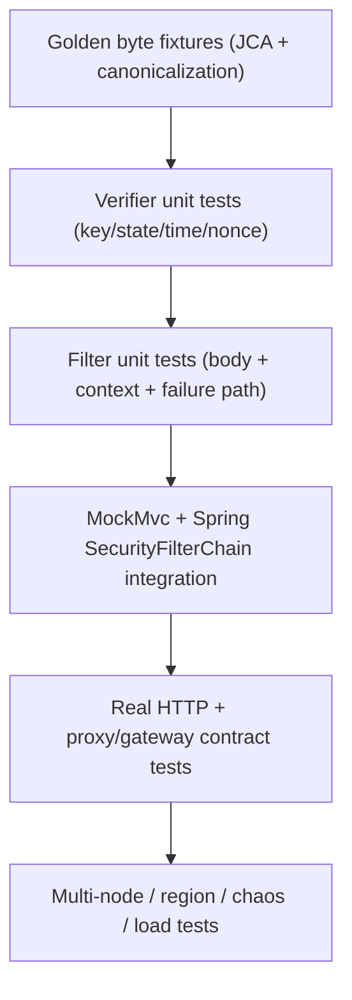

# Kiểm thử custom filter xác thực HMAC trong Spring Security

## 1. Tại sao phải kiểm thử custom authentication filter?

Một hệ thống B2B sử dụng HTTP request authentication bằng HMAC có thể nhận yêu cầu như sau:

```http
POST /api/payments HTTP/1.1
Host: api.example.test
Content-Type: application/json
Idempotency-Key: 550e8400-e29b-41d4-a716-446655440000
X-Key-Id: kid_AAAAAAAAAAAAAAAAAAAAAA
X-Signature-Version: hmac-test-v1
X-Timestamp: 2026-11-28T10:00:00Z
X-Nonce: AAAAAAAAAAAAAAAAAAAAAAAAAAAAAAAA
X-Signature: <64 lowercase hex characters>

{"paymentId":"P-42","amount":90000,"currency":"VND"}
```

Client và server dùng **shared secret** đã cấp để tạo/xác minh `HmacSHA256` trên một **canonical request** gồm method, URI, signed headers và SHA-256 body. Server còn kiểm tra credential ACTIVE, audience/route, timestamp và nonce để chống replay. Khi tất cả điều kiện đạt, **custom authentication filter** phải đưa **verified principal** vào Spring Security Context; `AuthorizationFilter` và tầng nghiệp vụ sẽ kiểm tra quyền riêng.

Lỗi ở custom filter không chỉ làm request hợp lệ bị từ chối. Một vài lỗi đặc biệt nguy hiểm:

- Request có **MAC sai** nhưng vẫn được đánh dấu `authenticated=true`.
- Header `X-Key-Id` bị giả mạo được dùng ngay làm principal trước khi xác minh.
- Hai `X-Key-Id` được gateway và backend hiểu khác nhau (header confusion).
- Body đã được dùng tính HMAC **khác** body được chuyển tới controller.
- Một nonce hợp lệ được chấp nhận **hai lần** dưới tải đồng thời hoặc qua hai JVM.
- Filter được đăng ký hai lần, request hợp lệ bị replay reject hoặc chạy sai thứ tự.
- Lỗi credential/nonce store bị coi là xác thực thành công, tạo bypass khi hệ thống gặp sự cố.
- Request đã xác thực nhưng không đủ quyền vẫn đi tới business handler.

Bài **Kiểm thử custom filter** thuộc chương **Custom authentication filter** của module `SECURITY_AUTHENTICATION_HMAC_REQUEST_AUTHENTICATION`. Phạm vi module là thiết kế xác thực HTTP request bằng **HMAC với shared secret**, canonical request có phương thức, URI, header hoặc body theo hợp đồng ký; xác minh MAC, chống replay bằng timestamp/nonce, quản lý key rotation, kiểm thử proxy/gateway và **phân biệt xác thực với phân quyền**. Vì vậy, việc kiểm thử phải bao trùm **crypto → HTTP adapter → Spring Security chain → business boundary → gateway/distributed state**, chứ không dừng ở một unit test tính HMAC.

**Phạm vi ví dụ:** Java 17+, Spring Boot 3.x, Spring Security 6.x và **Servlet/MVC** (API `jakarta.servlet`). WebFlux sử dụng `WebFilter`/`SecurityWebFilterChain`, không copy nguyên `OncePerRequestFilter` sang reactive stack. Bài đưa ra các **test fixtures và snippets** cho một profile HMAC minh họa, không tuyên bố Spring Security cung cấp giao thức HMAC HTTP mặc định.

### Kết quả mong đợi sau bài học

Người học có thể:

1. Thiết kế **test pyramid** tách lỗi canonicalization/JCA, verifier, Servlet adapter, filter chain và end-to-end proxy.
2. Tạo **golden fixtures byte-for-byte**, ký một request bằng secret **test-only**, kiểm tra method/URI/headers/body/encoding.
3. Dùng **JUnit 5 + Mockito + MockMvc + spring-security-test** để xác minh filter chỉ tạo Authentication sau khi đủ điều kiện.
4. Test `401` authentication failure, `403` authorization failure, `400` malformed, `413` body quá lớn, `503` dependency failure và chính sách 429.
5. Test timestamp/nonce biên, **atomic claim**, replay, key rotation, inactive key, thread context và filter registration.
6. Test body buffering, header duplication, proxy rewrite, network retries, multi-instance và failure injection mà không dùng secret production.

## 2. “Đúng” nghĩa là gì? Định nghĩa các bất biến trước khi test

Một bộ test tốt bắt đầu từ **các bất biến bảo mật**, không bắt đầu từ việc viết `assertEquals(200, response.status)`.

| Bất biến | Điều phải chứng minh trong test |
| --- | --- |
| **Không cấp danh tính từ dữ liệu chưa tin cậy** | Header `X-Key-Id`, `X-Client-Id` hoặc `X-Verified-Principal` tự khai không đủ để tạo authenticated principal. |
| **Exact credential lookup** | Một Key ID chọn **một** shared secret; không thử toàn bộ keys hoặc fallback sang default secret. |
| **MAC ràng buộc đúng bytes** | Đổi method, URI, signed header, body hoặc Key ID giữ nguyên signature đều bị từ chối. |
| **Credential lifecycle** | MAC đúng với key SUSPENDED/REVOKED/EXPIRED vẫn không authentication. |
| **Freshness** | Timestamp nằm ngoài cửa sổ UTC không được chấp nhận kể cả MAC đúng. |
| **Anti-replay** | Một `(immutableCredentialId, nonce)` được claim nguyên tử tối đa một lần trong TTL. |
| **SecurityContext đúng vòng đời** | Chỉ đặt authenticated principal sau PASS; không rò principal giữa requests/threads/dispatches. |
| **Authorization riêng** | Verified principal có MAC đúng nhưng thiếu `payments:write` hoặc quyền trên merchant sẽ bị chặn. |
| **Body integrity đến controller** | Handler đọc lại chính body snapshot đã tính hash, không nhận bytes khác hoặc stream rỗng. |
| **Không bypass khi dependency lỗi** | Credential registry, crypto provider hoặc replay cache lỗi → fail closed, không gọi handler. |
| **Một filter path thực thi** | Filter không bị auto-register ngoài `SecurityFilterChain`, không claim nonce hai lần. |
| **Proxy giữ contract** | Gateway/container thống nhất method, logical target, signed header values và body; trường hợp không thống nhất bị reject. |

### Các lớp kiểm thử phục vụ những bất biến nào?



| Lớp test | Tốc độ, tính độc lập | Phát hiện được | Không thay thế được |
| --- | --- | --- | --- |
| **JCA/canonical unit** | Rất nhanh, không cần Spring context. | Encoding/hex, dấu LF, body digest, signed field order, constant-time comparator usage. | HTTP parser, filter ordering. |
| **Verifier unit** | Nhanh với fake clock/registry/replay store. | Unknown/revoked key, wrong MAC, timestamp/nonce boundary, fail closed. | `SecurityContextHolder`, controller body, proxy. |
| **Filter unit** | Mock servlet request/filter chain. | Body wrapper, status mapping, context set/clear, chain invocation count. | Đầy đủ Spring Security authorization chain. |
| **MockMvc integration** | Spring MVC + security filters, không socket HTTP thật. | 401/403, matchers, Authentication, controller reads, filter ordering. | Raw HTTP framing và proxy-specific normalization. |
| **Real network + gateway** | Chậm hơn, staging/test environment. | HTTP/1.1↔2, duplicate raw fields, URI rewrite, compression, trusted forwarded headers. | Cross-region exact-once nếu chỉ một node. |
| **Distributed chaos/load** | Mô phỏng sự cố/concurrency. | Atomic nonce claim across nodes, propagation of revoke, store failover, resource exhaustion. | Golden crypto correctness nếu bỏ unit tests. |

Không nên giả lập `HmacVerifier.verify() = success` trong **tất cả** tests: điều đó sẽ bỏ sót lỗi canonicalization, MAC, replay và state. Ngược lại, không cần chạy proxy thật cho mọi biến thể của timestamp boundary; hãy chọn tầng rẻ nhất có thể **thực sự kiểm tra invariant**.

## 3. Profile HMAC kiểm thử: hợp đồng byte-for-byte

Để các ví dụ có thể tái lập, tài liệu dùng một profile **do bài học tự định nghĩa** mang tên `hmac-test-v1`. Đây **không phải** HTTP authentication standard hay định dạng có sẵn trong Spring Security.

| Thành phần | Hợp đồng V1 minh họa |
| --- | --- |
| Method | Chỉ `POST` (uppercase). |
| Raw target | Chỉ `/api/payments`, **không có query** trong V1. |
| Trusted audience | `https://api.example.test` từ cấu hình/ingress đáng tin, **không lấy từ Host caller tự khai**. |
| Body | UTF-8 JSON đã được giữ nguyên bytes, giới hạn 1 MiB, không `Content-Encoding`. |
| Content-Type | `application/json` chính xác; không tự thêm `charset`. |
| Key ID | `kid_` + 22 ký tự canonical Base64URL no-padding từ 16 random bytes; **value case-sensitive**. |
| Signature version | `hmac-test-v1` gắn với HmacSHA256 và exact canonical contract. |
| Timestamp | ISO-8601 UTC `YYYY-MM-DDTHH:mm:ssZ`, độ phân giải 1 giây; **inclusive** `now-300s <= issuedAt <= now+30s`. |
| Nonce | CSPRNG 24 bytes, Base64URL no-padding 32 ký tự, mới mỗi HTTP attempt. |
| Signature | Full HMAC-SHA256 32 bytes, encode 64 lowercase hex chars. |
| HTTP signed fields | Đúng một `Content-Type`, `Idempotency-Key`, `X-Key-Id`, `X-Signature-Version`, `X-Timestamp`, `X-Nonce`, `X-Signature`; tên header case-insensitive. |
| Idempotency-Key | UUID v4 canonical lowercase được ký; giữ qua retries cùng logical payment. |
| Canonical framing | UTF-8 các dòng bên dưới, ngăn LF `0A`, **không LF cuối**; body digest lowercase hex. |

```text
HMAC-TEST-V1
POST
https://api.example.test
/api/payments
content-type:application/json
idempotency-key:550e8400-e29b-41d4-a716-446655440000
x-key-id:kid_AAAAAAAAAAAAAAAAAAAAAA
x-signature-version:hmac-test-v1
x-timestamp:2026-11-28T10:00:00Z
x-nonce:AAAAAAAAAAAAAAAAAAAAAAAAAAAAAAAA
<lowercaseHex(SHA-256(exactBodyBytes))>
```

Các giá trị `kid_A...`, nonce `AAAA...` và dòng cuối là **placeholders** để giải thích định dạng, **không phải fixture có entropy production**. Một test thực phải thay body digest bằng **64 hex chars SHA-256** của body thực và dùng **test-only secret**.

Một request đã được ký với `POST /api/payments` mà gateway chuyển thành `POST /internal/payments` phải **fail** nếu backend không có cơ chế trusted logical-target normalization trong contract. Không “sửa” bằng cách bỏ path khỏi MAC; đó sẽ giảm phần request được ràng buộc.

### Trạng thái credential và quota hoàn toàn tách biệt

Sau khi parse/canonicalize, verifier tra `Key ID → Credential` phía server. Kết quả authentication chỉ được xem là PASS nếu:

```text
credential exists AND ACTIVE and valid at serverNow
AND credential audience/route/profile allowed
AND HMAC-SHA256(secret, canonicalRequestBytes) matches
AND timestamp within freshness window
AND nonce atomic claim succeeds
```

Quota/rate limit có thể chạy sau authentication theo `verifiedClientId`; một request hết quota nhận `429` nhưng vẫn có thể đã claim nonce. Authorization dựa trên authorities/resource **không được lẫn vào kết quả kiểm tra MAC**. Trong tests phải phân biệt lỗi **không authenticated** với **authenticated nhưng không authorized**.

## 4. Test fixture: tạo signed HTTP attempts có thể tái lập

Không nên viết test rồi vô tình tạo chữ ký bằng **chính implementation đang được test**, sau đó coi hai phía khớp là chứng minh giao thức đúng. Để tránh **common-mode bug**, hãy dùng:

- Một **test signer độc lập**, thực hiện contract đã công bố.
- **Golden vector** chứa canonical bytes/hex, body digest, MAC mong đợi từ một implementation đã được kiểm chứng độc lập.
- Một **fake UTC Clock** có thời điểm cố định và không chờ `Thread.sleep`.
- **Test secrets** được sinh/cố định riêng cho test; không lấy từ production vault, môi trường staging dùng chung hoặc secrets thực.
- Test data builders hỗ trợ thay **chính xác một thành phần**, ví dụ ký body A nhưng gửi body B.

### 4.1 Bộ sinh signed request đơn giản bằng Java 17

Ví dụ sau tự chứa ở mức **JDK-only** và phù hợp đặt trong test source set, nhưng **không phải server verifier**. Để test HMAC server, hãy đưa outputs vào HTTP adapter/MockMvc mà không gọi lại canonicalizer của server để tạo expected MAC.

```java
import java.nio.charset.StandardCharsets;
import java.security.GeneralSecurityException;
import java.security.MessageDigest;
import java.security.SecureRandom;
import java.time.Instant;
import java.time.temporal.ChronoUnit;
import java.util.Base64;
import java.util.HexFormat;
import java.util.LinkedHashMap;
import java.util.Map;
import java.util.Objects;
import javax.crypto.Mac;
import javax.crypto.spec.SecretKeySpec;

public final class HmacRequestTestSigner {
    private static final HexFormat HEX = HexFormat.of();
    private static final String PROFILE = "hmac-test-v1";
    private static final String TARGET = "/api/payments";
    private static final String AUDIENCE = "https://api.example.test";

    public record SignedAttempt(
            String method, String target,
            Map<String, String> headers,
            byte[] body, byte[] canonicalBytes) {
        public SignedAttempt {
            headers = Map.copyOf(headers);
            body = body.clone();
            canonicalBytes = canonicalBytes.clone();
        }
        @Override public byte[] body() { return body.clone(); }
        @Override public byte[] canonicalBytes() {
            return canonicalBytes.clone();
        }
    }

    public static SignedAttempt sign(
            String keyId, byte[] secret, byte[] body,
            String idempotencyKey, Instant issuedAt, String nonce)
            throws GeneralSecurityException {
        Objects.requireNonNull(keyId);
        Objects.requireNonNull(secret);
        Objects.requireNonNull(body);
        Objects.requireNonNull(idempotencyKey);
        Objects.requireNonNull(issuedAt);
        Objects.requireNonNull(nonce);

        String timestamp = issuedAt
                .truncatedTo(ChronoUnit.SECONDS).toString();
        String digest = HEX.formatHex(
                MessageDigest.getInstance("SHA-256").digest(body));
        String canonical = String.join("\n",
                "HMAC-TEST-V1",
                "POST",
                AUDIENCE,
                TARGET,
                "content-type:application/json",
                "idempotency-key:" + idempotencyKey,
                "x-key-id:" + keyId,
                "x-signature-version:" + PROFILE,
                "x-timestamp:" + timestamp,
                "x-nonce:" + nonce,
                digest);
        byte[] canonicalBytes = canonical.getBytes(
                StandardCharsets.UTF_8);

        Mac mac = Mac.getInstance("HmacSHA256");
        mac.init(new SecretKeySpec(secret, "HmacSHA256"));
        String signature = HEX.formatHex(
                mac.doFinal(canonicalBytes));

        Map<String, String> headers = new LinkedHashMap<>();
        headers.put("Content-Type", "application/json");
        headers.put("Idempotency-Key", idempotencyKey);
        headers.put("X-Key-Id", keyId);
        headers.put("X-Signature-Version", PROFILE);
        headers.put("X-Timestamp", timestamp);
        headers.put("X-Nonce", nonce);
        headers.put("X-Signature", signature);
        return new SignedAttempt(
                "POST", TARGET, headers, body, canonicalBytes);
    }

    public static String randomKeyId(SecureRandom random) {
        byte[] bytes = new byte[16];
        random.nextBytes(bytes);
        return "kid_" + Base64.getUrlEncoder()
                .withoutPadding().encodeToString(bytes);
    }

    public static String newNonce(SecureRandom random) {
        byte[] bytes = new byte[24];
        random.nextBytes(bytes);
        return Base64.getUrlEncoder()
                .withoutPadding().encodeToString(bytes);
    }
}
```

Trong unit test, đặt `issuedAt = Instant.parse("2026-11-28T10:00:00Z")` và truyền `nonce` **fixture cố định, đúng 24 bytes** để golden vectors tái lập; trong runtime client thật, `newNonce(SecureRandom)` phải tạo nonce mới cho từng attempt. **Không dùng nonce toàn chữ `A` trong production** chỉ vì fixture test trông dễ đọc.

### 4.2 HMAC-SHA256 JCA primitive test với vector đã công bố

Trước khi gỡ lỗi HTTP, kiểm tra code gọi `Mac` bằng một known vector của **RFC 4231**, test case 1:

```java
import static org.junit.jupiter.api.Assertions.assertEquals;
import java.nio.charset.StandardCharsets;
import java.util.Arrays;
import java.util.HexFormat;
import javax.crypto.Mac;
import javax.crypto.spec.SecretKeySpec;
import org.junit.jupiter.api.Test;

class JcaHmacSha256Test {
    @Test void matchesRfc4231Case1() throws Exception {
        byte[] key = new byte[20];
        Arrays.fill(key, (byte) 0x0b);
        byte[] data = "Hi There"
                .getBytes(StandardCharsets.US_ASCII);

        Mac mac = Mac.getInstance("HmacSHA256");
        mac.init(new SecretKeySpec(key, "HmacSHA256"));
        String actual = HexFormat.of().formatHex(
                mac.doFinal(data));

        assertEquals(
                "b0344c61d8db38535ca8afceaf0bf12b881dc200c9833da726e9376"
                        + "c2e32cff7",
                actual);
    }
}
```

Vector này kiểm tra **primitive**, **không** kiểm tra HTTP canonicalization hoặc hiệu lực credential. Hãy có test riêng đối chiếu `canonicalBytes` với chuỗi/hex chuẩn được tính độc lập: LF chứ không CRLF, không LF cuối, signed headers đúng thứ tự, body hash của **bytes** chứ không hash JSON object. Dùng `HexFormat.of().formatHex(canonicalBytes)` trong test diagnostic với payload không nhạy cảm; không bật hexdump production body.

### 4.3 Test kiểu “one mutation, one invariant”

Thay đổi đúng **một** phần của request đã ký, vẫn giữ signature cũ:

| Thay đổi sau khi ký | MAC dự kiến | Vì sao |
| --- | --- | --- |
| Body `amount:90000` thành `amount:90001`. | FAIL | SHA-256 body khác. |
| Method `POST` thành `PUT`. | FAIL | Method nằm trong canonical. |
| Path `/api/payments` thành `/api/payments/`. | FAIL | Raw target nằm trong canonical. |
| `Idempotency-Key` thành UUID khác. | FAIL | Header nghiệp vụ được ký. |
| `X-Key-Id` A thành B. | FAIL hoặc credential lookup reject | Key ID được ký và secret khác. |
| `X-Timestamp` tăng một giây, giữ MAC. | FAIL | Timestamp được ký. |
| `X-Nonce` thay một ký tự, giữ MAC. | FAIL | Nonce được ký. |
| `Content-Type` thêm `charset=UTF-8`. | Malformed/FAIL | V1 chỉ hỗ trợ exact value. |
| Chỉ đổi chữ hoa/thường **header name**, không đổi value. | Có thể PASS | Tên field case-insensitive, canonical dùng lowercase names. |
| Đổi thứ tự các field lines không trùng. | Có thể PASS | Canonical đã định thứ tự cố định theo profile. |

**Không đánh đồng** “reject” với “MAC mismatch”: nếu ký request có đúng MAC nhưng path không thuộc profile, server có thể reject ngay ở parser/route policy **trước khi** tính MAC. Tests cần kiểm tra **điểm chặn thực** và không dựa trên một HTTP status 401 chung để kết luận đã kiểm tra cryptography.

## 5. Thiết kế test seams: tách filter khỏi cryptography

Để kiểm thử custom filter dễ dàng, nên tách:

```text
HmacAuthenticationFilter
    |
    +-- Request adapter: bounded body + strict headers
    |
    +-- RequestAuthenticator.authenticate(snapshot)
             |
             +-- Canonicalizer + HmacSHA256
             +-- CredentialRegistry lookup + lifecycle
             +-- Timestamp policy (Clock)
             +-- NonceStore atomic claim
    |
    +-- SecurityContext / AuthenticationEntryPoint
```

Trong filter tests, thay `RequestAuthenticator` bằng **test double** để quan sát việc đặt SecurityContext, số lần gọi downstream, response mapping và body wrapper. Trong verifier tests, dùng fake registry/clock/replay store để chứng minh MAC/time/nonce/state. Trong Spring integration tests, dùng **real verifier + test-only credentials** cho happy path và tampering, nếu chỉ mock success toàn bộ sẽ không kiểm tra giao thức.

Ví dụ contract thu gọn:

```java
public interface RequestAuthenticator {
    VerifiedIdentity authenticate(
            String method, String rawTarget,
            java.util.Map<String, String> signedFields,
            byte[] body)
            throws BadHmacCredentials,
                   MalformedSignedRequest,
                   AuthDependencyUnavailable;
}

public record VerifiedIdentity(
        String clientId,
        String principalId,
        String immutableCredentialId,
        java.util.Set<String> authorities) {}

public class BadHmacCredentials extends Exception {}
public class MalformedSignedRequest extends Exception {}
public class AuthDependencyUnavailable extends Exception {}
```

Các class trên là **hợp đồng mô tả test seam**; đặt chúng trong file/package phù hợp nếu đưa vào code thật. `VerifiedIdentity` được tạo **sau verification**, không nhận trọn từ `X-Verified-Principal` do caller gửi. Mã test bên dưới dùng một cấu trúc filter thu gọn nhưng thực thi được về cơ chế kiểm thử này.

## 6. Servlet custom filter tối thiểu để kiểm thử

Một bài test chỉ có ý nghĩa khi **nhìn rõ filter chịu trách nhiệm gì**. Mã dưới đây minh họa `HmacRequestFilter` cho **HMAC-only Servlet chain**. Nó:

1. Chỉ chạy trên `/api/payments`, reject method khác `POST`.
2. Đọc tối đa `1 MiB + 1` byte để phát hiện body quá lớn, tạo replayable wrapper.
3. Từ chối signed header thiếu/trùng/không hợp lệ ở mức HTTP adapter.
4. Gọi `RequestAuthenticator` (được giả lập trong filter test và dùng **real HMAC verifier** trong security integration suite).
5. Tạo `Authentication` từ verified identity, đặt vào `SecurityContextHolder` rồi chuyển **wrapped request** cho controller.
6. Phân biệt lỗi 400/401/413/503; dọn context để tránh leak.

Đây là **một thành phần thực hành**, không phải verifier HMAC production đầy đủ: chức năng tính MAC, kiểm tra clock/nonce và registry nằm sau interface. Ví dụ chỉ hỗ trợ **synchronous Servlet I/O**, không tự xử lý raw proxy bytes đã mất ở Servlet boundary.

```java
package example.hmac;

import jakarta.servlet.FilterChain;
import jakarta.servlet.ReadListener;
import jakarta.servlet.ServletException;
import jakarta.servlet.ServletInputStream;
import jakarta.servlet.http.HttpServletRequest;
import jakarta.servlet.http.HttpServletRequestWrapper;
import jakarta.servlet.http.HttpServletResponse;
import org.springframework.security.authentication.BadCredentialsException;
import org.springframework.security.authentication.UsernamePasswordAuthenticationToken;
import org.springframework.security.core.Authentication;
import org.springframework.security.core.authority.SimpleGrantedAuthority;
import org.springframework.security.core.context.SecurityContext;
import org.springframework.security.core.context.SecurityContextHolder;
import org.springframework.security.web.AuthenticationEntryPoint;
import org.springframework.web.filter.OncePerRequestFilter;

import java.io.BufferedReader;
import java.io.ByteArrayInputStream;
import java.io.IOException;
import java.io.InputStreamReader;
import java.nio.charset.StandardCharsets;
import java.util.Enumeration;
import java.util.LinkedHashMap;
import java.util.List;
import java.util.Map;
import java.util.Set;

public final class HmacRequestFilter extends OncePerRequestFilter {
    static final String PATH = "/api/payments";
    static final int MAX_BODY = 1_048_576;
    static final List<String> REQUIRED_HEADERS = List.of(
            "Content-Type", "Idempotency-Key",
            "X-Key-Id", "X-Signature-Version",
            "X-Timestamp", "X-Nonce", "X-Signature");

    private final RequestAuthenticator authenticator;
    private final AuthenticationEntryPoint entryPoint;

    public HmacRequestFilter(
            RequestAuthenticator authenticator,
            AuthenticationEntryPoint entryPoint) {
        this.authenticator = authenticator;
        this.entryPoint = entryPoint;
    }

    @Override protected boolean shouldNotFilter(
            HttpServletRequest request) {
        // Demo dùng Servlet context path rỗng; các route khác
        // phải được security matcher/chain tương ứng bảo vệ.
        return !PATH.equals(request.getRequestURI());
    }

    private static String exactlyOne(
            HttpServletRequest request, String name)
            throws MalformedSignedRequest {
        Enumeration<String> values = request.getHeaders(name);
        if (values == null || !values.hasMoreElements()) {
            throw new MalformedSignedRequest();
        }
        String raw = values.nextElement();
        if (raw == null || values.hasMoreElements()) {
            throw new MalformedSignedRequest();
        }
        // Reject CR/LF/control trước khi trim: String.trim() có thể
        // vô tình làm mất chứng cứ một header value nhập nhằng.
        for (int i = 0; i < raw.length(); i++) {
            char ch = raw.charAt(i);
            if ((ch < 0x20 && ch != '\t') || ch > 0x7e) {
                throw new MalformedSignedRequest();
            }
        }
        int begin = 0, end = raw.length();
        while (begin < end && (raw.charAt(begin) == ' '
                || raw.charAt(begin) == '\t')) begin++;
        while (end > begin && (raw.charAt(end - 1) == ' '
                || raw.charAt(end - 1) == '\t')) end--;
        String value = raw.substring(begin, end);
        if (value.isEmpty() || value.length() > 512) {
            throw new MalformedSignedRequest();
        }
        for (int i = 0; i < value.length(); i++) {
            char ch = value.charAt(i);
            if (ch < 0x21 || ch > 0x7e || ch == ',') {
                throw new MalformedSignedRequest();
            }
        }
        return value;
    }

    private static Map<String, String> signedFields(
            HttpServletRequest request)
            throws MalformedSignedRequest {
        Map<String, String> result = new LinkedHashMap<>();
        for (String name : REQUIRED_HEADERS) {
            result.put(name.toLowerCase(java.util.Locale.ROOT),
                    exactlyOne(request, name));
        }
        return Map.copyOf(result);
    }

    private static final class RepeatableBody
            extends HttpServletRequestWrapper {
        private final byte[] bytes;

        RepeatableBody(HttpServletRequest request)
                throws IOException {
            super(request);
            byte[] candidate = request.getInputStream()
                    .readNBytes(MAX_BODY + 1);
            if (candidate.length > MAX_BODY) {
                throw new BodyTooLarge();
            }
            bytes = candidate;
        }

        byte[] body() { return bytes.clone(); }

        @Override public ServletInputStream getInputStream() {
            ByteArrayInputStream stream =
                    new ByteArrayInputStream(bytes);
            return new ServletInputStream() {
                @Override public int read() {
                    return stream.read();
                }
                @Override public boolean isFinished() {
                    return stream.available() == 0;
                }
                @Override public boolean isReady() {
                    return true;
                }
                @Override public void setReadListener(
                        ReadListener readListener) {
                    throw new UnsupportedOperationException(
                            "Synchronous demo only");
                }
            };
        }

        @Override public BufferedReader getReader() {
            return new BufferedReader(new InputStreamReader(
                    getInputStream(), StandardCharsets.UTF_8));
        }
    }

    private static final class BodyTooLarge
            extends IOException {}

    @Override protected void doFilterInternal(
            HttpServletRequest request,
            HttpServletResponse response, FilterChain chain)
            throws ServletException, IOException {
        // HMAC-only chain: không kế thừa principal của request khác.
        SecurityContextHolder.clearContext();

        if (!"POST".equals(request.getMethod())) {
            response.sendError(HttpServletResponse.SC_BAD_REQUEST);
            return;
        }
        if (request.getQueryString() != null
                || request.getHeader("Content-Encoding") != null) {
            response.sendError(HttpServletResponse.SC_BAD_REQUEST);
            return;
        }
        if (request.getContentLengthLong() > MAX_BODY) {
            response.sendError(
                    HttpServletResponse.SC_REQUEST_ENTITY_TOO_LARGE);
            return;
        }

        final RepeatableBody wrapped;
        try {
            wrapped = new RepeatableBody(request);
        } catch (BodyTooLarge tooLarge) {
            response.sendError(
                    HttpServletResponse.SC_REQUEST_ENTITY_TOO_LARGE);
            return;
        }
        if (wrapped.body().length == 0) {
            response.sendError(HttpServletResponse.SC_BAD_REQUEST);
            return;
        }

        final VerifiedIdentity verified;
        try {
            verified = authenticator.authenticate(
                    wrapped.getMethod(), wrapped.getRequestURI(),
                    signedFields(wrapped), wrapped.body());
        } catch (MalformedSignedRequest malformed) {
            response.sendError(HttpServletResponse.SC_BAD_REQUEST);
            return;
        } catch (BadHmacCredentials rejected) {
            entryPoint.commence(wrapped, response,
                    new BadCredentialsException("Invalid HMAC"));
            return;
        } catch (AuthDependencyUnavailable unavailable) {
            response.sendError(
                    HttpServletResponse.SC_SERVICE_UNAVAILABLE);
            return;
        }

        // Verifier không bao giờ được trả null như một success.
        if (verified == null || verified.principalId() == null
                || verified.authorities() == null) {
            response.sendError(
                    HttpServletResponse.SC_SERVICE_UNAVAILABLE);
            return;
        }
        List<SimpleGrantedAuthority> authorities =
                verified.authorities().stream()
                        .map(SimpleGrantedAuthority::new).toList();
        Authentication authentication =
                UsernamePasswordAuthenticationToken.authenticated(
                        verified, null, authorities);
        SecurityContext context =
                SecurityContextHolder.createEmptyContext();
        context.setAuthentication(authentication);
        SecurityContextHolder.setContext(context);

        try {
            chain.doFilter(wrapped, response);
        } finally {
            SecurityContextHolder.clearContext();
        }
    }
}
```

### Chú ý về ranh giới của mã demo

- `exactlyOne` là **adapter strict với profile ASCII V1**: nó loại outer whitespace và cấm dấu phẩy trong các trường ký vì V1 không dùng list values. Nó **không chứng minh** upstream chưa gộp hai raw HTTP field lines trước khi Servlet API nhìn thấy; gateway phải reject ambiguity từ sớm.
- `RepeatableBody` cố ý không hỗ trợ asynchronous servlet reading, multipart hoặc streaming. Trong production cần reject framing nhập nhằng và kiểm tra `MAX_BODY + 1` trên bytes thật, không chỉ dựa vào `Content-Length`.
- `shouldNotFilter` bỏ qua route khác, **không có nghĩa chúng được phép truy cập**; một `SecurityFilterChain` khác hoặc deny-all matcher phải bảo vệ các routes còn lại.
- `SecurityContextHolder.clearContext()` ở đầu filter phù hợp giả thiết **HMAC-only chain**; khi hỗ trợ nhiều cơ chế xác thực trong cùng chain, phải có policy về authentication precedence, không tự xóa context của một cơ chế hợp lệ khác.
- `BadHmacCredentials`, `MalformedSignedRequest`, `AuthDependencyUnavailable` và `VerifiedIdentity` là test-seam contract từ phần 5; khi đưa vào project phải đặt mỗi `public` top-level type ở file Java phù hợp.
- Spring Security filter này không tự tạo role: `verified.authorities()` **phải** lấy từ credential/server policy sau khi xác minh, tuyệt đối không từ header `X-Authorities` của HTTP caller.

### Vì sao filter không được được tự đăng ký hai lần?

Khi `HmacRequestFilter` được annotate `@Component` hoặc được expose như Servlet `Filter` bean, Spring Boot có thể **auto-register** vào Servlet container ngoài `FilterChainProxy`. Nếu lại thêm instance đó bằng `http.addFilterBefore(...)`, cùng signed request có thể đi qua hai lớp filter, dẫn tới body bị đọc khác nhau, nonce bị claim hai lần hoặc security context bị ghi đè.

**Cách đơn giản nhất:** tạo filter bằng `new HmacRequestFilter(...)` **bên trong cấu hình `SecurityFilterChain`** và không đăng ký nó như global Servlet filter. Nếu cần filter bean, cấu hình `FilterRegistrationBean#setEnabled(false)` cho servlet auto-registration. Tests phải phát hiện filter invocation count thực tế.

## 7. Unit test trực tiếp filter: body, SecurityContext và số lần gọi chain

Ở tầng này, ta **không dùng real HMAC verifier**: tập trung vào trách nhiệm riêng của Servlet filter. Unit test dùng `MockHttpServletRequest`, `MockHttpServletResponse`, một `RequestAuthenticator` fake và `FilterChain` được quan sát. Khi fake trả verified identity, filter phải:

- Đưa principal và authorities **từ fake verified result** vào `SecurityContext`.
- Chuyển wrapper cho downstream, body phải **trùng bytes** đã đưa cho authenticator.
- Gọi downstream **đúng một lần**.
- Xóa context **sau khi chain kết thúc**, kể cả khi downstream throw.
- Không ghi raw secret trong `Authentication.getCredentials()`.

### JUnit 5: request được xác thực thành công

```java
package example.hmac;

import jakarta.servlet.FilterChain;
import org.junit.jupiter.api.Test;
import org.springframework.mock.web.MockHttpServletRequest;
import org.springframework.mock.web.MockHttpServletResponse;
import org.springframework.security.core.Authentication;
import org.springframework.security.core.context.SecurityContextHolder;
import org.springframework.security.web.AuthenticationEntryPoint;

import java.nio.charset.StandardCharsets;
import java.util.Set;
import java.util.concurrent.atomic.AtomicInteger;
import static org.junit.jupiter.api.Assertions.*;

class HmacRequestFilterUnitTest {
    private static final byte[] BODY = (
            "{\"paymentId\":\"P-42\",\"amount\":90000}")
            .getBytes(StandardCharsets.UTF_8);

    private static MockHttpServletRequest request(byte[] body) {
        MockHttpServletRequest req =
                new MockHttpServletRequest("POST", "/api/payments");
        req.setContent(body);
        req.addHeader("Content-Type", "application/json");
        req.addHeader("Idempotency-Key",
                "550e8400-e29b-41d4-a716-446655440000");
        req.addHeader("X-Key-Id", "kid_test-only");
        req.addHeader("X-Signature-Version", "hmac-test-v1");
        req.addHeader("X-Timestamp", "2026-11-28T10:00:00Z");
        req.addHeader("X-Nonce", "test-only-nonce");
        req.addHeader("X-Signature", "test-only-signature");
        return req;
    }

    private static final AuthenticationEntryPoint UNAUTHORIZED =
            (req, response, error) -> response.sendError(401);

    @Test void setsAndClearsSecurityContextAndReplaysBody()
            throws Exception {
        AtomicInteger authentications = new AtomicInteger();
        AtomicInteger downstreamCalls = new AtomicInteger();
        RequestAuthenticator fake =
                (method, target, signedFields, body) -> {
                    authentications.incrementAndGet();
                    assertEquals("POST", method);
                    assertEquals("/api/payments", target);
                    assertEquals("kid_test-only",
                            signedFields.get("x-key-id"));
                    assertArrayEquals(BODY, body);
                    return new VerifiedIdentity(
                            "integration-a", "merchant-a", "cred-test",
                            Set.of("payments:write"));
                };

        HmacRequestFilter filter =
                new HmacRequestFilter(fake, UNAUTHORIZED);
        MockHttpServletResponse response =
                new MockHttpServletResponse();
        FilterChain downstream = (req, resp) -> {
            downstreamCalls.incrementAndGet();
            Authentication auth = SecurityContextHolder
                    .getContext().getAuthentication();
            assertNotNull(auth);
            assertTrue(auth.isAuthenticated());
            assertEquals("merchant-a",
                    ((VerifiedIdentity) auth.getPrincipal())
                            .principalId());
            assertNull(auth.getCredentials());
            assertTrue(auth.getAuthorities().stream()
                    .anyMatch(a ->
                            "payments:write".equals(a.getAuthority())));
            assertArrayEquals(BODY,
                    req.getInputStream().readAllBytes());
        };

        filter.doFilter(request(BODY), response, downstream);
        assertEquals(1, authentications.get());
        assertEquals(1, downstreamCalls.get());
        assertNull(SecurityContextHolder
                .getContext().getAuthentication());
    }

    @Test void invalidHmacNeverRunsBusinessChain()
            throws Exception {
        AtomicInteger invoked = new AtomicInteger();
        RequestAuthenticator alwaysRejects =
                (method, target, fields, body) -> {
                    throw new BadHmacCredentials();
                };
        HmacRequestFilter filter =
                new HmacRequestFilter(alwaysRejects, UNAUTHORIZED);
        MockHttpServletResponse response =
                new MockHttpServletResponse();
        filter.doFilter(request(BODY), response,
                (req, resp) -> invoked.incrementAndGet());

        assertEquals(401, response.getStatus());
        assertEquals(0, invoked.get());
        assertNull(SecurityContextHolder
                .getContext().getAuthentication());
    }

    @Test void duplicateSignedHeaderFailsBeforeVerifier()
            throws Exception {
        AtomicInteger authentications = new AtomicInteger();
        RequestAuthenticator fake = (m, t, f, b) -> {
            authentications.incrementAndGet();
            return new VerifiedIdentity(
                    "a", "a", "cred-test", Set.of());
        };
        MockHttpServletRequest req = request(BODY);
        req.addHeader("x-key-id", "kid_other");
        MockHttpServletResponse response =
                new MockHttpServletResponse();

        new HmacRequestFilter(fake, UNAUTHORIZED)
                .doFilter(req, response, (r, s) ->
                        fail("Chain should not be called"));
        assertEquals(400, response.getStatus());
        assertEquals(0, authentications.get());
    }

    @Test void bodyLimitRejectsOversizeBeforeAuthentication()
            throws Exception {
        byte[] large = new byte[HmacRequestFilter.MAX_BODY + 1];
        MockHttpServletRequest req = request(large);
        MockHttpServletResponse response =
                new MockHttpServletResponse();

        new HmacRequestFilter(
                (m, t, f, b) -> {
                    fail("Oversize must not reach verifier");
                    return null;
                }, UNAUTHORIZED)
                .doFilter(req, response, (r, s) ->
                        fail("Oversize must not reach handler"));
        assertEquals(413, response.getStatus());
    }
}
```

**Các giá trị `kid_test-only`, `test-only-nonce`, `test-only-signature` cố tình không đúng grammar HMAC V1** vì các tests trên **đang cô lập filter bằng fake authenticator**. Không được dùng chúng làm input cho **real verifier test** rồi kết luận verifier lỗi; phần 4 đã định nghĩa cách tạo fixture HMAC thật.

### Test làm downstream throw: context có bị rò?

Bổ sung một test đặt fake authenticator PASS, rồi downstream ném `ServletException`. Test phải bắt được exception **và** chứng minh `SecurityContextHolder.getContext().getAuthentication() == null` sau khi `filter.doFilter` hoàn tất. `finally` phải chạy kể cả khi handler lỗi. Không chỉ test happy path.

```java
@Test void contextIsClearedWhenDownstreamThrows()
        throws Exception {
    RequestAuthenticator success = (m, t, f, b) ->
            new VerifiedIdentity("a", "merchant-a",
                    "cred-1", Set.of("payments:write"));
    HmacRequestFilter filter =
            new HmacRequestFilter(success,
                    (req, resp, error) -> resp.sendError(401));
    MockHttpServletRequest request =
            new MockHttpServletRequest("POST", "/api/payments");
    request.setContent("{}".getBytes(
            java.nio.charset.StandardCharsets.UTF_8));
    request.addHeader("Content-Type", "application/json");
    request.addHeader("Idempotency-Key",
            "550e8400-e29b-41d4-a716-446655440000");
    request.addHeader("X-Key-Id", "kid_test-only");
    request.addHeader("X-Signature-Version", "hmac-test-v1");
    request.addHeader("X-Timestamp", "2026-11-28T10:00:00Z");
    request.addHeader("X-Nonce", "test-only-nonce");
    request.addHeader("X-Signature", "test-only-signature");

    assertThrows(jakarta.servlet.ServletException.class,
            () -> filter.doFilter(
                    request,
                    new org.springframework.mock.web.MockHttpServletResponse(),
                    (req, res) -> {
                        throw new jakarta.servlet.ServletException(
                                "Simulated handler failure");
                    }));
    assertNull(org.springframework.security.core.context
            .SecurityContextHolder.getContext().getAuthentication());
}
```

Đây là phương thức test bổ sung trong **cùng class JUnit 5** ở trên (đã có static imports), không phải một Java compilation unit độc lập. Cần test thêm failure từ parser/verifier/nonce store trả status và **không gọi `chain.doFilter`**.

## 8. MockMvc + Spring SecurityFilterChain: phân biệt 401 và 403

Unit test filter trực tiếp có thể chứng minh context và body wrapper, nhưng **chưa chứng minh** `AuthorizationFilter` trong Spring Security thật sự chạy, hoặc một route được đúng filter chain bảo vệ. Với các bất biến này, hãy chạy `MockMvc` có Spring application context và `springSecurityFilterChain`.

Đối với Spring Boot 3.x, test dependency thường gồm:

```xml
<dependency>
  <groupId>org.springframework.boot</groupId>
  <artifactId>spring-boot-starter-security</artifactId>
</dependency>
<dependency>
  <groupId>org.springframework.boot</groupId>
  <artifactId>spring-boot-starter-web</artifactId>
</dependency>
<dependency>
  <groupId>org.springframework.boot</groupId>
  <artifactId>spring-boot-starter-test</artifactId>
  <scope>test</scope>
</dependency>
<dependency>
  <groupId>org.springframework.security</groupId>
  <artifactId>spring-security-test</artifactId>
  <scope>test</scope>
</dependency>
```

Không ghim các version Spring riêng biệt nếu project dùng **Spring Boot dependency management**. JUnit 5 được đưa vào qua starter-test trong các project Boot thông thường; `spring-security-test` hỗ trợ các tiện ích test liên quan security.

### 8.1 Test application cố ý dùng authenticator giả

Ví dụ dưới có một **mini Spring Boot test context** chỉ cho `/api/payments`, với `FakeAuthenticator` thay real HMAC verifier. Nó **không kiểm tra HMAC**; mục tiêu là kiểm tra **Spring filter chain, response mapping, authorities và body**. Đừng dùng một request có `X-Signature: test-ok` làm bằng chứng signer/verifier production hoạt động.

```java
package example.hmac;

import org.junit.jupiter.api.BeforeEach;
import org.junit.jupiter.api.Test;
import org.springframework.beans.factory.annotation.Autowired;
import org.springframework.boot.SpringBootConfiguration;
import org.springframework.boot.autoconfigure.EnableAutoConfiguration;
import org.springframework.boot.test.autoconfigure.web.servlet.AutoConfigureMockMvc;
import org.springframework.boot.test.context.SpringBootTest;
import org.springframework.context.annotation.Bean;
import org.springframework.context.annotation.Configuration;
import org.springframework.context.annotation.Import;
import org.springframework.core.annotation.Order;
import org.springframework.http.HttpHeaders;
import org.springframework.http.HttpMethod;
import org.springframework.http.MediaType;
import org.springframework.security.config.annotation.web.builders.HttpSecurity;
import org.springframework.security.config.annotation.web.configurers
        .AbstractHttpConfigurer;
import org.springframework.security.config.http.SessionCreationPolicy;
import org.springframework.security.core.annotation.AuthenticationPrincipal;
import org.springframework.security.web.AuthenticationEntryPoint;
import org.springframework.security.web.SecurityFilterChain;
import org.springframework.security.web.authentication
        .UsernamePasswordAuthenticationFilter;
import org.springframework.test.web.servlet.MockMvc;
import org.springframework.web.bind.annotation.PostMapping;
import org.springframework.web.bind.annotation.RequestBody;
import org.springframework.web.bind.annotation.RestController;

import java.nio.charset.StandardCharsets;
import java.util.Set;
import java.util.concurrent.atomic.AtomicInteger;

import static org.junit.jupiter.api.Assertions.assertEquals;
import static org.springframework.test.web.servlet.request
        .MockMvcRequestBuilders.post;
import static org.springframework.test.web.servlet.result
        .MockMvcResultMatchers.content;
import static org.springframework.test.web.servlet.result
        .MockMvcResultMatchers.status;

@SpringBootTest(
        classes = HmacFilterMockMvcTest.TestApplication.class)
@AutoConfigureMockMvc
class HmacFilterMockMvcTest {
    @Autowired MockMvc mvc;
    @Autowired FakeAuthenticator fakeAuthenticator;

    private static final byte[] BODY =
            "{\"paymentId\":\"P-42\"}"
                    .getBytes(StandardCharsets.UTF_8);

    @SpringBootConfiguration
    @EnableAutoConfiguration
    @Import({SecurityConfig.class, ProbeController.class,
            TestBeans.class})
    static class TestApplication {}

    @Configuration
    static class SecurityConfig {
        @Bean
        @Order(1)
        SecurityFilterChain protectedApi(
                HttpSecurity http, FakeAuthenticator fake)
                throws Exception {
            AuthenticationEntryPoint entryPoint =
                    (req, resp, error) -> resp.sendError(401);
            return http
                    .securityMatcher("/api/**")
                    .csrf(AbstractHttpConfigurer::disable)
                    .sessionManagement(s -> s.sessionCreationPolicy(
                            SessionCreationPolicy.STATELESS))
                    .formLogin(AbstractHttpConfigurer::disable)
                    .httpBasic(AbstractHttpConfigurer::disable)
                    .authorizeHttpRequests(a -> a
                            .requestMatchers(
                                    HttpMethod.POST, "/api/payments")
                            .hasAuthority("payments:write")
                            .anyRequest().denyAll())
                    .exceptionHandling(e -> e
                            .authenticationEntryPoint(entryPoint))
                    .addFilterBefore(
                            new HmacRequestFilter(fake, entryPoint),
                            UsernamePasswordAuthenticationFilter.class)
                    .build();
        }

        @Bean
        @Order(2)
        SecurityFilterChain denyOtherRoutes(HttpSecurity http)
                throws Exception {
            return http
                    .authorizeHttpRequests(a -> a
                            .anyRequest().denyAll())
                    .build();
        }
    }

    @Configuration
    static class TestBeans {
        @Bean FakeAuthenticator fakeAuthenticator() {
            return new FakeAuthenticator();
        }
    }

    static class FakeAuthenticator implements RequestAuthenticator {
        final AtomicInteger calls = new AtomicInteger();

        @Override public VerifiedIdentity authenticate(
                String method, String target,
                java.util.Map<String, String> fields, byte[] body)
                throws BadHmacCredentials, AuthDependencyUnavailable {
            calls.incrementAndGet();
            String marker = fields.get("x-signature");
            if ("test-down".equals(marker)) {
                throw new AuthDependencyUnavailable();
            }
            if (!"test-ok".equals(marker)) {
                throw new BadHmacCredentials();
            }
            if ("kid_read".equals(fields.get("x-key-id"))) {
                return new VerifiedIdentity(
                        "integration-a", "merchant-a",
                        "cred-read", Set.of("payments:read"));
            }
            return new VerifiedIdentity(
                    "integration-a", "merchant-a",
                    "cred-write", Set.of("payments:write"));
        }
    }

    @RestController
    static class ProbeController {
        @PostMapping(path = "/api/payments",
                produces = MediaType.TEXT_PLAIN_VALUE)
        String accept(
                @AuthenticationPrincipal VerifiedIdentity principal,
                @RequestBody byte[] body) {
            return principal.principalId() + ":"
                    + new String(body, StandardCharsets.UTF_8);
        }
    }

    static HttpHeaders signedFields(String keyId, String signature) {
        HttpHeaders headers = new HttpHeaders();
        headers.add("Content-Type", "application/json");
        headers.add("Idempotency-Key",
                "550e8400-e29b-41d4-a716-446655440000");
        headers.add("X-Key-Id", keyId);
        headers.add("X-Signature-Version", "hmac-test-v1");
        headers.add("X-Timestamp", "2026-11-28T10:00:00Z");
        headers.add("X-Nonce", "test-only-nonce");
        headers.add("X-Signature", signature);
        return headers;
    }

    @BeforeEach void reset() {
        fakeAuthenticator.calls.set(0);
    }

    @Test void passesIdentityAndOriginalBodyToController()
            throws Exception {
        mvc.perform(post("/api/payments")
                    .headers(signedFields("kid_write", "test-ok"))
                    .content(BODY))
                .andExpect(status().isOk())
                .andExpect(content().string(
                        "merchant-a:{\"paymentId\":\"P-42\"}"));
        assertEquals(1, fakeAuthenticator.calls.get());
    }

    @Test void rejectsInvalidAuthenticationBeforeController()
            throws Exception {
        mvc.perform(post("/api/payments")
                    .headers(signedFields("kid_write", "test-bad"))
                    .content(BODY))
                .andExpect(status().isUnauthorized());
        assertEquals(1, fakeAuthenticator.calls.get());
    }

    @Test void authenticatedButInsufficientAuthorityIsForbidden()
            throws Exception {
        mvc.perform(post("/api/payments")
                    .headers(signedFields("kid_read", "test-ok"))
                    .content(BODY))
                .andExpect(status().isForbidden());
        assertEquals(1, fakeAuthenticator.calls.get());
    }

    @Test void malformedDuplicateHeaderReturns400()
            throws Exception {
        HttpHeaders headers = signedFields("kid_write", "test-ok");
        headers.add("x-key-id", "kid_other");
        mvc.perform(post("/api/payments")
                    .headers(headers)
                    .content(BODY))
                .andExpect(status().isBadRequest());
        assertEquals(0, fakeAuthenticator.calls.get());
    }

    @Test void authDependencyOutageFailsClosed()
            throws Exception {
        mvc.perform(post("/api/payments")
                    .headers(signedFields("kid_write", "test-down"))
                    .content(BODY))
                .andExpect(status().isServiceUnavailable());
        assertEquals(1, fakeAuthenticator.calls.get());
    }

    @Test void overlyLargeBodyDoesNotReachAuthenticator()
            throws Exception {
        mvc.perform(post("/api/payments")
                    .headers(signedFields("kid_write", "test-ok"))
                    .content(new byte[HmacRequestFilter.MAX_BODY + 1]))
                .andExpect(status().is(413));
        assertEquals(0, fakeAuthenticator.calls.get());
    }
}
```

**Kết quả cần đọc:**

| Test | Điều được chứng minh | Điều chưa được chứng minh |
| --- | --- | --- |
| `passesIdentityAndOriginalBodyToController` | Principal đã verify được Spring MVC nhận; body không mất; filter được gọi một lần. | Chữ ký HMAC hợp lệ, vì test dùng fake. |
| `rejectsInvalidAuthenticationBeforeController` | Filter map lỗi auth thành 401 và không cho handler chạy. | Đúng thuật toán HmacSHA256. |
| `authenticatedButInsufficientAuthorityIsForbidden` | Spring Security chặn 403 sau Authentication thành công. | Resource ownership của merchant đối với payment. |
| `malformedDuplicateHeaderReturns400` | Adapter reject duplicate mà MockMvc còn biểu diễn được. | Gateway chưa merge field lines ở HTTP wire. |
| `authDependencyOutageFailsClosed` | Dependency lỗi trả 503, không tự accept. | Behavior khi failover registry/nonce store production thật. |
| `overlyLargeBodyDoesNotReachAuthenticator` | Bounded body check hoạt động trong MockMvc. | Tránh HTTP request smuggling/chunked framing ở proxy thật. |

**Quan trọng:** `@SpringBootTest` với `@AutoConfigureMockMvc` có thể chạy qua Spring Security filter chain đã cấu hình, nhưng **không thay thế socket-level server test**. Ví dụ test app được nhập bằng `@Import` để độc lập, không đọc configuration của module học khác. Khi tích hợp vào codebase thật, cần điều chỉnh package scanning, dependency version và các `@Bean` để chỉ tạo một đường security chain mong đợi.

### 8.2 Khi nào dùng `@WebMvcTest` thay `@SpringBootTest`?

`@WebMvcTest` chỉ tải một slice của Spring MVC; nó có thể không mang tất cả credential/replay/filter beans hoặc có thể cấu hình security khác ứng dụng thật. Dùng nó để kiểm tra controller và một phần authorization khi đã **chủ động import security config**. Dùng `@SpringBootTest` + `@AutoConfigureMockMvc` để kiểm tra integration với **security config thực**. Dùng test chạy qua **HTTP server thực/proxy** để kiểm tra wire-level. Không mặc định một `MockMvcBuilders.standaloneSetup(controller)` thiếu `springSecurityFilterChain` là đã test HMAC security.

## 9. Verifier unit tests: credential, MAC và timestamp

Filter unit tests dùng fake authenticator; đó là lựa chọn đúng để cô lập `SecurityContext`, nhưng **không đủ** để chứng minh verifier HMAC hoạt động. Test verifier thật phải dùng credential registry test, `Clock.fixed`, nonce store deterministic và signer độc lập từ phần 4. Mỗi test nên kiểm tra:

- **Verdict** hoặc exception reason nội bộ.
- **Có/không có verified principal**.
- Replay store **đã claim nonce hay chưa**.
- Có gọi business handler hay không ở tầng integration.
- Không có fallback sang secret khác hoặc key đã revoke.

### 9.1 Những input hợp lệ trước khi mutate

Một bộ fixture ổn định:

```text
serverNow       = 2026-11-28T10:00:00Z
principal       = merchant-a
clientId        = integration-a
credentialId    = test-credential-1
keyId           = kid_AAAAAAAAAAAAAAAAAAAAAA    # 16 test bytes = 0
secret          = 32 test bytes with value 0x42    # NOT production
allowedAudience = https://api.example.test
allowedRoute    = POST /api/payments
allowedProfile  = hmac-test-v1
state           = ACTIVE
notBefore       = serverNow - 1 hour
expiresAt       = serverNow + 1 hour
nonce           = AAAAAAAAAAAAAAAAAAAAAAAAAAAAAAAA
body            = exact UTF-8 {"paymentId":"P-42","amount":90000}
idempotencyKey  = 550e8400-e29b-41d4-a716-446655440000
```

Đây là **test vector cố định**, không phải cách sinh secret hay nonce ở production. Dùng `HmacRequestTestSigner.sign(...)` để tạo signed request, sau đó chuyển qua **verifier thật** đang được phát triển. Chỉ thay từng trường một để xác định lớp kiểm tra nào bắt lỗi.

### 9.2 Timestamp boundaries

Với `MAX_AGE = 300s`, `MAX_FUTURE_SKEW = 30s`, timestamp phải **được HMAC ký** và được so theo **server clock**:

| `issuedAt - serverNow` | Verdict freshness | Lý do |
| ---: | --- | --- |
| -301 giây | REJECT | Cũ hơn max age. |
| **-300 giây** | **ACCEPT** | Biên cũ nhất được bao gồm. |
| -299 giây | ACCEPT | Nằm trong cửa sổ. |
| 0 giây | ACCEPT | Bằng giờ server. |
| **+30 giây** | **ACCEPT** | Biên future skew được bao gồm. |
| +31 giây | REJECT | Đi trước server quá xa. |

Mọi case phải được **ký lại với timestamp đang test**. Nếu chỉ sửa `X-Timestamp` rồi giữ MAC cũ, request sẽ bị reject do **BAD_MAC** trước khi kiểm tra freshness; test đó **không chứng minh** bộ kiểm tra timestamp đúng.

Một unit test riêng cho phép so biên thời gian:

```java
import static org.junit.jupiter.api.Assertions.assertEquals;
import java.time.Duration;
import java.time.Instant;
import java.util.stream.Stream;
import org.junit.jupiter.params.ParameterizedTest;
import org.junit.jupiter.params.provider.Arguments;
import org.junit.jupiter.params.provider.MethodSource;

class FreshnessBoundaryTest {
    static Stream<Arguments> cases() {
        return Stream.of(
                Arguments.of(-301, false),
                Arguments.of(-300, true),
                Arguments.of(-299, true),
                Arguments.of(0, true),
                Arguments.of(30, true),
                Arguments.of(31, false));
    }

    static boolean fresh(Instant issued, Instant now) {
        return !issued.isBefore(now.minus(Duration.ofSeconds(300)))
                && !issued.isAfter(now.plus(Duration.ofSeconds(30)));
    }

    @ParameterizedTest
    @MethodSource("cases")
    void checksExactInclusiveBoundaries(
            int secondsFromServerNow, boolean expected) {
        Instant now = Instant.parse("2026-11-28T10:00:00Z");
        assertEquals(expected, fresh(
                now.plusSeconds(secondsFromServerNow), now));
    }
}
```

Test `fresh(...)` này chứng minh **biểu thức policy**, không phải real HMAC verifier: cần thêm integration case để chứng minh verifier đang sử dụng đúng clock/biểu thức, đúng thứ tự và đúng signed timestamp.

### 9.3 Key state, thời hạn và exact lookup

| Scenario | Tạo MAC bằng secret nào? | Kỳ vọng |
| --- | --- | --- |
| K1 ACTIVE trong validity window | K1, Key ID1 | Authentication PASS nếu nonce fresh. |
| K1 SUSPENDED | **K1 thật** | Authentication REJECT dù MAC đúng. |
| K1 REVOKED | **K1 thật** | REJECT, không cho dùng credential cũ. |
| K1 not-yet-valid | K1, `serverNow < notBefore` | REJECT. |
| K1 expires đúng biên `serverNow == expiresAt` | K1 | REJECT với `acceptUntil` exclusive. |
| Unknown Key ID | Bất kỳ | REJECT, không default secret. |
| Key ID1 nhưng client ký bằng secret K2 | K2 | MAC REJECT, không scan/fallback. |
| Key ID2 nhưng giữ signature của ID1 | MAC K1 cũ | MAC REJECT hoặc policy reject. |
| K1/K2 cùng principal trong rotation | ID1/K1 và ID2/K2, attempts khác nhau | Cả hai có thể PASS theo policy; **cùng verified principal**, credential IDs khác. |
| Sau retire cutoff, ID1/K1 vẫn ký đúng | K1 | REJECT dù timestamp còn mới. |
| Principal đã bị đình chỉ toàn account | Bất kỳ credential | Account policy REJECT, dù một credential vẫn ACTIVE. |

**Biên kiểm tra state:** signed timestamp do client gửi **không** chứng minh credential được dùng hợp lệ khi đó. Ví dụ key bị suspend lúc 10:00:00, client gửi request ký timestamp 09:59:59 nhưng server verify lúc 10:00:01 → **REJECT theo trạng thái authoritative lúc quyết định**. Đối với revoke/suspend mạnh xuyên đa node, cần policy freshness/epoch/fencing theo guarantee đã thiết kế.

### 9.4 MAC mismatch không được tiêu nonce

Một attacker biết **public Key ID** nhưng không biết secret có thể gửi vô hạn chữ ký rác. Nếu verifier claim nonce **trước khi so MAC**, attacker có thể chiếm các nonce slots của credential thật hoặc làm đầy replay store.

Test nên có fake replay store ghi lại số lần gọi:

```java
// Pseudocode trong verifier test:
var replay = new RecordingReplayStore();
var tampered = signedRequestWithOneChangedBodyByte();
assertEquals(BAD_MAC,
        realVerifier.verify(tampered, fixedClock, replay).verdict());
assertEquals(0, replay.claimCallCount());
```

**Đây là pseudocode sử dụng test seams của verifier dự án**, không phải method names tồn tại sẵn trong Spring Security. Thứ tự khuyến nghị: strict parse + key policy → HMAC compare → timestamp → atomic nonce claim → verified identity. Nếu cố ý claim nonce ở thứ tự khác, phải chứng minh không tạo nonce poisoning hoặc replay bypass.

### 9.5 Constant-time MAC comparison

Test helper có thể kiểm tra **kết quả** khi khác byte đầu, giữa hoặc cuối của MAC; chúng phải đều bị từ chối. Nhưng **không nên dùng thời gian của một unit test nhỏ** để “chứng minh constant-time”: CPU scheduling, JIT, GC, cache và hệ điều hành làm timing nhiễu.

Verifier nên decode strict 64 lowercase hex thành **32 bytes** rồi dùng `MessageDigest.isEqual(expected, supplied)`. Điều này giúp tránh so sánh dừng ngay khi gặp byte khác, nhưng **không làm toàn bộ HTTP pipeline constant-time**: Key ID lookup, lifecycle status, invalid length, body size và database timing vẫn có thể khác.

Kiểm thử leakage ở tầng phù hợp gồm **log redaction, error response uniformity, key enumeration rate controls**, và khi cần đánh giá side channel nghiêm ngặt hãy dùng đánh giá chuyên môn riêng thay vì kết luận từ `assert(durationA == durationB)`.

## 10. Nonce và replay: test tính nguyên tử, TTL và failure injection

Với HMAC shared secret, replay protection không thể chỉ là:

```java
// SAI: check và insert rời nhau, có race condition.
if (!usedNonces.contains(nonce)) {
    usedNonces.add(nonce);
    return ACCEPT;
}
```

Hai threads/nodes có thể cùng thấy nonce chưa tồn tại và **cùng accept**. Cần atomic claim theo namespace và TTL:

```text
claim(immutableCredentialId, nonce, now, ttl)
  -> CLAIMED  (chỉ một winner)
  -> DUPLICATE
  -> UNAVAILABLE/UNKNOWN (phải fail closed)
```

Namespace theo **immutable credential ID** tránh lẫn nonce giữa các keys khác nhau. Nên không đưa **timestamp/body digest/signature** vào replay key: cùng nonce đã dùng với cùng credential nhưng timestamp hoặc body mới vẫn phải bị chặn theo hợp đồng đã công bố. HMAC timestamp cũng phải được ký để attacker không tự đổi freshness mà giữ signature.

### 10.1 Một unit test đồng thời tối thiểu

Đây là test **atomicity trong một JVM**, hữu ích để kiểm tra implementation thử nghiệm nhưng **không thay thế integration test Redis/database/shared replay store**.

```java
import static org.junit.jupiter.api.Assertions.assertEquals;
import java.time.Duration;
import java.time.Instant;
import java.util.Set;
import java.util.concurrent.Callable;
import java.util.concurrent.ConcurrentHashMap;
import java.util.concurrent.CountDownLatch;
import java.util.concurrent.ExecutorService;
import java.util.concurrent.Executors;
import java.util.concurrent.Future;
import java.util.concurrent.atomic.AtomicBoolean;
import java.util.concurrent.atomic.AtomicInteger;
import org.junit.jupiter.api.Test;

class AtomicNonceStoreTest {
    record Key(String credentialId, String nonce) {}

    // In-memory demo: atomic per-key ở phạm vi MỘT JVM.
    static final class Store {
        final ConcurrentHashMap<Key, Instant> expiry =
                new ConcurrentHashMap<>();

        boolean claim(
                String credentialId, String nonce,
                Instant now, Duration ttl) {
            AtomicBoolean first = new AtomicBoolean(false);
            expiry.compute(new Key(credentialId, nonce),
                    (key, existing) -> {
                if (existing == null || !existing.isAfter(now)) {
                    first.set(true);
                    return now.plus(ttl);
                }
                return existing;
            });
            return first.get();
        }
    }

    @Test void exactlyOneOf32ConcurrentClaimsWins()
            throws Exception {
        Store store = new Store();
        Instant now = Instant.parse("2026-11-28T10:00:00Z");
        int threads = 32;
        CountDownLatch ready = new CountDownLatch(threads);
        CountDownLatch start = new CountDownLatch(1);
        AtomicInteger winners = new AtomicInteger();
        ExecutorService pool = Executors.newFixedThreadPool(threads);
        try {
            java.util.List<Future<?>> futures =
                    new java.util.ArrayList<>();
            for (int i = 0; i < threads; i++) {
                futures.add(pool.submit((Callable<Void>) () -> {
                    ready.countDown();
                    start.await();
                    if (store.claim(
                            "cred-A", "nonce-N1", now,
                            Duration.ofSeconds(360))) {
                        winners.incrementAndGet();
                    }
                    return null;
                }));
            }
            ready.await();
            start.countDown();
            for (Future<?> future : futures) {
                future.get(); // không bỏ qua exception trong worker
            }
            assertEquals(1, winners.get());
        } finally {
            pool.shutdownNow();
        }
    }

    @Test void sameNonceDifferentCredentialsUseDifferentNamespace() {
        Store store = new Store();
        Instant now = Instant.parse("2026-11-28T10:00:00Z");
        Duration ttl = Duration.ofSeconds(360);
        assertEquals(true,
                store.claim("cred-A", "nonce-X", now, ttl));
        assertEquals(true,
                store.claim("cred-B", "nonce-X", now, ttl));
        assertEquals(false,
                store.claim("cred-A", "nonce-X", now, ttl));
    }
}
```

**Không dùng fake Store này để kết luận multi-instance replay an toàn.** `ConcurrentHashMap.compute` đảm bảo atomicity **trong một process**, không đồng bộ giữa hai JVM, hai gateway hoặc hai regions. Trong integration test thật, gửi **cùng một signed request** tới **hai instances** cùng lúc, ghi nhận nonce decision ở **shared storage authority**, kiểm tra chỉ một claim PASS theo consistency guarantee. Cần cấu hình load balancer để hai request thật sự tới **hai nodes khác nhau**, không vô tình dính sticky session.

### 10.2 TTL theo freshness window

Nếu chấp nhận timestamp tối đa 300 giây cũ và tối đa 30 giây tương lai, một nonce được claim tại thời điểm `now` phải được giữ **ít nhất đến khi mọi request dùng nonce đó không còn fresh** theo policy, cộng margin phù hợp.

Giả sử client ký request **tương lai gần** ở `now+30s`. Nó vẫn có thể nằm trong freshness window đến khoảng `now + 30s + 300s`. Do đó ví dụ `NONCE_TTL=360s` chứa **300 + 30 + 30 margin**. Không tính TTL từ signed timestamp nếu client có thể thao túng giá trị trước khi MAC được verify.

Test TTL:

| Điều kiện | Kết quả mong đợi |
| --- | --- |
| N1 đã claim lúc T, request replay tại T+1s. | DUPLICATE. |
| N1 replay tại T+299s, request vẫn fresh. | DUPLICATE. |
| N1 replay tại T+330s với signature/timestamp vẫn trong window. | DUPLICATE nếu TTL đủ bao phủ. |
| N1 entry bị evict sớm nhưng request còn fresh. | Test phải phát hiện **replay vulnerability**. |
| Entry N1 hết TTL khi không còn request dùng N1 nào có thể fresh. | Xóa entry là hợp lệ theo freshness contract. |
| Nonce store restart làm mất in-memory entries giữa freshness window. | Replay có thể được chấp nhận; shared/durable policy phải giải quyết. |

Mỗi test nên cố định `Clock` và **ký lại đúng timestamp mong muốn**, tránh phụ thuộc `Thread.sleep` hoặc clock CI. Khi timestamp quá cũ thì request bị chặn bởi freshness, không thể dùng nó để chứng minh nonce cache còn entry hay không.

### 10.3 Lỗi store: duplicate và unavailable không giống nhau

- **DUPLICATE:** Client có thể reuse signed attempt; server biết nonce đã claim, trả auth failure/replay theo API contract.
- **UNAVAILABLE:** Server không biết nonce đã dùng hay chưa, **không được accept**, trả lỗi dịch vụ phù hợp (ví dụ 503).
- **TIMEOUT AFTER COMMIT:** Store có thể đã lưu nonce nhưng response về verifier bị mất. Vẫn **fail closed**; retry bằng **nonce mới**, không xóa nonce cũ để “bù” sự không chắc chắn.
- **PARTITIONED REGION:** Một vùng có thể không nhìn thấy nonce của vùng khác; policy phải xác định strong consistency, home region hoặc phạm vi hạn chế đã công bố, không gọi mọi shared cache là global strict.

Test injection:

```text
Scenario 1: replayStore.claim(...) -> false
Expected: no Authentication; no handler; replay-denied metric

Scenario 2: replayStore.claim(...) -> throws StoreUnavailable
Expected: no Authentication; no handler; HTTP 503 (profile choice)

Scenario 3: replayStore.claim(...) -> write succeeds, response lost
Expected: no Authentication from unknown outcome; retry attempt mới

Scenario 4: two nodes claim same nonce concurrently
Expected: one winner per credential namespace/consistency scope
```

### 10.4 Nonce claim so với rate limiting và idempotency

Trong profile test:

```text
HMAC PASS -> timestamp PASS -> nonce claimed
    -> SecurityContext -> authorization -> per-client rate limit
    -> business idempotency -> commit
```

Nếu client bị `429` sau khi nonce đã claim, **không được gửi lại y nguyên** request cũ; phải tạo timestamp/nonce/MAC mới. Nếu cùng logical payment, giữ **`Idempotency-Key` cũ** và payload tương ứng. Nonce không thay thế idempotency vì hai attempts khác nonce vẫn có thể yêu cầu **cùng** side effect.

Trade-off: client có secret hợp lệ nhưng gửi liên tục hàng triệu request vượt quota có thể làm **replay cache phình to** dù business quota đã chặn. Hệ thống cần pre-auth resource caps và authenticated-abuse controls, sizing replay store, và chính sách khi store hết tài nguyên. Nếu thay thứ tự rate limiter/nonce claim, phải công bố lại retry/replay semantics và kiểm thử race; không đổi thứ tự âm thầm.

## 11. Test HTTP parsing, duplicate headers và body boundary

`MockMvc` hữu ích nhưng **không phải raw HTTP parser**. Nhiều lớp trung gian có thể gộp header, đổi path, tách chunked body, decompress hoặc sửa Content-Type trước khi request tới `HttpServletRequest`. Cần kiểm thử ở **điểm còn nhìn thấy HTTP field lines ban đầu**, đặc biệt khi xác minh MAC/Key ID.

### 11.1 Signed headers phải đúng một field line

Hai field names sau là **cùng tên HTTP** về mặt case-insensitive:

```http
X-Key-Id: kid_AAAAAAAAAAAAAAAAAAAAAA
x-key-id: kid_BBBBBBBBBBBBBBBBBBBBBB
```

Nếu proxy chọn dòng đầu, backend chọn dòng cuối, identity và canonical bytes có thể khác nhau. Với profile này phải **reject duplicate signed fields** tại gateway/ingress trước khi thông tin được merge. Kiểm thử:

| Input từ HTTP client | Kỳ vọng tại ingress | Lý do |
| --- | --- | --- |
| Một `X-Key-Id` hợp lệ. | Chuyển một giá trị nguyên vẹn. | Canonicalization xác định được. |
| Hai `X-Key-Id` cùng case. | Reject. | Không chọn first/last. |
| `X-Key-Id` và `x-key-id`. | Reject. | Header name case-insensitive. |
| Hai `X-Timestamp` khác nhau. | Reject. | Không cho gateway và backend chọn timestamp khác nhau. |
| Hai `X-Signature` có giá trị khác nhau. | Reject. | Tránh signature confusion. |
| `X-Key-Id: kid_A...,kid_B...` đã bị merge. | Reject theo grammar single-value V1. | Không coi combined value là một Key ID hợp lệ. |
| Header value chứa CR/LF/control. | Reject ở HTTP parser/adapter. | Ngăn mơ hồ và header injection. |
| Header name viết `x-key-id` một lần. | Có thể PASS nếu value không đổi. | Header names không phân biệt case. |
| Key ID value bị lowercase. | Lookup/MAC FAIL. | Key ID opaque **case-sensitive**. |

`HttpServletRequest.getHeaders(name)` giúp phát hiện một số duplicates **mà Servlet container còn giữ**, nhưng nếu reverse proxy đã merge trước đó, servlet filter không thể “khôi phục field lines gốc”. Bởi vậy **wire-level integration test** là bắt buộc, không dựa duy nhất vào MockMvc.

### 11.2 Method, raw URI, context path và query

Profile V1 chỉ nhận `POST /api/payments` **không query**. Các tests:

```text
POST /api/payments           -> candidate for PASS
POST /api/payments?dryRun=1  -> reject unsupported query V1
POST /api/payments/          -> reject mismatched target
PUT  /api/payments           -> reject mismatched method
POST /api/%70ayments         -> reject/handle explicit percent-encoding policy
POST /app/api/payments       -> reject unless deployment context path
                                and canonical profile explicitly account for it
```

**Không tự gọi `URLDecoder` để làm path “dễ khớp”**: decoded `/`, `%2F`, dot segments, repeated slashes và Unicode normalization có thể được gateway/router hiểu khác nhau. Nếu cần query, phải bổ sung canonical query contract (percent encoding, duplicate keys, ordering) **trong một profile được version hóa**, không tự loại bỏ query để MAC PASS.

### 11.3 Same-body guarantee: filter và controller nhìn cùng bytes

Lỗi phổ biến:

```java
// Sai: đọc body rồi chuyển request gốc cho controller.
byte[] bytes = request.getInputStream().readAllBytes();
verifyMac(bytes);
chain.doFilter(request, response); // controller có thể thấy EOF
```

Một lỗi khác:

```java
// Sai nếu wrapper chưa được ai đọc stream:
var wrapper = new ContentCachingRequestWrapper(request);
byte[] bytes = wrapper.getContentAsByteArray();
// bytes có thể rỗng; wrapper không tự bảo đảm replay input stream.
```

Test thực tế cần đồng thời chứng minh:

1. Verifier nhận **exact body bytes** đã ký.
2. Controller/service đọc **đúng body đó**, không body rỗng hoặc một object JSON đã serialize lại.
3. Ký compact JSON khác ký pretty-printed JSON, dù JSON semantic tương đương.
4. Bản copy body không vượt giới hạn bất kể `Content-Length` có bị bỏ, giả thấp hay stream chunked.
5. JSON parser lỗi sau authentication **không làm filter đổi verdict MAC**; business validation là lớp sau.

### 11.4 Content-Length và Transfer-Encoding

Một request HTTP có framing nhập nhằng có thể bị gateway/backend đọc khác nhau. **Không dùng HMAC để sửa request smuggling**. Ingress phải reject malformed/conflicting framing theo HTTP implementation/security policy, và tests phải gửi dữ liệu qua **HTTP server/gateway thật** để xác minh nó reject trước khi handler xử lý.

Trong unit test chỉ có `MockHttpServletRequest`, có thể mô phỏng content bytes lớn hơn 1 MiB. Nhưng một request **không có Content-Length, dùng chunked transfer** có thể vẫn lớn hơn giới hạn; production phải giới hạn **số bytes đọc thật**, không tin duy nhất header kích thước.

### 11.5 Content-Encoding và proxies

V1 không hỗ trợ compressed body. Nếu client gửi:

```http
Content-Encoding: gzip
```

server phải reject theo profile, hoặc nếu sản phẩm cần gzip thì thiết kế rõ body digest là **compressed bytes** hay **decompressed bytes** tại trust boundary. Không để gateway tự decompress rồi server tính SHA-256 trên một body khác với client đã ký. Tương tự với charset conversion, JSON reformat và Unicode normalization.

### 11.6 MIME type và HMAC

`Content-Type` được ký là `application/json` **chính xác** trong profile test. `application/json; charset=UTF-8` có thể là một HTTP media type hợp lý ở ứng dụng khác, nhưng **không tương đương ở cấp chữ ký V1** nếu chưa có canonicalization rule. Tests cần phân biệt **HTTP semantics** với **signature contract semantics**.

### 11.7 HTTP/1.1 ↔ HTTP/2

Trong HTTP/2, field names thường phải lowercase và có pseudo-header `:authority`; HTTP/1.1 dùng `Host` theo cấu trúc khác. Profile dùng **audience từ trusted server routing configuration**, nên test đảm bảo cùng **logical canonical audience/target** qua các hop. Không coi `Host` do caller tự khai là authority để chọn secret của tenant khác.

Đặc biệt kiểm tra gateway:

- Tên header `x-key-id` lowercase không làm Key ID **value** bị lowercase.
- `:path` hoặc raw request target không bị rewrite ngoài contract.
- Duplicate signed headers vẫn bị reject sau chuyển giao protocol.
- Gateway không chấp nhận request smuggling/framing ambiguity chỉ vì HMAC filter sẽ chạy ở backend.
- `X-Forwarded-Host`, `X-Forwarded-Proto`, `X-Original-URI` từ Internet được strip hoặc không tin; chỉ nhận metadata do trusted ingress tạo theo cấu hình.

### 11.8 Test table xuyên proxy

| Thử nghiệm thực tế | Expectation |
| --- | --- |
| Client ký `POST /api/payments`; proxy preserve route/body. | Authentication PASS nếu credential/time/nonce hợp lệ. |
| Proxy rewrite thành `/backend/payments` trước HMAC verifier. | Không tự pass MAC; phải verify trước rewrite hoặc dùng trusted signed logical-target contract. |
| HTTP/2 request tới edge, HTTP/1.1 tới Spring. | Canonical semantics không đổi, header name case insensitive. |
| Hai `x-key-id` ở wire-level bị edge merge. | Edge reject; backend không được chọn ngầm một ID. |
| Proxy decompress JSON body. | Reject hoặc dùng profile có transform minh bạch được ký. |
| Client giả `X-Forwarded-Host` sang tenant khác. | Không thay trusted audience/credential scope. |
| Client gửi `X-Verified-Principal: admin`. | Header không trở thành Authentication; strip/reject. |
| Backend nhận request trực tiếp không qua gateway. | Network/service policy chặn hoặc backend tự enforce HMAC; không bypass. |
| CDN trả private response từ cache trước auth. | Không lộ dữ liệu giữa principals; cache policy đúng. |

## 12. Test filter chain thực: thứ tự, matcher, 401/403 và double registration

### 12.1 `SecurityFilterChain` phải thực sự bảo vệ route

Một Spring Security config điển hình:

```java
@Bean
SecurityFilterChain hmacApi(
        HttpSecurity http,
        RequestAuthenticator authenticator,
        AuthenticationEntryPoint entryPoint) throws Exception {
    HmacRequestFilter filter =
            new HmacRequestFilter(authenticator, entryPoint);
    return http
            .securityMatcher("/api/**")
            .csrf(AbstractHttpConfigurer::disable)
            .sessionManagement(s -> s.sessionCreationPolicy(
                    SessionCreationPolicy.STATELESS))
            .authorizeHttpRequests(a -> a
                    .requestMatchers(HttpMethod.POST, "/api/payments")
                    .hasAuthority("payments:write")
                    .anyRequest().denyAll())
            .addFilterBefore(filter,
                    UsernamePasswordAuthenticationFilter.class)
            .build();
}
```

Chỉ vô hiệu **CSRF trên chain API máy-máy stateless** nếu threat model không dùng browser cookie authentication; **không tắt CSRF toàn bộ ứng dụng** chỉ vì một route dùng HMAC. Không nhầm CORS với authentication: browser CORS preflight `OPTIONS` có protocol/policy riêng.

Nếu có nhiều chains:

```text
@Order(1)  /api/payments/** -> HMAC-only chain
@Order(2)  /api/users/**    -> OAuth2 bearer chain
@Order(3)  /**              -> deny-all / other explicitly secured routes
```

Spring Security **chọn một `SecurityFilterChain` khớp đầu tiên** theo cấu hình, không tự chạy tất cả chains theo thứ tự rồi tổng hợp rules. Test phải xác nhận một chain `permitAll` rộng không match trước chain HMAC rồi **bypass custom filter**.

### 12.2 `AuthenticationEntryPoint` không tự bắt mọi lỗi thrown từ custom filter

Custom filter đặt **trước `UsernamePasswordAuthenticationFilter`** có thể nằm **trước `ExceptionTranslationFilter`**. Lỗi `BadCredentialsException` ném ra từ filter phía trước không được bảo đảm được filter phía sau bắt và chuyển thành 401. Vì vậy code minh họa **tự gọi `AuthenticationEntryPoint`** cho `BadHmacCredentials`, trả 400 cho malformed và 503 cho security dependency unavailable.

Test thật phải assert cả:

```text
HTTP status = 401
Spring Authentication = absent
Controller execution count = 0
Business idempotency write count = 0
No raw secret or expected MAC in public response
```

Một test chỉ `andExpect(status().isUnauthorized())` có thể vẫn bỏ sót **side effect đã xảy ra trước khi trả lỗi**.

### 12.3 401 và 403 khác nhau

| Authentication | Authorization | Kết quả |
| --- | --- | --- |
| Invalid/Missing HMAC | Chưa xét | 401 hoặc 400 tùy lỗi parser. |
| HMAC PASS, principal không có `payments:write` | FAIL | **403**, không thực thi payment. |
| HMAC PASS, có `payments:write` nhưng payment thuộc tenant khác | FAIL ở business resource authorization | **403** hoặc error policy che resource tương đương. |
| HMAC PASS, đủ quyền | PASS | Business handler được gọi, sau đó idempotency + validation/commit. |
| Nonce store lỗi | Không có verified identity | 503 fail closed, không biến thành anonymous allow. |

Trong MockMvc tests, test 403 cần **một authenticator thật hoặc fake đã trả authenticated principal hợp lệ nhưng chỉ có quyền đọc**. Nếu chỉ gửi MAC sai và nhận 403, test authorization chưa chứng minh được gì.

### 12.4 Double registration và idempotence của filter invocation

Nếu `HmacRequestFilter` vừa là `@Component`/`@Bean` Servlet filter vừa được `http.addFilterBefore`, Spring Boot có thể auto-register vào Servlet container **ngoài** Security chain. `OncePerRequestFilter` không phải đảm bảo mọi đăng ký trong nhiều chains sẽ chỉ xác minh một lần. Test:

- Đếm số lần `RequestAuthenticator.authenticate` được gọi cho **một HTTP attempt**.
- Đếm số lần `ReplayStore.claim` được gọi.
- Test cả success và error dispatch; không nhầm async dispatch thành HTTP attempt mới.
- Trong staging, kiểm tra actual filter order/registration log đã redact, không in raw credentials.

**Cách sửa:** tạo filter instance chỉ trong `SecurityFilterChain` hoặc tắt Servlet auto-registration bằng `FilterRegistrationBean#setEnabled(false)` nếu phải dùng filter bean.

### 12.5 Stateless không phải không giữ state

`SessionCreationPolicy.STATELESS` có nghĩa request sau **không kế thừa Authentication từ HTTP session**. Nhưng hệ thống vẫn có state quan trọng: nonce cache, credential registry, rate limiter, idempotency ledger và audit events.

Test hai request nối tiếp trên cùng thread/connection:

```text
Request A: valid HMAC -> principal merchant-a -> 200
Request B: missing HMAC / invalid signature -> 401
Assert: B không thấy Authentication của A, không chạy business
```

Test tiếp theo có thể dùng `ExecutorService`/Servlet request pool để kiểm tra `SecurityContextHolder` không rò giữa threads. Nếu dùng `@Async`, `Callable`, `DeferredResult` hoặc Executor, phải kiểm tra context propagation được thiết kế riêng, không giả định ThreadLocal tự truyền và tự xóa qua async boundaries.

## 13. Property-based, fuzz, mutation và contract testing

Các ví dụ thủ công kiểm tra những ca dễ nghĩ đến, nhưng HTTP HMAC parser còn phải đối mặt với input bất thường do Internet gửi. Property-based testing và fuzz testing giúp phát hiện những tổ hợp mà một danh sách test cases khó bao phủ.

### 13.1 Property tests cho canonicalization

Với các **signed headers đã được định nghĩa hợp lệ**, một số thuộc tính mong đợi:

```text
P1: Reordering distinct HTTP field lines
    must NOT change canonical bytes for V1 fixed header ordering.

P2: Changing case of header NAME only
    must NOT change canonical signed field name.

P3: Changing case/bytes of Key ID VALUE
    must change canonical bytes or fail strict validation.

P4: Changing any signed field value or body byte
    must change canonical bytes (or reject invalid input).

P5: Duplicate any signed header field line
    must be rejected at strict adapter/ingress.

P6: Any accepted canonical request
    has deterministic UTF-8 bytes and no unexpected trailing LF.

P7: Any accepted signature decodes to exactly 32 bytes.
```

**Phân biệt hai thao tác:** Permutation của **thứ tự distinct field lines** trong HTTP có thể được V1 chấp nhận vì canonicalizer sắp xếp theo danh sách cố định; còn permutation của **thứ tự các dòng trong canonical message** là đổi giao thức, sẽ làm MAC khác.

### 13.2 Fuzz input không tin cậy

Tạo data-driven tests cho:

- Header name chữ hoa/chữ thường, dấu gạch nối, token invalid, ký tự Unicode ngoài ASCII.
- Header value rỗng, outer OWS (space/tab), control characters, CR/LF, dấu phẩy và whitespace nội bộ.
- Key ID rất dài, Base64URL có padding, noncanonical trailing bits, mixed case và ký tự `+`/`/`.
- Signature hex 0/1/31/32/33/63/64/65/1000 chars, chữ hex uppercase, non-hex, null bytes nếu adapter cho phép.
- Timestamp sai format, thiếu `Z`, offset `+07:00`, fractional seconds, leap days không hợp lệ, giây ngoài phạm vi.
- Nonce dài/ngắn, padding, cùng nonce dùng lại, nonce đổi một byte nhưng giữ signature.
- URI encoded slash, double encoding, dot segment, unicode normalization và query duplicates theo profile.
- JSON bytes rỗng, body chính xác giới hạn 1 MiB, lớn hơn 1 byte, zero bytes, invalid UTF-8, compressed body, malformed JSON.

Fuzzer cần chạy trong môi trường test có **cấp phát bộ nhớ và thời gian giới hạn** để không làm CI thất bại vì chính chương trình fuzz tạo request vô hạn. Không log raw credentials hoặc payload nhạy cảm. Nếu dùng property-based library, chạy với **seed tái lập** và lưu input nhỏ nhất gây lỗi, tránh test ngẫu nhiên không thể reproduce.

### 13.3 Mutation testing chống false-positive

Mutation testing có thể tạm tạo các biến thể verifier sai trong **test environment**, ví dụ:

```text
remove credential ACTIVE check
replace HMAC compare with unconditional true
skip timestamp comparison
skip nonce claim
accept duplicate X-Key-Id
read body but pass original request to controller
set authenticated token before verifier result
remove SecurityContext cleanup
remove authorization rule
```

Một bộ test tốt phải **fail** khi mỗi mutation này được áp dụng. Nếu bỏ nonce claim nhưng mọi tests vẫn pass, có thể bộ test chỉ kiểm tra single-request success mà chưa có replay case. Nếu bỏ authority rule mà vẫn pass, test chưa có verified principal **thiếu quyền**.

**Không áp dụng mutation này lên production**; chúng là kỹ thuật kiểm tra chất lượng test suite trong CI hoặc môi trường cô lập.

### 13.4 Contract tests giữa hai signer implementations

Khi có client Java, Go hoặc Node.js cùng ký, không dùng việc “client A ký và server A verify” làm bằng chứng duy nhất. Hãy tạo **golden fixtures độc lập** cho:

```text
method, rawTarget, trustedAudience,
signed field names and raw values,
bodyBytesHex, bodySha256Hex,
canonicalBytesHex, sharedTestSecretHex, signatureHex
```

Mỗi SDK phải xuất cùng canonical bytes, cùng HMAC bytes từ cùng fixture. Các edge cases gồm Unicode JSON body, query encoding nếu profile hỗ trợ, HTTP header ordering, timestamp ISO formatting và Base64URL nonce. Test output phải được kiểm soát để **chỉ chứa secrets dùng riêng cho test**.

### 13.5 Không để “negative test pass” do lý do sai

Giả sử test muốn chứng minh `SUSPENDED` bị chặn:

```text
state          = SUSPENDED
key ID         = invalid
MAC            = invalid
timestamp      = stale
```

Request bị reject là đương nhiên, nhưng test **không cô lập lifecycle gate**. Đúng hơn:

```text
state          = SUSPENDED
key ID         = valid and registered
MAC            = valid for that exact secret
timestamp      = fresh
nonce          = new
other scopes   = valid
expected       = reject specifically because inactive credential
```

Tương tự, test replay phải gửi **một request MAC đúng** hai lần trong freshness window; test timestamp boundary phải **ký lại** cho từng timestamp; test authorization phải có principal **đã authenticated** nhưng thiếu authority.

Nếu API chỉ trả lỗi chung ra ngoài để chống enumeration, test có thể xác minh **reason code nội bộ/spy calls** trong môi trường test thay vì lộ chi tiết đó qua HTTP response production.

## 14. Failure injection: dependency timeout, partial write và backpressure

Một service HMAC filter phụ thuộc nhiều thành phần ngoài cryptography:

```text
Credential registry/secret manager -> tìm đúng secret + state
Shared nonce store                -> atomic insert-if-absent + TTL
Quota and abuse store             -> limit attempts/resources
Spring Security context           -> authenticated principal
Business idempotency store        -> avoid duplicate side effects
```

Các failure modes quan trọng:

| Inject lỗi | Điểm quan sát trong test | Kỳ vọng an toàn |
| --- | --- | --- |
| Credential lookup timeout. | Verifier chưa biết secret/state. | Không tạo Authentication; 503 hoặc policy fail-closed. |
| Key revoked trong lúc lookup. | State changed/version invalid. | Request bị chặn theo guarantee đã công bố; có policy revision/epoch check nếu cần. |
| Vault trả secret khác với Key ID record. | MAC mismatch. | Không thử key khác để cứu request. |
| HMAC provider không khởi tạo được. | `Mac.getInstance`/`init` exception. | Fail closed, không bypass crypto. |
| Replay store trả duplicate. | Nonce đã dùng. | Authentication failure, không gọi handler. |
| Replay store timeout **trước** insert. | Outcome unavailable. | Không cấp identity; retry phải dùng attempt mới theo contract. |
| Replay store timeout **sau** insert. | Outcome unknown, entry có thể đã lưu. | Không accept; không xóa nonce để “đền bù”. |
| Gateway/backend mất kết nối. | Ingress đã nhận signed request nhưng status không tới caller. | Client dùng nonce/time/MAC mới, cùng idempotency key; business bảo vệ duplicate. |
| Controller ném exception. | Filter `finally` chạy. | SecurityContext được clear, không rò principal. |
| Security chain cấu hình lỗi. | Một route không chạy HMAC. | Integration test fail trước deploy, deny by default. |
| Body stream lỗi giữa chừng. | IOException/parsing failure. | Không tạo Authentication hoặc gọi business với partial body. |
| Quota store timeout sau nonce claim. | HMAC PASS, nonce đã dùng, quota unknown. | Không xử lý business nếu risk policy fail closed; retry ký attempt mới. |
| Store partial regional partition. | Hai nodes không nhìn thấy cùng nonce. | Test chứng minh guarantee được tuyên bố; nếu không, chặn hoặc chấp nhận rủi ro rõ ràng. |

### 14.1 `CountDownLatch` thay cho `Thread.sleep`

Để tái lập race “suspend key giữa verify và handler”, không dựa vào `Thread.sleep(100)`. Dùng latch/barrier:

```text
Thread 1 verifier:
  key lookup ACTIVE revision=7
  signal afterLookup latch
  await allowContinue latch

Thread 2 admin:
  await afterLookup
  suspend credential ACTIVE->SUSPENDED revision=8
  signal allowContinue

Thread 1:
  finish crypto, nonce, policy recheck if designed
  assert verdict matches cutoff semantics
```

**Test phải định nghĩa acceptance point**. Một verifier chỉ pre-check key state có thể cho request in-flight đi tiếp nếu suspension đến sau pre-check; điều này có thể phù hợp policy **admission-time**, nhưng không phù hợp policy yêu cầu **execution-time fencing**. Đọc state hai lần giúp thu hẹp race nhưng vẫn có thể suspend sau lần check cuối; cần transaction/fencing ở business boundary nếu muốn guarantee mạnh hơn.

### 14.2 Concurrent load và tài nguyên

Khi fuzz/concurrency, đo:

- Heap usage và pressure của bounded-body buffering (1 MiB * số concurrent connections vẫn có thể rất lớn).
- Thời gian SHA-256/HMAC cho payload lớn, số credential lookup bị flood.
- Replay-store memory/TTL, hot-key contention, Redis/database latency.
- Thread pool exhaustion và connection timeouts khi store down.
- Số lần filter thực thi, số lần nonce claim, số business handler invocations.
- Các request body không vượt giới hạn, kể cả chunked/no Content-Length.

Giới hạn kích thước **mỗi request** là cần nhưng chưa đủ: cần **concurrency cap, global memory budget và pre-auth rate limits** để chống nhiều requests đúng giới hạn cùng lúc.

### 14.3 Kiểm tra log và metrics khi lỗi

Một test security nên xác nhận output **không chứa raw secret, expected MAC, full signature, Authorization header, private body/PII**. Với logs nội bộ, ghi nguyên nhân đã chuẩn hóa như `BAD_MAC`, `STALE_TIMESTAMP`, `REPLAY_NONCE`, `CREDENTIAL_INACTIVE`, `STORE_UNAVAILABLE` và request ID/region **không chứa secret**.

Phản hồi HTTP công khai thường không phân biệt chi tiết “Key ID tồn tại nhưng bị revoke” với “Key ID không tồn tại”, để tránh enumeration. Test nguyên nhân nội bộ có thể dùng fake/spy verifier nhưng không bắt API phải lộ thông tin đó ra Internet.

## 15. Ma trận kiểm thử tổng hợp: từ HTTP ingress tới business boundary

Đây là checklist test cases để triển khai cho một custom HMAC authentication filter thực. Cột **Tầng** chỉ nơi nên kiểm tra đầu tiên, không có nghĩa chỉ được test ở tầng đó.

### 15.1 HMAC, canonicalization và credential policy

| # | Scenario | Tầng ưu tiên | Verdict cần chứng minh |
| --- | --- | --- | --- |
| 01 | Signed POST hợp lệ, ACTIVE, đúng audience/route, MAC, timestamp, nonce. | Verifier + MockMvc | Authenticated principal đúng, handler có quyền mới chạy. |
| 02 | Ký body A, gửi body B khác một byte. | Golden/Verifier | BAD_MAC, không claim nonce. |
| 03 | Ký `POST`, gửi `PUT`. | Verifier/HTTP | Mismatched method, reject. |
| 04 | Ký `/api/payments`, gửi `/api/payments/`. | Verifier/HTTP | Target reject, không tự normalize tùy tiện. |
| 05 | Ký `/api/payments`, thêm `?dryRun=1`. | Verifier/HTTP | Query ngoài V1 reject. |
| 06 | `Content-Type` được ký là JSON nhưng request mang giá trị khác. | Verifier/HTTP | Malformed/MAC reject. |
| 07 | Đổi Key ID value, giữ signature. | Verifier | Không bypass exact lookup, MAC mismatch. |
| 08 | Key ID đúng nhưng secret khác. | Verifier | BAD_MAC; không thử mọi secrets. |
| 09 | Key ID unknown nhưng đúng grammar. | Verifier | Unauthenticated, không default key. |
| 10 | Client tự gửi `X-Verified-Principal: admin`. | Filter/Proxy | Không được cấp principal admin. |
| 11 | Client tự gửi `X-Roles: payments:write`. | Filter/MockMvc | Authority vẫn chỉ lấy server metadata. |
| 12 | Valid HMAC, `SUSPENDED` credential. | Verifier | Reject lifecycle, dù MAC đúng. |
| 13 | Valid HMAC, `REVOKED` credential. | Verifier | Reject lifecycle, không hồi sinh key. |
| 14 | Valid HMAC nhưng `serverNow < notBefore`. | Verifier | Reject time validity. |
| 15 | Valid HMAC tại `serverNow == expiresAt`. | Verifier | Reject exclusive end boundary. |
| 16 | Valid HMAC, wrong audience từ route đáng tin. | Verifier | OUT_OF_SCOPE, không tin forwarded host. |
| 17 | Valid HMAC, unsupported signature version. | Verifier | Reject; không tự fallback HmacSHA1. |
| 18 | ID1/K1 và ID2/K2 dual-accept khi rotation. | Verifier/MockMvc | Cùng verified principal, đúng credential identity. |
| 19 | ID1 bị retire, ID2 còn ACTIVE. | Verifier | ID1 reject, ID2 vẫn có thể PASS. |
| 20 | Client gửi MAC truncated hoặc uppercase hex. | Parser/Verifier | Reject strict signature grammar. |
| 21 | Secret được provisioning dạng Base64 nhưng code dùng text bytes. | Golden/Verifier | Test phát hiện sai HMAC key bytes. |

### 15.2 Timestamp, nonce, replay và retries

| # | Scenario | Tầng ưu tiên | Verdict cần chứng minh |
| --- | --- | --- | --- |
| 22 | Timestamp `now - 300s`, MAC ký lại đúng. | Verifier | PASS freshness inclusive. |
| 23 | Timestamp `now - 301s`, MAC ký lại đúng. | Verifier | REJECT stale. |
| 24 | Timestamp `now + 30s`, MAC ký lại đúng. | Verifier | PASS freshness inclusive. |
| 25 | Timestamp `now + 31s`, MAC ký lại đúng. | Verifier | REJECT future skew. |
| 26 | Timestamp sai UTC format hoặc offset không chuẩn. | Parser/Verifier | Reject format, không silently parse sang profile khác. |
| 27 | Một signed HTTP request được phát lại nguyên vẹn. | Verifier + Replay Store | Chỉ attempt đầu được phép claim nonce. |
| 28 | Hai threads claim cùng `credentialId,nonce`. | Concurrency | Exactly one winner trong một JVM. |
| 29 | Hai nodes claim cùng `credentialId,nonce`. | Distributed | One winner theo shared store consistency contract. |
| 30 | Nonce được reuse nhưng timestamp/body thay, MAC ký lại đúng. | Verifier | Reject cùng nonce/credential nếu entry còn hiệu lực. |
| 31 | Hai credential IDs khác nhau dùng cùng nonce. | Verifier/Store | Replay namespace theo credential như contract. |
| 32 | Nonce store timeout trước/sau write. | Chaos | Fail closed, không cấp Authentication. |
| 33 | Replay entry bị evict trước khi freshness hết hạn. | Distributed | Test phát hiện khả năng chấp nhận replay. |
| 34 | Client retry cùng payment sau timeout, nonce/time/MAC mới, idempotency key cũ. | Integration/Business | Không tạo duplicate business effect. |
| 35 | Client nhận 429 sau nonce claim, gửi lại nguyên request. | Integration | Replay reject; phải ký attempt mới. |
| 36 | Quota key dùng raw `X-Key-Id` trước MAC. | Abuse/Security | Test phát hiện quota poisoning của chủ key. |

### 15.3 Spring filter, SecurityContext và authorization

| # | Scenario | Tầng ưu tiên | Verdict cần chứng minh |
| --- | --- | --- | --- |
| 37 | Fake authenticator returns verified identity. | Filter unit | SecurityContext có principal/authorities đúng, downstream chạy đúng 1 lần. |
| 38 | Fake authenticator throws BadHmacCredentials. | Filter unit | 401; handler không chạy, context không có identity. |
| 39 | Fake authenticator throws dependency unavailable. | Filter unit | 503; handler không chạy, không fallback. |
| 40 | Header bị malformed/trùng. | Filter unit | 400 trước authenticator. |
| 41 | Body rỗng hoặc lớn hơn 1 MiB. | Filter unit/MockMvc | 400 hoặc 413; không xử lý business. |
| 42 | Handler đọc `@RequestBody byte[]`. | MockMvc | Nhận đúng bytes verifier đã hash. |
| 43 | Handler throws `ServletException`. | Filter unit | `finally` clear SecurityContext. |
| 44 | Request A hợp lệ rồi request B MAC sai cùng thread. | MockMvc | Không rò Authentication từ A sang B. |
| 45 | HMAC PASS có authority `payments:read` nhưng POST cần `payments:write`. | MockMvc | **403**, không phải authentication failure. |
| 46 | HMAC PASS có authority nhưng merchantId trong body thuộc principal khác. | Business integration | Resource authorization reject. |
| 47 | Filter được đăng ký trong Servlet và Spring Security. | Spring integration | Phát hiện double invocation/nonce claim. |
| 48 | `permitAll` chain match trước HMAC chain. | Spring integration | Test phát hiện bypass; sửa chain order. |
| 49 | Route khác với `shouldNotFilter`, không có catch-all rule. | Spring integration | Test phát hiện route bị bỏ bảo vệ. |
| 50 | Valid request ở context path/dispatcher khác. | Spring integration | Match/URI semantics đúng theo deployment contract. |
| 51 | Async/error dispatch của một HTTP attempt. | Servlet integration | Không claim nonce lần hai/rò context; async profile rõ. |
| 52 | Chỉ dùng session cũ, request mới không có HMAC. | MockMvc | Không cho qua vì SessionCreationPolicy.STATELESS. |

### 15.4 Wire-level gateway, multi-node và vận hành

| # | Scenario | Tầng ưu tiên | Verdict cần chứng minh |
| --- | --- | --- | --- |
| 53 | Hai `X-Key-Id` raw field lines khác case. | Real gateway | Reject trước proxy merge. |
| 54 | HTTP/2 names lowercase nhưng values không đổi. | Real gateway | Canonical verification nhất quán. |
| 55 | `Host` và `:authority` thay đổi format qua hop. | Real gateway | Trusted audience độc lập header tự khai. |
| 56 | `X-Forwarded-Host` do Internet caller giả. | Real gateway | Không đổi tenant/audience. |
| 57 | Proxy rewrite `/api/payments` thành route khác. | Real gateway | Reject hoặc trusted logical target có signed contract rõ. |
| 58 | Proxy decompress hoặc reserialize JSON. | Real gateway | Reject khác bytes hoặc contract transform được kiểm chứng. |
| 59 | HTTP framing mâu thuẫn/ambiguous. | Real gateway | Reject trước khi handler xử lý; không dựa vào HMAC để sửa framing. |
| 60 | Backend public port bypass gateway. | Network/security integration | Không cho đi vòng qua authentication. |
| 61 | CDN cache private auth response theo URL chung. | Gateway/CDN | Không trả dữ liệu client A cho B. |
| 62 | Registry state revoke chỉ tới một region. | Distributed chaos | Kiểm tra propagation SLO/epoch, fail-closed khi cần. |
| 63 | Replay store regional partition. | Distributed chaos | Tính nhất quán theo guarantee được công bố. |
| 64 | Secret manager/registry global outage. | Failure injection | Không bật default secret/anonymous allow. |
| 65 | Thousands of invalid Key IDs, huge body/headers. | Load/DoS | Ingress caps trước crypto, bounded memory/latency. |
| 66 | Rate limiter down sau authentication. | Chaos | Xử lý theo fail-closed/degraded policy được phê duyệt; không làm lệch business. |
| 67 | Logs/traces bật DEBUG tại HMAC failure. | Security regression | Không lộ raw secret, signature/expected MAC hoặc sensitive body. |
| 68 | Rotation + client retry + nonce store failover cùng lúc. | E2E chaos | Không bypass authentication/replay; business không tạo payment trùng. |

### Quy tắc đặt assertions

Với test âm tính quan trọng, không chỉ assert HTTP status. Nên assert **một vector kết quả**:

```text
httpStatus
internalReasonCode (test-only / protected telemetry)
authenticatorCallCount
replayClaimCount
springAuthenticatedPrincipalPresent
authorizationDecision
businessHandlerCallCount
database/idempotency sideEffectCount
```

Nếu API cố ý che giấu nguyên nhân ra ngoài, `internalReasonCode` được lấy qua **spy/verifier result trong test** hoặc audit đã được ủy quyền, không thêm vào public response. Đây là điểm khác biệt giữa **kiểm thử lớp bảo vệ** và “gửi request nhận lỗi”.

## 16. Debug một bài test thất bại theo đúng tầng

| Hiện tượng | Giả thuyết phổ biến | Cách kiểm tra trước tiên |
| --- | --- | --- |
| JCA HMAC vector không khớp. | Secret bytes sai, algorithm sai, encoding sai. | Kiểm tra key/message bytes và `HmacSHA256` với RFC vector, chưa cần Spring. |
| Golden canonical hex lệch. | CRLF/LF, newline cuối, body hash, header order khác. | So hex dump của **test data**, không so JSON objects. |
| Unit verifier PASS nhưng MockMvc 400. | Header duplicate/missing, Content-Type, body cap, path/query ngoài profile. | Kiểm tra HTTP adapter, `getHeaders`, status reason test-only. |
| Unit verifier PASS nhưng MockMvc 401. | Test chưa provision Key ID, khác secret, nonce đã claim bởi test trước, clock skew. | Fake clock/registry/replay isolation, exact lookup. |
| HMAC PASS nhưng MockMvc 403. | Thiếu authority hoặc URL/method authorization rule. | Kiểm tra Spring Security Context và `hasAuthority`. |
| HMAC FAIL nhưng MockMvc 200. | Filter bị bypass do matcher/chain order hoặc fake authenticator được dùng nhầm. | Test gọi real verifier + inspect Spring SecurityFilterChain. |
| Handler thấy body rỗng. | Filter đọc request input stream rồi chuyển request gốc. | Kiểm tra replayable wrapper và body snapshot. |
| Một request hợp lệ bị 401 replay ngay lần đầu. | Filter claim nonce hai lần, client reuse nonce, shared store chứa fixture cũ. | Đếm filter/verifier/claim invocations; reset test namespace an toàn. |
| Test 401 trả 500. | Exception từ custom filter đặt trước `ExceptionTranslationFilter` không được xử lý. | Kiểm tra `AuthenticationEntryPoint` được gọi trực tiếp trong failure path. |
| Revoke có hiệu lực ở node A, không ở B. | Stale credential state cache, propagation lag, thiếu fencing. | Test authority revision tại từng region; không giả định cache mới. |
| Test timeout không tái lập. | Dùng `sleep`, wall-clock CI và race ngẫu nhiên. | Dùng `Clock.fixed`, latch/barrier, controllable store faults. |
| Payload >1 MiB nhưng filter vẫn nhận. | Chỉ tin Content-Length, chunked body hoặc wrapper vô hạn. | Test raw HTTP chunked/no Content-Length và actual bytes cap. |
| HMAC đúng chỉ ở local, sai khi qua gateway. | Proxy rewrite URI/headers/body, context path hoặc HTTP/2 conversion. | So signed logical request tại trusted ingress và backend. |
| Debug logs chứa expected MAC/secret. | Logging too verbose ở interceptor/filter/exception handler. | Redact test + secret scanning; không dùng real credentials. |

### Test isolation và tránh flaky tests

- **Mỗi test** cần credential/nonce namespace độc lập hoặc replay store reset có kiểm soát; đừng để test trước làm nonce của test sau bị xem là duplicate.
- Đặt `Clock.fixed` cho các trường hợp freshness và `expiresAt` boundary, không dựa vào `Instant.now()` trong assertion có biên hẹp.
- Không dùng `Thread.sleep` để tạo race: dùng `CountDownLatch`/barrier, store fake có điểm chặn chính xác.
- Test concurrency phải **await Future.get()** để surface exceptions trong worker threads; chỉ đếm thành công khi mọi worker hoàn tất.
- Không dùng test secret hoặc nonce cố định trong môi trường **chia sẻ replay storage với staging/production**; giữ fixture môi trường test cô lập.
- Test integration có body lớn/DoS phải đặt timeout, resource cap và rate nhỏ; không để CI script trở thành một load generator không giới hạn.

### Ví dụ nhận diện nhầm lẫn về status

Một request thiếu `X-Signature` có thể bị filter trả `400 Bad Request` vì malformed signed fields. Một request với signature **đúng grammar nhưng sai giá trị** thường là `401 Unauthorized`. Một request HMAC đúng nhưng thiếu `payments:write` thường là `403 Forbidden`. Nonce store bị timeout có thể trả `503 Service Unavailable`. `429 Too Many Requests` thuộc rate limiting theo policy; nó **không chứng minh** caller chưa được xác thực.

Những mã HTTP này là **profile mapping minh họa**, không phải mọi API HMAC bắt buộc trả đúng cùng một mã. Dù lựa chọn mã khác, hệ thống vẫn phải **không cấp verified identity hoặc thực thi side effect** khi điều kiện bảo mật chưa đạt.

## 17. Bài tập thực hành theo cấp độ

### Bài tập A — Test đúng custom filter bằng fake authenticator

Cho `HmacRequestFilter` ở phần 6. Hãy viết JUnit 5 tests kiểm chứng:

1. Fake authenticator trả `VerifiedIdentity("integration-a","merchant-a",...)`, filter tạo authenticated `Authentication` đúng authorities.
2. Chain nhận được đúng bytes `{"paymentId":"P-42"}` dù filter đã đọc input stream.
3. Chain được gọi **đúng một lần**.
4. Sau response hoặc downstream exception, `SecurityContextHolder.getContext().getAuthentication()` không còn principal của request.
5. Fake authenticator trả lỗi → chain **không** chạy, response có status phù hợp.

**Tiêu chí đạt:** có assertion trên identity, authority, số lần downstream gọi, body bytes và cleanup; không chỉ assert HTTP 200.

### Bài tập B — Chữ ký đúng nhưng credential SUSPENDED

Tạo credential test với Key ID và secret hợp lệ. Đặt `state=SUSPENDED`; dùng **đúng secret** để ký request MAC hợp lệ, timestamp fresh và nonce mới. Verifier phải từ chối **vì lifecycle state**, không vì BAD_MAC hay stale timestamp.

Sau khi chuyển `SUSPENDED → ACTIVE` bằng control-plane có revision/approval, tạo **signed HTTP attempt mới**. Giải thích tại sao **resume** không thể bảo đảm vô hiệu hóa mọi request đã ký trước đó nếu nonce cũ chưa claim và timestamp còn fresh; nếu cần guarantee mạnh hơn, thiết kế **signed credential epoch** theo profile mới.

### Bài tập C — Test timestamp đúng bản chất

Với serverNow = `2026-11-28T10:00:00Z`, hãy tạo sáu signed requests tương ứng -301s, -300s, -299s, 0s, +30s và +31s. **Ký lại MAC** cho từng timestamp và dùng nonce khác nhau. Test các biên inclusive và xác định status/reason. Giải thích vì sao sửa timestamp nhưng giữ MAC cũ không phải test đúng freshness policy.

### Bài tập D — Replay race giữa 32 threads

Giữ nguyên credential ID và nonce, cho 32 threads cùng gọi `ReplayStore.claim` tại một thời điểm test cố định. Chứng minh chính xác một winner **trong cùng JVM**. Sau đó mở rộng sang hai Spring Boot replicas dùng một shared nonce store và xác định consistency guarantee. Nếu hai nodes độc lập cùng cho qua, lỗi nằm ở đâu?

### Bài tập E — Credential rotation và Key ID swapping

Cấp hai credentials ID1/K1 và ID2/K2 cùng `principalId=merchant-a`. Viết các tests:

```text
ID1/K1, ACTIVE                   -> authenticate
ID2/K2, ACTIVE                   -> authenticate
ID2 + signature created with K1 -> reject
ID1 + secret K2                 -> reject
ID1, REVOKED, correct K1 MAC     -> reject
ID2, ACTIVE, correct K2 MAC      -> authenticate
```

Hai credentials có thể tạo authenticated principal giống nhau nhưng có **immutable credential IDs khác nhau**; replay namespace và audit cần ghi đúng credential đã ký.

### Bài tập F — MockMvc xác thực khác phân quyền

Tạo endpoint `POST /api/payments` yêu cầu authority `payments:write`. Chuẩn bị:

- Một request **MAC sai** có credential thật được cấp authority `payments:write`.
- Một request **MAC đúng** nhưng credential chỉ có `payments:read`.
- Một request **MAC đúng** và authority `payments:write` nhưng merchant trong payment thuộc account khác.

Test kết quả lần lượt **401**, **403 ở Spring Security**, và **403/denial ở business authorization**. Chứng minh handler/payment processor không tạo side effects trong mọi trường hợp thất bại.

### Bài tập G — Header confusion qua gateway

Gửi hai field lines `X-Key-Id` và `x-key-id` với giá trị khác nhau qua một reverse proxy rồi tới Spring Boot. Hãy kiểm tra:

1. Gateway có reject trước khi merge không?
2. Servlet `getHeaders("X-Key-Id")` nhìn thấy bao nhiêu giá trị?
3. Filter có thể detect duplicate trên HTTP wire đã bị merge không?
4. Nếu proxy chọn first còn backend chọn last, ranh giới identity/HMAC có bị phá không?

**Tiêu chí đạt:** cấu hình/test ở tầng ingress khi cần, không tuyên bố MockMvc tự kiểm tra được raw HTTP framing.

### Bài tập H — Body bị đọc hết

Cho filter dùng `request.getInputStream().readAllBytes()` rồi chuyển `request` gốc xuống `@RequestBody` controller. Viết test chứng minh body bị mất, rồi sửa bằng **bounded repeatable wrapper**. Bổ sung ca body lớn hơn 1 MiB và chunked body không có Content-Length khi chạy qua HTTP server thật.

### Bài tập I — Filter đăng ký hai lần

Một dev đánh dấu `@Component` cho `HmacRequestFilter` và đồng thời `http.addFilterBefore(filter,...)`. Ghi số lần `authenticate()` và `ReplayStore.claim()` trên một HTTP attempt. Sửa cấu hình sao cho filter chỉ thuộc Spring Security chain; nếu cần filter bean, dùng `FilterRegistrationBean#setEnabled(false)`.

### Bài tập J — Failure injection sau nonce claim

Replay store đã claim nonce, sau đó rate limiter hoặc business dependency timeout. Client nhận 503/429 và retry. Hãy thiết kế flow:

```text
Attempt 1: idem=I1, timestamp=T1, nonce=N1, signature=S1
  -> HMAC PASS, N1 claimed, later layer fails

Attempt 2: idem=I1, timestamp=T2, nonce=N2, signature=S2
  -> HMAC/freshness/replay PASS, business idempotency handles I1
```

Giải thích vì sao retry nguyên attempt 1 bị replay reject, vì sao **không xóa N1** để “cho retry”, và vì sao idempotency key không được đổi sang I2 nếu vẫn là cùng logical payment.

### Bài tập K — Multiple SecurityFilterChains

Ứng dụng dùng HMAC cho `/api/payments/**`, OAuth2 bearer cho `/api/users/**` và một catch-all deny rule. Kiểm thử path/method combinations, bearer-only request tới HMAC-only path, HMAC-only request tới bearer path, thiếu cả hai mechanisms, và case có cả bearer/HMAC headers.

Vẽ thứ tự `@Order` của chains và lý do một chain `permitAll()` quá rộng có thể gây **auth bypass** dù HMAC filter implementation đúng.

### Bài tập L — Thiết kế một test pyramid thực tế

Cho một dịch vụ production có 10 client SDK, 3 Spring Boot replicas, Redis nonce store và API gateway. Đề xuất:

1. Golden fixtures phải cố định cho mọi SDK.
2. Unit tests cho verifier, Clock, credential lifecycle, constant-time comparator usage.
3. Filter/MockMvc tests cho context, 401/403, body, chain ordering.
4. E2E proxy tests cho HTTP/1.1/2, URI, duplicate headers, body transforms.
5. Chaos/distributed tests cho nonce race, Redis failover, key revoke propagation.
6. Release gates nào bắt buộc trước khi deploy thay canonical signature version?

Đáp án cần có **expected verdict, assertion về side effects, môi trường chạy và ai sở hữu failure** cho từng tầng. Không cần biến mọi unit test thành một hệ thống E2E chậm, nhưng cũng không được dùng mock thành công làm thay thế crypto verification.

## 18. Checklist kiểm thử custom HMAC authentication filter

### A. Trước khi viết test

- [ ] Đã xác định **Servlet/Spring MVC** hay WebFlux và chọn đúng filter abstraction.
- [ ] Có một **signature profile/version** với method, URI/query, audience, signed fields, body digest, algorithm, encoding và canonical separators rõ.
- [ ] Có test-only secrets, canonical Key IDs, timestamp/nonce fixtures và **golden expected canonical bytes** độc lập implementation đang test.
- [ ] Đã xác định status mapping 400/401/403/413/429/503 và điểm nào không được gọi business.
- [ ] Có `Clock.fixed` và fake registry/nonce store cho deterministic unit tests.
- [ ] Có danh sách trust boundaries: client, ingress/gateway, servlet container, HMAC verifier, SecurityContext, authorization, business transaction.

### B. Unit tests của verifier

- [ ] Kiểm tra JCA `Mac.getInstance("HmacSHA256")` với known vector và expected digest.
- [ ] So sánh canonical bytes byte-for-byte, LF/CRLF, final newline và signed header ordering.
- [ ] Key ID là public hint, lookup **exact/case-sensitive** tới một credential; không default secret hoặc scan secrets khi MAC sai.
- [ ] Thay method/path/Key ID/signed header/body giữ MAC phải reject.
- [ ] So full 32-byte HMAC bằng `MessageDigest.isEqual`, strict lowercase hex, không truncate.
- [ ] Credential ACTIVE/SUSPENDED/REVOKED, `notBefore`, `expiresAt`, audience, operation, version đều có negative cases **với MAC hợp lệ**.
- [ ] Timestamp được ký và test tại -301/-300/0/+30/+31 giây, theo clock server và biên inclusive đã công bố.
- [ ] Nonce đúng grammar/Base64URL, mới mỗi attempt; parser reject malformed/padding/noncanonical.
- [ ] Nonce chỉ được claim sau khi MAC và timestamp/policy đạt, không bị chiếm bởi request MAC sai.
- [ ] Shared replay store có atomic claim, TTL đủ, namespace credential, kiểm thử duplicate, outage, eviction và races.
- [ ] Key rotation ID1/K1 và ID2/K2 có cùng principal nhưng không fallback secret.

### C. Unit tests của filter và Servlet adapter

- [ ] Filter đọc body **có giới hạn**, reject body trống nếu profile yêu cầu và body lớn hơn cap kể cả khi Content-Length không đáng tin.
- [ ] Adapter kiểm tra signed headers đủ/không trùng; reject control chars và values không đúng grammar.
- [ ] Filter chuyển **wrapper chứa đúng verified body bytes** cho controller/downstream.
- [ ] Fake authenticator PASS → authenticated `Authentication` chứa server-derived principal/authorities, credentials `null`.
- [ ] Fake authenticator FAIL → 401/malformed 400/unavailable 503 theo contract, **không** gọi downstream.
- [ ] Context được clear kể cả downstream throw; request tiếp theo không thừa hưởng principal.
- [ ] Không tạo Authentication với Key ID/header principal chưa được verifier xác thực.
- [ ] Filter thực thi đúng một lần cho HTTP attempt theo dispatch policy; không đăng ký hai lần ở servlet và security chain.
- [ ] Chặn unsupported method/target/query/content encoding; không tự normalization ngoài signature profile.

### D. Spring Security + MockMvc

- [ ] `SecurityFilterChain` được load vào test context; `MockMvc` không bỏ qua filter chain vì dùng standalone setup.
- [ ] Đã kiểm tra matcher/`@Order`, multiple chains, catch-all rule và `permitAll` bypass.
- [ ] Real verifier integration test chấp nhận một HMAC fixture hợp lệ với credential ACTIVE và nonce mới.
- [ ] MAC sai, inactive key, stale/replay → không authenticated, không handler.
- [ ] Valid HMAC + thiếu authority → **403**, không nhầm 401.
- [ ] Valid HMAC + có authority nhưng không sở hữu resource → business authorization reject.
- [ ] Controller nhận `@AuthenticationPrincipal` đã xác minh và đúng body.
- [ ] Custom filter gọi `AuthenticationEntryPoint` đúng lúc; không giả định `ExceptionTranslationFilter` phía sau bắt mọi lỗi.
- [ ] Stateless session test: request thứ hai phải tự ký, không dùng session/request trước để bypass.
- [ ] Filter errors không ghi raw secret/signature/body vào response hoặc log.

### E. Gateway, phân tán và vận hành

- [ ] E2E test raw duplicate signed headers, encoded path, HTTP/1.1↔HTTP/2, Host/`:authority`, header case/values và request framing.
- [ ] Trusted audience/route không được điều khiển bởi `X-Forwarded-Host`/`X-Original-URI` do caller khai.
- [ ] Gateway/body transformations phải được version hóa hoặc reject; không làm MAC hợp lệ trên body A nhưng handler dùng body B.
- [ ] Chặn backend direct access và identity header spoofing sau gateway.
- [ ] Multi-instance nonce claim thật dùng shared atomic store; test cả region partition/failover, không chỉ `ConcurrentHashMap`.
- [ ] Credential revoke/suspend propagation được kiểm thử theo security guarantee đã cam kết; policy cache stale không âm thầm tiếp tục accept.
- [ ] Store unavailable/unknown outcome **fail closed**; không cho anonymous allow hoặc secret mặc định.
- [ ] Pre-auth size/IP/global limits bảo vệ trước HMAC; không trừ authenticated client quota theo Key ID chưa verify.
- [ ] Retry sau 429/timeout dùng nonce/time/MAC mới và giữ business idempotency key; không duplicate side effects.
- [ ] Test logs/metrics redaction, cardinality, latency, memory pressure và DoS scenarios trong môi trường an toàn.
- [ ] Test suite có deterministic unit tests, MockMvc security integration, real gateway tests và distributed failure-injection tests.
- [ ] Mutation tests loại bỏ MAC/state/nonce/authz check phải làm tests FAIL, không chỉ tăng test count.

## 19. Tổng kết

**Kiểm thử custom filter** xác thực HMAC trong Spring Security là kiểm tra **một chuỗi quyết định bảo mật**, không phải xác nhận một hàm trả boolean hay một endpoint trả 200. Request phải đi từ **untrusted HTTP fields** qua bounded parsing, canonical bytes, exact credential lookup, HMAC-SHA256, timestamp/nonce, rồi mới trở thành **authenticated principal** trong `SecurityContextHolder`. Sau đó Spring Security và business mới được **authorization/idempotency**.

Các tầng test bổ sung cho nhau: **golden fixtures** bắt sai byte-level HMAC, **verifier unit tests** bắt lỗi credential/time/nonce, **filter unit tests** chứng minh context/body/error behavior, **MockMvc** chứng minh filter chain và 401/403, còn **real gateway/distributed tests** phát hiện HTTP parser mismatch, double-registration, replay races và failures không thể mô phỏng đầy đủ trong một JVM.

**Điểm cần nhớ:** một custom filter chỉ an toàn khi test chứng minh rằng **MAC sai hoặc credential không hợp lệ không bao giờ tạo authenticated principal**, **MAC đúng nhưng thiếu quyền không tạo side effect**, **mỗi nonce chỉ được nhận một lần theo consistency contract**, và **controller xử lý đúng bytes đã được ký**. Mọi trường hợp không thể xác minh an toàn — từ duplicate headers, stale policy tới nonce store unavailable — đều phải bị từ chối theo một fail-closed policy có kiểm thử và giám sát.
