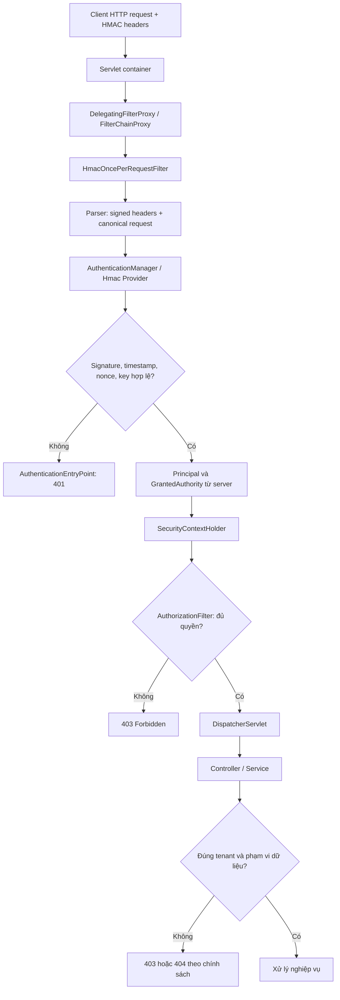

# OncePerRequestFilter trong Spring MVC: xác thực HTTP request bằng HMAC

## 1. Bối cảnh và mục tiêu

Trong hệ thống tích hợp giữa các dịch vụ, một client gửi HTTP request kèm chữ ký HMAC tạo từ shared secret và canonical request. Server cần kiểm tra chữ ký, danh tính key, timestamp, nonce, tình trạng key rotation rồi mới cho phép request đi vào API nghiệp vụ. Nếu xác thực thành công, Spring Security phải nhận được một `Authentication` có principal và authorities đáng tin cậy để kiểm tra quyền truy cập.

Lớp `OncePerRequestFilter` của Spring Web giúp xây dựng servlet filter có cơ chế tránh thực thi lặp trong một lần xử lý request theo quy tắc dispatch của Servlet. Đây là công cụ phù hợp để đặt bước xác thực HMAC tại ranh giới giữa HTTP và Spring Security, trước khi `DispatcherServlet` chuyển request tới controller.

Bài học thuộc chương **Spring MVC integration**, với chủ đề **OncePerRequestFilter**, trong module `SECURITY_AUTHENTICATION_HMAC_REQUEST_AUTHENTICATION`.

Sau bài học, người học có thể:

- Giải thích được vị trí của `OncePerRequestFilter` trong Spring MVC, Servlet Filter Chain và Spring Security Filter Chain.
- Cài đặt `doFilterInternal()` để đọc request ký HMAC, gửi dữ liệu tới `AuthenticationManager`, tạo `SecurityContext` và xử lý lỗi xác thực.
- Hiểu chính xác giới hạn của khái niệm “once”, đặc biệt với `REQUEST`, `ASYNC`, `ERROR` dispatch.
- Thiết kế wrapper cho request body, canonicalization, kiểm tra timestamp/nonce và tích hợp proxy/gateway.
- Phân biệt xác thực với phân quyền, kiểm tra đường chạy của filter và tránh đăng ký filter hai lần.

## 2. `OncePerRequestFilter` là gì?

`OncePerRequestFilter` là lớp trừu tượng thuộc package `org.springframework.web.filter`. Nó kế thừa `GenericFilterBean` và cung cấp phương thức `doFilter(...)` đã cài sẵn để quản lý một request attribute đánh dấu filter đang/đã được áp dụng trong dispatch hiện tại.

Lập trình viên thường chỉ cần ghi đè:

```java
public class ExampleFilter extends OncePerRequestFilter {
    @Override
    protected void doFilterInternal(
            HttpServletRequest request,
            HttpServletResponse response,
            FilterChain filterChain)
            throws ServletException, IOException {

        // Xử lý logic thuộc phạm vi của filter.
        filterChain.doFilter(request, response);
    }
}
```

Lớp cha tự kiểm tra và quản lý marker dạng `ALREADY_FILTERED` qua request attribute. Marker thường được đặt trước `doFilterInternal()` và gỡ ở khối `finally` sau khi xử lý xong; tên attribute được xác định từ tên filter. Nhờ đó, cùng một filter không vô tình đi vào `doFilterInternal()` lần hai khi filter chain bị gọi lồng nhau trong phạm vi marker còn hiệu lực.

**“Once” không có nghĩa một HTTP request chỉ có đúng một lần thực thi trong mọi hoàn cảnh.** Servlet có thể tái dispatch request qua các pha khác nhau, đặc biệt với async hoặc error handling. Mặc định, `OncePerRequestFilter` có cơ chế bỏ qua async/error dispatch; khi cấu hình để tham gia các dispatch ấy, filter có thể chạy thêm ở dispatch riêng. Nó cũng **không** cung cấp cơ chế phát hiện request HMAC bị gửi lại qua mạng: đó là việc của timestamp/nonce ở verifier.

| Thành phần | Thời điểm xử lý | Vai trò khi bảo vệ API HMAC |
| --- | --- | --- |
| Servlet Filter / `OncePerRequestFilter` | Trước hoặc sau `DispatcherServlet` theo filter chain | Chặn request chưa xác thực trước controller |
| Spring Security `FilterChainProxy` | Chọn và chạy `SecurityFilterChain` phù hợp | Điều phối các filter xác thực, phân quyền |
| `AuthenticationManager` / `AuthenticationProvider` | Khi filter yêu cầu xác thực | Xác minh bằng chứng HMAC, dựng danh tính đã xác thực |
| `HandlerInterceptor` | Trong quá trình Spring MVC xử lý handler | Logic liên quan handler; không thay thế security filter cho xác thực cốt lõi |
| Controller / Service | Sau khi vượt qua filter và authorization | Thực thi nghiệp vụ và kiểm tra tenant/ownership |

`OncePerRequestFilter` là **cơ chế xử lý request của servlet**, còn việc tính HMAC, cấp quyền hay chống replay là trách nhiệm các thành phần ứng dụng tự cài đặt.

## 3. Đường đi của request trong Spring MVC và Spring Security

Với một API chỉ nhận request ký HMAC, luồng mong muốn:



Ví dụ hợp đồng phân quyền của dịch vụ đơn hàng:

| Client sau xác thực HMAC | Tenant server cấp | Authority | Yêu cầu được phép |
| --- | --- | --- | --- |
| `reporting-client` | `tenant-a` | `ORDER_READ` | `GET /integrations/orders/{id}` thuộc tenant A |
| `fulfillment-client` | `tenant-b` | `ORDER_READ`, `ORDER_WRITE` | Đọc và tạo đơn thuộc tenant B |

Client `reporting-client` có thể ký đúng request `POST /integrations/orders` nhưng vẫn bị `403` vì không có `ORDER_WRITE`. Filter phải phân biệt **xác thực danh tính/tính toàn vẹn** với **phân quyền** và không tự cấp role quản trị chỉ vì chữ ký hợp lệ.

## 4. Chuẩn bị hợp đồng HMAC trước khi viết filter

Filter không thể xác minh chữ ký ổn định nếu client và server chưa thống nhất cách dựng canonical request.

Ví dụ **minh họa một hợp đồng ký riêng của ứng dụng**:

```text
POST
/integrations/orders?source=partner
x-key-id:key-2026-11
x-timestamp:2026-11-28T03:15:00Z
x-nonce:2f4b7c90
sha256-body:<lowercase-hex-sha256-of-raw-body>
```

Để dùng cấu trúc trên, hai phía phải ghi rõ:

1. Method viết hoa theo quy định; path và query được ký theo dạng nào, có chuẩn hóa percent-encoding hoặc thứ tự tham số hay không.
2. Những header nào được ký, cách chuẩn hóa chữ hoa/thường của tên, khoảng trắng và các giá trị lặp.
3. Body được ký bằng raw bytes hay digest của raw bytes, thuật toán băm, quy tắc xử lý body rỗng.
4. Dấu xuống dòng, encoding UTF-8, vị trí từng trường, key ID, timestamp và nonce có nằm trong phần được bảo vệ bởi chữ ký hay không.
5. Định dạng signature (ví dụ Base64), thuật toán MAC (ví dụ HMAC-SHA-256), giới hạn kích thước request.
6. Cách xử lý khi proxy/gateway viết lại path, query, `Host`, forwarded headers hoặc body; phía nào được phép chuẩn hóa các trường đã ký.

Hệ thống nên ký những yếu tố quan trọng như HTTP method, request-target và body digest, để tránh việc thay đổi thao tác hoặc payload trong lúc request đi qua mạng. Bắt buộc đưa timestamp/nonce vào dữ liệu được xác thực nếu dùng chúng để chống replay. Không dùng `request.toString()` hoặc serializing lại JSON làm canonical bytes.

Ví dụ các header HMAC là quy ước **của ứng dụng**, không phải header bắt buộc của Spring Security:

```http
POST /integrations/orders HTTP/1.1
Host: api.example.test
Content-Type: application/json
X-Key-Id: key-2026-11
X-Timestamp: 2026-11-28T03:15:00Z
X-Nonce: 2f4b7c90
X-Signature: <base64-hmac>

{"orderId":"O-17","amount":125000}
```

`X-Key-Id` chỉ cho verifier biết key nào được **client khai báo**; nó chưa chứng minh client sở hữu secret. Trạng thái key/secret phải được kiểm tra tại registry server. Các khóa đang rotation cần có giới hạn hiệu lực, thời điểm thu hồi và mapping tới client/tenant đáng tin cậy.

## 5. Thiết kế ranh giới trách nhiệm

Một custom filter HMAC nên giữ nhiệm vụ điều phối HTTP gọn và dễ kiểm thử:

| Thành phần | Nhiệm vụ chính | Điều phải tránh |
| --- | --- | --- |
| `HmacRequestParser` | Đọc header, chuẩn hóa dữ liệu ký và body, tạo evidence chưa tin cậy | Tự suy quyền từ header |
| `HmacVerifier` | Tìm key hợp lệ, tính MAC, so sánh chữ ký, kiểm tra thời gian/nonce | Tin key ID là danh tính đã xác thực |
| `HmacAuthenticationProvider` | Dùng verifier, tra policy, trả `Authentication` đã xác thực | Cấp `ROLE_ADMIN` mặc định |
| `HmacOncePerRequestFilter` | Đọc request, gọi manager, đặt `SecurityContext`, xử lý `401` | Nhúng chính sách nghiệp vụ vào filter |
| `SecurityFilterChain` | Chọn API áp dụng, đặt filter đúng thứ tự, áp authority | Để mọi endpoint mặc nhiên `permitAll` |
| Service/repository | Kiểm tra tenant, ownership, trạng thái dữ liệu | Dựa vào query param tenant do caller tự gửi |

Hợp đồng Java tối giản cho phần filter:

```java
// Chỉ là dữ liệu cần xác minh, chưa phải danh tính được chứng thực.
public record HmacSignedInput(
        String keyId,
        String timestamp,
        String nonce,
        byte[] canonicalRequest,
        byte[] providedSignature) {

    public HmacSignedInput {
        canonicalRequest = canonicalRequest.clone();
        providedSignature = providedSignature.clone();
    }

    @Override
    public byte[] canonicalRequest() {
        return canonicalRequest.clone();
    }

    @Override
    public byte[] providedSignature() {
        return providedSignature.clone();
    }
}

// Parser phải ném AuthenticationException nếu evidence không hợp lệ.
public interface HmacRequestParser {
    HmacSignedInput parse(HttpServletRequest request);
}

// Wrapper bảo đảm parser và controller đọc cùng các bytes đã nhận.
public interface ReplayableRequestFactory {
    HttpServletRequest wrap(HttpServletRequest request) throws IOException;
}
```

`ReplayableRequestFactory` là abstraction của ứng dụng; phần cài đặt phải giới hạn body size và cung cấp khả năng phát lại nội dung cho các tầng sau. Các kiểu trong ví dụ minh họa sử dụng Java có `record` và Servlet API dạng `jakarta.servlet.*`, phù hợp với các phiên bản Spring Framework/Spring Security hiện đại.

## 6. Ví dụ cài đặt `OncePerRequestFilter` xác thực HMAC

Ví dụ sau có chủ đích đặt phần xác minh HMAC trong `AuthenticationManager`. Lớp `HmacAuthenticationToken` có hai factory:

- `unauthenticated(HmacSignedInput)` tạo token `isAuthenticated() == false` để manager/provider kiểm tra.
- `authenticated(principal, authorities)` chỉ được provider gọi sau khi đã kiểm tra signature, timestamp, nonce, key và client policy.

Filter không được tự đánh dấu token đầu vào thành đã xác thực.

```java
import java.io.IOException;
import jakarta.servlet.FilterChain;
import jakarta.servlet.ServletException;
import jakarta.servlet.http.HttpServletRequest;
import jakarta.servlet.http.HttpServletResponse;
import org.springframework.security.authentication.AuthenticationManager;
import org.springframework.security.authentication.BadCredentialsException;
import org.springframework.security.core.Authentication;
import org.springframework.security.core.AuthenticationException;
import org.springframework.security.core.context.SecurityContext;
import org.springframework.security.core.context.SecurityContextHolder;
import org.springframework.security.web.AuthenticationEntryPoint;
import org.springframework.web.filter.OncePerRequestFilter;

public final class HmacOncePerRequestFilter extends OncePerRequestFilter {

    private final ReplayableRequestFactory bodyFactory;
    private final HmacRequestParser parser;
    private final AuthenticationManager authenticationManager;
    private final AuthenticationEntryPoint entryPoint;

    public HmacOncePerRequestFilter(
            ReplayableRequestFactory bodyFactory,
            HmacRequestParser parser,
            AuthenticationManager authenticationManager,
            AuthenticationEntryPoint entryPoint) {
        this.bodyFactory = bodyFactory;
        this.parser = parser;
        this.authenticationManager = authenticationManager;
        this.entryPoint = entryPoint;
    }

    @Override
    protected void doFilterInternal(
            HttpServletRequest request,
            HttpServletResponse response,
            FilterChain chain) throws ServletException, IOException {

        // Wrapper giới hạn body size và bảo đảm controller vẫn đọc được body.
        HttpServletRequest replayableRequest = bodyFactory.wrap(request);

        Authentication authenticated;
        try {
            HmacSignedInput signed = parser.parse(replayableRequest);
            Authentication candidate =
                    HmacAuthenticationToken.unauthenticated(signed);

            authenticated = authenticationManager.authenticate(candidate);
            if (authenticated == null || !authenticated.isAuthenticated()) {
                throw new BadCredentialsException("Invalid HMAC request");
            }
        } catch (AuthenticationException ex) {
            SecurityContextHolder.clearContext();
            entryPoint.commence(request, response, ex); // 401
            return;
        }

        SecurityContext context = SecurityContextHolder.createEmptyContext();
        context.setAuthentication(authenticated);
        SecurityContextHolder.setContext(context);
        try {
            chain.doFilter(replayableRequest, response);
        } finally {
            SecurityContextHolder.clearContext();
        }
    }
}
```

**Ý nghĩa các bước chính:**

1. `bodyFactory.wrap(request)` tạo request cho parser và controller sử dụng chung, tránh parser đọc hết `InputStream` rồi controller nhận body rỗng. Factory phải có giới hạn tài nguyên; yêu cầu vượt giới hạn cần được xử lý thành `413 Payload Too Large` hoặc phản hồi tương ứng.
2. Parser đọc evidence từ request. Dữ liệu do client đưa lên lúc này **chưa đáng tin**.
3. `authenticationManager.authenticate(...)` chuyển yêu cầu tới provider phù hợp. Provider xác minh HMAC và trả token đã xác thực với principal/authorities do server quyết định.
4. Nếu ném `AuthenticationException`, filter xóa context, gọi `AuthenticationEntryPoint` và dừng chain. Chữ ký sai hoặc nonce đã dùng không được tiếp tục vào controller.
5. Sau thành công, filter tạo một `SecurityContext` mới và đặt authentication vào đó. `try/finally` bảo đảm context được dọn khi processing đồng bộ kết thúc, kể cả controller ném lỗi.

Đây là ví dụ tích hợp trọng tâm, **chưa phải toàn bộ source có thể chạy độc lập**: ứng dụng cần cài `ReplayableRequestFactory`, `HmacRequestParser`, `HmacAuthenticationToken` và provider. Nếu wrapper phát hiện body không hợp lệ hoặc lỗi I/O trước khi tạo token, cần ánh xạ ngoại lệ đó thành mã HTTP phù hợp; không tùy tiện chuyển mọi lỗi hệ thống thành `401`.

Tại sao cần tự gọi `entryPoint.commence(...)` trong filter? Filter tùy biến thường được đặt **trước** `ExceptionTranslationFilter` của Spring Security, nên lỗi xác thực ném ngay trong filter có thể không được `ExceptionTranslationFilter` bắt. Xử lý lỗi xác thực tại đúng vị trí giúp thống nhất phản hồi `401`. Đừng bọc `chain.doFilter(...)` vào cùng khối `catch (AuthenticationException)` nếu điều đó sẽ bắt nhầm lỗi từ các filter/tầng phía sau.

## 7. AuthenticationProvider kiểm tra gì để filter được an toàn?

`OncePerRequestFilter` không tự cung cấp bảo mật mật mã. Một `AuthenticationProvider` nhận token chưa xác thực phải kiểm tra tối thiểu:

1. **Key lookup:** `keyId` tồn tại, chưa hết hạn/thu hồi và nằm trong phiên bản cho phép của key rotation. Registry xác định `clientId`, `tenantId` và secret; không tin danh tính từ header một cách độc lập.
2. **Canonical request:** server dựng đúng bytes theo hợp đồng ký. Method, request-target, signed headers, timestamp/nonce và body digest phải khớp giữa client/server. Các field quan trọng phải thuộc phạm vi ký.
3. **HMAC:** tính MAC bằng shared secret đúng thuật toán, decode chữ ký đúng định dạng và so sánh bằng thao tác thích hợp tránh sai khác thời gian. Không log secret, MAC đầy đủ hoặc dữ liệu nhạy cảm.
4. **Timestamp:** kiểm tra độ lệch đồng hồ theo cửa sổ cấu hình và chống dùng request quá cũ hay timestamp tương lai.
5. **Nonce:** ghi nhận duy nhất một cách nguyên tử theo client/key và phạm vi tương ứng, với TTL bao phủ cửa sổ chấp nhận. Trong hệ thống nhiều instance cần kho chống replay chia sẻ.
6. **Policy:** lấy authorities từ cấu hình server của client/tenant **đã xác thực**; không lấy quyền tự khai trong HTTP header/body.

Ví dụ phần chuyển đổi kết quả đã xác minh sang `Authentication`:

```java
// Giả định verifier đã xác minh HMAC, timestamp, nonce và key.
VerifiedHmacClient verified = verifier.verify(signedInput);

// Policy store chỉ trả bản ghi client/tenant còn hoạt động.
ClientPolicy policy = policyStore.requireActive(
        verified.clientId(), verified.tenantId());

List<GrantedAuthority> authorities = policy.permissions().stream()
        .map(name -> (GrantedAuthority) new SimpleGrantedAuthority(name))
        .toList();

Authentication result = HmacAuthenticationToken.authenticated(
        new HmacPrincipal(verified.clientId(), verified.tenantId()),
        authorities);
```

Các kiểu `VerifiedHmacClient`, `ClientPolicy`, `HmacPrincipal` và `policyStore` là phần triển khai domain của ứng dụng. Ví dụ trên minh họa trách nhiệm của provider, không tự thay thế `HmacVerifier` thật.

**Phân biệt security decisions:** HMAC hợp lệ trả lời “request được ký đúng bởi chủ key hợp lệ và chưa bị replay”; `GrantedAuthority` và kiểm tra tenant trả lời “client đó có quyền làm thao tác trên tài nguyên này hay không”.

## 8. Đăng ký filter đúng chỗ trong `SecurityFilterChain`

Với Spring Security 6.x, cấu hình gợi ý cho API tích hợp:

```java
@Bean
SecurityFilterChain hmacSecurityChain(
        HttpSecurity http,
        HmacOncePerRequestFilter hmacFilter) throws Exception {
    return http
            .securityMatcher("/integrations/**")
            .csrf(csrf -> csrf.disable())
            .sessionManagement(session -> session
                    .sessionCreationPolicy(SessionCreationPolicy.STATELESS))
            .authorizeHttpRequests(auth -> auth
                    .requestMatchers(HttpMethod.GET, "/integrations/orders/**")
                        .hasAuthority("ORDER_READ")
                    .requestMatchers(HttpMethod.POST, "/integrations/orders")
                        .hasAuthority("ORDER_WRITE")
                    .anyRequest().denyAll())
            .addFilterBefore(
                    hmacFilter, UsernamePasswordAuthenticationFilter.class)
            .build();
}
```

`securityMatcher("/integrations/**")` giới hạn chain cho nhóm endpoint cần HMAC; cần có chain khác cho những endpoint còn lại nếu ứng dụng phục vụ thêm API/web. `addFilterBefore(...)` đặt custom filter trong chuỗi Spring Security, trước bước kiểm tra phân quyền. `STATELESS` phù hợp với API máy gọi máy không sử dụng session cookie để duy trì xác thực.

Chỉ tắt CSRF trên chain khi đã đánh giá rằng luồng xác thực là máy gọi máy, không dùng cookie tự động đính kèm bởi trình duyệt. Ứng dụng web dựa vào cookie/session cần chính sách CSRF riêng.

**Tránh chạy filter hai lần do đăng ký trùng:**

Trong Spring Boot, một servlet `Filter` khai báo thành bean có thể bị đăng ký tự động vào servlet container. Nếu chính bean ấy đồng thời được thêm qua `http.addFilterBefore(...)`, filter có thể xuất hiện ở hai chain khác nhau, gây hành vi khó dự đoán. Một cách vô hiệu hóa đăng ký servlet tự động:

```java
@Bean
FilterRegistrationBean<HmacOncePerRequestFilter> hmacRegistration(
        HmacOncePerRequestFilter filter) {
    FilterRegistrationBean<HmacOncePerRequestFilter> registration =
            new FilterRegistrationBean<>(filter);
    registration.setEnabled(false);
    return registration;
}
```

Đoạn này áp dụng nếu `HmacOncePerRequestFilter` được quản lý như một bean Spring Boot. `FilterRegistrationBean` thuộc `org.springframework.boot.web.servlet`. Nếu filter chỉ được tạo khi cấu hình security chain và không có đăng ký servlet độc lập, không cần thêm registration bean này.

**Không dựa vào marker `already filtered` để chữa việc đăng ký hai lần.** Hai lần đăng ký có thể nằm ở các mức chain khác nhau, hoặc sử dụng các tên/filter instance khác nhau. Cần kiểm tra thứ tự và vị trí đăng ký của filter thực tế.

## 9. `shouldNotFilter()` và phạm vi được bỏ qua

`OncePerRequestFilter` cho phép ghi đè `shouldNotFilter(HttpServletRequest)` để bỏ qua một số request. Ví dụ nếu filter hoạt động ở phạm vi servlet rộng:

```java
@Override
protected boolean shouldNotFilter(HttpServletRequest request) {
    return !request.getRequestURI().startsWith(
            request.getContextPath() + "/integrations/");
}
```

Đây chỉ là ví dụ so khớp path ở mức ứng dụng. Với ứng dụng có nhiều security chain, nên dùng `securityMatcher(...)` và rule truy cập nhất quán để giảm nguy cơ bỏ sót path, method hoặc prefix. Trong ứng dụng ở sau proxy, cần xác định chính xác path backend thật sự nhìn thấy.

**Không được bỏ qua xác thực chỉ vì thiếu `X-Signature`.** Đối với endpoint bắt buộc HMAC, trường hợp header không có hoặc không hợp lệ phải được coi là lỗi xác thực và dừng request. Nếu dùng `shouldNotFilter()` cho health check hoặc endpoint public, các endpoint đó cần có policy public rõ ràng từ phía server.

## 10. Async, ERROR dispatch và ý nghĩa của “once”

Servlet API có nhiều `DispatcherType`. `OncePerRequestFilter` có hai phương thức quan trọng:

```java
@Override
protected boolean shouldNotFilterAsyncDispatch() {
    return true; // Giá trị mặc định: bỏ qua ASYNC dispatch
}

@Override
protected boolean shouldNotFilterErrorDispatch() {
    return true; // Giá trị mặc định: bỏ qua ERROR dispatch
}
```

| Kiểu dispatch | Diễn biến | Lưu ý cho HMAC filter |
| --- | --- | --- |
| `REQUEST` | Lần request đi vào servlet chain | Xác thực HMAC trước controller và authorization |
| `ASYNC` | Servlet tái dispatch sau khi xử lý bất đồng bộ | Theo mặc định filter bỏ qua; không dựa vào việc verifier chắc chắn sẽ chạy lại |
| `ERROR` | Container dispatch tới cơ chế xử lý lỗi | Theo mặc định filter bỏ qua; tránh làm mất mã lỗi gốc hoặc tạo vòng lặp |
| `FORWARD` / `INCLUDE` | Dispatch nội bộ trong servlet container | Phụ thuộc mapping filter/chain và marker; cần kiểm thử nếu ứng dụng sử dụng |

Nếu ghi đè trả `false` để tham gia `ASYNC` hoặc `ERROR`, filter có thể được gọi ở dispatch mới. Quyết định này phải nhất quán với servlet dispatcher mappings của filter/chain; chỉ thay override chưa đảm bảo container sẽ gọi filter tại dispatch tương ứng. Với error dispatch lồng nhau, lớp cung cấp thêm hook `doFilterNestedErrorDispatch(...)` cho tình huống container tái nhập `ERROR` khi marker vẫn đang tồn tại.

Đối với **API HMAC stateless thông thường**, thường nên xác minh ngay ở lần `REQUEST` ban đầu và không tính lại chữ ký ở mỗi async/error dispatch. Nếu code bất đồng bộ cần truy cập danh tính, hãy sử dụng cơ chế lan truyền `SecurityContext` phù hợp của Spring Security hoặc truyền dữ liệu principal đã kiểm chứng tới công việc đó. Đừng giữ `SecurityContextHolder` của một thread rồi mặc định tin rằng nó tự xuất hiện ở thread khác.

Quan trọng: `OncePerRequestFilter` **không chặn replay qua hai HTTP request riêng biệt**. Hai request gửi cùng signature/nonce là hai request mới ở cấp servlet. Phải kiểm tra nonce/timestamp ở verifier để request thứ hai bị từ chối.

## 11. Đọc body mà không phá luồng Spring MVC

Đây là lỗi tích hợp rất phổ biến khi ký body:

```java
byte[] body = request.getInputStream().readAllBytes();
// Nếu truyền nguyên request xuống controller,
// @RequestBody có thể không còn bytes để đọc.
filterChain.doFilter(request, response);
```

`HttpServletRequest.getInputStream()` thông thường là stream tiêu thụ một lần. Nếu filter đọc hết để tính hash body, controller dùng `@RequestBody` có thể nhận body rỗng hoặc lỗi mapping.

Giải pháp:

1. Đặt giới hạn kích thước body trước khi đọc, và từ chối request vượt quá giới hạn theo chính sách API.
2. Dùng request wrapper lưu bytes của body trong bộ nhớ có giới hạn hoặc giải pháp streaming phù hợp. Wrapper phải cung cấp `ServletInputStream`/`getReader()` từ bản sao bytes khi các tầng sau đọc.
3. Parser và controller cùng dùng **chính wrapper đó** qua `filterChain.doFilter(wrappedRequest, response)`.
4. Hash trực tiếp trên bytes đã nhận theo hợp đồng ký; không parse JSON rồi serialize lại vì key order, khoảng trắng hoặc encoding có thể làm thay đổi dữ liệu ký.
5. Với nội dung upload lớn, cân nhắc giao thức ký dựa trên hash/stream có quy tắc rõ ràng thay vì luôn giữ toàn bộ body trong RAM.

`ContentCachingRequestWrapper` của Spring Web giúp lưu bytes **đã được đọc**, nhưng bản thân nó không tự bảo đảm controller có thể đọc lại body sau khi filter đã tiêu thụ stream. Nếu cần phát lại nhiều lần, hãy cài wrapper có stream phát lại rõ ràng và kiểm thử với `@RequestBody`.

Nếu proxy/gateway có thể giải nén, chuẩn hóa JSON, thêm hoặc thay path/header trước backend, phải xác định **biểu diễn bytes nào** được ký và xác minh. Đặc biệt không tin header `X-Forwarded-*` do Internet trực tiếp gửi; chỉ tin dữ liệu forwarding đã được gateway đáng tin cậy làm sạch và quy định trong hợp đồng.

## 12. Phản hồi lỗi và bảo mật `SecurityContext`

| Tình huống | Phản hồi thường dùng | Nguồn quyết định |
| --- | --- | --- |
| Thiếu header ký hoặc định dạng signature không hợp lệ | `401 Unauthorized` | Parser/filter/entry point |
| Không tìm được key hợp lệ, signature sai, timestamp quá hạn | `401 Unauthorized` | HMAC verifier/provider |
| Nonce đã sử dụng trong cửa sổ chống replay | `401 Unauthorized` | Nonce store/verifier |
| Xác thực thành công nhưng thiếu `ORDER_WRITE` | `403 Forbidden` | Spring Security authorization |
| Client có quyền đọc nhưng truy vấn đơn hàng khác tenant | `403` hoặc `404` theo chính sách | Service/repository |
| Body vượt giới hạn kích thước | `413 Payload Too Large` | Request body wrapper hoặc container |
| Lỗi hệ thống, secret store/replay store không sẵn sàng | Lỗi server phù hợp, từ chối xử lý | Hạ tầng; fail closed |

Tránh ghi log raw `X-Signature`, shared secret, toàn bộ canonical request nếu chứa dữ liệu nhạy cảm, hoặc raw `Authorization` header. Log nên có request ID, danh tính client **sau khi xác minh**, endpoint, tên policy bị thiếu và mã lỗi đã chuẩn hóa.

Về `SecurityContextHolder`, sử dụng `SecurityContextHolder.createEmptyContext()` giúp tránh sửa trực tiếp một context được chia sẻ hoặc tái sử dụng sai. `try/finally` là lớp bảo vệ thêm trong ví dụ đồng bộ. Spring Security cũng có các filter quản lý vòng đời context theo request; khi làm custom filter, cần kiểm tra thứ tự trong chain để tránh ghi đè context đã được thiết lập bởi cơ chế xác thực khác hoặc vô tình giữ context trong thread pool.

## 13. Bài thực hành: filter HMAC cho API đơn hàng

Xây hai endpoint:

- `GET /integrations/orders/{id}` yêu cầu `ORDER_READ`.
- `POST /integrations/orders` yêu cầu `ORDER_WRITE`.

Thiết lập policy:

- `partner-reporting` thuộc `tenant-a`, chỉ có `ORDER_READ`.
- `partner-fulfillment` thuộc `tenant-b`, có `ORDER_READ` và `ORDER_WRITE`.

Các bước thực hành:

1. Định nghĩa format header, canonical request và các quy tắc ký method/path/query/header/body.
2. Viết `HmacRequestParser` tạo evidence từ request, bao gồm body digest và timestamp/nonce đã nằm trong phạm vi ký.
3. Cài `HmacVerifier` dùng shared secret từ registry, so sánh MAC, kiểm tra key rotation, timestamp, nonce và chính sách chống replay nguyên tử.
4. Cài provider đổi token chưa xác thực thành `Authentication` có principal, tenant và authorities đáng tin cậy.
5. Cài `HmacOncePerRequestFilter` bằng `OncePerRequestFilter`, dùng request body wrapper, gọi `AuthenticationManager` và trả `401` khi xác thực thất bại.
6. Đăng ký filter đúng một lần trong `SecurityFilterChain`, cấp quyền theo method/path và kiểm soát tenant ở service.
7. Viết kiểm thử tích hợp bằng `MockMvc` hoặc test servlet/security chain thật.

Ma trận kiểm thử gợi ý:

| Ca thử | Kỳ vọng |
| --- | --- |
| `partner-reporting` ký đúng GET đơn hàng thuộc `tenant-a` | Được phép nếu tài nguyên tồn tại |
| `partner-reporting` ký đúng POST | `403`; controller không ghi dữ liệu |
| `partner-fulfillment` ký đúng POST thuộc `tenant-b` | Qua authorization; service xử lý |
| Request thiếu chữ ký | `401`; không tới controller |
| Signature sai hoặc header thuộc vùng ký bị sửa | `401` |
| Timestamp ngoài cửa sổ, nonce đã dùng lại | `401`; không có side effect lần hai |
| Hai request đồng thời dùng cùng nonce | Nhiều nhất một request được chấp nhận theo replay policy |
| Key cũ trong thời gian rotation còn hiệu lực | Chấp nhận nếu key và policy đều cho phép |
| Key bị thu hồi | `401` sau khi thay đổi có hiệu lực |
| Client `tenant-a` yêu cầu đơn thuộc `tenant-b` | Không trả dữ liệu; `403`/`404` phù hợp |
| POST body JSON có ký và controller dùng `@RequestBody` | Controller đọc đúng bytes/đối tượng mà verifier kiểm tra |
| Gateway viết lại path/header đã ký | Từ chối chữ ký hoặc chuẩn hóa theo hợp đồng được chứng minh |
| Kích hoạt async hoặc error dispatch | Không có xác thực lặp ngoài chủ đích; status không bị thay |
| Filter bean đăng ký qua cả container và security chain | Phát hiện, loại bỏ đăng ký trùng |

Ví dụ tạo request có HMAC trong integration test (hàm ký là helper của test):

```java
String nonce = "n-" + UUID.randomUUID();
String timestamp = Instant.now().toString();
String body = "{\"orderId\":\"O-17\"}";
String signature = testSigner.sign(
        "POST", "/integrations/orders",
        timestamp, nonce, body);

mockMvc.perform(post("/integrations/orders")
        .header("X-Key-Id", "key-for-fulfillment")
        .header("X-Timestamp", timestamp)
        .header("X-Nonce", nonce)
        .header("X-Signature", signature)
        .contentType(MediaType.APPLICATION_JSON)
        .content(body))
    .andExpect(status().isCreated());
```

Trong kiểm thử, `testSigner.sign(...)` phải tạo cùng canonical bytes với hợp đồng mà verifier áp dụng; secret chỉ dùng trong test fixture, không commit secret thật. Test trên cần có policy/handler tạo đơn trả `201 Created`. Nên bổ sung assertion rằng filter chỉ xử lý một lần trong request thông thường, context bị dọn sau request, body đến controller còn nguyên, và hai nonce trùng không thể cùng được chấp nhận.

## 14. Các lỗi dễ gặp và cách nhận diện

| Triệu chứng | Nguyên nhân khả dĩ | Hướng kiểm tra |
| --- | --- | --- |
| Filter chạy hai lần trong một HTTP request | Đăng ký cả servlet container và `SecurityFilterChain` | Kiểm tra bean/filter registration và thứ tự chain |
| Controller thấy body rỗng | Filter đã đọc stream trước khi controller | Sử dụng replayable request wrapper và truyền wrapper xuống chain |
| Đúng chữ ký nhưng luôn `401` khi qua gateway | Khác path, query, header hoặc bytes body trong canonicalization | So sánh thành phần canonical theo hợp đồng, không log secret |
| Request thiếu signature vẫn qua controller | Filter bị skip, matcher sai hoặc endpoint được `permitAll` | Kiểm tra security matcher và điều kiện `shouldNotFilter()` |
| Token có authority cao dù request chỉ có keyId | Filter/provider cấp quyền từ dữ liệu tự khai | Lấy authorities từ server policy sau khi verifier thành công |
| Request cũ vẫn chạy lại | Chỉ dùng `OncePerRequestFilter` mà không chặn nonce | Timestamp + atomic nonce store |
| Request async mất danh tính | Chạy trên thread mới mà không truyền context | Thiết kế truyền `SecurityContext` phù hợp với async processing |
| Error dispatch làm mất status gốc | Filter xác thực lại khi đang dựng trang lỗi | Kiểm tra error dispatcher settings và tránh xác thực lại ngoài chủ đích |

## 15. Câu hỏi tự kiểm tra

**1. `OncePerRequestFilter` có tự chống replay không?** Không. Marker “already filtered” chỉ tác động tới luồng xử lý filter của một servlet request/dispatch. Replay là một HTTP request mới và phải được chặn bằng timestamp/nonce.

**2. Vì sao phải đưa filter HMAC vào Spring Security chain?** Để bước xác thực chạy trước authorization và tạo `Authentication` trong `SecurityContext`, từ đó các rule và service có thể dùng danh tính/authorities đã được xác minh.

**3. Vì sao không tự gọi `setAuthenticated(true)` sau khi đọc `X-Key-Id`?** Key ID là dữ liệu client cung cấp; chỉ sau khi kiểm tra đúng HMAC và replay mới có thể coi danh tính được xác thực.

**4. `ContentCachingRequestWrapper` có giải quyết hoàn toàn việc filter đọc hết body không?** Không. Nó cache những bytes đã được đọc, nhưng không tự cung cấp cơ chế phát lại body cho mọi lần gọi stream; cần wrapper phù hợp và integration test.

**5. Mặc định filter có chạy lại trên async/error dispatch không?** Mặc định `OncePerRequestFilter` bỏ qua hai loại dispatch này. Cần xem cả dispatcher mappings lẫn các override nếu thay đổi hành vi.

**6. Chữ ký HMAC hợp lệ nhưng client thiếu `ORDER_WRITE` thì trả mã nào?** Thường là `403 Forbidden` do authorization, trong khi chữ ký sai hoặc nonce bị phát lại là lỗi xác thực `401 Unauthorized`.

**7. Client có `ORDER_READ` là đọc được mọi tenant không?** Không. Service/repository vẫn cần giới hạn tài nguyên theo tenant/ownership từ principal đã được xác minh.

## 16. Ghi nhớ

`OncePerRequestFilter` cung cấp điểm móc servlet rõ ràng để xác thực HMAC trong ứng dụng Spring MVC: đọc HTTP evidence, tạo yêu cầu xác thực, gọi `AuthenticationManager`, nhận `Authentication` đáng tin cậy và gắn vào `SecurityContext` trước khi qua bước phân quyền. Tính “once” nhằm tránh thực thi filter lặp trong phạm vi dispatch theo thiết kế; **chống replay thực sự** vẫn phải dựa trên timestamp/nonce cùng bộ nhớ dùng chung có thao tác nguyên tử. Một giải pháp hoàn chỉnh còn cần hợp đồng canonical request chặt chẽ, quản lý key rotation, wrapper body phù hợp, xử lý proxy/gateway, ranh giới tenant rõ ràng và đăng ký filter đúng một lần.
