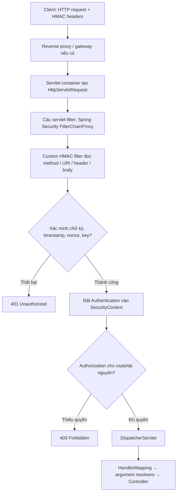

# HttpServletRequest trong Spring MVC: đọc chính xác HTTP request để xác thực HMAC

## 1. Bối cảnh và mục tiêu

Module `SECURITY_AUTHENTICATION_HMAC_REQUEST_AUTHENTICATION` hướng dẫn thiết kế xác thực HTTP request bằng HMAC sử dụng shared secret. Client ký **canonical request** chứa những thành phần đã được thỏa thuận, chẳng hạn HTTP method, URI, header và/hoặc body; server phải dựng lại đúng nội dung đó để xác minh chữ ký. Cơ chế còn phải chống replay bằng timestamp/nonce, hỗ trợ key rotation, hoạt động đúng qua proxy/gateway và tách riêng xác thực khỏi phân quyền.

Trong ứng dụng Java sử dụng **Spring MVC**, đối tượng `HttpServletRequest` là cửa ngõ để filter HMAC đọc dữ liệu HTTP mà servlet container đã chuyển vào ứng dụng. Hiểu sai đối tượng này có thể gây hai kiểu lỗi: **chữ ký hợp lệ bị từ chối** vì client và server canonicalize khác nhau, hoặc **request nguy hiểm được chấp nhận** do những thành phần của request mà ứng dụng xử lý không được xác minh nhất quán.

Bài thuộc chương **Spring MVC integration** và đi sâu vào một chủ đề: **`HttpServletRequest`**. Sau bài học, người học có thể:

- Xác định thời điểm custom authentication filter tiếp cận `HttpServletRequest` trong chuỗi xử lý Spring Security → Spring MVC.
- Đọc method, request URI, query string, header và body chính xác theo hợp đồng ký.
- Nhận diện giới hạn của servlet API: dữ liệu nhìn thấy có thể đã được proxy, container hoặc filter trước đó biến đổi.
- Tránh làm mất body trước khi `@RequestBody` hoặc controller sử dụng; chọn giải pháp buffering có giới hạn.
- Chuyển kết quả xác thực HMAC thành `Authentication` mà không đánh đồng với việc cấp quyền.
- Thiết kế kiểm thử cho encoding, duplicate header, replay, body, gateway rewrite và ranh giới bảo mật.

> Ví dụ áp dụng cho Servlet stack với Jakarta Servlet (`jakarta.servlet.*`), Spring Boot 3.x và Spring Security 6.x. Trên Spring WebFlux, request được biểu diễn bằng API khác và có mô hình body/stream khác; không áp dụng nguyên xi code Servlet.

## 2. HttpServletRequest nằm ở đâu trong luồng Spring MVC?

`HttpServletRequest` là interface của Jakarta Servlet đại diện request hiện tại sau khi nó đi vào web container. Spring MVC không tự tạo một request HTTP mới cho controller; `DispatcherServlet` nhận request đã được truyền qua chuỗi servlet filter, ánh xạ endpoint và giải quyết các tham số controller.



Một số hệ quả thực tế:

1. Custom filter thường chạy **trước controller và trước `@RequestBody`**. Nếu filter đọc body từ `getInputStream()`, controller có thể không còn byte nào để đọc.
2. `HttpServletRequest` là cùng request logic có thể được **bọc qua `HttpServletRequestWrapper`** bởi các filter; đối tượng được truyền tới controller có thể là một wrapper.
3. Spring Security dùng request để chọn `SecurityFilterChain`, xét `RequestMatcher` và đặt `SecurityContext`. `HttpServletRequest` tự nó không xác minh HMAC.
4. Filter/ngăn xếp phía trước có thể xử lý URI, header, request encoding và request body. Verifier cần hiểu rõ mình đang ký/xác minh **representation nào**.

## 3. Các phương thức quan trọng của HttpServletRequest

| API | Dữ liệu thu được | Lưu ý cho HMAC |
| --- | --- | --- |
| `getMethod()` | Method HTTP như `GET`, `POST` | Phải nằm trong hợp đồng ký; method khác là thông điệp khác |
| `getRequestURI()` | Phần request URI chỉ chứa path, không có query string | Không giống URL đầy đủ; có thể chứa phần path đã mã hóa tùy container |
| `getQueryString()` | Chuỗi query như xuất hiện với servlet request, hoặc `null` | Không tự sắp xếp hoặc decode nếu hợp đồng chưa quy định |
| `getContextPath()` | Prefix context của ứng dụng, có thể là chuỗi rỗng | Cần nhất quán khi ký external path và đường dẫn nội bộ |
| `getServletPath()` | Phần path dùng để ánh xạ servlet | Dễ nhầm với `getRequestURI()` khi ứng dụng có servlet mapping |
| `getPathInfo()` | Path bổ sung sau servlet path, có thể `null` | Không mặc nhiên bằng path của endpoint controller |
| `getHeader(name)` | Một giá trị header hoặc `null` | Không đủ nếu có nhiều header trùng tên |
| `getHeaders(name)` | Tất cả giá trị mà servlet API cung cấp cho tên header | Cần quy tắc rõ khi header bị lặp/gộp |
| `getHeaderNames()` | Danh sách tên header có thể truy xuất | Chuẩn hóa tên theo hợp đồng, không dựa vào thứ tự ban đầu |
| `getInputStream()` | Byte stream request body | Thường chỉ đọc được một lần nếu không dùng wrapper phù hợp |
| `getReader()` | Character reader cho body | Việc chuyển byte thành ký tự phụ thuộc encoding; không thích hợp để hash raw body |
| `getContentType()` | Media type, có thể kèm charset | Nếu được ký, cần quy tắc chuẩn hóa rõ |
| `getContentLengthLong()` | Content length hoặc giá trị âm nếu không biết | Không chứng minh body thực sự có đúng số byte |
| `getParameter*()` | Tham số query hoặc form đã parse | Mất nhiều thông tin wire representation; không nên dùng làm nguồn canonical raw URI/body |
| `getAttribute()/setAttribute()` | Dữ liệu nội bộ gắn với request | Phù hợp lưu metadata trung gian, không phải header do client ký |
| `getRemoteAddr()` | Địa chỉ peer kết nối đến container | Qua proxy thường là IP proxy; không thay thế client authentication |
| `getRequestURL()` | URL được container tái tạo từ request | Có thể chịu ảnh hưởng proxy/forwarded handling; không phải byte URL nguyên gốc |

### 3.1. Ví dụ quan sát method, path và query

Client gửi:

```http
POST /shop/internal/orders?currency=VND&mode=fast HTTP/1.1
Host: api.example.test
Content-Type: application/json
X-Client-Id: accounting-worker
X-Request-Timestamp: 2026-11-28T03:00:00Z
X-Request-Nonce: 6eb1fdc2-46b0-41e7-8d4c-6b60d450e423
X-Signature: <base64-hmac>

{"orderId":"O-1001","amount":125000}
```

Giả sử ứng dụng có context path `/shop` và `DispatcherServlet` được map ở `/`; những giá trị thường quan sát được là:

```java
request.getMethod();       // "POST"
request.getRequestURI();   // "/shop/internal/orders"
request.getContextPath();  // "/shop"
request.getServletPath();  // Phụ thuộc cách servlet được map
request.getQueryString();  // "currency=VND&mode=fast"
```

Không tự ghép `getServletPath() + getPathInfo()` rồi coi đó là `getRequestURI()` ở mọi deployment. Với context path, servlet mapping và forwarding khác nhau, các giá trị có thể không trùng nhau. Hãy xác định **canonical path** theo hợp đồng: ký public path client nhìn thấy, internal path gateway chuyển đến, hay một URI chuẩn đã được xác định và bảo vệ ở ranh giới tin cậy.

### 3.2. Vì sao getParameter() có thể làm sai chữ ký?

Hai chuỗi query dưới đây có thể được giải mã thành các cặp key/value tương tự nhưng khác nhau ở mức byte:

```text
name=red%20fox&flag=1
flag=1&name=red+fox
```

`getParameter("name")` có thể trả về cùng một giá trị ở cả hai request, trong khi raw query, thứ tự cặp tham số và cách encode khác nhau. Với HMAC, phải quy định rõ:

- Có sắp xếp key và value không? Xử lý key trùng như thế nào?
- Chuẩn hóa percent encoding, dấu `+`, ký tự Unicode, tham số rỗng và khoảng trắng ra sao?
- Method, path, query, header và body được nối bằng byte separator nào?
- Nếu loại bỏ một thành phần khi ký, có bảo đảm thành phần đó không ảnh hưởng đến hành động hoặc quyền hạn hay không?

Một hợp đồng dễ kiểm thử là canonicalize theo quy tắc độc lập với thư viện parse query, rồi tạo **test vector** có input và expected canonical string/bytes. Không lấy `Map<String,String[]>` từ `getParameterMap()` làm bằng chứng đủ để tái tạo request gốc.

## 4. Header: tên không phân biệt hoa thường, giá trị phải được định nghĩa rõ

Theo HTTP, **tên header không phân biệt chữ hoa/chữ thường**. Trong Servlet API:

```java
String clientId = request.getHeader("X-Client-Id");
String timestamp = request.getHeader("X-Request-Timestamp");
String nonce = request.getHeader("X-Request-Nonce");
String signature = request.getHeader("X-Signature");
```

Đọc được header không có nghĩa header đáng tin. Kẻ tấn công cũng có thể gửi `X-Client-Id: admin`. Client ID chỉ dùng để **tìm key candidate** và các thông tin liên quan; danh tính chỉ được xác nhận sau khi HMAC khớp và key được cấp phép cho client đó.

### 4.1. Duplicate header và header bị gộp

`getHeader("X-Client-Id")` chỉ lấy một giá trị. Một request chứa hai giá trị của header định danh có thể bị các proxy/container diễn giải khác nhau.

```java
import java.util.Collections;
import java.util.List;
import jakarta.servlet.http.HttpServletRequest;

static String singleRequiredHeader(
    HttpServletRequest request,
    String name
) {
    List<String> values =
        Collections.list(request.getHeaders(name));
    if (values.size() != 1) {
        throw new IllegalArgumentException(
            "Missing or ambiguous security header"
        );
    }
    String value = values.get(0);
    if (value == null || value.isBlank()) {
        throw new IllegalArgumentException(
            "Invalid security header"
        );
    }
    return value;
}
```

Đây là kiểm tra độ duy nhất ở **mức giá trị mà Servlet API nhìn thấy**. Nếu một proxy đã tự gộp nhiều header thành một chuỗi, servlet có thể không còn biết giá trị ban đầu là trùng lặp. Vì vậy gateway và application phải có **chính sách nhất quán**: từ chối/gộp header ra sao, header HMAC nào bắt buộc đơn trị và có thể xuất hiện dưới dạng list hay không.

Đừng tự ý gọi `trim()` với mọi header rồi cho rằng đã chuẩn hóa an toàn. Chỉ thực hiện những phép biến đổi được hợp đồng canonicalization định nghĩa. Đặc biệt, dấu cách trong một giá trị có thể có ý nghĩa, và thay đổi header sau khi ký sẽ làm verifier tính ra byte khác.

### 4.2. Signed headers và các trường bắt buộc

Một hợp đồng có thể yêu cầu chữ ký bảo vệ:

```text
x-client-id
x-request-timestamp
x-request-nonce
content-type
x-content-sha256
```

Danh sách này **chỉ là ví dụ**: thực tế phải định nghĩa chính xác field nào nằm trong canonical request và thứ tự xuất hiện. Nên đưa timestamp/nonce vào thông điệp ký để kẻ tấn công không thể sửa metadata chống replay mà vẫn giữ nguyên chữ ký.

Nếu response/chức năng phụ thuộc vào `Host`, tenant header hoặc target resource, thiết kế phải ràng buộc những thành phần đó bằng chữ ký, kiểm tra quyền server-side hoặc chính sách mạng đáng tin. Ngược lại, việc ký các header dễ bị gateway sửa (ví dụ header hop-by-hop) mà không có hợp đồng rõ ràng sẽ gây lỗi vận hành.

## 5. Đọc body: điểm tích hợp dễ sai nhất

### 5.1. InputStream thường không tự tua lại

`HttpServletRequest.getInputStream()` cho phép đọc byte body mà container cung cấp. Sau khi filter đã đọc hết stream, việc controller gọi `@RequestBody` có thể nhận body rỗng:

```java
// Không đủ nếu downstream cần đọc body lần nữa.
byte[] raw = request.getInputStream().readAllBytes();
verifyHmac(raw);
filterChain.doFilter(request, response);
// Controller có thể không còn body để parse JSON.
```

`getReader()` cũng không giải quyết được vấn đề. Reader chuyển raw bytes thành ký tự theo encoding, có thể làm thay đổi representation của payload. Khi ký **raw body digest**, phải tính SHA-256 trên byte phù hợp với hợp đồng, không reserialize đối tượng JSON:

```text
{"x":1,"y":2}
{"y":2, "x":1}
```

Hai JSON object có thể biểu diễn dữ liệu tương đương ở cấp nghiệp vụ nhưng mang byte khác nhau. Chúng sẽ có digest khác nếu ký raw body. Chỉ dùng canonical JSON nếu client và server có đặc tả canonical JSON thống nhất; nếu không, ký raw byte body là lựa chọn dễ giải thích hơn.

### 5.2. ContentCachingRequestWrapper có giới hạn gì?

Spring cung cấp `ContentCachingRequestWrapper` để **cache bytes khi body được đọc** và truy xuất bằng `getContentAsByteArray()`. Tuy nhiên:

- Wrapper **không tự đọc trước body**; nếu chưa có thành phần nào đọc, cache có thể còn rỗng.
- Nó **không tự biến request body đã đọc hết thành stream đọc lại được** cho controller.
- Cache limit chỉ giới hạn số byte *lưu cache*, không mặc nhiên giới hạn tổng byte đã đi qua mạng hoặc bảo đảm toàn bộ nội dung được giữ.

Vì thế, không triển khai filter HMAC bằng cách đọc sạch `ContentCachingRequestWrapper.getInputStream()` rồi kỳ vọng `@RequestBody` có thể đọc lại nguyên body chỉ vì có cache. Muốn verifier và Spring MVC dùng cùng bytes, cần thiết kế một **repeatable request wrapper** hoặc cơ chế buffering/body replay có giới hạn và được kiểm thử.

### 5.3. Ví dụ wrapper đơn giản cho JSON đồng bộ

Đoạn code dưới đây minh họa việc đã có `byte[]` body và cần cung cấp lại cho Spring MVC. Nó dùng cho **request đồng bộ, JSON nhỏ**; ứng dụng có multipart, form binding, Servlet async hoặc streaming phải sử dụng giải pháp chuyên biệt thích hợp.

```java
import jakarta.servlet.ReadListener;
import jakarta.servlet.ServletInputStream;
import jakarta.servlet.http.HttpServletRequest;
import jakarta.servlet.http.HttpServletRequestWrapper;
import java.io.BufferedReader;
import java.io.ByteArrayInputStream;
import java.io.IOException;
import java.io.InputStreamReader;
import java.nio.charset.Charset;
import java.nio.charset.StandardCharsets;

public final class RepeatableJsonBodyRequest
    extends HttpServletRequestWrapper {

    private final byte[] body;

    public RepeatableJsonBodyRequest(
        HttpServletRequest request,
        byte[] body
    ) {
        super(request);
        this.body = body.clone();
    }

    public byte[] bodyBytes() {
        return body.clone();
    }

    @Override
    public ServletInputStream getInputStream() {
        var input = new ByteArrayInputStream(body);

        return new ServletInputStream() {
            @Override
            public boolean isFinished() {
                return input.available() == 0;
            }

            @Override
            public boolean isReady() {
                return true;
            }

            @Override
            public void setReadListener(ReadListener listener) {
                throw new UnsupportedOperationException(
                    "Async I/O is not supported by this demo wrapper"
                );
            }

            @Override
            public int read() {
                return input.read();
            }

            @Override
            public int read(byte[] bytes, int off, int len) {
                return input.read(bytes, off, len);
            }
        };
    }

    @Override
    public BufferedReader getReader() throws IOException {
        String encoding = getCharacterEncoding();
        Charset charset = encoding == null
            ? StandardCharsets.UTF_8
            : Charset.forName(encoding);
        return new BufferedReader(
            new InputStreamReader(getInputStream(), charset)
        );
    }
}
```

Vì mỗi lần gọi `getInputStream()` tạo một `ByteArrayInputStream` mới, verifier có thể xử lý `bodyBytes()` còn controller JSON có thể đọc nội dung từ wrapper. Việc sao chép body tránh thành phần khác sửa trực tiếp mảng dữ liệu đã dùng để kiểm chữ ký.

**Giới hạn rõ ràng của ví dụ:** `setReadListener(...)` chưa hỗ trợ nonblocking I/O; `getParameter*()` cho `application/x-www-form-urlencoded` có thể phụ thuộc quá trình parse request gốc; multipart/streaming không nên bị nạp toàn bộ vào RAM. Cần test riêng các trường hợp đó thay vì tái sử dụng wrapper mẫu.

### 5.4. Giới hạn kích thước trước khi buffer

Không nên dùng `readAllBytes()` vô điều kiện cho request từ mạng. Hãy giới hạn byte đọc và từ chối request vượt ngân sách trước khi tạo mảng lớn:

```java
final int maxBodyBytes = 1024 * 1024; // Ví dụ: 1 MiB cho JSON
byte[] rawBody =
    request.getInputStream().readNBytes(maxBodyBytes + 1);

if (rawBody.length > maxBodyBytes) {
    response.sendError(
        HttpServletResponse.SC_REQUEST_ENTITY_TOO_LARGE,
        "Request body too large"
    );
    return;
}

HttpServletRequest repeatable =
    new RepeatableJsonBodyRequest(request, rawBody);
filterChain.doFilter(repeatable, response);
```

Đây là đoạn minh họa **buffering và replay**; trong filter HMAC đầy đủ phải **xác thực HMAC trước khi gọi `filterChain.doFilter(...)`**. Không dựa duy nhất vào `Content-Length` vì giá trị có thể thiếu, sai hoặc request gửi kiểu chunked. Giới hạn body, timeout, giới hạn header và reverse proxy cần được phối hợp để giảm nguy cơ tiêu hao tài nguyên.

## 6. Ví dụ tích hợp HttpServletRequest với custom HMAC filter

Thiết kế theo ranh giới trách nhiệm:

- `HmacRequestAuthenticator` kiểm chứng thông điệp ký và trả `Authentication` khi mọi điều kiện hợp lệ.
- `HttpServletRequest` và mảng raw body là đầu vào của verifier.
- `OncePerRequestFilter` giới hạn body, chuyển request wrapper xuống Spring MVC và đặt `SecurityContext` cho request hợp lệ.
- `SecurityFilterChain` và authorization xác định endpoint bắt buộc HMAC cũng như quyền được thực hiện.

Định nghĩa hợp đồng verifier:

```java
import jakarta.servlet.http.HttpServletRequest;
import org.springframework.security.core.Authentication;
import org.springframework.security.core.AuthenticationException;

public interface HmacRequestAuthenticator {
    Authentication authenticate(
        HttpServletRequest request,
        byte[] rawBody
    ) throws AuthenticationException;
}
```

Filter minh họa cho endpoint JSON đồng bộ:

```java
import jakarta.servlet.FilterChain;
import jakarta.servlet.ServletException;
import jakarta.servlet.http.HttpServletRequest;
import jakarta.servlet.http.HttpServletResponse;
import java.io.IOException;
import org.springframework.security.authentication.BadCredentialsException;
import org.springframework.security.core.Authentication;
import org.springframework.security.core.AuthenticationException;
import org.springframework.security.core.context.SecurityContext;
import org.springframework.security.core.context.SecurityContextHolder;
import org.springframework.web.filter.OncePerRequestFilter;

public final class HmacJsonAuthenticationFilter
    extends OncePerRequestFilter {

    private static final int MAX_BODY_BYTES = 1024 * 1024;
    private final HmacRequestAuthenticator authenticator;

    public HmacJsonAuthenticationFilter(
        HmacRequestAuthenticator authenticator
    ) {
        this.authenticator = authenticator;
    }

    @Override
    protected void doFilterInternal(
        HttpServletRequest request,
        HttpServletResponse response,
        FilterChain chain
    ) throws IOException, ServletException {
        byte[] rawBody =
            request.getInputStream().readNBytes(MAX_BODY_BYTES + 1);

        if (rawBody.length > MAX_BODY_BYTES) {
            response.sendError(
                HttpServletResponse.SC_REQUEST_ENTITY_TOO_LARGE
            );
            return;
        }

        var repeatable =
            new RepeatableJsonBodyRequest(request, rawBody);

        Authentication result;
        try {
            result = authenticator.authenticate(repeatable, rawBody);
            if (result == null || !result.isAuthenticated()) {
                throw new BadCredentialsException(
                    "HMAC authentication failed"
                );
            }
        } catch (AuthenticationException failure) {
            SecurityContextHolder.clearContext();
            response.sendError(
                HttpServletResponse.SC_UNAUTHORIZED,
                "Invalid HMAC request"
            );
            return;
        }

        SecurityContext context =
            SecurityContextHolder.createEmptyContext();
        context.setAuthentication(result);
        SecurityContextHolder.setContext(context);

        try {
            chain.doFilter(repeatable, response);
        } finally {
            SecurityContextHolder.clearContext();
        }
    }
}
```

Trong cấu hình ứng dụng, filter phải được gắn vào **đúng Spring Security chain** bảo vệ API cần ký. Ví dụ:

```java
http
    .securityMatcher("/internal/**")
    .sessionManagement(session -> session
        .sessionCreationPolicy(SessionCreationPolicy.STATELESS))
    .csrf(AbstractHttpConfigurer::disable)
    .authorizeHttpRequests(auth -> auth
        .requestMatchers(HttpMethod.POST, "/internal/orders")
            .hasAuthority("ORDER_CREATE")
        .anyRequest().denyAll()
    )
    .addFilterBefore(
        new HmacJsonAuthenticationFilter(authenticator),
        UsernamePasswordAuthenticationFilter.class
    );
```

Đây là đoạn trích từ nơi đang cấu hình `HttpSecurity` với các dependency Spring Security phù hợp. Phải có chain fallback hoặc chính sách tổng quát bảo vệ request ngoài `/internal/**`. Trong ứng dụng hỗn hợp, chỉ vô hiệu hóa CSRF cho API machine-to-machine stateless; không áp dụng tùy tiện cho endpoint sử dụng session/cookie.

**Lưu ý:** Giới hạn `/internal/**` ở mức chain vẫn làm filter HMAC chạy cho mọi request khớp vùng này. Nếu route `/internal/**` có method/path khác, filter có thể trả 401 trước khi authorization có cơ hội trả 403. Để kết quả chính sách rõ ràng, hãy thống nhất phạm vi matcher của chain và filter với danh sách endpoint HMAC cần hỗ trợ, rồi kiểm thử các method không công bố. Không dùng sự tồn tại của `X-Signature` làm điều kiện duy nhất để chọn chain.

### 6.1. Chính xác verifier cần làm gì với request?

Một verifier thực tế nên xử lý theo thứ tự có kiểm soát:

1. Đọc các security header bắt buộc (`keyId`, timestamp, nonce, signature, phiên bản giao thức) với chính sách duplicate/format nghiêm ngặt.
2. Chọn key đang hoạt động theo `keyId` và tenant/client đã khai báo; kiểm tra key lifecycle, trạng thái và quyền phạm vi trước/sau xác minh theo thiết kế.
3. Xây canonical bytes theo đúng giao thức: method, canonical path/query, signed headers, digest của `rawBody`. Phân biệt URI do client nhìn thấy và URI mà server thực tế nhận.
4. Tính HMAC (ví dụ `HmacSHA256`), giải mã chữ ký nhận được theo format đã quy định và so sánh các byte chữ ký bằng hàm so sánh phù hợp chống rò rỉ thời gian.
5. Kiểm timestamp trong cửa sổ clock skew, đồng thời thực hiện thao tác **check-and-record nonce nguyên tử** với scope key/client và thời hạn lưu phù hợp. Chỉ đánh dấu một nonce là đã sử dụng theo chính sách rõ ràng khi xác thực thành công hoặc dùng chiến lược reservation an toàn trước đó.
6. Tạo `Authentication` đã xác thực với danh tính client và `GrantedAuthority` lấy từ **registry phía server**, không tin authority do header tự tuyên bố.

Ví dụ lõi thuật toán tính HMAC cho canonical bytes:

```java
import java.security.GeneralSecurityException;
import java.security.MessageDigest;
import javax.crypto.Mac;
import javax.crypto.spec.SecretKeySpec;

static boolean verifyHmacSha256(
    byte[] secret,
    byte[] canonicalBytes,
    byte[] providedSignature
) throws GeneralSecurityException {
    Mac mac = Mac.getInstance("HmacSHA256");
    mac.init(new SecretKeySpec(secret, "HmacSHA256"));
    byte[] expected = mac.doFinal(canonicalBytes);
    return MessageDigest.isEqual(expected, providedSignature);
}
```

Đây chỉ là primitive kiểm chứng chữ ký. Ở nơi gọi phải có key management, kiểm input và độ dài/encoding signature, canonicalization, freshness và replay protection hoàn chỉnh. Không log shared secret hoặc full body có dữ liệu nhạy cảm.

### 6.2. Phân biệt 401 và 403

Sau khi xác thực thành công, filter tạo `SecurityContext` để authorization xem principal và authorities. Nếu chữ ký sai, nonce đã dùng hoặc key hết hiệu lực, phản hồi thường là **401 Unauthorized**. Nếu HMAC đúng nhưng client thiếu `ORDER_CREATE`, authorization từ chối với **403 Forbidden**. Với hệ thống multi-tenant, service/controller còn phải kiểm tra quyền đối với order cụ thể.

## 7. HttpServletRequest khi chạy sau proxy/gateway

Reverse proxy có thể đổi hoặc tái tạo một phần HTTP request trước khi Spring MVC nhận. Do đó Servlet API không thể tự bảo đảm đó là **byte-for-byte request nguyên bản từ client ngoài internet**.

| Thay đổi trong hạ tầng | Giá trị có thể bị ảnh hưởng | Nguy cơ |
| --- | --- | --- |
| Rewrite `/public/v1/orders` → `/internal/orders` | `getRequestURI()`, servlet mapping | Client ký external URI, server lại xác minh internal URI |
| Decode/normalize `%2F`, dấu `+`, đoạn `..` hoặc slash kép | Path/query sau proxy/container | Khác cách hiểu URI giữa matcher, verifier và controller |
| Gateway thêm/bỏ/gộp header | `getHeader(...)`, `getHeaders(...)` | Signed header có giá trị khác so với đầu gửi |
| Thay đổi `Host`, scheme, port | `getRequestURL()`, forwarding metadata | Canonical authority không nhất quán |
| Body transformation, decompress, parse hoặc reserialize JSON | `getInputStream()` | Raw byte digest không khớp hoặc diễn giải sai |
| Load balancer chuyển request giữa các instance | Không đổi API `HttpServletRequest` | Nonce store cục bộ không đủ để ngăn replay phân tán |

Một hợp đồng vận hành hợp lý cần xác định:

- Chữ ký được xác minh ở **gateway trước khi rewrite**, hay ở application **sau khi rewrite**?
- Nếu verifier ở application cần public URI, metadata đó được truyền qua cơ chế nào và **chỉ nguồn proxy đáng tin** mới được phép đặt giá trị?
- Container, firewall và route matcher có đồng ý về cách giải thích path đặc biệt, percent encoding và semicolon không?
- Những header nào gateway có thể sửa, có được ký hay không, và phiên bản canonicalization xử lý ra sao?

Không tin vô điều kiện `X-Forwarded-Host`, `X-Forwarded-Prefix` hoặc `Forwarded` do bất cứ client nào gửi. Nếu dùng `ForwardedHeaderFilter` hoặc chiến lược xử lý forwarded header ở container, cần khóa đầu vào từ các nguồn không tin cậy và xác minh chính xác request values sau các lớp proxy. `getRequestURL()` là URL được dựng lại, không tự động thay thế được một canonical URI đã được đặc tả.

## 8. Quan hệ giữa request body, Spring MVC binding và SecurityContext

Một controller có thể trông như sau:

```java
import org.springframework.http.HttpStatus;
import org.springframework.security.core.Authentication;
import org.springframework.web.bind.annotation.PostMapping;
import org.springframework.web.bind.annotation.RequestBody;
import org.springframework.web.bind.annotation.RequestMapping;
import org.springframework.web.bind.annotation.ResponseStatus;
import org.springframework.web.bind.annotation.RestController;

record CreateOrderRequest(String orderId, long amount) {}

@RestController
@RequestMapping("/internal/orders")
class InternalOrderController {

    @PostMapping
    @ResponseStatus(HttpStatus.CREATED)
    void createOrder(
        @RequestBody CreateOrderRequest body,
        Authentication authentication
    ) {
        String clientId = authentication.getName();
        // Service phải tiếp tục kiểm tra scope/tenant và dữ liệu nghiệp vụ.
        // Ví dụ: orderService.create(clientId, body);
    }
}
```

Trước khi MVC deserialization diễn ra, custom HMAC filter phải đã đọc **đúng byte body**, kiểm tra chữ ký và truyền **request wrapper có thể đọc lại**. `@RequestBody` xử lý việc giải mã JSON sang đối tượng Java, còn `Authentication` phản ánh kết quả xác thực đã được Spring Security đặt vào context.

Nếu request có JSON không hợp lệ nhưng chữ ký đúng, thứ tự xử lý thông thường là:

1. Filter xác nhận chữ ký trên byte JSON được gửi, timestamp/nonce và quyền cơ bản của client.
2. MVC cố parse JSON và có thể trả **400 Bad Request** do nội dung không hợp lệ.

Điều này không mâu thuẫn: HMAC bảo vệ tính xác thực/toàn vẹn của **bytes đã ký**; validation JSON và luật nghiệp vụ là các tầng khác. Không dùng object được parse rồi serialize lại để xác minh chữ ký trừ khi giao thức đã quy định canonical serialization thống nhất.

Trong Spring MVC, request attribute thích hợp cho metadata ít nhạy cảm đã xác minh, ví dụ:

```java
request.setAttribute("verified.hmac.keyId", verifiedKeyId);
request.setAttribute("verified.hmac.requestId", verifiedRequestId);
```

Nhưng thuộc tính request chỉ là kênh truyền dữ liệu nội bộ; đừng thay thế `SecurityContext` bằng attribute rồi mong `hasAuthority(...)` hiểu nó. Hạn chế lưu secret, raw signed body nhạy cảm hoặc thông tin không cần thiết vào request attribute, MDC và log.

## 9. Ma trận kiểm thử từ HttpServletRequest đến controller

Với `MockMvc` tích hợp Spring Security filter chain và fixture ký HMAC, kiểm tra ít nhất:

| Trường hợp | Kỳ vọng |
| --- | --- |
| `POST /internal/orders`, body và chữ ký hợp lệ, client có `ORDER_CREATE` | Controller nhận nguyên body và principal đúng; trả trạng thái nghiệp vụ dự kiến |
| Không có `X-Signature` hoặc key ID | 401; controller không được gọi |
| HMAC sai do sửa đúng một byte trong JSON | 401 |
| JSON đổi thứ tự property nhưng giữ signature cũ | 401 nếu giao thức ký raw body |
| Timestamp quá hạn hoặc nằm ngoài cửa sổ cho phép | 401 |
| Gửi lại cùng nonce với cùng key/client | Lần thứ hai bị chặn |
| Key đã bị revoke, quá hạn hoặc hết thời gian chấp nhận khi rotate | 401 theo chính sách |
| HMAC hợp lệ nhưng không có `ORDER_CREATE` | 403 |
| Query khác thứ tự/encoding so với canonicalization được thiết kế | Kết quả nhất quán với hợp đồng; không có bypass |
| Header HMAC trùng hoặc bị gateway gộp | Từ chối trường hợp ambiguous theo chính sách đã chọn |
| Body đúng giới hạn và vượt giới hạn 1 byte | Đúng giới hạn được xử lý; vượt giới hạn trả 413 |
| Body đọc ở filter, controller cũng dùng `@RequestBody` | Controller đọc đủ bytes, không rỗng |
| Proxy rewrite path và sửa header | Client và verifier vẫn có canonical bytes nhất quán hoặc request bị từ chối rõ ràng |
| Hai request khác client trên thread tái sử dụng | Không rò `SecurityContext` giữa request |
| Servlet async/error dispatch nếu ứng dụng sử dụng | Không bypass xác thực hoặc mất context ngoài ý muốn |

Ví dụ kiểm tra header thiếu bằng `MockMvc`:

```java
@Test
void unsignedOrderRequestIsRejected() throws Exception {
    mockMvc.perform(
            post("/internal/orders")
                .contentType(MediaType.APPLICATION_JSON)
                .content("{\"orderId\":\"O-1001\",\"amount\":125000}")
        )
        .andExpect(status().isUnauthorized());
}
```

Ví dụ này giả định test context nạp **filter HMAC thật**, endpoint khớp chain bảo vệ và không có header chữ ký. Đừng dùng `@WithMockUser` làm bằng chứng rằng HMAC verifier hoạt động; annotation tạo context kiểm thử mà có thể bỏ qua hẳn đường xác minh request. Hãy tạo test vector HMAC (secret giả, canonical bytes cố định, clock cố định, nonce store kiểm thử) và gửi các HTTP request thực trong test.

Để quan sát chính xác request mà Spring MVC nhận, có thể đặt breakpoint tại đầu filter và ngay trước controller, so sánh `getMethod()`, `getRequestURI()`, `getQueryString()`, danh sách signed headers và SHA-256 digest của body. Trong log sản xuất, chỉ ghi metadata đã được giảm nhạy cảm như request ID, mã lỗi, canonicalization version và key ID đã che; tránh in secret, signature kỳ vọng và raw request body.

## 10. Quy trình triển khai thực tế

1. **Định nghĩa hợp đồng HTTP cần ký.** Ghi rõ method, canonical URI/query, danh sách header và body representation, charset, byte separator và version của giao thức.
2. **Xác định điểm quan sát request.** Đo giá trị thực của `HttpServletRequest` sau proxy, container và các filter trước đó; kiểm tra context path, servlet mapping và forwarded metadata.
3. **Chọn endpoint HMAC bằng method/path.** Dùng matcher và `SecurityFilterChain` rõ ràng, có fallback cho route chưa khai báo; không chọn bằng header `X-Signature`.
4. **Thiết kế body handling trước MVC.** Với JSON nhỏ, dùng repeatable wrapper có giới hạn; với streaming/multipart, chọn cơ chế chuyên biệt bảo toàn bytes và giới hạn tài nguyên.
5. **Xác minh HMAC và chống replay.** Xác minh key lifecycle/rotation, canonical bytes, signature, timestamp và nonce nguyên tử trước khi đánh dấu Authentication thành công.
6. **Đặt `SecurityContext` và xét quyền.** Chỉ tạo principal từ nguồn tin cậy; authorization kiểm authority cùng điều kiện tài nguyên/tenant ở tầng phù hợp.
7. **Kiểm thử ở biên thực.** Bao gồm duplicate headers, URI encoding, body được đọc hai lần, clock skew, nonce phân tán, gateway rewrite, error dispatch và tình huống quá giới hạn dữ liệu.

**Điểm cần ghi nhớ:** `HttpServletRequest` là giao diện để Spring Security và Spring MVC quan sát một HTTP request trong phạm vi servlet container. Với HMAC, chất lượng xác thực phụ thuộc vào việc xác định **đúng request representation được ký**, đọc body mà không phá vỡ binding của Spring MVC và giữ ranh giới rõ giữa **xác thực danh tính** và **quyền thực hiện hành động**.
