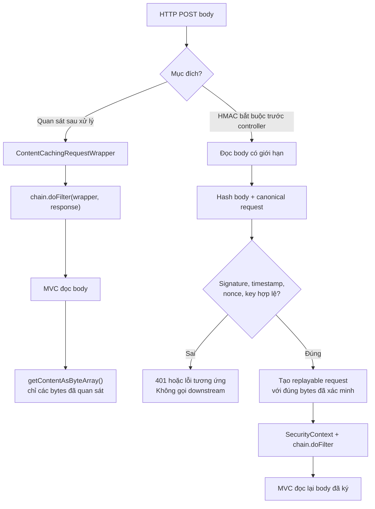

# ContentCachingRequestWrapper trong Spring MVC và xác thực HMAC

## 1. Vì sao cần hiểu ContentCachingRequestWrapper?

Trong Spring MVC, controller thường nhận dữ liệu qua `@RequestBody`. Spring dùng `HttpMessageConverter` đọc `HttpServletRequest.getInputStream()` để chuyển body JSON, text hoặc binary thành đối tượng Java.

Đối với module `SECURITY_AUTHENTICATION_HMAC_REQUEST_AUTHENTICATION`, request còn đi qua bước xác thực HTTP bằng HMAC với shared secret. Client và server phải thống nhất một **canonical request** có thể bao gồm method, URI, query string, các header và hash body. Server dùng khóa tương ứng để xác minh chữ ký, kiểm tra timestamp/nonce chống replay, xử lý key rotation và thiết lập danh tính để Spring Security phân quyền.

Vấn đề xuất hiện khi HMAC verifier muốn đọc **toàn bộ body trước controller** để kiểm tra chữ ký: Servlet request body là luồng dữ liệu mà việc đọc thường làm tiến con trỏ đến cuối. Nếu verifier đọc hết rồi chuyển tiếp nguyên request, controller có thể không còn body để parse.

`ContentCachingRequestWrapper` là công cụ hữu ích để *quan sát nội dung đã đi qua stream* nhưng thường bị hiểu nhầm là giải pháp phát lại body. Bài học này giải thích chính xác nó làm gì, giới hạn ở đâu và cách kết hợp với Spring MVC mà vẫn bảo toàn tính toàn vẹn request.

**Điều cần nhớ:** `ContentCachingRequestWrapper` cache những byte được đọc **thông qua wrapper**, nhưng **không tự động khôi phục stream** để downstream đọc lại. Nếu xác thực HMAC yêu cầu đọc body trước khi controller chạy, thông thường cần một cơ chế buffer và phát lại body được thiết kế riêng.

## 2. ContentCachingRequestWrapper hoạt động thế nào?

`ContentCachingRequestWrapper` thuộc `org.springframework.web.util` trong Spring Web. Nó kế thừa `HttpServletRequestWrapper` và lưu nội dung được đọc từ `getInputStream()` hoặc `getReader()` của wrapper.

Các API thường gặp:

| API | Vai trò | Điểm cần lưu ý |
| --- | --- | --- |
| `new ContentCachingRequestWrapper(request)` | Bọc request để quan sát body khi có thành phần đọc | Khởi tạo wrapper không có nghĩa body đã được cache |
| `new ContentCachingRequestWrapper(request, contentCacheLimit)` | Giới hạn lượng byte lưu trong cache | Đây là giới hạn **cache**, không mặc nhiên là chính sách reject request vượt kích thước |
| `getInputStream()` | Cho downstream đọc stream, đồng thời lưu những byte đã đọc vào cache | Đọc đến EOF vẫn làm cạn stream gốc |
| `getReader()` | Cho downstream đọc nội dung ký tự, có cache khi đọc qua wrapper | Cần chú ý character encoding và việc luân phiên Reader/InputStream |
| `getContentAsByteArray()` | Trả về bản sao những byte wrapper đã quan sát | Có thể rỗng, chưa đủ hoặc bị cắt bởi cache limit |
| `handleContentOverflow(int)` | Hook để tùy biến hành vi khi vượt cache limit | Hành vi mặc định không đồng nghĩa tự động trả HTTP 413 |

Hai ví dụ sau cho thấy khác biệt giữa **có wrapper** và **đã cache dữ liệu**.

### 2.1. Trước khi body được đọc

```java
ContentCachingRequestWrapper wrapper =
        new ContentCachingRequestWrapper(request, 1024 * 1024);

// Chưa có thành phần nào đọc body từ wrapper.
byte[] beforeRead = wrapper.getContentAsByteArray();
// Thường là byte[0], dù client đã gửi JSON body.
```

Wrapper không đọc toàn bộ body ngay trong constructor. Vì thế code xác minh HMAC dựa trên `getContentAsByteArray()` ngay sau khi khởi tạo thường đang ký hash của **body rỗng**.

### 2.2. Sau khi downstream đọc body

```java
ContentCachingRequestWrapper wrapper =
        new ContentCachingRequestWrapper(request, 1024 * 1024);

chain.doFilter(wrapper, response);

// Đọc lại nội dung đã được quan sát, ví dụ sau khi
// @RequestBody/HttpMessageConverter tiêu thụ request body.
byte[] observed = wrapper.getContentAsByteArray();
```

Đây là mẫu hợp lý cho logging/observability có kiểm soát. Nhưng nếu chỉ đến sau `chain.doFilter` mới kiểm tra chữ ký HMAC, controller có thể đã chạy và thực hiện side effect. **Không dùng kiểu này để quyết định có cho phép request thực thi nghiệp vụ hay không**.

Trong ví dụ, nếu controller không đọc body thì `observed` có thể vẫn rỗng; nếu controller chỉ đọc một phần thì cache có thể chứa một phần; nếu vượt `contentCacheLimit` thì cache không bao gồm mọi byte. Dù không cache hết, downstream vẫn có thể đọc nội dung nằm ngoài giới hạn cache.

## 3. Mô hình dữ liệu: cache để quan sát và buffer để phát lại

Hai yêu cầu khác nhau cần được phân biệt:

1. **Caching quan sát:** chỉ muốn xem request body mà controller đã đọc. Có thể dùng `ContentCachingRequestWrapper` và đọc `getContentAsByteArray()` sau `chain.doFilter`.
2. **Pre-authentication body verification:** phải xác minh chữ ký trên body thực **trước khi** cho chạy controller. Cần đọc bytes, xác minh, rồi chuyển tiếp một request mà downstream vẫn đọc lại đúng các bytes ấy.



Không có cam kết API rằng `ContentCachingRequestWrapper.getInputStream()` sẽ rewind/reset sau khi người dùng đọc. Ngay cả khi `getContentAsByteArray()` trả đủ byte, request stream downstream vẫn có thể đang ở EOF.

### Ví dụ lỗi cần nhận diện

```java
// SAI: verifier đọc hết body rồi dùng cùng wrapper đi tiếp.
ContentCachingRequestWrapper cached =
        new ContentCachingRequestWrapper(request);

byte[] body = cached.getInputStream().readAllBytes();
verifyHmac(request, body);

chain.doFilter(cached, response); // @RequestBody có thể thấy EOF.
```

`readAllBytes()` ở đây chỉ phù hợp để minh họa lỗi; nó còn thiếu giới hạn dung lượng. Kết quả xác thực có thể đúng nhưng Spring MVC parse body thất bại. Đây là lỗi tích hợp, không phải lỗi mật mã.

## 4. Tại sao body phải được xác minh trước controller?

Giả sử client ký request:

```http
POST /api/payments HTTP/1.1
Host: api.example.test
Content-Type: application/json
X-Key-Id: client-42
X-Request-Timestamp: 2026-11-28T03:00:00Z
X-Request-Nonce: nonce-001
X-Signature: <base64-hmac>

{"invoiceId":"INV-7","amount":50000}
```

Nếu hợp đồng ký gồm SHA-256 của body, bất kỳ thay đổi nào ở `invoiceId` hoặc `amount` đều phải khiến chữ ký không còn hợp lệ. Vì vậy verifier phải tính body hash trên **những byte mà server thực sự nhận theo hợp đồng canonicalization**.

Các phương án sai phổ biến:

- Chỉ lấy `X-Body-SHA256` do client gửi rồi tin giá trị đó, không tính lại hash trên body.
- Parse JSON thành object, serialize lại và ký chuỗi JSON mới trong khi client ký raw bytes. Whitespace, thứ tự field hoặc escaping có thể làm hai phía khác nhau.
- Verify chữ ký trong `afterCompletion` của `HandlerInterceptor`, sau khi controller đã ghi database.
- Lấy `getContentAsByteArray()` trước khi bất kỳ ai đọc body và coi kết quả rỗng là body hợp lệ.
- Verify trên body gốc nhưng chuyển sang controller body đã bị middleware transform; logic nghiệp vụ xử lý dữ liệu khác với dữ liệu được bảo vệ bởi chữ ký.

**Nguyên tắc:** thông tin có ảnh hưởng đến quyết định nghiệp vụ phải được ràng buộc vào chữ ký theo hợp đồng; không được để một request thất bại xác thực tạo side effect trước khi bị từ chối.

## 5. Hai cách tích hợp phù hợp với Spring MVC

### 5.1. Dùng ContentCachingRequestWrapper để audit sau khi xử lý

Nếu mục đích chỉ là theo dõi request được xử lý, có thể dùng filter như sau:

```java
public final class RequestAuditFilter extends OncePerRequestFilter {

    @Override
    protected void doFilterInternal(
            HttpServletRequest request,
            HttpServletResponse response,
            FilterChain chain) throws ServletException, IOException {

        ContentCachingRequestWrapper wrapper =
                new ContentCachingRequestWrapper(request, 64 * 1024);

        try {
            chain.doFilter(wrapper, response);
        } finally {
            byte[] observed = wrapper.getContentAsByteArray();
            // Chỉ ghi thông tin an toàn, ví dụ length, request ID.
            recordObservedBodyLength(observed.length);
        }
    }

    private void recordObservedBodyLength(int observedLength) {
        // Thay bằng metric/logger do ứng dụng sở hữu.
    }
}
```

Cách này **không dùng để xác thực HMAC**. Cache có thể chỉ chứa một phần body; không log body, secret, signature hoặc thông tin cá nhân nguyên văn. Nếu API có content encoding, nên xác định metric đang đo byte ở tầng nào.

Khi có filter khác cũng wrap request, hãy kiểm thử thứ tự để bảo đảm bộ audit quan sát đúng byte được đọc qua wrapper, tránh giả định mọi request được MVC đọc toàn bộ.

### 5.2. Dùng buffered/replayable request khi HMAC ký body

Đối với HMAC bắt buộc trước khi xử lý nghiệp vụ, xây wrapper khác thực sự lưu **toàn bộ body có giới hạn** và trả stream mới cho downstream. Có thể thiết kế pipeline:

```text
HTTP request
  -> HmacBodyAuthenticationFilter
     -> giới hạn request body
     -> đọc raw body bytes
     -> hash bytes và tái tạo canonical request
     -> lấy secret/key version, kiểm tra HMAC
     -> kiểm tra timestamp + nonce nguyên tử
     -> thiết lập Authentication đã xác minh
     -> new ReplayableBodyRequest(request, verifiedBytes)
     -> chain.doFilter(replayableRequest, response)
  -> AuthorizationFilter / Spring MVC
     -> @RequestBody đọc lại verifiedBytes
  -> controller
```

`ContentCachingRequestWrapper` vẫn có thể được dùng ở một layer khác nhằm observability, nhưng **không thay thế wrapper phát lại** trong đường xử lý này.

## 6. Ví dụ Java: replayable body cho Servlet API đồng bộ

Ví dụ sau minh họa request wrapper cho API **blocking**, body nhỏ, không hỗ trợ streaming/async nonblocking. Nó không phải thư viện đa dụng cho multipart hoặc luồng dữ liệu lớn.

```java
import jakarta.servlet.ReadListener;
import jakarta.servlet.ServletInputStream;
import jakarta.servlet.http.HttpServletRequest;
import jakarta.servlet.http.HttpServletRequestWrapper;

import java.io.BufferedReader;
import java.io.ByteArrayInputStream;
import java.io.IOException;
import java.io.InputStreamReader;
import java.nio.charset.Charset;
import java.nio.charset.StandardCharsets;

public final class ReplayableBodyRequest extends HttpServletRequestWrapper {

    private final byte[] body;
    private final Charset charset;

    public ReplayableBodyRequest(
            HttpServletRequest delegate, byte[] verifiedBody) {
        super(delegate);
        this.body = verifiedBody.clone();

        String encoding = delegate.getCharacterEncoding();
        // Chọn UTF-8 làm chính sách của API JSON trong ví dụ.
        this.charset = encoding == null
                ? StandardCharsets.UTF_8
                : Charset.forName(encoding);
    }

    @Override
    public ServletInputStream getInputStream() {
        ByteArrayInputStream input = new ByteArrayInputStream(body);

        return new ServletInputStream() {
            @Override
            public int read() {
                return input.read();
            }

            @Override
            public boolean isFinished() {
                return input.available() == 0;
            }

            @Override
            public boolean isReady() {
                return true;
            }

            @Override
            public void setReadListener(ReadListener readListener) {
                throw new UnsupportedOperationException(
                        "Nonblocking reads are not supported by this wrapper");
            }
        };
    }

    @Override
    public BufferedReader getReader() throws IOException {
        return new BufferedReader(
                new InputStreamReader(getInputStream(), charset));
    }

    @Override
    public int getContentLength() {
        return body.length;
    }

    @Override
    public long getContentLengthLong() {
        return body.length;
    }
}
```

Điểm đáng chú ý:

- Constructor clone body; downstream nhận một bản byte độc lập với mảng nguồn.
- Mỗi lần gọi `getInputStream()` tạo stream mới từ cùng bytes. Vì thế `@RequestBody` có thể đọc nội dung đã được dùng để tính chữ ký.
- `getReader()` giải mã bằng charset đã xác định. Nếu hợp đồng API chỉ cho phép UTF-8, hãy validate `Content-Type`/charset thay vì chấp nhận charset bất kỳ.
- `getContentLength()` trả độ dài body buffered. Vì body không đổi, thông tin này nhất quán với bytes cung cấp cho MVC.
- `setReadListener` ở đây **cố ý không hỗ trợ** nonblocking IO; ứng dụng dùng async/streaming phải triển khai giao ước `ServletInputStream` đầy đủ hoặc chọn hướng xử lý khác.
- Không lưu toàn bộ file upload lớn vào heap. Với multipart hoặc streaming endpoint, thiết kế HMAC/digest streaming, giới hạn tài nguyên và lifecycle riêng.

Mẫu này cũng chủ động cho phép đọc lại body nhiều lần; việc đó có thể tiện cho MVC trong API nhỏ nhưng không nên xem là hành vi chung của mọi wrapper hoặc của `ContentCachingRequestWrapper`.

### 6.1. Đọc body với giới hạn kích thước

Đừng dùng `readAllBytes()` trực tiếp trên input từ Internet khi không có giới hạn. Một hàm ví dụ:

```java
public static byte[] readBodyLimited(
        HttpServletRequest request, int maxBytes) throws IOException {

    if (maxBytes < 0) {
        throw new IllegalArgumentException("maxBytes must be >= 0");
    }
    long declaredLength = request.getContentLengthLong();
    if (declaredLength > maxBytes) {
        throw new BodyTooLargeException();
    }

    try (var result = new ByteArrayOutputStream()) {
        byte[] chunk = new byte[8192];
        int total = 0;
        int read;
        var input = request.getInputStream();

        while ((read = input.read(chunk)) != -1) {
            if (read > maxBytes - total) {
                throw new BodyTooLargeException();
            }
            result.write(chunk, 0, read);
            total += read;
        }
        return result.toByteArray();
    }
}

public static final class BodyTooLargeException extends IOException {
}
```

Cần import `java.io.ByteArrayOutputStream` và `java.io.IOException`. Ví dụ giới hạn tổng byte giữ trong RAM, nhưng production nên có giới hạn đầu vào tại gateway/server, timeout đọc và protection chống request streaming chậm. `Content-Length` có thể thiếu hoặc không đáng tin; vòng lặp vẫn phải kiểm tra số byte thực tế. Thất bại giới hạn nên trả `413 Content Too Large` theo hợp đồng, không chuyển thành lỗi chữ ký.

Đối với body dạng chunked, servlet container đã xử lý framing transfer encoding trước khi ứng dụng đọc stream; cần xác định chính xác byte representation được ký. Nếu proxy nén/giải nén, phải đồng thuận quy tắc ký dữ liệu trước hoặc sau biến đổi đó.

## 7. Tích hợp với authentication filter và Spring Security

Filter mẫu dưới đây giả định một `HmacRequestAuthenticator` đã được cài riêng, nhận request cùng byte body để trả về một `Authentication` đã xác minh. Nó chịu trách nhiệm tái tạo canonical request (method, URI, header, body hash), kiểm tra timestamp/nonce và key rotation.

```java
@FunctionalInterface
public interface HmacRequestAuthenticator {
    Authentication authenticate(
            HttpServletRequest request, byte[] body)
            throws AuthenticationException;
}
```

Luồng filter:

```java
public final class HmacBodyAuthenticationFilter
        extends OncePerRequestFilter {

    private static final int MAX_BODY_BYTES = 1024 * 1024;

    private final HmacRequestAuthenticator authenticator;
    private final AuthenticationEntryPoint entryPoint;

    public HmacBodyAuthenticationFilter(
            HmacRequestAuthenticator authenticator,
            AuthenticationEntryPoint entryPoint) {
        this.authenticator = authenticator;
        this.entryPoint = entryPoint;
    }

    @Override
    protected void doFilterInternal(
            HttpServletRequest request,
            HttpServletResponse response,
            FilterChain chain) throws ServletException, IOException {

        byte[] body;
        try {
            body = readBodyLimited(request, MAX_BODY_BYTES);
        } catch (BodyTooLargeException ex) {
            response.sendError(
                    HttpServletResponse.SC_REQUEST_ENTITY_TOO_LARGE);
            return;
        }

        final Authentication authentication;
        try {
            authentication = authenticator.authenticate(request, body);
            if (authentication == null
                    || !authentication.isAuthenticated()) {
                throw new BadCredentialsException("Invalid HMAC credential");
            }
        } catch (AuthenticationException ex) {
            SecurityContextHolder.clearContext();
            entryPoint.commence(request, response, ex);
            return; // Không chạy MVC/controller khi chữ ký sai.
        }

        SecurityContext context = SecurityContextHolder.createEmptyContext();
        context.setAuthentication(authentication);
        SecurityContextHolder.setContext(context);

        HttpServletRequest replayable =
                new ReplayableBodyRequest(request, body);

        // Đặt ngoài catch(AuthenticationException) để downstream
        // được xử lý bởi Spring Security như bình thường.
        chain.doFilter(replayable, response);
    }
}
```

Các import của Spring Security và Servlet được lược để làm rõ flow. `readBodyLimited`, `BodyTooLargeException` là helper ở mục trước. Ví dụ giả định request được xác thực không gặp lỗi charset khi dựng wrapper; trong production nên validate charset và body constraints **trước khi** chuyển tiếp, và quyết định mã lỗi phản hồi nhất quán. Không gắn principal nếu verifier chưa kiểm tra HMAC, freshness, nonce và key state.

Với API không yêu cầu HMAC ở một số endpoint (ví dụ `/api/health`), dùng `shouldNotFilter` hoặc matcher/filter chain phù hợp. Chính sách `permitAll` trong authorization **không tự động làm filter tùy chỉnh ngừng đòi chữ ký**.

### 7.1. Cấu hình theo chuỗi bảo mật

```java
@Bean
SecurityFilterChain signedApiSecurity(
        HttpSecurity http,
        HmacRequestAuthenticator authenticator) throws Exception {

    AuthenticationEntryPoint entryPoint = (request, response, ex) -> {
        response.setStatus(HttpServletResponse.SC_UNAUTHORIZED);
        // Scheme HMAC là một phần của hợp đồng API tự định nghĩa.
        response.setHeader(
                HttpHeaders.WWW_AUTHENTICATE, "HMAC realm=\"signed-api\"");
        response.setContentType(MediaType.APPLICATION_PROBLEM_JSON_VALUE);
        response.getWriter().write(
                "{\"type\":\"about:blank\",\"title\":\"Unauthorized\",\"status\":401}");
    };

    AccessDeniedHandler deniedHandler = (request, response, ex) -> {
        response.setStatus(HttpServletResponse.SC_FORBIDDEN);
        response.setContentType(MediaType.APPLICATION_PROBLEM_JSON_VALUE);
        response.getWriter().write(
                "{\"type\":\"about:blank\",\"title\":\"Forbidden\",\"status\":403}");
    };

    return http
            .securityMatcher("/api/**")
            .sessionManagement(sm -> sm.sessionCreationPolicy(
                    SessionCreationPolicy.STATELESS))
            .csrf(csrf -> csrf.disable())
            .requestCache(cache -> cache.requestCache(
                    new NullRequestCache()))
            .exceptionHandling(errors -> errors
                    .authenticationEntryPoint(entryPoint)
                    .accessDeniedHandler(deniedHandler))
            .authorizeHttpRequests(authz -> authz
                    .requestMatchers(
                            HttpMethod.POST, "/api/payments/**")
                        .hasAuthority("payments:create")
                    .anyRequest().authenticated())
            .addFilterBefore(
                    new HmacBodyAuthenticationFilter(
                            authenticator, entryPoint),
                    UsernamePasswordAuthenticationFilter.class)
            .build();
}
```

Đoạn này dành cho Spring Security 6 và servlet namespace Jakarta. Các import của cấu hình được lược; `HmacRequestAuthenticator` phải do ứng dụng cung cấp. Tắt CSRF chỉ phù hợp cho API stateless dùng header credentials thay vì cookie tự động của trình duyệt; web app có session cần cấu hình CSRF riêng.

Filter HMAC được đặt ở trước các bước kiểm tra authorization. Khi xác thực thất bại tại chính filter, nó tự dùng `AuthenticationEntryPoint` để trả `401`. Khi client được xác thực nhưng thiếu `payments:create`, `AuthorizationFilter` phía sau trả `403` qua `AccessDeniedHandler`. Phép HMAC chỉ xác minh danh tính theo secret và các trường ký; quyền còn phải lấy từ policy/trustworthy server mapping.

**Đừng đăng ký cùng filter một lần như servlet filter toàn cục và một lần trong Spring Security chain.** Cấu hình phải đảm bảo request không bị xác thực hai lần hoặc chạy sai thứ tự.

## 8. Canonical request phải được tạo từ dữ liệu nào?

Với HMAC, thứ tự xử lý body chỉ là một phần bài toán; client/server còn phải ký cùng một biểu diễn request.

Ví dụ hợp đồng minh họa (không phải chuẩn bắt buộc):

```text
METHOD + "\n" +
CANONICAL_PATH_AND_QUERY + "\n" +
LOWERCASE_SELECTED_HEADERS + "\n" +
BASE64(SHA256(EXACT_BODY_BYTES)) + "\n" +
TIMESTAMP + "\n" +
NONCE
```

Những quy tắc phải được viết rõ bằng tài liệu và test vectors:

| Thành phần | Câu hỏi cần quyết định |
| --- | --- |
| Method | Viết hoa ASCII hay giữ nguyên method nhận được? |
| Path | Dùng URI client gửi hay path đã được gateway rewrite? Cách xử lý percent-encoding? |
| Query | Có sort key/value? Có cho phép duplicate key? Giữ ký tự `+` khác `%20` thế nào? |
| Header | Những header nào được ký? Cách trim whitespace, ghép nhiều giá trị, case-insensitive name? |
| Body | SHA-256 raw bytes nào? Có ký content encoding hay một dạng normalize? |
| Timestamp | ISO-8601 hay epoch seconds? Cho phép clock skew bao nhiêu? |
| Nonce | Phạm vi duy nhất theo client/key nào? TTL bao lâu, lưu atomic thế nào? |
| Key rotation | `keyId` trỏ key version nào? Khi nào vô hiệu hóa và xóa key cũ? |

Nếu HMAC ký hash body, wrapper phát lại phải trả **đúng bytes đã hash**. Tránh parse JSON rồi serialize lại, vì đối tượng JSON tương đương ngữ nghĩa chưa chắc có chuỗi bytes giống nhau.

### Ví dụ khác biệt byte

```json
{"amount":50000,"currency":"VND"}
```

và:

```json
{ "currency": "VND", "amount": 50000 }
```

có thể biểu diễn cùng dữ liệu ứng dụng, nhưng SHA-256 raw bytes khác. Nếu hợp đồng không chuẩn hóa JSON, chữ ký phải gắn với biểu diễn bytes thực nhận; Spring MVC có thể parse thành cùng object, nhưng verifier không thể tự coi hai body là giống nhau.

## 9. Timestamp, nonce và key rotation liên quan gì tới body caching?

`ContentCachingRequestWrapper` không cung cấp tính năng mã hóa, chống replay, chọn secret hay phân quyền. Chỉ có code verifier/authorization chịu trách nhiệm:

1. Lấy credential identifier (ví dụ `X-Key-Id`) từ header theo hợp đồng.
2. Tra secret/phiên bản khóa hợp lệ từ kho được bảo vệ; không đưa secret ra log hoặc response.
3. Tạo canonical request từ method, URI, header và body hash được xác định đúng.
4. Xác minh HMAC bằng cơ chế so sánh phù hợp chống sai lệch thời gian; từ chối mismatch.
5. Kiểm tra timestamp trong khoảng cho phép và nonce chưa được sử dụng; đánh dấu nonce theo thao tác nguyên tử trong không gian key/client phù hợp.
6. Trả về principal cùng authorities đáng tin cậy; Spring Security mới kiểm tra permission.

Nếu backend nonce store bị lỗi, không cho request đi tiếp chỉ vì chữ ký hợp lệ. Cần *fail closed*, ghi nhận lỗi vận hành và trả `5xx` phù hợp (ví dụ `503 Service Unavailable`). Việc gắn mọi lỗi thành `BadCredentialsException` có thể che outage và làm sai metric.

Một request ký hợp lệ bị retry với cùng nonce có thể bị chặn trước controller, dù request đầu có thể đã thực thi xong. Chống replay không thay thế idempotency. Với thao tác như thanh toán, cần thiết kế idempotency key và retry riêng theo hợp đồng nghiệp vụ.

## 10. Hành vi khi đi qua reverse proxy và gateway

Các thành phần phía trước Spring MVC có thể thay đổi request: rewrite path, chỉnh host, thêm forwarding header, giải nén, giới hạn body hoặc normalize query. Nếu client ký một chuỗi bytes nhưng app xác minh biểu diễn khác, response `401` xuất hiện dù cả hai bên đều có đúng secret.

Ví dụ:

```text
Client ký:   POST /v1/payments?currency=VND
Gateway đổi: POST /internal/payments?currency=VND
MVC thấy:    /internal/payments
```

Nếu canonical request cần path public `/v1/payments`, server phải nhận thông tin path đáng tin cậy để xác minh. Không tự tin tưởng `X-Forwarded-Prefix` hay `X-Original-URI` do client bất kỳ gửi. Chỉ dùng header từ proxy đã cấu hình và kiểm soát chặt; tốt hơn có hợp đồng rõ giữa client, gateway và service về **vị trí xác minh chữ ký**.

Body cũng có vấn đề tương tự: `Content-Encoding`, chunked transfer encoding, gateway decompress/normalize và charset có thể thay đổi bytes ở điểm Spring MVC nhận. Cần kiểm thử các trường hợp body rỗng, JSON Unicode, query encoded, duplicate headers, multipart (nếu được hỗ trợ) và qua đúng hạ tầng gateway production.

## 11. Tương tác với Spring MVC: Controller, Advice, Interceptor

### 11.1. @RequestBody và HttpMessageConverter

Khi nhận request wrapper trong servlet filter chain, Spring MVC đọc `getInputStream()` hoặc `getReader()` của request mà nó đang có. Vì thế body được phát lại đúng sẽ cho phép:

```java
@RestController
@RequestMapping("/api/payments")
class PaymentController {

    @PostMapping
    ResponseEntity<String> create(
            @RequestBody CreatePaymentRequest payment) {
        // Ví dụ: kiểm tra ownership/tenant ở tầng nghiệp vụ.
        return ResponseEntity.ok("accepted");
    }
}

record CreatePaymentRequest(String invoiceId, long amount) {}
```

Code này minh họa việc message converter nhận được body JSON sau khi filter đã xác minh. Ứng dụng thật cần validation, policy phân quyền, idempotency, xử lý giao dịch và response phù hợp.

### 11.2. HandlerInterceptor

`HandlerInterceptor.preHandle` chạy trước controller nhưng sau nhiều bước xử lý trong Servlet/Spring MVC. Nó không phải nơi mặc định phù hợp để đưa toàn bộ xác thực HMAC dựa trên body vào security context; phải xét cách đọc body và xử lý lỗi ở interceptor cũng như điều kiện body còn nguyên. `postHandle` và `afterCompletion` quá muộn để ngăn các side effect đã xảy ra.

### 11.3. RequestBodyAdvice và ControllerAdvice

`RequestBodyAdvice` cho phép can thiệp trước/sau khi converter đọc body, nhưng đây là một extension point của Spring MVC, không tự thay thế Spring Security filter authentication cho mọi endpoint. Với request không đi qua body converter hoặc body rỗng, advice có thể không chạy như mong đợi. Nếu dùng advice để phối hợp hashing, vẫn cần bảo đảm request bị từ chối **trước controller** và identity được thiết lập đúng vị trí trong security pipeline.

`@ControllerAdvice` thường dùng cho exception trong quá trình xử lý MVC. Lỗi phát sinh ngay tại HMAC servlet/security filter có thể xảy ra trước khi MVC tham gia, nên không được mặc định dựa vào `@ControllerAdvice` để trả `401`. Sử dụng `AuthenticationEntryPoint` hoặc failure handler trong filter là lựa chọn rõ ràng hơn.

## 12. Kiểm thử để nhận ra cache rỗng, cache thiếu và body bị tiêu thụ

Để phát hiện lỗi thực tế, test cả số lần controller chạy và **byte body mà MVC nhận**, không chỉ status HTTP.

| Trường hợp | Kết quả mong đợi |
| --- | --- |
| Vừa tạo `ContentCachingRequestWrapper`, chưa đọc body | `getContentAsByteArray()` rỗng |
| Controller đọc hết body qua wrapper | Cache chứa body đã quan sát, tối đa giới hạn |
| Controller không đọc body | Cache có thể rỗng |
| Cache limit nhỏ hơn body | Cache không chứa toàn bộ body; không xem đó là hash đầy đủ |
| Verifier đọc stream rồi dùng lại `ContentCachingRequestWrapper` | Phát hiện lỗi MVC có thể đọc EOF |
| Verifier đọc bytes và dùng `ReplayableBodyRequest` | Controller nhận chính xác bytes đã ký |
| Signature sai | `401`, controller không chạy |
| Nonce đã dùng hoặc timestamp không hợp lệ | Bị chặn trước controller |
| HMAC hợp lệ nhưng authority sai | `403`, authorization vẫn hoạt động |
| Request body vượt giới hạn | `413`, không cấp principal/không gọi controller |
| Key/nonce dependency lỗi | Fail closed, không vào controller |
| Gateway rewrite URI/body/header | Phát hiện mismatch hoặc xử lý đúng theo hợp đồng canonical |
| Gửi hai request song song cùng nonce | Tối đa một request vượt qua kiểm tra replay |
| Endpoint đọc streaming hoặc multipart | Cần chiến lược chuyên biệt, không áp dụng wrapper heap một cách mù quáng |

### 12.1. Integration test Spring MVC và security filter chain

Giả sử test fixture đã tạo `MockMvc` có Spring Security filters, client ký hợp lệ, key store và nonce store riêng cho test:

```java
byte[] payload =
        "{\"invoiceId\":\"INV-7\",\"amount\":50000}"
                .getBytes(StandardCharsets.UTF_8);

// signedHeaders(...) tự sinh timestamp/nonce mới và chữ ký
// hợp lệ theo canonical request test fixture.
mockMvc.perform(post("/api/payments")
                .contentType(MediaType.APPLICATION_JSON)
                .content(payload)
                .headers(signedHeaders("POST", "/api/payments", payload)))
        .andExpect(status().isOk());
```

Chỉ thấy `200` vẫn chưa đủ: nên capture `CreatePaymentRequest` controller nhận và so sánh `invoiceId`, `amount` với payload đã ký. Test tiếp bằng cách đổi `amount` sau khi ký; mong đợi `401` và số lần gọi service không tăng.

Ví dụ kiểm thử quan sát cache với một controller đọc `@RequestBody`: sau khi `chain.doFilter` hoàn tất, compare `getContentAsByteArray()` với payload **nếu body nhỏ hơn cache limit và thực sự đã được đọc hết**. Không áp assertion đó cho endpoint không đọc body.

### 12.2. Test unit riêng cho replay wrapper

```java
MockHttpServletRequest base = new MockHttpServletRequest();
base.setCharacterEncoding(StandardCharsets.UTF_8.name());

byte[] expected =
        "{\"message\":\"xin chào\"}".getBytes(StandardCharsets.UTF_8);

ReplayableBodyRequest replayable =
        new ReplayableBodyRequest(base, expected);

byte[] first = replayable.getInputStream().readAllBytes();
byte[] second = replayable.getInputStream().readAllBytes();

assertArrayEquals(expected, first);
assertArrayEquals(expected, second);
```

Lời gọi `readAllBytes()` trong unit test là an toàn vì `expected` do test tạo và đã có kích thước cố định; không lặp cách đó để đọc body trực tiếp từ request Internet chưa giới hạn.

Cần thêm integration test với encoding, content-type, body rỗng, request không có content-length, response đã commit, filter order và trường hợp framework gọi `getReader()`. Đặc biệt cần test trên container/transport thực nếu có async hoặc multipart.

## 13. Checklist để thiết kế production

1. **Xác định mục đích wrapper.** Nếu chỉ logging/tracing sau khi controller đọc, `ContentCachingRequestWrapper` phù hợp; nếu verifier phải đọc trước controller, cần phát lại body bằng thiết kế riêng.
2. **Giới hạn tài nguyên.** Đặt kích thước body tối đa, timeout, gateway limit, phân biệt small JSON và streaming/multipart.
3. **Ký đúng biểu diễn.** Định nghĩa canonical method, URI, header và hash body; giữ nguyên bytes đã xác minh khi gửi xuống MVC.
4. **Kiểm tra credential toàn diện.** HMAC signature, timestamp, nonce atomic, key rotation và mapping principal/tenant từ nguồn tin cậy.
5. **Tách xác thực và phân quyền.** Filter xác thực trả `401` cho credential sai; Spring Security authorization trả `403` khi thiếu quyền.
6. **Thực thi đúng thứ tự.** Chỉ gọi `chain.doFilter(replayableRequest, response)` sau khi xác minh thành công; không gọi downstream sau lỗi.
7. **Không log dữ liệu nhạy cảm.** Cache có thể chứa body thanh toán, token hoặc PII; ưu tiên metrics an toàn, request ID và mã lỗi nội bộ.
8. **Kiểm thử end-to-end.** Test HMAC mismatch, replay, proxy rewrite, body bytes controller nhìn thấy, limit/overflows và failure của dependency.

**Kết luận:** `ContentCachingRequestWrapper` giúp quan sát những byte đã được đọc trong Spring MVC, nhưng bản thân nó không cung cấp khả năng replay request body để HMAC filter đọc trước rồi controller đọc sau. Với xác thực HMAC bao gồm body, cách làm an toàn là đọc body có giới hạn, xác minh chữ ký và chống replay trước business logic, tạo request wrapper phát lại đúng những byte đã xác minh, sau đó mới gọi `chain.doFilter` và để Spring Security tiếp tục kiểm tra phân quyền.
