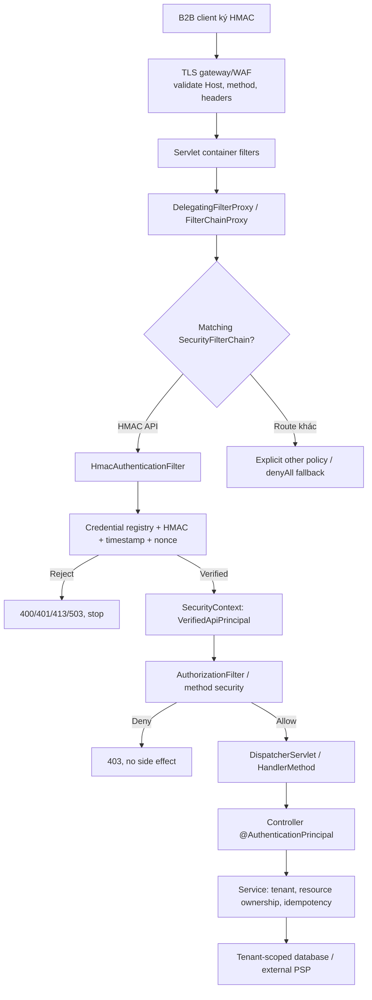
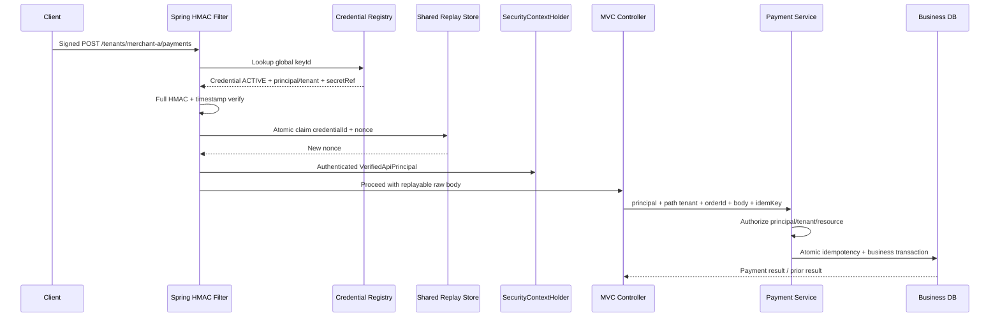
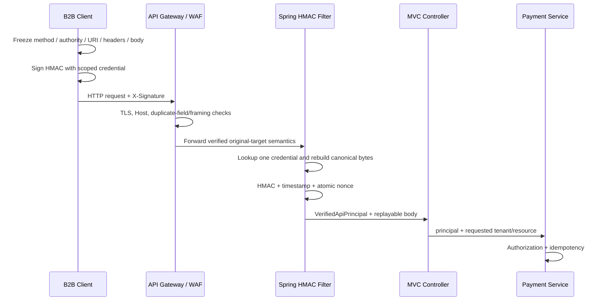

# Controller authentication trong Spring MVC: dùng danh tính đã xác thực bằng HMAC đúng ranh giới bảo mật

> **Chương:** Spring MVC integration  
> **Bài học:** Controller authentication  
> **Module:** `SECURITY_AUTHENTICATION_HMAC_REQUEST_AUTHENTICATION`  
> **Ngữ cảnh:** Thiết kế xác thực HTTP request bằng HMAC với shared secret trên canonical method, URI, header và/hoặc body. Bên cạnh kiểm signature, hệ thống phải chống replay bằng timestamp/nonce, hỗ trợ key rotation/revoke, tương thích proxy/gateway và phân biệt **authentication** với **authorization**.

Bài hướng đến **Java 17+, Spring Boot 3.x, Spring MVC (Servlet) và Spring Security 6.x**. Các ví dụ dùng `jakarta.servlet.*` và Java lambda DSL. Đây là mô hình **Servlet synchronous**; `WebFlux` dùng `SecurityWebFilterChain`, `ReactiveSecurityContextHolder` và cơ chế truy cập body/context khác. API có thể đổi giữa các bản Spring Security, vì vậy khi triển khai thật phải căn chỉnh theo BOM và tài liệu phiên bản hiện hành của dự án.

## 1. Controller authentication là gì và không phải gì?

Khi có endpoint:

```java
@PostMapping("/api/hmac/v1/tenants/{tenantId}/payments")
public PaymentResponse createPayment(
        @PathVariable String tenantId,
        @RequestBody PaymentRequest body) {
    // ...
}
```

Một người mới học thường hỏi: **“Làm sao controller biết người gọi đã xác thực bằng HMAC?”** Có hai cách tiếp cận, nhưng chỉ một cách đủ an toàn cho API thật:

**Sai:** Controller tự lấy `X-Key-Id`, `X-Signature`, `X-Tenant-Id` và gán principal/tenant dựa trên giá trị do client tự cung cấp.

**Đúng:** **Filter/AuthenticationProvider ở security boundary** xác minh HMAC, timestamp và nonce, đối chiếu credential state; sau đó xuất `Authentication` đáng tin vào `SecurityContext`. Controller nhận principal đã được xác minh bằng `@AuthenticationPrincipal` hoặc `Authentication`; controller/service tiếp tục **authorization theo action/resource/tenant** và **idempotency cho business effect**.

### Tình huống điển hình

Merchant A được cấp credential:

```text
keyId      = merchant-a-k1                # selector công khai
credential = cred-merchant-a-001          # stable identity
principal  = service-merchant-a
tenant     = merchant-a
secretRef  = kv/payments/merchant-a-k1    # trusted registry mapping
secret     = 32 random bytes              # shared secret, không đưa vào controller
state      = ACTIVE
authorities= [payments:create]
```

Client gửi:

```http
POST /api/hmac/v1/tenants/merchant-a/payments?orderId=42 HTTP/1.1
Host: api.example.test
Content-Type: application/json
Idempotency-Key: pay-order-42
X-Key-Id: merchant-a-k1
X-Timestamp: 1767225600
X-Nonce: 87a3d56ea72d40af89f5b68cb3e831d4
X-Signature: v1=<HMAC_SHA256_BASE64URL_TAG>

{"amount":100000,"currency":"VND"}
```

`<HMAC_SHA256_BASE64URL_TAG>` là **placeholder**. Timestamp cố định ở đây chỉ là fixture, không được dùng để ký request mới trong môi trường thật.

Controller chỉ được thực thi khi **chữ ký đúng cho request đích**, credential đang được phép, timestamp còn tươi, nonce chưa bị claim, và authorization rule của endpoint cho phép. Nếu client có K_A tự ký một request nhắm tenant B, **HMAC vẫn có thể đúng** nhưng phải **403 hoặc 404 theo policy**, không thực thi payment.

### Sau bài này, người học có thể

1. Giải thích vị trí authentication trong pipeline `Filter → DispatcherServlet → HandlerAdapter → Controller → Service`.
2. Phân biệt `@RequestHeader`, `Principal`, `Authentication`, `@AuthenticationPrincipal` và `@CurrentSecurityContext`.
3. Dùng `SecurityFilterChain` để chỉ bảo vệ đúng nhóm endpoints và deny-by-default.
4. Nhận immutable, tối thiểu hóa `VerifiedApiPrincipal` trong controller mà không lộ shared secret.
5. Ký raw request body mà `@RequestBody` vẫn đọc được nội dung chính xác.
6. Ngăn một HMAC hợp lệ được dùng để thao tác tài nguyên/tenant không được phép.
7. Thiết kế `@PreAuthorize`, kiểm resource owner trong service và bảo vệ business idempotency.
8. Phân loại lỗi 400/401/403/409/413/503, xử lý ngoại lệ an toàn.
9. Viết `MockMvc` tests kiểm verified context, body tampering, replay, rotation và endpoint bypass.
10. Hiểu các giới hạn của `HandlerInterceptor`, `@ControllerAdvice`, async controllers và gateway forwarding.

## 2. HTTP request đi tới controller qua những lớp nào?



**Đường đi quan trọng:** `DispatcherServlet` không tự giải mã HMAC signature. Spring MVC chỉ bind arguments và gọi handler. **Security boundary đứng trước controller**, thường trong Servlet `FilterChain` do Spring Security quản lý.

### 2.1. `DelegatingFilterProxy`, `FilterChainProxy` và `SecurityFilterChain`

| Thành phần | Vai trò | Không nên nhầm với |
| --- | --- | --- |
| `DelegatingFilterProxy` | Cầu nối Servlet container với Spring bean `springSecurityFilterChain`. | Controller hoặc HMAC verifier. |
| `FilterChainProxy` | Chọn **SecurityFilterChain khớp đầu tiên** theo thứ tự. | Chạy mọi matching chains. |
| `SecurityFilterChain` | Tập filters áp dụng cho một nhóm request được matcher chọn. | Một MVC controller mapping. |
| `HmacAuthenticationFilter` | Thu thập proof, gọi verifier và tạo authenticated `Authentication`. | Business authorization. |
| `AuthorizationFilter` | Kiểm HTTP authorization rule trong security chain. | Full resource-level/tenant-level authorization. |
| `DispatcherServlet` | Chọn handler/argument resolvers và xử lý MVC. | Lớp quyết định key ID còn hiệu lực. |
| `@PreAuthorize` | Method authorization theo authorities/expression. | Bằng chứng HMAC đã đúng khi thiếu authentication boundary. |

`securityMatcher(...)` **xác định chain**; `requestMatchers(...)` trong `authorizeHttpRequests` **xác định quy tắc authorization của chain ấy**. Nếu một route không match bất kỳ security chain nào, có nguy cơ **không được Spring Security bảo vệ**. Vì vậy nên có fallback deny-by-default khi API chỉ chủ ý mở một số route.

### 2.2. Vì sao không chỉ gọi `HmacVerifier` bên trong controller?

```java
// ANTI-PATTERN: trộn HMAC, parse body và nghiệp vụ.
@PostMapping("/pay")
public Object pay(
        @RequestHeader("X-Key-Id") String keyId,
        @RequestHeader("X-Signature") String signature,
        @RequestBody PaymentRequest payment) {
    // Verify here, after body parsing, có thể quá muộn
    // nếu conversion/validation/interceptors có side effects.
    return null;
}
```

Một controller-level verifier chỉ an toàn nếu **mọi tuyến/handler**, error path, pre-handler và processing đều được review rất kỹ. Thực tế dễ bỏ sót route, đọc sai raw body hoặc execute logic trước verification. Đưa authentication vào filter giúp enforcement tại một trust boundary, còn controller tập trung HTTP resource semantics.

Ngoài ra, `@RequestBody PaymentRequest` là một object sau Jackson deserialization: re-serialize nó để ký có thể đổi whitespace, field order, numeric representation, Unicode escaping hoặc duplicate-field handling. **HMAC body hash phải dựa trên raw bytes đúng theo hợp đồng ký**, trước khi JSON parsing làm mất tính nguyên vẹn.

## 3. Authentication, authorization, tenant binding và idempotency

Bốn câu hỏi độc lập:

| Lớp | Câu hỏi | Ví dụ khi bị từ chối |
| --- | --- | --- |
| **Authentication** | Client có chứng minh sở hữu secret hợp lệ của credential này không? | Sai HMAC, unknown/revoked key → 401. |
| **Request integrity / anti-replay** | Chữ ký có bảo vệ đích/body? Timestamp còn tươi và nonce chưa dùng? | Body bị sửa, stale, nonce lặp → reject. |
| **Authorization** | Principal đã được xác thực có được gọi action này trên tenant/resource cụ thể? | Merchant A ký request nhắm tenant B → 403/404. |
| **Idempotency** | Business intent này đã được commit trước đó chưa? | POST retry cùng key/body → trả kết quả cũ, không tạo payment thứ hai. |

**HMAC đúng không đủ để thanh toán.** Nếu client A biết K_A, họ có thể tự tạo chữ ký hợp lệ cho một request đến tenant B. HMAC chỉ nói rằng request do holder của K_A ký; kiểm quyền tenant B là trách nhiệm của authorization policy.

**Nonce và Idempotency-Key khác nhau.**

```text
Attempt 1: k1, timestamp T1, nonce N1, Idempotency-Key pay-order-42
Attempt 2: k2, timestamp T2, nonce N2, Idempotency-Key pay-order-42

N1 != N2, T2 mới, signature tính lại với K2.
Business intent vẫn là một payment; kết quả không được nhân đôi.
```

Replay store nên có namespace `(stableCredentialId, nonce)` và **shared atomic claim**; idempotency nên có namespace `(authenticatedPrincipal, verifiedTenant, operation, idempotencyKey)` và body/request fingerprint theo policy.

## 4. Controller nên lấy authentication từ đâu?

Sau khi Spring Security đã xác thực thành công, các kiểu sau có thể xuất hiện trong Spring MVC controller.

| Kiểu nhận | Nguồn | Có nên dùng? | Lưu ý |
| --- | --- | --- | --- |
| `@AuthenticationPrincipal VerifiedApiPrincipal p` | `Authentication.getPrincipal()` của security context. | **Ưu tiên** khi cần principal có kiểu rõ ràng. | Chỉ tin nếu HMAC-only security chain và provider đã kiểm chứng. |
| `Authentication authentication` | Request principal/security context qua Spring MVC/Security. | Có. | Không suy authorities từ input headers; kiểm kiểu principal. |
| `java.security.Principal principal` | Authenticated principal do web security layer cung cấp. | Có cho nhu cầu chung. | Thường không đủ credential ID/tenant data và type safety. |
| `@CurrentSecurityContext(expression="authentication") Authentication a` | Current `SecurityContext`. | Có khi cần kiểm toàn bộ authentication. | Không log `Authentication.toString()` chứa dữ liệu nhạy cảm. |
| `@RequestHeader("X-Key-Id") String keyId` | Untrusted raw HTTP header. | **Không** dùng làm authenticated identity. | Key ID chỉ là selector, chưa chứng minh secret possession. |
| `@RequestHeader("X-Tenant-Id") String t` | Claimed tenant từ caller. | Không dùng làm verified tenant/authorization. | Cần đối chiếu signed target và grants. |
| `HttpServletRequest.getUserPrincipal()` | Container/Spring Security request wrapper. | Có thể. | Không tự đảm bảo credential binding nếu route bypass security. |
| `SecurityContextHolder.getContext()` | Thread-bound security context. | Ở infrastructure khi thật cần. | Tránh trong business service khi có thể pass immutable principal tường minh. |

### 4.1. `@AuthenticationPrincipal` có nghĩa gì?

Annotation này hỗ trợ bind **principal đã được security layer đưa vào `Authentication`**, không đọc body/header để dựng principal. Nếu provider trả:

```java
record VerifiedApiPrincipal(
    String credentialId,
    String principalId,
    String tenantId) {}
```

controller có thể nhận:

```java
@PostMapping("/v1/payments")
public ResponseEntity<?> create(
        @AuthenticationPrincipal VerifiedApiPrincipal caller) {
    // caller đến từ verified Authentication.getPrincipal()
    return ResponseEntity.ok().build();
}
```

Không có nghĩa rằng chỉ thêm annotation là endpoint được bảo vệ. Nếu `SecurityFilterChain` không match route, principal có thể `null` hoặc đến từ authentication mechanism khác. **Luôn enforce security chain và authorization rules**; đối với API HMAC-only, không cho anonymous/Basic/session login thay thế ngoài chủ ý.

### 4.2. `@CurrentSecurityContext`, `Principal` và test utilities

`@CurrentSecurityContext` hữu ích khi cần cả authentication và authorities, nhưng ít coupling hơn khi controller chỉ nhận một immutable principal.

`@WithMockUser` trong Spring Security Test **không tạo chữ ký HMAC**; nó cung cấp synthetic security context. Integration tests của HMAC-only API phải kiểm một request được mock user nhưng thiếu signature **vẫn bị HMAC filter chặn**. Tránh vô ý test controller slice mà bỏ qua security filters rồi tuyên bố HMAC đã được kiểm.

## 5. Hợp đồng ký request dùng trong bài

Để có mã và fixtures thống nhất, ví dụ định nghĩa contract minh họa tên **`MVC-HMAC-V1`**. Đây không phải định dạng chuẩn phổ quát của Spring Security hoặc RFC 9421.

### 5.1. HTTP fixture

```http
POST /api/hmac/v1/tenants/merchant-a/payments?orderId=42 HTTP/1.1
Host: api.example.test
Content-Type: application/json
Idempotency-Key: pay-order-42
X-Key-Id: merchant-a-k1
X-Timestamp: 1767225600
X-Nonce: 87a3d56ea72d40af89f5b68cb3e831d4
X-Signature: v1=<BASE64URL_NO_PADDING_32_BYTE_TAG>

{"amount":100000,"currency":"VND"}
```

Quy định:

- Method `POST`, authority `api.example.test` (chỉ fixture); path `/api/hmac/v1/tenants/{tenantId}/payments`.
- Query `orderId=42` (fixture); production cần URI/query canonicalization đầy đủ.
- `Content-Type: application/json`, không nhận nội dung đã giải nén/biến đổi ngoài contract.
- `X-Key-Id` selector global-unique, ký cùng request.
- `X-Timestamp` Unix epoch seconds (ASCII), `X-Nonce` 128-bit random hex lowercase, **cả hai đều được ký**.
- `Idempotency-Key` mang business intent, **cũng được ký**.
- Signature full HmacSHA256 32 bytes, Base64URL no padding dài **43 ký tự** và prefix `v1=`.
- Raw-body SHA-256 hash dùng đúng bytes tới controller; body giới hạn 64 KiB trong demo.
- Single-valued security headers, reject duplicates **kể cả tên khác hoa/thường** ở ingress, trước khi một proxy coalesce.

### 5.2. Canonical request

```text
POST
api.example.test
/api/hmac/v1/tenants/merchant-a/payments
orderId=42
content-type:application/json
idempotency-key:pay-order-42
x-key-id:merchant-a-k1
x-nonce:87a3d56ea72d40af89f5b68cb3e831d4
x-timestamp:1767225600
content-type;idempotency-key;x-key-id;x-nonce;x-timestamp
<SHA256_HEX_OF_EXACT_RAW_BODY>
```

Các dòng được nối bằng UTF-8 LF (`\n`), **không có LF cuối**. Sau đó:

```text
bytesToSign = UTF8("HMAC-SHA256/MVC-HMAC-V1\n" + canonical)
tag         = HMAC-SHA256(secretBytesForKeyId, bytesToSign)
wire        = "v1=" + Base64URLNoPadding(tag)
```

Phải ký **method + authority + path + query + headers + body hash** để client không thể lấy một chữ ký thanh toán A rồi áp lên operation/tenant B bằng cách sửa URI. **Cùng một key** ký request tới tenant B vẫn tạo tag đúng về toán học; backend phải kiểm tenant binding/authorization.

### 5.3. Không đồng nhất HTTP representation với object Java

| Ở wire | Trong Servlet/MVC | Điều cần biết |
| --- | --- | --- |
| Request target raw path/query | `getRequestURI()/getQueryString()` | Có thể đã đi qua reverse proxy/forwarded handling; không tự coi là original external target. |
| Header field occurrences | `getHeaders(name)` | Container/gateway có thể đã gộp từ trước; reject ambiguous duplicates tại edge. |
| Raw body bytes | `ServletInputStream` | Chỉ đọc được một lần nếu không có replay wrapper/buffering phù hợp. |
| JSON object | `@RequestBody PaymentRequest` | Jackson parse có thể làm mất thứ tự/whitespace/duplicate keys. |
| Authenticated principal | `@AuthenticationPrincipal` | Chỉ đáng tin sau HMAC filter/provider. |
| Resource identifier | `@PathVariable` / `@RequestParam` | Đây là target do caller yêu cầu, **không tự chứng minh quyền truy cập**. |

### 5.4. Timestamp và replay TTL

Với thời điểm được ký `T`, server hiện tại `N`, cửa sổ quá khứ `P` và tương lai `F`:

\[
N-P \le T \le N+F
\]

Nonce record phải giữ tới ít nhất `T+P+margin`. Nếu client đến sớm tại `N=T-F`, đặt TTL cố định `P` kể từ thời điểm claim có thể hết hạn **trước** khi signed timestamp hết hạn. Đây là lỗi replay phổ biến khi dùng Redis `SET NX EX 300` mà không tính theo timestamp.

## 6. Chỗ nào kiểm HMAC, chỗ nào kiểm business authorization?



**Phần HMAC filter đảm bảo:** authenticity/integrity của signing input, credential lifecycle và freshness/replay. **Controller/service đảm bảo:** action/tenant/resource permissions và một business intent không thực thi lặp ngoài policy.

Phía controller **không** nên nhận `secretBytes` để gọi lại `Mac.doFinal()` hoặc tự chạy nonce claim lần hai. Nếu gateway đã verify rồi chuyển trusted principal, Spring service phải xác thực internal delegation thay vì tin tùy tiện một header Internet-supplied.

## 7. `SecurityFilterChain` dành riêng cho MVC HMAC API

Một cách tổ chức hợp lý là có **HMAC chain** cho `/api/hmac/**` và **fallback deny** cho route không chủ ý mở. Nếu ứng dụng còn web form dùng session/cookie, web chain riêng cần CSRF/session policy thích hợp.

### 7.1. `HmacMvcSecurityConfig.java`

Đây là cấu hình định hướng **Spring Security 6.x Servlet**; `HmacMvcAuthenticationFilter` ở phần sau được khởi tạo **bên trong chain**, không là `@Component` hay `@Bean` để tránh Boot đăng ký filter vào Servlet container ngoài Spring Security.

```java
package com.example.hmacmvc;

import java.time.Clock;
import org.springframework.context.annotation.Bean;
import org.springframework.context.annotation.Configuration;
import org.springframework.core.annotation.Order;
import org.springframework.http.HttpMethod;
import org.springframework.security.config.annotation.method.configuration.EnableMethodSecurity;
import org.springframework.security.config.annotation.web.builders.HttpSecurity;
import org.springframework.security.config.http.SessionCreationPolicy;
import org.springframework.security.web.SecurityFilterChain;
import org.springframework.security.web.authentication.UsernamePasswordAuthenticationFilter;
import org.springframework.security.web.context.NullSecurityContextRepository;

@Configuration
@EnableMethodSecurity
public class HmacMvcSecurityConfig {
    @Bean
    Clock clock() {
        return Clock.systemUTC();
    }

    @Bean
    @Order(1)
    SecurityFilterChain hmacApi(
            HttpSecurity http,
            HmacMvcVerifier verifier) throws Exception {

        http
            .securityMatcher("/api/hmac/**")
            .sessionManagement(s -> s
                .sessionCreationPolicy(SessionCreationPolicy.STATELESS))
            .securityContext(c -> c
                .securityContextRepository(
                    new NullSecurityContextRepository()))
            .csrf(csrf -> csrf.disable()) // B2B header-only API.
            .requestCache(c -> c.disable())
            .formLogin(f -> f.disable())
            .httpBasic(b -> b.disable())
            .logout(l -> l.disable())
            .authorizeHttpRequests(a -> a
                .requestMatchers(HttpMethod.POST,
                    "/api/hmac/v1/tenants/*/payments")
                    .hasAuthority("payments:create")
                .anyRequest().denyAll())
            .exceptionHandling(e -> e
                .authenticationEntryPoint(
                    (req, res, ex) ->
                        SafeApiError.write(
                            res, 401, "unauthenticated"))
                .accessDeniedHandler(
                    (req, res, ex) ->
                        SafeApiError.write(
                            res, 403, "forbidden")))
            .addFilterBefore(
                new HmacMvcAuthenticationFilter(verifier),
                UsernamePasswordAuthenticationFilter.class);

        return http.build();
    }

    @Bean
    @Order(99)
    SecurityFilterChain fallback(HttpSecurity http)
            throws Exception {
        return http
            .authorizeHttpRequests(a -> a.anyRequest().denyAll())
            .build();
    }
}
```

**Những vấn đề cần nhớ:**

1. `securityMatcher("/api/hmac/**")` chọn chain; `requestMatchers(HttpMethod.POST, ...)` chỉ cấp permission trong chain ấy.
2. `@Order(1)` và `@Order(99)` bảo đảm HMAC chain được chọn trước catch-all fallback.
3. Filter chạy **trước** authorization; custom filter tự map authentication failures vì nó có thể nằm **trước `ExceptionTranslationFilter`**.
4. `STATELESS` không đồng nghĩa không có server-side state. Replay store/idempotency store vẫn cần persistent/shared state.
5. `httpBasic`/`formLogin` disabled nên một HMAC-invalid request không tự fallback sang authentication cơ chế khác trên cùng API.
6. Chỉ disable CSRF ở API dành cho **non-browser machine-to-machine**, không dùng cookie/session ambient credentials. `STATELESS` không tự loại trừ mọi CSRF risk.
7. `hasAuthority("payments:create")` là **điều kiện cần**, không đủ cho tenant/resource authorization. `@EnableMethodSecurity` cho phép bổ sung `@PreAuthorize`.
8. Đừng coi một matcher URL được viết giống route template nhưng khác routing semantics là an toàn khi chưa test. Tạo tests với trailing slash, encoded slash, alternate route và HTTP method khác.

### 7.2. Vì sao custom filter không được tự đăng ký hai lần?

Nếu `HmacMvcAuthenticationFilter` được đánh dấu `@Component` rồi còn `addFilterBefore(filter, ...)`, Boot có thể đăng ký nó trong **Servlet container chain** lẫn **Spring Security chain**: filter chạy sai thứ tự, đọc body hai lần hoặc claim nonce hai lần. Trong ví dụ này filter được tạo bằng `new` trực tiếp trong config; không đăng ký bean riêng.

Nếu bắt buộc filter là Spring bean để inject dependencies, phải disable Servlet container auto-registration qua `FilterRegistrationBean.setEnabled(false)` trước khi thêm vào `HttpSecurity`, rồi kiểm toàn bộ filter chain thực tế.

## 8. Thiết kế `VerifiedApiPrincipal` tối thiểu

```java
package com.example.hmacmvc;

import java.util.Set;

public record VerifiedApiPrincipal(
        String credentialId,
        String principalId,
        String tenantId,
        long credentialRevision,
        Set<String> grantedActions) {

    public VerifiedApiPrincipal {
        grantedActions = Set.copyOf(grantedActions);
    }
}
```

Các trường đến từ trusted credential registry/policy **sau HMAC**, không phải từ `X-Key-Id` hoặc body do client tự khai. Không đưa shared secret, Vault token, full signature, raw body hoặc sensitive customer profile vào principal.

**Lưu ý quyền theo thời gian:** `grantedActions` chỉ là snapshot cho request này. Với operations có quyền có thể bị revoke giữa request hoặc có resource-level policy, service vẫn cần kiểm current grants/ownership theo consistency requirements.

Một token `Authentication` có thể chứa:

```text
principal =
    VerifiedApiPrincipal(
        credentialId="cred-A1",
        principalId="service-A",
        tenantId="merchant-a",
        credentialRevision=7,
        grantedActions=["payments:create"]
    )

authorities = [SimpleGrantedAuthority("payments:create")]
credentials = null
authenticated = true
```

**Không** gọi `new UsernamePasswordAuthenticationToken(principal, null, authorities)` từ raw headers trước khi verify HMAC. Trong Spring Security 6 có static factory `UsernamePasswordAuthenticationToken.authenticated(principal, null, authorities)`, nhưng chỉ code security đã kiểm proof mới được phép gọi.

## 9. Raw-body replay: yêu cầu riêng khi controller dùng `@RequestBody`

Một Servlet `HttpServletRequest#getInputStream()` thường chỉ được đọc một lần. Nếu HMAC filter đọc body để hash:

```java
byte[] signedBytes = request.getInputStream().readAllBytes();
```

và sau đó chỉ `chain.doFilter(request, response)`, controller có thể nhận EOF ở `@RequestBody`. Nếu chọn giải pháp JSON deserialize trước rồi serialize lại, signature không còn đại diện cho **raw bytes gốc**.

### 9.1. Pattern phù hợp

- Giới hạn kích thước body **trước khi đọc** bằng Content-Length check (không tin tuyệt đối); đọc tối đa `MAX+1` để enforce limit ngay cả khi Content-Length thiếu.
- Lưu **defensive copy** của raw bytes.
- Tính SHA-256 trên bản sao đúng bytes.
- Sau HMAC thành công, gọi `chain.doFilter(new ReplayableRequest(original, body), response)`.
- Wrapper `getInputStream` và `getReader` phát lại đúng bytes; hỗ trợ `getContentLength`/`getContentLengthLong` nhất quán.
- **Giới hạn:** Wrapper synchronous/minimal không hỗ trợ multipart/file streaming, Servlet async `ReadListener`, trailers hoặc content-coding transformations; dùng giải pháp khác nếu application cần.

### 9.2. `ContentCachingRequestWrapper` có đủ không?

Không tự động. Nó **ghi lại những bytes được đọc qua wrapper**, nhưng không bảo đảm Spring MVC sẽ thấy nguyên body sau khi filter đã tiêu thụ input stream. Khi cần đọc trước rồi cho downstream đọc lại, phải dùng replayable wrapper hoặc cơ chế buffering đã được kiểm chứng.

### 9.3. `@RequestBody PaymentCommand` có an toàn không?

Sau khi HMAC đã được verify trên raw body, Spring MVC/Jackson có thể bind object. Phải tiếp tục validate:

- JSON schema, UTF-8 policy, duplicate JSON keys, maximum nesting, numeric bounds, unexpected fields.
- Không được cho body tenantId tự override `tenantId` đã authenticated/authorized.
- Body phải là chính representation được HMAC bảo vệ; không cho gateway rewrite JSON sau filter verification.
- `@Valid` là **validation dữ liệu**, không phải authentication và không thay authorization.

---

## 10. Java 17+: filter xác thực HMAC trước khi gọi Spring MVC controller

Đoạn mã dưới đây là **ví dụ liên kết các lớp**, giả định cấu hình ở mục 7 và các class ở mục 11–13 cùng thuộc package `com.example.hmacmvc`. Code sử dụng synchronous Servlet I/O, giới hạn body tối đa 64 KiB. **Không triển khai như thế này cho multipart hoặc WebFlux.**

### 10.1. `HmacMvcAuthenticationFilter.java`

```java
package com.example.hmacmvc;

import jakarta.servlet.FilterChain;
import jakarta.servlet.ReadListener;
import jakarta.servlet.ServletException;
import jakarta.servlet.ServletInputStream;
import jakarta.servlet.http.HttpServletRequest;
import jakarta.servlet.http.HttpServletRequestWrapper;
import jakarta.servlet.http.HttpServletResponse;
import java.io.BufferedReader;
import java.io.ByteArrayInputStream;
import java.io.IOException;
import java.io.InputStreamReader;
import java.nio.charset.StandardCharsets;
import java.util.Collections;
import java.util.List;
import java.util.Objects;
import java.util.regex.Pattern;
import org.springframework.security.authentication.AuthenticationServiceException;
import org.springframework.security.authentication.BadCredentialsException;
import org.springframework.security.authentication.UsernamePasswordAuthenticationToken;
import org.springframework.security.core.Authentication;
import org.springframework.security.core.authority.SimpleGrantedAuthority;
import org.springframework.security.core.context.SecurityContext;
import org.springframework.security.core.context.SecurityContextHolder;
import org.springframework.web.filter.OncePerRequestFilter;

public final class HmacMvcAuthenticationFilter
        extends OncePerRequestFilter {

    private static final int MAX_BODY_BYTES = 64 * 1024;
    private static final Pattern PATH = Pattern.compile(
        "^/api/hmac/v1/tenants/"
        + "[a-z0-9](?:[a-z0-9-]{0,30}[a-z0-9])?"
        + "/payments$");

    private final HmacMvcVerifier verifier;

    public HmacMvcAuthenticationFilter(HmacMvcVerifier verifier) {
        this.verifier = Objects.requireNonNull(verifier);
    }

    @Override
    protected void doFilterInternal(
            HttpServletRequest request,
            HttpServletResponse response,
            FilterChain chain) throws IOException, ServletException {

        SignedMvcRequest signed;
        try {
            signed = extract(request);
        } catch (PayloadTooLargeException tooLarge) {
            SecurityContextHolder.clearContext();
            SafeApiError.write(response, 413, "payload_too_large");
            return;
        } catch (BadCredentialsException notAuthenticated) {
            SecurityContextHolder.clearContext();
            SafeApiError.write(response, 401, "unauthenticated");
            return;
        } catch (MalformedSignedRequest malformed) {
            SecurityContextHolder.clearContext();
            SafeApiError.write(response, 400, "malformed_request");
            return;
        }

        VerifiedApiPrincipal principal;
        try {
            principal = verifier.verify(signed);
        } catch (AuthenticationServiceException unavailable) {
            SecurityContextHolder.clearContext();
            SafeApiError.write(
                response, 503, "verification_unavailable");
            return;
        } catch (BadCredentialsException rejected) {
            SecurityContextHolder.clearContext();
            SafeApiError.write(response, 401, "unauthenticated");
            return;
        }

        Authentication authentication =
            UsernamePasswordAuthenticationToken.authenticated(
                principal,
                null, // Never store HMAC secret in Authentication.
                principal.grantedActions().stream()
                    .map(SimpleGrantedAuthority::new)
                    .toList());

        SecurityContext context =
            SecurityContextHolder.createEmptyContext();
        context.setAuthentication(authentication);
        SecurityContextHolder.setContext(context);

        try {
            // Spring MVC still receives exactly the bytes we signed.
            chain.doFilter(
                new ReplayableBodyRequest(
                    request, signed.rawBody()),
                response);
        } finally {
            SecurityContextHolder.clearContext();
        }
    }

    private static SignedMvcRequest extract(
            HttpServletRequest req) throws IOException {

        // Deliberately narrow demo contract.
        if (!"POST".equals(req.getMethod())
                || !"api.example.test".equals(
                    req.getServerName())
                || !PATH.matcher(req.getRequestURI()).matches()
                || !"orderId=42".equals(
                    req.getQueryString())) {
            throw new MalformedSignedRequest(
                "Unsupported signed target");
        }

        String contentType = requireOne(
            req, "Content-Type", false);
        if (!"application/json".equals(contentType)
                || req.getHeaders("Content-Encoding")
                    .hasMoreElements()) {
            throw new MalformedSignedRequest(
                "Unsupported content representation");
        }

        String keyId = requireOne(
            req, "X-Key-Id", true);
        String signature = requireOne(
            req, "X-Signature", true);
        String timestamp = requireOne(
            req, "X-Timestamp", false);
        String nonce = requireOne(req, "X-Nonce", false);
        String idempotency = requireOne(
            req, "Idempotency-Key", false);

        if (timestamp == null || nonce == null
                || idempotency == null
                || !keyId.matches("[A-Za-z0-9._-]{1,64}")
                || !signature.matches("v1=[A-Za-z0-9_-]{43}")
                || !timestamp.matches("[1-9][0-9]{9,10}")
                || !nonce.matches("[0-9a-f]{32}")
                || !idempotency.matches("[A-Za-z0-9._-]{1,64}")) {
            throw new MalformedSignedRequest(
                "Invalid signed metadata");
        }

        long declaredLength = req.getContentLengthLong();
        if (declaredLength > MAX_BODY_BYTES) {
            throw new PayloadTooLargeException();
        }

        // Body length is bounded even with missing/incorrect length.
        byte[] body = req.getInputStream()
            .readNBytes(MAX_BODY_BYTES + 1);
        if (body.length > MAX_BODY_BYTES) {
            throw new PayloadTooLargeException();
        }

        return new SignedMvcRequest(
            keyId, timestamp, nonce, idempotency,
            req.getRequestURI(), req.getQueryString(),
            contentType, body, signature);
    }

    private static String requireOne(
            HttpServletRequest req,
            String headerName,
            boolean missingMeansUnauthenticated) {

        // Servlet API may already have lost raw field occurrences
        // after proxy/container coalescing. Also reject at ingress.
        List<String> values = Collections.list(
            req.getHeaders(headerName));
        if (values.size() > 1) {
            throw new MalformedSignedRequest(
                "Duplicate signed header");
        }
        if (values.isEmpty()) {
            if (missingMeansUnauthenticated) {
                throw new BadCredentialsException(
                    "Missing HMAC credential");
            }
            return null;
        }

        String value = values.get(0);
        if (value == null || value.isEmpty()
                || value.length() > 1024
                || !value.equals(value.strip())) {
            throw new MalformedSignedRequest(
                "Invalid header value");
        }
        for (int i = 0; i < value.length(); i++) {
            char ch = value.charAt(i);
            if (ch < 0x20 || ch > 0x7e) {
                throw new MalformedSignedRequest(
                    "Control/non-ASCII signed header");
            }
        }
        return value;
    }

    // Simplified wrapper: synchronous request bodies only.
    private static final class ReplayableBodyRequest
            extends HttpServletRequestWrapper {

        private final byte[] bytes;

        ReplayableBodyRequest(
                HttpServletRequest source, byte[] original) {
            super(source);
            this.bytes = original.clone();
        }

        @Override public int getContentLength() {
            return bytes.length;
        }

        @Override public long getContentLengthLong() {
            return bytes.length;
        }

        @Override public ServletInputStream getInputStream() {
            ByteArrayInputStream source =
                new ByteArrayInputStream(bytes);

            return new ServletInputStream() {
                @Override public int read() {
                    return source.read();
                }
                @Override public boolean isFinished() {
                    return source.available() == 0;
                }
                @Override public boolean isReady() {
                    return true;
                }
                @Override public void setReadListener(
                        ReadListener listener) {
                    throw new UnsupportedOperationException(
                        "Nonblocking Servlet IO not supported");
                }
            };
        }

        @Override public BufferedReader getReader() {
            return new BufferedReader(
                new InputStreamReader(
                    getInputStream(), StandardCharsets.UTF_8));
        }
    }
}

record SignedMvcRequest(
        String keyId,
        String timestamp,
        String nonce,
        String idempotencyKey,
        String rawPath,
        String rawQuery,
        String contentType,
        byte[] rawBody,
        String signature) {

    SignedMvcRequest {
        Objects.requireNonNull(rawBody);
        rawBody = rawBody.clone();
    }

    @Override public byte[] rawBody() {
        return rawBody.clone();
    }
}

final class MalformedSignedRequest extends RuntimeException {
    MalformedSignedRequest(String message) {
        super(message);
    }
}

final class PayloadTooLargeException extends RuntimeException {}

final class SafeApiError {
    private SafeApiError() {}

    static void write(
            HttpServletResponse response,
            int status,
            String serverCode) throws IOException {
        // serverCode is a constant chosen by server, never user input.
        response.setStatus(status);
        response.setCharacterEncoding("UTF-8");
        response.setContentType("application/json");
        response.setHeader("Cache-Control", "no-store");
        response.getWriter().write(
            "{\"error\":\"" + serverCode + "\"}");
    }
}
```

### 10.2. Đọc hành vi của filter

`parse/extract` từ chối method, path, query hoặc signed-header grammar không hợp lệ. `verifier.verify` kiểm HMAC, credential status, timestamp/nonce và trả **VerifiedApiPrincipal**. Filter đặt `Authentication` vào **SecurityContext mới** chỉ sau khi verifier thành công.

Nếu `verifier.verify` trả lỗi:

- `BadCredentialsException` → generic 401.
- `AuthenticationServiceException` → 503, fail closed.
- `MalformedSignedRequest` → 400 từ adapter.
- Body quá lớn → 413.

Filter ở đây được đặt trước `UsernamePasswordAuthenticationFilter`; với vị trí ấy, **không thể mặc nhiên trông đợi `ExceptionTranslationFilter` sẽ bắt lỗi được ném ra từ filter HMAC**, vì exception translation có thể nằm phía sau trong chain. Do đó filter có failure mapping riêng. Một lựa chọn khác là dùng `AuthenticationFilter` + converter/failureHandler được Spring Security hỗ trợ, miễn vẫn giải quyết được raw-body replay.

Sau `chain.doFilter`, `finally` xóa context; đừng giữ principal A qua Servlet thread tái sử dụng cho request B.

**Giới hạn đáng lưu ý:**

- Code không hỗ trợ `ServletInputStream.setReadListener` thực sự; phải thay wrapper khi dùng Servlet async/nonblocking.
- Servlet API không bảo đảm phản ánh raw HTTP header occurrences nếu proxy đã gộp; edge phải reject ambiguity trước.
- `getServerName()` và `getRequestURI()` không tự chứng minh original client target khi có reverse proxy/`Forwarded` config.
- `readNBytes` giới hạn buffer, nhưng client chậm có thể giữ thread; gateway cần timeouts/rate limits.
- Filter không hỗ trợ compressed/multipart bodies; nếu endpoint cần, phải thiết kế canonical representation/streaming và request buffering riêng.
- Không đưa `@Component` lên filter này rồi lại `new` trong `HttpSecurity`.

## 11. Java 17+: verifier trả principal, không trả shared secret

`HmacMvcVerifier` dùng **CredentialDirectory** và **ReplayNonceStore** làm hai adapter có contract rõ:

```text
Client keyId (untrusted)
   ↓
CredentialDirectory.findByKeyId(keyId)
   ↓ trusted credential:
     credentialId / principalId / tenantId /
     state / verifyUntil / secret bytes / authorities
   ↓
HMAC + timestamp + nonce claim
   ↓
VerifiedApiPrincipal (no key material)
```

### 11.1. `HmacMvcVerifier.java`

```java
package com.example.hmacmvc;

import java.nio.charset.StandardCharsets;
import java.security.GeneralSecurityException;
import java.security.MessageDigest;
import java.time.Clock;
import java.util.Arrays;
import java.util.Base64;
import java.util.HexFormat;
import java.util.Objects;
import java.util.Set;
import javax.crypto.Mac;
import javax.crypto.spec.SecretKeySpec;
import org.springframework.security.authentication.AuthenticationServiceException;
import org.springframework.security.authentication.BadCredentialsException;
import org.springframework.stereotype.Service;

@Service
public final class HmacMvcVerifier {
    private static final HexFormat HEX = HexFormat.of();
    private static final String PREFIX =
        "HMAC-SHA256/MVC-HMAC-V1\n";
    private static final String COVERED =
        "content-type;idempotency-key;x-key-id;"
        + "x-nonce;x-timestamp";
    private static final long PAST = 300;
    private static final long FUTURE = 300;
    private static final long NONCE_MARGIN = 60;

    private final CredentialDirectory credentials;
    private final ReplayNonceStore replay;
    private final Clock clock;

    public HmacMvcVerifier(
            CredentialDirectory credentials,
            ReplayNonceStore replay,
            Clock clock) {
        this.credentials = Objects.requireNonNull(credentials);
        this.replay = Objects.requireNonNull(replay);
        this.clock = Objects.requireNonNull(clock);
    }

    public VerifiedApiPrincipal verify(SignedMvcRequest request) {
        HmacCredential credential;
        try {
            credential = credentials.findByKeyId(request.keyId());
        } catch (RuntimeException unavailable) {
            throw new AuthenticationServiceException(
                "Credential directory unavailable", unavailable);
        }

        if (credential == null
                || !credential.keyId().equals(request.keyId())) {
            throw new BadCredentialsException(
                "Invalid HMAC credential");
        }

        long now = clock.instant().getEpochSecond();
        // Allowlist accepted states; any future state fails closed.
        if ((credential.state() != CredentialState.ACTIVE
                && credential.state() != CredentialState.VERIFY_ONLY)
                || (credential.state() == CredentialState.VERIFY_ONLY
                    && now > credential.verifyUntilEpoch())) {
            throw new BadCredentialsException(
                "Invalid HMAC credential");
        }

        byte[] supplied = decodeSignature(request.signature());
        byte[] secret = credential.secretBytes();
        if (secret.length != 32) {
            Arrays.fill(secret, (byte) 0);
            throw new AuthenticationServiceException(
                "Invalid credential key material");
        }

        byte[] expected;
        try {
            byte[] bodyDigest = MessageDigest
                .getInstance("SHA-256")
                .digest(request.rawBody());
            String canonical = String.join("\n",
                "POST",
                "api.example.test",
                request.rawPath(),
                request.rawQuery(),
                "content-type:" + request.contentType(),
                "idempotency-key:" + request.idempotencyKey(),
                "x-key-id:" + request.keyId(),
                "x-nonce:" + request.nonce(),
                "x-timestamp:" + request.timestamp(),
                COVERED,
                HEX.formatHex(bodyDigest));

            Mac mac = Mac.getInstance("HmacSHA256");
            mac.init(new SecretKeySpec(secret, "HmacSHA256"));
            expected = mac.doFinal(
                (PREFIX + canonical)
                    .getBytes(StandardCharsets.UTF_8));
        } catch (GeneralSecurityException cryptoFailure) {
            throw new AuthenticationServiceException(
                "Cryptographic verifier unavailable",
                cryptoFailure);
        } finally {
            // Best effort: JVM/JCA may retain other copies.
            Arrays.fill(secret, (byte) 0);
        }

        if (!MessageDigest.isEqual(expected, supplied)) {
            throw new BadCredentialsException(
                "Invalid HMAC signature");
        }

        long timestamp;
        try {
            timestamp = Long.parseLong(request.timestamp());
        } catch (NumberFormatException badTimestamp) {
            throw new BadCredentialsException(
                "Invalid signed timestamp");
        }

        if (timestamp < now - PAST
                || timestamp > now + FUTURE) {
            throw new BadCredentialsException(
                "Invalid signed timestamp");
        }

        // A nonce is one-use within an immutable credential identity.
        long expiresAt;
        try {
            expiresAt = Math.addExact(
                Math.addExact(timestamp, PAST), NONCE_MARGIN);
        } catch (ArithmeticException badTimestamp) {
            throw new BadCredentialsException(
                "Invalid signed timestamp");
        }

        String nonceKey = credential.credentialId()
            + ":" + request.nonce();

        boolean claimed;
        try {
            claimed = replay.claim(nonceKey, expiresAt, now);
        } catch (RuntimeException unavailable) {
            throw new AuthenticationServiceException(
                "Replay store unavailable", unavailable);
        }
        if (!claimed) {
            throw new BadCredentialsException(
                "Replay rejected");
        }

        return new VerifiedApiPrincipal(
            credential.credentialId(),
            credential.principalId(),
            credential.tenantId(),
            credential.revision(),
            credential.grantedActions());
    }

    private static byte[] decodeSignature(String wire) {
        try {
            if (!wire.matches("v1=[A-Za-z0-9_-]{43}")) {
                throw new IllegalArgumentException("Bad grammar");
            }
            String encoded = wire.substring(3);
            byte[] decoded = Base64
                .getUrlDecoder().decode(encoded);
            if (decoded.length != 32
                    || !encoded.equals(Base64.getUrlEncoder()
                        .withoutPadding()
                        .encodeToString(decoded))) {
                throw new IllegalArgumentException(
                    "Noncanonical Base64URL");
            }
            return decoded;
        } catch (IllegalArgumentException malformed) {
            throw new BadCredentialsException(
                "Invalid HMAC signature");
        }
    }
}

enum CredentialState {
    PREPARED, ACTIVE, VERIFY_ONLY, REVOKED
}

record HmacCredential(
        String keyId,
        String credentialId,
        String principalId,
        String tenantId,
        long revision,
        CredentialState state,
        long verifyUntilEpoch,
        byte[] secretBytes,
        Set<String> grantedActions) {

    HmacCredential {
        Objects.requireNonNull(keyId);
        Objects.requireNonNull(credentialId);
        Objects.requireNonNull(principalId);
        Objects.requireNonNull(tenantId);
        Objects.requireNonNull(state);
        Objects.requireNonNull(secretBytes);
        Objects.requireNonNull(grantedActions);
        secretBytes = secretBytes.clone();
        grantedActions = Set.copyOf(grantedActions);
    }

    @Override public byte[] secretBytes() {
        return secretBytes.clone();
    }
}

interface CredentialDirectory {
    HmacCredential findByKeyId(String keyId);
}

interface ReplayNonceStore {
    boolean claim(
        String credentialScopedNonce,
        long expiresAtEpochSeconds,
        long nowEpochSeconds);
}
```

### 11.2. Bất biến cần có trong CredentialDirectory

- Key ID là **global-unique selector** trong ví dụ này; không chọn key bằng tenant header chưa được xác thực.
- Một key ID ánh xạ tới **đúng một credential**, secretRef/bytes, principal, tenant và status.
- `ACTIVE` và `VERIFY_ONLY` trong deadline mới có thể verify; `PREPARED/REVOKED` phải reject.
- **Không** thử K1, K2 và mọi Vault KV versions cho tới khi tag khớp; như vậy tạo downgrade/credential confusion.
- Secret có thể cache ngắn hạn nhưng status/revision phải tuân thủ **revoke consistency**; không có cache nào được phép resurrect credential REVOKED.
- Khóa mới trong rotation dùng **key ID khác** và material CSPRNG độc lập; không ghi đè secret của k1 dưới cùng identity.
- Credential identity và metadata dùng để audit, nonce namespace, idempotency business scope nhưng **không** cấp quyền chỉ vì keyId string giống tenant.

### 11.3. Authentication verifier không làm authorization thay controller

Chữ ký đúng đối với request nhắm `/tenants/merchant-b` và key của merchant A vẫn **có thể được xác minh**. `HmacMvcVerifier` trả principal tenant A; controller/service nhìn tenantId trong signed path và đánh giá quyền. Kết quả cuối phải deny, không thay `principal.tenantId` theo path input.

Có thể quyết định chuyển tenant-binding deny về filter/provider để giảm load, nhưng vẫn cần authorization tại resource layer nếu một principal có nhiều tenant grants hoặc resource owner không trùng path tenant.

### 11.4. Replay store có cần chung giữa mọi tenant?

Replay namespace hợp lý thường là `credentialId:nonce`. Hai credentials khác nhau có thể dùng trùng nonce text mà không phải replay cùng attempt; **cùng credential+nonce** phải chỉ claim được một lần trên mọi serving nodes.

Trong multi-region, một local `ConcurrentHashMap` mỗi pod **không** đáp ứng yêu cầu anti-replay. Cần shared atomic store/consistency hoặc sticky routing có bằng chứng phù hợp threat model. Khi claim timeout/ambiguous, **không tiếp tục business effect**.

## 12. Spring MVC controller nhận principal và kiểm tenant

Một controller có thể nhận đủ thông tin dùng cho application service **mà không biết secret, key ID header hoặc Mac API**.

### 12.1. `PaymentController.java`

```java
package com.example.hmacmvc;

import org.springframework.http.ResponseEntity;
import org.springframework.security.core.annotation.AuthenticationPrincipal;
import org.springframework.security.access.prepost.PreAuthorize;
import org.springframework.web.bind.annotation.PathVariable;
import org.springframework.web.bind.annotation.PostMapping;
import org.springframework.web.bind.annotation.RequestBody;
import org.springframework.web.bind.annotation.RequestHeader;
import org.springframework.web.bind.annotation.RequestParam;
import org.springframework.web.bind.annotation.RestController;
import org.springframework.web.server.ResponseStatusException;
import org.springframework.http.HttpStatus;

@RestController
public class PaymentController {
    private final PaymentApplicationService payments;

    public PaymentController(PaymentApplicationService payments) {
        this.payments = payments;
    }

    @PostMapping("/api/hmac/v1/tenants/{tenantId}/payments")
    @PreAuthorize("hasAuthority('payments:create')")
    public ResponseEntity<PaymentReceipt> createPayment(
            @PathVariable String tenantId,
            @RequestParam String orderId,
            @RequestHeader("Idempotency-Key") String idempotencyKey,
            @AuthenticationPrincipal VerifiedApiPrincipal caller,
            @RequestBody PaymentCommand body) {

        // Defense-in-depth in case chain/routing gets misconfigured.
        if (caller == null) {
            throw new ResponseStatusException(
                HttpStatus.UNAUTHORIZED, "Authentication required");
        }

        PaymentReceipt result = payments.create(
            caller, tenantId, orderId, idempotencyKey, body);

        return ResponseEntity.status(
            result.replayed() ? HttpStatus.OK
                              : HttpStatus.CREATED)
            .body(result);
    }
}

record PaymentCommand(long amount, String currency) {}

record PaymentReceipt(
    String paymentId,
    String tenantId,
    long amount,
    String currency,
    boolean replayed) {}

interface PaymentApplicationService {
    PaymentReceipt create(
        VerifiedApiPrincipal principal,
        String requestedTenant,
        String orderId,
        String idempotencyKey,
        PaymentCommand command);
}
```

**Tại sao controller không gọi lại HMAC?** Nó đã nhận `VerifiedApiPrincipal` từ security context. Việc xác thực lần hai bằng cùng signature có thể claim nonce lần hai và gây **false replay**, hoặc tạo hai implementations có canonicalization khác nhau.

**Tại sao controller vẫn truyền tenantId và orderId vào service?** Chúng là **target tài nguyên** chứ không phải identity của caller. Service phải đối chiếu principal grants, path tenant và owner của order trong database; không cấp quyền chỉ vì route chứa tenant đó.

### 12.2. Service phải kiểm resource owner, không chỉ tenant slug

Với principal tenant A và path tenant A, client vẫn có thể truyền `orderId` của B. Nếu business DB chỉ `SELECT order WHERE id=?` rồi trả kết quả, có thể tiết lộ tài nguyên B.

Quy trình đúng:

```text
1. Trusted principal from @AuthenticationPrincipal.
2. Requested tenant from signed path variable.
3. Check principal can access requested tenant/action.
4. Fetch resource with (tenantId, resourceId) predicate.
5. Check business policy/amount/state and idempotency fingerprint.
6. Atomically reserve idempotency/business intent.
7. Execute business transaction/outbox/PSP using stable reference.
8. Return prior result on valid retry, without repeat side effect.
```

Ví dụ SQL predicate:

```sql
SELECT id, tenant_id, state
FROM orders
WHERE tenant_id = :verifiedTenant
  AND id = :orderId;

UPDATE payments
SET state = 'CAPTURED'
WHERE tenant_id = :verifiedTenant
  AND id = :paymentId
  AND state = 'AUTHORIZED';
```

`:verifiedTenant` ở đây phải đến từ **authorized tenant context**, không từ `@RequestHeader("X-Tenant-Id")` chưa được xác minh. Với PostgreSQL Row Level Security, cần transaction-scoped setting và kiểm quyền DB role; RLS là defense in depth, không thay HMAC/authorization.

### 12.3. Có nên dùng `@PreAuthorize` để so tenant không?

Có thể kết hợp:

```java
@PreAuthorize("hasAuthority('payments:create')")
```

và policy bean kiểm grants theo tenant:

```java
@PreAuthorize(
    "@tenantAuthorization.canCreatePayment(authentication, #tenantId)")
```

**Đoạn thứ hai là contract sketch:** Cần bean `tenantAuthorization` đúng kiểu, SpEL parameter-name discovery và logic kiểm chính xác grants/action; không copy câu expression vào dự án khi chưa có implementation. Ngay cả khi method security pass, **resource owner của order** vẫn cần đối chiếu trong transaction/query của service.

### 12.4. `@AuthenticationPrincipal` khác `@RequestAttribute`

Một gateway có thể thêm `request.setAttribute("principal", ...)`, nhưng attribute đó chỉ đáng tin nếu **code tại security boundary** đã verify và tạo ra nó. `@AuthenticationPrincipal` thường thuận tiện hơn vì đi qua abstraction `SecurityContext` chính thức của Spring Security. Nếu microservice dùng pre-authenticated gateway assertion, cần xác thực assertion/audience/expiry/mTLS trước khi map thành `Authentication`; raw forwarding header không tự có quyền trở thành principal.

## 13. Idempotency business mẫu: chỉ minh họa một JVM

Để thấy controller/service tách lớp, có thể dựng adapter demo in-memory. **Không dùng adapter này để thanh toán production**; atomic `ConcurrentHashMap.compute` chỉ ở một process, không xử lý crash/PSP ambiguity hoặc nhiều nodes.

### 13.1. `DemoPaymentApplicationService.java`

```java
package com.example.hmacmvc;

import java.util.concurrent.ConcurrentHashMap;
import java.util.concurrent.atomic.AtomicBoolean;
import java.util.UUID;
import org.springframework.context.annotation.Profile;
import org.springframework.http.HttpStatus;
import org.springframework.security.access.AccessDeniedException;
import org.springframework.stereotype.Service;
import org.springframework.web.server.ResponseStatusException;

@Service
@Profile("demo")
public class DemoPaymentApplicationService
        implements PaymentApplicationService {

    private record Scope(
        String principal, String tenant,
        String operation, String idempotencyKey) {}

    private record Stored(
        PaymentCommand fingerprint, PaymentReceipt receipt) {}

    private final ConcurrentHashMap<Scope, Stored> records =
        new ConcurrentHashMap<>();

    @Override
    public PaymentReceipt create(
            VerifiedApiPrincipal caller,
            String requestedTenant,
            String orderId,
            String idempotencyKey,
            PaymentCommand command) {

        if (!caller.tenantId().equals(requestedTenant)
                || !caller.grantedActions()
                    .contains("payments:create")) {
            throw new AccessDeniedException(
                "Tenant/action permission denied");
        }

        // Fake ownership rule for one public test fixture.
        // Real service uses trusted DB (tenantId, orderId).
        if (!"merchant-a".equals(requestedTenant)
                || !"42".equals(orderId)) {
            throw new ResponseStatusException(
                HttpStatus.NOT_FOUND, "Order not found");
        }
        if (command == null
                || command.amount() <= 0
                || !"VND".equals(command.currency())) {
            throw new ResponseStatusException(
                HttpStatus.BAD_REQUEST, "Invalid payment");
        }

        Scope scope = new Scope(
            caller.principalId(),
            requestedTenant,
            "payment:create:" + orderId,
            idempotencyKey);

        AtomicBoolean createdNew = new AtomicBoolean(false);
        Stored stored = records.compute(scope, (k, existing) -> {
            if (existing != null) {
                if (!existing.fingerprint().equals(command)) {
                    throw new ResponseStatusException(
                        HttpStatus.CONFLICT,
                        "Idempotency fingerprint conflict");
                }
                return existing;
            }
            createdNew.set(true);
            PaymentReceipt receipt = new PaymentReceipt(
                "pay-" + UUID.randomUUID(),
                requestedTenant,
                command.amount(),
                command.currency(),
                false);
            return new Stored(command, receipt);
        });

        // Flag is from the atomic compute for THIS attempt.
        // Does not provide cluster-wide idempotency or PSP exactly-once.
        boolean replayed = !createdNew.get();
        return new PaymentReceipt(
            stored.receipt().paymentId(),
            stored.receipt().tenantId(),
            stored.receipt().amount(),
            stored.receipt().currency(),
            replayed);
    }
}
```

**Giới hạn:** `AtomicBoolean createdNew` là biến cục bộ của một invocation, được cập nhật trong cùng thao tác `ConcurrentHashMap.compute` nên phân biệt lần tạo mới/retry **trong một JVM đang chạy**. Nó không bảo đảm durability, multi-pod coordination, không xử lý external PSP commit/timeout và không thay một durable idempotency state machine. HTTP `201/200` ở ví dụ chỉ minh họa first/retry semantics trong môi trường demo.

Một thiết kế production thường dùng **unique key trên (principal, tenant, operation, Idempotency-Key)**, content fingerprint, durable state machine (`IN_PROGRESS`/`COMMITTED`/`FAILED`) và recovery cho trường hợp PSP commit nhưng response chưa được lưu. Không tin một in-memory map để đạt exactly-once.

### 13.2. Khóa idempotency không được dùng credential key ID

Trong rotation:

```text
Attempt 1: merchant-a-k1, nonce=N1, Idempotency-Key=pay-order-42
Attempt 2: merchant-a-k2, nonce=N2, Idempotency-Key=pay-order-42
Both authenticated principal: service-merchant-a
Target tenant/order: merchant-a/42
```

Nếu idempotency key theo k1/k2, chúng sẽ thành hai ý định độc lập và có thể tạo payment trùng. Dùng **stable authenticated principal + authorized tenant + operation + idempotency key**.

### 13.3. 401 trước idempotency lookup

Đừng tra idempotency cache và trả stored response **trước** HMAC, timestamp/nonce và authorization. Nếu làm vậy, attacker biết `Idempotency-Key` có thể lấy kết quả cũ mà không chứng minh identity.

---

## 14. Test-only adapters và Spring Boot bootstrap

`HmacMvcVerifier` cần `CredentialDirectory`, `ReplayNonceStore` và `Clock`. `PaymentController` cần `PaymentApplicationService`. Để tập trung vào luồng Spring MVC, adapter dưới đây chỉ cấp test keys, một fake registry và local replay store khi profile `demo` được bật.

**Không bật `demo` profile ở production.** Public shared key trong source có thể bị ai cũng dùng để giả mạo requests; nó không bao giờ được xem là secret thật.

### 14.1. `DemoHmacMvcAdapters.java`

```java
package com.example.hmacmvc;

import java.util.HexFormat;
import java.util.Map;
import java.util.Set;
import java.util.concurrent.ConcurrentHashMap;
import java.util.concurrent.atomic.AtomicBoolean;
import org.springframework.context.annotation.Bean;
import org.springframework.context.annotation.Configuration;
import org.springframework.context.annotation.Profile;

@Configuration
@Profile("demo")
public class DemoHmacMvcAdapters {

    @Bean
    CredentialDirectory credentialDirectory() {
        HexFormat hex = HexFormat.of();

        byte[] activeKey = hex.parseHex(
            "000102030405060708090a0b0c0d0e0f"
            + "101112131415161718191a1b1c1d1e1f");
        byte[] readonlyKey = hex.parseHex(
            "f0e0d0c0b0a090807060504030201000"
            + "ffeeddccbbaa99887766554433221100");
        byte[] revokedKey = hex.parseHex(
            "101112131415161718191a1b1c1d1e1f"
            + "202122232425262728292a2b2c2d2e2f");

        HmacCredential active = new HmacCredential(
            "merchant-a-k1",
            "cred-merchant-a-001",
            "service-merchant-a",
            "merchant-a",
            7L,
            CredentialState.ACTIVE,
            Long.MAX_VALUE,
            activeKey,
            Set.of("payments:create"));

        HmacCredential readonly = new HmacCredential(
            "merchant-a-readonly",
            "cred-merchant-a-readonly",
            "service-merchant-a-readonly",
            "merchant-a",
            3L,
            CredentialState.ACTIVE,
            Long.MAX_VALUE,
            readonlyKey,
            Set.of("payments:read"));

        HmacCredential revoked = new HmacCredential(
            "merchant-a-revoked",
            "cred-merchant-a-revoked",
            "service-merchant-a",
            "merchant-a",
            9L,
            CredentialState.REVOKED,
            0L,
            revokedKey,
            Set.of("payments:create"));

        Map<String, HmacCredential> records = Map.of(
            active.keyId(), active,
            readonly.keyId(), readonly,
            revoked.keyId(), revoked);

        return records::get;
    }

    @Bean
    ReplayNonceStore replayNonceStore() {
        ConcurrentHashMap<String, Long> seen =
            new ConcurrentHashMap<>();

        return (scopedNonce, expiresAt, now) -> {
            if (expiresAt <= now) {
                throw new IllegalStateException(
                    "Invalid replay retention");
            }

            AtomicBoolean claimed = new AtomicBoolean(false);
            seen.compute(scopedNonce, (key, oldExpiry) -> {
                if (oldExpiry == null || oldExpiry <= now) {
                    claimed.set(true);
                    return expiresAt;
                }
                return oldExpiry;
            });
            return claimed.get();
        };
    }
}
```

Trong ứng dụng Spring Boot thực, tạo root application:

```java
package com.example.hmacmvc;

import org.springframework.boot.SpringApplication;
import org.springframework.boot.autoconfigure.SpringBootApplication;

@SpringBootApplication
public class HmacMvcApplication {
    public static void main(String[] args) {
        SpringApplication.run(
            HmacMvcApplication.class, args);
    }
}
```

Các dependencies theo BOM Boot 3.x đã chọn:

```text
spring-boot-starter-web
spring-boot-starter-security
spring-boot-starter-test        (test scope)
spring-security-test           (test scope)
```

`spring-boot-starter-validation` chỉ cần khi sử dụng Jakarta Bean Validation (`@Valid` và annotations) ở project; ví dụ kiểm tra amount/currency trong service demo bằng code. **Không tự trộn Spring Security major versions hoặc thay `javax.servlet` khi dự án dùng Jakarta Servlet.**

### 14.2. Production adapters: yêu cầu bắt buộc

| Adapter | Production requirement |
| --- | --- |
| `CredentialDirectory` | Global-unique keyId; stable credential ID, principal, tenant, state và secretRef; fetch secrets từ Vault/manager với workload identity; revision/deny epoch nhất quán. |
| `ReplayNonceStore` | Atomic claim trên tất cả serving nodes; TTL theo `T+P+margin`, fail closed khi bất khả dụng; không dùng map cục bộ trong cluster. |
| `PaymentApplicationService` | Transaction + unique idempotency constraint + stable operation ID + PSP/outbox reconciliation; kiểm tenant/resource ownership từ DB. |
| `Clock` | UTC server time, NTP/skew monitoring; không lấy client clock làm authority. |
| `SecurityFilterChain` | Match đúng routes; catch-all deny; Basic/form login disabled cho HMAC-only; không double-register filter. |
| `Gateway` | Reject duplicate security headers trước coalescing; preserve signed target/body; TLS, Host validation và network isolation. |

### 14.3. Vì sao không thể copy toàn bộ demo thành production?

Một local `ConcurrentHashMap` có atomicity **trong một JVM** nhưng không bền, không chia sẻ giữa pods và có thể reset khi restart. Một payment PSP có thể commit tại external service rồi connection timeout trước khi local app ghi success — map không xử lý được trạng thái mơ hồ. Một key revoked ở registry primary có thể vẫn ACTIVE trong cache của region khác.

**Demo giúp nhìn đúng ranh giới controller authentication, không chứng minh bất biến distributed exactly-once hay instant revoke.**

## 15. MockMvc integration tests: chứng minh controller nhận principal đáng tin

Cần kiểm tích hợp với **Spring Security filters thật**, không chỉ gọi controller như Java method. Test `@WebMvcTest` có thể mock security sai hoặc thiếu filters; `@SpringBootTest + @AutoConfigureMockMvc` phù hợp để kiểm đường đi đầy đủ trong bài.

**Giới hạn:** `MockMvc` mô phỏng Servlet request, không tái tạo đầy đủ HTTP/1.1 framing, HTTP/2 pseudo-headers, TLS termination và reverse proxy. Những test này phải kết hợp staging gateway end-to-end.

### 15.1. Tạo signed request trong test

```java
package com.example.hmacmvc;

import java.nio.charset.StandardCharsets;
import java.security.MessageDigest;
import java.time.Clock;
import java.time.Instant;
import java.time.ZoneOffset;
import java.util.Base64;
import java.util.HexFormat;
import javax.crypto.Mac;
import javax.crypto.spec.SecretKeySpec;
import org.junit.jupiter.api.Test;
import org.springframework.beans.factory.annotation.Autowired;
import org.springframework.boot.test.autoconfigure.web.servlet.AutoConfigureMockMvc;
import org.springframework.boot.test.context.SpringBootTest;
import org.springframework.boot.test.context.TestConfiguration;
import org.springframework.context.annotation.Bean;
import org.springframework.context.annotation.Import;
import org.springframework.context.annotation.Primary;
import org.springframework.http.MediaType;
import org.springframework.security.test.context.support.WithMockUser;
import org.springframework.test.context.ActiveProfiles;
import org.springframework.test.web.servlet.MockMvc;
import org.springframework.test.web.servlet.request.MockHttpServletRequestBuilder;
import static org.springframework.test.web.servlet.request.MockMvcRequestBuilders.*;
import static org.springframework.test.web.servlet.result.MockMvcResultMatchers.*;

@SpringBootTest
@AutoConfigureMockMvc
@ActiveProfiles("demo")
@Import(HmacMvcControllerIntegrationTest.FixedTime.class)
class HmacMvcControllerIntegrationTest {
    private static final HexFormat HEX = HexFormat.of();
    private static final String T = "1767225600";
    private static final String JSON =
        "{\"amount\":100000,\"currency\":\"VND\"}";
    private static final byte[] PUBLIC_KEY_A = HEX.parseHex(
        "000102030405060708090a0b0c0d0e0f"
        + "101112131415161718191a1b1c1d1e1f");
    private static final byte[] PUBLIC_KEY_READONLY = HEX.parseHex(
        "f0e0d0c0b0a090807060504030201000"
        + "ffeeddccbbaa99887766554433221100");
    private static final byte[] PUBLIC_KEY_REVOKED = HEX.parseHex(
        "101112131415161718191a1b1c1d1e1f"
        + "202122232425262728292a2b2c2d2e2f");

    @Autowired MockMvc mvc;

    @TestConfiguration
    static class FixedTime {
        @Bean @Primary
        Clock fixedTestClock() {
            return Clock.fixed(
                Instant.ofEpochSecond(1767225600L),
                ZoneOffset.UTC);
        }
    }

    private static String sign(
            String pathTenant,
            String keyId,
            String nonce,
            String idemKey,
            String timestamp,
            String body,
            byte[] key) throws Exception {

        String canonical = String.join("\n",
            "POST", "api.example.test",
            "/api/hmac/v1/tenants/"
                + pathTenant + "/payments",
            "orderId=42",
            "content-type:application/json",
            "idempotency-key:" + idemKey,
            "x-key-id:" + keyId,
            "x-nonce:" + nonce,
            "x-timestamp:" + timestamp,
            "content-type;idempotency-key;x-key-id;"
                + "x-nonce;x-timestamp",
            HEX.formatHex(
                MessageDigest.getInstance("SHA-256")
                    .digest(body.getBytes(StandardCharsets.UTF_8))));

        Mac mac = Mac.getInstance("HmacSHA256");
        mac.init(new SecretKeySpec(key, "HmacSHA256"));
        byte[] tag = mac.doFinal(
            ("HMAC-SHA256/MVC-HMAC-V1\n" + canonical)
                .getBytes(StandardCharsets.UTF_8));
        return "v1=" + Base64.getUrlEncoder()
            .withoutPadding().encodeToString(tag);
    }

    private MockHttpServletRequestBuilder signed(
            String tenant,
            String keyId,
            String nonce,
            String idemKey,
            String timestamp,
            String body,
            String signature) {
        return post("/api/hmac/v1/tenants/"
                + tenant + "/payments?orderId=42")
            .with(req -> {
                req.setServerName("api.example.test");
                return req;
            })
            .contentType(MediaType.APPLICATION_JSON)
            .header("Idempotency-Key", idemKey)
            .header("X-Key-Id", keyId)
            .header("X-Timestamp", timestamp)
            .header("X-Nonce", nonce)
            .header("X-Signature", signature)
            .content(body);
    }

    @Test
    void validSignedRequestReturnsCreatedAndVerifiedPrincipal()
            throws Exception {
        String nonce = "aaaaaaaaaaaaaaaaaaaaaaaaaaaaaaaa";
        String tag = sign(
            "merchant-a", "merchant-a-k1",
            nonce, "idem-first", T, JSON, PUBLIC_KEY_A);

        mvc.perform(signed(
                "merchant-a", "merchant-a-k1",
                nonce, "idem-first", T, JSON, tag))
            .andExpect(status().isCreated())
            .andExpect(jsonPath("$.tenantId").value("merchant-a"))
            .andExpect(jsonPath("$.replayed").value(false));
    }

    @Test
    void replayOfSameSignedAttemptRejected()
            throws Exception {
        String nonce = "bbbbbbbbbbbbbbbbbbbbbbbbbbbbbbbb";
        String idem = "idem-replay";
        String tag = sign(
            "merchant-a", "merchant-a-k1",
            nonce, idem, T, JSON, PUBLIC_KEY_A);

        MockHttpServletRequestBuilder first = signed(
            "merchant-a", "merchant-a-k1",
            nonce, idem, T, JSON, tag);
        mvc.perform(first)
            .andExpect(status().isCreated());

        mvc.perform(signed(
                "merchant-a", "merchant-a-k1",
                nonce, idem, T, JSON, tag))
            .andExpect(status().isUnauthorized());
    }

    @Test
    void validBusinessRetryUsesNewNonceAndPriorOutcome()
            throws Exception {
        String idem = "idem-retry";
        String n1 = "cccccccccccccccccccccccccccccccc";
        String n2 = "dddddddddddddddddddddddddddddddd";

        mvc.perform(signed(
            "merchant-a", "merchant-a-k1", n1,
            idem, T, JSON,
            sign("merchant-a", "merchant-a-k1",
                n1, idem, T, JSON, PUBLIC_KEY_A)))
            .andExpect(status().isCreated());

        mvc.perform(signed(
            "merchant-a", "merchant-a-k1", n2,
            idem, T, JSON,
            sign("merchant-a", "merchant-a-k1",
                n2, idem, T, JSON, PUBLIC_KEY_A)))
            .andExpect(status().isOk())
            .andExpect(jsonPath("$.replayed").value(true));
    }

    @Test
    void bodyTamperingAfterSigningRejected()
            throws Exception {
        String n = "eeeeeeeeeeeeeeeeeeeeeeeeeeeeeeee";
        String idem = "idem-tamper";
        String sig = sign(
            "merchant-a", "merchant-a-k1",
            n, idem, T, JSON, PUBLIC_KEY_A);

        mvc.perform(signed(
            "merchant-a", "merchant-a-k1",
            n, idem, T, "{\"amount\":900000}", sig))
            .andExpect(status().isUnauthorized());
    }

    @Test
    void signedCrossTenantTargetDoesNotGrantAccess()
            throws Exception {
        // Client A knows K_A and signs target tenant B correctly:
        // HMAC is valid, but tenant authorization must deny.
        String n = "ffffffffffffffffffffffffffffffff";
        String idem = "idem-cross-tenant";
        String sig = sign(
            "merchant-b", "merchant-a-k1",
            n, idem, T, JSON, PUBLIC_KEY_A);

        mvc.perform(signed(
            "merchant-b", "merchant-a-k1",
            n, idem, T, JSON, sig))
            .andExpect(status().isForbidden());
    }

    @Test
    void correctlySignedReadOnlyCredentialCannotCreate()
            throws Exception {
        String n = "11111111111111111111111111111111";
        String idem = "idem-readonly";
        String sig = sign(
            "merchant-a", "merchant-a-readonly",
            n, idem, T, JSON, PUBLIC_KEY_READONLY);

        mvc.perform(signed(
            "merchant-a", "merchant-a-readonly",
            n, idem, T, JSON, sig))
            .andExpect(status().isForbidden());
    }

    @Test
    void revokedCredentialRejectedEvenWithCorrectTag()
            throws Exception {
        String n = "22222222222222222222222222222222";
        String idem = "idem-revoked";
        String sig = sign(
            "merchant-a", "merchant-a-revoked",
            n, idem, T, JSON, PUBLIC_KEY_REVOKED);

        mvc.perform(signed(
            "merchant-a", "merchant-a-revoked",
            n, idem, T, JSON, sig))
            .andExpect(status().isUnauthorized());
    }

    @Test
    @WithMockUser(authorities = "payments:create")
    void mockSpringUserCannotBypassMissingHmac()
            throws Exception {
        mvc.perform(
            post("/api/hmac/v1/tenants/merchant-a/payments"
                    + "?orderId=42")
                .with(req -> {
                    req.setServerName("api.example.test");
                    return req;
                })
                .contentType(MediaType.APPLICATION_JSON)
                .content(JSON))
            .andExpect(status().isUnauthorized());
    }

    @Test
    void duplicateSignedHeaderRejected()
            throws Exception {
        String n = "33333333333333333333333333333333";
        String idem = "idem-duplicate";
        String sig = sign(
            "merchant-a", "merchant-a-k1",
            n, idem, T, JSON, PUBLIC_KEY_A);

        mvc.perform(signed(
            "merchant-a", "merchant-a-k1",
            n, idem, T, JSON, sig)
                .header("X-Nonce", "different-duplicate-value"))
            .andExpect(status().isBadRequest());
    }

    @Test
    void fallbackDeniesUnrelatedRoute()
            throws Exception {
        mvc.perform(get("/admin/unlisted"))
            .andExpect(status().is4xxClientError());
    }
}
```

### 15.2. Những điều tests chứng minh — và không chứng minh

**Được chứng minh nếu chạy và pass trong một Spring test context hợp lệ:**

- HMAC filter chạy trước controller; `@AuthenticationPrincipal` nhận identity đúng.
- Signature/body tampering bị chặn; revoked key không được authenticate.
- Client A **ký hợp lệ** cho tenant B vẫn bị service deny.
- Request dùng read-only credential không được `payments:create`.
- Replay nonce lặp bị reject, còn retry business dùng nonce mới có thể nhận outcome cũ.
- `@WithMockUser` không qua được HMAC-only filter khi thiếu signed fields.
- Fallback chain không vô tình mở URL mới.

**Chưa được chứng minh:**

- Các test trên **chưa được thực thi** trong nhiệm vụ viết STEP 4.
- Cross-process Redis/SQL atomic nonce claim, idempotency durability hoặc external PSP exactly-once.
- Reverse-proxy rewriting, HTTP/2, TLS/SNI, duplicated raw header lines trước servlet.
- Per-tenant data isolation trong DB thật và authorization scope động.
- Async MVC, Servlet `ReadListener` nonblocking, streaming uploads hoặc large payloads.

Cần **golden test vectors độc lập**: nếu test signer và verifier copy cùng canonicalizer bug, chúng có thể cùng pass. Nên lưu raw request fixture, SHA-256 body hex, canonical bytes UTF-8 hex, bytes-to-sign hex và HMAC tag từ một implementation độc lập.

## 16. Những điểm Spring MVC đặc thù dễ làm sai

### 16.1. `HandlerInterceptor` không thay HMAC filter

`HandlerInterceptor.preHandle` chạy trong MVC handler mapping pipeline, **sau Servlet filters**, và có thể hữu ích cho telemetry/correlation/handler-specific validation. Tuy nhiên:

- Nó không bảo vệ những request không đi qua MVC controller (một số filters, servlets, static resources, error paths).
- Nếu chỉ intercept một số controllers, có thể bỏ sót route mapping hoặc async dispatch.
- Nó không phải lựa chọn chuẩn để gắn authenticated `SecurityContext` tương tác với mọi Spring Security filters.
- Nó không giải quyết raw-body consumption/nonce claim tự động.
- Khi muốn tất cả `/api/hmac/**` phải có HMAC, dùng **SecurityFilterChain + authentication filter** trước MVC, không chỉ MVC interceptor.

### 16.2. `HandlerMethodArgumentResolver` chỉ ánh xạ verified context

Có thể viết custom annotation `@CurrentHmacCaller` và một `HandlerMethodArgumentResolver` để lấy `VerifiedApiPrincipal` từ `Authentication`, nếu muốn tạo API controller rõ hơn. **Resolver không được coi header do client gửi là principal** hoặc tự validate HMAC lần thứ hai.

`@AuthenticationPrincipal` đã đáp ứng phần lớn nhu cầu; chỉ viết custom resolver khi cần invariant nhiều controller và đã kiểm implementation.

### 16.3. `@ControllerAdvice` không bắt lỗi filter trước MVC

`@RestControllerAdvice` xử lý lỗi trong MVC handler argument binding, conversion/validation và controller/service. Một HMAC filter chạy **trước DispatcherServlet** có thể reject mà không vào controller, nên `@ControllerAdvice` không phải cơ chế chính cho 401/503 của custom authentication filter.

Ví dụ phân loại:

| Lỗi | Nơi phát sinh | Thành phần trả lỗi |
| --- | --- | --- |
| Duplicate `X-Key-Id` | Servlet HMAC filter | Filter / failure handler, 400. |
| HMAC mismatch | HMAC verifier được filter gọi | Filter / authentication failure handler, 401. |
| Credential registry unavailable | Verifier | Filter, 503 fail closed. |
| HTTP authority/target mismatch | Filter | Filter, 400 hoặc policy-specific reject. |
| Anonymous/không đủ authority | `AuthorizationFilter` hoặc method security | `AuthenticationEntryPoint`/`AccessDeniedHandler`, 401/403. |
| JSON invalid sau khi HMAC đúng | MVC `HttpMessageConverter` | MVC exception handling, 400. |
| Tenant/resource owner mismatch | Service/authorization | 403/404 theo disclosure policy. |
| Idempotency fingerprint conflict | Business idempotency logic | 409. |
| External PSP timeout sau commit | Business/reconciliation layer | Controlled pending/indeterminate outcome, không retry mù. |

Một `@RestControllerAdvice` **không** được “sửa tất cả lỗi” thành 200 để tránh thất bại endpoint. Không chuyển `AccessDeniedException` thành validation failure hay lộ danh tính tenant/credential trong response.

### 16.4. Request mapping và path matching

Spring MVC có thể dùng path pattern parsing/URI normalization khác với ký raw URI ở gateway. Nếu HMAC filter verify một representation, nhưng MVC handler lại xử lý **route khác có semantic business khác**, bạn có risk signature confusion.

Ví dụ cần test:

```text
/api/hmac/v1/tenants/merchant-a/payments
/api/hmac/v1/tenants/merchant-a/payments/
/api/hmac/v1/tenants/merchant-a/%70ayments
/api/hmac/v1/tenants/merchant-a%2Fmerchant-b/payments
/api/hmac/v1/tenants/merchant-a/../merchant-b/payments
```

Trong demo, filter chỉ hỗ trợ **strict ASCII path grammar**; trong production cần canonicalization contract xử lý percent-encoding, path parameters và gateway rewrites đồng nhất, không tự động chấp nhận các variants trên.

### 16.5. JSON validation không phải authentication

`@RequestBody` Jackson deserialization và `@Valid` kiểm structure/range, nhưng không chứng minh payload còn nguyên từ sender. HMAC nên kiểm exact raw body bytes trước đó. Ngược lại, HMAC đúng trên JSON chứa amount âm hoặc duplicate keys **không có nghĩa business payload hợp lệ**.

Nếu JSON parser cho duplicate field keys, hai tầng có thể chọn giá trị khác nhau. Cân nhắc strict duplicate detection và schema policies cho những API nhạy cảm.

---

## 17. Proxy, gateway và signed target: hai góc nhìn của cùng một HTTP request

Trong môi trường SaaS, Spring MVC gần như luôn nằm sau load balancer hoặc API gateway.



### 17.1. Gateway có thể thay đổi những gì?

| Biến đổi | Ảnh hưởng đến HMAC/Controller | Cách thiết kế |
| --- | --- | --- |
| `Host` public → internal service host | `getServerName()`/authority khác client signing input. | Chốt original authority trust boundary, verify ở edge hoặc dùng metadata đã được proxy xác thực. |
| `/public/tenants/A` → `/api/hmac/v1/tenants/A` | Path trong chữ ký khác path controller thấy. | Chọn verify trước rewrite hoặc truyền original target qua channel đáng tin; không tự bỏ path khỏi signature. |
| Query order, percent encoding, duplicate keys | Signature mismatch hoặc verifier/business hiểu khác nhau. | Quy định canonical query hoặc reject dạng mơ hồ. |
| HTTP/1.1 → HTTP/2 pseudo-headers | Wire framing khác nhưng semantic method/authority/path phải nhất quán. | Test cùng golden bytes qua hai transports. |
| HTTP field names lowercase | Tên header HTTP vốn case-insensitive. | Normalize **tên**, không tự sửa value ngoài contract. |
| Header duplicate bị gộp | Servlet không còn thấy hai occurrences. | Reject duplicate security fields tại edge **trước** coalescing. |
| `Content-Type` bị thêm sau signer | Signed header values lệch. | Finalize request trước ký. |
| Gateway giải nén hoặc reserialize JSON | SHA-256 raw body không còn như cũ. | Verify đúng representation, không bỏ body integrity. |
| Client tự gửi `X-Verified-Principal` | Backend có thể nhầm thành identity tin cậy. | Strip/overwrite ở gateway; kênh nội bộ mTLS hoặc signed assertion. |
| Forwarded host/proto được tin từ Internet | Caller điều khiển signed-target interpretation. | Chỉ tin forwarding headers do trusted proxy set. |

**Cẩn thận với Servlet API:** `request.getRequestURI()` không nhất thiết là original URI client ký nếu gateway đã rewrite. `request.getServerName()` có thể chịu ảnh hưởng Host, forwarding configuration hoặc servlet container. Bài dùng strict fixture `api.example.test` để dễ học; production cần **định nghĩa và kiểm thực tế trust boundary**.

### 17.2. Ai claim nonce: gateway hay Spring service?

Chọn **một authoritative replay decision point**.

- Nếu **gateway verify HMAC** và claim nonce, Spring service không được claim lại cùng attempt như request mới. Service phải xác thực internal assertion về principal/tenant/coverage/audience và tiếp tục authorization.
- Nếu **Spring service verify HMAC**, gateway không claim nonce như thể đã xác thực request bằng chính verifier khác. Gateway đảm bảo gửi đúng signed components tới Spring.
- Nếu có hai bước verification vì một threat model đặc biệt, giao thức delegation phải quy định rõ idempotent forwarding và tránh double-claim; không chỉ “thêm thêm một filter”.

### 17.3. Không tin header identity từ network bên ngoài

```http
X-Verified-Principal: service-merchant-a
X-Verified-Tenant: merchant-a
```

Hai header này **không tự chứng minh** gì. Khi gateway là verifier, chúng chỉ được dùng nếu gateway xóa header đầu vào cùng tên, set lại sau verification và backend xác thực gateway identity/transport; tốt hơn có signed internal assertion gắn audience, expiry, method/target hoặc request ID tùy risk.

## 18. Async MVC và context propagation

Một số controller trả:

```java
@GetMapping("/example")
public Callable<String> slow() {
    return () -> "done";
}
```

hoặc `DeferredResult`, `CompletableFuture`, async event handler. `SecurityContextHolder` thường giữ context theo thread trong Servlet processing; sang worker thread, context có thể không còn, hoặc tệ hơn bị giữ từ task trước nếu propagate sai.

**Quy tắc:**

1. Filter HMAC phải xác minh và cấp principal ở request boundary trước business admission.
2. Nếu async cần identity, truyền `VerifiedApiPrincipal` bất biến dưới dạng argument/context có provenance rõ, hoặc dùng Spring Security context propagation facilities có kiểm soát.
3. **Không** dùng static `currentTenant` hay share mutable authentication giữa requests.
4. Luôn clear context khi task kết thúc; không giữ credential secret hoặc raw HMAC signature trong ThreadLocal.
5. Method-level/async authorization cần được enforce tại đúng operation, không mặc định `@PreAuthorize` ở controller bao phủ mọi background job về sau.
6. `OncePerRequestFilter` có quy tắc dispatch async/error riêng; không giả định wrapper synchronous ở bài hoạt động nguyên vẹn trong asynchronous servlet I/O.
7. Với background queue jobs, dùng durable job identity/authorized resource scope và revalidate rights theo chính sách, không sao chép tùy ý `Authentication` của request ban đầu.

**WebFlux khác hoàn toàn về context:** reactive `SecurityWebFilterChain` và Reactor context không dùng thẳng `SecurityContextHolder` ThreadLocal như servlet sample.

## 19. HTTP response, lỗi và audit: authentication ≠ authorization

| Outcome | Nơi quyết định | HTTP gợi ý | Hành vi bảo mật |
| --- | --- | --- | --- |
| Target/header/signature grammar không hợp lệ | HMAC filter | 400 | Không vào controller; không claim nonce. |
| Thiếu key ID/signature | HMAC filter | 401 | Không vào controller. |
| Unknown/revoked/prepared credential | HMAC verifier | 401 generic | Không tiết lộ key có tồn tại không. |
| HMAC mismatch | Verifier | 401 generic | Không thử các keys/versions khác. |
| Timestamp stale hoặc nonce replay | Verifier | 401/4xx theo contract | Không side effect. |
| Body vượt giới hạn | Filter | 413 | Chặn sớm, không parse JSON. |
| Credential/Vault/replay store unavailable | Verifier | 503 | **Fail closed**, không bypass. |
| Đã authenticated nhưng thiếu `payments:create` | Spring authorization | 403 | Không gọi business. |
| Đã authenticated nhưng tenant/resource sai | Application service | 403 hoặc 404 masking | Không tiết lộ tài nguyên ngoài scope. |
| JSON không hợp lệ sau HMAC | MVC converter | 400 | Không thực thi transaction. |
| Idempotency key trùng nhưng fingerprint khác | Business service | 409 | Không tạo payment mới. |
| Retry hợp lệ cùng business intent | Business idempotency | 200 hoặc return prior result | Không chạy side effect hai lần. |
| PSP commit/response ambiguous | Business orchestration | 202/pending hoặc contract riêng | Reconcile, không blind retry. |

Một HTTP authentication scheme chuẩn có thể dùng `WWW-Authenticate` cùng 401. Ví dụ này dùng custom `X-*` headers nên cần **error contract rõ**; không tự nhận mọi response challenge đúng semantics của HTTP Authentication framework.

### Logging/tracing đúng

Nên log theo policies: correlation/request ID, route template, HTTP method, verified credential/principal/tenant IDs đã được mask, credential revision, authn/nonce/authz decision category, latency và operation/idempotency ID.

Không log:

- Shared HMAC secret (Base64/hex/raw).
- Vault token/AppRole SecretID.
- Full request signature, expected computed HMAC.
- JSON payment body/PII tùy tiện.
- `Authentication.toString()` nếu implementation có dữ liệu nhạy cảm.
- Raw `X-Key-Id` hoặc claimed tenant như thể đã là verified identity trước khi HMAC pass.

Đừng để error body nói “merchant-a-k1 tồn tại nhưng đã revoke” hoặc “nonce này đã được dùng bởi tenant B lúc …”. Có thể phân loại chi tiết **trong nội bộ** với access control và retention thích hợp.

## 20. Ma trận kiểm thử Controller authentication: 75 tình huống

Chạy ở nhiều tầng: verifier unit tests; MVC MockMvc với real SecurityFilterChain; database/nonce store integration; gateway HTTP/1.1↔HTTP/2; multi-instance/region failure injection.

| # | Tình huống | Kết quả mong đợi |
| --- | --- | --- |
| 1 | POST đúng path, HMAC hợp lệ, nonce mới, authority đủ. | Controller được gọi với `VerifiedApiPrincipal` đúng. |
| 2 | Thiếu `X-Key-Id`. | 401, không gọi controller. |
| 3 | Thiếu `X-Signature`. | 401, không gọi controller. |
| 4 | Key ID không tồn tại trong registry. | 401 generic, không thử secret khác. |
| 5 | Key ID đúng, HMAC sai. | 401, không claim nonce. |
| 6 | Client ký bằng K_B nhưng khai keyId A. | Reject HMAC, không fallback key B. |
| 7 | Signature thiếu prefix `v1=`. | Reject malformed. |
| 8 | Base64URL signature có padding `=` ngoài contract. | Reject grammar. |
| 9 | Signature khác độ dài 43 ký tự. | Reject. |
| 10 | HMAC tag đúng độ dài nhưng raw bytes không khớp. | Constant-time compare thất bại. |
| 11 | Body thay amount sau signing. | HMAC mismatch; không payment. |
| 12 | Thêm whitespace/newline vào JSON sau signing. | Raw-body hash thay đổi, reject. |
| 13 | Reorder JSON fields sau signing. | Reject theo raw-byte signing contract. |
| 14 | UTF-8/BOM chuyển đổi sau signing. | Reject hoặc explicit representational contract. |
| 15 | Body đúng 64 KiB. | Được đọc theo bounded-body policy, các checks khác vẫn áp dụng. |
| 16 | Body vượt 64 KiB có Content-Length. | 413, không parse. |
| 17 | Body vượt 64 KiB không có Content-Length. | Bounded read phát hiện, 413. |
| 18 | Content-Encoding không được hỗ trợ. | 400, không verify representation mơ hồ. |
| 19 | Duplicate `X-Key-Id` hai occurrences. | Reject trước merge. |
| 20 | Duplicate `X-Signature`. | Reject trước merge. |
| 21 | Duplicate `X-Timestamp` hoặc `X-Nonce`. | Reject trước merge. |
| 22 | Duplicate `Idempotency-Key`. | Reject. |
| 23 | Duplicate `Content-Type`. | Reject. |
| 24 | Header value có CRLF/tab/control. | Reject tại ingress/adapter. |
| 25 | `x-key-id` tên field lowercase nhưng chỉ một occurrence. | HTTP semantics case-insensitive; vẫn kiểm đúng. |
| 26 | Timestamp epoch milliseconds thay seconds. | Reject grammar/freshness. |
| 27 | Timestamp quá cũ, tag toán học đúng. | Reject freshness. |
| 28 | Timestamp quá xa tương lai, tag toán học đúng. | Reject freshness. |
| 29 | Nonce có độ dài sai hoặc ký tự không phải lowercase hex. | Reject grammar. |
| 30 | Nonce trùng trên cùng credential. | Atomic replay claim reject. |
| 31 | Cùng nonce text nhưng hai credential IDs độc lập. | Không false replay theo namespace. |
| 32 | Hai pods claim cùng credential+nonce đồng thời. | Chỉ một accept trong shared atomic store. |
| 33 | Replay store bị partition/outage. | 503/fail closed, không business. |
| 34 | Replay TTL tính thiếu future acceptance window. | Test phát hiện nonce hết hạn quá sớm. |
| 35 | HMAC filter và controller đều claim cùng nonce. | Phát hiện false replay; loại duplicate claimant. |
| 36 | Credential PREPARED có HMAC đúng. | Không authenticate production request. |
| 37 | Credential ACTIVE, key material đúng. | Có thể authenticate nếu các điều kiện khác đạt. |
| 38 | VERIFY_ONLY trong overlap chưa hết deadline. | Verify theo policy, không được signing mới ở client. |
| 39 | VERIFY_ONLY quá deadline. | 401, không cho dùng key cũ. |
| 40 | REVOKED nhưng cached secret còn. | 401, không tin secret possession. |
| 41 | Registry trả secretBytes sai size/hỏng. | 503, không xếp thành lỗi client. |
| 42 | Vault/credential directory timeout. | 503, không bypass HMAC. |
| 43 | Cache stale giữa hai verifiers sau revoke. | Tests phát hiện, enforce revocation fencing/SLA. |
| 44 | Client chuyển k1→k2 trong rotation. | Principal/tenant ổn định; authn riêng theo keyId mới. |
| 45 | HMAC đúng nhưng thiếu `payments:create`. | 403 trước service. |
| 46 | K_A tự ký HMAC đúng cho tenant B. | 403/404 theo policy; không truy cập B. |
| 47 | Principal A đúng tenant A nhưng order thuộc tenant B. | Service DB ownership deny. |
| 48 | Controller nhận `@AuthenticationPrincipal` null do config sai. | Defense-in-depth fail closed; không dùng header thay thế. |
| 49 | Test `@WithMockUser` nhưng không gửi HMAC signature. | HMAC-only filter vẫn reject. |
| 50 | `securityMatcher` không bao phủ một route mới. | Regression test phát hiện, fallback deny. |
| 51 | Catch-all chain @Order ưu tiên sai. | Test thất bại thay vì vô tình permitAll. |
| 52 | Filter vừa `@Component` vừa `addFilterBefore`. | Phát hiện double execution/nonce claim. |
| 53 | Controller nhận body rỗng sau filter đọc stream. | Test fail; cần replay wrapper. |
| 54 | `@RequestBody` nhận raw-body khác bytes đã hash. | Reject regression, sửa proxy/wrapper. |
| 55 | Controller không gọi lại HMAC verifier. | Chỉ một authoritative verification/nonce claim. |
| 56 | Controller tự lấy `@RequestHeader("X-Tenant-Id")` làm principal tenant. | Security test phát hiện bypass; dùng trusted principal. |
| 57 | MVC parser nhận duplicate JSON property gây semantic ambiguity. | Reject schema ambiguity hoặc policy deterministic. |
| 58 | Truy vấn DB theo `orderId` không có tenant predicate. | Security test fail, thêm trusted tenant scoping. |
| 59 | RLS session setting còn tenant A khi xử lý tenant B. | Không leak; transaction-scoped context reset. |
| 60 | Retry POST cùng idem key/body, nonce mới. | Prior business outcome, không tạo payment hai lần. |
| 61 | Retry POST cùng idem key nhưng amount khác. | 409 fingerprint conflict. |
| 62 | Idempotency namespace chỉ theo keyId. | Test phát hiện duplicate khi rotate k1→k2. |
| 63 | Idempotency store unavailable khi chuẩn bị side effect. | Fail closed hoặc controlled recovery, không double commit. |
| 64 | Idempotency cache được đọc trước authentication. | Security test fail; không lộ prior result. |
| 65 | Gateway rewrite method/path sau ký. | Reject hoặc verify tại đúng signed target boundary. |
| 66 | Gateway sửa Host/`:authority`. | Không silently accept wrong audience/authority. |
| 67 | Gateway reorder/query percent-encoding khác contract. | HMAC mismatch hoặc reject ambiguity. |
| 68 | Gateway reserialize signed JSON body. | HMAC mismatch, không tắt body hash. |
| 69 | HTTP/2 lower-case header names, single field. | Semantics thống nhất với HTTP/1.1. |
| 70 | Gateway coalesce duplicate signed fields trước Servlet. | Edge test bắt và reject trước khi merge. |
| 71 | Backend đọc `X-Verified-Principal` trực tiếp từ Internet. | Fail security test; internal attestation/mTLS. |
| 72 | Async controller mất context hoặc rò sang request khác. | Context propagation/clear đúng scope. |
| 73 | MVC `@ControllerAdvice` cố bắt lỗi HMAC filter. | Tests chứng minh lỗi được filter/failure handler xử lý. |
| 74 | Browser OPTIONS preflight không gửi HMAC. | CORS/route policy explicit, POST thật vẫn cần HMAC. |
| 75 | Upgrade Spring Security/Servlet container/gateway. | Full chain, raw body, principal, tenant và replay regression tests đạt. |

### Những assertions quan trọng nhất

- HMAC-invalid, stale, replay, revoked và insufficient authority requests **không có business side effects**.
- `@AuthenticationPrincipal` không nhận raw `X-Key-Id` hoặc `X-Tenant-Id` làm danh tính tin cậy.
- Body mà controller xử lý là đúng representation đã được hash và ký.
- Tenant resource ownership được kiểm **tại business data boundary**.
- HMAC filter được gọi đúng một lần trên synchronous request; nonce được claim một lần tại authoritative replay store.
- Không có route ngoài security policy mà vẫn vào controller nhờ matcher/order sai.
- Token keys và shared secrets không vào controller/session/logs.
- Same signed attempt bị replay reject; legitimate retry dùng nonce mới + stable Idempotency-Key trả prior result.
- Khi source of truth không khả dụng, **fail closed**.

## 21. Troubleshooting khi controller thấy principal sai hoặc request bị 401/403

### 21.1. Quy trình chẩn đoán 20 bước

```text
01. Request đã match HMAC SecurityFilterChain chưa?
02. @Order có để fallback/catch-all chain nuốt route không?
03. Custom filter có bị container-register lần hai không?
04. Filter có chạy trước AuthorizationFilter/DispatcherServlet không?
05. Có đúng một bộ X-Key-Id/Signature/Timestamp/Nonce/Idem không?
06. Gateway có coalesce duplicate headers trước Servlet không?
07. getServerName/getRequestURI/getQueryString có như client đã ký?
08. JSON body bytes có được preserved khi đi qua proxy/filter?
09. Content-Type/Encoding có bị thêm hoặc normalize sau signing?
10. HMAC tag decode/re-encode đúng Base64URL unpadded chưa?
11. Key ID có lookup đúng một credential/secretRef/environment?
12. Credential state ACTIVE/VERIFY_ONLY hay đã REVOKED?
13. Server Clock có skew và nonce TTL đủ theo timestamp?
14. Replay store có đang claim trên một authority duy nhất không?
15. SecurityContext có authenticated principal đúng kiểu không?
16. @AuthenticationPrincipal có null vì filter không set context?
17. User đã authenticated nhưng thiếu payments:create authority?
18. Controller path tenant có được service kiểm resource ownership?
19. @RequestBody có rỗng do filter đã consume stream không?
20. Business idem/PSP state có xử lý retry sau timeout đúng không?
```

### 21.2. Bảng triệu chứng

| Triệu chứng | Nghi vấn ưu tiên | Kiểm tra |
| --- | --- | --- |
| `@AuthenticationPrincipal` luôn null. | HMAC chain không match, filter không set context, đang chạy anonymous/route bypass. | Inspect selected SecurityFilterChain và authentication object trong test. |
| Controller nhận `@RequestBody` rỗng. | Filter tiêu thụ stream trước MVC, wrapper không replay. | So raw-body digest/length ở fixture và controller. |
| 401 tăng sau nâng gateway. | URI/authority/header/body bị rewrite. | So canonical bytes/client–gateway–Spring qua fixtures. |
| 401 chỉ trên một instance. | Key cache/revocation revision khác, clock skew. | So credential status, epoch và server time. |
| 403 dù HMAC đúng. | Thiếu authority, tenant/grant hoặc resource ownership. | Kiểm trusted principal, service policy, DB predicate. |
| 500 thay vì 503 khi Vault lỗi. | Infrastructure exception bị bubble không được map fail-closed. | Verifier exception contract và filter failure handler. |
| 201 ở retry thứ hai nhưng chỉ có một payment. | Response replayed flag/idem outcome state sai. | Kiểm atomic reservation result; đừng suy từ cache presence. |
| Hai payments cùng Idempotency-Key. | Non-atomic store hoặc scope theo keyId, crash/PSP ambiguity. | Composite uniqueness + durable reconciliation. |
| Một request bị replay ngay khi lần đầu tới backend. | Gateway và backend cùng claim nonce; filter đăng ký hai lần. | Tracing claimant và filter invocation count. |
| GET/OPTIONS xử lý lạ. | Chain matcher/filter reject trước CORS hoặc method authz. | Test preflight chain và allowlist. |
| Principal A xuất hiện ở request B. | SecurityContext/ThreadLocal leak, async propagation sai. | Multi-request concurrency + cleanup tests. |
| Authenticated principal đúng nhưng dữ liệu B bị lộ. | Service bỏ tenant predicate/owner check. | Resource authorization & DB integration tests. |

**Không “sửa” bằng cách bỏ signed path/body, cho phép mọi key, xóa nonce records, mở `permitAll` hoặc tin `X-Tenant-Id` làm principal.**

## 22. Checklist triển khai và vận hành

### Controller và SecurityContext

- [ ] Controller chỉ nhận authenticated principal từ `@AuthenticationPrincipal`/`Authentication`/context do security layer tạo.
- [ ] Dùng immutable principal tối thiểu, không chứa shared secret/Raw HMAC.
- [ ] `@PreAuthorize`/HTTP authorize rules kiểm action và hạn chế routes.
- [ ] Tenant/resource ownership còn được kiểm ở service/database.
- [ ] Không lấy client headers để tự dựng `SecurityContext`.
- [ ] Filter/`SecurityContext` cleanup sau request, error và async lifecycle.
- [ ] Test route bypass/`@WithMockUser` injection không bypass HMAC.

### HMAC và HTTP representation

- [ ] Signing contract chỉ rõ method/authority/path/query/header/body representation.
- [ ] KeyId global-unique (hoặc trusted composite selection) và registry state/revision.
- [ ] Strict signature prefix `v1=`, full 32-byte tag, Base64URL unpadded + canonical decode.
- [ ] Signed timestamp/nonce + shared atomic replay claim và TTL `T+P+margin`.
- [ ] Bounded body read, synchronous replay wrapper hoặc streaming design đã review.
- [ ] Cấm unsigned tenant/resource overrides sau authentication.
- [ ] Reject duplicate security headers tại edge trước framework coalescing.
- [ ] Secret rotation/revoke propagation và cache hard expiry có SLA rõ.
- [ ] Fail closed khi registry/replay/crypto không đưa ra quyết định tin cậy.

### Business, gateway và reliability

- [ ] POST idempotency namespace principal+tenant+operation+key và fingerprint.
- [ ] Payment/resource queries có tenant predicates/owner checks.
- [ ] External PSP/outbox crash/timeout được reconcile, không blind retry.
- [ ] Gateway/HTTP2 preserve signed semantics hoặc verify đúng boundary.
- [ ] Internal identity assertions qua mTLS/audience/expiry, không tin Internet raw headers.
- [ ] CSRF/CORS tách theo HTTP authentication model thực tế.
- [ ] MockMvc + staging gateway + multi-instance nonce/DB tests.
- [ ] Metrics phân biệt authn, stale/replay, authz, idem và infrastructure.
- [ ] Audit operation/credential context đã mask, không tiết lộ keys/signatures/body nhạy cảm.

## 23. Bài tập thực hành

### Bài tập A — Controller nhận đúng principal

Cấu hình một HMAC-only Spring MVC POST endpoint, dùng `@AuthenticationPrincipal VerifiedApiPrincipal`. Tạo request ký đúng và request chỉ có header `X-Key-Id` nhưng không signature.

**Tiêu chí đạt:** Request đúng nhận principal từ registry; request chỉ có key ID bị 401, controller không chạy.

### Bài tập B — HMAC trên raw body trước Jackson

Gửi hai JSON có cùng object semantics nhưng whitespace/field order khác nhau. Ký chỉ một representation, rồi đổi body trước khi gửi.

**Tiêu chí đạt:** Signature mismatch trên altered bytes; `@RequestBody` vẫn nhận đúng signed bytes khi request hợp lệ.

### Bài tập C — Cross-tenant authorization

Cho service merchant A sở hữu K_A và có `payments:create` trên tenant A. Nó ký hợp lệ một request đến route tenant B.

**Tiêu chí đạt:** HMAC pass nhưng controller/service deny 403/404; không đọc/ghi order của B.

### Bài tập D — `@WithMockUser` regression

Viết một `@SpringBootTest + MockMvc` test có `@WithMockUser(authorities="payments:create")` nhưng không cung cấp HMAC.

**Tiêu chí đạt:** Endpoint HMAC-only vẫn trả unauthorized, không cho test principal giả bypass custom authentication.

### Bài tập E — Replay store hai JVM

Thay local map bằng Redis/SQL atomic insert-if-absent. Gửi hai bản sao cùng signed attempt vào hai pods.

**Tiêu chí đạt:** Chỉ một claim thành công, một replay reject; store outage không thực thi business.

### Bài tập F — Idempotency qua key rotation

Payment đầu tiên commit dưới k1 nhưng HTTP response mất. Client retry cùng body/Idempotency-Key bằng k2 và nonce/timestamp mới.

**Tiêu chí đạt:** Request k2 được authenticate theo credential mới; business trả payment cũ, không tạo side effect mới.

### Bài tập G — Reverse proxy rewrite

Gateway đổi external Host/path prefix trước khi tới Spring. Xây golden fixtures ở client và verifier, thử HTTP/1.1 và HTTP/2.

**Tiêu chí đạt:** Không bỏ protected method/path/body; chọn verify boundary/forwarding metadata đáng tin.

### Bài tập H — Async context

Chuyển controller sang trả `Callable` và phát triển một background job. Kiểm principal/tenant có được truyền đúng và dọn sạch khi task kết thúc.

**Tiêu chí đạt:** Không leak cross-request principal, không dùng shared `SecurityContext` mutable cho nhiều tasks.

## 24. Câu hỏi tự kiểm tra

**Câu 1.** Vì sao `@AuthenticationPrincipal` tốt hơn `@RequestHeader("X-Key-Id")` khi cần caller identity?

*Đáp án:* Principal đến từ `Authentication` đã được HMAC filter/provider xác minh; keyId header là untrusted selector, không chứng minh secret possession.

**Câu 2.** Chỉ thêm `@AuthenticationPrincipal` có bảo vệ endpoint không?

*Đáp án:* Không. Phải có SecurityFilterChain phù hợp và authentication/authorization enforcement; nếu chain không match, principal có thể null hoặc thuộc cơ chế khác.

**Câu 3.** HMAC filter nên chạy trước hay sau controller?

*Đáp án:* Trước `DispatcherServlet`/controller trong Servlet security chain, để không có business logic chạy trước authentication.

**Câu 4.** `HandlerInterceptor.preHandle` có thể thay mọi Servlet security filters không?

*Đáp án:* Không. Nó chạy trong MVC pipeline, có thể bỏ sót non-MVC paths, không tự tích hợp đầy đủ với Spring SecurityContext và raw-body/authn lifecycle.

**Câu 5.** Một client có K_A có thể ký HMAC đúng cho target tenant B không?

*Đáp án:* Có thể, vì attacker/client A biết K_A. Phải kiểm tenant authorization và resource owner riêng để từ chối B.

**Câu 6.** Key ID có được tạo principal/tenant trực tiếp bằng cách parse prefix không?

*Đáp án:* Không. Key ID do caller cung cấp; registry đáng tin phải trả credential/principal/tenant binding sau verification.

**Câu 7.** Vì sao HMAC nên ký cả path và body?

*Đáp án:* Để ràng buộc operation/tenant/resource và payload integrity; sửa signed target/body làm signature mismatch.

**Câu 8.** Có nên hash `PaymentCommand` sau Jackson deserialize rồi serialize lại không?

*Đáp án:* Không. HMAC raw body cần đúng bytes theo signing contract; JSON parsing/serialization có thể biến đổi representation.

**Câu 9.** Vì sao controller cần replay wrapper sau HMAC filter?

*Đáp án:* Filter đã đọc ServletInputStream để hash, nếu không phát lại bytes thì `@RequestBody` có thể gặp EOF hoặc body rỗng.

**Câu 10.** `ContentCachingRequestWrapper` tự giải quyết mọi trường hợp đọc lại body không?

*Đáp án:* Không. Nó cache bytes đã đọc; không mặc nhiên phát lại input stream sau khi đã tiêu thụ. Cần wrapper/streaming strategy phù hợp.

**Câu 11.** Sau HMAC filter, ai kiểm `payments:create`?

*Đáp án:* Spring `AuthorizationFilter`/method security có thể kiểm authority; service vẫn phải kiểm resource ownership và tenant grants.

**Câu 12.** `@PreAuthorize("hasAuthority('payments:create')")` có đủ để cho phép tạo payment của tenant B không?

*Đáp án:* Không. Authority chung không chứng minh quyền với specific tenant/order. Service/ABAC/RLS checks vẫn cần.

**Câu 13.** `@ControllerAdvice` có tự bắt `BadCredentialsException` do filter ném trước DispatcherServlet không?

*Đáp án:* Không bảo đảm; filter trước MVC nên có failure handler/entrypoint theo vị trí filter, còn ControllerAdvice xử lý MVC errors.

**Câu 14.** `SecurityFilterChain` và MVC controller mapping là một không?

*Đáp án:* Không. Chain matching quyết định security filters trước MVC; controller mapping chọn handler sau đó. Hai matchers phải được test tương thích.

**Câu 15.** Tại sao không đánh dấu filter `@Component` rồi cũng `addFilterBefore`?

*Đáp án:* Spring Boot có thể đăng ký filter hai lần ở container và Spring Security, khiến đọc body/nonce claim sai thứ tự hoặc lặp.

**Câu 16.** `SessionCreationPolicy.STATELESS` có nghĩa server không cần nonce store không?

*Đáp án:* Không. Nó chủ yếu quy định HTTP session/SecurityContext persistence; replay/idempotency là server-side state độc lập.

**Câu 17.** Vì sao nonce claim nên diễn ra sau HMAC và timestamp checks?

*Đáp án:* Tránh requests sai signature/stale tiêu thụ nonce của credential hợp lệ và giảm replay state poisoning.

**Câu 18.** Replay nonce key có nên lấy trực tiếp `X-Tenant-Id` hay keyId string từ header không?

*Đáp án:* Nên scope theo stable authenticated credential identity từ registry. Raw header là untrusted input, không phải toàn bộ trust boundary.

**Câu 19.** Tại sao Idempotency-Key phải được ký?

*Đáp án:* Nó quyết định business intent; nếu không ký, attacker/proxy có thể sửa retry key mà giữ HMAC tag cũ, tăng nguy cơ duplicate side effects.

**Câu 20.** Retry POST hợp lệ sau timeout giữ và thay gì?

*Đáp án:* Giữ business request/Idempotency-Key, tạo timestamp/nonce mới và HMAC tag mới; service trả prior outcome theo stable principal/tenant/operation.

**Câu 21.** Khi registry/Vault/replay store unavailable, filter có được đặt một principal tạm để giữ availability không?

*Đáp án:* Không. Phải fail closed theo policy; status 503 phù hợp cho verification unavailable.

**Câu 22.** Nếu credential bị REVOKED nhưng server vẫn có shared secret K, HMAC có đúng toán học không?

*Đáp án:* Có thể đúng, nhưng authentication phải từ chối vì lifecycle status REVOKED, dù K còn trong cache/Vault.

**Câu 23.** `MockMvc` có kiểm hết vấn đề HTTP/2/proxy rewrite không?

*Đáp án:* Không. Cần end-to-end staging gateway tests và golden byte vectors độc lập.

**Câu 24.** `SecurityContextHolder` có tự propagates đúng sang mọi async/background thread không?

*Đáp án:* Không. Cần context propagation đúng lifecycle hoặc truyền verified immutable principal theo task, kèm cleanup và authorization thích hợp.

---

## Tài liệu tham khảo

- [Spring Security — Servlet Architecture](https://docs.spring.io/spring-security/reference/servlet/architecture.html): `FilterChainProxy`, `SecurityFilterChain` và filter ordering.
- [Spring Security — Java Configuration](https://docs.spring.io/spring-security/reference/servlet/configuration/java.html): multiple chains, `securityMatcher` và `requestMatchers`.
- [Spring Security — Servlet Authentication Architecture](https://docs.spring.io/spring-security/reference/servlet/authentication/architecture.html): `Authentication`, `SecurityContextHolder`, `AuthenticationManager`.
- [Spring Security — Authorize HTTP Requests](https://docs.spring.io/spring-security/reference/servlet/authorization/authorize-http-requests.html): URL/action authorization.
- [Spring Security — Method Security](https://docs.spring.io/spring-security/reference/servlet/authorization/method-security.html): `@EnableMethodSecurity`, `@PreAuthorize`.
- [Spring Security — MVC Integration](https://docs.spring.io/spring-security/reference/servlet/integrations/mvc.html): request matchers và MVC integration.
- [Spring Security — `@AuthenticationPrincipal`](https://docs.spring.io/spring-security/reference/servlet/integrations/mvc.html#mvc-authentication-principal): inject verified principal trong controller.
- [Spring Security — Testing](https://docs.spring.io/spring-security/reference/servlet/test/index.html): MockMvc và authentication testing.
- [Spring Security — Session Management](https://docs.spring.io/spring-security/reference/servlet/authentication/session-management.html): `STATELESS`, session/context persistence.
- [Spring Framework — MVC Controller Method Arguments](https://docs.spring.io/spring-framework/reference/web/webmvc/mvc-controller/ann-methods/arguments.html): `Principal`, `@RequestBody`, `@RequestHeader` và argument resolution.
- [Spring Framework — HandlerInterceptor](https://docs.spring.io/spring-framework/reference/web/webmvc/mvc-servlet/handlermapping.html#interception): interceptor scope trong MVC.
- [Spring Framework — OncePerRequestFilter API](https://docs.spring.io/spring-framework/docs/current/javadoc-api/org/springframework/web/filter/OncePerRequestFilter.html): filter dispatch behavior.
- [Spring Framework — ContentCachingRequestWrapper API](https://docs.spring.io/spring-framework/docs/current/javadoc-api/org/springframework/web/util/ContentCachingRequestWrapper.html): lưu bytes đã đọc, không bảo đảm reset stream.
- [RFC 2104 — HMAC](https://www.rfc-editor.org/rfc/rfc2104): authentication bằng keyed hash.
- [RFC 4231 — HMAC-SHA256 Test Vectors](https://www.rfc-editor.org/rfc/rfc4231): kiểm HMAC primitive.
- [RFC 9110 — HTTP Semantics](https://www.rfc-editor.org/rfc/rfc9110): method, headers, authentication/authorization và HTTP statuses.
- [RFC 9113 — HTTP/2](https://www.rfc-editor.org/rfc/rfc9113): pseudo-headers, field rules và request mapping.
- [RFC 3986 — URI Generic Syntax](https://www.rfc-editor.org/rfc/rfc3986): authority/path/query và encoding.
- [RFC 4648 — Base64/Base64URL](https://www.rfc-editor.org/rfc/rfc4648): canonical signature encoding.
- [RFC 9421 — HTTP Message Signatures](https://www.rfc-editor.org/rfc/rfc9421): chuẩn HTTP signing, **khác** demo custom `MVC-HMAC-V1`.
- [OWASP — Authorization Cheat Sheet](https://cheatsheetseries.owasp.org/cheatsheets/Authorization_Cheat_Sheet.html): least privilege và per-resource authorization.
- [OWASP — REST Security Cheat Sheet](https://cheatsheetseries.owasp.org/cheatsheets/REST_Security_Cheat_Sheet.html): nguyên tắc authentication và API security.
- [Oracle Java SE 17 — `Mac`](https://docs.oracle.com/en/java/javase/17/docs/api/java.base/javax/crypto/Mac.html): HmacSHA256 trong JCA.
- [Oracle Java SE 17 — `MessageDigest`](https://docs.oracle.com/en/java/javase/17/docs/api/java.base/java/security/MessageDigest.html): SHA-256 body và constant-time-oriented tag comparison.

**Ghi nhớ:** Controller authentication trong Spring MVC **không phải việc lấy `X-Key-Id` và tự tin đó là người gọi**. Hãy kiểm HMAC trên **đúng method, authority, path, query, signed headers và raw body** tại filter/security boundary; xác nhận credential state, timestamp và atomic nonce; sau đó mới cấp `Authentication` chứa immutable `VerifiedApiPrincipal` cho `@AuthenticationPrincipal` trong controller. Controller và service tiếp tục kiểm action/tenant/resource ownership, xử lý `Idempotency-Key` bền vững và không chạy payment hai lần. Khi cấu hình Spring MVC, phải đồng bộ security matchers với controller routes, preserve raw body cho `@RequestBody`, không đăng ký filter hai lần, không tin forwarded identity từ Internet và **fail closed** khi thiếu bằng chứng xác thực an toàn.
