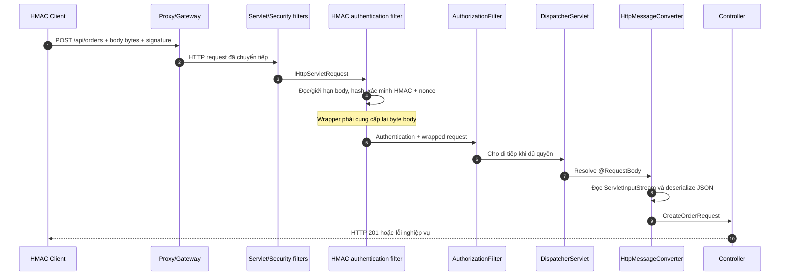
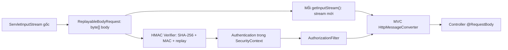

# Request body trong MVC khi xác thực HMAC

## 1. Bối cảnh bài học

Trong chương **Spring MVC integration**, chủ đề **Request body trong MVC** giải thích cách body của HTTP request được truyền qua Servlet filter đến Spring MVC, sau đó được chuyển thành dữ liệu Java bởi `HttpMessageConverter`. Điểm khó xuất hiện khi một **custom authentication filter** cần đọc body trước controller để xác minh chữ ký HMAC: Servlet request body thường là một luồng có thể đọc tiêu thụ một lần, vì vậy bộ xác thực có thể vô tình khiến `@RequestBody` nhận body rỗng.

Bài nằm trong mô-đun `SECURITY_AUTHENTICATION_HMAC_REQUEST_AUTHENTICATION`, nơi client dùng **shared secret** để ký canonical request gồm HTTP method, URI, header và/hoặc body theo hợp đồng ký. Ngoài xác minh chữ ký, server còn phải kiểm timestamp/nonce chống replay, quản lý key rotation, xét sự thay đổi của proxy/gateway và phân biệt **xác thực** với **phân quyền**. Việc xử lý body là một mắt xích trực tiếp của các yêu cầu đó: server phải kiểm tra **đúng byte đã ký** và vẫn cung cấp body hợp lệ cho Spring MVC xử lý nghiệp vụ.

Sau bài này, người học có thể:

- Mô tả thứ tự Servlet filter → Spring Security → `DispatcherServlet` → argument resolver → `HttpMessageConverter` → controller.
- Giải thích vì sao body bị đọc hết ở filter có thể làm `@RequestBody` thất bại.
- Phân biệt body gốc, chuỗi ký canonical, digest của body và đối tượng Java sau khi deserialize.
- Thiết kế giải pháp đọc/đệm body có giới hạn, hỗ trợ đọc lại cho controller và biết khi nào phải dùng streaming.
- Kiểm thử chữ ký HMAC, body rỗng, JSON sai, body bị sửa, thay đổi do proxy và chống replay trong cùng một HTTP request.

## 2. Body đi từ HTTP tới tham số `@RequestBody` như thế nào?

Spring MVC dựa trên Servlet API. Với một request đến controller như sau:

```java
@RestController
@RequestMapping("/api/orders")
class OrderController {

    @PostMapping(consumes = MediaType.APPLICATION_JSON_VALUE)
    ResponseEntity<OrderResponse> create(
            @Valid @RequestBody CreateOrderRequest body,
            Authentication authentication) {

        String clientId = authentication.getName();
        // Kiểm tra nghiệp vụ, tạo order theo quyền của client đã xác thực.
        return ResponseEntity.status(HttpStatus.CREATED)
            .body(new OrderResponse("order-123", clientId));
    }
}

record CreateOrderRequest(String sku, int quantity) {}
record OrderResponse(String id, String createdBy) {}
```

Luồng khái niệm trên **Servlet stack**:



Đường đi thực tế còn có nhiều filter khác, handler mapping, validation và exception handling. Đáng chú ý:

- `HttpServletRequest.getInputStream()` trả `ServletInputStream` chứa body theo cách Servlet container cung cấp.
- `HttpServletRequest.getReader()` đọc body dưới dạng ký tự với encoding tương ứng. Servlet API không được thiết kế để vừa gọi `getReader()` vừa gọi `getInputStream()` tùy ý trên cùng request.
- `@RequestBody` được xử lý bởi cơ chế argument resolver; ví dụ với `application/json`, Spring MVC thường dùng Jackson thông qua `MappingJackson2HttpMessageConverter` để tạo đối tượng Java.
- `@Valid` xác thực ràng buộc dữ liệu sau khi converter đọc và tạo đối tượng. HMAC đúng không đồng nghĩa dữ liệu JSON hợp lệ hay dữ liệu nghiệp vụ được phép chấp nhận.
- `Authentication` do Spring Security cung cấp đại diện cho **danh tính client đã xác minh**; controller không cần tự xác minh HMAC lần hai.

### Minh họa lỗi đọc body hai lần

```java
class BrokenHmacFilter extends OncePerRequestFilter {
    @Override
    protected void doFilterInternal(
            HttpServletRequest request,
            HttpServletResponse response,
            FilterChain chain) throws ServletException, IOException {

        // Sai trong nhiều trường hợp: tiêu thụ body ngay tại filter.
        byte[] body = request.getInputStream().readAllBytes();

        verifyHmac(body, request); // minh họa, chưa có implementation
        chain.doFilter(request, response);

        // Controller có @RequestBody sẽ đọc stream đã bị tiêu thụ.
    }
}
```

Ở đây, chữ ký có thể đúng nhưng Spring MVC không còn byte body để parse. Tùy mapping và cách xử lý, controller có thể gặp lỗi body thiếu, lỗi chuyển đổi hoặc nhận nội dung không như mong đợi. Với JSON bắt buộc, phản hồi thường là `400 Bad Request`. Không giải quyết vấn đề bằng cách gọi lại `request.getInputStream()` trên đối tượng request gốc rồi kỳ vọng Servlet container tự tua luồng.

## 3. Xác định chính xác byte nào nằm trong chữ ký

HMAC không ký một “đối tượng JSON” theo nghĩa trừu tượng: HMAC được tính từ **chuỗi byte**. Một hợp đồng ví dụ có thể chọn ký phương thức, raw path/query, những header bắt buộc và **SHA-256 của request body**:

```text
HMAC-V1
POST
/api/orders?channel=partner
x-client-id:service-a
x-key-id:key-2026-11
x-timestamp:2026-11-28T03:00:00Z
x-nonce:9e0b4aa7-0c3d-4e8a-8dc2-9d88591ab66b
content-type:application/json
body-sha256:<hex SHA-256 của byte body theo hợp đồng>
```

Sau đó:

```text
bodyHash   = SHA256(bodyBytes)
toSign     = UTF8(canonicalRequest)
signature  = Base64(HMAC_SHA256(sharedSecret, toSign))
```

Đây là **hợp đồng ví dụ do hệ thống tự định nghĩa**, không phải định dạng mà Spring MVC hoặc Spring Security mặc định áp dụng. Dù dùng hash body thay vì đưa toàn bộ body vào canonical string, body vẫn được ràng buộc bởi chữ ký nếu canonical request chứa hash đúng và server xác minh cả MAC lẫn digest đó.

Một thay đổi byte có thể tạo hash khác dù ý nghĩa JSON vẫn như nhau:

```json
{"sku":"P100","quantity":2}
```

```json
{
  "quantity": 2,
  "sku": "P100"
}
```

Hai chuỗi JSON trên có thể deserialize thành dữ liệu nghiệp vụ tương đương, nhưng khác byte vì khoảng trắng và thứ tự thuộc tính. **Không parse JSON rồi serialize lại để tạo body bytes phục vụ HMAC**, trừ khi hai phía chủ động chọn và triển khai một tiêu chuẩn canonical JSON rõ ràng.

### Byte từ mạng và byte mà Servlet API cung cấp

Cần quy định nguồn byte chuẩn:

- Khi request dùng HTTP chunked transfer encoding, phần framing/chunk là cơ chế truyền tải; Servlet input stream thường cung cấp dữ liệu body sau khi container xử lý framing. Không ký từng chunk delimiter nếu hợp đồng của bạn dựa trên byte body mà ứng dụng nhìn thấy.
- Khi có `Content-Encoding: gzip`, proxy, servlet filter hoặc thư viện có thể giải nén hay biến đổi nội dung. Hợp đồng phải xác định ký **byte nén** hay **byte đã giải nén** và tầng nào được phép thực hiện chuyển đổi. Hai bên không thể tự suy đoán.
- Khi gateway thay đổi prefix path hoặc sắp xếp query, canonical URI phía client và phía server có thể khác nhau dù body không đổi. Cần chọn canonical URI theo đường biên tin cậy; chỉ tin `Forwarded`/`X-Forwarded-*` từ proxy đáng tin cậy.
- `Content-Length` có thể vắng mặt hoặc thay đổi khi proxy chuyển tiếp. Nếu ký trường này, phải có quy tắc ổn định; giới hạn body vẫn phải dựa trên **số byte thực đọc**, không chỉ dựa vào header.
- Nếu ký `Content-Type`, cần quy ước charset, dấu cách và thứ tự tham số. Content type có thể ảnh hưởng cách MVC chuyển đổi body; cùng byte nhưng header khác có thể dẫn đến cách diễn giải khác nhau.

Body rỗng cũng có digest: SHA-256 của 0 byte có dạng hex `e3b0c44298fc1c149afbf4c8996fb92427ae41e4649b934ca495991b7852b855`. Hợp đồng phải phân biệt rõ “không có body” và “body rỗng” nếu nghiệp vụ coi hai trường hợp khác nhau.

## 4. Vì sao `ContentCachingRequestWrapper` chưa đủ?

Spring Web có `ContentCachingRequestWrapper`, thường thấy trong code logging request:

```java
ContentCachingRequestWrapper wrapper =
    new ContentCachingRequestWrapper(request, 1024 * 1024);
chain.doFilter(wrapper, response);
byte[] observedBytes = wrapper.getContentAsByteArray();
```

Wrapper này **cache các byte khi nội dung được đọc từ wrapper**; dữ liệu cache có thể lấy ra sau khi downstream đọc. Nó hữu ích để log thông tin đã đọc theo chính sách an toàn hoặc quan sát request, nhưng cần phân biệt hai chức năng:

| Yêu cầu | `ContentCachingRequestWrapper` |
| --- | --- |
| Ghi lại các byte đã được đọc | Có, trong giới hạn cache được cấu hình. |
| Đưa ngay toàn bộ body vào cache khi khởi tạo | Không. |
| Gọi `getContentAsByteArray()` khi chưa ai đọc body và nhận toàn bộ body | Không bảo đảm; thường nhận mảng rỗng. |
| Đọc hết body trong HMAC filter rồi cho MVC đọc **lại toàn bộ byte** qua `getInputStream()` | Không phải một replayable-body wrapper theo nghĩa này. |
| Tự từ chối request nếu body vượt giới hạn nghiệp vụ | Không thể dựa vào cache limit như một body-size enforcement hoàn chỉnh. |

Đặc biệt, làm như sau dễ sai:

```java
ContentCachingRequestWrapper wrapper =
    new ContentCachingRequestWrapper(request);

byte[] signedBody = wrapper.getInputStream().readAllBytes();
verifyHmac(signedBody, request);

// Sai giả định: converter có thể đọc lại signedBody từ stream của wrapper.
chain.doFilter(wrapper, response);
```

`ContentCachingRequestWrapper` có thể đã ghi cache nhưng luồng mà MVC sử dụng vẫn bị tiêu thụ. Trong tình huống cần xác minh body **trước khi cho controller chạy**, ứng dụng thường phải dùng một request wrapper **có khả năng phát lại body** hoặc một kiến trúc xác minh ở gateway/stream processing phù hợp.

## 5. Thiết kế giải pháp cho body nhỏ, JSON đồng bộ

Với API máy-gọi-máy gửi JSON có giới hạn nhỏ (ví dụ tối đa 1 MiB), một thiết kế tương đối đơn giản là:

1. Filter tạo wrapper trước khi người khác đọc body, chỉ cache tới `MAX_BODY_BYTES + 1` để phát hiện vượt ngưỡng.
2. Server dùng cached byte array để tính body digest và kiểm HMAC với shared secret phù hợp.
3. Verifier kiểm timestamp/nonce, trạng thái key/rotation và lưu nonce nguyên tử vào kho chống replay dùng chung.
4. Filter tạo `SecurityContext` chứa `Authentication` đã xác minh.
5. Filter gọi `chain.doFilter(wrappedRequest, response)` để Spring MVC đọc một stream **mới** chứa cùng byte body.
6. Controller nhận `@RequestBody` đã deserialize và thực hiện nghiệp vụ sau khi qua authorization.

Sơ đồ lớp đơn giản:



Giải pháp này phù hợp với **request body hữu hạn, đọc đồng bộ**. Nó không phải lựa chọn tự nhiên cho upload lớn, multipart, streaming vô hạn hoặc Servlet async non-blocking I/O.

### 5.1. Ví dụ wrapper có thể đọc lại body

Đoạn Java sau nhấn mạnh cơ chế và giới hạn kích thước. Nó giả định Java 17+, Jakarta Servlet API và Spring MVC hiện đại. Lớp này chỉ hướng đến **synchronous Servlet I/O**; phương thức `setReadListener` cố tình không hỗ trợ non-blocking dispatch để tránh giả vờ tương thích async. Trong production, cần điều chỉnh encoding/error mapping/dispatch theo API thực tế.

```java
public final class ReplayableBodyRequest
        extends HttpServletRequestWrapper {

    private final byte[] body;

    public ReplayableBodyRequest(
            HttpServletRequest original,
            int maxBodyBytes) throws IOException {
        super(original);

        if (maxBodyBytes < 0) {
            throw new IllegalArgumentException("maxBodyBytes");
        }

        // Không tin Content-Length đơn thuần: có thể là -1 hoặc sai.
        // Đọc thêm một byte để phát hiện vượt giới hạn.
        byte[] read = original.getInputStream()
            .readNBytes(maxBodyBytes + 1);

        if (read.length > maxBodyBytes) {
            throw new PayloadTooLargeException();
        }

        this.body = read;
    }

    public byte[] bodyBytes() {
        return body.clone();
    }

    @Override
    public ServletInputStream getInputStream() {
        ByteArrayInputStream source =
            new ByteArrayInputStream(body);

        return new ServletInputStream() {
            @Override
            public int read() {
                return source.read();
            }

            @Override
            public int read(byte[] target, int off, int len) {
                return source.read(target, off, len);
            }

            @Override
            public boolean isFinished() {
                return source.available() == 0;
            }

            @Override
            public boolean isReady() {
                return true;
            }

            @Override
            public void setReadListener(ReadListener listener) {
                throw new UnsupportedOperationException(
                    "Non-blocking Servlet IO is not supported");
            }
        };
    }

    @Override
    public BufferedReader getReader() throws IOException {
        String encoding = getCharacterEncoding();
        Charset charset = encoding == null
            ? StandardCharsets.UTF_8
            : Charset.forName(encoding);

        return new BufferedReader(
            new InputStreamReader(getInputStream(), charset));
    }
}

final class PayloadTooLargeException extends IOException {
    PayloadTooLargeException() {
        super("Request body exceeds configured limit");
    }
}
```

Lưu ý triển khai:

- Mỗi lần `getInputStream()` được gọi trên **wrapper**, một `ByteArrayInputStream` mới bắt đầu từ đầu dữ liệu. Bộ xác thực dùng `bodyBytes()` và downstream có thể đọc lại từ stream mới.
- `readNBytes(maxBodyBytes + 1)` dùng số byte thực đọc để giới hạn dữ liệu. Cần cấu hình thêm giới hạn tại reverse proxy/Servlet container để giảm chi phí request lớn và slow clients.
- Mỗi request có một bản copy body trong bộ nhớ; khi đồng thời có nhiều request 1 MiB, tổng memory tăng theo concurrency. `bodyBytes()` trả bản sao để thành phần khác không sửa dữ liệu đã cache.
- Khi thiết kế body lớn hoặc streaming, cần hashing khi đọc và lưu tạm có kiểm soát, hoặc xác thực tại gateway tin cậy có thể kiểm soát toàn bộ request. Không tăng giới hạn bộ nhớ vô hạn.
- `getReader()` phục vụ code tiêu thụ nội dung dạng ký tự, còn HMAC vẫn nên tính trên raw `byte[]`. Mã ví dụ chưa xử lý đầy đủ tác động của `getParameter*()` trên form data, async reads hoặc mọi tính năng wrapper của Servlet.

### 5.2. Kết hợp vào HMAC filter

Sơ đồ dưới dùng `HmacVerifier` do ứng dụng tự viết. Verifier phải kiểm **đầy đủ** canonical request, chữ ký, timestamp, nonce và key state; chỉ trả token đã xác thực khi mọi điều kiện đều đạt. Bộ xác thực được đặt trong Spring Security sau `ExceptionTranslationFilter` và trước `AuthorizationFilter` để exception authentication được xử lý đúng.

```java
public final class HmacBodyAuthenticationFilter
        extends OncePerRequestFilter {

    private static final int MAX_BODY_BYTES = 1024 * 1024;

    private final HmacVerifier verifier;

    public HmacBodyAuthenticationFilter(HmacVerifier verifier) {
        this.verifier = verifier;
    }

    @Override
    protected void doFilterInternal(
            HttpServletRequest request,
            HttpServletResponse response,
            FilterChain chain)
            throws ServletException, IOException {

        final ReplayableBodyRequest wrapped;

        try {
            wrapped = new ReplayableBodyRequest(
                request, MAX_BODY_BYTES);
        } catch (PayloadTooLargeException ex) {
            response.sendError(
                HttpServletResponse.SC_REQUEST_ENTITY_TOO_LARGE);
            return;
        }

        // Giả định authenticate() kiểm MAC, timestamp,
        // nonce/replay, key rotation và client/tenant.
        Authentication authentication =
            verifier.authenticate(wrapped, wrapped.bodyBytes());

        if (authentication == null
                || !authentication.isAuthenticated()) {
            throw new BadCredentialsException(
                "Invalid HMAC request");
        }

        SecurityContext context =
            SecurityContextHolder.createEmptyContext();
        context.setAuthentication(authentication);
        SecurityContextHolder.setContext(context);

        // Bắt buộc chuyển wrapper cho toàn bộ downstream.
        chain.doFilter(wrapped, response);
    }
}
```

`HttpServletResponse.SC_REQUEST_ENTITY_TOO_LARGE` là mã `413` trong Jakarta Servlet API. Xử lý `413` trực tiếp ở filter là một ví dụ; production có thể dùng error response schema chung. Không chuyển IOException/hạ tầng thành `BadCredentialsException` vì sẽ che giấu lỗi vận hành thành `401`.

Ví dụ cấu hình chain dành cho API HMAC:

```java
@Bean
@Order(1)
SecurityFilterChain hmacApi(
        HttpSecurity http,
        HmacVerifier verifier) throws Exception {

    http
        .securityMatcher("/api/**")
        .sessionManagement(session -> session
            .sessionCreationPolicy(SessionCreationPolicy.STATELESS))
        // Phù hợp API HMAC máy-gọi-máy không dùng cookie
        // của trình duyệt làm cơ chế xác thực.
        .csrf(AbstractHttpConfigurer::disable)
        .httpBasic(AbstractHttpConfigurer::disable)
        .formLogin(AbstractHttpConfigurer::disable)
        .exceptionHandling(errors -> errors
            .authenticationEntryPoint((req, res, e) ->
                res.sendError(HttpServletResponse.SC_UNAUTHORIZED))
            .accessDeniedHandler((req, res, e) ->
                res.sendError(HttpServletResponse.SC_FORBIDDEN)))
        .authorizeHttpRequests(auth -> auth
            .requestMatchers(HttpMethod.POST, "/api/orders")
                .hasAuthority("orders:write")
            .anyRequest().authenticated())
        .addFilterBefore(
            new HmacBodyAuthenticationFilter(verifier),
            AuthorizationFilter.class);

    return http.build();
}
```

Với cấu hình Spring Security chuẩn, `ExceptionTranslationFilter` đứng trước `AuthorizationFilter`. Tuy nhiên phải kiểm chứng **thứ tự thực tế** khi thêm filter hoặc dùng nhiều chain. `new HmacBodyAuthenticationFilter(verifier)` chỉ đăng ký filter ở chain này; nếu cùng filter được đánh dấu `@Component` như một Servlet `Filter` bean, Spring Boot có thể đăng ký thêm bên ngoài Security chain, gây chạy sai thứ tự hoặc lặp. Cần tránh double registration hoặc vô hiệu hóa đăng ký Servlet nếu giữ bean.

### 5.3. Tính digest body trong verifier

Verifier có thể dùng thư viện JDK để tính digest:

```java
static String sha256Hex(byte[] bytes)
        throws NoSuchAlgorithmException {

    byte[] digest = MessageDigest
        .getInstance("SHA-256")
        .digest(bytes);

    return HexFormat.of().formatHex(digest);
}
```

Hash body **chưa đủ** để xác thực client. Verifier còn phải tra secret theo `keyId` và danh tính/tenant server-side, tính HMAC trên canonical request, so sánh byte MAC được decode đúng định dạng (ví dụ `MessageDigest.isEqual`), kiểm timestamp, ghi nonce bằng thao tác nguyên tử trong kho dùng chung, rồi tạo `Authentication` với authority lấy từ hệ thống tin cậy.

Với key rotation, `keyId` phải trỏ tới đúng key hợp lệ trong phạm vi client/tenant, có khoảng thời gian hiệu lực và trạng thái phù hợp. Key cũ có thể được chấp nhận xác minh trong khoảng chuyển tiếp, nhưng key đã thu hồi phải bị từ chối. Không chọn key tùy ý bằng cách thử hết mọi secret của các tenant.

## 6. Body rỗng, body thiếu và các kiểu nội dung

MVC không diễn giải mọi body theo cách giống nhau. Các trường hợp sau cần được quy định trong hợp đồng ký và HTTP API:

| Tình huống | Ảnh hưởng tới body/HMAC | Xử lý tại MVC/API |
| --- | --- | --- |
| `GET` không có body | Hash của mảng byte rỗng nếu hợp đồng luôn ký digest. | Thường không dùng `@RequestBody`. |
| `POST` có body rỗng | HMAC vẫn có thể hợp lệ trên 0 byte. | `@RequestBody` mặc định yêu cầu body, có thể trả `400` nếu thiếu. |
| `@RequestBody(required = false)` | Cho phép vắng body ở tầng binding; không bỏ qua kiểm HMAC. | Controller cần xử lý giá trị `null`/Optional theo thiết kế. |
| JSON sai cú pháp | HMAC có thể hoàn toàn hợp lệ trên byte JSON sai. | `HttpMessageNotReadableException`, thường là `400`. |
| Sai `Content-Type` | Nếu header nằm trong chữ ký, sửa đổi có thể làm HMAC sai. | Converter không hỗ trợ có thể trả `415 Unsupported Media Type`. |
| JSON hợp lệ nhưng vi phạm Bean Validation | Không ảnh hưởng tính đúng của MAC. | Validation ở MVC, thường `400` theo cấu hình. |
| `application/x-www-form-urlencoded` | Servlet parameter parsing có thể tác động cách body được đọc. | Cần đánh giá `getParameter*()`, converter và thứ tự form filter. |
| `multipart/form-data` | Body gồm boundary và từng part; parse có thể thay cách ứng dụng thấy dữ liệu. | Cần thiết kế riêng với `MultipartResolver` và giới hạn file. |
| Binary / file lớn | Buffer toàn bộ trong RAM dễ tốn bộ nhớ. | Ưu tiên cơ chế stream/hash + lưu tạm hoặc xác thực tại gateway phù hợp. |

Nếu endpoint yêu cầu `@RequestBody` JSON và không hỗ trợ multipart hoặc form, hãy giới hạn `consumes = application/json`, body-size và canonicalization một cách nhất quán. Không mặc nhiên coi mọi `Content-Type` đều phù hợp với một wrapper đọc trước duy nhất.

### Phân biệt `@RequestBody` và `@RequestParam`

`@RequestBody` yêu cầu MVC đọc **entity body** thông qua message converter. `@RequestParam` thường lấy dữ liệu từ query parameters hoặc form parameters. Đặc biệt với `application/x-www-form-urlencoded`, gọi `request.getParameter(...)` có thể kích hoạt parse form và tác động `ServletInputStream`, tùy container/filter. Nếu endpoint cần ký raw form body, phải đặt quy ước và vị trí filter rõ ràng, thử nghiệm trên Servlet container thực tế.

## 7. Spring MVC validation và xử lý lỗi sau HMAC

HMAC bảo vệ tính toàn vẹn của **những byte đã được ký**; nó không thay thế validation, business rules hay authorization.

Ví dụ request ký đúng nhưng nội dung:

```json
{"sku":"","quantity":-5}
```

Nếu DTO có các constraint phù hợp, MVC có thể từ chối trước khi controller thực hiện nghiệp vụ. Ngược lại, JSON có thể hợp lệ, nhưng client không có authority `orders:write`; `AuthorizationFilter` phải từ chối dù chữ ký đúng.

| Loại vấn đề | Tầng nên xử lý | Mã HTTP phổ biến |
| --- | --- | --- |
| Thiếu/chữ ký HMAC sai, timestamp quá hạn, nonce trùng, key không hợp lệ | HMAC authentication filter / entry point | `401 Unauthorized` |
| HMAC hợp lệ nhưng thiếu quyền | Spring Security authorization / access denied handler | `403 Forbidden` |
| Body vượt giới hạn | Gateway, Servlet hoặc HMAC body wrapper | `413 Content Too Large` |
| JSON sai, body bắt buộc bị thiếu | MVC message conversion | `400 Bad Request` |
| Content type không được API hỗ trợ | MVC/content negotiation | `415 Unsupported Media Type` |
| Giá trị trường không thỏa validation | MVC bean validation | Thường `400 Bad Request` |
| Replay store gặp sự cố, không thể bảo đảm chống replay | Hạ tầng xác thực / error handling | Fail closed, có thể `503 Service Unavailable` |

Khi xử lý lỗi trước controller, tránh rò rỉ thông tin như expected HMAC, shared secret, body nhạy cảm hay trạng thái chi tiết của key. Ghi mã nguyên nhân nội bộ và request correlation ID là đủ cho nhiều tình huống chẩn đoán.

## 8. Timestamp/nonce liên quan gì tới body parsing?

Một client có thể gửi lại **toàn bộ** request hợp lệ mà không thay body, header hay chữ ký. HMAC khi đó vẫn đúng; chỉ dựa vào body digest không chặn được phát lại.

Do đó verifier phải:

1. Buộc `X-Timestamp` và `X-Nonce` nằm trong dữ liệu đã ký.
2. Kiểm timestamp thuộc cửa sổ chấp nhận, có giới hạn lệch đồng hồ tương lai.
3. Sau khi MAC hợp lệ, ghi nonce vào kho dùng chung bằng thao tác **insert-if-absent nguyên tử**. Khóa replay cần gắn với client/tenant và key ID phù hợp.
4. Nếu nonce đã tồn tại, từ chối trước khi MVC/controller chạy.
5. Đặt TTL bao phủ cửa sổ timestamp được phép, kể cả độ lệch đồng hồ; nếu kho chống replay ngừng hoạt động thì fail closed với API bắt buộc chống replay.

Việc ghi nonce sau xác minh MAC cũng giúp hạn chế request giả mạo tùy ý chiếm chỗ trong replay store. Tuy nhiên chấp nhận một request hợp lệ rồi trả `400` do JSON sai vẫn có thể **tiêu thụ nonce**; đây thường là kết quả hợp lý vì nonce bảo vệ **request đã gửi**, không bảo vệ “nghiệp vụ thành công”. Nếu client muốn thử lại request, nó cần timestamp/nonce/chữ ký mới và tuân thủ idempotency policy nghiệp vụ.

Đối với endpoint tạo thanh toán hay đơn hàng, **nonce chống replay không đồng nghĩa idempotency key**. Một khách hàng có thể ký hai request khác nonce nhưng cùng nội dung và cả hai hợp lệ; ngăn tạo nghiệp vụ trùng cần idempotency key và chính sách phía ứng dụng.

## 9. Hợp đồng proxy/gateway quyết định body mà backend thấy

Giả sử client ký body JSON và URI `/public/api/orders`, còn gateway chuyển thành `/api/orders` trước khi chuyển tiếp. Nếu backend canonicalize trực tiếp `request.getRequestURI()`, nó có thể thấy URI khác. Với body, reverse proxy có thể nén/giải nén hoặc đọc/chuyển đổi nội dung; khi byte được ký và byte mà verifier đọc khác nhau, chữ ký sai.

Các phương án thiết kế gồm:

- **Client và backend thống nhất ký canonical target do backend nhìn thấy**. Gateway bảo toàn những thành phần đã ký, hoặc có quy tắc rewrite ổn định và được tài liệu hóa.
- **Gateway xác thực HMAC trước khi rewrite** và chuyển danh tính được xác minh tới backend trên kết nối tin cậy; backend không tin bất kỳ “verified” header nào mà client có thể tự điền. Mô hình trust boundary và authorization phải được thiết kế riêng.
- **Chuyển canonical input qua kênh đáng tin cậy** từ gateway, với danh sách proxy được phép và kiểm soát header chống spoofing; cách này phức tạp, cần threat model và integration test.

Trong mọi phương án, hãy test byte UTF-8 có dấu, chuỗi JSON khác khoảng trắng, path percent-encoded, query nhiều tham số, duplicate header, body có/không có gzip và Content-Length thay đổi. Không lấy bytes từ DTO đã deserialize để “sửa” mismatch signature, vì việc đó che mất khác biệt trong hợp đồng ký.

## 10. Các bài kiểm thử tích hợp nên có

Một unit test tính SHA-256 hoặc test riêng wrapper là hữu ích, nhưng không chứng minh được đường đi qua Spring Security và Spring MVC. Với API HMAC, integration test nên gửi request HTTP qua `MockMvc` hoặc embedded Servlet container với bộ ký test độc lập từ cùng hợp đồng canonicalization.

| Case | Request gửi vào | Điều cần xác nhận |
| --- | --- | --- |
| Happy path | JSON body hợp lệ, HMAC đúng, nonce mới, đủ quyền | Controller nhận đủ DTO, HTTP 2xx/201. |
| Body bị sửa | Giữ signature cũ, đổi một byte body | `401`, controller không chạy. |
| JSON khác nhưng cùng ý nghĩa | Giữ signature cũ, thay whitespace/thứ tự trường | `401` nếu hợp đồng ký raw bytes. |
| JSON sai nhưng ký đúng | Ký trên JSON có lỗi cú pháp | Xác thực qua HMAC, MVC từ chối `400`. |
| Body thiếu | Ký body rỗng nhưng endpoint yêu cầu DTO | MVC trả `400` sau khi HMAC hợp lệ. |
| Body vượt giới hạn | Gửi hơn `MAX_BODY_BYTES` | `413`, không vào controller. |
| Replay | Gửi lại đúng nonce/chữ ký trong cửa sổ | Lần đầu có thể thành công, lần sau bị từ chối. |
| Concurrent replay | Hai request trùng nonce tới hai node | Chỉ một request có thể vượt qua replay guard. |
| Thiếu quyền | HMAC đúng, principal không có authority | `403`, controller không chạy. |
| Key rotation | Gửi request bằng key cũ, mới, đã revoke | Chỉ key đúng trạng thái/hiệu lực được chấp nhận. |
| Proxy rewrite | Qua cấu hình gateway tương tự production | Backend tính đúng canonical input, đọc đúng body bytes. |
| Servlet/MVC binding | Controller dùng `@RequestBody` và `@Valid` | Dữ liệu khớp raw body đã được ký. |

### Ví dụ skeleton kiểm thử bằng `MockMvc`

Ví dụ minh họa phương pháp; `TestHmacSigner`, `TestCredentialFixture` và `testReplayStore` là các tiện ích test cần tự triển khai để sinh chữ ký đúng theo hợp đồng của ứng dụng.

```java
@SpringBootTest
@AutoConfigureMockMvc
class HmacBodyMvcIntegrationTest {

    @Autowired MockMvc mvc;
    @Autowired TestHmacSigner signer;

    @Test
    void acceptsSignedBodyAndPassesItToController() throws Exception {
        byte[] body =
            "{\"sku\":\"P100\",\"quantity\":2}"
                .getBytes(StandardCharsets.UTF_8);

        var signed = signer.sign(
            "POST", "/api/orders", body);

        mvc.perform(post("/api/orders")
                .contentType(MediaType.APPLICATION_JSON)
                .content(body)
                .headers(signed.headers()))
            .andExpect(status().isCreated())
            .andExpect(jsonPath("$.createdBy").value("service-a"));
    }

    @Test
    void rejectsChangedBodyBeforeController() throws Exception {
        byte[] signedBody =
            "{\"sku\":\"P100\",\"quantity\":2}"
                .getBytes(StandardCharsets.UTF_8);
        byte[] tamperedBody =
            "{\"sku\":\"P100\",\"quantity\":3}"
                .getBytes(StandardCharsets.UTF_8);

        var signed = signer.sign(
            "POST", "/api/orders", signedBody);

        mvc.perform(post("/api/orders")
                .contentType(MediaType.APPLICATION_JSON)
                .content(tamperedBody)
                .headers(signed.headers()))
            .andExpect(status().isUnauthorized());
    }
}
```

Khi kiểm thử trên production-like stack, cần đảm bảo signature test bao gồm tất cả header đã cam kết (ví dụ `Content-Type` nếu được ký) và không dùng cùng nonce vô tình giữa các test. Để xác minh controller thực sự không chạy khi chữ ký sai, có thể dùng mock/spy bean cho service nghiệp vụ hoặc kiểm tra database không tạo bản ghi.

### Kiểm tra wrapper độc lập

Test wrapper nên xác nhận các thuộc tính sau:

- Wrapper trả byte array đúng bằng body gửi đến, bao gồm byte UTF-8 đa byte và binary.
- `getInputStream()` gọi nhiều lần trên wrapper tạo các luồng độc lập với cùng nội dung ban đầu.
- `getReader()` giải mã theo charset của request; không biến raw bytes thành dữ liệu dùng để ký.
- Giới hạn body được kiểm bằng **byte count**, kể cả request không có `Content-Length`.
- Chế độ không hỗ trợ async/non-blocking được nhận diện; test không ngầm giả định wrapper phù hợp `ReadListener`.

## 11. Lỗi thiết kế phổ biến và cách phòng tránh

| Sai lầm | Hướng xử lý |
| --- | --- |
| Filter đọc hết `getInputStream()` rồi truyền request gốc vào chain | Tạo wrapper thực sự phát lại body và truyền wrapper xuống MVC. |
| Cho rằng `ContentCachingRequestWrapper` tự hỗ trợ đọc lại stream | Chỉ dùng theo chức năng caching quan sát; dùng wrapper replay hoặc thiết kế khác cho pre-auth. |
| Tính HMAC từ JSON đã deserialize | Ký byte body đúng hợp đồng; nếu canonical JSON thì định nghĩa chuẩn rõ ràng. |
| Tin header `Content-Length` để giới hạn body | Đếm byte thực đọc và giới hạn ở gateway/container. |
| Dùng cùng cách buffer cho upload nhiều GB | Streaming/hash/lưu tạm có giới hạn và thiết kế vận hành riêng. |
| Gọi `getParameter(...)` trước khi ký form body | Xem xét Servlet form parsing và thứ tự filter; kiểm thử đúng content type. |
| Bỏ qua `Content-Encoding` và proxy rewrite | Quy định ký ở tầng nào, kiểm chứng byte/URI thực tế hai phía. |
| Đặt body verifier sau controller hoặc sau authorization | Xác thực trước khi cấp quyền; kiểm soát filter order. |
| Dùng nonce nhưng chỉ giữ trong RAM một server | Dùng kho dùng chung, thao tác nguyên tử, TTL phù hợp. |
| Hiểu chữ ký đúng là request được cấp mọi quyền | Sau authentication luôn áp dụng authorization và kiểm tra nghiệp vụ. |
| Log toàn bộ body hoặc shared secret để debug lỗi chữ ký | Log correlation ID, body length, hash và mã lỗi cần thiết theo chính sách; che dữ liệu nhạy cảm. |

## 12. Câu hỏi tự đánh giá

1. `@RequestBody` đọc body ở bước nào của luồng Spring MVC, và bước đó xảy ra trước hay sau Spring Security filter?
2. Vì sao cùng một JSON về mặt ngữ nghĩa vẫn có thể dẫn tới chữ ký HMAC khác?
3. Khi nào `ContentCachingRequestWrapper` có `getContentAsByteArray()` chứa dữ liệu, và tại sao điều đó không đảm bảo đọc lại được body?
4. Wrapper muốn cho HMAC verifier và controller đều đọc body phải đáp ứng thuộc tính gì?
5. Vì sao body size limit phải dựa vào byte thực đọc thay vì chỉ dựa vào `Content-Length`?
6. Một HMAC hợp lệ trên JSON sai cú pháp nên thất bại ở bước xác thực hay bước deserialize của MVC?
7. Một request có chữ ký hợp lệ được phát lại cùng nonce cần bị chặn ở đâu trong luồng?
8. Vì sao timestamp/nonce không thay thế idempotency policy cho endpoint tạo đơn hàng?
9. Khi gateway thay đổi URI hoặc giải nén body, canonicalization phải được xác định như thế nào?
10. Với file upload lớn hoặc Servlet async, vì sao wrapper minh họa ở bài không đủ cho production?

**Kết luận:** Khi tích hợp HMAC với Spring MVC, cần vừa xác minh được **body bytes theo đúng hợp đồng ký** trước khi vào controller, vừa giữ nguyên dữ liệu để `@RequestBody` và `HttpMessageConverter` xử lý. Wrapper phát lại body có giới hạn giải quyết trường hợp JSON đồng bộ nhỏ; các bài toán multipart, streaming, async và proxy transformation cần thiết kế riêng. HMAC, timestamp/nonce, key lifecycle, authorization và validation là các lớp kiểm soát khác nhau trong cùng luồng HTTP request.
