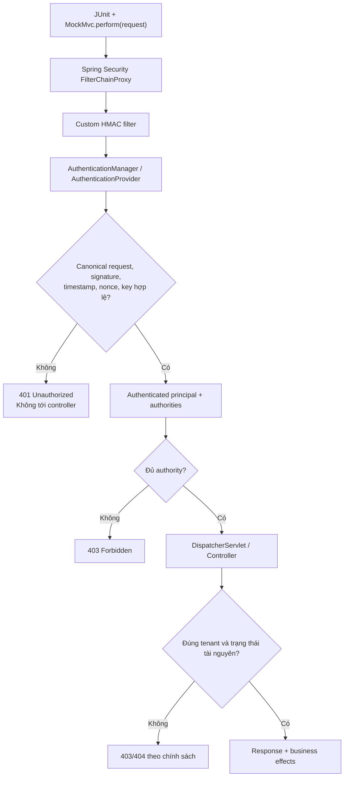

# MockMvc testing cho xác thực HTTP request bằng HMAC trong Spring MVC

## 1. Bài toán và kết quả cần đạt

Trong hệ thống máy gọi máy, client gửi request HTTP kèm chữ ký HMAC được tạo từ shared secret và một **canonical request** theo hợp đồng ký. Hợp đồng có thể bao gồm HTTP method, URI, query, header được chọn và body hoặc body digest. Server phải kiểm tra chữ ký, thời hạn của timestamp, nonce chống replay, trạng thái khóa trong lúc key rotation, sau đó mới xác định danh tính client và cấp quyền thực hiện nghiệp vụ.

Nếu chỉ kiểm thử hàm `hmacSha256()`, ta chưa biết filter có thật sự chặn request không hợp lệ, `SecurityContext` có được thiết lập đúng hay controller có nhận lại body sau khi filter đọc để ký hay không. **MockMvc testing** thuộc chương **Spring MVC integration** giúp kiểm tra tương tác giữa request HTTP mô phỏng, servlet filter, Spring Security và controller mà không cần chạy một HTTP server thực.

Mục tiêu của bài:

- Phân biệt kiểm thử verifier riêng lẻ, kiểm thử tích hợp qua `MockMvc` và kiểm thử end-to-end qua proxy/gateway thật.
- Cấu hình `MockMvc` sao cho `SecurityFilterChain` và filter HMAC thực sự được kích hoạt.
- Tạo request đã ký bằng một test signer có canonicalization rõ ràng, seed key/policy và cố định thời gian để kết quả lặp lại được.
- Kiểm tra các trường hợp `200/201`, `401`, `403`, sửa payload, replay nonce, key rotation và truy cập sai tenant.
- Tránh kết quả kiểm thử dương tính giả khi dùng mock user, vô hiệu hóa security filters hoặc dùng chung logic canonicalization bị lỗi.

Bài gắn trực tiếp với module `SECURITY_AUTHENTICATION_HMAC_REQUEST_AUTHENTICATION`: một request được xác thực **đúng HMAC** vẫn có thể bị **từ chối phân quyền** vì thiếu authority hoặc vì muốn đọc dữ liệu của tenant khác.

## 2. MockMvc kiểm tra được những gì?

`MockMvc` mô phỏng việc xử lý request qua Spring MVC trong cùng tiến trình test. Nó cho phép gửi method, path, query, header, body và khẳng định status, response header, JSON, handler hoặc side effect của service.

Với cấu hình Spring Security phù hợp, request trong MockMvc có thể đi qua:



Đây là **kiểm thử tích hợp trong bộ nhớ**. MockMvc không tự chứng minh TLS, load balancer, đường truyền, proxy rewrite, giới hạn kích thước do web server hay cấu hình gateway thật đang hoạt động đúng.

| Mức kiểm thử | Đối tượng chính | Được gì | Giới hạn |
| --- | --- | --- | --- |
| Unit test `HmacVerifier` | Canonicalization, HMAC, timestamp, nonce | Chỉ rõ lỗi mật mã và dữ liệu đầu vào | Không chứng minh filter/authorization được gắn vào MVC |
| `MockMvc` + security filters thật | HTTP, filter, provider, controller, lỗi `401/403` | Kiểm tra hành vi tích hợp nhanh, có thể cô lập dữ liệu | Không đi qua mạng hoặc gateway thật |
| `@WebMvcTest` + cấu hình security chọn lọc | MVC slice và filter được import rõ | Test một controller với giả lập dependency | Dễ bỏ sót bean/filter hoặc mock chính verifier |
| Embedded server + HTTP client | Servlet container, session/dispatcher thực | Gần với đường đi production hơn | Vẫn có thể chưa bao gồm reverse proxy |
| E2E qua gateway | Path/header/body sau proxy, TLS và routing | Phát hiện biến đổi byte hoặc rule ngoài ứng dụng | Chậm và cần môi trường triển khai |

Vì vậy, bài thực hành ưu tiên **`@SpringBootTest` + `@AutoConfigureMockMvc` + filter thật** để đảm bảo các rule HMAC và phân quyền cùng chạy.

## 3. Hợp đồng ký phải cố định trước khi viết test

Giả sử API tích hợp sử dụng bốn header:

```http
X-Key-Id: reporting-v1
X-Timestamp: 2026-11-28T03:15:00Z
X-Nonce: req-001
X-Signature: <base64-hmac-sha256>
```

Để bài học có một ví dụ nhất quán, quy ước canonical request **chỉ cho ví dụ này** gồm sáu dòng, UTF-8, nối bằng ký tự LF (`\n`), **không có newline cuối**:

```text
UPPERCASE_HTTP_METHOD
RAW_PATH_AND_QUERY
KEY_ID
TIMESTAMP_ISO_8601
NONCE
LOWERCASE_SHA256_HEX_OF_RAW_BODY
```

Ví dụ với GET không body:

```text
GET
/integrations/orders/O-17?view=summary
reporting-v1
2026-11-28T03:15:00Z
req-001
e3b0c44298fc1c149afbf4c8996fb92427ae41e4649b934ca495991b7852b855
```

Giá trị dòng cuối là SHA-256 của mảng byte rỗng. Chữ ký = `Base64(HMAC-SHA256(sharedSecret, UTF8(canonicalRequest)))`.

Các điểm phải quy định trong hệ thống thật:

- `RAW_PATH_AND_QUERY` là biểu diễn nào client ký và server nhìn thấy; xử lý percent-encoding, ký tự Unicode, dấu `?`, query trùng tên và thứ tự query phải được thống nhất.
- Không tự sort query, decode rồi encode lại, hoặc serialize lại JSON nếu hợp đồng chưa cho phép. Nhiều lỗi xác thực là do hai phía ký **khác bytes**.
- Key ID, timestamp và nonce **nằm trong dữ liệu được ký**; không chỉ đọc chúng để kiểm tra rồi bỏ ngoài chữ ký.
- Nếu `Content-Type`, `Host` hoặc các header khác quyết định ý nghĩa request, xem xét đưa chúng vào hợp đồng ký. Ví dụ đơn giản ở đây chưa ký các header đó.
- Body digest tính từ **bytes thực sự được bảo vệ bởi hợp đồng**, không phải từ object Jackson đã serialize lại.
- Header `X-Key-Id` vẫn là dữ liệu chưa đáng tin cho tới khi verifier tìm được key phù hợp và xác thực MAC.

**Lưu ý test signer:** signer trong test phải mô tả độc lập hợp đồng ký. Nếu test gọi lại chính hàm canonicalization bị lỗi của server để tạo chữ ký, cả hai có thể sai giống nhau mà test vẫn xanh. Cần thêm test vector tĩnh hoặc vector liên ngôn ngữ đã được kiểm chứng cho các trường hợp quan trọng.

## 4. Chuẩn bị cấu hình Spring Boot và bộ dữ liệu test

Sử dụng `@SpringBootTest` với `@AutoConfigureMockMvc(addFilters = true)` để khởi tạo ứng dụng và cho MockMvc dùng servlet filters đã đăng ký, bao gồm Spring Security:

```java
import org.junit.jupiter.api.BeforeEach;
import org.junit.jupiter.api.Test;
import org.springframework.beans.factory.annotation.Autowired;
import org.springframework.boot.test.autoconfigure.web.servlet.AutoConfigureMockMvc;
import org.springframework.boot.test.context.SpringBootTest;
import org.springframework.context.annotation.Import;
import org.springframework.test.context.ActiveProfiles;
import org.springframework.test.web.servlet.MockMvc;

@SpringBootTest
@AutoConfigureMockMvc(addFilters = true)
@ActiveProfiles("test")
@Import(HmacTestClockConfiguration.class)
class HmacMvcIntegrationTest {
    @Autowired MockMvc mockMvc;
    @Autowired HmacTestFixtures fixtures;

    @BeforeEach
    void resetData() {
        fixtures.resetAndSeed();
    }

    // Các phương thức @Test được minh họa ở các phần tiếp theo.
}
```

`HmacTestFixtures` là helper test do dự án định nghĩa để seed và dọn key registry, quyền client, đơn hàng và nonce store trong môi trường test. Nó không phải API có sẵn của Spring Boot. Với JPA/Redis, dùng database hoặc namespace dành riêng cho test; đừng xóa dữ liệu production. Đối với nhiều test chạy song song, nonce store cần namespace riêng hoặc test isolation để tránh can thiệp lẫn nhau.

Chọn một bộ dữ liệu rõ ràng:

| Test key | Test secret, chỉ dùng trong fixture | Client và tenant từ registry | Quyền |
| --- | --- | --- | --- |
| `reporting-v1` | `test-secret-reporting-v1` | `partner-reporting` / `tenant-a` | `ORDER_READ` |
| `fulfillment-v1` | `test-secret-fulfillment-v1` | `partner-fulfillment` / `tenant-b` | `ORDER_READ`, `ORDER_CREATE` |
| `retired-v0` | `test-secret-retired-v0` | Key đã bị thu hồi | Không được xác thực |

Giả sử fixture tạo sẵn đơn `O-17` thuộc `tenant-a` và controller có:

- `GET /integrations/orders/{id}`: `ORDER_READ`, trả `200` nếu đơn hàng tồn tại trong tenant của principal.
- `POST /integrations/orders`: `ORDER_CREATE`, trả `201` nếu body hợp lệ và tạo được đơn.

Các tên key/secret trong bảng chỉ là dữ liệu giả cho test; không dùng secret thật và không ghi signature/secret production vào snapshot hay log.

### 4.1. Cố định Clock ở cả verifier và test

Timestamp hợp lệ phụ thuộc đồng hồ server. Để test chạy ổn định:

```java
import java.time.Clock;
import java.time.Instant;
import java.time.ZoneOffset;
import org.springframework.boot.test.context.TestConfiguration;
import org.springframework.context.annotation.Bean;
import org.springframework.context.annotation.Primary;

@TestConfiguration
class HmacTestClockConfiguration {
    static final Instant NOW =
            Instant.parse("2026-11-28T03:15:00Z");

    @Bean
    @Primary
    Clock hmacTestClock() {
        return Clock.fixed(NOW, ZoneOffset.UTC);
    }
}
```

Verifier production nên lấy thời gian qua `Clock` được inject, thay vì gọi `Instant.now()` trực tiếp ở khắp nơi. Nếu test chỉ cố định đồng hồ phía signer mà verifier vẫn dùng đồng hồ hệ thống, test sẽ thất bại khi thời gian thực trôi.

Đối với cửa sổ chấp nhận ±5 phút, kiểm thử riêng cả hai biên và thời điểm nằm ngoài biên. Không nên để giá trị timestamp của request cố định trong test chạy với đồng hồ thực không kiểm soát.

## 5. Test signer tạo HMAC từ HTTP evidence

Helper sau tạo chữ ký theo đúng hợp đồng sáu dòng ở phần 3. Trong môi trường thật, nên thêm vector đối chiếu độc lập để phát hiện sai canonicalization.

```java
import java.nio.charset.StandardCharsets;
import java.security.GeneralSecurityException;
import java.security.MessageDigest;
import java.util.Base64;
import java.util.HexFormat;
import javax.crypto.Mac;
import javax.crypto.spec.SecretKeySpec;

final class HmacTestSigner {
    private HmacTestSigner() {}

    static String sign(
            String secret,
            String method,
            String rawPathAndQuery,
            String keyId,
            String timestamp,
            String nonce,
            byte[] body) throws GeneralSecurityException {

        byte[] bodyHash = MessageDigest.getInstance("SHA-256")
                .digest(body);
        String bodyHashHex = HexFormat.of().formatHex(bodyHash);

        String canonical = String.join("\n",
                method,
                rawPathAndQuery,
                keyId,
                timestamp,
                nonce,
                bodyHashHex);

        Mac mac = Mac.getInstance("HmacSHA256");
        mac.init(new SecretKeySpec(
                secret.getBytes(StandardCharsets.UTF_8),
                "HmacSHA256"));

        byte[] signature = mac.doFinal(
                canonical.getBytes(StandardCharsets.UTF_8));
        return Base64.getEncoder().encodeToString(signature);
    }
}
```

Trong helper, `method` cần được truyền theo dạng chữ hoa; `rawPathAndQuery` là request-target đã thỏa thuận, ví dụ `/integrations/orders/O-17`. Đây không phải hàm tự sửa path/query. Test phải đưa vào các bytes mà HTTP request thực sự mang theo.

Tại phía verifier, so sánh MAC cần thực hiện trên bytes bằng phép so sánh an toàn về thời gian, chẳng hạn `MessageDigest.isEqual(expected, actual)` sau khi decode định dạng chữ ký, cùng các kiểm tra độ dài/định dạng hợp lệ. Không dùng `String.equals` để so sánh signature trong implementation xác thực.

### 5.1. Tạo request MockMvc đã ký

Helper dưới đây nhận builder để có thể dùng cho GET lẫn POST:

```java
import java.nio.charset.StandardCharsets;
import java.security.GeneralSecurityException;
import org.springframework.test.web.servlet.request.MockHttpServletRequestBuilder;

static MockHttpServletRequestBuilder signedRequest(
        MockHttpServletRequestBuilder builder,
        String method,
        String rawPathAndQuery,
        String keyId,
        String secret,
        String timestamp,
        String nonce,
        byte[] body) throws GeneralSecurityException {

    String signature = HmacTestSigner.sign(
            secret, method, rawPathAndQuery,
            keyId, timestamp, nonce, body);

    return builder
            .header("X-Key-Id", keyId)
            .header("X-Timestamp", timestamp)
            .header("X-Nonce", nonce)
            .header("X-Signature", signature)
            .content(body);
}
```

Các test dưới đây giả định `signedRequest(...)` là một static helper nằm trong lớp test hoặc được import tĩnh. Dùng lại cùng body byte array khi ký và gửi, kể cả khi đó là JSON. Nếu request có query, builder và tham số `rawPathAndQuery` phải biểu diễn **cùng query trên wire**; việc thêm query sau khi ký sẽ khiến chữ ký không còn phù hợp.

## 6. Kiểm thử thành công và phân biệt 401 với 403

### 6.1. Client có quyền đọc và ký đúng

```java
import static org.springframework.test.web.servlet.request.MockMvcRequestBuilders.get;
import static org.springframework.test.web.servlet.result.MockMvcResultMatchers.status;

private static final String NOW = "2026-11-28T03:15:00Z";

@Test
void signedReaderCanReadOwnTenantOrder() throws Exception {
    mockMvc.perform(signedRequest(
            get("/integrations/orders/O-17"),
            "GET",
            "/integrations/orders/O-17",
            "reporting-v1",
            "test-secret-reporting-v1",
            NOW,
            "nonce-read-001",
            new byte[0]))
        .andExpect(status().isOk());
}
```

Đây là phép kiểm thử **toàn đường xác thực** nếu fixture và context dùng verifier/provider thật. Test xanh khi chữ ký hợp lệ, key và nonce hợp lệ, client được cấp `ORDER_READ` và đơn `O-17` thuộc `tenant-a`.

Để kiểm tra kết quả nghiệp vụ, nên thêm assertion trên JSON (ví dụ `jsonPath("$.id").value("O-17")`) và xác nhận tenant được trả về đúng dự liệu fixture.

### 6.2. Chữ ký đúng nhưng thiếu quyền phải trả 403

```java
import static org.springframework.test.web.servlet.request.MockMvcRequestBuilders.post;
import static org.springframework.http.MediaType.APPLICATION_JSON;

@Test
void signedReaderCannotCreateOrder() throws Exception {
    byte[] body = """
            {"orderId":"O-90","amount":125000}
            """.getBytes(StandardCharsets.UTF_8);

    mockMvc.perform(signedRequest(
            post("/integrations/orders")
                    .contentType(APPLICATION_JSON),
            "POST",
            "/integrations/orders",
            "reporting-v1",
            "test-secret-reporting-v1",
            NOW,
            "nonce-write-denied-001",
            body))
        .andExpect(status().isForbidden());
}
```

Điều này chứng minh hai bước khác nhau: chữ ký HMAC xác thực thành công, nhưng `Authentication` của `partner-reporting` không có `ORDER_CREATE`. Ngoài status `403`, nên assert rằng số lượng đơn hàng trong fixture không tăng và service tạo đơn không được gọi.

### 6.3. Chữ ký sai phải trả 401

```java
@Test
void invalidSignatureIsUnauthorized() throws Exception {
    mockMvc.perform(get("/integrations/orders/O-17")
            .header("X-Key-Id", "reporting-v1")
            .header("X-Timestamp", NOW)
            .header("X-Nonce", "nonce-bad-signature")
            .header("X-Signature", "not-a-valid-signature"))
        .andExpect(status().isUnauthorized());
}
```

Với HMAC-only API, request thiếu signature, signature không đúng, key hết hiệu lực hoặc replay thường phải bị xử lý như lỗi xác thực qua `AuthenticationEntryPoint`. Đừng dùng `403` cho mọi loại thất bại, vì như vậy khó phân biệt chứng thực và phân quyền.

**Không dùng `.with(user("partner-reporting"))` ở ba test trên.** Nó gắn sẵn một security principal vào request nhằm kiểm tra authorization, có thể khiến test vượt qua hoặc bỏ qua luồng xác thực HMAC thực sự. `@WithMockUser` và `SecurityMockMvcRequestPostProcessors.authentication(...)` phù hợp cho test controller/method authorization cô lập, nhưng không chứng minh signature đã được kiểm tra.

## 7. Kiểm thử sửa request sau khi ký

Đối với HMAC, một lỗi quan trọng là server xác minh chữ ký trên một tập byte khác tập byte thực thi nghiệp vụ.

### 7.1. Body đã bị sửa

```java
@Test
void modifiedBodyAfterSigningIsUnauthorized() throws Exception {
    String signedJson = """
            {"orderId":"O-90","amount":125000}
            """;
    String sentJson = """
            {"orderId":"O-90","amount":999999}
            """;

    byte[] original = signedJson.getBytes(StandardCharsets.UTF_8);
    String signature = HmacTestSigner.sign(
            "test-secret-fulfillment-v1", "POST",
            "/integrations/orders", "fulfillment-v1",
            NOW, "nonce-tampered-body", original);

    mockMvc.perform(post("/integrations/orders")
            .contentType(APPLICATION_JSON)
            .header("X-Key-Id", "fulfillment-v1")
            .header("X-Timestamp", NOW)
            .header("X-Nonce", "nonce-tampered-body")
            .header("X-Signature", signature)
            .content(sentJson.getBytes(StandardCharsets.UTF_8)))
        .andExpect(status().isUnauthorized());
}
```

Test cần assert nghiệp vụ **không tạo đơn**. Nếu vẫn tạo đơn, có khả năng server bỏ qua body digest khi dựng canonical request hoặc controller đang nhận một body khác body đã được xác minh.

### 7.2. Method, path, query hoặc signed header bị sửa

Một nhóm test tương tự cần ký `GET /integrations/orders/O-17` nhưng gửi sang `GET /integrations/orders/O-18`; ký `GET` nhưng gửi `POST`; ký `?view=summary` nhưng gửi `?view=full`. Nếu các trường này nằm trong hợp đồng, request bị sửa phải trả `401`.

Riêng việc sửa header **không nằm trong vùng được ký** không nhất thiết làm MAC sai. Chẳng hạn hợp đồng ví dụ chưa ký `Content-Type`: test không nên kỳ vọng thay `Content-Type` luôn gây `401`. Nếu ứng dụng sử dụng header đó để giải thích body hoặc quyết định nghiệp vụ, cần cập nhật hợp đồng ký để bảo vệ nó.

Nên có một bộ test canonicalization tập trung vào percent-encoding, Unicode, dấu `+`, query trùng khóa, dấu `/` cuối, tên header khác chữ hoa/thường, nhiều giá trị header và body rỗng. Dùng **test vector đã xác nhận** để tránh client/server cùng lặp một lỗi chuẩn hóa.

## 8. Kiểm thử timestamp, nonce và anti-replay

`OncePerRequestFilter` chỉ hạn chế việc chạy filter lặp trong cùng servlet dispatch theo thiết kế; nó **không chặn hai HTTP request riêng biệt** được gửi cùng HMAC. Replay protection phải nằm trong verifier hoặc thành phần tương đương.

### 8.1. Gửi lại cùng chữ ký và nonce

```java
@Test
void sameSignedRequestCannotBeReplayed() throws Exception {
    String nonce = "nonce-replay-001";

    mockMvc.perform(signedRequest(
            get("/integrations/orders/O-17"),
            "GET", "/integrations/orders/O-17",
            "reporting-v1", "test-secret-reporting-v1",
            NOW, nonce, new byte[0]))
        .andExpect(status().isOk());

    // Tạo builder mới để mô phỏng một HTTP request thứ hai.
    mockMvc.perform(signedRequest(
            get("/integrations/orders/O-17"),
            "GET", "/integrations/orders/O-17",
            "reporting-v1", "test-secret-reporting-v1",
            NOW, nonce, new byte[0]))
        .andExpect(status().isUnauthorized());
}
```

Với một nghiệp vụ có side effect, kiểm tra lần thứ hai không gọi service hoặc không tạo thêm dữ liệu. Tránh chỉ kiểm tra việc nonce đã tồn tại trong mock store; test nên chứng minh HTTP request thứ hai thật sự bị chặn.

### 8.2. Đồng hồ bị lệch

Nếu giả định cửa sổ hợp lệ là ±5 phút so với `HmacTestClockConfiguration.NOW`, hãy tạo chữ ký đúng với một timestamp ngoài cửa sổ, ví dụ `2026-11-28T03:08:00Z`, và assert `401`. Test timestamp tương lai quá xa theo chính sách tương tự.

Kiểm tra hai biên của cửa sổ (`exact boundary` và một thời điểm ngay ngoài biên) theo quy tắc so sánh của ứng dụng. Không hardcode kết quả ở biên nếu hợp đồng chưa xác định dùng `<=` hay `<`.

### 8.3. Race condition dùng cùng nonce

Nếu verifier chạy trên nhiều instance, check-then-set kiểu “đọc xem nonce có chưa, rồi mới ghi” không an toàn. Hai request đến đồng thời có thể cùng vượt qua. Nonce store nên dùng thao tác **ghi nếu chưa tồn tại một cách nguyên tử** với TTL bao phủ cửa sổ thời gian hợp lệ, ví dụ lệnh có semantics tương tự `SET NX EX` ở Redis.

MockMvc có thể dùng trong một concurrency integration test, nhưng test đơn luồng không chứng minh tính nguyên tử giữa các node. Với backend chống replay thật, tạo hai tác vụ đồng thời ký cùng `nonce`, bắt đầu gần cùng thời điểm, rồi kiểm tra số request được chấp nhận **không vượt quá một**. Kiểm tra kỹ phạm vi key nonce theo client/key và thời gian để tránh false positives khi hai client khác nhau dùng cùng chuỗi nonce theo chính sách được phép.

## 9. Kiểm thử phân quyền, principal và tenant

HMAC có thể đúng nhưng client vẫn không được phép gọi endpoint. Chính sách quyền phải lấy từ kho dữ liệu đáng tin cậy của server **sau khi** xác thực key, không lấy từ `X-Role`, `X-Permissions` hoặc body do client tự gửi.

| Tình huống | Kết quả chính | Kiểm tra thêm |
| --- | --- | --- |
| `partner-reporting` ký GET với `ORDER_READ` | `200` nếu đơn thuộc `tenant-a` | Response trả đúng đơn và tenant |
| `partner-reporting` ký POST nhưng thiếu `ORDER_CREATE` | `403` | Service không ghi đơn |
| `partner-fulfillment` ký POST với `ORDER_CREATE` | `201` nếu body hợp lệ | Dữ liệu được tạo dưới `tenant-b` |
| Client `tenant-a` đọc ID đơn thuộc `tenant-b` | `403` hoặc `404` theo chính sách | Không lộ nội dung tenant khác |
| Client ký hợp lệ, thêm `X-Role: ADMIN` | Quyền không thay đổi | Header tự khai không được sử dụng làm authority |
| Client có authority nhưng đã bị vô hiệu hóa trong registry | `401` hoặc lỗi xác thực theo policy | Không tới controller |

Ví dụ test không cho client tenant A đọc đơn thuộc tenant B:

```java
@Test
void signedClientCannotReadAnotherTenantOrder() throws Exception {
    // Fixture: O-22 thuộc tenant-b, reporting-v1 thuộc tenant-a.
    mockMvc.perform(signedRequest(
            get("/integrations/orders/O-22"),
            "GET", "/integrations/orders/O-22",
            "reporting-v1", "test-secret-reporting-v1",
            NOW, "nonce-cross-tenant-001", new byte[0]))
        .andExpect(status().isNotFound()); // Nếu policy ẩn tài nguyên.
}
```

`404` trong ví dụ là lựa chọn nếu service truy vấn theo `(orderId, tenantId của principal)` và trả “không tìm thấy”. Nếu ứng dụng định nghĩa `403` cho truy cập chéo tenant thì sửa assertion theo chính sách đã công bố; điều không đổi là không được trả dữ liệu tenant B.

Tại tầng `SecurityContext` có thể assert rằng `Authentication.getPrincipal()` chứa `clientId`/`tenantId` từ registry và `getAuthorities()` đúng với policy. Hạn chế dùng principal do test cố ý inject bằng `@WithMockUser` trong bài test này vì như vậy mất ý nghĩa kiểm tra HMAC.

## 10. Key rotation, key revocation và cấu hình theo thời điểm

Key rotation thường cho phép một giai đoạn overlap giữa key cũ và key mới, sau đó vô hiệu hóa key cũ. MockMvc cần kiểm tra behavior theo trạng thái registry, không dựa vào tên key.

Một kế hoạch fixture:

1. Seed `fulfillment-v1` và `fulfillment-v2` cùng ánh xạ tới `partner-fulfillment` / `tenant-b`; cả hai còn hiệu lực trong thời gian overlap.
2. Dùng signer với từng secret tương ứng; gửi hai request hợp lệ nhưng **nonce khác nhau**, assert đều xác thực theo cùng quyền client.
3. Thu hồi `fulfillment-v1` trong registry test và vô hiệu hóa cache key nếu hệ thống cache. Gửi request mới ký bằng v1, assert `401`.
4. Gửi request mới bằng v2, assert tiếp tục thành công với policy hiện tại.
5. Đổi policy server, bỏ `ORDER_CREATE` rồi gửi `POST` ký đúng bằng v2, assert `403` theo hiệu lực cập nhật policy/cache.

Nếu key bị thu hồi nhưng HMAC vẫn pass trong test, cần kiểm tra cache key, lifecycle của bean registry hoặc việc verifier đang dựa vào cấu hình cũ. Nếu quyền vẫn còn sau khi đã thu hồi, kiểm tra cache authorities và token creation; **key rotation không được tự động cấp thêm quyền**.

Ở các hệ thống có cache phân tán, test trong cùng tiến trình không xác nhận toàn bộ node đã nhận thông báo invalidation. Nên bổ sung integration test riêng với hạ tầng gần production hoặc E2E khi yêu cầu thu hồi phải có hiệu lực tức thì.

## 11. Đảm bảo filter chạy đúng và controller nhận đúng body

### 11.1. Kiểm tra filter thật sự nằm trong chain

`@AutoConfigureMockMvc(addFilters = true)` giúp đăng ký filters vào MockMvc, nhưng cần xác minh cấu hình bảo vệ đúng endpoint. Một sanity test:

```java
@Test
void unsignedProtectedRequestIsUnauthorized() throws Exception {
    mockMvc.perform(get("/integrations/orders/O-17"))
        .andExpect(status().isUnauthorized());
}
```

Nếu test này trả `200`, có thể filter không được đăng ký, `securityMatcher` không khớp hoặc endpoint vô tình được `permitAll`. Nếu trả `403`, hãy kiểm tra entry point và cơ chế xác thực áp dụng; thiếu bằng chứng xác thực trong API HMAC-only thường được xử lý như `401`.

Nếu filter là bean Spring Boot **và** được đưa vào `http.addFilterBefore(...)`, kiểm tra tránh đăng ký nó hai lần ở servlet container và trong SecurityFilterChain. Có thể dùng `FilterRegistrationBean` với `setEnabled(false)` khi bean chỉ nên chạy trong Spring Security. Một test HTTP status đơn lẻ khó nhận diện double registration vì `OncePerRequestFilter` có marker; cần bổ sung instrumentation hoặc assertion số lần provider được gọi.

### 11.2. Body được verifier đọc và controller đọc lại

Nếu custom filter lấy body để tính SHA-256, stream Servlet có thể đã bị tiêu thụ; `@RequestBody` ở controller sau đó sẽ thấy body rỗng. Test POST có chữ ký hợp lệ cần xác minh **đồng thời**:

- Chữ ký được tạo trên đúng mảng byte JSON gửi đi.
- Controller nhận đúng object Jackson parse từ cùng body và service lưu đúng giá trị.
- Body bị sửa sau khi ký dẫn tới `401`; controller không chạy.
- Request vượt kích thước giới hạn bị từ chối (thường `413 Payload Too Large`).

`ContentCachingRequestWrapper` của Spring Web chỉ cache bytes đã được đọc; không tự đảm bảo khả năng đọc lại stream cho controller sau khi filter tiêu thụ. Nếu parser đọc body trước controller, cần wrapper có thể phát lại body hoặc thiết kế stream phù hợp và kiểm thử integration thật.

### 11.3. SecurityContext được dọn sau request

Trong test, có thể instrument provider, service hoặc filter để quan sát principal và authorities trong lúc xử lý. Sau request, không nên còn `Authentication` của client cũ trên thread request được tái sử dụng. Spring Security có cơ chế quản lý vòng đời `SecurityContextHolder`; custom filter cũng cần không để dữ liệu leak qua thread.

Với request async, `SecurityContext` không tự xuất hiện trên mọi thread tùy ý. Cần dùng cơ chế truyền context phù hợp (ví dụ các wrapper/executor của Spring Security), hoặc truyền danh tính đã xác thực một cách rõ ràng.

## 12. `@WebMvcTest`, `standaloneSetup` và các bẫy dương tính giả

`@WebMvcTest(OrderController.class)` chỉ tải phần MVC cần thiết. Khi cần kiểm tra chính filter HMAC, bạn phải đưa filter, security chain, provider và các dependency thích hợp vào test context bằng `@Import` hoặc cấu hình tương đương. Nếu mock `HmacVerifier` để luôn trả verified client, test chỉ kiểm tra **dây nối filter/provider/authorization**, chưa kiểm tra mật mã.

Trong test xây MockMvc thủ công:

```java
MockMvc mvc = MockMvcBuilders
        .webAppContextSetup(webApplicationContext)
        .apply(springSecurity())
        .build();
```

`springSecurity()` là `SecurityMockMvcConfigurers.springSecurity()` trong `spring-security-test`. Cấu hình này giúp kết nối `FilterChainProxy` và test support phù hợp. Với `@SpringBootTest` + `@AutoConfigureMockMvc` như ví dụ chính, thường không cần tự dựng builder.

Các bẫy cần tránh:

| Cách làm | Vì sao kết quả có thể sai | Cách kiểm tra |
| --- | --- | --- |
| `@AutoConfigureMockMvc(addFilters = false)` | Tắt security filters, HMAC không chạy | Dùng `addFilters=true` cho integration test |
| `@WithMockUser` trên test chữ ký | Principal được giả lập, HMAC có thể không được kiểm tra | Gửi HTTP headers ký thật |
| `standaloneSetup(controller)` không thêm filter/security | Chỉ test MVC controller | Dùng context có security chain hoặc import filter rõ ràng |
| Mock verifier luôn trả success | Không test signature, timestamp, nonce, rotation | Có một bộ integration test với verifier thật |
| Dùng đúng một helper canonicalization của production | Cả signer lẫn verifier có thể sai giống nhau | Test vector độc lập theo hợp đồng |
| Dùng timestamp thực và nonce trùng giữa các test | Flaky test hoặc phụ thuộc thứ tự chạy | Inject `Clock` và reset/isolate nonce store |
| Kiểm tra mỗi HTTP status | Side effect có thể xảy ra trước khi trả lỗi | Assert repository/service không bị gọi |
| Gửi JSON đã được serialize lại sau khi ký | Body bytes khác dẫn đến `401` khó hiểu | Ký và gửi cùng một `byte[]` |

## 13. Async dispatch, ERROR dispatch và giới hạn của MockMvc

`OncePerRequestFilter` mặc định thường bỏ qua async và error dispatch theo cấu hình hook `shouldNotFilterAsyncDispatch()` và `shouldNotFilterErrorDispatch()`. Khi app có endpoint async, test có thể cần xác nhận:

```java
MvcResult pending = mockMvc.perform(signedRequest(
        get("/integrations/async-report"),
        "GET", "/integrations/async-report",
        "reporting-v1", "test-secret-reporting-v1",
        NOW, "nonce-async-001", new byte[0]))
    .andExpect(request().asyncStarted())
    .andReturn();

mockMvc.perform(asyncDispatch(pending))
    .andExpect(status().isOk());
```

Ví dụ giả định ứng dụng có endpoint `/integrations/async-report` hỗ trợ async và policy cho phép client này gọi endpoint đó. Cần import static các hàm `request()` và `asyncDispatch(...)` của `MockMvcResultMatchers`/`MockMvcRequestBuilders`.

Không nên khẳng định “filter HMAC chạy chính xác một lần” chỉ vì test async trả `200`. Hãy gắn bộ đếm test tại verifier hoặc quan sát số lần provider được gọi, kiểm tra dispatcher mappings và các override. Nếu async dispatch tái xác thực cùng nonce, request có thể bị coi là replay do filter chạy sai dispatch.

MockMvc không thể thay thế test qua reverse proxy để đánh giá chuyển đổi path, query, `Host`, `Forwarded`/`X-Forwarded-*`, canonical bytes sau gateway, TLS termination hay behavior của servlet container khi truyền body streaming. Có thể mô phỏng header proxy trong MockMvc cho unit/integration, nhưng còn phải có test thật qua đường đi triển khai.

## 14. Ma trận kiểm thử HMAC dành cho MockMvc

| Nhóm | Kịch bản | Kỳ vọng |
| --- | --- | --- |
| Happy path | GET ký đúng với key còn hiệu lực và authority đọc | `200`; đúng tenant, đúng dữ liệu |
| Happy path | POST ký đúng, body hợp lệ, authority tạo | `201`; có side effect chính xác |
| Authentication | Thiếu key ID, signature hoặc timestamp/nonce | `401`; không gọi controller |
| Authentication | Signature sai định dạng hoặc sai MAC | `401`; không tiết lộ key/secret |
| Integrity | Method/path/query/signed header bị sửa sau ký | `401` |
| Integrity | JSON body bị sửa sau ký | `401`; không tạo dữ liệu |
| Time | Timestamp quá cũ/quá xa tương lai | `401` |
| Anti-replay | Hai request liên tiếp cùng nonce hợp lệ | Chỉ request đầu được chấp nhận |
| Anti-replay | Hai request đồng thời cùng nonce | Tối đa một request thành công |
| Authorization | Chữ ký đúng nhưng thiếu `ORDER_CREATE` | `403`; không ghi dữ liệu |
| Tenant | Client A đọc dữ liệu tenant B | `403/404`; không lộ dữ liệu |
| Privilege escalation | Header `X-Role: ADMIN` tự khai | Không được nâng quyền |
| Key lifecycle | Key mới trong overlap | Được xác thực nếu policy cho phép |
| Key lifecycle | Key cũ bị thu hồi | `401`; cache không trả quyền cũ |
| Policy lifecycle | Client bị thu hồi quyền ghi | POST ký đúng vẫn `403` |
| Body integration | Verifier và `@RequestBody` dùng cùng bytes | Không mất hoặc biến dạng body |
| Filter wiring | Endpoint bảo vệ thiếu chữ ký | `401`; chứng minh chain có hiệu lực |
| Error/async | Dispatch bất đồng bộ hoặc lỗi | Không xác thực lại ngoài dự kiến |
| Gateway | Path/header/body thay đổi qua proxy | Kiểm tra riêng trên môi trường có gateway thật |

Khi assert `401`, nên kiểm tra response không chứa stack trace, shared secret, signature đầy đủ hay dấu hiệu cho phép phân biệt key có tồn tại. Với `403`, xác minh client **đã xác thực** nhưng không có quyền và nghiệp vụ chưa được thực hiện.

## 15. Bài thực hành tự triển khai

Hãy tạo một bộ test cho hai endpoint `GET /integrations/orders/{id}` và `POST /integrations/orders`, sử dụng hai client thuộc hai tenant khác nhau và một `HmacAuthenticationFilter` nằm trong `SecurityFilterChain`.

Các đầu việc theo thứ tự:

1. Viết hợp đồng canonical request bằng các trường HTTP đã thống nhất; tạo test vector gồm GET rỗng body và POST có body.
2. Cài `HmacTestSigner` độc lập theo hợp đồng ký; bảo đảm byte encoding, body digest, thứ tự trường và Base64 khớp.
3. Seed key registry, key lifecycle, client policy, order fixture và nonce store test; inject `Clock.fixed(...)`.
4. Thiết lập `@SpringBootTest` và `@AutoConfigureMockMvc(addFilters = true)`, dùng provider/verifier thật để xác minh chữ ký.
5. Viết test `200`/`201`, `401` sai signature, `403` thiếu quyền; assert cả side effects.
6. Viết test body tampering, timestamp ngoài cửa sổ, nonce replay, truy cập chéo tenant và key revocation.
7. Kiểm tra `@RequestBody` nhận body đúng sau filter, quan sát số lần filter/provider được gọi, và thêm test proxy/gateway ở cấp môi trường tích hợp nếu có.

Nếu test false-positive vì filter không được gắn vào chain, hãy sửa security configuration và matcher trước khi làm nhiều assertion nghiệp vụ. Nếu test thất bại do canonicalization, ghi log **cấu trúc, độ dài và hash** của từng thành phần ký trong test khi cần; không in secret hay signature thật vào log.

## 16. Câu hỏi tự kiểm tra

**1. Vì sao `@WithMockUser` không đủ cho integration test HMAC?** Vì annotation đưa principal giả lập vào security context, không chứng minh request đã được ký và verifier đã kiểm tra timestamp/nonce.

**2. Vì sao test phải có clock cố định?** Để request ký tại một timestamp biết trước luôn được đánh giá trong cùng cửa sổ hợp lệ; tránh phụ thuộc thời gian chạy thực tế.

**3. Hai request cùng nonce bị từ chối nhờ `OncePerRequestFilter` đúng không?** Không. Đó là hai HTTP request riêng biệt. Nonce store/verifier phải chống replay.

**4. Ký body JSON bằng Jackson object rồi gửi string khác có vấn đề gì?** Có thể tạo bytes khác nhau (thứ tự field, dấu cách, encoding), dẫn tới signature không khớp hoặc nguy cơ xác minh sai dữ liệu mà controller xử lý.

**5. Test `403` khác gì test `401`?** `401` kiểm tra xác thực thất bại, ví dụ signature sai; `403` kiểm tra đã xác thực nhưng thiếu quyền.

**6. `MockMvc` kiểm tra được vấn đề path rewrite qua gateway chưa?** Chỉ có thể mô phỏng input; để xác minh rewrite thực tế cần test HTTP qua proxy/gateway đã triển khai.

**7. Vì sao cần kiểm tra side effect khi response là lỗi?** Vì một lỗi bảo mật có thể xảy ra sau khi nghiệp vụ đã chạy; status đơn lẻ không chứng minh dữ liệu được bảo vệ.

## 17. Ghi nhớ

MockMvc testing là bước kiểm tra trọng tâm khi tích hợp xác thực HMAC vào Spring MVC: nó chứng minh **HTTP request có signature đi qua filter và AuthenticationProvider thật**, tạo principal/authorities từ registry server, được xử lý đúng bởi Spring Security authorization và trả mã lỗi phù hợp. Bộ test đáng tin cậy cần hợp đồng canonical request được kiểm chứng độc lập, clock và nonce store cô lập, các kịch bản sửa dữ liệu/replay, kiểm tra key rotation, tenant và side effect. Với các yếu tố phụ thuộc mạng hoặc proxy/gateway, tiếp tục bổ sung integration/E2E test ngoài MockMvc.
