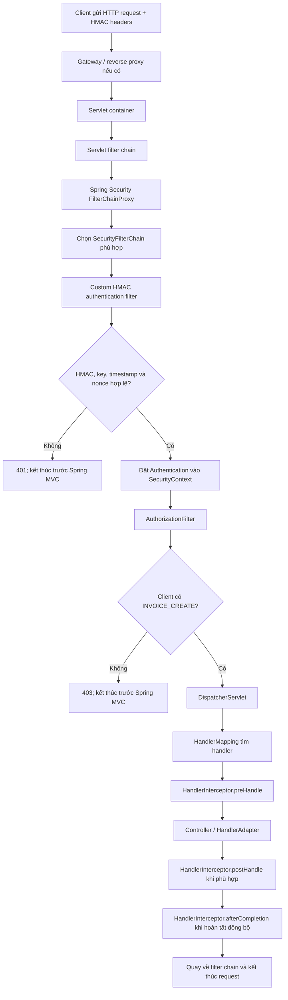

# Interceptor và filter trong Spring MVC: đặt xác thực HMAC ở đúng tầng

## 1. Bài toán: hai điểm chặn request nhưng khác vòng đời

Trong module `SECURITY_AUTHENTICATION_HMAC_REQUEST_AUTHENTICATION`, client ký HTTP request bằng **HMAC với shared secret** theo một hợp đồng **canonical request**: method, URI, các header và/hoặc body được ký phải được biểu diễn thống nhất ở client và server. Server xác minh chữ ký, kiểm tra timestamp/nonce để chống replay, quản lý key rotation, xử lý khác biệt khi đi qua proxy/gateway và tách xác thực khỏi phân quyền.

Khi tích hợp với Spring MVC, lập trình viên thường gặp hai cơ chế có vẻ tương tự:

- **Servlet filter**, triển khai `jakarta.servlet.Filter` hoặc `OncePerRequestFilter`, chạy trong chuỗi servlet filter trước khi request tới `DispatcherServlet`.
- **Spring MVC `HandlerInterceptor`**, chạy **bên trong** quá trình dispatch của Spring MVC, quanh thời điểm controller/handler được gọi.

Chúng đều có thể đọc `HttpServletRequest`, dừng luồng xử lý và trả HTTP response, nhưng **không thể thay thế nhau trong mọi chính sách bảo mật**. Với API cần bắt buộc xác thực HMAC trước khi Spring Security cấp quyền, vị trí phù hợp là **authentication filter bên trong Spring Security `SecurityFilterChain`**. `HandlerInterceptor` phù hợp hơn cho các tác vụ đã biết handler như ghi nhận metadata, đo thời gian xử lý hoặc audit bổ sung sau khi xác thực.

Sau bài này, người học có thể:

1. Vẽ đúng vị trí của servlet filter, Spring Security filter và MVC interceptor trong request lifecycle.
2. Phân biệt `Filter#doFilter`, `OncePerRequestFilter#doFilterInternal` với `HandlerInterceptor#preHandle`, `postHandle`, `afterCompletion`.
3. Đặt bộ kiểm chứng HMAC đủ sớm để Spring Security dùng được `Authentication` và `GrantedAuthority`.
4. Nhận biết những request không tới interceptor, kể cả request bị filter từ chối, không có MVC handler, hoặc qua servlet khác.
5. Tránh lỗi đọc cạn request body, filter chạy hai lần, matcher không nhất quán, mất context trong async/error dispatch.
6. Thiết kế kiểm thử cho chữ ký sai/đúng, replay, phân quyền, proxy rewrite và vòng đời callback.

> Ví dụ dùng **Servlet stack**, Jakarta Servlet, Spring MVC, Spring Security 6.x và Spring Boot 3.x. Với Spring WebFlux, điểm mở rộng tương ứng là `WebFilter` và các cơ chế reactive khác, không phải `HttpServletRequest` hay `HandlerInterceptor` kiểu Servlet.

## 2. Thứ tự xử lý thật của một HTTP request

Giả sử endpoint `POST /internal/invoices` yêu cầu chữ ký HMAC và authority `INVOICE_CREATE`. Đường đi cơ bản:



Đây là luồng **request đồng bộ thành công**. Với exception, response streaming, async request hoặc error redispatch, một số callback có thể không xảy ra đúng như sơ đồ; phần 8 trình bày các khác biệt.

Điều quan trọng là `AuthorizationFilter` có thể kiểm quyền **trước khi** Spring MVC chọn handler và gọi `preHandle(...)`. Nếu đợi đến MVC interceptor mới dựng `Authentication` từ HMAC, bước authorization phía trước có thể đã quyết định request không đủ quyền. Vì vậy không nên dùng interceptor như cơ chế HMAC chính khi bảo vệ endpoint bằng Spring Security.

### 2.1. Chọn SecurityFilterChain không phải chọn MVC handler

`FilterChainProxy` chọn **SecurityFilterChain đầu tiên** có `RequestMatcher` phù hợp. Các filter của chain đó chạy trong phạm vi request đã khớp, bất kể MVC sau đó có chọn được controller hay không.

`DispatcherServlet` đến sau và dùng `HandlerMapping` để tìm MVC handler. `HandlerInterceptor` được đăng ký với MVC; nó chỉ chạy khi quá trình dispatch tương ứng đưa interceptor vào chuỗi xử lý handler.

Nếu cấu hình servlet khác, endpoint bị chặn bởi filter trước đó, request chưa tới MVC hoặc không có handler phù hợp, đừng giả định MVC interceptor sẽ kiểm chứng được request.

## 3. So sánh filter và interceptor

| Tiêu chí | Servlet filter / Spring Security filter | Spring MVC `HandlerInterceptor` |
| --- | --- | --- |
| Tầng hoạt động | Servlet container / Spring Security | Bên trong Spring MVC `DispatcherServlet` |
| Thời điểm | Trước handler mapping và controller | Sau khi MVC xác định handler, quanh thực thi handler |
| Đầu vào chính | `ServletRequest`, `ServletResponse`, `FilterChain` | `HttpServletRequest`, `HttpServletResponse`, `handler` |
| Cách cho request đi tiếp | `chain.doFilter(request, response)` | `preHandle(...)` trả `true` |
| Cách chặn | Không gọi `chain.doFilter(...)`, gửi response | `preHandle(...)` trả `false`, tự xử lý response |
| Có thể truyền request wrapper xuống MVC? | Có: gọi `chain.doFilter(wrapper, response)` | Không có cách thay `HttpServletRequest` truyền xuống toàn bộ filter chain đã chạy |
| Biết trước controller/`HandlerMethod`? | Thông thường chưa | Có thể biết từ `handler`, nếu là MVC handler |
| Phạm vi bảo vệ | Được chọn theo servlet filter registration và `SecurityFilterChain` | Chỉ các request đi qua MVC handler chain tương ứng |
| Phù hợp để xác thực HMAC trước authorization? | **Có**, khi gắn đúng vào SecurityFilterChain | **Không phù hợp làm điểm xác thực chính** |
| Phù hợp cho đo thời gian/audit theo handler? | Có, đo toàn bộ vòng đời HTTP | **Có**, biết thêm handler và mapping |
| Async/error dispatch | Phụ thuộc dispatcher type, filter registration và `OncePerRequestFilter` | Phụ thuộc vòng đời `DispatcherServlet` và async callbacks |

Từ bảng trên, chọn cơ chế theo mục tiêu:

- Cần **bắt buộc xác thực chữ ký trên endpoint** trước authorization: Spring Security authentication filter.
- Cần **đọc và tái cung cấp raw body** cho `@RequestBody`: servlet filter với request wrapper thích hợp.
- Cần **đo thời gian controller**, gắn request ID hoặc audit tên handler: MVC interceptor hoặc cơ chế observability phù hợp.
- Cần kiểm **authority và quyền trên tài nguyên**: Spring Security authorization và service/domain-level authorization; đừng xem chữ ký HMAC hợp lệ là đủ quyền.

## 4. Các callback của filter và interceptor

### 4.1. Filter: bao quanh toàn bộ phần downstream

Một servlet filter đơn giản:

```java
import jakarta.servlet.Filter;
import jakarta.servlet.FilterChain;
import jakarta.servlet.ServletException;
import jakarta.servlet.ServletRequest;
import jakarta.servlet.ServletResponse;
import java.io.IOException;

public final class TimingServletFilter implements Filter {
    @Override
    public void doFilter(
        ServletRequest request,
        ServletResponse response,
        FilterChain chain
    ) throws IOException, ServletException {
        long start = System.nanoTime();
        try {
            chain.doFilter(request, response);
        } finally {
            long elapsedNanos = System.nanoTime() - start;
            // Ghi metric theo chính sách quan sát của ứng dụng.
        }
    }
}
```

Mọi thao tác **trước** `chain.doFilter(...)` chạy trước các thành phần phía sau; đoạn `finally` chạy khi chuỗi downstream trả quyền điều khiển hoặc ném exception. Filter có thể thay request/response bằng wrapper. Tuy nhiên nếu filter đọc cạn body trước khi chuyển tiếp, Spring MVC có thể không còn dữ liệu để bind `@RequestBody`.

Với Spring Security, bộ lọc HMAC thường kế thừa `OncePerRequestFilter` để nhận trực tiếp `HttpServletRequest` và `HttpServletResponse` trong `doFilterInternal(...)`. Tên “OncePerRequest” không có nghĩa filter tự động bảo đảm duy nhất một lần xác thực cho mọi tình huống async/error redispatch hay đăng ký trùng; cần hiểu semantics dispatch và registration.

### 4.2. Interceptor: trước và sau MVC handler

`HandlerInterceptor` khai báo ba callback chính:

```java
import jakarta.servlet.http.HttpServletRequest;
import jakarta.servlet.http.HttpServletResponse;
import org.springframework.web.servlet.HandlerInterceptor;
import org.springframework.web.servlet.ModelAndView;

public final class ExampleMvcInterceptor implements HandlerInterceptor {
    @Override
    public boolean preHandle(
        HttpServletRequest request,
        HttpServletResponse response,
        Object handler
    ) throws Exception {
        return true;
    }

    @Override
    public void postHandle(
        HttpServletRequest request,
        HttpServletResponse response,
        Object handler,
        ModelAndView modelAndView
    ) throws Exception {
        // Có thể chạy khi handler hoàn tất bình thường.
    }

    @Override
    public void afterCompletion(
        HttpServletRequest request,
        HttpServletResponse response,
        Object handler,
        Exception exception
    ) throws Exception {
        // Dọn metadata/ghi nhận trạng thái sau khi xử lý.
    }
}
```

- `preHandle(...)` chạy trước handler. Trả `false` nghĩa là interceptor đã xử lý và **không tiếp tục chạy handler**. Nếu cần trả response, phải chủ động đặt status/body trước khi trả `false`.
- `postHandle(...)` chạy sau khi handler thực thi bình thường và trước phần hoàn tất render theo đường xử lý MVC. Với `@ResponseBody`, response có thể đã được ghi bởi `HttpMessageConverter` nên `postHandle` không phải điểm đáng tin để sửa JSON.
- `afterCompletion(...)` hỗ trợ cleanup/observability cho lần xử lý đồng bộ khi `preHandle` của interceptor đó đã thành công. Nó không được bảo đảm sẽ chạy trong mọi lỗi và mọi trường hợp interceptor trả `false`.

Nếu nhiều interceptors được cấu hình, `preHandle` được gọi theo thứ tự đăng ký, còn callback hậu xử lý thường đi ngược thứ tự. Luồng exception và async có các ngoại lệ cần kiểm thử.

## 5. Vì sao HMAC nên xác thực trong Spring Security filter?

### 5.1. Chữ ký phải được kiểm tra trước khi cấp quyền

Khi request đến `POST /internal/invoices`, server cần:

1. Đọc các trường do giao thức HMAC quy định, chẳng hạn `X-Key-Id`, `X-Request-Timestamp`, `X-Request-Nonce`, `X-Signature`.
2. Tra cứu key theo `keyId`, kiểm tra key còn hiệu lực, trạng thái thu hồi và chính sách chấp nhận key cũ/mới trong giai đoạn rotation.
3. Dựng **canonical bytes** theo hợp đồng ký, gồm method, URI/query, các header được ký và digest body nếu có.
4. Tính HMAC và so sánh chữ ký phù hợp để giảm rò rỉ thời gian; từ chối trường hợp khác canonicalization, chữ ký sai hoặc định dạng không hợp lệ.
5. Kiểm tra timestamp trong cửa sổ cho phép và nonce chưa được dùng; cơ chế check-and-record nonce phải **nguyên tử trên kho chia sẻ** nếu có nhiều instance.
6. Tạo `Authentication` từ dữ liệu client/key **phía server**, đặt vào `SecurityContext` để `AuthorizationFilter` xét quyền.

Xác thực và phân quyền là hai việc khác nhau. Client có secret hợp lệ có thể chỉ được quyền `INVOICE_READ`, vẫn phải bị chặn khi tạo invoice nếu không có `INVOICE_CREATE`. Nếu tài nguyên thuộc tenant cụ thể, lớp service tiếp tục xác minh client được phép thao tác trên tenant đó.

### 5.2. Vấn đề nếu xác thực trong HandlerInterceptor

Giả sử cấu hình:

```java
http.authorizeHttpRequests(auth -> auth
    .requestMatchers(HttpMethod.POST, "/internal/invoices")
        .hasAuthority("INVOICE_CREATE")
);
```

`AuthorizationFilter` cần `Authentication` **trước khi** chạy `DispatcherServlet`. Nếu interceptor định đặt `SecurityContextHolder.getContext().setAuthentication(...)` trong `preHandle` thì code đó có thể không được gọi vì request đã bị authorization từ chối. Việc đổi route sang `permitAll()` để “vào interceptor trước” lại khiến ranh giới bảo vệ trở nên dễ sai khi xuất hiện route hoặc servlet handler mới.

Ngoài ra, MVC interceptor không nhìn thấy những request bị security filter, firewall hoặc servlet filter khác chặn trước; không thể bảo vệ toàn bộ HTTP surface chỉ bằng việc đăng ký pattern `/internal/**` của MVC. Vì vậy, khi kết hợp với Spring Security, hãy sử dụng **SecurityFilterChain cho xác thực và phân quyền**, MVC interceptor cho tác vụ cần biết handler.

## 6. Ví dụ một SecurityFilterChain dùng custom HMAC filter

Ứng dụng ví dụ có endpoint `POST /internal/invoices`, cần authority `INVOICE_CREATE`. Giao thức ký có thể bao gồm method, path/query, signed headers và raw body digest. Để tập trung vào việc tích hợp, ta định nghĩa verifier như một giao diện riêng:

```java
import jakarta.servlet.http.HttpServletRequest;
import org.springframework.security.core.Authentication;
import org.springframework.security.core.AuthenticationException;

public interface HmacRequestAuthenticator {
    Authentication authenticate(
        HttpServletRequest request,
        byte[] rawBody
    ) throws AuthenticationException;
}
```

**Hợp đồng quan trọng:** `authenticate(...)` chỉ trả về `Authentication` đã xác thực sau khi **đủ tất cả** kiểm tra về key, signature, canonical request, timestamp và nonce. Trường hợp từ chối thì ném `AuthenticationException`; authorities của danh tính đã xác thực phải đến từ registry/policy đáng tin ở phía server. Không coi `X-Client-Id` hoặc `X-Role` là bằng chứng quyền chỉ vì có trong request.

### 6.1. Đọc body trước MVC: cần truyền lại đúng bytes

Filter có thể cần băm raw body để tính chữ ký. Nhưng `request.getInputStream()` thường không tự đọc lại được. Nếu verifier đã đọc stream, controller với `@RequestBody` có thể nhận body rỗng. `ContentCachingRequestWrapper` có chức năng cache bytes **khi được đọc**, nhưng nó **không tự biến một stream đã đọc hết thành stream mới cho controller**.

Với endpoint JSON nhỏ, có thể dùng wrapper giới hạn phạm vi như sau:

```java
import jakarta.servlet.ReadListener;
import jakarta.servlet.ServletInputStream;
import jakarta.servlet.http.HttpServletRequest;
import jakarta.servlet.http.HttpServletRequestWrapper;
import java.io.BufferedReader;
import java.io.ByteArrayInputStream;
import java.io.IOException;
import java.io.InputStreamReader;
import java.nio.charset.Charset;
import java.nio.charset.StandardCharsets;

public final class BufferedJsonRequest extends HttpServletRequestWrapper {
    private final byte[] body;

    public BufferedJsonRequest(HttpServletRequest source, byte[] body) {
        super(source);
        this.body = body.clone();
    }

    @Override
    public ServletInputStream getInputStream() {
        ByteArrayInputStream input = new ByteArrayInputStream(body);

        return new ServletInputStream() {
            @Override
            public int read() {
                return input.read();
            }

            @Override
            public int read(byte[] bytes, int off, int len) {
                return input.read(bytes, off, len);
            }

            @Override
            public boolean isFinished() {
                return input.available() == 0;
            }

            @Override
            public boolean isReady() {
                return true;
            }

            @Override
            public void setReadListener(ReadListener readListener) {
                throw new UnsupportedOperationException(
                    "Demo wrapper is for synchronous requests only"
                );
            }
        };
    }

    @Override
    public BufferedReader getReader() throws IOException {
        String name = getCharacterEncoding();
        Charset charset = name == null
            ? StandardCharsets.UTF_8 : Charset.forName(name);
        return new BufferedReader(
            new InputStreamReader(getInputStream(), charset)
        );
    }

    @Override
    public int getContentLength() {
        return body.length;
    }

    @Override
    public long getContentLengthLong() {
        return body.length;
    }
}
```

Wrapper trên tạo một input stream mới từ mảng byte cho mỗi lần đọc, dùng được cho ví dụ JSON đồng bộ. **Không dùng nguyên mẫu này** cho `multipart/form-data`, form-urlencoded cần `getParameter*()`, request streaming hoặc Servlet nonblocking/async. Với các giao thức đó, phải thiết kế và kiểm thử riêng việc bảo toàn byte, xử lý kích thước, cách đọc lại và API Servlet tương ứng. `readAllBytes()` không giới hạn cũng không thích hợp cho payload do client điều khiển.

### 6.2. Authentication filter: xác thực, đặt SecurityContext, đi tiếp

```java
import jakarta.servlet.FilterChain;
import jakarta.servlet.ServletException;
import jakarta.servlet.http.HttpServletRequest;
import jakarta.servlet.http.HttpServletResponse;
import java.io.IOException;
import org.springframework.security.authentication.BadCredentialsException;
import org.springframework.security.core.Authentication;
import org.springframework.security.core.AuthenticationException;
import org.springframework.security.core.context.SecurityContext;
import org.springframework.security.core.context.SecurityContextHolder;
import org.springframework.web.filter.OncePerRequestFilter;

public final class HmacJsonAuthenticationFilter
    extends OncePerRequestFilter {

    private static final int MAX_BODY_BYTES = 1024 * 1024; // 1 MiB
    private final HmacRequestAuthenticator authenticator;

    public HmacJsonAuthenticationFilter(
        HmacRequestAuthenticator authenticator
    ) {
        this.authenticator = authenticator;
    }

    @Override
    protected void doFilterInternal(
        HttpServletRequest request,
        HttpServletResponse response,
        FilterChain chain
    ) throws IOException, ServletException {
        byte[] rawBody =
            request.getInputStream().readNBytes(MAX_BODY_BYTES + 1);

        if (rawBody.length > MAX_BODY_BYTES) {
            response.sendError(
                HttpServletResponse.SC_REQUEST_ENTITY_TOO_LARGE
            );
            return;
        }

        var replayable = new BufferedJsonRequest(request, rawBody);
        Authentication authentication;

        try {
            authentication =
                authenticator.authenticate(replayable, rawBody);
            if (authentication == null ||
                !authentication.isAuthenticated()) {
                throw new BadCredentialsException(
                    "HMAC authentication required"
                );
            }
        } catch (AuthenticationException failure) {
            SecurityContextHolder.clearContext();
            response.sendError(
                HttpServletResponse.SC_UNAUTHORIZED,
                "Invalid HMAC request"
            );
            return;
        }

        SecurityContext context =
            SecurityContextHolder.createEmptyContext();
        context.setAuthentication(authentication);
        SecurityContextHolder.setContext(context);

        try {
            chain.doFilter(replayable, response);
        } finally {
            // HMAC machine-to-machine stateless: dọn context theo request.
            SecurityContextHolder.clearContext();
        }
    }
}
```

Filter gọi `chain.doFilter(...)` **chỉ sau khi xác thực thành công**, đồng thời chuyển wrapper chứa đủ body xuống Spring MVC. `SecurityContext` mới được dựng trước authorization, nhờ đó controller/service có thể truy cập principal đã xác minh. Khi downstream kết thúc hoặc ném exception, `finally` dọn context khỏi holder của thread. Spring Security cũng có cơ chế cleanup tại ranh giới filter chain; ở đây thao tác explicit phù hợp ví dụ chain chuyên biệt cho HMAC stateless.

Đoạn code minh họa **điểm tích hợp**, không phải hiện thực thuật toán HMAC. Nếu verifier không kiểm signature trên đúng canonical bytes, timestamp, nonce hoặc trạng thái key, filter vẫn không an toàn. Với request lớn/streaming cần cách xử lý body khác. Cần cấu hình giới hạn kích thước header, thời gian đọc và body tại gateway/container phù hợp với giới hạn ứng dụng.

### 6.3. Đăng ký filter đúng vào Spring Security, tránh chạy hai lần

```java
import org.springframework.context.annotation.Bean;
import org.springframework.context.annotation.Configuration;
import org.springframework.core.annotation.Order;
import org.springframework.http.HttpMethod;
import org.springframework.security.config.annotation.web.builders.HttpSecurity;
import org.springframework.security.config.annotation.web.configurers.AbstractHttpConfigurer;
import org.springframework.security.config.http.SessionCreationPolicy;
import org.springframework.security.web.SecurityFilterChain;
import org.springframework.security.web.authentication.UsernamePasswordAuthenticationFilter;
import org.springframework.security.web.servlet.util.matcher.MvcRequestMatcher;
import org.springframework.web.servlet.handler.HandlerMappingIntrospector;

@Configuration
class InternalInvoiceSecurityConfig {

    @Bean
    @Order(1)
    SecurityFilterChain hmacInvoiceChain(
        HttpSecurity http,
        HandlerMappingIntrospector introspector,
        HmacRequestAuthenticator authenticator
    ) throws Exception {
        var matcher = new MvcRequestMatcher.Builder(introspector)
            .pattern(HttpMethod.POST, "/internal/invoices");

        http
            .securityMatcher(matcher)
            .sessionManagement(session ->
                session.sessionCreationPolicy(SessionCreationPolicy.STATELESS))
            .csrf(AbstractHttpConfigurer::disable)
            .httpBasic(AbstractHttpConfigurer::disable)
            .formLogin(AbstractHttpConfigurer::disable)
            .authorizeHttpRequests(auth -> auth
                .anyRequest().hasAuthority("INVOICE_CREATE"))
            .addFilterBefore(
                new HmacJsonAuthenticationFilter(authenticator),
                UsernamePasswordAuthenticationFilter.class
            );

        return http.build();
    }

    @Bean
    @Order(2)
    SecurityFilterChain fallbackChain(HttpSecurity http)
        throws Exception {
        return http
            .authorizeHttpRequests(auth -> auth
                .anyRequest().denyAll())
            .build();
    }
}
```

Trong ví dụ:

- `@Order(1)` chọn chain có matcher **POST và đúng đường dẫn**. Một request thiếu `X-Signature` vẫn vào chain này và bị filter từ chối. Không bao giờ chọn HMAC chain chỉ dựa vào sự tồn tại của header chữ ký.
- `@Order(2)` làm fallback cho những request không khớp chain thứ nhất. Không có route nào được tự động công bố chỉ vì HMAC matcher không khớp.
- `hasAuthority("INVOICE_CREATE")` kiểm **quyền**, sau khi filter đã kiểm **danh tính**. Một client có HMAC hợp lệ nhưng thiếu authority sẽ bị từ chối bằng cơ chế access denied (thường là 403).
- `SessionCreationPolicy.STATELESS` giúp tránh lưu kết quả xác thực HMAC vào HTTP session để dùng lại trong request tiếp theo. Mỗi request cần chữ ký/timestamp/nonce phù hợp.
- Chỉ tắt CSRF trong chain dành riêng cho API machine-to-machine stateless; endpoint dựa trên cookie/session cần được thiết kế CSRF riêng.

Ví dụ tạo `new HmacJsonAuthenticationFilter(...)` khi cấu hình chain, không khai báo cùng filter như một servlet `@Component`. Với Spring Boot, nếu filter là Spring bean, container có thể tự đăng ký nó ngoài SecurityFilterChain **và** filter còn được thêm bằng `addFilterBefore(...)`, dẫn đến chạy hai lần hoặc chạy trên route ngoài dự kiến. Khi cần filter bean riêng, có thể vô hiệu hóa servlet auto-registration bằng `FilterRegistrationBean`/`setEnabled(false)` rồi gắn vào SecurityFilterChain đúng một lần.

Matcher dựa trên Spring MVC phụ thuộc vào servlet mapping. Khi ứng dụng dùng servlet path khác mặc định, phải cấu hình matcher nhất quán với mapping đó và kiểm thử thực tế. Các phiên bản Spring Security có thể hỗ trợ matcher khác như `PathPatternRequestMatcher` với quy tắc riêng; không trộn tùy tiện.

## 7. Dùng MVC interceptor cho audit theo handler

Sau khi SecurityFilterChain đã xác thực HMAC và kiểm quyền, interceptor có thể bổ sung thông tin về controller được gọi. Ví dụ đo elapsed time cho handler mà không can thiệp chữ ký:

```java
import jakarta.servlet.http.HttpServletRequest;
import jakarta.servlet.http.HttpServletResponse;
import org.springframework.security.core.Authentication;
import org.springframework.security.core.context.SecurityContextHolder;
import org.springframework.web.method.HandlerMethod;
import org.springframework.web.servlet.HandlerInterceptor;

public final class InvoiceAuditInterceptor implements HandlerInterceptor {
    private static final String START_NANOS =
        InvoiceAuditInterceptor.class.getName() + ".startNanos";

    @Override
    public boolean preHandle(
        HttpServletRequest request,
        HttpServletResponse response,
        Object handler
    ) {
        request.setAttribute(START_NANOS, System.nanoTime());
        return true;
    }

    @Override
    public void afterCompletion(
        HttpServletRequest request,
        HttpServletResponse response,
        Object handler,
        Exception exception
    ) {
        Long start = (Long) request.getAttribute(START_NANOS);
        if (start == null) {
            return;
        }

        long elapsedNanos = System.nanoTime() - start;
        Authentication authentication =
            SecurityContextHolder.getContext().getAuthentication();

        String clientId = authentication != null
            ? authentication.getName() : "unknown";
        String handlerName = handler instanceof HandlerMethod hm
            ? hm.getMethod().getName() : "other";

        // Gửi metric/audit với clientId, handlerName, status và thời gian.
        // Không log shared secret, canonical body hoặc chữ ký kỳ vọng.
    }
}
```

Đăng ký interceptor bằng Spring MVC configuration:

```java
import org.springframework.context.annotation.Configuration;
import org.springframework.web.servlet.config.annotation.InterceptorRegistry;
import org.springframework.web.servlet.config.annotation.WebMvcConfigurer;

@Configuration
class InvoiceMvcConfiguration implements WebMvcConfigurer {
    @Override
    public void addInterceptors(InterceptorRegistry registry) {
        registry.addInterceptor(new InvoiceAuditInterceptor())
            .addPathPatterns("/internal/**");
    }
}
```

Interceptor này chỉ quan sát những request tới được MVC handler. **Nó không log được trực tiếp các lần HMAC fail 401 đã bị filter chặn**, nên audit toàn bộ xác thực cần đặt tại filter/verifier hoặc lớp observability phù hợp. Pattern của interceptor phục vụ phạm vi audit; nó không thay thế policy của SecurityFilterChain.

Để tránh rò dữ liệu, không log raw body, shared secret hoặc full signature. Nếu `clientId` là thông tin nhạy cảm hoặc yêu cầu ẩn danh, log mã tham chiếu/định danh đã che. Với nhiều handler có cùng tên method, có thể thêm thông tin class/route an toàn để phân biệt.

## 8. Các bẫy vòng đời: exception, async, error dispatch và CORS

### 8.1. Exception không xảy ra ở cùng tầng

Nếu HMAC filter trả 401 trước `DispatcherServlet`, `@ControllerAdvice` của MVC thường **không xử lý** response đó. Có thể dùng `AuthenticationEntryPoint` hoặc phương án xử lý lỗi xác thực thống nhất trong SecurityFilterChain; phải tính đến vị trí tương đối của custom filter và `ExceptionTranslationFilter`.

Ngược lại, lỗi validate `@RequestBody` hoặc exception từ controller thường xảy ra **sau** khi xác thực đã thành công và có thể được MVC exception resolver xử lý. Interceptor không phải nơi thích hợp để biến tất cả lỗi MVC thành lỗi HMAC.

### 8.2. Async: afterCompletion có thể chưa đến ngay

Với MVC async như `Callable` hoặc `DeferredResult`, `DispatcherServlet` có thể nhả thread request ban đầu trước khi tác vụ hoàn tất. `HandlerInterceptor.postHandle` và `afterCompletion` không chạy theo cùng thứ tự đồng bộ tại thời điểm bắt đầu async; khi có async redispatch, một số callback có thể được gọi lại.

Nếu cần cleanup/timing theo luồng async, xem `AsyncHandlerInterceptor.afterConcurrentHandlingStarted(...)` hoặc các callback quản lý async lifecycle của Spring MVC. Context dựa trên `ThreadLocal` không tự động xuất hiện trong mọi worker thread: hãy dùng cơ chế truyền `SecurityContext` được thiết kế cho executor tương ứng nếu thực sự cần danh tính, không truyền shared secret hoặc request body thô chỉ để giữ authentication.

### 8.3. Error dispatch và ý nghĩa của OncePerRequestFilter

Filter có thể được gọi ở `DispatcherType.REQUEST`, `ERROR`, `ASYNC` tùy servlet registration và cấu hình. `OncePerRequestFilter` có `shouldNotFilterAsyncDispatch()` và `shouldNotFilterErrorDispatch()` để kiểm soát cách tham gia redispatch; mặc định không có nghĩa mọi kiểu dispatch tự được xác thực lại.

Một request đã xác thực ở REQUEST dispatch có thể đi vào error handling sau khi context được dọn; code xử lý lỗi không nên tự giả định context còn nguyên. Nếu cấu hình chặn cả ERROR dispatch bằng matcher/authorization, cần kiểm tra xem error endpoint có được xử lý hợp lệ hay bị chặn ngoài ý muốn. Không tự mở đường bỏ qua bảo vệ khi xảy ra error dispatch.

### 8.4. OPTIONS/CORS preflight

Browser preflight `OPTIONS` thường không gửi cùng header chữ ký của HTTP request nghiệp vụ. Nếu một API có CORS, cấu hình CORS/OPTIONS rõ ràng ở tầng phù hợp để preflight được xử lý trước yêu cầu authentication dành cho request thực. Chỉ vì preflight được phép không có nghĩa `POST` hoặc `PUT` tương ứng được miễn HMAC.

Với API chỉ dành cho machine-to-machine không chạy trong browser, CORS có thể không liên quan; đừng thêm `permitAll("/internal/**")` chỉ để giải quyết một tình huống preflight chưa được mô tả rõ.

### 8.5. Đừng nhầm permitAll với bỏ qua filter

Trong cùng `SecurityFilterChain`, `authorizeHttpRequests(...).permitAll()` cho phép request vượt qua **authorization**, nhưng custom authentication filter vẫn có thể chạy và từ chối request trước đó. Nếu một endpoint là public, chính sách cần nói rõ chain nào nhận request và filter nào được chạy. Có thể giới hạn chain bằng `securityMatcher(...)` hoặc dùng `shouldNotFilter(...)` theo route đã quy định; cả hai phải được kiểm thử cùng authorization.

## 9. Những vấn đề đặc thù của HMAC khi đi qua proxy/gateway

Filter và interceptor đều đọc `HttpServletRequest` **sau** khi các lớp phía trước đã xử lý. Khi ký request, phải xác định byte/representation nào được bảo vệ.

| Tình huống | Tác động | Điều cần kiểm |
| --- | --- | --- |
| Gateway rewrite `/api/v1/invoices` thành `/internal/invoices` | Method/path được ứng dụng nhìn thấy khác URI client đã ký | Quy định ký external URI hay internal URI; xác minh tại điểm nhất quán |
| `%2F`, slash kép, dấu chấm phẩy hoặc `..` trong path | Servlet firewall, MVC mapping và verifier có thể hiểu khác nhau | Chặn dạng mơ hồ hoặc canonicalize theo hợp đồng duy nhất |
| Gateway tự thêm hoặc gộp header | Signed headers tại app có thể khác bản client gửi | Quy định header nào được ký và chính sách duplicate |
| `X-Forwarded-*` hoặc `Forwarded` | Giá trị host/scheme/prefix có thể bị giả mạo nếu trust boundary sai | Chỉ tin metadata do proxy được kiểm soát cung cấp |
| Body được nén/giải nén hoặc reserialize | Raw body digest có thể đổi | Xác minh body representation đúng như giao thức đã định |
| HMAC xác minh trên nhiều instance | Nonce store cục bộ không chặn replay sang instance khác | Kho nonce có thao tác ghi duy nhất/nguyên tử và TTL phù hợp |
| Key rotation | Có thể cùng lúc tồn tại key cũ và mới | Key ID, trạng thái, thời điểm chấp nhận và thu hồi phải tường minh |

Đừng dùng sự hiện diện của `X-Signature` làm matcher chọn chain. Nếu request không có signature nhưng vẫn vào controller thông qua chain khác, hệ thống có thể bị bypass. Route cần bảo vệ phải được nhận diện bằng method/path hợp đồng, request thiếu chữ ký trả 401, và các route chưa công bố phải có fallback thích hợp.

Verifier không nên dựa vào `request.getParameterMap()` để tái tạo raw query hoặc dùng JSON object đã parse rồi serialize lại để hash body nếu giao thức ký raw bytes. Khác biệt về thứ tự query, percent encoding, Unicode, header whitespace, JSON whitespace hoặc thứ tự field có thể làm canonical request khác nhau. Hãy xây test vector cho nhiều ngôn ngữ client.

## 10. Ma trận kiểm thử filter và interceptor

Khi kiểm thử, không chỉ gọi đơn lẻ verifier. Nên có test tích hợp qua `MockMvc` với Spring Security filter chain thực, và test qua reverse proxy nếu production dùng rewrite.

| Ca kiểm thử | HMAC filter | MVC interceptor | Kết quả mong đợi |
| --- | --- | --- | --- |
| `POST /internal/invoices` ký đúng, client có `INVOICE_CREATE` | Xác minh và đặt context | Chạy cho handler thành công | Controller nhận body/Authentication đúng |
| Thiếu `X-Signature` | Từ chối | Không chạy | 401 |
| Chữ ký sai hoặc body bị sửa | Từ chối | Không chạy | 401 |
| Timestamp hết hạn hoặc nonce lặp | Từ chối | Không chạy | 401 |
| Key hết hạn/đã thu hồi | Từ chối | Không chạy | 401 |
| Signature hợp lệ, client thiếu `INVOICE_CREATE` | Xác thực thành công | Không chạy | 403 khi authorization từ chối |
| `GET /internal/invoices` ngoài hợp đồng | Không đi vào chain dành riêng cho POST | Không cần chạy | Fallback từ chối |
| JSON ký đúng nhưng cú pháp JSON sai | HMAC hợp lệ | Có thể đi vào MVC nhưng handler binding lỗi | Lỗi 400 từ MVC |
| Gửi body JSON được filter đọc trước | Xác thực và chuyển wrapper | Chạy | `@RequestBody` vẫn nhận đủ bytes |
| Body vượt giới hạn | Trả 413 trước verifier | Không chạy | Không tiêu thụ bộ nhớ không giới hạn |
| Header duplicate/khác encoding | Theo chính sách verifier | Không chạy khi bị từ chối | Không chấp nhận representation mơ hồ |
| Gateway rewrite path | Xác minh đúng representation ký | Theo handler sau rewrite | Không báo HMAC sai giả hoặc bypass |
| Controller ném exception | Filter dọn context | Callback phù hợp với MVC/error flow | Không lộ authentication sang request sau |
| Servlet async hoặc error redispatch | Kiểm theo dispatch policy | Kiểm async/error callbacks | Không mất/nhầm danh tính ngoài ý muốn |
| Filter bị đăng ký cả ở servlet container và SecurityFilterChain | Có nguy cơ chạy trùng | Không liên quan | Test phát hiện, sửa registration |

Ví dụ kiểm tra chữ ký thiếu:

```java
@Test
void missingSignatureIsRejectedBeforeMvc() throws Exception {
    mockMvc.perform(post("/internal/invoices")
            .contentType(MediaType.APPLICATION_JSON)
            .content("{\"invoiceId\":\"INV-001\",\"amount\":100}"))
        .andExpect(status().isUnauthorized());
}
```

Để test này đáng tin, phải nạp **SecurityFilterChain và HMAC filter thật** (hoặc verifier fake được điều khiển rõ ràng), sau đó khẳng định controller/interceptor không được gọi. `@WithMockUser` chỉ dựng test authentication và không chứng minh chữ ký HMAC đã được verifier kiểm tra.

Nên bổ sung hai kiểu kiểm thử:

1. **Unit test verifier:** signature đúng/sai, canonical bytes khác nhau, timestamp ngoài cửa sổ, key revocation/rotation và check-and-record nonce nguyên tử.
2. **Integration test HTTP:** filter chạy trước authorization, body vẫn đến `@RequestBody`, controller chỉ chạy khi được phép, interceptor thấy principal đã xác thực, context dọn sau request và proxy rewrite nhất quán.

Khi cần quan sát đường đi request, dùng log cấu hình Spring Security và metric có giới hạn. Tránh log secret, chữ ký kỳ vọng, raw body nhạy cảm hoặc nội dung được ký đầy đủ vào hệ thống audit.

## 11. Quy trình lựa chọn và triển khai

1. **Viết bảng endpoint** gồm HTTP method, path, mức bắt buộc HMAC, authority và yêu cầu về tenant/resource. Tránh wildcard bảo vệ quá rộng hoặc fallback để hở route.
2. **Chốt giao thức canonical request** giữa client và server: method, URI/query, signed headers, digest body, encoding, format signature, timestamp/nonce và version.
3. **Gắn HMAC authentication filter trong đúng SecurityFilterChain**, trước authorization. Đảm bảo filter không bị đăng ký lần hai ở servlet container.
4. **Tách HMAC verifier khỏi phần điều phối Servlet**, kiểm tra key lifecycle, chữ ký, freshness và replay trước khi tạo `Authentication` đã xác thực.
5. **Giữ raw body cho Spring MVC** nếu verifier đọc body, với wrapper có giới hạn và hỗ trợ phù hợp content type/async của ứng dụng.
6. **Đặt `SecurityContext` cho request hợp lệ**, rồi để authorization kiểm authority và domain service kiểm quyền đối với tài nguyên/tenant.
7. **Dùng MVC interceptor cho audit/metric theo handler** khi cần, không đặt trách nhiệm bắt buộc HMAC vào callback `preHandle`.
8. **Kiểm thử chuỗi filter → MVC** cùng các biến thể proxy, encoding, duplicate headers, async/error dispatch, 401/403 và nonce được xử lý phân tán.

**Ghi nhớ:** Servlet filter quyết định request có đi tiếp từ tầng HTTP hay không; Spring Security authentication filter biến kết quả xác thực HMAC thành `Authentication`; `AuthorizationFilter` xét quyền trước controller; MVC interceptor chỉ được gọi khi MVC đã đi đến bước xử lý handler. Đặt từng trách nhiệm ở đúng tầng giúp chống bypass, giữ chính xác nội dung được ký và làm cho hành vi 401/403 có thể kiểm chứng.
