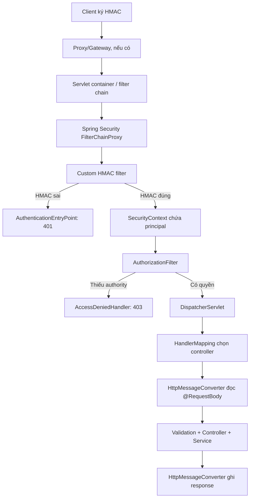

# Cấu hình MVC cho API xác thực HMAC trong Spring Security

## 1. Mục tiêu của cấu hình MVC trong module HMAC

Trong Spring Boot, một HTTP API dùng Spring MVC có thể nhận JSON qua `@RequestBody`, ánh xạ endpoint qua `@RequestMapping` và dùng `@ControllerAdvice` để xử lý lỗi nghiệp vụ. Nhưng khi API yêu cầu xác thực HMAC, request phải được kiểm tra **trước khi controller thực thi**. Vì vậy, người học cần cấu hình đúng ranh giới giữa **Spring MVC** và **Spring Security**.

Module `SECURITY_AUTHENTICATION_HMAC_REQUEST_AUTHENTICATION` có mục tiêu xác thực HTTP request bằng HMAC với shared secret. Client ký một *canonical request* theo hợp đồng bao gồm phương thức HTTP, URI, header hoặc body; server xác minh chữ ký, chống replay bằng timestamp/nonce, hỗ trợ key rotation và kiểm tra hành vi qua proxy/gateway. Sau xác thực, Spring Security tiếp tục phân quyền cho danh tính đã được xác minh.

Bài này tập trung vào cách cấu hình Spring MVC để phục vụ hợp đồng ấy, kết nối với filter xác thực HMAC và đảm bảo dữ liệu controller nhìn thấy chính là dữ liệu đã được kiểm tra.

**Mục tiêu thực hành:**

1. Phân biệt vai trò `WebMvcConfigurer`, `DispatcherServlet`, `SecurityFilterChain` và custom HMAC filter.
2. Cấu hình ánh xạ URL, JSON, validation, CORS (nếu cần), lỗi MVC và security policy tương thích nhau.
3. Bảo vệ tính nhất quán của method, URI, query, header và body khi xác minh HMAC.
4. Chặn request HMAC sai trước controller; phân biệt `401 Unauthorized` với `403 Forbidden`.
5. Kiểm thử luồng có gateway/proxy, key rotation, timestamp/nonce và request body.

## 2. Request đi qua Spring Security và Spring MVC như thế nào?

Với ứng dụng Spring Boot 3 và Spring Security 6 sử dụng Servlet stack, luồng thường có dạng:



Sơ đồ chỉ hiển thị các điểm chính; thứ tự filter thực tế còn chứa những thành phần tiêu chuẩn khác, chẳng hạn quản lý `SecurityContext`, CORS và exception translation.

Có **hai tầng cấu hình** phối hợp với nhau:

| Tầng | Thành phần thường dùng | Trách nhiệm |
| --- | --- | --- |
| Servlet container | Filter registration, dispatch types | Khởi tạo luồng request và các servlet filter |
| Spring Security | `SecurityFilterChain`, `OncePerRequestFilter` | Xác thực HMAC, gắn identity, kiểm tra authority, xử lý 401/403 |
| Spring MVC | `DispatcherServlet`, `HandlerMapping` | Chọn controller và mapping URL |
| Spring MVC | `HttpMessageConverter`, Jackson | Deserialize body và serialize response |
| Bean Validation | `@Valid` và các constraint | Kiểm tra tính hợp lệ của dữ liệu nghiệp vụ |
| Spring MVC | `@RestControllerAdvice` | Định dạng lỗi phát sinh trong tầng MVC |
| Proxy/gateway | Rewrite, forwarding headers, TLS | Định hình request đi đến ứng dụng theo cấu hình triển khai |

**Không dùng `WebMvcConfigurer` thay cho `SecurityFilterChain`.** Các interceptor của MVC chỉ chạy khi request đã đi vào xử lý MVC; còn HMAC credential cần được kiểm tra trước hành vi nghiệp vụ và trước khi controller được gọi.

## 3. Chuẩn bị Spring Boot và các nguyên tắc cấu hình

Ví dụ trong bài giả định Java 17+, Spring Boot 3, Spring MVC Servlet stack, Spring Security 6, API JSON và request body nhỏ. Các thành phần cơ bản gồm `spring-boot-starter-web`, `spring-boot-starter-security` và `spring-boot-starter-validation`. Khi kiểm thử có thể dùng `spring-boot-starter-test` cùng `spring-security-test`.

Ứng dụng thường không cần tự tạo bean `DispatcherServlet` hay đánh dấu `@EnableWebMvc`. Spring Boot auto-configuration đã thiết lập các converter phổ biến, handler mapping và cơ chế xử lý JSON. Dùng một bean implements `WebMvcConfigurer` để bổ sung cấu hình MVC khi cần.

Ví dụ:

```java
@Configuration
public class ApiMvcConfiguration implements WebMvcConfigurer {

    @Override
    public void configureContentNegotiation(
            ContentNegotiationConfigurer configurer) {
        // Không chọn response representation bằng query parameter.
        configurer.favorParameter(false);
    }
}
```

Các import tương ứng thuộc `org.springframework.context.annotation` và `org.springframework.web.servlet.config.annotation`. Đoạn trên chỉ là ví dụ extension point, không bắt buộc nếu cấu hình mặc định đã đáp ứng API.

Không thêm `@EnableWebMvc` chỉ để dùng `WebMvcConfigurer`: trong Spring Boot, annotation ấy có thể khiến một số auto-configuration MVC không còn được áp dụng theo cách mặc định. Chỉ sử dụng khi chủ động muốn tự quản lý cấu hình MVC chi tiết.

Về thiết kế module, nên tách các nhóm cấu hình:

- `ApiMvcConfiguration`: URL mapping, message conversion, CORS, conversion/formatting và interceptor không mang trách nhiệm authentication.
- `ApiSecurityConfiguration`: HMAC filter chain, chính sách route, session, entry point và denied handler.
- `HmacRequestVerifier`: canonicalization, khóa, chữ ký, timestamp, nonce và ràng buộc client identity.
- `PaymentController` / service: validation, nghiệp vụ, kiểm tra quyền sở hữu tài nguyên và idempotency.

Có thể đặt các lớp trong package khác nhau để dễ bảo trì, nhưng không cần tạo thêm framework hay cơ chế đăng nhập ngoài yêu cầu.

## 4. Cấu hình mapping và controller MVC

Giả sử API cần endpoint:

| Endpoint | Ý nghĩa | Xác thực | Quyền |
| --- | --- | --- | --- |
| `GET /api/health` | Health check | Public, nếu chính sách cho phép | Không yêu cầu authority |
| `POST /api/payments` | Tạo yêu cầu thanh toán | HMAC bắt buộc | `payments:create` |
| `GET /api/payments/{id}` | Xem thanh toán | HMAC bắt buộc | `payments:read` và kiểm tra ownership/tenant |

Một controller đơn giản:

```java
@RestController
@RequestMapping(
        path = "/api/payments",
        produces = MediaType.APPLICATION_JSON_VALUE)
public class PaymentController {

    private final PaymentService paymentService;

    public PaymentController(PaymentService paymentService) {
        this.paymentService = paymentService;
    }

    @PostMapping(consumes = MediaType.APPLICATION_JSON_VALUE)
    public ResponseEntity<PaymentResponse> create(
            @Valid @RequestBody CreatePaymentRequest input,
            @AuthenticationPrincipal HmacPrincipal principal) {

        PaymentResponse created =
                paymentService.create(input, principal.clientId());
        return ResponseEntity.status(HttpStatus.CREATED).body(created);
    }

    @GetMapping("/{id}")
    public PaymentResponse get(
            @PathVariable String id,
            @AuthenticationPrincipal HmacPrincipal principal) {

        return paymentService.getForClient(id, principal.clientId());
    }
}

record CreatePaymentRequest(
        @NotBlank String invoiceId,
        @Positive long amount) {
}

record PaymentResponse(String id, String status) {
}
record HmacPrincipal(String clientId, String tenantId) {
}
```

Đây là ví dụ về hợp đồng controller: `PaymentService` do ứng dụng triển khai. Principal phải đến từ verifier đã xác thực HMAC và từ ánh xạ tin cậy trên server, không lấy tùy ý từ `X-Client-Id` hay `X-Tenant-Id`. Với API multi-tenant, `getForClient` và `create` cần kiểm tra ownership/tenant ở service hoặc chính sách truy cập tài nguyên, ngoài authority tổng quát ở filter.

Các import tiêu biểu là `org.springframework.web.bind.annotation.*`, `org.springframework.http.*`, `org.springframework.security.core.annotation.AuthenticationPrincipal` và `jakarta.validation.constraints.*`.

### 4.1. URL mapping không quyết định canonical URI

Spring MVC dùng `HandlerMapping` để ánh xạ URL sang controller, có thể áp dụng matching pattern như `/api/payments/{id}`. Nhưng HMAC cần một biểu diễn **canonical URI** theo hợp đồng ký. Không dùng tên pattern `/api/payments/{id}` làm chuỗi ký thay cho URI request thực tế `/api/payments/42`.

Tương tự, các giá trị sau không nhất thiết tương đương:

- `request.getRequestURI()` thường chứa raw request URI path mà container cung cấp, bao gồm context path.
- `request.getServletPath()` có thể chỉ chứa phần path liên quan servlet mapping.
- `request.getQueryString()` chứa chuỗi query ở biểu diễn container cung cấp, có thể khác các parameter đã được decode.
- `@PathVariable` và `@RequestParam` là các giá trị đã qua quy tắc xử lý của MVC, không nên mặc nhiên dùng để tái tạo bytes đã được client ký.

Chọn **một nguồn canonical chính thức** và viết test vectors cho percent encoding, dấu `+`, `%20`, query lặp, query rỗng, Unicode, slash và context path. Đừng giả định hành vi normalize của framework luôn giống client.

### 4.2. JSON và dữ liệu thô

Với `@RequestBody`, Jackson chuyển JSON bytes thành Java object. Nếu hợp đồng HMAC ký `SHA-256` của body raw bytes thì phải tính hash trên **bytes thực nhận theo hợp đồng** trước khi Jackson parse.

Hai JSON sau có thể tương đương về dữ liệu nhưng khác digest:

```json
{"invoiceId":"INV-101","amount":50000}
```

```json
{ "amount": 50000, "invoiceId": "INV-101" }
```

Không serialize lại object Java thành JSON rồi dùng JSON mới để xác minh chữ ký, trừ khi chính hợp đồng ký đã quy định một chuẩn canonical JSON cụ thể và được triển khai nhất quán ở cả hai bên.

## 5. Cấu hình SecurityFilterChain cho API HMAC

Spring MVC chịu trách nhiệm dispatch tới controller; Spring Security đảm nhận xác thực và phân quyền.

Ví dụ cấu hình logic cho API `/api/**`:

```java
@Configuration
@EnableMethodSecurity
public class ApiSecurityConfiguration {

    @Bean
    @Order(1)
    SecurityFilterChain hmacApiChain(
            HttpSecurity http,
            HmacRequestVerifier verifier) throws Exception {

        AuthenticationEntryPoint entryPoint = (request, response, ex) -> {
            response.setStatus(HttpServletResponse.SC_UNAUTHORIZED);
            // HMAC là scheme của chính hợp đồng API này.
            response.setHeader(
                    HttpHeaders.WWW_AUTHENTICATE,
                    "HMAC realm=\"service-api\"");
            response.setContentType(
                    MediaType.APPLICATION_PROBLEM_JSON_VALUE);
            response.setCharacterEncoding(StandardCharsets.UTF_8.name());
            response.getWriter().write(
                    "{\"type\":\"about:blank\",\"title\":\"Unauthorized\",\"status\":401}");
        };

        AccessDeniedHandler deniedHandler = (request, response, ex) -> {
            response.setStatus(HttpServletResponse.SC_FORBIDDEN);
            response.setContentType(
                    MediaType.APPLICATION_PROBLEM_JSON_VALUE);
            response.setCharacterEncoding(StandardCharsets.UTF_8.name());
            response.getWriter().write(
                    "{\"type\":\"about:blank\",\"title\":\"Forbidden\",\"status\":403}");
        };

        return http
                .securityMatcher("/api/**")
                .sessionManagement(session -> session
                        .sessionCreationPolicy(SessionCreationPolicy.STATELESS))
                .requestCache(cache -> cache
                        .requestCache(new NullRequestCache()))
                .csrf(csrf -> csrf.disable())
                .httpBasic(AbstractHttpConfigurer::disable)
                .formLogin(AbstractHttpConfigurer::disable)
                .exceptionHandling(errors -> errors
                        .authenticationEntryPoint(entryPoint)
                        .accessDeniedHandler(deniedHandler))
                .authorizeHttpRequests(authz -> authz
                        .requestMatchers("/api/health").permitAll()
                        .requestMatchers(
                                HttpMethod.POST, "/api/payments")
                            .hasAuthority("payments:create")
                        .requestMatchers(
                                HttpMethod.GET, "/api/payments/**")
                            .hasAuthority("payments:read")
                        .anyRequest().authenticated())
                .addFilterBefore(
                        new HmacAuthenticationFilter(verifier, entryPoint),
                        UsernamePasswordAuthenticationFilter.class)
                .build();
    }
}
```

Đoạn mã minh họa Spring Security 6, Jakarta Servlet API; các import được lược để tập trung cấu hình. `HmacRequestVerifier` và `HmacAuthenticationFilter` do ứng dụng xây dựng, sẽ được mô tả tiếp theo.

Một số quyết định quan trọng:

- `securityMatcher("/api/**")` giới hạn phạm vi của chain. Nếu có nhiều `SecurityFilterChain`, chain đầu tiên khớp request theo thứ tự `@Order` được chọn; cần bảo đảm các route nhạy cảm nằm trong chain này.
- `sessionCreationPolicy(STATELESS)` phù hợp với API machine-to-machine sử dụng credential trên mỗi request.
- `NullRequestCache` tránh lưu request trong session để phục vụ redirect login.
- `csrf.disable()` ở đây dành cho API stateless xác thực bằng header; ứng dụng dùng cookie/session trình duyệt cần thiết kế CSRF riêng.
- `AuthenticationEntryPoint` trả `401` cho request chưa được xác thực hoặc credential sai; `AccessDeniedHandler` trả `403` cho client đã xác thực nhưng thiếu authority.
- `WWW-Authenticate: HMAC ...` chỉ có ý nghĩa khi client/server đã thống nhất một scheme HMAC cụ thể; không tự xem nó là chuẩn HTTP universal.
- `@EnableMethodSecurity` chỉ cần khi có dùng annotation bảo vệ method như `@PreAuthorize`; rule ở `authorizeHttpRequests` đã có thể bảo vệ route mà không phụ thuộc annotation này.

Đừng chỉ thêm rule `hasAuthority` trong `SecurityFilterChain` mà quên kiểm tra ownership/tenant ở tầng dữ liệu. Client có quyền `payments:read` vẫn không được đọc thanh toán thuộc client khác nếu chính sách tài nguyên không cho phép.

## 6. Kết nối HMAC filter với MVC

Trong ví dụ sau, verifier phải trả về danh tính **đã kiểm tra chữ ký** và request còn đọc được bởi downstream. Nếu verifier đã đọc body để tính digest, nó phải cung cấp wrapper phát lại đúng body.

Định nghĩa kết quả:

```java
public record VerifiedHmacRequest(
        Authentication authentication,
        HttpServletRequest requestForMvc) {
}

@FunctionalInterface
public interface HmacRequestVerifier {
    VerifiedHmacRequest verify(HttpServletRequest request)
            throws AuthenticationException, IOException;
}
```

Ví dụ custom filter:

```java
public final class HmacAuthenticationFilter
        extends OncePerRequestFilter {

    private final HmacRequestVerifier verifier;
    private final AuthenticationEntryPoint entryPoint;

    public HmacAuthenticationFilter(
            HmacRequestVerifier verifier,
            AuthenticationEntryPoint entryPoint) {
        this.verifier = verifier;
        this.entryPoint = entryPoint;
    }

    @Override
    protected boolean shouldNotFilter(HttpServletRequest request) {
        // Chính sách public này phải khớp cấu hình authorization.
        return "/api/health".equals(request.getServletPath());
    }

    @Override
    protected void doFilterInternal(
            HttpServletRequest request,
            HttpServletResponse response,
            FilterChain chain) throws ServletException, IOException {

        final VerifiedHmacRequest verified;
        try {
            verified = verifier.verify(request);
            if (verified == null
                    || verified.authentication() == null
                    || !verified.authentication().isAuthenticated()
                    || verified.requestForMvc() == null) {
                throw new ServletException(
                        "Verifier contract returned invalid result");
            }
        } catch (AuthenticationException ex) {
            SecurityContextHolder.clearContext();
            entryPoint.commence(request, response, ex);
            return; // Không cho MVC chạy khi HMAC không hợp lệ.
        }

        SecurityContext context = SecurityContextHolder.createEmptyContext();
        context.setAuthentication(verified.authentication());
        SecurityContextHolder.setContext(context);

        // Cố ý nằm ngoài catch(AuthenticationException).
        chain.doFilter(verified.requestForMvc(), response);
    }
}
```

Đoạn code này minh họa **ranh giới trách nhiệm**. `verify` phải xác thực canonical request, shared secret, key version, timestamp, nonce và principal; code trong filter không thay thế các bước ấy. Trường hợp verifier trả giá trị không hợp lệ là lỗi hợp đồng nội bộ, nên không âm thầm coi là credential hợp lệ.

Vì HMAC filter được thêm trước `UsernamePasswordAuthenticationFilter`, nó thường chạy trước `ExceptionTranslationFilter`. Ngoại lệ xác thực phát sinh ngay trong filter không được mặc nhiên bắt bởi `ExceptionTranslationFilter`; ở đây filter chủ động gọi `AuthenticationEntryPoint`. Sau khi `chain.doFilter` được gọi, `AuthorizationFilter` và các handler downstream tiếp tục xử lý quyền. Lỗi phân quyền ở downstream sẽ đi theo cơ chế exception translation phù hợp của Spring Security.

### 6.1. Phân loại kết quả xác thực

| Trường hợp | Nơi phát hiện | Hành vi |
| --- | --- | --- |
| Không có credential trên endpoint được bảo vệ | Verifier | `AuthenticationException` → entry point → `401` |
| Signature sai, key không tồn tại hoặc bị thu hồi | Verifier | `401` chung, không tiết lộ tình trạng key |
| Timestamp ngoài cửa sổ hoặc nonce đã dùng | Verifier | Từ chối trước MVC, thường `401` theo hợp đồng HMAC |
| HMAC hợp lệ, thiếu `payments:create` | Authorization | `403` |
| JSON không hợp lệ nhưng HMAC đúng | MVC converter/validation | `400` phù hợp |
| Body vượt giới hạn cho phép | Bộ đọc body ở filter/gateway | `413 Content Too Large` theo hợp đồng |
| Key store hoặc nonce store bị lỗi | Tầng hạ tầng của verifier | Fail closed, lỗi dịch vụ `5xx` phù hợp |
| HMAC hợp lệ và đủ quyền | Security → MVC | Controller chạy và trả response nghiệp vụ |

Không dùng `catch (Exception)` để biến mọi lỗi, kể cả outage hệ thống, thành `401`; điều đó che nguyên nhân vận hành và có thể làm sai chính sách retry của client.

### 6.2. `permitAll` không tự tắt custom filter

Với cấu hình:

```java
.requestMatchers("/api/health").permitAll()
```

`AuthorizationFilter` cho phép anonymous, nhưng custom filter vẫn chạy trước nó nếu không được cấu hình bỏ qua. Vì vậy `shouldNotFilter` ở ví dụ phải đồng bộ với các đường dẫn public đã xác định. Không mở rộng việc skip cho mọi request thiếu chữ ký; đối với endpoint được bảo vệ, thiếu credential phải bị từ chối.

## 7. Cấu hình xử lý request body cho Spring MVC

### 7.1. Vì sao có thể mất body?

HMAC bảo vệ body nếu hợp đồng ký có hash của body. Verifier muốn tính hash từ raw bytes trước khi controller xử lý; nhưng `HttpServletRequest.getInputStream()` là stream, việc đọc hết có thể khiến `@RequestBody` gặp EOF.

Lỗi thường thấy:

```java
// SAI khi verifier đã đọc hết stream:
byte[] bytes = request.getInputStream().readAllBytes();
verifySignature(request, bytes);
chain.doFilter(request, response); // MVC không còn body để đọc.
```

Cũng không thể chỉ bọc `ContentCachingRequestWrapper` rồi mong downstream tự đọc lại được:

```java
ContentCachingRequestWrapper cached =
        new ContentCachingRequestWrapper(request);

byte[] bytes = cached.getInputStream().readAllBytes();
verifySignature(cached, bytes);
chain.doFilter(cached, response); // Stream vẫn có thể đã cạn.
```

`ContentCachingRequestWrapper` lưu những bytes **đã được đọc qua wrapper**, thích hợp cho audit/logging sau xử lý. Nó không mặc nhiên rewind stream cho lần đọc tiếp theo. `getContentAsByteArray()` trước khi body được đọc có thể rỗng, còn cache limit có thể khiến bytes lưu chỉ là một phần body.

### 7.2. Cách thiết kế đúng

Một pipeline an toàn cho API JSON nhỏ:

1. Giới hạn body bằng gateway/server và một bộ đọc có giới hạn ngay trong ứng dụng.
2. Đọc raw bytes một lần từ request; không parse/serialize JSON trước khi hash nếu hợp đồng ký raw bytes.
3. Tính digest body, tạo canonical request và xác minh HMAC bằng khóa đúng phiên bản.
4. Kiểm tra timestamp, nonce bằng lưu trữ atomic và xác lập principal.
5. Dựng `HttpServletRequestWrapper` có `ServletInputStream` phát lại **chính bytes đã xác minh**.
6. Gọi `chain.doFilter(replayableRequest, response)`; Spring MVC nhận JSON đúng như payload đã ký.

Ví dụ trừu tượng bên trong verifier:

```java
byte[] body = readBodyWithLimit(request, MAX_BODY_BYTES);
String bodyHash = sha256Base64(body);

CanonicalRequest canonical = canonicalizer.from(
        request, bodyHash);

// Bao gồm kiểm tra secret/key version, signature, timestamp, nonce.
Authentication authentication =
        hmacAuthenticator.authenticate(request, canonical);

// ReplayableBodyRequest phải hiện thực getInputStream/getReader
// đúng theo hợp đồng Servlet và trả lại body đã xác minh.
HttpServletRequest requestForMvc =
        new ReplayableBodyRequest(request, body);

return new VerifiedHmacRequest(authentication, requestForMvc);
```

Các kiểu `CanonicalRequest`, `ReplayableBodyRequest`, helper đọc body và `hmacAuthenticator` là thành phần của ứng dụng; đây là pseudocode có kiểu Java nhằm minh họa hợp đồng, không phải API có sẵn của Spring.

Cần kiểm tra byte limit ngay cả khi request không có `Content-Length` hoặc gửi chunked. Không dùng `readAllBytes()` không giới hạn trên input từ Internet. Wrapper phát lại dùng bộ nhớ không phù hợp với upload lớn, streaming hoặc async nonblocking IO; các trường hợp đó cần thiết kế riêng, có bounded buffering hoặc stream digest phù hợp.

### 7.3. Định dạng JSON và độ dài body

`HttpMessageConverter` của Spring MVC thường dựa vào `Content-Type` để chọn converter. Với `consumes = application/json`, request không đúng media type có thể nhận `415 Unsupported Media Type`. JSON cú pháp sai có thể dẫn tới `400 Bad Request`.

Nhưng **chữ ký được kiểm tra trước khi MVC phân tích cú pháp**. Một request chứa JSON sai nhưng có HMAC hợp lệ vẫn phải đáp ứng bước xác thực, sau đó mới bị converter hoặc validation từ chối. Nếu muốn reject media type sớm tại gateway, hãy định nghĩa rõ điều kiện và thứ tự kiểm tra trong hợp đồng API.

Không chỉnh sửa hoặc chuẩn hóa body sau khi tính chữ ký rồi chuyển vào controller. Nếu middleware phải giải nén hay convert charset, phải xác định tại điểm nào body được ký và được kiểm chứng.

## 8. Cấu hình lỗi trong MVC và lỗi của security filter

Cả hai tầng đều có thể trả JSON lỗi, nhưng không phải tất cả exception đi qua cùng cơ chế.

| Nguồn lỗi | Công cụ xử lý điển hình | Ví dụ |
| --- | --- | --- |
| Xác thực HMAC trong servlet/security filter | `AuthenticationEntryPoint` / failure handler | `401` |
| Quyền bị từ chối ở downstream security authorization | `AccessDeniedHandler` | `403` |
| Không đọc được JSON hoặc validation fail trong MVC | `@RestControllerAdvice` | `400` |
| Loại nội dung HTTP không hỗ trợ | MVC exception resolvers | `415` |
| Body quá lớn trước MVC | Filter/gateway/body reader | `413` |
| Hạ tầng nonce/key store không khả dụng | Exception handler vận hành ở filter hoặc global error handler | `503` khi thích hợp |

Ví dụ response lỗi validation trong MVC:

```java
@RestControllerAdvice
public class ApiValidationAdvice {

    @ExceptionHandler(MethodArgumentNotValidException.class)
    ResponseEntity<ProblemDetail> invalidBody(
            MethodArgumentNotValidException ex) {

        ProblemDetail problem = ProblemDetail.forStatusAndDetail(
                HttpStatus.BAD_REQUEST,
                "Request body did not satisfy validation rules");
        return ResponseEntity.badRequest().body(problem);
    }

    @ExceptionHandler(HttpMessageNotReadableException.class)
    ResponseEntity<ProblemDetail> malformedBody(
            HttpMessageNotReadableException ex) {

        ProblemDetail problem = ProblemDetail.forStatusAndDetail(
                HttpStatus.BAD_REQUEST, "Malformed request body");
        return ResponseEntity.badRequest().body(problem);
    }
}
```

`ProblemDetail` là cấu trúc Spring Framework 6 hỗ trợ cho lỗi HTTP. Tùy cấu hình/framework, có thể dùng `ResponseEntityExceptionHandler` để tùy chỉnh thống nhất các lỗi MVC sẵn có.

**Đừng dựa vào `@RestControllerAdvice` để bắt lỗi chữ ký được ném trong custom servlet filter.** Filter chạy trước `DispatcherServlet` và lỗi của nó có thể không đi qua MVC exception resolvers. Filter nên dùng entry point hoặc lớp xử lý lỗi được định nghĩa rõ.

Ngoài ra, không để response public tiết lộ shared secret, chữ ký HMAC kỳ vọng, canonical string chứa dữ liệu nhạy cảm, key ID tồn tại hay nguyên nhân chi tiết của signature mismatch. Log nội bộ có thể ghi mã lỗi có cấu trúc, request ID và dependency status sau khi giảm nhạy cảm dữ liệu.

## 9. CORS và browser request: có cần cấu hình MVC không?

CORS chủ yếu ảnh hưởng đến client chạy trong trình duyệt. API machine-to-machine gọi từ server thường không cần CORS. Đối với HMAC dùng shared secret, **không nhúng shared secret dài hạn vào JavaScript phát cho trình duyệt**, vì người dùng và mã chạy trong trình duyệt có thể đọc được nó. Nếu sản phẩm có frontend browser, nên cân nhắc cơ chế phù hợp với môi trường browser hoặc backend ký request thay mặt.

Nếu thực sự có một endpoint cần CORS, Spring MVC có thể định nghĩa chính sách cụ thể:

```java
@Configuration
public class CorsMvcConfiguration implements WebMvcConfigurer {

    @Override
    public void addCorsMappings(CorsRegistry registry) {
        registry.addMapping("/api/**")
                .allowedOrigins("https://console.example.test")
                .allowedMethods("GET", "POST", "OPTIONS")
                .allowedHeaders(
                        "Content-Type",
                        "X-Key-Id",
                        "X-Request-Timestamp",
                        "X-Request-Nonce",
                        "X-Signature");
    }
}
```

Để Spring Security tích hợp CORS theo cấu hình này, có thể bật:

```java
http.cors(Customizer.withDefaults());
```

trong chuỗi security thích hợp (hoặc cấu hình `CorsConfigurationSource` rõ ràng nếu cần). CORS preflight `OPTIONS` không mang credential HMAC của thao tác business; phải được xử lý trước bước yêu cầu chữ ký để tránh bị `401` làm trình duyệt chặn. Việc xử lý request thực vẫn phải xác minh chữ ký và kiểm soát quyền.

Đừng trả `Access-Control-Allow-Origin: *` bừa bãi, đặc biệt khi dùng credentials. CORS là cơ chế của browser, **không phải xác thực** và không ngăn client không phải browser gửi HTTP trực tiếp.

## 10. Reverse proxy, gateway và cấu hình forwarded headers

Trong production, proxy có thể thay đổi request trước khi vào MVC:

- Rewrite `/public/api/payments` thành `/api/payments`.
- Chuyển TLS ở gateway rồi gửi HTTP vào ứng dụng.
- Thêm hoặc thay đổi `Host`, `Forwarded` và `X-Forwarded-*`.
- Chuẩn hóa path, query, phần trăm mã hóa, duplicate headers.
- Nén/giải nén body hoặc thay đổi transfer/content encoding.

Nếu client ký biểu diễn khác với biểu diễn server xác minh, HMAC mismatch xảy ra dù secret chính xác.

### 10.1. Các lựa chọn canonical path

Ví dụ:

```text
Client nhìn thấy:        POST /public/api/payments?client=7
Gateway gửi vào app:     POST /api/payments?client=7
Spring MVC mapping:      POST /api/payments
```

Có hai chiến lược chính:

1. **Ký request public:** verifier tại edge hoặc app phải truy cập URI public nguyên vẹn qua cơ chế đáng tin cậy và canonicalization được công bố.
2. **Ký request tại một hop xác định:** client/gateway ký một biểu diễn request mà nơi xác minh thực sự nhìn thấy và không thay đổi giữa ký và kiểm tra.

Không được lấy tùy ý `X-Original-URI` hay `X-Forwarded-Proto` do client cung cấp để thay thế URI khi xác minh. Gateway tin cậy cần loại bỏ header giả mạo do client gửi rồi tự đặt lại giá trị, kèm quy tắc mạng chỉ cho phép nhận từ proxy hợp lệ.

### 10.2. Cấu hình forwarding trong Spring Boot

Spring Boot có thuộc tính triển khai ví dụ:

```yaml
server:
  forward-headers-strategy: framework
```

Tùy môi trường, thuộc tính này có thể khiến framework xử lý forwarding headers để cung cấp URL/scheme từ proxy cho ứng dụng. **Nó không tự xác thực nguồn gốc header**, nên phải kết hợp với cấu hình trusted proxy, lọc header phía edge và network policy. Nếu application kiểm tra chữ ký từ URI/scheme, cần test chính xác giá trị được Servlet API và filter nhìn thấy sau khi các wrapper forwarding được áp dụng.

Tránh đặt quy tắc ký dựa vào ngẫu nhiên vị trí của `ForwardedHeaderFilter` hoặc phụ thuộc vào một header mà người dùng Internet có thể giả mạo.

### 10.3. Test vectors tối thiểu

| Dữ liệu | Trường hợp cần kiểm tra |
| --- | --- |
| Path | Rewrite prefix, dấu `/` cuối, percent encoding, dấu `%2F` |
| Query | Duplicate key, key/value rỗng, dấu `+` và `%20`, thứ tự param |
| Header | Upper/lowercase name, whitespace, duplicate header, header do gateway thêm |
| Body | JSON whitespace, Unicode, binary, body rỗng, compression |
| Scheme/host | TLS offload, port mặc định, forwarded headers từ proxy tin cậy |
| Clock/nonce | Đồng hồ lệch, nonce lặp song song, hết hạn TTL |
| Key | Key cũ trong thời gian rotation, key revoked, client sai |

Mục tiêu test không phải “cho qua mọi biến thể”, mà đảm bảo **hai bên ký đúng cùng một canonical representation** và từ chối nhất quán biến thể ngoài hợp đồng.

## 11. Kết hợp timestamp, nonce, key rotation và phân quyền

Cấu hình MVC không cung cấp xác thực HMAC. Verifier cần thực hiện toàn bộ kiểm tra sau:

1. Parse `keyId`, timestamp, nonce và chữ ký theo header contract; validate cú pháp và kích thước.
2. Chọn shared secret đúng key version và client từ kho bảo vệ; kiểm tra trạng thái active/revoked.
3. Dựng canonical request chính xác theo method, URI, các header và body hash đã thống nhất.
4. Tính HMAC (ví dụ `HmacSHA256`), so sánh digest bằng phương pháp không rò rỉ đáng kể qua timing; không so sánh signature bằng chuỗi thường.
5. Kiểm tra timestamp nằm trong cửa sổ chấp nhận, xử lý clock skew và giới hạn thời gian replay.
6. Đảm bảo nonce dùng một lần theo định danh client/key phù hợp bằng thao tác **atomic**; hai request song song cùng nonce không thể cùng vượt qua.
7. Trả về `Authentication` với principal và authorities lấy từ policy phía server, rồi cho request đi tiếp tới authorization.

Không biến `X-Tenant-Id` hoặc `X-Role` tự khai thành quyền truy cập chỉ vì nó có mặt trong request. Nếu những trường đó được ký, chữ ký chỉ chứng minh rằng chủ sở hữu khóa đã ký giá trị ấy; còn **quyền của client đối với tenant hoặc tài nguyên** vẫn do policy server quyết định.

### 11.1. Key rotation

Hợp đồng cần xác định `keyId` và phiên bản khóa, khoảng overlap khi chuyển khóa, thời điểm revoke và giới hạn cache. Trong thời gian overlap, verifier có thể chấp nhận nhiều phiên bản key *đã được policy cho phép*, nhưng mỗi signature vẫn phải được xác minh với khóa đúng. Không fallback thử hàng loạt secret một cách không kiểm soát hoặc tiết lộ khóa nào khớp ra response public.

### 11.2. Replay và idempotency

Timestamp giới hạn thời gian replay, nonce ngăn gửi lại cùng request trong khoảng kiểm tra. Nonce store phải xử lý atomic giữa các instance; khi store không khả dụng, hệ thống cần fail closed, không chuyển tiếp request chỉ vì xác minh HMAC đã thành công.

Với `POST /api/payments`, chống replay **không thay thế** idempotency. Retry sau timeout với nonce cũ có thể bị từ chối, còn retry có nonce mới vẫn có nguy cơ tạo thanh toán thứ hai nếu không có idempotency key và xử lý nghiệp vụ phù hợp.

## 12. Kiểm thử cấu hình MVC và Security end-to-end

Ưu tiên integration test chạy qua `SecurityFilterChain` và `DispatcherServlet` thực, ví dụ `@SpringBootTest` kết hợp `@AutoConfigureMockMvc`, với verifier/nonce/key fixtures được kiểm soát. Unit test cho helper canonicalization và wrapper body cũng hữu ích, nhưng không phát hiện được mọi lỗi do thứ tự filter, mapping hay converter.

Một test ví dụ (các helper ký được cài trong fixture theo hợp đồng HMAC):

```java
@SpringBootTest
@AutoConfigureMockMvc
class SignedPaymentApiTest {

    @Autowired
    MockMvc mockMvc;

    @Test
    void acceptsValidSignedJsonBody() throws Exception {
        byte[] body = """
                {"invoiceId":"INV-101","amount":50000}
                """.getBytes(StandardCharsets.UTF_8);

        HttpHeaders signed = signRequest(
                "POST", "/api/payments", body,
                "client-with-payments-create",
                uniqueNonce());

        mockMvc.perform(post("/api/payments")
                        .contentType(MediaType.APPLICATION_JSON)
                        .content(body)
                        .headers(signed))
                .andExpect(status().isCreated());
    }

    @Test
    void rejectsMissingSignatureBeforeController() throws Exception {
        mockMvc.perform(post("/api/payments")
                        .contentType(MediaType.APPLICATION_JSON)
                        .content("{\"invoiceId\":\"X\",\"amount\":1}"))
                .andExpect(status().isUnauthorized());
    }
}
```

`signRequest(...)` và `uniqueNonce()` là helper do test fixture cung cấp, không thuộc Spring Test. Lấy signature hợp lệ phải tính từ body **đúng như byte[] được gửi**, không giả định ký trên JSON đã deserialize. Trường hợp `403` phải dùng chữ ký HMAC hợp lệ từ principal thiếu `payments:create`; nếu chữ ký sai trước đó, test chỉ đo được `401`.

### Ma trận kiểm thử đề xuất

| Kịch bản | Kết quả / điều cần chứng minh |
| --- | --- |
| HMAC hợp lệ, authority đúng | `201` (theo endpoint), controller nhận đúng bytes đã ký |
| Thiếu chữ ký hoặc key không hợp lệ | `401`; service chưa thực thi |
| HMAC đúng nhưng không đủ authority | `403`; không vào service |
| HMAC đúng nhưng sai ownership/tenant | Từ chối theo policy, không rò rỉ dữ liệu tenant |
| Body bị đổi một byte sau khi ký | Signature mismatch; controller không thực thi |
| Body bị verifier đọc nhưng wrapper không phát lại | Test phát hiện lỗi `@RequestBody` rỗng hoặc `400` |
| Body > giới hạn tối đa | `413` hoặc chính sách giới hạn đã định nghĩa; không cấp quyền |
| JSON sai cú pháp nhưng chữ ký hợp lệ | Lỗi `400` từ MVC, không lẫn với `401` |
| `Content-Type` sai nhưng chữ ký hợp lệ | `415` khi mapping/converter không hỗ trợ |
| Timestamp ngoài khoảng, nonce lặp | Từ chối trước controller |
| Hai request song song cùng nonce | Tối đa một request vượt qua kiểm tra replay |
| Key rotation và revoked key | Chỉ key/version được phép mới xác thực thành công |
| Gateway rewrite path/query/header | Dựng canonical request đúng hợp đồng |
| Public `/api/health` | Không bị custom HMAC filter chặn |
| CORS preflight, nếu có browser | `OPTIONS` được xử lý theo CORS policy trước yêu cầu HMAC |
| Lỗi nonce/key store | Fail closed; phản hồi vận hành phù hợp, không chạy controller |
| Có nhiều `SecurityFilterChain` | Route nhạy cảm không rơi vào chain khác ngoài dự kiến |

Trong test hành vi phụ, nên spy service hoặc repository để xác nhận request bị chặn không tạo giao dịch, không chỉ assert status code. Đồng thời kiểm tra response cho lỗi công khai không lộ key ID tồn tại, secret hay expected signature.

## 13. Các sai lầm phổ biến khi cấu hình MVC cho HMAC

1. **Đưa HMAC verification vào `HandlerInterceptor.postHandle` hoặc `afterCompletion`.** Các điểm này chạy quá muộn để ngăn side effect đã xảy ra.
2. **Dùng `@RestControllerAdvice` làm cơ chế xử lý duy nhất cho lỗi trong servlet filter.** Filter có thể chạy trước `DispatcherServlet`, nên lỗi xác thực phải được xử lý ngay trong security pipeline.
3. **Chỉ dùng `@RequestBody` đã parse để tái tạo dữ liệu ký.** Serialize lại JSON làm đổi bytes; dùng raw body theo hợp đồng.
4. **Dùng `ContentCachingRequestWrapper` như wrapper phát lại body.** Nó cache nội dung đã đọc và không tự rewind input stream cho controller.
5. **Tin rằng `permitAll` tự bỏ qua HMAC filter.** Custom filter phải có matcher skip minh bạch đối với route public.
6. **Nhầm authentication với authorization.** HMAC hợp lệ chứng minh credential, còn authority và tenant vẫn phải kiểm tra.
7. **Cho nonce store hỏng nhưng tiếp tục xử lý request.** Anti-replay không còn bảo đảm; cần fail closed.
8. **Không kiểm thử qua gateway.** Rewrite URI, forwarded headers và biến đổi body dễ khiến chữ ký lệch.
9. **Đăng ký HMAC filter hai lần.** Một lần dưới servlet container và một lần trong security chain sẽ thay đổi thứ tự, có thể xử lý lặp.
10. **Dùng `@EnableWebMvc` mà không hiểu tác động tới auto-configuration Spring Boot.** Chỉ dùng khi cần kiểm soát MVC toàn phần.
11. **Bật CORS quá rộng để “sửa” 401.** CORS không phải xác thực; cần xử lý preflight đúng và bảo vệ API thật.
12. **Đưa shared secret dài hạn vào JavaScript phía browser.** Shared secret có thể bị trích xuất; thiết kế client trust boundary phù hợp.

## 14. Bài thực hành: cấu hình Spring MVC cho signed payment API

Hãy thiết kế một ứng dụng Spring Boot phục vụ hai endpoint `POST /api/payments` và `GET /api/payments/{id}`, kèm `GET /api/health` công khai. Hợp đồng HMAC gồm method, canonical path/query, `Content-Type`, SHA-256 body, timestamp và nonce. Các header `X-Key-Id`, `X-Request-Timestamp`, `X-Request-Nonce` và `X-Signature` phải có quy tắc encoding/validation rõ ràng.

Trình tự thực hành:

1. Tạo `WebMvcConfigurer` tối thiểu cho nhu cầu MVC thực tế; không dùng cấu hình message converter tùy biến khi Jackson mặc định đã đủ.
2. Tạo controller nhận `@Valid @RequestBody`, trả response JSON và kiểm tra ownership/tenant trong service.
3. Cấu hình `SecurityFilterChain` stateless, filter xác thực HMAC và rule authority theo HTTP method/route.
4. Viết verifier có body size limit, canonicalization, xác minh chữ ký bằng key version, timestamp/nonce atomic; tạo request wrapper phát lại đúng body đã ký.
5. Định nghĩa entry point `401`, denied handler `403` và advice `400` cho JSON/validation, tránh lộ thông tin bảo mật.
6. Viết integration test cho body thay đổi, signature sai, missing signature, permission, replay, key rotation, URI rewrite và service outage.
7. Chạy qua một proxy cấu hình tương tự production; xác nhận client/server tạo cùng canonical bytes và controller nhận đúng dữ liệu đã kiểm tra.

**Tiêu chí hoàn thành:** Spring MVC xử lý HTTP mapping, JSON và validation theo hợp đồng; Spring Security chặn request HMAC không hợp lệ trước controller; request HMAC hợp lệ được gắn principal đáng tin cậy và vẫn chịu kiểm tra quyền; body đi vào MVC trùng với bytes được ký; hệ thống xử lý nonce, key rotation và proxy nhất quán. Khi đó việc cấu hình MVC hỗ trợ xác thực HMAC đúng cách mà không trộn lẫn cơ chế authentication với business logic hoặc authorization.
