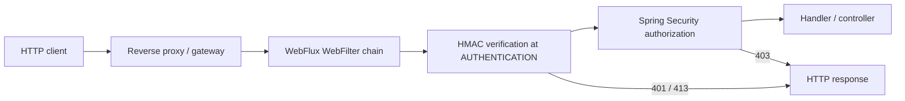

# WebFilter trong tích hợp xác thực HMAC với Spring WebFlux

## Mục tiêu bài học

Trong module **SECURITY_AUTHENTICATION_HMAC_REQUEST_AUTHENTICATION**, một HTTP request được xác thực bằng chữ ký HMAC tạo từ **shared secret** và một **canonical request** mà client và server đã thống nhất. Ở Spring WebFlux, `WebFilter` là điểm chặn thích hợp để xác minh request trước khi chuyển tiếp tới handler/controller trong một chuỗi xử lý bất đồng bộ.

Sau bài học, người học có thể:

- Giải thích vị trí, hợp đồng và vòng đời của `WebFilter` trong WebFlux so với Servlet `Filter`.
- Cài đặt bước kiểm tra HMAC dựa trên method, raw URI, timestamp, nonce và SHA-256 của body; xử lý request body theo mô hình reactive.
- Đưa danh tính đã xác thực vào **Reactor Context** để Spring Security tiếp tục kiểm tra quyền truy cập.
- Chống phát lại (replay) bằng kho nonce dùng thao tác ghi nguyên tử và hỗ trợ credential/key rotation.
- Nhận diện các lỗi thực tế do proxy/gateway thay đổi URI, body, header hoặc do đọc `DataBuffer` sai cách.
- Phân biệt **authentication** (request thuộc client nào) với **authorization** (client đó được phép thực hiện hành động gì).

## 1. WebFilter nằm ở đâu?

`org.springframework.web.server.WebFilter` có một phương thức chính:

```java
Mono<Void> filter(ServerWebExchange exchange, WebFilterChain chain);
```

`ServerWebExchange` chứa request, response và các thuộc tính theo lượt gọi. `WebFilterChain` đại diện cho phần xử lý phía sau. `chain.filter(exchange)` trả về `Mono<Void>`; request được xử lý khi publisher được subscribe. Vì vậy, không dùng `block()`, không tạo `subscribe()` thủ công và không đọc body bằng API Servlet.



Với Spring Security WebFlux, có hai cách thường gặp:

| Cách tích hợp | Dùng khi nào | Lưu ý |
|---|---|---|
| `WebFilter` độc lập, đăng ký toàn cục | Lọc/correlation ID, quy tắc hạ tầng áp dụng cho nhiều route | Phải tự kiểm soát thứ tự với Spring Security; dễ xác thực hai lần nếu đồng thời add vào security chain |
| `WebFilter` chèn qua `ServerHttpSecurity.addFilterAt(..., SecurityWebFiltersOrder.AUTHENTICATION)` | Đặt HMAC đúng vị trí trong chuỗi security và dùng `authorizeExchange` | Thích hợp cho ví dụ trong bài; chỉ đăng ký filter **một lần** |
| `AuthenticationWebFilter` với `ServerAuthenticationConverter` và `ReactiveAuthenticationManager` | Muốn dùng đầy đủ cơ chế authentication chuẩn của Spring Security | Có thể chuyển riêng phần parse/verify bên dưới sang các thành phần đó khi hệ thống lớn hơn |

**Điểm cốt lõi:** chữ ký hợp lệ tạo ra một `Authentication` đáng tin cậy; quyền truy cập vẫn phải được Spring Security hoặc tầng nghiệp vụ xác định. HMAC không tự cấp quyền quản trị hay quyền trên mọi tenant.

## 2. Chốt hợp đồng ký trước khi viết filter

Giả sử endpoint cần bảo vệ là `/partner/**`. Client gửi các header:

| Header | Ý nghĩa | Hợp đồng ví dụ |
|---|---|---|
| `X-Key-Id` | ID công khai để tra khóa và trạng thái credential | 1–64 ký tự `[A-Za-z0-9._-]` |
| `X-Timestamp` | Unix epoch **giây**, UTC | 10 chữ số; sai lệch tối đa ±300 giây so với clock server |
| `X-Nonce` | Giá trị duy nhất cho mỗi request | 16 byte ngẫu nhiên mã hóa Base64URL không padding, thành 22 ký tự |
| `X-Content-SHA256` | SHA-256 của **byte body thực tế**, viết hex chữ thường | Đúng 64 ký tự |
| `X-Signature` | HMAC-SHA256 của canonical request | Base64 chuẩn của 32 byte MAC |

Trong phiên bản minh họa `HMAC-SHA256-V1`, canonical request gồm đúng tám dòng UTF-8 dưới đây, ngăn cách bằng ký tự LF (`\n`), **không có LF cuối**:

```text
HMAC-SHA256-V1
<METHOD_IN_UPPERCASE>
<RAW_PATH>
<RAW_QUERY_OR_EMPTY_STRING>
<X-KEY-ID>
<X-TIMESTAMP>
<X-NONCE>
<LOWERCASE_HEX_SHA256_OF_BODY>
```

Ví dụ request `GET /partner/orders?state=ready%2Fhold&limit=10` với body rỗng cho chuỗi cần ký:

```text
HMAC-SHA256-V1
GET
/partner/orders
state=ready%2Fhold&limit=10
partner-k1
1795800000
AbCdEfGhIjKlMnOpQrStUv
e3b0c44298fc1c149afbf4c8996fb92427ae41e4649b934ca495991b7852b855
```

Giá trị timestamp trên chỉ để minh họa cấu trúc; request thật phải dùng thời gian hiện tại trong cửa sổ cho phép. Client tính:

```text
contentDigest = lowercaseHex(SHA256(rawRequestBodyBytes))
signature = Base64(HMAC-SHA256(secretBytes, UTF8(canonicalRequest)))
```

Cần thống nhất thêm các điểm sau trước khi phát hành client SDK:

1. **URI:** dùng `getRawPath()` và `getRawQuery()` như server nhận được; `%2F` khác `/`, `a=1&b=2` khác `b=2&a=1`. Không tự decode, sort hay làm sạch query ở một phía.
2. **Body:** ký từng byte mà tầng xác minh đọc được. Không parse rồi serialize lại JSON vì whitespace, thứ tự field, encoding hay dạng số có thể thay đổi.
3. **Header có ảnh hưởng ngữ nghĩa:** ví dụ `Content-Type`, `Content-Encoding`, tenant hoặc API version cần được cố định bằng policy hoặc đưa vào phiên bản canonical tiếp theo. Không được đổi hợp đồng ký ngầm giữa client/server.
4. **Khóa:** `X-Key-Id` chỉ là định danh tra cứu; shared secret không gửi trong request. Mỗi client/tenant có credential độc lập và phạm vi quyền được cấu hình tại server.
5. **Đường truyền:** HMAC không thay thế TLS. Luôn dùng HTTPS; request bị thay đổi trên gateway phải tuân theo hợp đồng ký đã thống nhất.

## 3. Ví dụ WebFilter thực thi bất đồng bộ

Đoạn dưới dùng Java 17+, Spring WebFlux và Spring Security reactive. Ví dụ minh họa đầy đủ luồng của **một** filter; registry credential và replay guard được tách thành interface để nối vào secret store/Redis thật. Body được giới hạn 1 MiB cho mục đích học tập; giới hạn thực tế tùy API và khả năng chịu tải.

```java
import java.nio.charset.StandardCharsets;
import java.security.GeneralSecurityException;
import java.security.MessageDigest;
import java.security.NoSuchAlgorithmException;
import java.time.Clock;
import java.time.Duration;
import java.util.Base64;
import java.util.HexFormat;
import java.util.List;

import javax.crypto.Mac;
import javax.crypto.spec.SecretKeySpec;

import org.springframework.core.io.buffer.DataBuffer;
import org.springframework.core.io.buffer.DataBufferLimitException;
import org.springframework.core.io.buffer.DataBufferUtils;
import org.springframework.http.HttpStatus;
import org.springframework.http.server.reactive.ServerHttpRequest;
import org.springframework.http.server.reactive.ServerHttpRequestDecorator;
import org.springframework.security.authentication.UsernamePasswordAuthenticationToken;
import org.springframework.security.core.Authentication;
import org.springframework.security.core.GrantedAuthority;
import org.springframework.security.core.context.ReactiveSecurityContextHolder;
import org.springframework.web.server.ServerWebExchange;
import org.springframework.web.server.WebFilter;
import org.springframework.web.server.WebFilterChain;

import reactor.core.publisher.Flux;
import reactor.core.publisher.Mono;

record HmacPrincipal(String clientId, String tenantId) {}

record HmacClient(
        HmacPrincipal principal,
        byte[] secret,
        List<GrantedAuthority> authorities) {}

interface HmacClientRegistry {
    // Trả Mono.empty() nếu không có key ID hoặc credential đã bị vô hiệu hóa.
    Mono<HmacClient> findActive(String keyId);
}

interface ReplayGuard {
    // True chỉ cho lời gọi đầu tiên; triển khai phải atomic trên mọi instance.
    Mono<Boolean> claim(String key, Duration ttl);
}

final class InvalidHmacException extends RuntimeException {}

public final class HmacWebFilter implements WebFilter {

    private static final int MAX_BODY_BYTES = 1_048_576;
    private static final long ALLOWED_SKEW_SECONDS = 300;
    private static final Duration NONCE_TTL = Duration.ofMinutes(11);

    private final HmacClientRegistry clients;
    private final ReplayGuard replayGuard;
    private final Clock clock;

    public HmacWebFilter(
            HmacClientRegistry clients,
            ReplayGuard replayGuard,
            Clock clock) {
        this.clients = clients;
        this.replayGuard = replayGuard;
        this.clock = clock;
    }

    @Override
    public Mono<Void> filter(ServerWebExchange exchange, WebFilterChain chain) {
        ServerHttpRequest request = exchange.getRequest();

        return readBody(request)
                .flatMap(body -> authenticate(request, body)
                        .flatMap(authentication -> {
                            // getBody() là stream dùng một lần: cấp lại byte body
                            // để controller hoặc filter phía sau vẫn đọc được.
                            ServerHttpRequest replayable =
                                    new ServerHttpRequestDecorator(request) {
                                @Override
                                public Flux<DataBuffer> getBody() {
                                    return Flux.defer(() -> Flux.just(
                                            exchange.getResponse()
                                                    .bufferFactory()
                                                    .wrap(body.clone())));
                                }
                            };

                            ServerWebExchange continued = exchange.mutate()
                                    .request(replayable)
                                    .build();

                            return chain.filter(continued)
                                    .contextWrite(
                                            ReactiveSecurityContextHolder
                                                    .withAuthentication(authentication));
                        }))
                .onErrorResume(InvalidHmacException.class,
                        error -> reject(exchange, HttpStatus.UNAUTHORIZED))
                .onErrorResume(DataBufferLimitException.class,
                        error -> reject(exchange, HttpStatus.valueOf(413)));
    }

    private Mono<byte[]> readBody(ServerHttpRequest request) {
        return DataBufferUtils.join(request.getBody(), MAX_BODY_BYTES)
                .map(buffer -> {
                    try {
                        byte[] body = new byte[buffer.readableByteCount()];
                        buffer.read(body);
                        return body;
                    } finally {
                        // DataBuffer có thể là pooled buffer; luôn release.
                        DataBufferUtils.release(buffer);
                    }
                })
                .defaultIfEmpty(new byte[0]);
    }

    private Mono<Authentication> authenticate(
            ServerHttpRequest request, byte[] body) {

        String keyId = singleHeader(request, "X-Key-Id");
        String timestamp = singleHeader(request, "X-Timestamp");
        String nonce = singleHeader(request, "X-Nonce");
        String digestHeader = singleHeader(request, "X-Content-SHA256");
        String signatureHeader = singleHeader(request, "X-Signature");

        // Quy ước cú pháp chặt chẽ để tránh nhiều cách diễn giải một request.
        if (keyId == null || !keyId.matches("[A-Za-z0-9._-]{1,64}")
                || timestamp == null || !timestamp.matches("[0-9]{10}")
                || nonce == null || !nonce.matches("[A-Za-z0-9_-]{22}")
                || digestHeader == null || !digestHeader.matches("[0-9a-f]{64}")
                || signatureHeader == null || signatureHeader.length() > 64) {
            return Mono.error(new InvalidHmacException());
        }

        long sentAt = Long.parseLong(timestamp);
        long now = clock.instant().getEpochSecond();
        if (sentAt < now - ALLOWED_SKEW_SECONDS
                || sentAt > now + ALLOWED_SKEW_SECONDS) {
            return Mono.error(new InvalidHmacException());
        }

        byte[] receivedSignature;
        try {
            receivedSignature = Base64.getDecoder().decode(signatureHeader);
        } catch (IllegalArgumentException error) {
            return Mono.error(new InvalidHmacException());
        }
        if (receivedSignature.length != 32) {
            return Mono.error(new InvalidHmacException());
        }

        byte[] actualBodyDigest = sha256(body);
        byte[] claimedBodyDigest = HexFormat.of().parseHex(digestHeader);
        if (!MessageDigest.isEqual(actualBodyDigest, claimedBodyDigest)) {
            return Mono.error(new InvalidHmacException());
        }

        String rawQuery = request.getURI().getRawQuery();
        String canonical = String.join("\n",
                "HMAC-SHA256-V1",
                request.getMethod().name(),
                request.getURI().getRawPath(),
                rawQuery == null ? "" : rawQuery,
                keyId,
                timestamp,
                nonce,
                digestHeader);

        return clients.findActive(keyId)
                .switchIfEmpty(Mono.error(new InvalidHmacException()))
                .flatMap(client -> {
                    byte[] expected = hmacSha256(client.secret(), canonical);
                    if (!MessageDigest.isEqual(expected, receivedSignature)) {
                        return Mono.error(new InvalidHmacException());
                    }

                    // Chỉ giữ nonce SAU KHI chữ ký hợp lệ.
                    String replayKey = "hmac:v1:" + keyId + ":" + nonce;
                    return replayGuard.claim(replayKey, NONCE_TTL)
                            .flatMap(firstUse -> {
                                if (!firstUse) {
                                    return Mono.error(new InvalidHmacException());
                                }

                                Authentication auth =
                                        new UsernamePasswordAuthenticationToken(
                                                client.principal(),
                                                null,
                                                client.authorities());
                                return Mono.just(auth);
                            });
                });
    }

    private static String singleHeader(
            ServerHttpRequest request, String name) {
        List<String> values = request.getHeaders().get(name);
        return values != null && values.size() == 1 ? values.get(0) : null;
    }

    private static byte[] sha256(byte[] bytes) {
        try {
            return MessageDigest.getInstance("SHA-256").digest(bytes);
        } catch (NoSuchAlgorithmException error) {
            throw new IllegalStateException(error);
        }
    }

    private static byte[] hmacSha256(byte[] secret, String canonical) {
        try {
            Mac mac = Mac.getInstance("HmacSHA256");
            mac.init(new SecretKeySpec(secret, "HmacSHA256"));
            return mac.doFinal(canonical.getBytes(StandardCharsets.UTF_8));
        } catch (GeneralSecurityException error) {
            throw new IllegalStateException(error);
        }
    }

    private static Mono<Void> reject(
            ServerWebExchange exchange, HttpStatus status) {
        exchange.getResponse().setStatusCode(status);
        return exchange.getResponse().setComplete();
    }
}
```

**Những quyết định cần hiểu trong đoạn code:**

- `readBody()` gom body có **giới hạn kích thước**, tính digest từ byte thực, `release` buffer sau khi sao chép và dùng decorator để controller đọc tiếp. Nếu `join` vượt giới hạn, request nhận HTTP 413. Với tải lớn/streaming thật, thiết kế xác minh khác hoặc cơ chế ký theo chunk sẽ phù hợp hơn; tránh giữ toàn bộ body của nhiều request đồng thời.
- `Mono` nối tiếp các tác vụ: đọc body → xác minh nội dung và chữ ký → `ReplayGuard.claim` → dựng `Authentication` → gọi tiếp chain. Không có lời gọi `block()` hoặc `subscribe()` ngoài luồng.
- `MessageDigest.isEqual` kiểm tra MAC mà không dùng so sánh chuỗi thông thường. Chữ ký không hợp lệ, timestamp quá hạn, key bị khóa hoặc nonce đã dùng đều trở thành lỗi 401 chung, không lộ nội dung secret hay lý do nhạy cảm.
- Chỉ xác thực bằng `clients.findActive(keyId)` khi credential còn hiệu lực. `HmacPrincipal` chứa danh tính tenant và client; `secret` **không** đưa vào principal hoặc security context.
- `contextWrite(ReactiveSecurityContextHolder.withAuthentication(...))` truyền danh tính trong **Reactor Context** cho đoạn xử lý tiếp theo; `ThreadLocal` thông thường không đáng tin trong reactive pipeline do đổi thread.
- Lỗi hạ tầng của registry/Redis **không** được coi là `firstUse=true`. Để lỗi lan tới xử lý 5xx/503 của ứng dụng, đóng xác thực khi kho nonce không khả dụng; không bỏ qua replay guard.

Ví dụ chủ động tập trung vào xác thực. Trong hệ thống thật, nên tiền kiểm tra các header nhỏ và cú pháp trước khi gom body để tiết kiệm tài nguyên khi gặp request rác; giới hạn kích thước header, concurrency và timeout ở gateway/web server, cũng như cấu hình mã lỗi theo chính sách API.

## 4. Đưa WebFilter vào SecurityWebFilterChain

Nếu endpoint đối tác dùng HMAC, hãy đưa filter vào **security chain** của chính route đó. Ví dụ cấu hình:

```java
import java.time.Clock;

import org.springframework.context.annotation.Bean;
import org.springframework.context.annotation.Configuration;
import org.springframework.core.annotation.Order;
import org.springframework.security.config.web.server.ServerHttpSecurity;
import org.springframework.security.web.server.SecurityWebFilterChain;
import org.springframework.security.web.server.SecurityWebFiltersOrder;
import org.springframework.security.web.server.util.matcher
        .PathPatternParserServerWebExchangeMatcher;

@Configuration
class PartnerSecurityConfig {

    @Bean
    @Order(0)
    SecurityWebFilterChain partnerChain(
            ServerHttpSecurity http,
            HmacClientRegistry clients,
            ReplayGuard replayGuard) {

        // Tạo trực tiếp trong chain để tránh đăng ký lại
        // cùng WebFilter như filter toàn cục của WebFlux.
        HmacWebFilter hmac = new HmacWebFilter(
                clients, replayGuard, Clock.systemUTC());

        return http
                .securityMatcher(
                        new PathPatternParserServerWebExchangeMatcher("/partner/**"))
                .csrf(ServerHttpSecurity.CsrfSpec::disable)
                .httpBasic(ServerHttpSecurity.HttpBasicSpec::disable)
                .formLogin(ServerHttpSecurity.FormLoginSpec::disable)
                .addFilterAt(hmac, SecurityWebFiltersOrder.AUTHENTICATION)
                .authorizeExchange(exchange -> exchange
                        .anyExchange().authenticated())
                .build();
    }
}
```

Ở đây `@Order(0)` ưu tiên chain `/partner/**` khi ứng dụng có nhiều `SecurityWebFilterChain`. Các route khác phải có security chain và chính sách riêng. Việc tắt CSRF trong ví dụ chỉ áp dụng cho API HMAC không dựa trên cookie/session trình duyệt; phải đánh giá lại nếu API còn nhận xác thực bằng cookie.

Không đồng thời gắn `@Component`/`@Bean` để Spring tự thu thập `HmacWebFilter` như một global filter nếu đã tạo trực tiếp và chèn nó vào security chain. Nếu vô tình chạy hai lần, lần thứ hai sẽ xem cùng nonce là replay và trả 401.

Trong controller, có thể lấy danh tính đã xác thực bằng `Authentication` hoặc `ReactiveSecurityContextHolder`. Tuy nhiên, việc client thuộc tenant A **không** tự cho phép truy cập đơn hàng của tenant B. Hãy kiểm tra `tenantId`, scope và quyền trên từng tài nguyên sau xác thực; thiếu quyền thường là HTTP 403.

## 5. ReplayGuard phải dùng thao tác nguyên tử

Bước `claim(replayKey, ttl)` không thể triển khai bằng “`GET` kiểm tra rồi `SET`”, vì hai request song song có thể cùng thấy chưa tồn tại. Trên Redis, dùng một thao tác tương đương:

```text
SET hmac:v1:partner-k1:AbCdEfGhIjKlMnOpQrStUv 1 NX EX 660
```

- Trả `OK` cho request đầu tiên: `claim = true`.
- Trả null cho request trùng key: `claim = false`.
- Có lỗi kết nối/timeout: phát lỗi ra ngoài, không xác thực thành công.

TTL 660 giây lớn hơn hai lần cửa sổ timestamp 300 giây và có khoảng đệm; giá trị thực cần khớp hợp đồng clock skew/retry. Replay store phải được **dùng chung giữa mọi instance** để một chữ ký không qua được server A rồi tiếp tục qua server B.

Nếu client retry sau khi mất response, **không tái sử dụng nonce**. Client phải tạo nonce mới và ký lại request. Điều này chỉ ngăn phát lại ở lớp giao thức; nếu nghiệp vụ tạo đơn/thanh toán có thể được gọi hai lần bằng hai request hợp lệ, vẫn cần `Idempotency-Key` cùng kiểm tra giao dịch ở tầng nghiệp vụ.

## 6. Key rotation và cách gán quyền

`X-Key-Id` cho phép tra đúng version credential khi client và server đổi khóa. Một mô hình khả thi:

1. Cấp key mới với ID mới, secret mới và quyền/tenant được ràng buộc ở server.
2. Cho phép key cũ và mới cùng có hiệu lực trong một khoảng chuyển tiếp ngắn theo chính sách.
3. Client ký bằng key mới, server xác minh theo ID tương ứng; đo tỷ lệ sử dụng key cũ.
4. Vô hiệu hóa key cũ sau thời hạn, xử lý yêu cầu bị từ chối như credential không hợp lệ.

Không chọn secret theo header tenant tự khai hoặc đoán tuần tự qua mọi khóa. `HmacClientRegistry` cần kiểm soát trạng thái active, thời hạn, owner client, tenant và scope. Quyền trong `GrantedAuthority` phải được cấp từ dữ liệu server đã xác thực, không suy ra từ header do client tự gửi.

## 7. Proxy/gateway: thống nhất byte thực sự được ký

Các lỗi khó tìm nhất thường xuất hiện khi client ký chuỗi A nhưng `WebFilter` nhận chuỗi B:

| Tình huống | Rủi ro | Hướng xử lý |
|---|---|---|
| Gateway rewrite `/api/v1/partner/orders` thành `/partner/orders` | Raw path ký ở client khác raw path nhìn từ ứng dụng | Quy định rõ ký path trước hay sau rewrite; cố định cấu hình gateway và test end-to-end |
| Proxy decode `%2F`, đổi thứ tự query hoặc chuẩn hóa encoding | Hai bên tạo canonical khác nhau | Dùng đúng raw path/raw query theo hợp đồng; tránh normalize ngầm |
| Gateway giải nén, thay body, đổi line ending hoặc charset | SHA-256 body không khớp | Quy định ký bytes ở điểm nào và tránh biến đổi sau khi ký |
| Header trùng, bị nối, bị đổi giá trị hoặc bị strip | Cách đọc/định dạng header khác nhau | Chỉ chấp nhận một giá trị cho từng header ký; xác định chính sách proxy và giới hạn header |
| Tin `X-Forwarded-Uri` từ client ngoài | Kẻ tấn công điều khiển chuỗi dùng để xác minh | Chỉ dùng metadata forwarded từ proxy **đáng tin** theo cấu hình; không tự tin header tùy ý |
| App chạy nhiều node với clock lệch hoặc nonce store cục bộ | Request hợp lệ bị từ chối, hoặc replay vượt qua node khác | Đồng bộ thời gian, dùng replay store chung và atomic |

Với request body dạng JSON, việc “JSON giống nhau” về ngữ nghĩa không đủ: `{"a":1}` và `{ "a": 1 }` có digest khác nhau. Nếu muốn ký cấu trúc logic thay vì bytes, phải thiết kế một chuẩn canonical JSON riêng và kiểm thử các trường hợp Unicode, số, `null`, trùng key; không tự thêm vào HMAC V1.

## 8. Ma trận kiểm thử cần có

Dùng `WebTestClient`/integration test và signer ở phía client độc lập với code verify. Với mỗi trường hợp, kiểm tra cả HTTP status lẫn việc handler có được gọi hay không.

| Ca kiểm thử | Kết quả mong đợi |
|---|---|
| Chữ ký hợp lệ, timestamp còn hạn, nonce mới, key active | Qua filter; quyền được kiểm tra tiếp, handler nhận đầy đủ body |
| Sai một byte body hoặc `X-Content-SHA256` | 401; handler không chạy |
| Thay method/path/raw query khi tái sử dụng chữ ký | 401 |
| Timestamp quá ±300 giây, nonce trùng, key không tồn tại hoặc đã revoke | 401 |
| Thiếu header, ký tự Base64 sai, nhiều giá trị header cùng tên | 401 |
| Body quá 1 MiB | 413; không cấp authentication |
| Ký hợp lệ nhưng không có quyền trên resource/tenant | 403 từ authorization |
| Hai request **đồng thời** cùng key ID và nonce qua hai instance | Chính xác một claim thành công |
| Redis/replay store ngừng hoạt động | Không xác thực thành công; kiểm tra đáp ứng lỗi hạ tầng |
| Body rỗng, UTF-8, binary, JSON có khoảng trắng; query chứa `%2F` | Digest/canonical đúng trên bytes nhận được |
| End-to-end qua gateway có rewrite/path prefix, proxy header, body forwarding | Cùng hợp đồng ký hoặc từ chối rõ ràng khi sai |
| Xoay key: cùng lúc old/new active; old bị revoke | Đúng trạng thái từng key ID |

Nên kiểm tra riêng trường hợp **đọc body hai lần**: controller phải nhận nguyên vẹn bytes sau khi xác thực. Kiểm tra thêm request bị hủy giữa chừng để phát hiện rò rỉ pooled `DataBuffer`. Dùng `Clock.fixed(...)` khi test thời gian và fake `ReplayGuard` có hành vi atomic khi test race.

### Quan sát hệ thống và xử lý sự cố

Log các trường an toàn như request ID, key ID đã rút gọn/mã hóa, mã lỗi, độ trễ xác minh, kết quả credential lookup và replay check. **Không** ghi shared secret, raw body chứa dữ liệu nhạy cảm, canonical request đầy đủ hay signature vào log. Với 401, thông báo trả về client nên chung chung; chi tiết phân loại lỗi có thể lưu trong metrics/log nội bộ với quyền truy cập phù hợp.

Những metric có ích: `hmac.verify.success`, `hmac.verify.failure` theo nhóm nguyên nhân, tỷ lệ replay, kích thước body, thời gian lookup key, độ trễ Redis, lỗi proxy mismatch và tỷ lệ key cũ trong giai đoạn rotation.

## 9. Bài thực hành

Giả sử dịch vụ WebFlux nhận `POST /partner/orders` với JSON body, có hai client `partner-a` và `partner-b` thuộc hai tenant. Hãy triển khai ba tình huống sau:

1. Viết signer nhỏ cho client dùng `SecureRandom` tạo 16 byte nonce, `Instant.now().getEpochSecond()` để gửi timestamp và HMAC-SHA256 cho canonical V1. Xác minh rằng gửi lại nguyên request sau khi thành công sẽ nhận 401.
2. Cấu hình `HmacClientRegistry` lưu hai key ID có tenant và quyền khác nhau; chỉ cho một client được đọc tài nguyên thuộc tenant của mình. Chứng minh chữ ký hợp lệ vẫn có thể bị 403.
3. Đưa ứng dụng sau một reverse proxy có path rewrite. Tạo hai phép thử: signer và verifier cùng nhìn thấy path đã thống nhất thì thành công; signer dùng path khác thì 401. Ghi lại chính xác các chuỗi canonical ở môi trường test (không log secret trong production).

**Câu hỏi tự kiểm tra:** Vì sao `WebFilter` không được `subscribe()` thủ công? Vì sao cùng một `Mono<Void>` trả về từ `chain.filter` cần được bọc `contextWrite`? Vì sao nonce store phải atomic và dùng chung giữa các node? Vì sao cần kiểm tra quyền sau khi HMAC đã được xác minh?

**Kết quả cần đạt:** Người học có thể gắn xác thực HMAC vào luồng reactive của Spring WebFlux mà không chặn event loop; request chỉ đi tiếp khi chữ ký, body digest, timestamp, nonce và credential hợp lệ; danh tính được truyền đúng trong Reactor Context và quyền được kiểm soát độc lập ở Spring Security/tầng nghiệp vụ.

