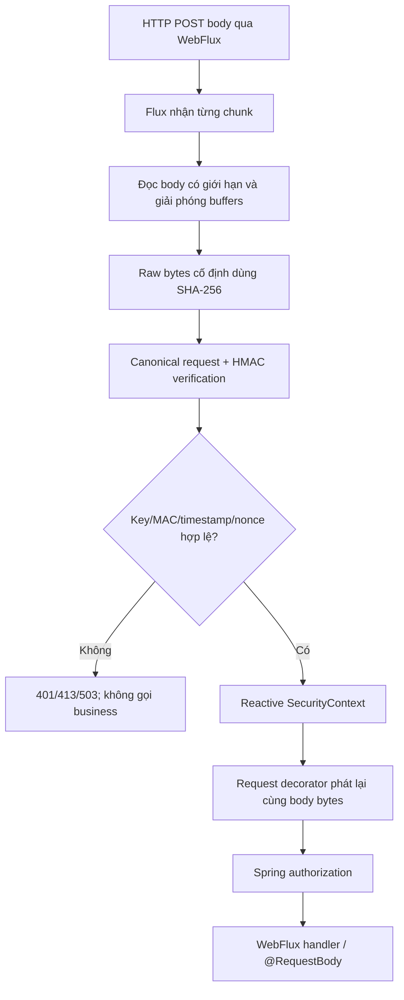
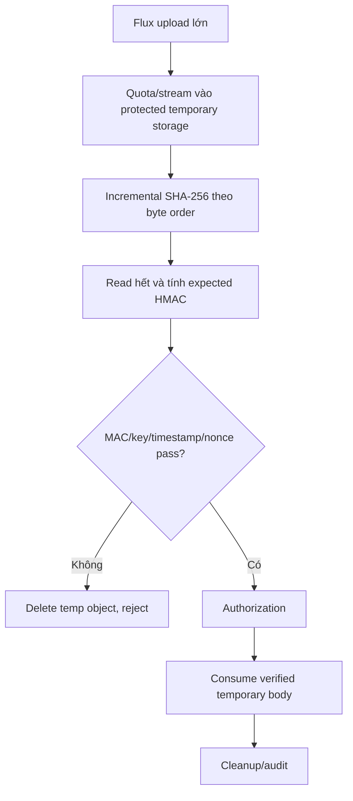

# Reactive request body

## 1. Vì sao request body trong Spring WebFlux cần cách xử lý riêng?

Với **HTTP request authentication bằng HMAC**, client và server thống nhất một **canonical request** bao gồm phương thức HTTP, URI, một tập header và/hoặc **dấu băm của đúng bytes trong body**. Server chỉ chấp nhận request khi biết client sở hữu shared secret của key version tương ứng, MAC khớp và các điều kiện timestamp/nonce chống replay được thỏa mãn.

Trong **Spring MVC Servlet**, ứng dụng hay nhận body qua `InputStream`. Trong **Spring WebFlux**, body là một luồng bất đồng bộ **`Flux<DataBuffer>`**. Nó thường được phát ra từ Netty dưới dạng những chunks có bộ nhớ tham chiếu đếm; **không có quyền giả định có sẵn một `byte[]`, cũng không thể đọc body hai lần chỉ bằng cách subscribe lại**.



Nếu WebFilter gọi `exchange.getRequest().getBody().subscribe(...)` riêng rồi vẫn chuyển request gốc xuống controller, có thể dẫn tới:

- Lỗi do **body stream bị subscribe/consume trước**; controller nhận stream rỗng hoặc bị từ chối subscribe lần hai.
- **DataBuffer leak**, nếu pooled buffers không được release.
- **Đọc vô hạn vào heap** (không có cap), dẫn đến DoS.
- **Chữ ký tính trên bytes khác bytes controller xử lý**, ví dụ gateway thay nội dung hoặc code parse rồi serialize JSON.
- **Race condition** nếu code xác thực trong callback `subscribe(...)` nhưng gọi `chain.filter(...)` trước khi verification hoàn thành.
- **Sai security context**, do dùng Servlet ThreadLocal thay cho Reactor Context.

Bài **“Reactive request body”** thuộc chương **Spring WebFlux integration** của mô-đun **`SECURITY_AUTHENTICATION_HMAC_REQUEST_AUTHENTICATION`**. Phạm vi mô-đun là thiết kế xác thực HTTP request bằng **HMAC/shared secret**, canonical request có method/URI/headers/body, xác minh chữ ký, chống replay bằng timestamp/nonce, key rotation, kiểm thử proxy/gateway và tách authentication với authorization.

**Sau khi học, bạn có thể:**

- Giải thích `Flux<DataBuffer>`, `Publisher`, subscription, cancellation, backpressure và pooled buffers.
- Đọc body **một lần** với giới hạn kích thước, giữ **đúng raw bytes**, và nhả buffer sau khi copy.
- Sử dụng `DataBufferUtils.join(..., maxByteCount)` một cách an toàn cho body nhỏ.
- Tạo `ServerHttpRequestDecorator` có body có thể phát lại cho downstream, không phụ thuộc vào double subscription của nguồn gốc.
- Gắn `Authentication` bằng `ReactiveSecurityContextHolder` chỉ sau khi HMAC, key policy, timestamp và atomic nonce reservation thành công.
- Chọn giữa **bounded buffering** và **thiết kế streaming/spool-to-disk** theo threat model.
- Kiểm thử golden HMAC vectors, body rỗng, chunking, tampering, cancellation, byte limit, gateway, tenant isolation và replay.

**Bất biến:** chỉ một bản body byte sequence được coi là **nguồn sự thật** cho cả HMAC và business handler. Downstream chỉ được chạy **sau khi** việc xác thực toàn bộ request body hoàn tất.

## 2. Servlet body và reactive body khác nhau ở đâu?

| Khía cạnh | Spring MVC Servlet | Spring WebFlux |
| --- | --- | --- |
| HTTP request body | `ServletInputStream` | `Flux<DataBuffer>` |
| Cách lấy dữ liệu | Đọc blocking theo thread | Subscription, tín hiệu bất đồng bộ |
| Lặp đọc | Cần wrapper/cache thích hợp | Không tự resubscribe source; cần body decorator/cache |
| Kiểm soát bộ nhớ | Byte array/stream, request limit | `DataBuffer`, có thể là pooled/ref-counted |
| Lỗi client disconnect | `IOException` | `onError` hoặc `cancel` |
| Authentication context | `SecurityContextHolder` theo ThreadLocal trong servlet | `ReactiveSecurityContextHolder` qua Reactor Context |
| Tích hợp security | `OncePerRequestFilter`, `SecurityFilterChain` | `WebFilter`, `SecurityWebFilterChain` |
| Nguy cơ điển hình | Read-once stream, thread leakage | Double subscribe, buffer leaks, race, event-loop blocking |

**WebFlux không đồng nghĩa với “mọi thư viện bên dưới đều nonblocking”**. Gọi `JDBC` sync, `Vault` sync, `Thread.sleep` hoặc `Mono.block()` trên Netty event-loop sẽ làm đình trệ nhiều requests khác.

### 2.1. “Một body” không nhất thiết là một buffer

Ví dụ trên wire:

```text
Content-Type: application/json
Transfer-Encoding: chunked

Chunk 1: {"orderId":"O-
Chunk 2: 42","amountMinor":
Chunk 3: 250000,"currency":"VND"}
```

Framework có thể phát ba `DataBuffer`. HMAC không được ký từng chunk text thay vì body bytes theo contract, cũng không được đưa metadata **HTTP chunk framing** vào SHA-256 trừ khi hợp đồng đã định nghĩa như vậy.

Nếu contract ký **raw HTTP entity body bytes sau transfer decoding**, body đã ghép là chuỗi:

```json
{"orderId":"O-42","amountMinor":250000,"currency":"VND"}
```

Chiến lược `bounded join` chỉ phù hợp khi body có kích thước tối đa rõ ràng. Giới hạn đó là **một quyết định bảo mật**, không phải lựa chọn style.

### 2.2. Không gọi `subscribe()` thủ công trong WebFilter

Mẫu **sai**:

```java
// SAI: việc subscribe chạy riêng; chain không chờ verify.
exchange.getRequest().getBody().subscribe(buffer -> {
    verifyHmacAfterBodyArrives(buffer);
});
return chain.filter(exchange);
```

Thay bằng **composed reactive publisher**:

```java
// Ý tưởng đúng: chain chỉ chạy sau khi read + verify hoàn tất.
return bodyReader.read(exchange.getRequest())
        .flatMap(rawBody ->
            verifier.verify(exchange, rawBody)
                .flatMap(verified ->
                    chain.filter(decorate(exchange, rawBody))
                        .contextWrite(
                            ReactiveSecurityContextHolder
                                    .withAuthentication(
                                        toAuthentication(verified)))));
```

Ở các mục sau, ví dụ đầy đủ sẽ thêm error mapping, body ownership và cancellation cleanup.

## 3. `DataBuffer`, pooled memory và ownership

`DataBuffer` là abstraction của Spring cho vùng bytes; trên Reactor Netty nó có thể bọc `ByteBuf` **reference-counted**. Khi đọc một chunk:

- `readableByteCount()` cho biết bao nhiêu bytes còn có thể đọc.
- `read(byte[])` copy bytes và cập nhật vị trí đọc của buffer.
- `DataBufferUtils.release(buffer)` giải phóng buffer theo chính sách của implementation; điều này đặc biệt quan trọng với pooled buffers.
- `DataBufferUtils.join` có thể tạo **composite buffer**; giải phóng **joined buffer** đúng lúc thay vì release nhầm các component đã được nó quản lý.

### 3.1. Vì sao “đọc xong bỏ đó” nguy hiểm?

```java
// SAI: không có release, có thể leak pooled memory.
return exchange.getRequest().getBody()
        .map(dataBuffer -> {
            byte[] chunk = new byte[dataBuffer.readableByteCount()];
            dataBuffer.read(chunk);
            return chunk;
        });
```

Mỗi `DataBuffer` đến từ hệ thống I/O cần có **đường sở hữu/giải phóng** rõ ràng. Không lấy `ByteBuffer` view rồi giữ lại sau khi pooled buffer đã được release.

### 3.2. Vì sao “release hai lần” cũng nguy hiểm?

```java
// SAI về ownership nếu joined quản lý component buffers:
// release từng component bằng tay, rồi lại release joined buffer.
```

Trong thuật toán ở bài, `DataBufferUtils.join(body, limit)` là thành phần quản lý các chunks đầu vào; khi phát ra một `joined`, **code của ta sở hữu đúng một joined buffer** và nhả nó sau khi copy.

### 3.3. Không dựa vào kích thước chunk để giới hạn body

Một request 100 MiB có thể đến dưới dạng hàng nghìn chunks 8 KiB. Chỉ kiểm `readableByteCount() <= MAX` **trên từng chunk** không chặn tổng số bytes. Giới hạn phải áp dụng **trên tổng dữ liệu được join/đọc**.

## 4. Threat model: body re-consumption, tampering và DoS

| Rủi ro | Ví dụ | Bất biến |
| --- | --- | --- |
| **Double subscribe** | Filter và controller cùng subscribe source body | Chỉ consume source một lần, downstream đọc cached body |
| **Auth-before-body** | Gọi chain trước khi body hash xong | Chỉ authorize business sau full verification |
| **Buffer leak** | Không release pooled `DataBuffer` | Release theo ownership, kể cả lỗi/cancel |
| **Unbounded buffering** | Attacker gửi body không giới hạn | Hard bound + rate/concurrency limits |
| **JSON reserialization** | Filter parse thành Map rồi serialize lại | Hash đúng raw bytes theo contract |
| **Content-Encoding ambiguity** | Gateway decompress gzip, backend ký bytes khác | Ràng buộc transformation/encoding vào contract |
| **Proxy rewriting** | Path/header/query thay đổi sau khi client ký | Verify trước rewrite hoặc dùng metadata gateway đáng tin |
| **Duplicate signed headers** | Gateway first-wins, backend last-wins | Ingress reject ambiguity |
| **Tenant/key confusion** | Cùng key ID thuộc nhiều clients/tenants | Resolver scope đầy đủ và ký tenant/client/key |
| **Replay** | MAC hợp lệ được gửi lại với nonce cũ | Atomic nonce reserve sau MAC |
| **Key rotation** | Key A bị revoke nhưng cache giữ A VERIFY_ONLY | Kiểm lifecycle theo server clock và revocation SLO |
| **Event-loop blocking** | Secret lookup sync chặn Netty loop | Reactive I/O hoặc offload có giới hạn |
| **Cancellation** | Client ngắt giữa lúc join/verify | Release buffers, không tạo context/business effect |
| **Payload smuggling** | CL/TE hoặc HTTP2/HTTP1 ambiguity | Gateway/container reject inconsistent framing |
| **Memory copies** | Cache body ở nhiều layers | Cân bằng bound, số concurrent requests, GC |
| **Reactive context confusion** | Dùng ThreadLocal ở Reactor pipeline | `ReactiveSecurityContextHolder` đúng boundary |

HMAC chỉ bảo vệ **những thành phần đã được ký theo hợp đồng**. Nếu path, query, Content-Type hoặc Content-Encoding ảnh hưởng ý nghĩa business nhưng không được ký và/hoặc validate, attacker có thể thay đổi cách server diễn giải request dù body MAC đúng.

## 5. Chọn chiến lược: bounded buffering hay streaming?

Không có một giải pháp cho mọi kích thước body.

| Cách làm | Ưu điểm | Giới hạn / khi không nên dùng |
| --- | --- | --- |
| **Bounded in-memory join** | Dễ canonicalize, verify trước handler, replay body | Tăng heap/direct-memory; chỉ dùng request nhỏ có bound |
| **Spool-to-disk/object storage** | Hỗ trợ body lớn, verify trước business | Cần quota, cleanup, encrypted temp, lifecycle, async I/O |
| **Incremental SHA-256 + durable spool** | Không giữ toàn body trong heap | Vẫn phải giữ/đọc lại body sau khi verify |
| **Incremental hash + stream thẳng vào business** | Ít buffering | **Không an toàn** nếu business xử lý trước MAC cuối cùng |
| **Signed chunk/trailer protocol riêng** | Có thể xác thực từng phần | Phải có protocol chống reorder/truncation và security review |
| **Gateway verify + protected internal assertion** | Backend không cần đọc lại body | Gateway phải là trust boundary rõ; body downstream không được thay đổi |

Bài chọn **bounded in-memory join (1 MiB)** làm profile minh họa, vì dễ kiểm chứng correctness và resource cap. Không coi 1 MiB là chuẩn cố định: mỗi dịch vụ cần budget theo traffic, concurrency, số lần copy và TLS/Netty memory.

### 5.1. Vì sao không đưa body cho handler trước khi MAC được xác minh?

Một handler có thể ghi DB, gửi email hoặc tạo payment ngay khi nhận chunk đầu. HMAC-SHA-256 trên toàn body **chỉ có thể được xác nhận hoàn chỉnh sau khi đọc hết body**. Nếu có side effect trước đó, việc trả 401 sau khi đọc chunk cuối **không hoàn tác** được payment.

**Thiết kế phải đảm bảo mọi side effect nghiệp vụ nằm sau authentication và authorization** hoặc áp dụng một protocol per-chunk có ràng buộc mật mã được review riêng.

### 5.2. Tác động bộ nhớ cần tính theo concurrent requests

Một API có 1 MiB cap nhưng 2.000 requests cùng lúc có thể giữ hàng GiB dữ liệu nếu mỗi request có nhiều bản sao `byte[]`, Netty buffers và JSON decoder buffers. Ngoài size limit cần:

- Concurrency quota, rate limit, connection/read timeouts.
- Bound số bản copy body và thời điểm release.
- Giới hạn các codec (`maxInMemorySize`) ở layer tương ứng.
- Theo dõi Netty direct-memory, heap, GC và pending reads.
- Streaming/spooling cho use case không phù hợp in-memory.

## 6. Hợp đồng canonical HMAC cho reactive request body

Chọn **profile V1 tự định nghĩa** cho ví dụ. Server dùng **đúng body bytes được đọc từ nguồn reactive** trước khi parse JSON.

Request minh họa:

```http
POST /v1/tenants/tenant-42/payments?merchantId=m-42 HTTP/1.1
Content-Type: application/json
X-Tenant-Id: tenant-42
X-Client-Id: client-api
X-Key-Id: k-2026-11
X-Timestamp: 1795856400
X-Nonce: AAAAAAAAAAAAAAAAAAAAAA
X-Signature: <Base64-Basic-full-HMAC-SHA256>

{"orderId":"O-42","amountMinor":250000,"currency":"VND"}
```

**Canonical request đúng 11 dòng**, nối bằng **LF `\n`**, **không có LF cuối**:

```text
HMAC-WEBFLUX-BODY-V1
POST
/v1/tenants/tenant-42/payments
merchantId=m-42
content-type:application/json
tenant-id:tenant-42
client-id:client-api
key-id:k-2026-11
x-timestamp:1795856400
x-nonce:AAAAAAAAAAAAAAAAAAAAAA
<lowercase-hex-SHA256(raw HTTP body bytes)>
```

Quy tắc cụ thể:

- `method` chính xác là `POST`.
- `rawPath` chính xác là `/v1/tenants/<tenantId>/payments` theo grammar V1.
- `rawQuery` chính xác một `merchantId=m-<digits>`; profile V1 không hỗ trợ query phức tạp.
- `Content-Type` có đúng một giá trị `application/json`; không normalize ngầm từ `application/json; charset=UTF-8`.
- `tenantId`, `clientId`, `keyId` từ headers đã kiểm định dạng và cardinality, **đều được ký**; chưa phải principal cho tới khi MAC khớp.
- `timestamp` là Unix seconds canonical, `nonce` là Base64URL unpadded của 16 random bytes (22 ASCII chars).
- `bodyHash` là SHA-256 hex lowercase trên **raw bytes**; không tin body digest do client gửi mà không kiểm lại.
- `X-Signature` chứa Base64 Basic padded của **full 32-byte HMAC-SHA-256 tag**, không nằm trong canonical message.
- `Content-Encoding` **không được phép** trong profile minh họa; transformation upstream phải được kiểm soát.

### 6.1. Vì sao ký tenant/client/key ID?

Một attacker có thể thay `X-Client-Id` hoặc `X-Key-Id` để ép verifier tra nhầm key; ký các trường này và kiểm ownership sẽ ràng buộc chúng với credential. Trong môi trường nhiều tenants, metadata lookup là **untrusted hint** cho tới lúc MAC khớp.

### 6.2. “Raw body” không đồng nghĩa với bytes trên TCP wire

HTTP transfer decoding bỏ chunk framing; TLS cũng không thuộc body. Nếu reverse proxy **decompresses** hoặc **rewrites** payload trước khi WebFlux nhận, `rawBody` của WebFlux có thể khác bytes client ban đầu ký. Hợp đồng phải nêu rõ **ở điểm nào** HMAC được verify và transformation nào được phép.

## 7. Golden HMAC vectors tính độc lập từ bytes

Dữ liệu ở phần này **chỉ dành cho test**, không dùng secret/timestamp/nonce cố định trong production.

Body gốc, **56 UTF-8 bytes**, không LF cuối:

```json
{"orderId":"O-42","amountMinor":250000,"currency":"VND"}
```

SHA-256 của body, lowercase hex:

```text
eaeb86c57439a64c80d023bc882535c45ebfcabb7617add8d2a628637faab41a
```

Test secret **32 raw bytes** (hiển thị hex):

```text
00112233445566778899aabbccddeeff00112233445566778899aabbccddeeff
```

Canonical bytes **279 UTF-8 bytes**, đủ 11 dòng:

```text
HMAC-WEBFLUX-BODY-V1
POST
/v1/tenants/tenant-42/payments
merchantId=m-42
content-type:application/json
tenant-id:tenant-42
client-id:client-api
key-id:k-2026-11
x-timestamp:1795856400
x-nonce:AAAAAAAAAAAAAAAAAAAAAA
eaeb86c57439a64c80d023bc882535c45ebfcabb7617add8d2a628637faab41a
```

Expected full HMAC-SHA-256:

```text
HEX (32 bytes):
654adca3d5ea477329b069b4092d0b1893335c829b9cf745351d5b3e9f60ce74

Base64 Basic padded (44 chars):
ZUrco9XqR3MpsGm0CS0LGJMzXIKbnPdFNR1bPp9gznQ=
```

### 7.1. Đổi amount nhưng giữ signature cũ

Nếu body đổi thành:

```json
{"orderId":"O-42","amountMinor":250001,"currency":"VND"}
```

Body hash thành:

```text
db14082abf9cce1c093d31baca5cb661e24b54afe5650eb13f5bef67bb217d28
```

Expected HMAC theo canonical **mới** là:

```text
w4AgH0X/ohjeka7weGGflBEod7tlbCXHM9EfC1+KWgQ=
```

Như vậy signature **cũ** `ZUrco9...` phải bị từ chối khi body amount bị sửa.

### 7.2. Chỉ thêm một dấu cách trong JSON

Body:

```json
{"orderId":"O-42", "amountMinor":250000,"currency":"VND"}
```

có **57 UTF-8 bytes**. Dù parser JSON có thể tạo cùng object nghiệp vụ, SHA-256 bytes đổi thành:

```text
5b77d34282272434a23d8586b8f9bbebe5acb0dcc9f444ad57efcaf3d0b2a597
```

HMAC mới:

```text
8P5EMsW8fYiUsh9A3j5xL0DwaFXr8MGCOis8nLjSW74=
```

Đây là bằng chứng không được parse JSON rồi serialize lại trước HMAC **nếu contract ký raw body bytes**.

### 7.3. Body rỗng vẫn có hash xác định

Một body rỗng có SHA-256:

```text
e3b0c44298fc1c149afbf4c8996fb92427ae41e4649b934ca495991b7852b855
```

Nếu mọi trường còn lại giữ nguyên, HMAC cho body rỗng là:

```text
SrS5WNQvoRpHjbQ/Rw7k6uWOcKdfaeI0gR/vkVo4gy4=
```

Body **không có bytes** khác với body chứa ký tự `{}` hoặc newline. Một `Flux.empty()` phải được biểu diễn thành **`byte[0]`**, không thành null hay “body hash bất kỳ”.

### 7.4. Đổi tenant nhưng dùng cùng secret thử nghiệm

Chỉ thay path và signed tenant ID từ `tenant-42` sang `tenant-99` trong canonical fixture, vẫn dùng secret thử nghiệm trên:

```text
Tyvg7nWcZntBb4FRSb0u5fXKN307BcRj9Hk0sXu+vg4=
```

Tag đổi vì canonical tenant/path đổi. **Trong production**, tenant-99 phải có **secret riêng**, nên key lookup của tenant-99 **không được trả secret tenant-42** ngay từ đầu. Golden vector chỉ chứng minh binding mật mã, không thay thế authorization.

### 7.5. Tóm tắt dữ liệu kiểm thử

| Fixture | Body bytes | Canonical bytes | HMAC Base64 |
| --- | ---: | ---: | --- |
| Gốc | 56 | 279 | `ZUrco9XqR3MpsGm0CS0LGJMzXIKbnPdFNR1bPp9gznQ=` |
| Amount +1 | 56 | 279 | `w4AgH0X/ohjeka7weGGflBEod7tlbCXHM9EfC1+KWgQ=` |
| Thêm space | 57 | 279 | `8P5EMsW8fYiUsh9A3j5xL0DwaFXr8MGCOis8nLjSW74=` |
| Body rỗng | 0 | 279 | `SrS5WNQvoRpHjbQ/Rw7k6uWOcKdfaeI0gR/vkVo4gy4=` |
| Tenant đổi | 56 | 279 | `Tyvg7nWcZntBb4FRSb0u5fXKN307BcRj9Hk0sXu+vg4=` |

**Cả năm vectors được tính độc lập** từ raw key, SHA-256 body và canonical bytes trước khi đưa vào bài. Các test vector có **timestamp/nonce cố định** nên không thể gửi như production authenticated requests; API thực phải tạo timestamp/nonce mới.

## 8. Java 17: đọc `Flux<DataBuffer>` một lần với size cap

Đây là phần cốt lõi của bài. Đọc **tối đa 1 MiB** body vào `byte[]`, dùng `DataBufferUtils.join` để quản lý chunks, sau đó **release joined buffer** khi đã copy bytes.

```java
import java.util.Objects;
import org.springframework.core.io.buffer.DataBuffer;
import org.springframework.core.io.buffer.DataBufferLimitException;
import org.springframework.core.io.buffer.DataBufferUtils;
import org.springframework.http.server.reactive.ServerHttpRequest;
import reactor.core.publisher.Mono;

public final class BoundedRawBodyReaderV1 {
    private BoundedRawBodyReaderV1() {}

    public static final int MAX_BODY_BYTES = 1_048_576;

    public static final class BodyTooLargeException
            extends RuntimeException {
        public BodyTooLargeException(Throwable cause) {
            super("HMAC request body too large", cause);
        }
    }

    public static Mono<byte[]> read(ServerHttpRequest request) {
        return read(request, MAX_BODY_BYTES);
    }

    // maxBytes phải có giá trị dương và tính theo tổng bytes.
    public static Mono<byte[]> read(
            ServerHttpRequest request, int maxBytes) {

        Objects.requireNonNull(request);
        if (maxBytes <= 0) {
            return Mono.error(new IllegalArgumentException(
                    "maxBytes must be positive"));
        }

        long contentLength =
                request.getHeaders().getContentLength();
        if (contentLength > maxBytes) {
            // Fast reject; vẫn cần bound thực vì Content-Length
            // có thể thiếu/không phản ánh tổng data nhận được.
            return Mono.error(new BodyTooLargeException(null));
        }

        return DataBufferUtils
                .join(request.getBody(), maxBytes)
                .map(joined -> {
                    // DataBufferUtils.join sở hữu chunks; khi
                    // joined phát ra, ta sở hữu joined buffer.
                    try {
                        byte[] out =
                                new byte[joined.readableByteCount()];
                        joined.read(out);
                        return out;
                    } finally {
                        DataBufferUtils.release(joined);
                    }
                })
                // Flux.empty() là body rỗng => SHA256(empty).
                .switchIfEmpty(Mono.fromSupplier(
                        () -> new byte[0]))
                .onErrorMap(DataBufferLimitException.class,
                        BodyTooLargeException::new);
    }
}
```

### 8.1. Vì sao dùng `join(body, maxBytes)` thay vì `collectList()`?

`collectList()` mặc định có thể giữ số lượng chunks không giới hạn, rồi lại cấp phát byte array khổng lồ. `join` với `maxByteCount` đặt **total-buffer-size bound** và thực hiện ownership/release của buffers qua operator.

Theo contract của `DataBufferUtils.join`, nếu vượt giới hạn nó phát `DataBufferLimitException`; buffer input được quản lý/release theo operator semantics. **Đừng tự release lại từng upstream chunk** sau khi `join` đã nhận ownership.

### 8.2. `onErrorMap` đúng vị trí

`onErrorMap(DataBufferLimitException.class, BodyTooLargeException::new)` nằm trong **body reader**, nên chỉ biến **body-join overflow** thành lỗi 413 theo contract.

Không đặt `onErrorResume(DataBufferLimitException.class, ...)` bao quanh **cả `chain.filter(...)`**, vì có thể vô tình đổi lỗi của downstream codecs/business thành “HMAC body too large”, làm sai semantics.

### 8.3. `Content-Length` chỉ là tối ưu từ chối sớm

`Transfer-Encoding: chunked` hoặc HTTP/2 có thể không gửi Content-Length; và nếu headers bị normalize sai ở gateway, metadata có thể không chính xác. **Bound trên raw bytes được đọc vẫn bắt buộc**. Kiểm chính xác CL/TE ambiguity và framing phải ở HTTP server/ingress.

### 8.4. `doFinally`, cancellation và buffer ownership

Nếu client ngắt giữa khi `join` đang tích lũy chunks, operator cần giải phóng buffers đã nhận. `DataBufferUtils.join` được thiết kế để release accumulated buffers trên error/cancel; ứng dụng không nên giữ buffer references trong một `List` bên ngoài pipeline.

Sau khi `read(...)` trả `byte[]`, không còn `DataBuffer` nào do code ở ví dụ giữ; byte array là **bản copy riêng** phục vụ ký/xác minh và decorator downstream.

### 8.5. Tại sao không gọi `block()`?

`block()` trên Netty event loop làm mất reactive backpressure, có thể deadlock hoặc làm nghẽn server. Toàn bộ quá trình đọc body phải được **compose bằng Mono/Flux**, không chuyển về blocking chỉ để dễ dùng một method sync.

## 9. Java 17: phát lại đúng body bytes cho downstream

Sau khi đọc body để kiểm HMAC, nguồn `request.getBody()` ban đầu đã được consume. Để Spring WebFlux controller hoặc codec nhận lại **đúng bytes đã xác thực**, dùng `ServerHttpRequestDecorator`:

```java
import java.util.Objects;
import org.springframework.core.io.buffer.DataBuffer;
import org.springframework.core.io.buffer.DataBufferFactory;
import org.springframework.http.server.reactive.ServerHttpRequest;
import org.springframework.http.server.reactive.ServerHttpRequestDecorator;
import reactor.core.publisher.Flux;

public final class CachedBodyRequestV1
        extends ServerHttpRequestDecorator {

    private final DataBufferFactory factory;
    private final byte[] verifiedBodyBytes;

    public CachedBodyRequestV1(
            ServerHttpRequest delegate,
            DataBufferFactory factory,
            byte[] verifiedBodyBytes) {

        super(Objects.requireNonNull(delegate));
        this.factory = Objects.requireNonNull(factory);
        this.verifiedBodyBytes =
                Objects.requireNonNull(verifiedBodyBytes).clone();
    }

    @Override
    public Flux<DataBuffer> getBody() {
        // Mỗi subscription nhận DataBuffer mới, không
        // resubscribe source body và không chia cùng
        // mutable data buffer position giữa consumers.
        return Flux.defer(() ->
                Flux.just(factory.wrap(
                        verifiedBodyBytes.clone())));
    }
}
```

### 9.1. Vì sao cần `Flux.defer`?

`Flux.defer` tạo `DataBuffer` tại lúc **downstream subscribe**, nên một request-body consumer nhận **buffer mới, có reader index riêng**. Nếu tái sử dụng một `DataBuffer` duy nhất đã đọc/released từ trước, lần subscribe sau có thể thấy index ở EOF hoặc truy cập pooled memory đã được giải phóng.

Điều này cho phép handler/decoder đọc lại bytes đã được verifier xác thực. Tuy nhiên `Flux.defer` **không phải giấy phép** cho downstream subscribe body vô hạn lần; cần giới hạn read pattern và số bản sao ở HTTP adapter/codec nếu có nguy cơ DoS.

### 9.2. Không để downstream mutate cached raw-body

Constructor giữ một bản clone của `verifiedBodyBytes`, và mỗi subscription lại cấp `clone()`. Bản gốc dùng tính MAC không bị decoder ghi đè ngoài ý muốn.

### 9.3. Byte[] mới vẫn cần lifecycle bảo mật

`byte[]` được GC quản lý; bản sao trong wrapper và codec có thể còn trong heap. Với nội dung nhạy cảm, không log/serialize raw body ra debug. `Arrays.fill(...)` sau khi xử lý là **best effort**, không bảo đảm xóa mọi copy trong JVM hoặc buffer Netty.

### 9.4. Decorator không thay đổi canonical target

`ServerHttpRequestDecorator` mặc định delegate path/query/headers/method. Điều này hữu ích vì chúng phải giữ đúng như bytes/fields đã được ký. Nếu middleware downstream tự rewrite path/body sau verification, ý nghĩa nghiệp vụ có thể thay đổi; cần bảo vệ trust boundary hoặc verify sau rewrite theo contract.

## 10. Ghép body reader, verifier và decorator: điều kiện trước downstream

Ở mức ý tưởng, cần một **chuỗi có thứ tự rõ ràng**:

```text
read bounded body
    -> verify canonical HMAC over same bytes
        -> check key version policy + server clock
        -> atomic nonce reservation
        -> create authenticated principal
            -> decorate request with verified bytes
                -> authorize and run handler
```

Nếu bất kỳ bước nào trước authentication fail, **không gọi downstream handler**.

### 10.1. Một “empty publisher” không tự có nghĩa verified

Hợp đồng `HmacReactiveVerifier.verify(...)` cần quy định:

```text
Mono.just(VerifiedCaller) = verified success
Mono.error(HmacRejectedException) = invalid/untrusted request
Mono.error(HmacUnavailableException) = cannot verify, fail closed
Mono.empty() = CONTRACT VIOLATION; caller must reject
```

Không dùng `Mono.empty()` để “bỏ qua HMAC nếu không có key”, vì khi đó chuỗi `switchIfEmpty` khác có thể vô tình chạy business.

### 10.2. Không tự subscribe verifier

```java
// SAI: verifier chạy asynchronous riêng,
// chain có thể nhận body trước khi MAC xác minh.
verifier.verify(exchange, body).subscribe();
return chain.filter(exchange);
```

Sử dụng `flatMap` để downstream **phụ thuộc trực tiếp vào thành công** của verification publisher.

### 10.3. Chỉ đưa verified body cho downstream

Nếu verifier hash `bodyA` nhưng controller đọc `bodyB`, chữ ký không còn bảo vệ dữ liệu nghiệp vụ. Decorator phải phát **exact verified bytes**; không tái lấy dữ liệu từ untrusted request headers, cache bên ngoài hoặc nguồn body chưa xác thực.

## 11. Reactive Context: không dùng Servlet ThreadLocal trong WebFlux

Spring Security WebFlux sử dụng **`ReactiveSecurityContextHolder`**, lưu security context qua **Reactor Context** gắn với subscriber chain. Nó không tương đương với việc set `SecurityContextHolder` ThreadLocal trên một Netty thread.

Ví dụ xây context sau verification:

```java
import org.springframework.security.authentication.UsernamePasswordAuthenticationToken;
import org.springframework.security.core.Authentication;
import org.springframework.security.core.context.ReactiveSecurityContextHolder;
import reactor.core.publisher.Mono;

public final class ReactiveHmacContextV1 {
    private ReactiveHmacContextV1() {}

    public static <T> Mono<T> withVerifiedCaller(
            Mono<T> downstream,
            HmacVerifiedCallerV1 verified) {

        Authentication authentication =
                UsernamePasswordAuthenticationToken.authenticated(
                        verified.principal(),
                        null,                     // Không chứa secret.
                        verified.authorities());

        return downstream.contextWrite(
                ReactiveSecurityContextHolder
                        .withAuthentication(authentication));
    }
}
```

`HmacVerifiedCallerV1` ở ví dụ sẽ được định nghĩa tại mục 12.

**Không bao giờ đặt `Authentication` từ `X-Client-Id` hoặc `X-Tenant-Id` trước khi MAC khớp.** Chỉ có credential record đã verify mới được cung cấp principal/authorities.

### 11.1. Reactor Context khác ThreadLocal

Reactor Context được truyền qua **reactive subscription**, không phải một global map. Không viết:

```java
// SAI trong WebFlux: thread có thể đổi giữa các signals.
SecurityContextHolder.getContext()
        .setAuthentication(tokenFromRequest);
```

Các method Spring Security reactive authorization đọc context theo `ReactiveSecurityContextHolder`. Với asynchronous service calls, giữ nguyên reactive chain hoặc truyền identity có chủ đích, tránh tự đưa principal vào mutable static variables.

### 11.2. 401 khác 403

- Signature sai, key revoked, timestamp stale, nonce replay → **401**, **không có authenticated principal**.
- Secret store/Redis unavailable → **503/fail closed**, **không tạo context**.
- HMAC hợp lệ, principal thiếu `payments:create` hoặc tenant/merchant scope → **403/404 theo authorization policy** sau authentication.
- Body vượt limit → **413**, **không gọi verifier/business**.

## 12. Contract cho verified principal và reactive HMAC verifier

Tách các thành phần thành interfaces, không đặt raw HMAC key vào `Authentication`.

```java
import java.security.Principal;
import java.util.List;
import java.util.Objects;
import org.springframework.security.core.GrantedAuthority;
import org.springframework.web.server.ServerWebExchange;
import reactor.core.publisher.Mono;

public record HmacVerifiedCallerV1(
        HmacPrincipal principal,
        String keyId,
        List<GrantedAuthority> authorities) {

    public HmacVerifiedCallerV1 {
        Objects.requireNonNull(principal);
        Objects.requireNonNull(keyId);
        Objects.requireNonNull(authorities);
        if (keyId.isBlank()) {
            throw new IllegalArgumentException(
                    "Invalid verified key ID");
        }
        authorities = List.copyOf(authorities);
    }

    public record HmacPrincipal(
            String tenantId,
            String principalId,
            String clientId) implements Principal {

        public HmacPrincipal {
            Objects.requireNonNull(tenantId);
            Objects.requireNonNull(principalId);
            Objects.requireNonNull(clientId);
            if (tenantId.isBlank()
                    || principalId.isBlank()
                    || clientId.isBlank()) {
                throw new IllegalArgumentException(
                        "Invalid HMAC principal");
            }
        }

        @Override public String getName() {
            return tenantId + ":" + principalId;
        }
    }

    @FunctionalInterface
    public interface ReactiveVerifier {
        // Chỉ emit VerifiedCaller sau:
        // key owner/state + full MAC + timestamp +
        // atomic nonce reserve.
        Mono<HmacVerifiedCallerV1> verify(
                ServerWebExchange exchange,
                byte[] verifiedRawBodyBytes);
    }
}
```

**Nội dung không được đưa vào principal:** raw secret, `SecretKeySpec`, signature, full body, Vault token hoặc internal secret path.

### 12.1. Scope đúng trong multi-tenant

Key catalog phải tìm credential theo `(tenantId, clientId, environment, purpose, keyId)`. Trước khi MAC khớp, tenant/client IDs từ request chỉ là **lookup hints chưa đáng tin**. Chỉ lấy principal và authorities từ **trusted key record đã verify**.

### 12.2. “Reactive verifier” không có nghĩa làm sync work trên event loop

Interfaces `Mono<...>` có thể bọc code blocking một cách sai. Secret-store/Redis/JDBC clients phải là **nonblocking** hoặc được offload bằng bounded executor phù hợp, với timeout và bulkhead. Không gọi `block()` hay `subscribe()` để ép kết quả.

### 12.3. Phân biệt domain authentication với authorization

Verifier trả `HmacVerifiedCallerV1` khi biết sender là ai, nhưng **không** quyết định có được tạo payment cho `merchantId=m-99` hay không. Tầng authorization phải kiểm `principal.tenantId`, authorities và resource ownership sau đó.


## 13. Java 17: parser canonical request có chính sách chặt

Một body hash chuẩn vẫn **không an toàn** nếu path, query hoặc các header định danh được phân tích mơ hồ. V1 chọn một endpoint nhỏ, kiểm định dạng và cardinality ngay tại boundary.

```java
import java.nio.charset.StandardCharsets;
import java.security.GeneralSecurityException;
import java.security.MessageDigest;
import java.util.Base64;
import java.util.HexFormat;
import java.util.List;
import java.util.Objects;
import org.springframework.http.HttpMethod;
import org.springframework.http.server.reactive.ServerHttpRequest;

public final class ReactiveCanonicalHmacV1 {
    private ReactiveCanonicalHmacV1() {}

    public record SignedFields(
            String tenantId,
            String clientId,
            String keyId,
            String timestamp,
            String nonce,
            String signature) {}

    public static String one(
            ServerHttpRequest request, String name) {

        List<String> values =
                request.getHeaders().get(name);

        if (values == null || values.size() != 1
                || values.get(0) == null
                || values.get(0).isBlank()
                || values.get(0).indexOf('\r') >= 0
                || values.get(0).indexOf('\n') >= 0) {
            throw new ReactiveHmacFailureV1.Rejected();
        }

        return values.get(0);
    }

    public static SignedFields parse(
            ServerHttpRequest request) {

        Objects.requireNonNull(request);

        String tenant = one(request, "X-Tenant-Id");
        String client = one(request, "X-Client-Id");
        String keyId = one(request, "X-Key-Id");
        String timestamp = one(request, "X-Timestamp");
        String nonce = one(request, "X-Nonce");
        String signature = one(request, "X-Signature");

        String rawPath = request.getURI().getRawPath();
        String rawQuery = request.getURI().getRawQuery();

        if (!HttpMethod.POST.equals(request.getMethod())
                || !tenant.matches("tenant-[0-9]{1,12}")
                || !client.matches("[A-Za-z0-9._-]{1,80}")
                || !keyId.matches("[A-Za-z0-9._-]{1,80}")
                || !("/v1/tenants/" + tenant
                        + "/payments").equals(rawPath)
                || rawQuery == null
                || !rawQuery.matches("merchantId=m-[0-9]{1,12}")
                || !"application/json".equals(
                        one(request, "Content-Type"))
                || request.getHeaders()
                        .containsKey("Content-Encoding")
                || !timestamp.matches("0|[1-9][0-9]{0,11}")
                || !nonce.matches("[A-Za-z0-9_-]{22}")) {
            throw new ReactiveHmacFailureV1.Rejected();
        }

        final byte[] decodedNonce;
        try {
            decodedNonce =
                    Base64.getUrlDecoder().decode(nonce);
        } catch (IllegalArgumentException badNonce) {
            throw new ReactiveHmacFailureV1.Rejected();
        }

        if (decodedNonce.length != 16
                || !Base64.getUrlEncoder().withoutPadding()
                        .encodeToString(decodedNonce)
                        .equals(nonce)) {
            throw new ReactiveHmacFailureV1.Rejected();
        }

        return new SignedFields(
                tenant, client, keyId,
                timestamp, nonce, signature);
    }

    public static byte[] canonicalBytes(
            ServerHttpRequest request,
            byte[] rawBody,
            SignedFields signed)
            throws GeneralSecurityException {

        Objects.requireNonNull(rawBody);
        Objects.requireNonNull(signed);

        String bodySha256 = HexFormat.of().formatHex(
                MessageDigest.getInstance("SHA-256")
                        .digest(rawBody));

        String canonical = String.join("\n",
                "HMAC-WEBFLUX-BODY-V1",
                "POST",
                request.getURI().getRawPath(),
                request.getURI().getRawQuery(),
                "content-type:application/json",
                "tenant-id:" + signed.tenantId(),
                "client-id:" + signed.clientId(),
                "key-id:" + signed.keyId(),
                "x-timestamp:" + signed.timestamp(),
                "x-nonce:" + signed.nonce(),
                bodySha256);

        return canonical.getBytes(StandardCharsets.UTF_8);
    }
}
```

**Vì sao parser chặt?**

- `X-Tenant-Id`, `X-Client-Id`, `X-Key-Id` là **gợi ý lookup** nhưng đều được ký và phải khớp trusted key record sau verification.
- Path được so với tenant ID; từ đó tránh tình huống header nói tenant-42 nhưng route đến tenant-99.
- Raw query V1 chỉ cho phép `merchantId=m-42` dạng một parameter; không có sorted query/percent-encoding ambiguity.
- `Content-Encoding` bị reject để tránh client và gateway bất đồng về compressed body bytes.
- Timestamp dạng số Unix seconds canonical; nonce là **16 raw bytes Base64URL unpadded**, không chấp nhận biến thể tương đương ngoài contract.
- `X-Signature` không được đưa vào canonical bytes nhưng phải được kiểm bằng helper full-tag ở mục kế tiếp.

### 13.1. Limitation của `getHeaders(name)`

`HttpHeaders` cung cấp danh sách giá trị, nhưng nếu reverse proxy đã **gộp hai headers trùng tên** vào một chuỗi trước khi vào WebFlux, ứng dụng có thể không biết ban đầu có hai field. Phải **reject duplicate/ambiguous signed headers ở ingress** và kiểm tra HTTP/1.1–HTTP/2 translation.

### 13.2. Trong production không thể chỉ có một regex query

Một API có optional parameters, Unicode, percent encoding, dấu `+` và duplicate keys cần **quy tắc canonical query versioned**. Demo cố tình chỉ nhận một mẫu duy nhất để không tạo ra những normalization rules chưa được xác định.

### 13.3. `ServerHttpRequest#getURI` có thật sự là public URI?

Không luôn luôn. Gateway có thể rewrite path, host hoặc scheme. Nếu ký public raw request target nhưng backend nhận internal rewritten target, HMAC mismatch. Cần verify trước rewrite hoặc một metadata protocol **được bảo vệ khỏi Internet caller** để tái tạo public target.

## 14. Java 17: full-tag HMAC, constant-time compare và lỗi rõ ràng

HMAC-SHA-256 trả 32 raw bytes. Profile này yêu cầu **Base64 Basic padded** có đúng **44 ký tự**:

```java
import java.security.GeneralSecurityException;
import java.security.MessageDigest;
import java.util.Base64;
import java.util.Objects;
import javax.crypto.Mac;
import javax.crypto.spec.SecretKeySpec;

public final class ReactiveFullHmacV1 {
    private ReactiveFullHmacV1() {}

    public static byte[] compute(
            byte[] ownedRawKey, byte[] canonicalBytes)
            throws GeneralSecurityException {

        Objects.requireNonNull(ownedRawKey);
        Objects.requireNonNull(canonicalBytes);

        if (ownedRawKey.length != 32) {
            // Server provisioning/configuration error,
            // không phải một MAC mismatch bình thường.
            throw new IllegalStateException(
                    "Invalid provisioned HMAC key size");
        }

        Mac mac = Mac.getInstance("HmacSHA256");
        mac.init(new SecretKeySpec(ownedRawKey, "HmacSHA256"));
        return mac.doFinal(canonicalBytes);
    }

    public static boolean matches(
            byte[] expected, String base64Signature) {

        if (expected == null || expected.length != 32
                || base64Signature == null
                || !base64Signature.matches(
                        "[A-Za-z0-9+/]{43}=")) {
            return false;
        }

        final byte[] actual;
        try {
            actual = Base64.getDecoder().decode(
                    base64Signature);
        } catch (IllegalArgumentException invalid) {
            return false;
        }

        // Đủ 32 raw bytes; Base64 canonical encode-back.
        if (actual.length != 32
                || !Base64.getEncoder().encodeToString(actual)
                        .equals(base64Signature)) {
            return false;
        }

        return MessageDigest.isEqual(expected, actual);
    }
}
```

**Không** làm:

```java
// SAI: attacker có thể gửi tag rỗng hoặc rất ngắn.
MessageDigest.isEqual(
    java.util.Arrays.copyOf(expectedTag, received.length),
    received);
```

Với HMAC authentication, **truncated tag** chỉ được hỗ trợ nếu cả hai phía cố định độ dài an toàn theo một contract khác đã được security review; client không được tự quyết định số bytes phải so.

### 14.1. Secret Base64 khác signature Base64

Nếu provisioning API giao secret dưới Base64, phải **decode về raw bytes** trước `SecretKeySpec`. Không lấy `secretBase64.getBytes(UTF_8)` làm HMAC key.

Trong profile:
- Secret: 32 random raw bytes.
- Nonce: 16 random raw bytes, Base64URL không padding trên wire.
- Signature: 32 raw HMAC tag bytes, Base64 Basic **có padding**.

### 14.2. Constant-time compare chỉ giải quyết một phần

`MessageDigest.isEqual` giúp tránh so từng byte theo kiểu `return false` ngay vị trí đầu tiên. Nhưng toàn endpoint vẫn có lookup/cache/HTTP timing khác nhau. Kết hợp public error thống nhất, rate limiting, bounded work, không để lộ key existence và key-scope policy.

## 15. Domain ports: catalog, key lifecycle, secret và replay store

Để custom WebFilter thật sự nonblocking, verifier phải dùng **reactive contract** với dependency adapters phát tín hiệu lỗi đúng:

```java
import java.time.Instant;
import java.util.List;
import java.util.Objects;
import org.springframework.security.core.GrantedAuthority;
import reactor.core.publisher.Mono;

public final class ReactiveHmacPortsV1 {
    private ReactiveHmacPortsV1() {}

    public enum KeyState {
        PENDING, CURRENT_SIGNER, VERIFY_ONLY,
        REVOKED
    }

    public record Scope(
            String tenantId, String clientId,
            String environment, String purpose,
            String keyId) {}

    public record KeyRecord(
            Scope scope,
            String principalId,
            String trustedSecretLocator,
            List<GrantedAuthority> authorities,
            KeyState state,
            Instant verifyFrom,
            Instant verifyUntil) {

        public KeyRecord {
            Objects.requireNonNull(scope);
            Objects.requireNonNull(principalId);
            Objects.requireNonNull(trustedSecretLocator);
            Objects.requireNonNull(authorities);
            Objects.requireNonNull(state);
            Objects.requireNonNull(verifyFrom);
            Objects.requireNonNull(verifyUntil);
            authorities = List.copyOf(authorities);
        }

        public boolean canVerifyAt(Instant serverNow) {
            return (state == KeyState.CURRENT_SIGNER
                    || state == KeyState.VERIFY_ONLY)
                && !serverNow.isBefore(verifyFrom)
                && serverNow.isBefore(verifyUntil);
        }
    }

    @FunctionalInterface
    public interface Catalog {
        // Exact tuple. Empty means key absent.
        // Outage MUST be onError, never empty.
        Mono<KeyRecord> find(Scope requested);
    }

    @FunctionalInterface
    public interface SecretStore {
        // Return an OWNED raw 32-byte copy, không phải
        // mutable array được share từ global key cache.
        // Failures MUST be onError.
        Mono<byte[]> readOwned(String trustedLocator);
    }

    @FunctionalInterface
    public interface ReplayStore {
        // Atomic insert-if-absent trên mọi verifier nodes.
        // False=duplicate; failure=onError; không fallback local.
        Mono<Boolean> reserveOnce(
                String authenticatedTenant,
                String authenticatedPrincipal,
                String nonce,
                long ttlSeconds);
    }
}
```

**Quan trọng:** `Catalog.find` phải return `Mono.empty()` **chỉ khi không có key**, không dùng empty để che timeout. `SecretStore.readOwned` phải return **owned copy**, vì verifier sẽ xóa bản copy sau tính HMAC. Không trả trực tiếp mutable `byte[]` đang được nhiều requests chia sẻ trong secret cache rồi xóa nó.

### 15.1. Vì sao không lưu raw secret trong `KeyRecord`?

Key record gồm trusted locator, owner, principal, state/time window và authorities. Secret material nằm trong Vault/KMS/secret manager theo chính sách; nếu service dùng HSM non-exportable key, adapter có thể cung cấp primitive `compute/verifyMac` và verifier cần điều chỉnh interface tương ứng.

**Server giữ key và client cùng biết shared secret**; nếu key non-exportable trên server, provisioning phải nêu rõ cách client nhận được cùng secret mà không vi phạm mục tiêu lưu trữ.

### 15.2. Không “giải quyết” outage bằng cách thử một secret khác

Nếu `SecretStore` không đọc được key đã chọn, **đừng fallback tới key cũ đã REVOKED**, thử key của client khác hoặc bỏ qua MAC. Kết quả phải là **unavailable/fail closed**.

### 15.3. Key lifecycle sử dụng server clock

`canVerifyAt(now)` nhận **server clock**, không lấy signed timestamp do caller cung cấp làm thời gian quyết định có được dùng key. Một request ký trước grace deadline nhưng đến sau `verifyUntil` vẫn bị từ chối theo contract này.

## 16. Domain errors: reject khác dependency unavailable

Định nghĩa hai exception ngắn, không chứa secrets:

```java
public final class ReactiveHmacFailureV1 {
    private ReactiveHmacFailureV1() {}

    public static final class Rejected
            extends RuntimeException {
        public Rejected() {
            super("HMAC request rejected");
        }
    }

    public static final class Unavailable
            extends RuntimeException {
        public Unavailable() {
            super("HMAC verifier unavailable");
        }

        public Unavailable(Throwable cause) {
            super("HMAC verifier unavailable", cause);
        }
    }
}
```

Ý nghĩa:

| Kết quả | Nghĩa | Public HTTP |
| --- | --- | --- |
| `Rejected` | Credential/MAC/timestamp/nonce sai policy | 401 generic |
| `Unavailable` | Catalog/Vault/KMS/replay store không thể xác minh | 503, fail closed |
| `BodyTooLargeException` | Đọc body vượt 1 MiB | 413 |
| `IllegalArgumentException` bất ngờ | Bug nội bộ / contract mismatch | 5xx generic; không accept |
| Downstream access denied | Đã xác thực, thiếu quyền | 403 theo Spring Security |
| Downstream business exception | Lỗi nghiệp vụ | 4xx/5xx theo business contract |

Không map `Rejected` bằng cách catch **toàn bộ pipeline bao gồm `chain.filter`**. Làm vậy có thể biến lỗi downstream thành authentication failure; ví dụ đầy đủ sẽ **cô lập error mapping trong verification phase**.

## 17. Reactive verifier: chỉ phát principal sau body HMAC + nonce

Một implementation minh họa, chạy trên WebFlux, không gọi `block()`. Mỗi dependency port phải phát lỗi `Unavailable` khi backend không phục vụ được.

```java
import java.security.GeneralSecurityException;
import java.time.Clock;
import java.time.Instant;
import java.util.Arrays;
import java.util.Objects;
import org.springframework.http.server.reactive.ServerHttpRequest;
import org.springframework.web.server.ServerWebExchange;
import reactor.core.publisher.Mono;

public final class ReactiveHmacVerificationServiceV1
        implements HmacVerifiedCallerV1.ReactiveVerifier {

    private static final long MAX_PAST_SECONDS = 300;
    private static final long MAX_FUTURE_SECONDS = 60;
    private static final long NONCE_MARGIN_SECONDS = 60;

    private final ReactiveHmacPortsV1.Catalog catalog;
    private final ReactiveHmacPortsV1.SecretStore secrets;
    private final ReactiveHmacPortsV1.ReplayStore replay;
    private final Clock clock;

    public ReactiveHmacVerificationServiceV1(
            ReactiveHmacPortsV1.Catalog catalog,
            ReactiveHmacPortsV1.SecretStore secrets,
            ReactiveHmacPortsV1.ReplayStore replay,
            Clock clock) {

        this.catalog = Objects.requireNonNull(catalog);
        this.secrets = Objects.requireNonNull(secrets);
        this.replay = Objects.requireNonNull(replay);
        this.clock = Objects.requireNonNull(clock);
    }

    @Override
    public Mono<HmacVerifiedCallerV1> verify(
            ServerWebExchange exchange,
            byte[] rawBodyBytes) {

        return Mono.defer(() -> {
            ServerHttpRequest request = exchange.getRequest();
            var signed = ReactiveCanonicalHmacV1.parse(request);

            final byte[] canonical;
            try {
                canonical =
                    ReactiveCanonicalHmacV1.canonicalBytes(
                        request, rawBodyBytes, signed);
            } catch (GeneralSecurityException cryptoConfigError) {
                // Server provider/configuration failure;
                // không giả thành MAC mismatch.
                return Mono.error(
                    new ReactiveHmacFailureV1.Unavailable(
                        cryptoConfigError));
            }

            var scope = new ReactiveHmacPortsV1.Scope(
                    signed.tenantId(), signed.clientId(),
                    "PRODUCTION", "PAYMENT_REQUEST_AUTH",
                    signed.keyId());

            return catalog.find(scope)
                .switchIfEmpty(Mono.error(
                    new ReactiveHmacFailureV1.Rejected()))
                .flatMap(record -> {
                    // Defense in depth: catalog result MUST match.
                    if (!scope.equals(record.scope())
                            || !record.canVerifyAt(clock.instant())) {
                        return Mono.error(
                            new ReactiveHmacFailureV1.Rejected());
                    }

                    return secrets.readOwned(
                            record.trustedSecretLocator())
                        .switchIfEmpty(Mono.error(
                            new ReactiveHmacFailureV1.Unavailable()))
                        .flatMap(ownedSecret -> verifyWithKey(
                            record, signed, canonical, ownedSecret));
                });
        });
    }

    private Mono<HmacVerifiedCallerV1> verifyWithKey(
            ReactiveHmacPortsV1.KeyRecord key,
            ReactiveCanonicalHmacV1.SignedFields signed,
            byte[] canonical,
            byte[] ownedSecret) {

        // Mỗi request sở hữu secret array riêng.
        final byte[] expectedTag;
        try {
            expectedTag = ReactiveFullHmacV1.compute(
                    ownedSecret, canonical);
        } catch (GeneralSecurityException e) {
            return Mono.error(
                    new ReactiveHmacFailureV1.Unavailable(e));
        } finally {
            Arrays.fill(ownedSecret, (byte) 0);
        }

        if (!ReactiveFullHmacV1.matches(
                expectedTag, signed.signature())) {
            return Mono.error(
                    new ReactiveHmacFailureV1.Rejected());
        }

        final long nowSeconds = clock.instant().getEpochSecond();
        final long signedSeconds;
        final long ttl;

        try {
            signedSeconds =
                    Long.parseLong(signed.timestamp());
            long earliest = Math.subtractExact(
                    nowSeconds, MAX_PAST_SECONDS);
            long latest = Math.addExact(
                    nowSeconds, MAX_FUTURE_SECONDS);

            if (signedSeconds < earliest
                    || signedSeconds > latest) {
                return Mono.error(
                    new ReactiveHmacFailureV1.Rejected());
            }

            long expiry = Math.addExact(
                    signedSeconds, MAX_PAST_SECONDS);
            ttl = Math.max(1L, Math.addExact(
                    Math.subtractExact(expiry, nowSeconds),
                    NONCE_MARGIN_SECONDS));
        } catch (NumberFormatException | ArithmeticException invalidTime) {
            return Mono.error(
                new ReactiveHmacFailureV1.Rejected());
        }

        // Recheck tại thời điểm gần quyết định hơn,
        // phòng secret lookup/crypto kéo dài qua verifyUntil.
        if (!key.canVerifyAt(clock.instant())) {
            return Mono.error(
                new ReactiveHmacFailureV1.Rejected());
        }

        return replay.reserveOnce(
                key.scope().tenantId(),
                key.principalId(),
                signed.nonce(),
                ttl)
            .switchIfEmpty(Mono.error(
                new ReactiveHmacFailureV1.Unavailable()))
            .flatMap(firstUse -> {
                if (!firstUse) {
                    return Mono.error(
                        new ReactiveHmacFailureV1.Rejected());
                }

                // Replay backend có thể phản hồi muộn. Không
                // chấp nhận key vừa hết hạn lúc finalize.
                if (!key.canVerifyAt(clock.instant())) {
                    return Mono.error(
                        new ReactiveHmacFailureV1.Rejected());
                }

                return Mono.just(new HmacVerifiedCallerV1(
                    new HmacVerifiedCallerV1.HmacPrincipal(
                        key.scope().tenantId(),
                        key.principalId(),
                        key.scope().clientId()),
                    key.scope().keyId(),
                    key.authorities()));
            });
    }
}
```

### 17.1. Điểm nonblocking

`Mono.defer` chỉ trì hoãn thực thi parser/canonical CPU đến khi subscribe. `Catalog`, `SecretStore` và `ReplayStore` phải cung cấp I/O nonblocking hoặc offload thích hợp. Không được wrap một JDBC/Vault sync call đơn giản trong `Mono.just(syncLookup())` và cho rằng nó nonblocking — `syncLookup()` đã chạy trước khi Mono được tạo.

Nếu bắt buộc dùng thư viện blocking:

```java
// Chỉ là mẫu adapter cho I/O blocking BẮT BUỘC;
// cần boundedElastic quota, timeout và backpressure.
Mono.fromCallable(() -> legacySecretStore.read(secretRef))
    .subscribeOn(reactor.core.scheduler.Schedulers.boundedElastic());
```

Đây không phải lựa chọn mặc định cho sản phẩm tải cao. Ưu tiên reactive drivers/clients khi có thể.

### 17.2. Mapping timeout của dependency

Ports phải chuyển timeout/error của Vault/Redis thành `ReactiveHmacFailureV1.Unavailable`, không `Mono.empty()`, để custom WebFilter trả 503 và dừng chain.

### 17.3. Bảo vệ tính toàn vẹn của key cache

`SecretStore.readOwned` trả một `byte[]` **thuộc quyền sở hữu request**. `Arrays.fill` xóa best-effort **bản copy đó**. Nếu port đưa thẳng shared cache array, xóa nó sẽ phá cả requests khác; không được làm vậy.

### 17.4. Replay scope

`reserveOnce(tenantId, principalId, nonce, ttl)` dùng **authenticated tenant/principal từ trusted key record**, không từ header trước MAC. Nếu key A và B cùng principal trong rotation, nonce namespace nên chung giữa chúng khi policy single-use per-principal.

## 18. WebFilter tích hợp body HMAC và Reactor SecurityContext

Đây là ví dụ tích hợp cốt lõi: **bước đọc body, bước verify và bước downstream được compose tuần tự**, không manual subscribe. Error mapping chỉ bao quanh **đúng stage tạo lỗi**.

```java
import java.nio.charset.StandardCharsets;
import java.util.Arrays;
import java.util.Objects;
import org.springframework.core.io.buffer.DataBuffer;
import org.springframework.http.HttpStatus;
import org.springframework.http.MediaType;
import org.springframework.http.server.reactive.ServerHttpRequest;
import org.springframework.security.authentication.UsernamePasswordAuthenticationToken;
import org.springframework.security.core.Authentication;
import org.springframework.security.core.context.ReactiveSecurityContextHolder;
import org.springframework.web.server.ServerWebExchange;
import org.springframework.web.server.WebFilter;
import org.springframework.web.server.WebFilterChain;
import reactor.core.publisher.Mono;

public final class HmacBodyAuthenticationWebFilterV1
        implements WebFilter {

    private final HmacVerifiedCallerV1.ReactiveVerifier verifier;

    public HmacBodyAuthenticationWebFilterV1(
            HmacVerifiedCallerV1.ReactiveVerifier verifier) {
        this.verifier = Objects.requireNonNull(verifier);
    }

    private enum AuthKind {
        VALID, REJECTED, UNAVAILABLE
    }

    private record AuthDecision(
            AuthKind kind, HmacVerifiedCallerV1 caller) {
        static AuthDecision valid(HmacVerifiedCallerV1 caller) {
            return new AuthDecision(AuthKind.VALID, caller);
        }

        static AuthDecision rejected() {
            return new AuthDecision(AuthKind.REJECTED, null);
        }

        static AuthDecision unavailable() {
            return new AuthDecision(AuthKind.UNAVAILABLE, null);
        }
    }

    private record ReadDecision(
            byte[] body, boolean tooLarge) {
        static ReadDecision ok(byte[] body) {
            return new ReadDecision(body, false);
        }
        static ReadDecision oversized() {
            return new ReadDecision(null, true);
        }
    }

    @Override
    public Mono<Void> filter(
            ServerWebExchange exchange, WebFilterChain chain) {

        // Chỉ body-reader errors được map thành 413.
        Mono<ReadDecision> readPhase =
            BoundedRawBodyReaderV1.read(exchange.getRequest())
                .map(ReadDecision::ok)
                .onErrorResume(
                    BoundedRawBodyReaderV1.BodyTooLargeException.class,
                    err -> Mono.just(ReadDecision.oversized()));

        return readPhase.flatMap(read -> {
            if (read.tooLarge()) {
                return writeError(exchange,
                        HttpStatus.PAYLOAD_TOO_LARGE,
                        "payload_too_large");
            }

            byte[] rawBody = read.body();

            // Chỉ verifier errors được map thành 401/503.
            // Không bọc chain.filter vào onErrorResume này.
            Mono<AuthDecision> verificationPhase =
                verifier.verify(exchange, rawBody)
                    .switchIfEmpty(Mono.error(
                        new ReactiveHmacFailureV1.Rejected()))
                    .map(AuthDecision::valid)
                    .onErrorResume(
                        ReactiveHmacFailureV1.Rejected.class,
                        err -> Mono.just(
                            AuthDecision.rejected()))
                    .onErrorResume(
                        ReactiveHmacFailureV1.Unavailable.class,
                        err -> Mono.just(
                            AuthDecision.unavailable()));

            return verificationPhase.flatMap(decision -> {
                if (decision.kind() == AuthKind.REJECTED) {
                    return writeError(exchange,
                            HttpStatus.UNAUTHORIZED,
                            "invalid_hmac_authentication");
                }
                if (decision.kind() == AuthKind.UNAVAILABLE) {
                    return writeError(exchange,
                            HttpStatus.SERVICE_UNAVAILABLE,
                            "authentication_unavailable");
                }

                Authentication auth =
                    UsernamePasswordAuthenticationToken
                        .authenticated(
                            decision.caller().principal(),
                            null,  // Không giữ secret/tag.
                            decision.caller().authorities());

                ServerHttpRequest decorated =
                    new CachedBodyRequestV1(
                        exchange.getRequest(),
                        exchange.getResponse().bufferFactory(),
                        rawBody);

                ServerWebExchange next =
                    exchange.mutate().request(decorated).build();

                return chain.filter(next)
                    .contextWrite(
                        ReactiveSecurityContextHolder
                            .withAuthentication(auth));
            })
            // Clear bản copy của reader khi pipeline kết thúc,
            // lỗi hoặc subscriber hủy; decorator đã clone.
            .doFinally(signal ->
                Arrays.fill(rawBody, (byte) 0));
        });
    }

    private static Mono<Void> writeError(
            ServerWebExchange exchange,
            HttpStatus status,
            String publicCode) {

        var response = exchange.getResponse();
        if (response.isCommitted()) {
            return Mono.error(new IllegalStateException(
                    "Response already committed"));
        }

        // publicCode chỉ truyền constants nội bộ.
        response.setStatusCode(status);
        response.getHeaders().setContentType(
                MediaType.APPLICATION_JSON);
        response.getHeaders().setCacheControl("no-store");

        if (status == HttpStatus.UNAUTHORIZED) {
            // Private HMAC auth scheme của API, không phải
            // HTTP HMAC standard cho mọi vendor.
            response.getHeaders().set(
                "WWW-Authenticate",
                "HMAC realm=\"payments\"");
        }

        byte[] json = (
                "{\"error\":\"" + publicCode + "\"}")
            .getBytes(StandardCharsets.UTF_8);

        return response.writeWith(Mono.fromSupplier(() ->
            response.bufferFactory().wrap(json)));
    }
}
```

### 18.1. Vì sao `verificationPhase` phải được tạo riêng?

Hãy chú ý:

```java
Mono<AuthDecision> verificationPhase = verifier.verify(...)
    .onErrorResume(ReactiveHmacFailureV1.Rejected.class, ...);

return verificationPhase.flatMap(result ->
    chain.filter(decoratedExchange));
```

`onErrorResume` nằm **trước** `flatMap` downstream. Nó chỉ phân loại lỗi của verifier; **không nuốt exception** như `AccessDeniedException` hoặc lỗi DB nghiệp vụ phát sinh trong `chain.filter`.

Nếu viết:

```java
// SAI: có thể bắt cả lỗi phát sinh từ controller/authz.
return verifier.verify(...)
    .flatMap(v -> chain.filter(exchange))
    .onErrorResume(Throwable.class, e -> return401());
```

thì một 403/500 downstream có thể bị biến thành “HMAC bad” 401.

### 18.2. Vì sao không trả `Mono.empty()` khi HMAC fail?

`Mono.empty()` trong `WebFilter.filter` biểu thị completion thành công; nếu không ghi response và không có security policy chặn, server có thể trả response không như mong đợi. Filter phải **viết lỗi và kết thúc**, hoặc propagate một error được xử lý bởi framework. Không dùng empty như “cho phép tiếp tục”.

### 18.3. Vì sao `doFinally` dùng trên downstream Mono?

Khi verifier fail, downstream success, downstream error hoặc cancellation, `doFinally` sẽ chạy. Nó xóa best-effort bản byte[] do body reader tạo ra. Decorator đã clone bytes để downstream, nên không phụ thuộc bản gốc đã bị xóa ở thời điểm pipeline kết thúc.

**Không** diễn giải `Arrays.fill` là bảo đảm xóa mọi copy trong Netty buffers, codec hoặc heap dumps; cần các chính sách dữ liệu nhạy cảm khác.

### 18.4. Không tự tạo `SecurityContext` khi request chưa verified

`UsernamePasswordAuthenticationToken.authenticated(...)` nằm **duy nhất trong nhánh `AuthKind.VALID`**. Chỉ `HmacVerifiedCallerV1` do verifier tạo sau MAC/key/timestamp/nonce được đưa vào Reactor Context. Không tin `X-Roles` hoặc `X-Authenticated-Principal` do caller khai.

### 18.5. Cách xử lý lỗi trước khi body đã đọc xong

Body overflow tạo 413 **trước khi verifier chạy**. Network I/O error khi đọc `Flux<DataBuffer>` được propagate thành lỗi hạ tầng/request-stream, không tạo authentication hay business side effect. Hệ thống có thể map nó thành 400/499-like internal metrics theo contract ở ingress, nhưng không được coi là MAC đúng.

## 19. `SecurityWebFilterChain`: đặt filter đúng vị trí

Cấu hình reactive Spring Security cho các endpoint HMAC, Java 17:

```java
import org.springframework.context.annotation.Bean;
import org.springframework.context.annotation.Configuration;
import org.springframework.core.annotation.Order;
import org.springframework.http.HttpMethod;
import org.springframework.security.config.web.server.ServerHttpSecurity;
import org.springframework.security.web.server.SecurityWebFilterChain;
import org.springframework.security.config.web.server.SecurityWebFiltersOrder;
import org.springframework.security.web.server.context.NoOpServerSecurityContextRepository;
import org.springframework.security.web.server.util.matcher.PathPatternParserServerWebExchangeMatcher;

@Configuration
public class ReactiveHmacSecurityConfigV1 {

    @Bean
    @Order(1)
    SecurityWebFilterChain hmacApi(
            ServerHttpSecurity http,
            HmacVerifiedCallerV1.ReactiveVerifier verifier) {

        var hmacFilter =
            new HmacBodyAuthenticationWebFilterV1(verifier);

        return http
            .securityMatcher(
                new PathPatternParserServerWebExchangeMatcher(
                    "/v1/**"))
            .securityContextRepository(
                NoOpServerSecurityContextRepository.getInstance())
            .csrf(ServerHttpSecurity.CsrfSpec::disable)
            .httpBasic(ServerHttpSecurity.HttpBasicSpec::disable)
            .formLogin(ServerHttpSecurity.FormLoginSpec::disable)
            .exceptionHandling(errors -> errors
                .authenticationEntryPoint(
                    (exchange, error) ->
                        ReactiveErrorHandlerV1.unauthorized(exchange))
                .accessDeniedHandler(
                    (exchange, error) ->
                        ReactiveErrorHandlerV1.forbidden(exchange)))
            .authorizeExchange(authorize -> authorize
                .pathMatchers(
                    HttpMethod.POST,
                    "/v1/tenants/*/payments")
                    .hasAuthority("payments:create")
                .anyExchange().authenticated())
            .addFilterAt(
                hmacFilter, SecurityWebFiltersOrder.AUTHENTICATION)
            .build();
    }
}
```

Code này tham chiếu `ReactiveErrorHandlerV1` cho lỗi do Spring authorization layer tạo; định nghĩa ở mục 20.

### 19.1. Tại sao dùng `SecurityWebFiltersOrder.AUTHENTICATION`?

HMAC filter phải chạy **trước phần authorization** để Reactor Context chứa verified principal khi authorization quyết định quyền. Đặt nó ngoài Spring Security chain hoặc sau authorization có thể khiến authentication không được nhìn thấy, hoặc handler đã chạy trước khi MAC được kiểm.

Khi application có thêm Bearer, OAuth2 hoặc cookie/session auth, cần thiết kế **route matcher và lựa chọn cơ chế** rõ; không cho route bắt buộc HMAC được chấp nhận nhờ cơ chế khác vô tình bật sẵn.

### 19.2. Vì sao dùng `NoOpServerSecurityContextRepository`?

HMAC-per-request không cần phục hồi authentication từ WebSession request trước. Mỗi attempt phải có timestamp/nonce/signature mới. `NoOpServerSecurityContextRepository` không lưu context cho request sau.

Nhưng hệ thống **vẫn cần replay store có trạng thái**, ví dụ Redis atomic insert-if-absent, để nonce không được sử dụng lại trên nhiều pods/regions. “Stateless API” không có nghĩa bỏ anti-replay.

### 19.3. Không đăng ký filter hai lần

Đừng vừa annotate `@Component` cho `HmacBodyAuthenticationWebFilterV1` khiến Spring Boot đưa nó vào global WebFilter chain, vừa `addFilterAt` vào `SecurityWebFilterChain`. Double execution có thể:

- Body bị đọc hai lần.
- Nonce đã reserve ở lần đầu, lần sau bị xem là replay.
- Reactor Context hoặc response handling đi sai thứ tự.

Ở đây filter được tạo bằng `new` và chỉ đăng ký trong chain dành riêng cho HMAC.

### 19.4. Security matcher chưa bảo vệ mọi route

`securityMatcher("/v1/**")` là ranh giới được chọn cho ví dụ. Endpoint `/v2/payments`, `/admin/rotate-key`, actuator và WebSocket routes cần security policies riêng; không suy rằng chúng tự động được bảo vệ bởi chain này.


## 20. Reactive error handler: 401 khác 403

Trong WebFlux, `ServerHttpSecurity.exceptionHandling(...)` cho phép cấu hình reactive authentication entry point và access denied handler. Custom HMAC filter cũng cần phát response rõ ràng khi signature sai hoặc dependency không hoạt động.

```java
import java.nio.charset.StandardCharsets;
import org.springframework.http.HttpStatus;
import org.springframework.http.MediaType;
import org.springframework.web.server.ServerWebExchange;
import reactor.core.publisher.Mono;

public final class ReactiveErrorHandlerV1 {
    private ReactiveErrorHandlerV1() {}

    public static Mono<Void> unauthorized(
            ServerWebExchange exchange) {
        return write(exchange, HttpStatus.UNAUTHORIZED,
                "invalid_hmac_authentication");
    }

    public static Mono<Void> forbidden(
            ServerWebExchange exchange) {
        return write(exchange, HttpStatus.FORBIDDEN,
                "access_denied");
    }

    private static Mono<Void> write(
            ServerWebExchange exchange,
            HttpStatus status,
            String publicCode) {

        var response = exchange.getResponse();
        if (response.isCommitted()) {
            // Không cố ghi response thứ hai sau khi committed.
            return Mono.error(new IllegalStateException(
                    "Response already committed"));
        }

        response.setStatusCode(status);
        response.getHeaders().setContentType(
                MediaType.APPLICATION_JSON);
        response.getHeaders().setCacheControl("no-store");

        if (status == HttpStatus.UNAUTHORIZED) {
            // Private scheme của API minh họa.
            response.getHeaders().set(
                "WWW-Authenticate", "HMAC realm=\"payments\"");
        }

        byte[] json = (
            "{\"error\":\"" + publicCode + "\"}")
            .getBytes(StandardCharsets.UTF_8);

        return response.writeWith(Mono.fromSupplier(() ->
            response.bufferFactory().wrap(json)));
    }
}
```

**`HMAC realm="payments"` trong ví dụ là private scheme**, không phải một chuẩn xác thực HMAC áp dụng chung cho mọi API. Giao thức thực cần công bố HTTP challenge phù hợp và các client phải biết cách xử lý.

| Trường hợp | Có authenticated principal? | Kết quả theo profile |
| --- | --- | --- |
| Thiếu signature, sai MAC | Không | 401 |
| Key ID lạ, key bị revoke/hết hạn | Không | 401 public generic |
| Timestamp quá cũ, nonce đã dùng | Không | 401 |
| Body vượt giới hạn | Không | 413 |
| Catalog/Vault/Redis timeout | Không | 503, fail closed |
| HMAC đúng nhưng thiếu `payments:create` | Có | 403 |
| HMAC đúng nhưng sai quyền merchant/tenant | Có | 403/404 theo authz policy |
| Lỗi business trong handler | Có thể đã có | Business 4xx/5xx, không giả HMAC sai |
| Gateway rate limit trước authentication | Không | 429 |
| Client đóng kết nối trước response | Không có response đáng tin | Cancel/I/O error, không tạo success giả |

### 20.1. Tại sao không catch lỗi downstream thành 401?

Trong `HmacBodyAuthenticationWebFilterV1`, `onErrorResume(Rejected.class, ...)` chỉ áp dụng trên publisher `verifier.verify(...)`, trước khi gọi `chain.filter(...)`. Một `AccessDeniedException` hoặc database exception ở downstream **không phải HMAC authentication failure**.

### 20.2. Đừng gửi exception details cho caller

Không đưa `exception.getMessage()`, Vault secret path, key ID existence, full expected HMAC hoặc server stacktrace vào public response. Có thể ghi internal error category an toàn trong telemetry.

### 20.3. Response đã committed

Nếu handler đã stream body của `200 OK` rồi gặp lỗi, không thể sửa phần response đã gửi thành `401`. Vì vậy **đọc và verify toàn bộ body trước handler** là ranh giới bảo mật, không chỉ là cách viết code.

## 21. Controller nhận raw-body đã verify qua decorator

Sau khi filter xác thực và truyền `ServerHttpRequestDecorator`, WebFlux codec có thể đọc lại body để giải mã JSON cho controller.

```java
import org.springframework.http.ResponseEntity;
import org.springframework.security.core.annotation.AuthenticationPrincipal;
import org.springframework.web.bind.annotation.PostMapping;
import org.springframework.web.bind.annotation.RequestBody;
import org.springframework.web.bind.annotation.RequestMapping;
import org.springframework.web.bind.annotation.RequestParam;
import org.springframework.web.bind.annotation.RestController;
import reactor.core.publisher.Mono;

@RestController
@RequestMapping("/v1/tenants/{tenantId}")
public final class ReactivePaymentControllerV1 {

    private final PaymentService service;

    public ReactivePaymentControllerV1(PaymentService service) {
        this.service = service;
    }

    public record PaymentInput(
            String orderId, long amountMinor, String currency) {}

    public interface PaymentService {
        Mono<String> create(
                String tenantId,
                String principalId,
                String merchantId,
                PaymentInput input);
    }

    @PostMapping("/payments")
    public Mono<ResponseEntity<String>> create(
            @AuthenticationPrincipal
            HmacVerifiedCallerV1.HmacPrincipal principal,
            @RequestParam String merchantId,
            @RequestBody Mono<PaymentInput> input) {

        return input.flatMap(body ->
            service.create(
                principal.tenantId(),
                principal.principalId(),
                merchantId,
                body))
            .map(ResponseEntity::ok);
    }
}
```

**Quan trọng:** `@AuthenticationPrincipal` lấy principal từ **Reactor SecurityContext** do HMAC filter cấp sau MAC/freshness/replay. Không lấy `tenantId` tự khai trong path/header làm quyền truy cập resource, dù có thể dùng nó làm routing hint.

### 21.1. Authority không thay resource-level authorization

`hasAuthority("payments:create")` chỉ kiểm loại quyền. Service/authorization manager phải tiếp tục kiểm principal thực sự được phép thao tác với `merchantId=m-42` trong `tenant-42`. HMAC đúng không có nghĩa được thao tác mọi merchants.

### 21.2. Không verify nonce thêm lần nữa ở controller

Nếu filter đã reserve nonce, controller không nên gọi cùng verifier để “double-check”; lần thứ hai có thể bị coi là replay. Trong mô hình gateway verify HMAC rồi backend nhận protected assertion, cần một trust protocol rõ, không tiêu thụ nonce ở cả hai nơi.

### 21.3. Không sửa body sau verification

Downstream chỉ được xử lý **verified bytes**. Nếu một middleware tiếp theo rewrite body hoặc decode gzip không nằm trong signed contract, business semantics có thể khác thứ đã được HMAC bảo vệ.

## 22. Memory, backpressure và concurrency budget

`DataBufferUtils.join(body, 1_048_576)` là một **per-request cap**, không tự giải quyết resource exhaustion khi nhiều request đồng thời.

```text
Một request ở đỉnh dùng bộ nhớ:
  joined DataBuffer up to ~1 MiB
  + rawBody byte[] up to ~1 MiB
  + decorator copy up to ~1 MiB
  + downstream buffer copy up to ~1 MiB
  + codec JSON allocations
  + runtime/I/O overhead
```

Nếu có 1.000 requests in-flight, tổng bộ nhớ có thể rất lớn dù mỗi body chỉ 1 MiB. Các buffer allocations còn có thể thuộc direct memory của Netty, không chỉ heap.

### 22.1. Các lớp giới hạn cần phối hợp

- Gateway/WAF HTTP body và header limits.
- Server connection quota, read deadlines, HTTP/2 stream concurrency.
- HMAC body cap trong `DataBufferUtils.join(..., maxByteCount)`.
- WebFlux codecs `maxInMemorySize` cho `@RequestBody` khi phù hợp.
- KMS/Vault/Redis concurrency limits, timeout và circuit breaker.
- Memory/GC/direct-memory metrics, rejected request telemetry.
- Quota theo tenant/client sau khi authentication và theo network identity trước authentication.

### 22.2. Một chunk quá lớn vẫn có overhead nhất thời

Nếu client gửi một `DataBuffer` lớn vượt cap, chunk đó có thể đã được Netty/server cấp phát trước khi `join` phát `DataBufferLimitException`. Do đó 413 ở WebFilter không thay thế ingress hard limit.

### 22.3. Backpressure không thay quota

Reactive backpressure điều tiết demand, nhưng `collectList()` không có size limit vẫn có thể tích lũy lượng bytes khổng lồ. Một pipeline an toàn cần **hard total-byte bound** và tests overflow/cancellation.

### 22.4. Blocking I/O làm tăng bộ nhớ in-flight

Nếu HMAC verifier gọi JDBC/Vault sync trên event-loop, requests chờ lâu trong khi vẫn giữ body arrays. Ưu tiên reactive drivers; nếu offload sync work, dùng bounded scheduler, timeout, bulkhead và đo throughput.

## 23. Cancellation, timeouts và lifecycle cleanup

Reactive request có thể bị **cancel** bất kỳ lúc nào:

- Client ngắt giữa khi Netty vẫn đang phát body.
- Timeout của gateway khi filter đang chờ secret manager.
- Nonce store chưa trả kết quả nhưng caller đã ngắt.
- Downstream client ngắt khi handler bắt đầu gửi response.

### 23.1. Cancel trong quá trình join

`DataBufferUtils.join` có semantics release các buffers đã tích lũy trên error/cancel. Sau khi `joined` được emit, code tự `DataBufferUtils.release(joined)` sau copy trong `finally`.

Không giữ `DataBuffer` trong một `List` bên ngoài publisher mà thiếu cleanup path; không giữ view của pooled bytes sau khi buffer đã release.

### 23.2. Cancel sau khi có byte[]

`HmacBodyAuthenticationWebFilterV1` dùng `doFinally` để xóa best-effort bản body copy của reader khi complete/error/cancel. Decorator đã clone array; không tuyên bố `Arrays.fill` xóa được mọi bản copy trong codec/heap/Netty.

### 23.3. Nonce reservation không rollback vô điều kiện

Nếu Redis đã atomic-reserve nonce N1 nhưng client disconnect, đừng xóa N1 chỉ để caller gửi lại cùng HTTP request; nó có thể mở lại cơ hội replay. Client retry với **timestamp mới, nonce N2 và HMAC mới**, đồng thời giữ business `Idempotency-Key` cho cùng intent.

### 23.4. Timeout cần map đúng phạm vi

`Mono.timeout(...)` trên Vault/Redis stage có thể được adapter map thành `Unavailable` → 503. Không bọc cả `chain.filter` trong catch-all rồi biến business timeout thành HMAC failure.

Kiểm cancellation của nonblocking clients, không retry vô hạn và không phát authenticated principal khi chưa có bằng chứng.

### 23.5. Client cancellation không rollback business commit

Một request đã authenticate và commit transaction có thể mất response vì mạng. Retry muốn tránh double-payment cần idempotency ledger; `SecurityContext` và nonce store không cung cấp exactly-once business semantics.

## 24. Upload lớn: tại sao không `join` hàng gigabyte?

Đối với file upload lớn, 1 MiB cached body profile ở bài không phù hợp. HMAC trên **whole body digest** yêu cầu **đọc hết body trước khi cho phép business side effect**.



### 24.1. Các yêu cầu khi spool

- Temporary storage có encryption-at-rest, quota theo request/tenant, retention và cleanup khi cancel/crash.
- Digest được `update(chunk bytes)` theo **đúng thứ tự**; không parse/serialize JSON trước khi hash.
- Không để downstream nhận data trước khi toàn body được verify.
- Không cho request tự cung cấp trusted temp storage path.
- Nếu cần resume, phải có protocol chunk/part riêng, hash chain/truncation/order checks và idempotency.
- Async file/object-store I/O hoặc offload blocking I/O đúng cách.

### 24.2. “Vừa stream vừa verify” có thể không bảo mật

Nếu business handler tạo payment khi nhận chunk đầu rồi signature trên toàn body sai ở chunk cuối, việc trả 401 **không hoàn tác** payment. Không coi HMAC cuối body có tác dụng hồi tố.

Nếu use case đòi xử lý trước khi upload kết thúc, cần **authenticated per-chunk protocol và commit barrier**, không copy giải pháp bounded join vào hoàn cảnh khác.

### 24.3. Incremental hash không tự giải quyết downstream body

`MessageDigest.update(...)` tránh giữ toàn body chỉ để tính SHA-256, nhưng controller vẫn cần body để xử lý. Phải spool rồi replay hoặc thay đổi hợp đồng ứng dụng để dùng verified object reference.

## 25. JUnit 5 + StepVerifier: đọc chunks, body rỗng, size boundaries

`BoundedRawBodyReaderV1` có thể test bằng `MockServerHttpRequest` và `reactor-test` mà không mở HTTP port:

```java
import static org.junit.jupiter.api.Assertions.*;
import java.nio.charset.StandardCharsets;
import org.junit.jupiter.api.Test;
import org.springframework.core.io.buffer.DataBufferFactory;
import org.springframework.core.io.buffer.DefaultDataBufferFactory;
import org.springframework.mock.http.server.reactive.MockServerHttpRequest;
import reactor.core.publisher.Flux;
import reactor.test.StepVerifier;

class BoundedRawBodyReaderV1Test {

    private static final DataBufferFactory FACTORY =
            new DefaultDataBufferFactory();

    @Test
    void readsMultipleChunksInOrder() {
        var req = MockServerHttpRequest.post("/test")
            .body(Flux.just(
                FACTORY.wrap("hel".getBytes(
                    StandardCharsets.UTF_8)),
                FACTORY.wrap("lo".getBytes(
                    StandardCharsets.UTF_8))));

        StepVerifier.create(
                BoundedRawBodyReaderV1.read(req, 8))
            .assertNext(bytes -> assertArrayEquals(
                "hello".getBytes(StandardCharsets.UTF_8),
                bytes))
            .verifyComplete();
    }

    @Test
    void emptyFluxMeansEmptyBodyNotNull() {
        var req = MockServerHttpRequest
                .post("/test").build();

        StepVerifier.create(
                BoundedRawBodyReaderV1.read(req, 8))
            .assertNext(bytes -> assertEquals(0, bytes.length))
            .verifyComplete();
    }

    @Test
    void exactlyAtLimitPasses() {
        var req = MockServerHttpRequest.post("/test")
                .body("12345678");

        StepVerifier.create(
                BoundedRawBodyReaderV1.read(req, 8))
            .assertNext(bytes -> assertEquals(8, bytes.length))
            .verifyComplete();
    }

    @Test
    void oneByteOverLimitRejects() {
        var req = MockServerHttpRequest.post("/test")
                .body("123456789");

        StepVerifier.create(
                BoundedRawBodyReaderV1.read(req, 8))
            .expectError(
                BoundedRawBodyReaderV1.BodyTooLargeException.class)
            .verify();
    }
}
```

### 25.1. Non-pooled unit tests không chứng minh Netty pooled cleanup

`DefaultDataBufferFactory` đủ để kiểm bytes/cap nhưng không chứng minh reference-counted pooled buffers được release. Trong integration, dùng `NettyDataBufferFactory` hoặc `PooledDataBuffer` để kiểm refcount/cleanup khi:

- Normal success.
- `join` vượt bound.
- Client cancel giữa stream.
- Verifier reject sau đọc body.
- Downstream codec trả error hoặc cancel.

### 25.2. Thêm tests chia chunk tại UTF-8 boundary

Chia bytes của ký tự Unicode thành nhiều `DataBuffer`. Hash phải phụ thuộc **raw bytes nối theo đúng thứ tự**, không được decode mỗi chunk thành String rồi nối text (có thể làm hỏng multi-byte character).

### 25.3. Content-Length và chunked

Test body 1 MiB+1 dù không có Content-Length, và Content-Length báo nhỏ hơn payload thực. Ingress phải chặn framing ambiguity, body reader vẫn kiểm tổng bytes nhận được.

## 26. JUnit 5: kiểm cached decorator phát đúng verified bytes

`ServerHttpRequestDecorator` phải phát lại bytes từ bản cache, không thử subscribe `source.getBody()` đã consume.

```java
import static org.junit.jupiter.api.Assertions.*;
import java.nio.charset.StandardCharsets;
import java.util.Arrays;
import org.junit.jupiter.api.Test;
import org.springframework.core.io.buffer.DataBufferUtils;
import org.springframework.core.io.buffer.DefaultDataBufferFactory;
import org.springframework.mock.http.server.reactive.MockServerHttpRequest;
import reactor.core.publisher.Mono;
import reactor.test.StepVerifier;

class CachedBodyRequestV1Test {

    static Mono<byte[]> read(CachedBodyRequestV1 request) {
        return DataBufferUtils.join(request.getBody())
            .map(joined -> {
                try {
                    byte[] bytes =
                        new byte[joined.readableByteCount()];
                    joined.read(bytes);
                    return bytes;
                } finally {
                    DataBufferUtils.release(joined);
                }
            });
    }

    @Test
    void replaysExactBodyTwice() {
        byte[] verified =
            "verified-body".getBytes(StandardCharsets.UTF_8);

        var source = MockServerHttpRequest
            .post("/test").body("not-the-verified-source");

        var decorated = new CachedBodyRequestV1(
            source, new DefaultDataBufferFactory(), verified);

        StepVerifier.create(read(decorated))
            .assertNext(bytes ->
                assertArrayEquals(verified, bytes))
            .verifyComplete();

        StepVerifier.create(read(decorated))
            .assertNext(bytes ->
                assertArrayEquals(verified, bytes))
            .verifyComplete();
    }

    @Test
    void changingSourceArrayCannotAlterCachedCopy() {
        byte[] original =
            "safe".getBytes(StandardCharsets.UTF_8);

        var decorated = new CachedBodyRequestV1(
            MockServerHttpRequest.post("/test").build(),
            new DefaultDataBufferFactory(),
            original);

        Arrays.fill(original, (byte) 0);

        StepVerifier.create(read(decorated))
            .assertNext(bytes -> assertEquals(
                "safe", new String(
                    bytes, StandardCharsets.UTF_8)))
            .verifyComplete();
    }
}
```

**Giới hạn:** đây là unit test byte replay, chưa chứng minh WebFlux codecs/controller thực tế hoặc proxy transformations. Cần WebTestClient/integration tests để bảo đảm downstream đọc **đúng verified body**.


## 27. JUnit 5: kiểm 5 golden HMAC vectors bằng Java crypto API

Bộ test sau độc lập với WebFilter. Nó nhận raw JSON body bytes, tính SHA-256 và HMAC-SHA-256 theo profile mục 6, rồi đối chiếu kết quả đã tính trước ở mục 7.

```java
import static org.junit.jupiter.api.Assertions.*;
import java.nio.charset.StandardCharsets;
import java.security.MessageDigest;
import java.util.Base64;
import java.util.HexFormat;
import javax.crypto.Mac;
import javax.crypto.spec.SecretKeySpec;
import org.junit.jupiter.api.Test;

class ReactiveBodyHmacGoldenV1Test {

    static byte[] body(long amountMinor, boolean withSpace) {
        String separator = withSpace ? ", " : ",";
        String json = "{\"orderId\":\"O-42\""
            + separator
            + "\"amountMinor\":" + amountMinor
            + ",\"currency\":\"VND\"}";
        return json.getBytes(StandardCharsets.UTF_8);
    }

    static byte[] canonical(
            String tenantId, byte[] rawBody)
            throws Exception {

        String sha256 = HexFormat.of().formatHex(
            MessageDigest.getInstance("SHA-256")
                .digest(rawBody));

        String message = String.join("\n",
            "HMAC-WEBFLUX-BODY-V1",
            "POST",
            "/v1/tenants/" + tenantId + "/payments",
            "merchantId=m-42",
            "content-type:application/json",
            "tenant-id:" + tenantId,
            "client-id:client-api",
            "key-id:k-2026-11",
            "x-timestamp:1795856400",
            "x-nonce:AAAAAAAAAAAAAAAAAAAAAA",
            sha256);

        return message.getBytes(StandardCharsets.UTF_8);
    }

    static String sign(
            String tenantId, byte[] rawBody)
            throws Exception {

        byte[] key = HexFormat.of().parseHex(
            "00112233445566778899aabbccddeeff"
          + "00112233445566778899aabbccddeeff");

        Mac mac = Mac.getInstance("HmacSHA256");
        mac.init(new SecretKeySpec(key, "HmacSHA256"));

        byte[] tag = mac.doFinal(
            canonical(tenantId, rawBody));

        return Base64.getEncoder().encodeToString(tag);
    }

    @Test
    void originalGoldenFixture() throws Exception {
        byte[] raw = body(250000L, false);
        assertEquals(56, raw.length);
        assertEquals(279, canonical("tenant-42", raw).length);

        assertEquals(
            "eaeb86c57439a64c80d023bc882535c45ebfcabb7617add8d2a628637faab41a",
            HexFormat.of().formatHex(
                MessageDigest.getInstance("SHA-256")
                    .digest(raw)));

        assertEquals(
            "ZUrco9XqR3MpsGm0CS0LGJMzXIKbnPdFNR1bPp9gznQ=",
            sign("tenant-42", raw));
    }

    @Test
    void amountTamperingChangesTag() throws Exception {
        assertEquals(
            "w4AgH0X/ohjeka7weGGflBEod7tlbCXHM9EfC1+KWgQ=",
            sign("tenant-42", body(250001L, false)));
    }

    @Test
    void whitespaceOnlyChangesTag() throws Exception {
        byte[] raw = body(250000L, true);
        assertEquals(57, raw.length);
        assertEquals(
            "8P5EMsW8fYiUsh9A3j5xL0DwaFXr8MGCOis8nLjSW74=",
            sign("tenant-42", raw));
    }

    @Test
    void emptyBodyHasKnownTag() throws Exception {
        assertEquals(
            "SrS5WNQvoRpHjbQ/Rw7k6uWOcKdfaeI0gR/vkVo4gy4=",
            sign("tenant-42", new byte[0]));
    }

    @Test
    void changingTenantChangesSignedBytes()
            throws Exception {
        assertEquals(
            "Tyvg7nWcZntBb4FRSb0u5fXKN307BcRj9Hk0sXu+vg4=",
            sign("tenant-99", body(250000L, false)));
    }
}
```

**Giới hạn:** đây là kiểm thử cryptographic deterministic. Nó không tự chứng minh nonce store là atomic, key đang CURRENT_SIGNER, timestamp còn hạn hoặc principal được phép merchant. Những điều đó cần tests domain/integration riêng.

### 27.1. Đừng dùng fixture timestamp cho live API

`1795856400` và nonce `AAAAAAAAAAAAAAAAAAAAAA` được cố định để so byte-for-byte. Trong test freshness có thể inject `Clock.fixed(...)` phù hợp; production luôn dùng timestamp/nonce ngẫu nhiên hợp lệ cho từng attempt.

## 28. JUnit 5 + StepVerifier: WebFilter không chạy downstream trước khi verify

Test WebFilter tập trung xác minh **trật tự reactive, Reactor Context và body bytes ở downstream**. Fake verifier trong test là stub có chủ đích, **không thay thế golden HMAC và integration test với verifier thật**.

```java
import static org.junit.jupiter.api.Assertions.*;
import java.nio.charset.StandardCharsets;
import java.util.List;
import java.util.concurrent.atomic.AtomicBoolean;
import java.util.concurrent.atomic.AtomicReference;
import org.junit.jupiter.api.Test;
import org.springframework.core.io.buffer.DataBufferUtils;
import org.springframework.http.HttpStatus;
import org.springframework.mock.http.server.reactive.MockServerHttpRequest;
import org.springframework.mock.web.server.MockServerWebExchange;
import org.springframework.security.access.AccessDeniedException;
import org.springframework.security.core.authority.SimpleGrantedAuthority;
import org.springframework.security.core.context.ReactiveSecurityContextHolder;
import org.springframework.web.server.WebFilterChain;
import reactor.core.publisher.Mono;
import reactor.test.StepVerifier;

class HmacBodyAuthenticationWebFilterV1Test {

    static HmacVerifiedCallerV1 trustedTestCaller() {
        return new HmacVerifiedCallerV1(
            new HmacVerifiedCallerV1.HmacPrincipal(
                "tenant-42", "svc-payments-42", "client-api"),
            "k-2026-11",
            List.of(new SimpleGrantedAuthority(
                "payments:create")));
    }

    static MockServerWebExchange request(String body) {
        return MockServerWebExchange.from(
            MockServerHttpRequest.post(
                "/v1/tenants/tenant-42/payments?merchantId=m-42")
                .body(body));
    }

    @Test
    void downstreamSeesVerifiedPrincipalAndExactBody() {
        String json = "{\"orderId\":\"O-42\"}";
        var exchange = request(json);

        var filter = new HmacBodyAuthenticationWebFilterV1(
            (ex, body) -> Mono.just(trustedTestCaller()));

        AtomicBoolean reached = new AtomicBoolean();
        AtomicReference<byte[]> seenBody =
            new AtomicReference<>();

        WebFilterChain downstream = ex ->
            ReactiveSecurityContextHolder.getContext()
                .switchIfEmpty(Mono.error(
                    new AssertionError("Missing reactive context")))
                .doOnNext(ctx -> {
                    reached.set(true);
                    var auth = ctx.getAuthentication();
                    assertNotNull(auth);
                    assertTrue(auth.isAuthenticated());
                    assertEquals(
                        "tenant-42:svc-payments-42",
                        auth.getName());
                    assertNull(auth.getCredentials());
                })
                .then(DataBufferUtils.join(
                    ex.getRequest().getBody())
                    .doOnNext(buffer -> {
                        try {
                            byte[] bytes = new byte[
                                buffer.readableByteCount()];
                            buffer.read(bytes);
                            seenBody.set(bytes);
                        } finally {
                            DataBufferUtils.release(buffer);
                        }
                    })
                    .then());

        StepVerifier.create(filter.filter(
            exchange, downstream))
            .verifyComplete();

        assertTrue(reached.get());
        assertArrayEquals(
            json.getBytes(StandardCharsets.UTF_8),
            seenBody.get());
    }

    @Test
    void rejectedHmacReturns401WithoutDownstream() {
        var exchange = request("{}");
        var filter = new HmacBodyAuthenticationWebFilterV1(
            (ex, body) -> Mono.error(
                new ReactiveHmacFailureV1.Rejected()));

        StepVerifier.create(filter.filter(
            exchange,
            ex -> Mono.error(new AssertionError(
                "Invalid request reached downstream"))))
            .verifyComplete();

        assertEquals(
            HttpStatus.UNAUTHORIZED,
            exchange.getResponse().getStatusCode());
    }

    @Test
    void verifierUnavailableReturns503FailClosed() {
        var exchange = request("{}");
        var filter = new HmacBodyAuthenticationWebFilterV1(
            (ex, body) -> Mono.error(
                new ReactiveHmacFailureV1.Unavailable()));

        StepVerifier.create(filter.filter(
            exchange,
            ex -> Mono.error(new AssertionError(
                "Backend outage must not run business"))))
            .verifyComplete();

        assertEquals(
            HttpStatus.SERVICE_UNAVAILABLE,
            exchange.getResponse().getStatusCode());
    }

    @Test
    void downstreamAccessDeniedIsNotMappedTo401() {
        var filter = new HmacBodyAuthenticationWebFilterV1(
            (ex, body) -> Mono.just(trustedTestCaller()));

        StepVerifier.create(filter.filter(
            request("{}"),
            ex -> Mono.error(new AccessDeniedException(
                "downstream denies"))))
            .expectError(AccessDeniedException.class)
            .verify();

        // Test filter standalone chưa có WebFlux
        // ExceptionTranslationWebFilter; integration chain
        // thực mới chuyển denial thành 403.
    }
}
```

### 28.1. Assert body đúng là bằng chứng thiết yếu

Một test chỉ assert 2xx không đủ. Downstream phải thấy **exact bytes** verifier đã nhận; nếu khác, body signature có thể bảo vệ dữ liệu khác business xử lý.

### 28.2. Test isolate context giữa requests

Chạy liên tiếp request A với fake success, request B với fake reject; B không được nhận principal của A. `ReactiveSecurityContextHolder` được truyền theo **subscriber context**, không bằng biến global/ThreadLocal tự tạo.

### 28.3. Test `Mono.empty()` từ verifier

`HmacBodyAuthenticationWebFilterV1` biến `Mono.empty()` thành `Rejected`. Viết test xác nhận no downstream, status 401. Nếu service returns empty một cách bất ngờ, filter không được “rơi qua” một nhánh mặc định cho phép.

## 29. WebTestClient: kiểm toàn bộ security chain và gateway behavior

Unit test `WebFilter` không chứng minh `SecurityWebFilterChain` được gắn đúng, authorization chạy đúng hoặc HTTP headers/body đi qua Reactor Netty mà không bị normalize.

WebFlux thường sử dụng **`WebTestClient`** để test:

- Khởi động Spring application test context với `@SpringBootTest` và `@AutoConfigureWebTestClient`; hoặc
- Bind WebTestClient vào `ApplicationContext` và áp dụng Spring Security test configurers phù hợp.

Skeleton:

```java
import org.junit.jupiter.api.Test;
import org.springframework.beans.factory.annotation.Autowired;
import org.springframework.boot.test.context.SpringBootTest;
import org.springframework.boot.test.autoconfigure.web.reactive.AutoConfigureWebTestClient;
import org.springframework.http.MediaType;
import org.springframework.test.web.reactive.server.WebTestClient;

@SpringBootTest
@AutoConfigureWebTestClient
class ReactiveHmacApiWebTestClientIT {

    @Autowired WebTestClient client;

    @Test
    void unsignedPaymentIsUnauthorized() {
        client.post()
            .uri("/v1/tenants/tenant-42/payments?merchantId=m-42")
            .contentType(MediaType.APPLICATION_JSON)
            .bodyValue("{}")
            .exchange()
            .expectStatus().isUnauthorized();
    }

    // Với test verifier thật cần:
    // - Public key fixtures theo mục 7.
    // - Clock.fixed cho timestamp freshness.
    // - Test catalog/secret source/replay store riêng.
    // - Signed headers và signature được tính cho raw body.
    // - Assert business side effect không chạy khi reject.
}
```

**Đây là skeleton để định hướng integration setup**, không khẳng định đã có các beans/controller/test dependencies trong project hiện tại. STEP 4 chỉ viết tài liệu; không chạy Gradle/Content QA theo quy trình Worker.

### 29.1. Bộ test cần có cho WebTestClient

| Input | HMAC/authentication | Expected |
| --- | --- | --- |
| Missing signature | Reject | 401, handler không chạy |
| MAC sai | Reject | 401 |
| Body amount đổi sau khi ký | Reject | 401 |
| Body JSON chỉ khác whitespace | Reject nếu giữ signature cũ | 401 |
| Full valid MAC + fresh nonce | Verified | Handler chạy sau authorization |
| HMAC đúng, không có `payments:create` | Verified | 403 |
| HMAC đúng, merchant tenant khác | Verified | 403/404 |
| Empty body + signature đúng | HMAC có thể đúng | Codec/business có thể trả 400 nếu JSON required |
| Body ở size limit | Theo policy | Có thể đi tới verification |
| Body vượt limit 1 byte | Không verify | 413 |
| Unknown/revoked key | Reject | 401 generic |
| Redis/Vault unavailable | Không thể verify | 503 fail closed |
| Nonce đã dùng | Reject | 401, no side effect |
| Two regions cùng nonce | Chỉ một thành công | Atomic replay |
| Gateway rewrite public URI | Mismatch hoặc trusted metadata flow | Không silent bypass |
| Duplicate signed headers | Reject tại ingress | 400/401 theo contract |
| Authenticated principal không đúng tenant | Reject/deny | Không cross-tenant data access |

### 29.2. Dùng `@WithMockUser` có đủ chứng minh HMAC không?

Không. `@WithMockUser` hoặc Spring Security test context helpers có thể đặt sẵn principal để test authorization, nhưng **không** chạy MAC verifier với signed HTTP bytes thật. Giữ **hai nhóm tests riêng**:

1. Authentication integration: send signed requests qua WebFilter/verifier/catalog/nonce.
2. Authorization integration: principal đã authenticated (có thể dùng test helper), kiểm resource policy.

### 29.3. HTTP/1.1 so với HTTP/2

Thử requests qua ingress thực với HTTP/1.1 và HTTP/2, đặc biệt:

- Header names lowercase trong HTTP/2 (values vẫn case-sensitive theo contract).
- Duplicate signed headers và header merging.
- Query/path raw percent-encoding.
- Body split thành nhiều chunks/frames.
- Content-Length không có, Transfer-Encoding/chunked.
- CDN/WAF/gateway decompression hoặc JSON normalization.

### 29.4. Đừng gọi verifier hai lần ở hai lớp

Nếu API Gateway đã HMAC verify + reserve nonce, backend không nên tự verify và reserve **cùng nonce** lần hai rồi báo replay. Dùng protected internal assertion với backend trust rules hoặc chọn duy nhất một verification boundary.

## 30. Ma trận QA: tính đúng của reactive body và HMAC

### 30.1. Unit tests cho bytes, parsing và crypto

| ID | Kịch bản | Kết quả cần kiểm |
| --- | --- | --- |
| U01 | `Flux.empty()` | Body `byte[0]`, SHA-256 của empty |
| U02 | Một chunk chứa toàn body | Exact raw bytes |
| U03 | Nhiều chunks bất kỳ | Bytes nối theo thứ tự |
| U04 | Chia giữa các bytes UTF-8 multi-byte | Hash không đổi |
| U05 | Body đúng max | Accept ở body reader |
| U06 | Body max+1 | `BodyTooLargeException` |
| U07 | Body chunked không Content-Length | Vẫn có total-byte cap |
| U08 | Content-Length giả báo nhỏ | Bound theo bytes thực |
| U09 | Joined buffer normal completion | Release đúng ownership |
| U10 | Buffer error/cancel | Không pooled buffer leak |
| U11 | Decorator đọc lần đầu | Exact bytes đã verify |
| U12 | Decorator đọc lần hai | Buffer mới, reader index mới |
| U13 | Đổi byte[] đầu vào sau decorator constructor | Cached copy không thay đổi |
| U14 | Body JSON chỉ khác whitespace | SHA/HMAC khác |
| U15 | Body amount bị sửa | MAC mismatch |
| U16 | Body rỗng và `{}` | Hai body hash khác |
| U17 | Golden fixture original | Tag `ZUrco9...` khớp |
| U18 | Golden fixture amount+1 | Tag `w4Ag...` khớp |
| U19 | Golden fixture whitespace | Tag `8P5...` khớp |
| U20 | Golden fixture empty | Tag `SrS5...` khớp |
| U21 | Golden fixture tenant-changed | Tag `Tyvg...` khớp |
| U22 | Base64 tag truncated | Reject, không so prefix |
| U23 | Noncanonical Base64 tag | Reject |
| U24 | Noncanonical Base64URL nonce | Reject |
| U25 | Timestamp overflow/outside window | Reject |
| U26 | Signed key ID thay | Canonical/MAC thay |
| U27 | Signed tenant ID/path mismatch | Reject |
| U28 | Duplicate signed header | Reject tại ingress/adapter |
| U29 | Content-Encoding có giá trị bất kỳ | Reject theo V1 |
| U30 | Unexpected internal exception | Fail closed, không authenticated |

### 30.2. WebFlux integration/security tests

| ID | Kịch bản | Kết quả cần kiểm |
| --- | --- | --- |
| I01 | Signed request hợp lệ | Handler nhận body đúng; principal đúng |
| I02 | Không có signature | 401, handler không chạy |
| I03 | Key revoked nhưng MAC toán học đúng | 401 |
| I04 | Key verify-only còn grace | Có thể verify theo policy |
| I05 | Key đã qua `verifyUntil` | Reject theo server clock |
| I06 | Vault/KMS outage | 503, không bypass |
| I07 | Redis replay outage | 503, không bypass |
| I08 | Nonce N1 dùng hai lần | Chỉ request đầu được accept |
| I09 | Nonce N1 đồng thời trên hai pods | Atomic reserve chỉ một pass |
| I10 | Nonce N1 đổi HMAC key A→B cùng principal | Replay reject theo policy |
| I11 | HMAC đúng thiếu `payments:create` | 403 |
| I12 | HMAC đúng nhưng sai merchant ownership | 403/404 |
| I13 | Cùng client/key ID text giữa tenants | Secret resolver không cross-tenant |
| I14 | Gateway rewrite signed public URI | Reject hoặc trusted metadata path |
| I15 | HTTP/2 header lowercase | Canonical headers đúng |
| I16 | Duplicate signature headers | Reject |
| I17 | Gzip Content-Encoding / decompression | Reject theo profile V1 |
| I18 | Body size max+1 | 413 trước verifier |
| I19 | Client disconnect mid-body | Cancel/release, không side effect |
| I20 | Client disconnect after nonce reserve | Retry fresh nonce policy |
| I21 | Downstream business 500 | Không map thành HMAC 401 |
| I22 | Reactive Context across operators | Principal không bị mất hoặc rò |
| I23 | Request A verified rồi request B missing MAC | B 401, không reuse auth |
| I24 | WebFilter được register hai lần | Test phát hiện double nonce reserve |
| I25 | WebFlux route mới ngoài HMAC matcher | Coverage test bắt missing auth |
| I26 | Memory pressure với nhiều bodies 1 MiB | Backpressure/quota/GC trong SLO |
| I27 | Response đã committed rồi downstream fails | Không gửi 401 giả |
| I28 | Verified body đổi giữa filter và codec | Test phát hiện byte mismatch |
| I29 | Retry payment A→B với Idempotency-Key ổn định | Không double commit |
| I30 | HTTP auth gateway và backend cùng reserve nonce | Test phát hiện double consumption |

### 30.3. Fault injection theo reactive lifecycle

```text
F1. Cancel trước chunk đầu.
F2. Cancel khi join đã tích lũy một số pooled buffers.
F3. Chunk cuối đẩy body từ MAX lên MAX+1.
F4. Content-Length đúng nhưng Flux phát nhiều bytes hơn.
F5. DataBuffer source onError trong lúc join.
F6. Catalog.find mất kết nối.
F7. SecretStore.readOwned timeout sau catalog lookup.
F8. ReplayStore.reserveOnce timeout, không rõ đã ghi.
F9. Nonce reserve thành công rồi client disconnect.
F10. Verifier Mono.empty() bất ngờ.
F11. Verifier throw unexpected runtime exception.
F12. WebFilter verify success nhưng downstream access denied.
F13. Downstream Mono.error sau khi body read.
F14. Gateway rewrite path/header/body giữa client và verifier.
F15. Hai tenants có cùng clientId/keyId text.
F16. Key A revoked, một region cache còn VERIFY_ONLY.
F17. HMAC filter vô tình được đăng ký hai lần.
F18. Upload rất lớn nhưng không có ingress cap.
F19. Response committed rồi gặp lỗi late business.
F20. Async job giữ principal cũ sau khi quyền bị revoke.
```

Với mỗi case, kiểm **release/cancellation behavior, có tạo authenticated principal không, response contract, business side effects, tenant isolation và telemetry không lộ dữ liệu**.

## 31. Vận hành WebFlux HMAC khi 401, 413 hoặc 503 tăng

### 31.1. Khi 401 tăng đột biến

1. Xem route, region, canonical version, client/key identifier **trong audit có phân quyền**.
2. Phân biệt internal reasons: `BAD_MAC`, `UNKNOWN_KEY`, `REVOKED`, `STALE_TIMESTAMP`, `NONCE_REPLAY`.
3. Kiểm client và server có cùng **method, raw path/query, signed headers và raw body bytes**.
4. Đặc biệt kiểm gateway compression, decompression, path rewrite và Content-Type normalization.
5. So golden vectors trên môi trường test (không yêu cầu đối tác gửi production raw secret qua ticket).
6. Kiểm key rotation grace, timestamp skew và client retry với nonce mới.
7. Kiểm Reactor Context chain, filter order và duplicate WebFilter registration.

### 31.2. Khi 413 tăng đột biến

1. Kiểm max-body policy có phù hợp traffic không.
2. Đo request body sizes, concurrency, heap/direct-memory và pooled buffers.
3. Xác định uploads vượt giới hạn có cần chuyển sang **streaming/spooling protocol** thay vì nâng max vô hạn.
4. Kiểm ingress cap, Content-Length/chunked behavior và read timeouts.
5. Test exact-boundary MAX/MAX+1; bảo đảm khi 413 thì verifier và business **không chạy**.

### 31.3. Khi 503 tăng đột biến

1. Kiểm secret manager/KMS, key catalog, replay store health và latency.
2. Đo HTTP client connection pool, bounded concurrency, event-loop blocking và backpressure.
3. Giữ **fail closed**: không fallback secret cũ đã revoked, không bypass nonce.
4. Áp dụng backoff, retries có giới hạn, circuit breaker/bulkhead theo dependency.
5. Sau phục hồi, kiểm nonce-store consistency và revocation propagation.

### 31.4. Metrics có giá trị

```text
hmac_body_bytes_received_bucket
hmac_body_limit_rejected_total
hmac_body_read_duration_seconds
hmac_auth_rejected_total{reason="bad_mac"}
hmac_auth_backend_unavailable_total{backend="replay_store"}
hmac_nonce_replay_total
hmac_key_revocation_propagation_seconds
webflux_event_loop_blocked_duration
reactor_netty_pooled_memory_used
http_request_inflight_count
payment_idempotency_hit_total
```

Tên metrics chỉ **minh họa**, phụ thuộc observability stack. Không đưa raw secrets, HMAC tags, nonces hoặc toàn bộ request payload vào logs/metrics. Tránh labels cardinality cao theo raw clientId/keyId khi số lượng lớn.

### 31.5. Checklist code review

- [ ] Source body `Flux<DataBuffer>` chỉ consume **một lần** trước verification.
- [ ] Body reader có **total-byte bound**; không dùng unbounded `collectList()`.
- [ ] `DataBufferUtils.join` xử lý cancellation/error; joined buffer được release sau copy.
- [ ] Body rỗng thành `byte[0]`, không dùng null/special hash.
- [ ] Cached request decorator phát **DataBuffer mới** cho mỗi downstream subscription.
- [ ] HMAC ký chính xác raw body bytes, không parse/serialize lại JSON ngoài contract.
- [ ] Path/query/headers/Content-Encoding có canonical contract versioned, kiểm gateway transformations.
- [ ] Ingress reject duplicate signed headers/framing ambiguities.
- [ ] Full 32-byte HMAC-SHA-256 tag + canonical Base64, so bằng `MessageDigest.isEqual`.
- [ ] Key lookup có tenant/client/environment/purpose/keyId scope; kiểm current/verify-only/revoke.
- [ ] Timestamp và nonce được ký; replay reservation atomic, fail closed khi store outage.
- [ ] `Mono.empty()` từ verifier bị reject, không coi là authentication success.
- [ ] Không `block()` hoặc tự `subscribe()` trong WebFilter.
- [ ] 401/413/503 mapping chỉ nằm ở **verify/body stage**, không bắt nhầm downstream 403/500.
- [ ] `ReactiveSecurityContextHolder.withAuthentication` chỉ dùng sau verified result.
- [ ] Không dùng Servlet ThreadLocal để truyền principal giữa reactive operators.
- [ ] `NoOpServerSecurityContextRepository` nếu API bắt buộc HMAC-per-request không session.
- [ ] WebFilter chỉ đăng ký **một lần**, đúng `SecurityWebFiltersOrder.AUTHENTICATION`.
- [ ] Business handler chỉ nhận body **đã verify**; không có side effect trước authentication.
- [ ] 401 challenge/error body không tiết lộ secrets/key existence.
- [ ] Body size và số in-flight requests đều có quota/telemetry.
- [ ] Cancellation, pooled buffers, Netty direct-memory được test riêng.
- [ ] WebTestClient tests gồm 401/403/413/503, body tamper, replay, tenant isolation, gateway.
- [ ] Retry sau timeout dùng nonce/signature mới nhưng giữ business Idempotency-Key cho cùng intent.

## 32. Bài tập thực hành: HMAC cho reactive payment API

Bạn xây Spring WebFlux API ký HMAC cho `POST /v1/tenants/tenant-42/payments?merchantId=m-42`. Body là `Flux<DataBuffer>`, Gateway dùng HTTP/2, Secret Manager lưu per-client keys, Redis dùng atomic nonce reservation. Client thực hiện payment với body JSON và đôi lúc retry sau timeout.

**Câu hỏi:**

1. Vì sao body trong WebFlux không được giả định là `byte[]` sẵn có?
2. Vì sao filter và controller không thể tự subscribe source body độc lập như một collection?
3. `DataBuffer` có thể là pooled/ref-counted không? Vì sao điều đó quan trọng?
4. `DataBufferUtils.join(body,maxByteCount)` giải quyết vấn đề gì?
5. Vì sao kiểm từng chunk size ≤ 1 MiB chưa đủ?
6. Ai chịu trách nhiệm release joined DataBuffer sau khi đã copy?
7. Điều gì xảy ra khi upstream body source bị cancel giữa stream?
8. Body `Flux.empty()` nên có SHA-256 nào?
9. Vì sao không parse JSON rồi serialize lại nếu hợp đồng ký raw bytes?
10. Nếu chỉ thêm một khoảng trắng vào JSON, HMAC signature cũ có còn hợp lệ không?
11. Nếu tăng amount 250000→250001 nhưng giữ MAC cũ, kỳ vọng status nào?
12. Vì sao cần `ServerHttpRequestDecorator` sau khi filter consume body?
13. `Flux.defer` trong `getBody()` giải quyết lỗi gì?
14. Vì sao không tái dùng một `DataBuffer` instance đã bị read/release?
15. Khi nào nên chọn spool-to-disk/object storage thay vì in-memory join?
16. Vì sao “vừa stream vào business vừa verify HMAC cuối body” nguy hiểm?
17. Vì sao `Content-Length` không đủ làm cơ chế chống DoS?
18. `Content-Encoding` gzip cần được xử lý thế nào trong profile V1?
19. Vì sao không gọi `block()` trên Netty event-loop?
20. Nếu Vault client chỉ cung cấp API blocking, hướng xử lý tối thiểu là gì?
21. `ReactiveSecurityContextHolder` khác `SecurityContextHolder` servlet ra sao?
22. Vì sao `Authentication` chỉ được tạo sau timestamp và nonce checks?
23. `Mono.empty()` từ verifier có nên cho request qua không?
24. Nonce-store trả `false` khác timeout như thế nào?
25. Nếu request A và B cùng authenticated principal dùng cùng nonce qua key rotation, replay policy per-principal xử lý ra sao?
26. HMAC đúng nhưng principal thiếu `payments:create` trả mã nào?
27. HMAC đúng và role đúng nhưng merchant thuộc tenant khác, tầng nào từ chối?
28. Gateway rewrite public path trước khi backend verify cần có thỏa thuận gì?
29. Vì sao `X-Authenticated-Principal` từ Internet không phải identity đáng tin?
30. Khi client retry sau network timeout, giữ trường nghiệp vụ nào để tránh double charge?
31. `@WithMockUser` có chứng minh HMAC filter đọc body và xác minh signature thật không?
32. Kể ba test quan trọng nhất để kiểm pooled buffer cleanup và body integrity.

### Gợi ý đáp án

1. Nó là publisher chunks bất đồng bộ, không phải toàn bộ array.
2. Source reactive body có thể chỉ đọc một lần; phải compose verification và replay bytes.
3. Có; thiếu release gây leak direct memory.
4. Join tổng bytes có hạn và sở hữu cleanup cho upstream chunks.
5. Tổng nhiều chunks nhỏ vẫn có thể vượt limit.
6. Code đã nhận joined buffer, release trong `finally` sau copy.
7. Operator join phải cleanup accumulated buffers; không tạo authenticated business side effects.
8. SHA-256 empty = `e3b0c44298fc1c149afbf4c8996fb92427ae41e4649b934ca495991b7852b855`.
9. Bytes JSON có thể thay đổi dù object tương đương.
10. Không; raw-body SHA-256 khác, tag khác.
11. 401 generic nếu chữ ký cũ được giữ.
12. Downstream cần một publisher mới phát đúng verified bytes.
13. Tạo buffer mới tại subscription, không reuse reader index.
14. Reader index đã thay hoặc pooled memory có thể đã release.
15. Khi body lớn hoặc concurrency khiến heap caching không phù hợp.
16. Side effect có thể xảy ra trước khi nhận MAC cuối và không hoàn tác được.
17. Header có thể thiếu/sai, cần bound bytes thực và ingress limits.
18. Profile V1 reject; nếu hỗ trợ phải ký/verify transformation/encoding rõ ràng.
19. Block event loop gây đình trệ nhiều requests.
20. Offload có giới hạn/timeout, tốt hơn là nonblocking driver.
21. Reactor Context theo subscriber chain vs ThreadLocal.
22. Không được tạo principal khi request replay hoặc stale.
23. Không, fail closed.
24. False = duplicate đã biết; timeout = chưa biết, fail closed/503.
25. Reject reuse nếu nonce single-use xuyên key version cùng principal.
26. 403.
27. Resource-level authorization.
28. Verify trước rewrite hoặc dùng protected canonical public target metadata.
29. Caller có thể giả mạo, cần gateway strip và protected assertion.
30. Giữ Idempotency-Key của cùng business intent; nonce/timestamp/signature mới.
31. Không; chỉ tạo sẵn test principal, phải dùng signed HTTP request thật.
32. Success release, max-overflow/cancellation release, verified body bytes y nguyên downstream.

## 33. Tổng kết

**Reactive request body** trong Spring WebFlux là `Flux<DataBuffer>` có thể gồm nhiều chunks và pooled memory, không phải một `byte[]` có thể đọc lại tùy ý. Để xác thực HMAC trên body, ứng dụng cần **consume source một lần**, giới hạn tổng bytes, tính SHA-256 trên **exact raw body bytes**, và chỉ cho downstream xử lý dữ liệu sau khi full HMAC, key lifecycle, timestamp/nonce đạt.

Với body nhỏ, `DataBufferUtils.join(..., maxByteCount)` cùng `DataBufferUtils.release(joined)` và `ServerHttpRequestDecorator` phát lại cached bytes là một phương án minh họa dễ kiểm chứng. Với uploads lớn, cần **streaming digest + protected spool/storage + verify-before-business barrier**, không thể chỉ nâng max in-memory size vô hạn.

Spring Security WebFlux đưa verified principal vào **`ReactiveSecurityContextHolder` (Reactor Context)**, không phải Servlet ThreadLocal. Các lỗi **401 bad credential, 413 over-limit, 503 verifier unavailable** cần dừng trước controller; **403 authorization denied** là lớp sau khi HMAC hợp lệ. Tránh `block()`, manual `subscribe()` và catch-all errors nuốt downstream exceptions.

Chất lượng production phải được chứng minh bằng **golden raw-byte/HMAC vectors, pooled-buffer release/cancellation tests, body replay tests, WebTestClient security integration, key rotation/revocation, gateway rewrite, tenant isolation, Redis atomic nonce và business idempotency tests**. Điều cần bảo vệ không chỉ là một signature đúng, mà là **chính các bytes mà business thật sự xử lý**.


