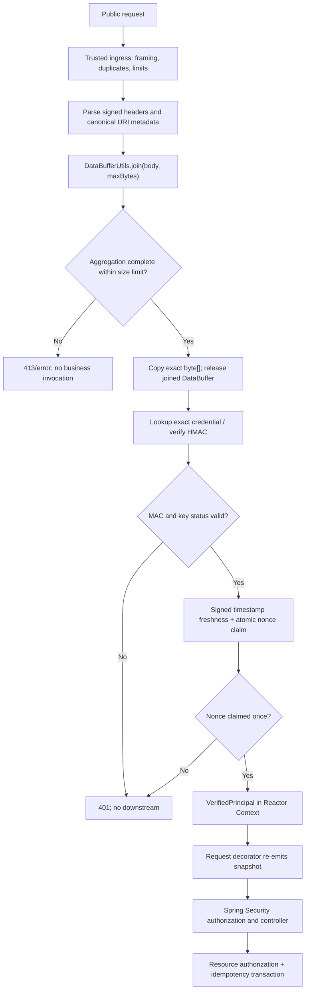

# Body caching reactive

## 1. Vấn đề: request body trong WebFlux là một luồng, không phải chuỗi đọc tùy ý

Trong **Spring WebFlux**, HTTP request body được biểu diễn bằng `Flux<DataBuffer>` thay vì một `InputStream` đồng bộ kiểu Servlet. Một custom HMAC authentication filter muốn tính chữ ký trên **exact body bytes** thường phải đọc body trước khi controller deserialize JSON. Nếu filter subscribe vào `request.getBody()` rồi không phát lại nội dung đúng cách, controller có thể nhận **body rỗng**, bị lỗi hoặc xử lý bytes **khác** với những bytes đã được kiểm tra HMAC.

Trong module `SECURITY_AUTHENTICATION_HMAC_REQUEST_AUTHENTICATION`, request được ký bằng shared secret HMAC và **canonical method/URI/headers/body**. Người học còn phải áp dụng signed timestamp/nonce chống replay, quản lý key rotation, xử lý reverse proxy/gateway và tách **authentication** khỏi **authorization**. Vì vậy chủ đề **Body caching reactive** thuộc chương **Spring WebFlux integration** là một **security boundary** chứ không chỉ là thủ thuật “đọc Flux hai lần”.

Ví dụ:

```http
POST /v1/payments?currency=VND HTTP/1.1
Host: api.example.test
Content-Type: application/json
X-Client-Id: merchant-42
X-Key-Id: key-2026-b
X-Timestamp: 1790000050
X-Nonce: QEFCQ0RFRkdISUpLTE1OTw
X-Idempotency-Key: pay-041
X-Signature: fU9sZUSEz8Cr_d8S-ZZgII_Fy_7BG33mZ0Scbj9FDGM

{"paymentId":"pay-041","amount":125000,"currency":"VND"}
```

Giả sử chữ ký bao phủ `SHA-256(exactBodyBytes)`. Filter phải bảo đảm một chuỗi sự kiện:

```text
Client HTTP request
   |
   v
Trusted ingress (reject ambiguous method/URI/headers/body framing)
   |
   v
WebFlux Security WebFilter
   |---- subscribe vào request.getBody() đúng một lần
   |---- aggregate có giới hạn byte
   |---- snapshot exact bytes; release DataBuffer sở hữu
   |---- verify HMAC + key status + signed timestamp + nonce atomic
   |---- nếu fail: KHÔNG gọi downstream
   |
   v
ServerHttpRequestDecorator.getBody()
   |---- phát lại bytes đã xác minh bằng DataBuffer mới
   v
Controller / HttpMessageReader / business authorization
   |---- deserialize chính body đã ký
   v
Transaction / idempotency / resource authorization
```

Nếu body có `amount=125000` lúc HMAC verify nhưng sau đó controller xử lý `amount=999999` vì middleware thay đổi payload, tính toàn vẹn của HTTP HMAC coi như **bị phá ở trust boundary** dù cryptographic primitive hoàn toàn đúng.

**Mục tiêu bài học:** bạn hiểu vì sao Flux body thường chỉ nên được tiêu thụ một lần ở network boundary, cách buffer/replay an toàn với `DataBufferUtils` và `ServerHttpRequestDecorator`, quản lý pooled buffers, memory/backpressure/cancellation, kết nối với reactive authentication và kiểm thử bằng `StepVerifier`/`WebTestClient`.

### 1.1. Những điều phải chứng minh được

- Có một **hợp đồng ký byte-level**: exact body snapshot, method, URI, header selectors, timestamp và nonce.
- Body được **giới hạn kích thước** trước khi aggregate; không gọi `collectList()` vô hạn.
- Mỗi `DataBuffer` cần được xử lý ownership đúng: release sau copy, không reuse pooled buffer đã release và không release hai lần.
- Body downstream được phát lại **chỉ sau HMAC/freshness/nonce thành công**, không trả lại body khác từ source.
- Không biến WebFlux non-blocking pipeline thành `block()`, JDBC/KMS blocking trên event-loop hoặc mutable `ThreadLocal` principal.
- Lỗi body quá lớn, HMAC sai, nonce replay hoặc kho credential unavailable **không gọi business handler**.
- Test xác minh golden vectors HMAC, split chunks, empty body, over-limit, cancellation, concurrent requests và gateway/body mutation.

## 2. `Flux<DataBuffer>` và vòng đời bộ nhớ

### 2.1. `DataBuffer` không đơn giản là `byte[]`

`ServerHttpRequest.getBody()` trả `Flux<DataBuffer>`. Một HTTP body có thể đến dưới dạng:

```text
Chunk 1: {"paymentId":"pay-
Chunk 2: 041","amount":125000,
Chunk 3: "currency":"VND"}
```

Chunk boundaries phụ thuộc network, buffering, runtime và backpressure; chúng **không** là thành phần của hợp đồng HMAC. Hai lần nhận cùng exact body bytes có thể chia thành số chunks khác nhau.

Không có nghĩa mỗi `DataBuffer` được phép giữ vô hạn. Với Reactor Netty, buffer có thể bọc `ByteBuf` **reference-counted**; giữ tham chiếu sau khi owner đã release có thể gây `IllegalReferenceCountException`, đọc sai dữ liệu hoặc memory leak. Với `DefaultDataBuffer` heap-backed, chuyện release có thể khác. **Code phải viết theo contract của Spring `DataBufferUtils`, không giả định runtime luôn dùng heap buffers.**

### 2.2. Pooled buffers: retain/release và ownership

| Hành động | Ý nghĩa |
| --- | --- |
| `DataBuffer.read(byte[])` | Copy readable bytes vào snapshot của ứng dụng; có thể thay read position |
| `DataBufferUtils.join(body, limit)` | Aggregate có giới hạn, có thể trả composite zero-copy hoặc buffer đã gộp |
| `DataBufferUtils.release(joined)` | Trả buffer được sở hữu sau khi copy/xử lý xong |
| `DataBufferUtils.retain(buffer)` | Tăng reference count khi có yêu cầu giữ pooled buffer; **cần kế hoạch release tương ứng** |
| `DataBufferUtils.releaseConsumer()` | Utility giải phóng những DataBuffers bị discard/tiêu thụ |
| `DataBufferFactory.wrap(byte[])` | Tạo DataBuffer từ bytes; ownership của buffer được emit giao downstream |

**Quy tắc:** Nếu dùng `DataBufferUtils.join`, các buffer input đã được đưa vào aggregate được **release theo lifecycle của joined result**, nên **không release thêm từng input buffer rồi lại release joined buffer**. Copy ra `byte[]` trong khối `try/finally` và release joined result đúng một lần là cách dễ chứng minh nhất cho body nhỏ có giới hạn.

Khi source `Flux` error/cancel trong quá trình `join`, Spring quản lý release các buffer đã tích lũy. Khi tự viết `reduce`, `collectList`, `cache` hoặc `publish`, ứng dụng phải thiết kế ownership/discard/cancellation riêng; thiếu một bước có thể leak pooled memory. Không sao chép ví dụ “lưu `DataBuffer` vào một trường instance và phát lại mãi mãi”.

### 2.3. Vì sao subscribe body hai lần là rủi ro?

`request.getBody()` là publisher được gắn với quá trình nhận HTTP request. Nó **không có lời hứa** rằng có thể subscribe lại để đọc byte stream y hệt lần đầu. Một nguồn one-shot có thể không emit lần hai, emit error hoặc đã bị tiêu thụ.

Antipattern:

```java
Mono<byte[]> digestInput = readAll(request.getBody());
// Subscription đầu để tính MAC.

return digestInput.flatMap(bytes -> {
    verifyHmac(bytes);
    return chain.filter(exchange); // Controller lại lấy original getBody().
});
```

Sau khi filter subscribe original body, controller có thể không còn đọc được body. Cách đúng: **aggregate once**, snapshot exact bytes và **decorate request** để downstream đọc body đã được xác minh từ snapshot.

### 2.4. Không dùng `body.toString()` để ký

Các giá trị sau đều có thể là **khác bytes** dù JSON có cùng ý nghĩa:

```json
{"amount":125000,"currency":"VND"}
```

```json
{ "currency": "VND", "amount": 125000 }
```

Nếu hợp đồng ký **raw body bytes**, hai JSON được hash khác nhau. Không parse object → serialize lại → ký; không `trim()`, đổi line endings, đổi Unicode normalization hay tự thêm dấu xuống dòng. Nếu API muốn ký JSON canonical semantics, phải thiết kế **một hợp đồng canonical JSON riêng**, không ngầm áp trong HMAC WebFilter.

## 3. Các chiến lược xử lý body reactive và lựa chọn phù hợp

### 3.1. Bốn chiến lược

| Chiến lược | Khi phù hợp | Rủi ro / giới hạn |
| --- | --- | --- |
| **Aggregate bounded → immutable byte[] → replay** | JSON/API body nhỏ, HMAC cần verify trước controller | O(body size) RAM/request, giới hạn concurrency |
| **Aggregate bounded → retain pooled DataBuffer → replay** | Mục tiêu giảm copy với pipeline kiểm soát mạnh | Reference counts phức tạp, race/use-after-release, cancellation leaks |
| **Streaming HMAC digest** | Payload lớn/upload | Không được cho business side effects trước khi toàn bộ tag được xác minh; replay/stream ownership khó |
| **Verify tại trusted gateway** | Gateway có thể hash body trước backend | Internal assertion phải bind đúng request/body và protected channel; tránh backend bypass |

Bài chọn **bounded copy-to-heap snapshot** vì dễ kiểm tra **bytes đã ký == bytes controller nhận** và dễ giải phóng pooled buffers. Đây là **mẫu lab có giới hạn**, không phải giải pháp tối ưu cho file uploads nhiều GiB.

### 3.2. Vì sao cần limit ngay trong `join`?

Code không an toàn:

```java
// SAI cho public endpoint: không giới hạn body.
return DataBufferUtils.join(request.getBody())
    .map(buffer -> /* copy everything */);
```

Attacker có thể gửi body rất lớn/chậm hoặc nhiều concurrent requests, khiến memory tăng, kéo dài thời gian chiếm connection và làm event-loop/service cạn tài nguyên.

Dùng biến thể có limit:

```java
DataBufferUtils.join(request.getBody(), 64 * 1024)
```

Khi vượt `maxByteCount`, Spring phát `DataBufferLimitException`; filter phải trả **413 Payload Too Large**, không để request đi tiếp rồi tạo một body rỗng. Cần thêm **ingress max request size, timeouts/rate limits, concurrency controls** và giới hạn decompression nếu hỗ trợ content codings. `Content-Length` có thể thiếu hoặc sai; không chỉ tin header này để áp policy.

Một lưu ý về `DataBufferUtils.join`: kết quả có thể là **composite buffer zero-copy**. Copy đúng `readableByteCount()` sang `byte[]` và release joined result, không giữ composite qua request lifecycle.

### 3.3. Memory budget có tính concurrency

Ví dụ mỗi request cho phép buffer 64 KiB:

```text
64 KiB/request × 2.000 simultaneous buffered requests
≈ 125 MiB chỉ riêng một bản snapshot byte[].

Ngoài ra còn DataBuffer aggregate, decoder objects, JSON model,
connection state, KMS/Redis operations, allocator overhead...
```

Con số trên là **ước lượng bộ nhớ snapshot**, không phải tổng heap/direct-memory. Spring reactive giúp sử dụng tài nguyên hiệu quả với I/O, nhưng **không loại bỏ giới hạn RAM vật lý**. Chính sách `maxBytes` cần đi cùng global/per-client concurrency, read timeout, request rate, max headers và backpressure.

### 3.4. Cancellation và error khác completed body

Body có thể kết thúc theo ba cách:

- **Complete:** nhận đủ bytes, snapshot được tạo, chỉ khi verify pass mới decorate downstream.
- **Error:** client disconnect, decoder/proxy error hoặc vượt limit → không có authenticated principal và không chạy business.
- **Cancel:** subscription bị hủy; source phải release/discard pooled buffers đã nhận, không giữ snapshot trong global cache.

Đặc biệt **không** thay `DataBufferLimitException` bằng `Mono.empty()` hoặc `onErrorResume(e -> Mono.just(new byte[0]))`. HMAC trên empty body sẽ là **thông điệp khác** và có thể dẫn đến fail-open/flow confusion nếu credentials được gán sớm.

## 4. Security boundaries: HMAC, nonce, key rotation và authorization

### 4.1. Cái gì được HMAC bảo vệ?

Một contract minh họa `HTTP-HMAC-WEBFLUX-BODY-V1` ký:

- HTTP method `POST`.
- Raw path `/v1/payments`.
- Raw query `currency=VND`.
- Trusted external authority `api.example.test`.
- Singleton `Content-Type: application/json`.
- Singleton `X-Client-Id`, `X-Key-Id`, `X-Timestamp`, `X-Nonce`, `X-Idempotency-Key`.
- `SHA-256(exactBodyBytes)` ở dòng cuối.
- Domain prefix `HTTP-HMAC-WEBFLUX-BODY-V1` để tránh dùng chữ ký của protocol khác.

`X-Signature` chứa tag HMAC **không nằm trong canonical input**. Một request có body 56 bytes và cùng metadata phải tạo **cùng canonical bytes bất kể Reactor Netty chia body thành 1 hay 8 chunks**.

**Tất cả fields là input chưa tin** trước khi MAC; `clientId/keyId` chỉ là selectors. Verifier phải lookup **đúng một** credential theo `(trusted environment,claimed client,claimed key)` và kiểm tra record owner/status/algorithm/not-before/expiry, không thử các keys khác khi MAC sai.

### 4.2. Thứ tự authentication



**Không gọi** `chain.filter(exchange)` trước khi toàn bộ HMAC và replay checks hoàn tất. Một controller có thể tạo payment side effect trong lúc body vẫn đang truyền; nếu signature cuối cùng fail thì không có cách “rút lại” giao dịch đã commit.

### 4.3. Timestamp và nonce

Trong fixture:

```text
signedTimestamp = 1790000050
trustedServerNow = 1790000040
pastTolerance = 300 seconds
futureTolerance = 30 seconds
nonce = 16 raw bytes, Base64url without padding
```

Policy ví dụ:

```text
now - 300 <= signedTimestamp <= now + 30
nonceExpiry = signedTimestamp + 300 + 60
replayKey = (environment, verifiedClientId, rawNonceBytes)
```

Nonce claim phải **atomic trên shared storage** (ví dụ Redis SET NX có TTL atomically) và **chỉ sau MAC+time pass**. Khi client xoay key A→B, replay namespace không chứa `keyId` để tránh cùng client dùng nonce N hai lần dưới hai key versions. Nếu Redis/KMS không biết kết quả, **fail-closed**, không bỏ qua guard.

### 4.4. Body caching không giải quyết authorization

HMAC hợp lệ xác thực caller đã ký **những bytes này**, không chứng minh caller được phép chuyển tiền từ account được nhắc trong body. Controller/business layer cần kiểm tra verified principal, permission/scopes, resource ownership và tenant trong cùng transaction boundary, rồi idempotency theo `(verified client,operation,idempotency key)`.

Một retry nghiệp vụ sau network timeout phải dùng **nonce/timestamp/HMAC mới** nhưng giữ **same idempotency key và business intent fingerprint**; body caching chỉ bảo vệ exact bytes, không tự chống double charge.

## 5. Quy tắc bytes đối với WebFlux body và gateway

### 5.1. `Transfer-Encoding`, `Content-Encoding` và source body

HTTP chunking/HTTP/2 frames là transport framing; không phải body bytes dành cho application HMAC theo contract này. WebFlux `Flux<DataBuffer>` thường thấy các application payload bytes **sau khi transport framing đã được xử lý**. Tuy nhiên `Content-Encoding: gzip` có thể làm khác **compressed bytes** và **decompressed bytes** tùy gateway/filter. Nếu signer hash compressed body nhưng verifier hash decompressed body, HMAC mismatch; nếu gateway verify một representation rồi backend dùng representation khác, integrity boundary không được bảo vệ đúng.

**V1 của bài chỉ chấp nhận identity content coding**, `Content-Type: application/json` và exact UTF-8 JSON bytes như nhận tại verified boundary. Reject bất kỳ `Content-Encoding` khác identity trong policy lab; production muốn hỗ trợ gzip phải công bố ký bytes **trước hay sau decompress**, chống decompression bomb và đồng bộ gateway/backend.

### 5.2. URI và authority sau reverse proxy

`request.getURI().getRawPath()`/`getRawQuery()` phản ánh representation mà WebFlux server nhận, **không bảo đảm là raw wire bytes trước gateway**. Proxy có thể percent-decode, normalize slash, reorder query hoặc đổi Host. Nếu signer ký public URL, verifier lại ký internal URL, HMAC sai; nếu gateway đã authn public URL nhưng backend thực thi rewritten route không tương đương, security gap.

Quy tắc:

- Chọn **một trusted ingress verification point** hoặc một authenticated original-request representation.
- Định nghĩa method/raw path/query/signed authority và normalize/reject ambiguous encoding ở boundary.
- Không sử dụng `X-Forwarded-Host`/`X-Original-URI` do caller Internet tự gửi làm nguồn xác thực.
- Reject duplicate signed headers **trước coalescing**; WebFlux `HttpHeaders.getFirst` không chứng minh wire header xuất hiện đúng một lần nếu proxy đã gộp trước.

### 5.3. Header semantics và signature output

Các field names case-insensitive theo HTTP; `X-Key-Id` và `x-key-id` là cùng một field. **Giá trị** client ID, key ID, nonce và Base64url tag giữ nguyên case theo contract. Không `trim()`/`toLowerCase()` toàn value để “sửa” request.

Header `X-Signature` là output, không ký chính nó. Versioned canonical request ở `HTTP-HMAC-WEBFLUX-BODY-V1` bảo vệ **client ID, key ID, timestamp và nonce**; missing/invalid/duplicate fields phải reject trước khi chọn secret.

## 6. Golden HMAC-SHA256 vectors độc lập cho body snapshot

### 6.1. Exact bytes

JSON body, **không có newline ở cuối**:

```json
{"paymentId":"pay-041","amount":125000,"currency":"VND"}
```

- **Body length:** 56 UTF-8 bytes.
- **SHA-256 body lowercase hex:** `ac3c72a34cf5ecd49e3dd94ce69e6a993cd641baf5cb559f625cabcb410e7c79`.
- Nonce raw bytes hex `404142434445464748494a4b4c4d4e4f` (16 bytes) → Base64url no-padding `QEFCQ0RFRkdISUpLTE1OTw`.
- `X-Timestamp: 1790000050` và trusted test clock `1790000040`.
- **Canonical request:** 12 lines, 302 UTF-8 bytes, LF-separated `0x0A`, **không trailing LF**.

Canonical request với key B:

```text
HTTP-HMAC-WEBFLUX-BODY-V1
POST
/v1/payments
currency=VND
authority:api.example.test
content-type:application/json
x-client-id:merchant-42
x-key-id:key-2026-b
x-timestamp:1790000050
x-nonce:QEFCQ0RFRkdISUpLTE1OTw
x-idempotency-key:pay-041
ac3c72a34cf5ecd49e3dd94ce69e6a993cd641baf5cb559f625cabcb410e7c79
```

Canonical input A chỉ đổi dòng `x-key-id:key-2026-b` thành `x-key-id:key-2026-a`. HMAC dùng secret tương ứng, không ghi đè secret A dưới cùng key ID.

### 6.2. Raw keys và tag outputs

Hai test secrets **công khai chỉ phục vụ lab**, không dùng production:

```text
Key A ID: key-2026-a
A raw secret hex (bytes 00..1f):
000102030405060708090a0b0c0d0e0f101112131415161718191a1b1c1d1e1f

Key B ID: key-2026-b
B raw secret hex (bytes 20..3f):
202122232425262728292a2b2c2d2e2f303132333435363738393a3b3c3d3e3f
```

| Vector | Canonical bytes | HMAC-SHA256 raw hex | Base64url no-padding tag (43 chars) |
| --- | --- | --- | --- |
| A, `key-2026-a` | 302 | `1e83f79ff11539c79ce68d29def8505fb89bfa0117a26df9e471b2392c8e7ae4` | `HoP3n_EVOcec5o0p3vhQX7ib-gEXom355HGyOSyOeuQ` |
| B, `key-2026-b` | 302 | `7d4f6c654484cfc0abfddf12f99660208fc5cbfec11b7de667449c6e3f450c63` | `fU9sZUSEz8Cr_d8S-ZZgII_Fy_7BG33mZ0Scbj9FDGM` |

Các vector được tính **độc lập** từ exact body và canonical bytes, tránh “cả signer và verifier cùng sai” khi chỉ test round-trip. Body snapshot chia thành 1, 3 hoặc 20 DataBuffers phải tạo **cùng SHA-256/HMAC** nếu thứ tự và bytes không đổi.

### 6.3. Mutation thử nghiệm

| Mutation | Body length | HMAC cần xảy ra |
| --- | --- | --- |
| Giữ nguyên 56 bytes, chia chunks khác | 56 | **Không đổi** tag |
| Thêm một byte `0x0A` ở cuối body | 57 | Body digest khác, tag khác |
| Đổi `125000` thành `125001` | 56 | Body digest khác, tag khác |
| Đổi thứ tự field JSON | Có thể khác | Body digest khác, tag khác theo raw-byte contract |
| Thay `X-Key-Id` nhưng giữ tag B | 56 | Verifier từ chối |
| Body vượt configured max bytes | `>max` | `413` trước authentication và business |
| Body có invalid UTF-8 ở một byte | Tùy | HMAC vẫn tính bytes; JSON decoder có thể reject sau authn |

**Lưu ý:** Invalid JSON/UTF-8 không nhất thiết là HMAC failure: MAC xác minh exact bytes; JSON schema/encoding errors là một bước tiếp theo. V1 endpoint muốn JSON hợp lệ phải xử lý decoder/schema errors **không tạo side effect**. Không được tự reserialize body để “sửa” lỗi cho phù hợp chữ ký.

### 6.4. Vectors không phải live credentials

Timestamp/nonce fixture chỉ để deterministic tests. Production tạo secret bằng CSPRNG/protected provisioning và nonce mới mỗi attempt. Nếu bạn dùng cùng nonce N cho vector A rồi gửi vector B dưới cùng verified client trên **shared replay store**, B phải bị reject replay, dù MAC toán học của cả hai đúng. Kiểm tra goldens **thuần cryptographic** trước bước nonce claim hoặc tách test environments có chủ ý.

## 7. Java 17: body snapshot bounded + request decorator

### 7.1. Hợp đồng của `ReactiveBodySnapshotV1`

Trong WebFlux, cách dễ hiểu và kiểm tra nhất cho JSON body nhỏ là:

1. `DataBufferUtils.join(sourceFlux, maxBytes)` → một aggregate bounded.
2. Đọc `readableByteCount()` và **copy** ra `byte[]` riêng; ở `finally` luôn `DataBufferUtils.release(joined)`.
3. Khi source không emit bất kỳ `DataBuffer` nào, trả snapshot `new byte[0]` (không bỏ mất luồng downstream hoặc làm `Mono.empty()` thành authenticated request).
4. Sau HMAC/freshness/replay thành công, tạo `ServerHttpRequestDecorator` với `getBody()` trả `Flux.defer`.
5. **Mỗi lần subscribe downstream** tạo `DataBuffer` mới bọc **byte[] clone**, tránh nhiều subscribers đọc chung vị trí buffer hoặc sửa cùng vùng nhớ.
6. Khi downstream hủy subscription/truncate, gắn `doOnDiscard` để release những buffers bị discard; body do decoder tiêu thụ là trách nhiệm ownership của decoder.

Bài cố ý **không giữ pooled `DataBuffer` để replay**, giảm độ phức tạp reference counting. Snapshot là `byte[]` ở heap, có bounds và request scope; không lưu vào singleton/static cache.

### 7.2. Class `ReactiveBodySnapshotV1.java`

```java
import java.util.Objects;
import org.springframework.core.io.buffer.DataBuffer;
import org.springframework.core.io.buffer.DataBufferFactory;
import org.springframework.core.io.buffer.DataBufferUtils;
import org.springframework.http.server.reactive.ServerHttpRequest;
import org.springframework.http.server.reactive.ServerHttpRequestDecorator;
import org.springframework.web.server.ServerWebExchange;
import reactor.core.publisher.Flux;
import reactor.core.publisher.Mono;

public final class ReactiveBodySnapshotV1 {
    public static final int MAX_BODY_BYTES = 64 * 1024;

    private ReactiveBodySnapshotV1() {}

    /**
     * One subscription to the ORIGINAL request body per call.
     * A complete aggregation yields exactly one independent byte[].
     * Overflow and upstream failures propagate as errors.
     */
    public static Mono<byte[]> captureOnce(
            ServerHttpRequest original) {
        Objects.requireNonNull(original, "original");

        return DataBufferUtils.join(
                original.getBody(), MAX_BODY_BYTES)
            .map(joined -> {
                try {
                    // Retain exact readable bytes; do not use
                    // joined.toString(), decode JSON or normalize.
                    int n = joined.readableByteCount();
                    byte[] copy = new byte[n];
                    joined.read(copy);
                    return copy;
                } finally {
                    // The JOINED result owns aggregated buffers.
                    // Do NOT separately release the source chunks.
                    DataBufferUtils.release(joined);
                }
            })
            // Body publisher can complete with ZERO buffers.
            // It must produce an empty BYTE SNAPSHOT, not
            // terminate the whole authn pipeline silently.
            .defaultIfEmpty(new byte[0]);
    }

    /**
     * Original body has already been consumed once by captureOnce.
     * GetBody now re-emits only the authenticated snapshot.
     *
     * No DataBuffer instance is reused between subscriptions.
     */
    public static ServerHttpRequest decorate(
            ServerWebExchange exchange,
            byte[] verifiedSnapshot) {
        Objects.requireNonNull(exchange, "exchange");
        Objects.requireNonNull(verifiedSnapshot, "body");

        final byte[] frozen = verifiedSnapshot.clone();
        final DataBufferFactory factory =
            exchange.getResponse().bufferFactory();

        return new ServerHttpRequestDecorator(
                exchange.getRequest()) {
            @Override
            public Flux<DataBuffer> getBody() {
                return Flux.defer(() -> {
                    if (frozen.length == 0) {
                        return Flux.<DataBuffer>empty();
                    }
                    // Fresh bytes + fresh DataBuffer per subscribe.
                    // Downstream may mutate read positions.
                    DataBuffer next =
                        factory.wrap(frozen.clone());

                    return Flux.just(next)
                        .doOnDiscard(
                            DataBuffer.class,
                            DataBufferUtils::release);
                });
            }
        };
    }
}
```

### 7.3. Vì sao copy trước release?

Nếu join trả composite Netty pooled buffer và filter lưu trực tiếp:

```java
// SAI: giữ pooled DataBuffer sau khi đã release,
// hoặc phát lại một instance có mutable readPosition.
DataBuffer cached = joined;
DataBufferUtils.release(joined);
return Flux.just(cached);
```

downstream có thể đọc một đối tượng đã bị release. Nếu không release để tránh lỗi, lại có nguy cơ **direct-memory leak** trên nhiều requests/cancellations. `byte[]` copy tách lifetime body khỏi pooled buffer; decorator sử dụng một vùng nhớ mới cho mỗi subscription.

### 7.4. Vì sao `Flux.defer` quan trọng?

Code chưa tốt:

```java
DataBuffer once = factory.wrap(snapshot);
@Override
public Flux<DataBuffer> getBody() {
    return Flux.just(once);
}
```

Một subscription có thể thay read position hoặc decoder release `once`. Subscription thứ hai sẽ nhận cùng object đã tiêu thụ/release. Ngược lại:

```java
@Override
public Flux<DataBuffer> getBody() {
    return Flux.defer(() ->
        Flux.just(factory.wrap(snapshot.clone())));
}
```

Mỗi subscription có buffer mới. Ví dụ đầy đủ còn xử lý body rỗng và discard/cancellation. **Không** suy rằng multi-subscribe luôn là nghiệp vụ an toàn: cho phép đọc lại bytes không có nghĩa được phép thực hiện cùng payment hai lần; idempotency/authorization vẫn độc lập.

### 7.5. `DataBufferLimitException` cần được giữ là lỗi

`DataBufferUtils.join(body, maxBytes)` phát `DataBufferLimitException` khi tổng số bytes vượt giới hạn; đừng viết:

```java
// SAI: body quá lớn bị biến thành empty body và có thể đi tiếp.
.onErrorResume(DataBufferLimitException.class,
    ex -> Mono.just(new byte[0]))
```

Đúng là **map thành 413** ở filter/HTTP boundary và **không subscribe chain.filter**. Nếu body **đúng bằng** giới hạn, contract có thể cho qua (vẫn phải đủ memory/CPU); nếu lớn hơn dù một byte, reject. Có thể kiểm tra `Content-Length` để reject sớm nhưng vẫn phải giới hạn **bytes thực sự nhận** vì header có thể thiếu, giả hoặc qua chunked transfer.

### 7.6. Sự cố cancellation sau khi release aggregate

Khi `captureOnce` nhận xong body, đã copy và release aggregate. Nếu client ngắt kết nối **trước khi** verifier hoàn thành hoặc downstream chưa dùng body, `byte[]` snapshot sẽ được GC khi request reactive pipeline không còn tham chiếu (không đưa vào static cache). Nếu cancellation xảy ra **trong lúc** aggregate, API `DataBufferUtils.join` xử lý release buffers đã tích lũy. Các Netty buffers được downstream tạo trong decorator cũng có lifecycle riêng và cần được consumer/discard hooks xử lý.

Để phát hiện leak thực sự, dùng Netty leak detection và tests hủy subscription tại nhiều vị trí. Một unit test không throw exception **không chứng minh** native memory không bị leak.

## 8. Java 17: đọc signed headers và metadata trước khi nhận body

### 8.1. Vì sao validate header trước `join`?

Nếu request không có `X-Client-Id`, `X-Key-Id` hoặc `X-Signature`, filter nên từ chối sớm **không cần buffer 64 KiB body của caller**. Tương tự, metadata quá dài, malformed method/URI hoặc wrong Content-Encoding nên bị chặn ở ingress/filter đầu tiên có thể.

Một logic tốt:

```text
Validate trusted HTTP framing + duplicate signed headers
Validate method/path/query, selected header grammar and size
Capture bounded body ONCE
Validate credential/HMAC/time/replay
Decorate authenticated snapshot and continue
```

Điều này giảm memory/CPU DoS nhưng **không** thay bounded join và concurrency limit: attacker vẫn có thể gửi headers syntactically valid để buộc filter nhận body.

### 8.2. Class `HmacWebFluxClaimsV1.java`

```java
import java.util.List;
import java.util.regex.Pattern;
import org.springframework.http.HttpHeaders;
import org.springframework.http.HttpMethod;
import org.springframework.http.server.reactive.ServerHttpRequest;
import org.springframework.security.authentication.BadCredentialsException;
import org.springframework.web.server.ServerWebExchange;

public final class HmacWebFluxClaimsV1 {
    private static final Pattern IDENTIFIER =
        Pattern.compile("[A-Za-z0-9._-]{1,64}");
    private static final Pattern TIMESTAMP =
        Pattern.compile("[1-9][0-9]{0,18}");
    private static final Pattern NONCE =
        Pattern.compile("[A-Za-z0-9_-]{22}");
    private static final Pattern TAG =
        Pattern.compile("[A-Za-z0-9_-]{43}");

    public record Claims(
        String method,
        String rawPath,
        String rawQuery,
        String trustedAuthority,
        String contentType,
        String clientId,
        String keyId,
        String signedTimestamp,
        String nonceB64url,
        String idempotencyKey,
        String signatureB64url
    ) {}

    private HmacWebFluxClaimsV1() {}

    private static String exactlyOne(
            HttpHeaders headers, String fieldName) {
        List<String> values = headers.get(fieldName);
        if (values == null || values.size() != 1
                || values.get(0) == null) {
            throw new BadCredentialsException(
                "Invalid HMAC request headers");
        }
        // Does not reconstruct raw duplicated HTTP fields that
        // were already coalesced/dropped by a proxy.
        return values.get(0);
    }

    private static void requireMatch(
            Pattern pattern, String value) {
        if (!pattern.matcher(value).matches()) {
            throw new BadCredentialsException(
                "Invalid HMAC request headers");
        }
    }

    public static Claims parse(ServerWebExchange exchange) {
        ServerHttpRequest request = exchange.getRequest();
        HttpHeaders headers = request.getHeaders();

        String rawPath = request.getURI().getRawPath();
        String rawQuery = request.getURI().getRawQuery();
        if (request.getMethod() != HttpMethod.POST
                || !"/v1/payments".equals(rawPath)
                || !"currency=VND".equals(rawQuery)) {
            throw new BadCredentialsException(
                "Unsupported signed request target");
        }

        // This LAB rejects compressed request bodies.
        List<String> codings =
            headers.get(HttpHeaders.CONTENT_ENCODING);
        if (codings != null && !codings.isEmpty()) {
            if (codings.size() != 1
                    || !"identity".equalsIgnoreCase(
                        codings.get(0))) {
                throw new BadCredentialsException(
                    "Unsupported content encoding");
            }
        }

        String contentType =
            exactlyOne(headers, HttpHeaders.CONTENT_TYPE);
        if (!"application/json".equals(contentType)) {
            throw new BadCredentialsException(
                "Invalid signed content type");
        }

        String clientId =
            exactlyOne(headers, "X-Client-Id");
        String keyId =
            exactlyOne(headers, "X-Key-Id");
        String ts =
            exactlyOne(headers, "X-Timestamp");
        String nonce =
            exactlyOne(headers, "X-Nonce");
        String idem =
            exactlyOne(headers, "X-Idempotency-Key");
        String tag =
            exactlyOne(headers, "X-Signature");

        requireMatch(IDENTIFIER, clientId);
        requireMatch(IDENTIFIER, keyId);
        requireMatch(IDENTIFIER, idem);
        requireMatch(TIMESTAMP, ts);
        requireMatch(NONCE, nonce);
        requireMatch(TAG, tag);

        try {
            Long.parseLong(ts);
        } catch (NumberFormatException overflow) {
            throw new BadCredentialsException(
                "Invalid timestamp", overflow);
        }

        // A trusted ingress has already established the
        // externally visible authority, not an untrusted
        // X-Forwarded-Host from the public request.
        return new Claims(
            "POST", rawPath, rawQuery,
            "api.example.test", contentType,
            clientId, keyId, ts, nonce, idem, tag
        );
    }
}
```

### 8.3. Giới hạn của `HttpHeaders`

`HttpHeaders.get("X-Key-Id")` có thể chứa nhiều values, nên kiểm `size()==1` là cần thiết. Nhưng nếu reverse proxy đã **coalesce** thành một string như `"A, B"`, code chỉ biết đó là **một value chứa dấu phẩy**, và strict regex từ chối. Nếu gateway **drop một occurrence** trước Servlet/Netty, WebFlux không thể phát hiện value đã mất. Raw-wire ingress duplicate guard vẫn là bắt buộc.

Khi API thật hỗ trợ `Authorization: HMAC ...` thay vì các `X-...` fields, cần parse Authorization theo versioned grammar riêng, từ chối duplicate schemes/parameters và ký parsed values vào canonical request. **Không đưa nguyên header chứa signature output vào HMAC input**.

### 8.4. Thông tin nào được trusted?

Trong code lab, string `"api.example.test"` là trusted authority được cấu hình cố định. Trong production có proxy/TLS termination, ingress cần xác thực host/authority thực nhận và cung cấp canonical public host **đúng theo contract**, không gán bừa giá trị hardcoded cho nhiều virtual hosts. Tương tự, environment `prod`/`test` được lấy từ trusted deployment/routing policy, **không** từ header do caller tùy ý gửi.

### 8.5. Vì sao `clientId/keyId` chỉ là selector?

Một client có thể gửi:

```http
X-Client-Id: merchant-73
X-Key-Id: key-2026-b
```

mà không biết secret của `merchant-73`. Regex parse thành công không biến họ thành merchant-73. Verifier phải lookup trusted credential owner cho đúng tuple, tính MAC với selected secret, xác minh timestamp/nonce và chỉ sau đó tạo reactive security principal. **Không set Reactor security context ở bước parse**.

## 9. Java 17: reactive HMAC verifier dùng exact body bytes

### 9.1. Pipeline I/O và mật mã

Sau khi body được snapshot, verifier tính `SHA-256(exactBody)`, dựng canonical bytes, tra một credential `(trusted environment,clientId,keyId)`, kiểm owner/status/algorithm/validity, so HMAC-SHA256 raw tag, kiểm freshness của signed timestamp rồi **atomic claim nonce**. Chỉ khi mọi bước pass mới trả `Mono<VerifiedPrincipal>`. Không trả principal chỉ vì header parse đúng.

```text
Captured exact bytes (request-scoped)
  -> SHA-256 + canonical method/path/query/headers/body digest
  -> ReactiveCredentialStore.find(env,clientId,keyId)
  -> HMAC-SHA256 with exactly selected trusted secret
  -> MessageDigest.isEqual(expectedRawTag, suppliedRawTag)
  -> signed timestamp freshness
  -> ReactiveReplayStore.claim(env,verifiedClient,rawNonce,expiry)
  -> VerifiedPrincipal (then Reactor Security Context)
```

DB/Redis/KMS cần **reactive I/O thật**; `Mono.just(blockingSdkCall())` vẫn thực thi blocking call trên event-loop. Nếu buộc gọi SDK blocking, isolate bằng `Mono.fromCallable(...).subscribeOn(Schedulers.boundedElastic())` với bounded concurrency/timeouts. `Mac` là mutable nên tạo instance riêng cho mỗi phép tính; không dùng singleton `Mac` ở nhiều requests.

### 9.2. Class `ReactiveHmacVerifierV1.java`

```java
import java.nio.charset.StandardCharsets;
import java.security.GeneralSecurityException;
import java.security.MessageDigest;
import java.time.Clock;
import java.util.Base64;
import java.util.HexFormat;
import javax.crypto.Mac;
import javax.crypto.spec.SecretKeySpec;
import org.springframework.security.authentication.AuthenticationServiceException;
import org.springframework.security.authentication.BadCredentialsException;
import reactor.core.publisher.Mono;

public final class ReactiveHmacVerifierV1 {
    private static final String ALG = "HmacSHA256";
    private static final long PAST = 300L;
    private static final long FUTURE = 30L;
    private static final long MARGIN = 60L;

    public enum KeyState {
        PREPARED, ACTIVE, VERIFY_ONLY, REVOKED
    }

    public record Credential(
        String ownerClientId, String keyId, KeyState state,
        String algorithm, long notBefore, long expiresAt,
        byte[] secret) {
        public Credential {
            if (secret == null) {
                throw new IllegalArgumentException("Missing secret");
            }
            secret = secret.clone();
        }

        @Override public byte[] secret() {
            return secret.clone();
        }

        @Override public String toString() {
            return "Credential[secret=REDACTED]";
        }
    }

    public record VerifiedPrincipal(
        String environment, String clientId, String keyId) {}

    public interface ReactiveCredentialStore {
        Mono<Credential> find(
            String trustedEnvironment, String clientId,
            String keyId);
    }

    public interface ReactiveReplayStore {
        // Atomic insert-if-absent, shared across replicas,
        // with expiry. false=duplicate; empty/error=fail closed.
        Mono<Boolean> claim(
            String environment, String verifiedClientId,
            byte[] rawNonce, long expiresAtEpochSeconds);
    }

    private ReactiveHmacVerifierV1() {}

    public static byte[] strictBase64url(
            String encoded, int chars, int rawLength) {
        if (encoded == null || encoded.length() != chars
                || !encoded.matches("[A-Za-z0-9_-]+")) {
            throw new BadCredentialsException("Invalid HMAC data");
        }
        final byte[] raw;
        try {
            raw = Base64.getUrlDecoder().decode(encoded);
        } catch (IllegalArgumentException bad) {
            throw new BadCredentialsException("Invalid HMAC data", bad);
        }
        String recoded = Base64.getUrlEncoder().withoutPadding()
            .encodeToString(raw);
        if (raw.length != rawLength
                || !recoded.equals(encoded)) {
            throw new BadCredentialsException("Invalid HMAC data");
        }
        return raw;
    }

    public static byte[] canonicalBytes(
            HmacWebFluxClaimsV1.Claims h, byte[] exactBody)
            throws GeneralSecurityException {
        if (h == null || exactBody == null
                || exactBody.length
                    > ReactiveBodySnapshotV1.MAX_BODY_BYTES) {
            throw new IllegalArgumentException("Invalid signed body");
        }
        String digest = HexFormat.of().formatHex(
            MessageDigest.getInstance("SHA-256").digest(exactBody));
        String text = String.join("\n",
            "HTTP-HMAC-WEBFLUX-BODY-V1",
            h.method(),
            h.rawPath(),
            h.rawQuery(),
            "authority:" + h.trustedAuthority(),
            "content-type:" + h.contentType(),
            "x-client-id:" + h.clientId(),
            "x-key-id:" + h.keyId(),
            "x-timestamp:" + h.signedTimestamp(),
            "x-nonce:" + h.nonceB64url(),
            "x-idempotency-key:" + h.idempotencyKey(),
            digest);
        return text.getBytes(StandardCharsets.UTF_8);
    }

    private static byte[] mac(byte[] secret, byte[] canonical)
            throws GeneralSecurityException {
        if (secret == null || secret.length < 32) {
            throw new IllegalStateException("Invalid HMAC key material");
        }
        Mac m = Mac.getInstance(ALG);
        m.init(new SecretKeySpec(secret, ALG));
        return m.doFinal(canonical);
    }

    // Lab-only: a client must provision secret safely and
    // generate fresh timestamp/nonce on every real attempt.
    public static String signForTest(
            HmacWebFluxClaimsV1.Claims h,
            byte[] body, byte[] secret)
            throws GeneralSecurityException {
        byte[] tag = mac(secret, canonicalBytes(h, body));
        return Base64.getUrlEncoder().withoutPadding()
            .encodeToString(tag);
    }

    public static Mono<VerifiedPrincipal> verify(
            HmacWebFluxClaimsV1.Claims h,
            byte[] exactBody,
            String trustedEnvironment,
            Clock clock,
            ReactiveCredentialStore credentials,
            ReactiveReplayStore replay) {

        return Mono.defer(() -> {
            final byte[] supplied;
            final byte[] rawNonce;
            final byte[] canonical;
            final long signedTs;
            try {
                supplied = strictBase64url(
                    h.signatureB64url(), 43, 32);
                rawNonce = strictBase64url(
                    h.nonceB64url(), 22, 16);
                signedTs = Long.parseLong(h.signedTimestamp());
                canonical = canonicalBytes(h, exactBody);
            } catch (GeneralSecurityException crypto) {
                return Mono.error(
                    new AuthenticationServiceException(
                        "SHA-256 unavailable", crypto));
            } catch (IllegalArgumentException bad) {
                return Mono.error(
                    new BadCredentialsException(
                        "Invalid signed request", bad));
            }

            long now = clock.instant().getEpochSecond();

            return credentials.find(
                    trustedEnvironment,
                    h.clientId(), h.keyId())
                .switchIfEmpty(Mono.error(
                    new BadCredentialsException(
                        "Invalid HMAC credentials")))
                .flatMap(record -> {
                    boolean acceptedState =
                        record.state() == KeyState.ACTIVE
                        || record.state() == KeyState.VERIFY_ONLY;
                    if (!acceptedState
                            || !h.clientId().equals(
                                record.ownerClientId())
                            || !h.keyId().equals(record.keyId())
                            || !ALG.equals(record.algorithm())
                            || now < record.notBefore()
                            || now >= record.expiresAt()) {
                        return Mono.error(
                            new BadCredentialsException(
                                "Invalid HMAC credentials"));
                    }

                    final byte[] expected;
                    try {
                        expected = mac(record.secret(), canonical);
                    } catch (GeneralSecurityException crypto) {
                        return Mono.error(
                            new AuthenticationServiceException(
                                "HMAC unavailable", crypto));
                    }

                    if (!MessageDigest.isEqual(
                            expected, supplied)) {
                        return Mono.error(
                            new BadCredentialsException(
                                "Invalid HMAC credentials"));
                    }

                    final long earliest, latest, nonceExpiry;
                    try {
                        earliest = Math.subtractExact(now, PAST);
                        latest = Math.addExact(now, FUTURE);
                        nonceExpiry = Math.addExact(
                            signedTs, PAST + MARGIN);
                    } catch (ArithmeticException overflow) {
                        return Mono.error(
                            new AuthenticationServiceException(
                                "Unsafe server time", overflow));
                    }

                    if (signedTs < earliest || signedTs > latest) {
                        return Mono.error(
                            new BadCredentialsException(
                                "Invalid HMAC credentials"));
                    }

                    // No key ID in replay namespace:
                    // key rotation must not reset used nonces.
                    return replay.claim(
                            trustedEnvironment,
                            record.ownerClientId(),
                            rawNonce, nonceExpiry)
                        .switchIfEmpty(Mono.error(
                            new AuthenticationServiceException(
                                "Missing replay claim result")))
                        .flatMap(claimed -> {
                            if (!Boolean.TRUE.equals(claimed)) {
                                return Mono.error(
                                    new BadCredentialsException(
                                        "Invalid HMAC credentials"));
                            }
                            return Mono.just(
                                new VerifiedPrincipal(
                                    trustedEnvironment,
                                    record.ownerClientId(),
                                    record.keyId()));
                        });
                });
        });
    }
}
```

### 9.3. Vì sao `Mono.empty()` khác lỗi?

- Credential lookup `Mono.empty()`: không có credential → **401**.
- Nonce claim `Mono.just(false)`: nonce đã được sử dụng → **401**.
- Nonce claim `Mono.empty()`: không biết đã claim chưa → **503/fail closed**, không coi là success.
- Reactive network/KMS/Redis error → không mặc định `onErrorResume(... -> Mono.just(VerifiedPrincipal))`.
- Invalid MAC hoặc timestamp quá cũ → **không claim nonce**, không tới controller.
- `REVOKED`/`PREPARED` không được verify dù HMAC toán học đúng; `VERIFY_ONLY` chỉ khi overlap được phê duyệt và có deadline.

### 9.4. Byte-level correctness, key rotation và owner binding

Canonical text có **12 LF-separated lines**, body digest lowercase hex, không có trailing LF. Verifier dùng **một secret** từ đúng `(environment,clientId,keyId)`, không thử all keys hoặc default secret khi tag sai. ClientId/KeyId trong canonical string chống **wire tampering**, nhưng nếu hai owners được provision cùng raw secret thì MAC binding không sửa được lỗi key isolation; phải sinh secrets độc lập.

`MessageDigest.isEqual` so raw MAC bytes, tránh so Base64 text, nhưng không khiến **toàn bộ** authn pipeline constant-time; vẫn cần rate limits, generic error messages và kiểm soát timing/lookup enumeration. `Mac` mutable được tạo mới cho mỗi phép xác minh.

### 9.5. Tại sao HMAC pass chưa đủ để làm payment?

Verified principal xác nhận caller nắm credential đúng owner trong policy hiện tại. Payment còn phải được **authorize theo account/resource/action**, và idempotency scope theo `(verifiedClient,operation,idempotencyKey)`, không key ID/nonce, để retry hợp lệ qua rotation không tạo side effect hai lần.

**Không set Reactor security context trước khi nonce claim thành công**, nếu không controller có thể xử lý khi replay state chưa bảo đảm.

## 10. Java 17: `WebFilter` xác minh rồi mới replay body

### 10.1. Vì sao thứ tự `chain.filter()` đặc biệt quan trọng?

WebFlux dùng publisher để biểu diễn công việc; đoạn code `chain.filter(exchange)` được tạo trước không có nghĩa nó đã thực thi, nhưng **subscribe publisher chain trước HMAC completion** là sai:

```java
// SAI: controller có thể tạo side effect trước khi HMAC được xác minh.
return chain.filter(exchange)
    .then(verifyHmacAfterBusiness());
```

Cần aggregate bounded, HMAC, freshness và **atomic nonce claim** xong rồi mới tạo decorated exchange và subscribe downstream. Đồng thời, **lỗi không được biến thành empty Mono với HTTP 200 mặc định**. Phân biệt:

- `413` khi body thực nhận vượt giới hạn.
- `401` khi header thiếu/malformed, unknown/revoked credential, HMAC sai, timestamp sai hoặc nonce replay.
- `503` khi credential/KMS/replay store không đáng tin hoặc không trả kết quả.
- `403/404` sau khi authentication đúng nhưng business authorization từ chối resource.
- `409` nếu business idempotency key bị reuse với intent khác, sau authn/authz.

### 10.2. Class `ReactiveHmacBodyWebFilterV1.java`

```java
import java.time.Clock;
import java.util.List;
import org.springframework.core.io.buffer.DataBufferLimitException;
import org.springframework.http.HttpHeaders;
import org.springframework.http.HttpStatus;
import org.springframework.http.server.reactive.ServerHttpRequest;
import org.springframework.security.authentication.AuthenticationServiceException;
import org.springframework.security.authentication.BadCredentialsException;
import org.springframework.security.authentication.UsernamePasswordAuthenticationToken;
import org.springframework.security.core.Authentication;
import org.springframework.security.core.context.ReactiveSecurityContextHolder;
import org.springframework.web.server.ServerWebExchange;
import org.springframework.web.server.WebFilter;
import org.springframework.web.server.WebFilterChain;
import reactor.core.publisher.Mono;

public final class ReactiveHmacBodyWebFilterV1
        implements WebFilter {

    private record AuthenticatedSnapshot(
        byte[] exactBody,
        ReactiveHmacVerifierV1.VerifiedPrincipal principal
    ) {}

    private final ReactiveHmacVerifierV1.ReactiveCredentialStore
        credentials;
    private final ReactiveHmacVerifierV1.ReactiveReplayStore
        replay;
    private final Clock trustedClock;
    private final String environment;

    public ReactiveHmacBodyWebFilterV1(
            ReactiveHmacVerifierV1.ReactiveCredentialStore credentials,
            ReactiveHmacVerifierV1.ReactiveReplayStore replay,
            Clock trustedClock,
            String environment) {
        this.credentials = credentials;
        this.replay = replay;
        this.trustedClock = trustedClock;
        this.environment = environment;
    }

    private Mono<Void> reject(
            ServerWebExchange exchange, HttpStatus status) {
        var response = exchange.getResponse();
        response.setStatusCode(status);
        response.getHeaders().setCacheControl("no-store");
        if (status == HttpStatus.UNAUTHORIZED) {
            response.getHeaders().set(
                HttpHeaders.WWW_AUTHENTICATE,
                "HMAC realm=\"payments\"");
        }
        // No raw Authorization/signature, secret or body.
        return response.setComplete();
    }

    @Override
    public Mono<Void> filter(
            ServerWebExchange exchange, WebFilterChain chain) {

        final HmacWebFluxClaimsV1.Claims claims;
        try {
            // Cheap header/route validation before body buffering.
            claims = HmacWebFluxClaimsV1.parse(exchange);
        } catch (BadCredentialsException invalid) {
            return reject(exchange, HttpStatus.UNAUTHORIZED);
        }

        // Map errors ONLY in the authentication publisher.
        // Downstream business exceptions must be handled by
        // their own error/authorization boundary.
        Mono<AuthenticatedSnapshot> validated =
            ReactiveBodySnapshotV1.captureOnce(
                    exchange.getRequest())
                .flatMap(body ->
                    ReactiveHmacVerifierV1.verify(
                            claims, body, environment,
                            trustedClock, credentials, replay)
                        .map(principal ->
                            new AuthenticatedSnapshot(
                                body, principal)))
                .switchIfEmpty(Mono.error(
                    new AuthenticationServiceException(
                        "Authn produced no result")))
                .onErrorResume(
                    DataBufferLimitException.class,
                    tooLarge -> reject(
                        exchange, HttpStatus.PAYLOAD_TOO_LARGE)
                        .then(Mono.<AuthenticatedSnapshot>empty()))
                .onErrorResume(
                    BadCredentialsException.class,
                    invalid -> reject(
                        exchange, HttpStatus.UNAUTHORIZED)
                        .then(Mono.<AuthenticatedSnapshot>empty()))
                .onErrorResume(
                    AuthenticationServiceException.class,
                    unavailable -> reject(
                        exchange, HttpStatus.SERVICE_UNAVAILABLE)
                        .then(Mono.<AuthenticatedSnapshot>empty()));

        return validated.flatMap(authenticated -> {
            // Never reaches here on bad MAC, bad timestamp,
            // duplicate nonce, oversized body or store outage.
            ServerHttpRequest replayable =
                ReactiveBodySnapshotV1.decorate(
                    exchange, authenticated.exactBody());

            ServerWebExchange mutated =
                exchange.mutate().request(replayable).build();

            Authentication auth =
                UsernamePasswordAuthenticationToken.authenticated(
                    authenticated.principal(), null, List.of());

            // Reactor Context, not Servlet SecurityContextHolder.
            return chain.filter(mutated)
                .contextWrite(
                    ReactiveSecurityContextHolder
                        .withAuthentication(auth));
        });
    }
}
```

### 10.3. Vì sao error handlers nằm trước `flatMap(chain.filter)`?

Nếu viết:

```java
return authnPublisher
    .flatMap(p -> chain.filter(exchange))
    .onErrorResume(BadCredentialsException.class, ex -> send401());
```

và **controller cũng ném một `BadCredentialsException`** trong logic downstream, lỗi nghiệp vụ có thể bị gắn sai nhãn “HMAC invalid”. Bài đặt `onErrorResume` ngay trên phần chỉ dùng để **snapshot + verify**, rồi sau đó mới `flatMap` gọi downstream. Error của business service đi vào standard WebFlux/Spring Security error handling.

Ngoài ba nhóm lỗi được map, các exception khác từ I/O/crypto sẽ **không chạy downstream** và đi vào controlled server error path (thường 5xx). Production cần adapters phân loại lỗi hạ tầng thành `AuthenticationServiceException` cho response `503` và giám sát, **không** catch mọi exception rồi fail-open.

### 10.4. Vì sao cần `switchIfEmpty`?

Nếu credential lookup không có key hoặc replay store trả `Mono.empty()`, một chuỗi `flatMap` có thể **complete bình thường mà không gọi chain**, vô tình tạo response mặc định/khó phân biệt failure. Bài xử lý unknown credential thành `BadCredentialsException`, empty replay result thành `AuthenticationServiceException`, và filter có `switchIfEmpty` phòng trường hợp adapter trả kết quả rỗng bất thường.

Nếu filter gửi `401/413/503` rồi trả `Mono.empty()`, đó là trường hợp **đã set response status và setComplete có chủ ý**; khác hoàn toàn việc pipeline empty mà **không phản hồi**.

### 10.5. Reactor Context, không dùng `ThreadLocal`

`ReactiveSecurityContextHolder.withAuthentication(auth)` ghi authentication vào **Reactor Context** downstream của publisher, nên vẫn phù hợp khi scheduler/thread thay đổi. Không dùng `SecurityContextHolder.getContext()` của servlet/thread-local làm nguồn danh tính trong reactive request; không gọi `block()` hoặc tạo `subscribe()` riêng để “chạy trước filter”.

Kết quả `List.of()` là authorities rỗng: parser/HMAC không cấp role. Nếu API cần scope `payments:create`, tải trusted authorization policy và kiểm tra theo verified principal/resource, không lấy một `X-Role` do caller tự khai.

### 10.6. Body snapshot có request scope

Filter là singleton instance nhưng **không chứa `byte[] currentBody` trong field**. Biến `AuthenticatedSnapshot` local theo publisher/request và snapshot riêng cho từng request; controller chỉ đọc decorated body của đúng exchange. Một global `Mono.cache()` hoặc `static byte[] lastBody` có thể gây cross-request leakage khi nhiều clients cùng tải.

## 11. Spring Security WebFlux: lắp filter đúng chain

### 11.1. `SecurityWebFilterChain` thay vì Servlet `SecurityFilterChain`

WebFlux dùng `ServerHttpSecurity` và `SecurityWebFilterChain`; Spring MVC/Servlet dùng `HttpSecurity` và `SecurityFilterChain`. Hai cách không hoán đổi được.

Trong WebFlux, `ServerHttpSecurity.addFilterAt(customWebFilter, SecurityWebFiltersOrder.AUTHENTICATION)` đặt WebFilter tại vị trí authentication trong **reactive Security chain**. Filter phải thực thi trước authorization decision; không chỉ dùng một `@Component WebFilter` global và mong Spring Security tự coi đó là authentication mechanism.

### 11.2. Class `ReactiveHmacSecurityConfigV1.java`

```java
import java.time.Clock;
import org.springframework.context.annotation.Bean;
import org.springframework.context.annotation.Configuration;
import org.springframework.core.annotation.Order;
import org.springframework.security.config.web.server.SecurityWebFiltersOrder;
import org.springframework.security.config.web.server.ServerHttpSecurity;
import org.springframework.security.web.server.SecurityWebFilterChain;
import org.springframework.security.web.server.context.NoOpServerSecurityContextRepository;
import org.springframework.security.web.server.util.matcher.PathPatternParserServerWebExchangeMatcher;

@Configuration
public class ReactiveHmacSecurityConfigV1 {

    @Bean
    @Order(1)
    SecurityWebFilterChain paymentHmacChain(
            ServerHttpSecurity http,
            ReactiveHmacVerifierV1.ReactiveCredentialStore credentials,
            ReactiveHmacVerifierV1.ReactiveReplayStore replay) {

        // Create filter ONLY within the Security chain.
        // Do not also register this instance as a global
        // @Component WebFilter.
        var hmacFilter = new ReactiveHmacBodyWebFilterV1(
            credentials, replay, Clock.systemUTC(), "prod");

        return http
            .securityMatcher(
                new PathPatternParserServerWebExchangeMatcher(
                    "/v1/payments"))
            .csrf(ServerHttpSecurity.CsrfSpec::disable)
            .httpBasic(ServerHttpSecurity.HttpBasicSpec::disable)
            .formLogin(ServerHttpSecurity.FormLoginSpec::disable)
            .securityContextRepository(
                NoOpServerSecurityContextRepository.getInstance())
            .authorizeExchange(auth ->
                auth.anyExchange().authenticated())
            .addFilterAt(
                hmacFilter, SecurityWebFiltersOrder.AUTHENTICATION)
            .build();
    }
}
```

**Quan trọng về cấu hình:**

- Ví dụ dùng filter **không phải `@Component`**, tránh auto-registration global chồng lên Spring Security chain.
- `PathPatternParserServerWebExchangeMatcher("/v1/payments")` match path, còn method `POST`/query được `HmacWebFluxClaimsV1.parse` kiểm tra. Production có thể thêm method matching và các chains khác theo policy.
- `@Order(1)` nghĩa là còn phải có **fallback chain** cho những routes khác. Không tạo security gap bằng một unmatched route public không chủ ý.
- Disabling HTTP Basic/Form Login trong HMAC-only chain ngăn những cơ chế đó trở thành fallback khi HMAC missing/invalid. Nếu dùng OAuth2/Bearer ở routes khác, tạo chain/matcher riêng; kiểm tra ordering cụ thể.
- Stateless `NoOpServerSecurityContextRepository` không lưu principal vào session; Reactor Context cấp danh tính trong request.
- `csrf(...disable)` chỉ là giả định cho **stateless API không dùng cookie credentials** trong lab; không tắt CSRF cho một ứng dụng khác có browser sessions.
- CORS browser preflight có thể không mang HMAC. Nếu phục vụ browser, định nghĩa CORS policy và matcher cho `OPTIONS` tại ingress/security chain; không blanket bypass protected payment methods.
- `ReactiveCredentialStore`/`ReactiveReplayStore` là interfaces bắt buộc có implementation thật. Đoạn này là **wiring minh họa**, không phải drop-in deployment khi chưa có Redis/DB/KMS, gateway và business authorization.
- Không dùng `SecurityWebFilterChain` để tự cấp `ROLE_ADMIN` cho verified HMAC principal. Authorization ở path/method/object resource là bước riêng.

### 11.3. Thứ tự thực tế cần test, không suy đoán

Một pipeline khái niệm:

```text
Trusted HTTP ingress / request-size guard
  -> Spring Security WebFilterChainProxy
      -> Reactor security context setup
      -> HMAC Body WebFilter at AUTHENTICATION
          -> bounded body snapshot
          -> MAC/time/nonce verify
          -> decorated request + Reactor Context principal
      -> authorization
  -> controller / JSON decoding / business authorization
```

Thứ tự chính xác còn phụ thuộc các WebFilters/CORS/security chains cấu hình; phải kiểm qua `WebTestClient` integration tests. Nếu authn filter chạy sau authorization, principal có thể chưa sẵn khi policy cần. Nếu filter chạy hai lần, có thể double nonce claim và từ chối request hợp lệ. Tránh đăng ký `@Component WebFilter` cùng lúc với `addFilterAt` nếu không chủ ý.

### 11.4. Nếu gateway đã xác minh HMAC trước WebFlux

Có hai mô hình:

1. **WebFlux tự xác minh HMAC** từ raw trusted representation, claims, exact body và shared replay store.
2. **Gateway xác minh** rồi cấp **authenticated internal identity assertion** qua trusted mTLS/service channel, backend kiểm tra assertion và vẫn authorize resource.

Đừng vừa để gateway claim nonce vừa để WebFlux claim lại cùng nonce như một request mới. Không tin `X-Verified-Client` do public caller gửi; gateway phải strip forwarded identity headers bên ngoài và bind assertion vào request/audience/time/purpose. Direct-backend access phải bị chặn hoặc có verification tương đương.

### 11.5. Reactive error handling và response semantics

Một body quá lớn là `413`, bad HMAC/replay là `401`, store unavailable là `503`, còn authenticated caller không có quyền trên resource là `403` hoặc `404` theo policy. Filter không nên trộn tất cả thành `200` với một JSON payload `{"error":true}`; response phải phản ánh đúng security boundary để SDK/client không retry sai.

Lỗi có thể xảy ra khi response đã committed do một thành phần khác write sớm; vì vậy **không write response/business output trước authentication**. Giữ authn trước downstream chain giúp tránh trường hợp này trong mô hình lab.

## 12. Kiểm thử reactive body caching và HMAC bằng `StepVerifier`

### 12.1. Tách ba đối tượng cần chứng minh

Một test “HMAC đúng” không chứng minh WebFlux pipeline đúng. Cần ba lớp kiểm thử:

1. **Byte stream:** aggregate đúng exact body bytes bất kể chunks; over-limit error; empty/early-cancel; joined buffers được release; decorator phát lại một **fresh** DataBuffer mỗi subscription.
2. **Authentication:** canonical SHA-256/HMAC khớp golden độc lập; credential đúng owner; timestamp/nonce atomic; revoked key và body tamper fail; không claim nonce khi MAC sai.
3. **Integration:** WebFilter chỉ gọi downstream sau xác thực; downstream nhận **chính bytes đã ký**, Reactor Context có verified principal, `401/413/503` đúng, không double side effect khi controller/idempotency chạy.

Test code dưới dùng Spring `spring-test`, `reactor-test`, `MockServerHttpRequest`/`MockServerWebExchange` và `StepVerifier`. Các dependencies phải có trong **test scope**; bài không tự thêm dependency/build file vì worker chỉ được ghi hai tệp đã giao.

### 12.2. Class `ReactiveBodyHmacChecksV1.java`

```java
import java.nio.charset.StandardCharsets;
import java.security.GeneralSecurityException;
import java.time.Clock;
import java.time.Instant;
import java.time.ZoneOffset;
import java.util.Arrays;
import java.util.Base64;
import java.util.HexFormat;
import java.util.Set;
import java.util.concurrent.ConcurrentHashMap;
import java.util.concurrent.atomic.AtomicInteger;
import org.springframework.core.io.buffer.DataBuffer;
import org.springframework.core.io.buffer.DataBufferLimitException;
import org.springframework.core.io.buffer.DataBufferUtils;
import org.springframework.core.io.buffer.DefaultDataBufferFactory;
import org.springframework.http.server.reactive.ServerHttpRequest;
import org.springframework.mock.http.server.reactive.MockServerHttpRequest;
import org.springframework.mock.web.server.MockServerWebExchange;
import org.springframework.security.authentication.BadCredentialsException;
import reactor.core.publisher.Flux;
import reactor.core.publisher.Mono;
import reactor.core.scheduler.Schedulers;
import reactor.test.StepVerifier;

public final class ReactiveBodyHmacChecksV1 {
    private static final Clock FIXED_CLOCK = Clock.fixed(
        Instant.ofEpochSecond(1790000040L), ZoneOffset.UTC);

    private static final String JSON =
        "{\"paymentId\":\"pay-041\",\"amount\":125000,"
      + "\"currency\":\"VND\"}";
    private static final String NONCE =
        "QEFCQ0RFRkdISUpLTE1OTw";
    private static final String TAG_A =
        "HoP3n_EVOcec5o0p3vhQX7ib-gEXom355HGyOSyOeuQ";
    private static final String TAG_B =
        "fU9sZUSEz8Cr_d8S-ZZgII_Fy_7BG33mZ0Scbj9FDGM";

    private record ReplayKey(
        String environment, String verifiedClient, String nonce) {}

    private static byte[] bodyBytes() {
        return JSON.getBytes(StandardCharsets.UTF_8);
    }

    private static byte[] keyA() {
        return HexFormat.of().parseHex(
            "000102030405060708090a0b0c0d0e0f"
          + "101112131415161718191a1b1c1d1e1f");
    }

    private static byte[] keyB() {
        return HexFormat.of().parseHex(
            "202122232425262728292a2b2c2d2e2f"
          + "303132333435363738393a3b3c3d3e3f");
    }

    private static HmacWebFluxClaimsV1.Claims claims(
            String keyId, String signature) {
        return new HmacWebFluxClaimsV1.Claims(
            "POST", "/v1/payments", "currency=VND",
            "api.example.test", "application/json",
            "merchant-42", keyId, "1790000050",
            NONCE, "pay-041", signature);
    }

    private static ReactiveHmacVerifierV1.Credential
            credential(String keyId, byte[] secret,
                ReactiveHmacVerifierV1.KeyState state) {
        return new ReactiveHmacVerifierV1.Credential(
            "merchant-42", keyId, state,
            "HmacSHA256",
            1789990000L, 1790100000L, secret);
    }

    private static ReactiveHmacVerifierV1.ReactiveCredentialStore
            store(ReactiveHmacVerifierV1.KeyState oldState) {
        return (env, client, keyId) -> {
            if (!"test".equals(env)
                    || !"merchant-42".equals(client)) {
                return Mono.empty();
            }
            return switch (keyId) {
                case "key-2026-a" -> Mono.just(
                    credential(keyId, keyA(), oldState));
                case "key-2026-b" -> Mono.just(
                    credential(keyId, keyB(),
                        ReactiveHmacVerifierV1.KeyState.ACTIVE));
                default -> Mono.empty();
            };
        };
    }

    private static ReactiveHmacVerifierV1.ReactiveReplayStore
            newReplayStore() {
        Set<ReplayKey> claimed =
            ConcurrentHashMap.newKeySet();
        return (env, client, nonce, expiry) ->
            Mono.fromSupplier(() -> {
                long now =
                    FIXED_CLOCK.instant().getEpochSecond();
                if (expiry <= now) {
                    throw new IllegalStateException("Bad TTL");
                }
                String n = Base64.getUrlEncoder()
                    .withoutPadding().encodeToString(nonce);
                return claimed.add(new ReplayKey(env, client, n));
            });
    }

    private static byte[] copyAndRelease(DataBuffer buffer) {
        try {
            byte[] copy = new byte[buffer.readableByteCount()];
            buffer.read(copy);
            return copy;
        } finally {
            DataBufferUtils.release(buffer);
        }
    }

    private static void check(boolean condition, String message) {
        if (!condition) throw new AssertionError(message);
    }

    public static void main(String[] args) throws Exception {
        byte[] expected = bodyBytes();
        check(expected.length == 56, "Unexpected body bytes");

        // Fragmented body: 3 DataBuffers, same 56 raw bytes.
        var factory = DefaultDataBufferFactory.sharedInstance;
        byte[] a = Arrays.copyOfRange(expected, 0, 8);
        byte[] b = Arrays.copyOfRange(expected, 8, 32);
        byte[] c = Arrays.copyOfRange(expected, 32, 56);

        MockServerHttpRequest request = MockServerHttpRequest
            .post("https://api.example.test/v1/payments?currency=VND")
            .body(Flux.just(
                factory.wrap(a),
                factory.wrap(b),
                factory.wrap(c)));

        MockServerWebExchange exchange =
            MockServerWebExchange.from(request);

        StepVerifier.create(
                ReactiveBodySnapshotV1.captureOnce(request)
                    .flatMapMany(snapshot -> {
                        check(Arrays.equals(expected, snapshot),
                            "Aggregation changed bytes");
                        ServerHttpRequest decorated =
                            ReactiveBodySnapshotV1.decorate(
                                exchange, snapshot);

                        // Two independent subscriptions see same
                        // exact bytes but new DataBuffer instances.
                        return Flux.concat(
                            DataBufferUtils.join(
                                decorated.getBody())
                                .map(ReactiveBodyHmacChecksV1
                                    ::copyAndRelease),
                            DataBufferUtils.join(
                                decorated.getBody())
                                .map(ReactiveBodyHmacChecksV1
                                    ::copyAndRelease));
                    }))
            .expectNextMatches(bytes ->
                Arrays.equals(expected, bytes))
            .expectNextMatches(bytes ->
                Arrays.equals(expected, bytes))
            .verifyComplete();

        // Empty body is a byte[0] snapshot, not Mono.empty().
        var empty = MockServerHttpRequest
            .post("/v1/payments")
            .body(Flux.<DataBuffer>empty());
        StepVerifier.create(
                ReactiveBodySnapshotV1.captureOnce(empty))
            .expectNextMatches(x -> x.length == 0)
            .verifyComplete();

        // 64 KiB + 1 byte must raise DataBufferLimitException;
        // do not silently substitute an empty body.
        byte[] oversized = new byte[
            ReactiveBodySnapshotV1.MAX_BODY_BYTES + 1];
        var tooLarge = MockServerHttpRequest
            .post("/v1/payments")
            .body(Flux.just(factory.wrap(oversized)));
        StepVerifier.create(
                ReactiveBodySnapshotV1.captureOnce(tooLarge))
            .expectError(DataBufferLimitException.class)
            .verify();

        var claimsA = claims("key-2026-a", TAG_A);
        var claimsB = claims("key-2026-b", TAG_B);

        // INDEPENDENT golden HMAC vectors, not just self-roundtrip.
        check(
            ReactiveHmacVerifierV1.canonicalBytes(
                claimsA, expected).length == 302,
            "Canonical length A");
        check(
            ReactiveHmacVerifierV1.canonicalBytes(
                claimsB, expected).length == 302,
            "Canonical length B");
        check(TAG_A.equals(
            ReactiveHmacVerifierV1.signForTest(
                claimsA, expected, keyA())),
            "Golden A mismatch");
        check(TAG_B.equals(
            ReactiveHmacVerifierV1.signForTest(
                claimsB, expected, keyB())),
            "Golden B mismatch");

        var duringRotation = store(
            ReactiveHmacVerifierV1.KeyState.VERIFY_ONLY);

        // Isolated stores only for testing each valid key's MAC.
        StepVerifier.create(ReactiveHmacVerifierV1.verify(
                claimsA, expected, "test", FIXED_CLOCK,
                duringRotation, newReplayStore()))
            .expectNextMatches(p ->
                "merchant-42".equals(p.clientId()))
            .verifyComplete();
        StepVerifier.create(ReactiveHmacVerifierV1.verify(
                claimsB, expected, "test", FIXED_CLOCK,
                duringRotation, newReplayStore()))
            .expectNextCount(1).verifyComplete();

        // One shared replay store for same verified client:
        // A then B with same NONCE -> second request is replay.
        var shared = newReplayStore();
        StepVerifier.create(ReactiveHmacVerifierV1.verify(
                claimsA, expected, "test", FIXED_CLOCK,
                duringRotation, shared))
            .expectNextCount(1).verifyComplete();
        StepVerifier.create(ReactiveHmacVerifierV1.verify(
                claimsB, expected, "test", FIXED_CLOCK,
                duringRotation, shared))
            .expectError(BadCredentialsException.class).verify();

        // Revocation policy dominates mathematical HMAC validity.
        var revoked = store(
            ReactiveHmacVerifierV1.KeyState.REVOKED);
        StepVerifier.create(ReactiveHmacVerifierV1.verify(
                claimsA, expected, "test", FIXED_CLOCK,
                revoked, newReplayStore()))
            .expectError(BadCredentialsException.class).verify();
        StepVerifier.create(ReactiveHmacVerifierV1.verify(
                claimsB, expected, "test", FIXED_CLOCK,
                revoked, newReplayStore()))
            .expectNextCount(1).verifyComplete();

        // Tampering one body byte fails HMAC, not "best effort".
        byte[] tampered = expected.clone();
        tampered[18] ^= 0x01;
        AtomicInteger claimCalls = new AtomicInteger();
        ReactiveHmacVerifierV1.ReactiveReplayStore spy =
            (env, client, nonce, expiry) ->
                Mono.fromSupplier(() -> {
                    claimCalls.incrementAndGet();
                    return true;
                });

        StepVerifier.create(ReactiveHmacVerifierV1.verify(
                claimsB, tampered, "test", FIXED_CLOCK,
                revoked, spy))
            .expectError(BadCredentialsException.class).verify();
        check(claimCalls.get() == 0,
            "Invalid MAC must not claim nonce");

        // Concurrent attempts with same verified client/nonce:
        // exactly one atomic winner in THIS IN-JVM test store.
        var concurrentStore = newReplayStore();
        StepVerifier.create(
                Flux.range(0, 32)
                    .flatMap(i ->
                        ReactiveHmacVerifierV1.verify(
                                claimsB, expected, "test",
                                FIXED_CLOCK, revoked,
                                concurrentStore)
                            .map(p -> 1)
                            .onErrorResume(
                                BadCredentialsException.class,
                                error -> Mono.just(0))
                            .subscribeOn(Schedulers.parallel()),
                        32)
                    .reduce(0, Integer::sum))
            .expectNext(1).verifyComplete();

        System.out.println(
            "Reactive body snapshot, golden HMAC, replay OK");
    }
}
```

### 12.3. Những gì test harness chứng minh và chưa chứng minh

| Bằng chứng | Chứng minh | Chưa chứng minh |
| --- | --- | --- |
| 3 `DataBuffer` → 56 bytes snapshot | Aggregate giữ đúng thứ tự/bytes | Netty native pooled buffer không leak ở tải thật |
| Decorated body subscribe 2 lần | Mỗi subscription có cùng byte content | Mọi middleware có thể tự subscribe nhiều lần an toàn về side effects |
| Over 64 KiB phát exception | `join` bounded, không silent-empty | Ingress/global RAM budget tốt |
| Golden tags A/B khớp | Canonical bytes/secret HMAC đúng fixture | Credential provisioning KMS production |
| Key A VERIFY_ONLY và REVOKED | Key state policy được áp trong test | Cache invalidation ở mọi region |
| Same nonce qua keys reject | Replay namespace không chứa KeyId | Shared distributed Redis consistency |
| Body tamper fail, claim count=0 | MAC trước nonce claim | HTTP/gateway body rewrite semantics |
| 32 requests có 1 winner | In-JVM store dùng atomic set | Distributed replay across failover/regions |

Một `ConcurrentHashMap` test double không có expiry cleanup hay persistence, nên **không dùng như replay store production**. Production cần atomic insert-if-absent với TTL và quyết định consistency/failover, ví dụ một thao tác Redis `SET key value NX PX ttlMillis` (không `GET` rồi `SET` riêng). Khóa nonce ở đây theo verified principal, không key ID.

### 12.4. `WebTestClient` cần kiểm tra thêm gì?

`StepVerifier` kiểm thử từng publisher; `WebTestClient` có thể chạy request qua **real WebFlux handler and SecurityWebFilterChain** trong integration test. Trường hợp tối thiểu:

```text
1. POST valid HMAC + 56-byte JSON:
   -> controller sees EXACT same SHA-256 as signer,
      reactive principal merchant-42, one business invocation.

2. POST with body + 1 newline, old signature:
   -> 401; controller count=0; no nonce claim.

3. POST exceeding 64 KiB:
   -> 413; controller count=0.

4. POST bad HMAC:
   -> 401; no downstream and no nonce claim.

5. POST valid HMAC, replayed nonce:
   -> second 401, no second business effect.

6. Credential or nonce store timeout:
   -> 503, no authenticated principal/business invocation.

7. Valid HMAC but unauthorized account:
   -> 403/404 by policy, no business effect.

8. 32 concurrent identical requests:
   -> at most one nonce claim across shared store;
      idempotency/transaction determines business once.
```

Quan sát và assert **downstream invocation count = 0** cho mọi request bị từ chối ở authentication boundary. Test tại controller nên ghi lại body digest được đọc **sau decoration**, so với oracle SHA-256; kiểm tra “HTTP 200” đơn thuần không bắt được bug controller nhận JSON khác body đã xác minh.

### 12.5. Test pooled Netty, cancellation và memory leaks

Mock WebFlux mặc định dùng buffers không nhất thiết là pooled Netty `ByteBuf`. Vì vậy cần thêm integration/performance tests với **Reactor Netty runtime thật**, leak detection và cancellation tại:

- Trước khi source phát chunk đầu.
- Sau 1/3 chunks trong lúc `join`.
- Sau khi join tạo composite nhưng trước khi copy xong.
- Sau HMAC pass nhưng trước downstream subscription.
- Khi controller cancel/ignore body hoặc client disconnect.
- Khi body vượt limit đúng một byte và nhiều requests đồng thời.

Kiểm tra allocator/native-memory metrics sau nhiều iterations, không chỉ Java heap; đảm bảo `DataBufferUtils.release(joined)` chạy trong `finally` trên đường thành công và API `join` giải phóng accumulated buffers khi lỗi/cancel. Cần chú ý test `ServerHttpRequestDecorator` trả fresh buffer cho subscription mới, không reference cùng pooled buffer đã release.

### 12.6. `StepVerifier.withVirtualTime` có phù hợp timestamp?

Virtual time của Reactor hữu ích để test timeout/backoff của publisher, **không tự thay `Clock` trong HMAC verifier**. Với signed timestamp policy, dùng `Clock.fixed` hoặc injected `Clock` rồi kiểm biên `now−300`, `now+30` và expiry; không dựa vào `Thread.sleep` để “đợi timestamp hết hạn”.

Nếu test Redis TTL, dùng test container/clock của storage hoặc predictable TTL integration fixtures và kiểm tra failover/eviction policy thực sự, không khẳng định virtual scheduler tự điều khiển Redis server clock.

## 13. Những lỗi reactive body caching dễ gây rò bộ nhớ hoặc bypass HMAC

### 13.1. Tổng hợp antipatterns và hướng sửa

| Antipattern | Vì sao sai | Hướng sửa |
| --- | --- | --- |
| `DataBufferUtils.join(body)` không limit | RAM/direct memory có thể tăng vô hạn theo request size | `join(body,maxBytes)` + ingress/timeouts/concurrency |
| `collectList()` giữ mọi DataBuffers | Pooled buffers bị giữ, release khó và thiếu limit | Bounded join/copy/release |
| `Flux.cache()` trên body source toàn cục | Retain DataBuffers ngoài request lifecycle; leak/cross-request | Request-scoped immutable snapshot bytes |
| Phát lại cùng `DataBuffer` sau release | Use-after-release/ref-count lỗi | Fresh `factory.wrap(snapshot.clone())` mỗi subscribe |
| Không release `joined` sau copy | Netty direct memory leak | `try/finally DataBufferUtils.release(joined)` |
| Release từng input và lại release joined | Double release composite/ref-count mismatch | Giao ownership source chunks cho `join` |
| `DataBufferUtils.retain()` vô tội vạ | Ref count tăng không có release tương ứng | Chỉ retain khi có ownership rõ và cleanup |
| `Mono.empty()` khi vượt limit | Có thể silently skip authn/error status | `413` fail-closed |
| `block()` trên Netty event-loop | Deadlock/throughput collapse/latency spikes | Reactive I/O, bounded scheduler nếu bất khả kháng |
| `subscribe()` thủ công trong WebFilter | Detached authn/context/error/backpressure | Return composed reactive chain |
| `doOnNext()` gọi business effect trước MAC | Side effect xảy ra trước authn hoàn tất | Chỉ gọi `chain.filter` sau verify |
| Body hash sau khi parse JSON | Thay đổi whitespace/field order/encoding | Hash exact bytes; parse sau authn |
| Body snapshot của A lưu trong field singleton | Concurrency cross-request data leak | Snapshot local trong Mono/request |
| Dùng `ByteBuffer.asReadOnlyBuffer()` nhưng giữ pooled backing memory | Backing ByteBuf có thể đã release | Copy bounded snapshot hoặc retain/release đúng |
| Gán `SecurityContextHolder` ThreadLocal | Reactive chain đổi threads | `ReactiveSecurityContextHolder` |
| Verify ở gateway, backend lại hash body đã rewrite | Hai security boundaries không cùng semantics | Verify một nơi, bind trusted original request |
| Gateway và backend cùng claim một nonce | Request hợp lệ bị coi replay lần 2 | Định nghĩa một owner replay claim |
| Idempotency keyed theo `signature`/`keyId` | Retry/key rotation tạo payment trùng | Scope theo verified principal + business intent |
| Log pooled buffer/JSON/canonical secret | Rò dữ liệu nhạy cảm + retention ngoài request | Sanitize/categorize errors; không full bodies |
| Catch `Exception` rồi `chain.filter` | Infrastructure failure biến thành bypass | Fail-closed, controlled 5xx, no business |

### 13.2. Memory: heap và direct khác nhau

Copy `DataBuffer` sang `byte[]` tăng heap memory (snapshot), đồng thời `join` có thể tạm thời sử dụng direct pooled memory. Sau `release(joined)`, direct memory được trả về theo allocator contract, nhưng heap snapshot **sống đến khi downstream xử lý xong**.

Mô hình peak memory gần đúng:

```text
In-flight network body buffers
  + join/composite overhead
  + immutable byte[] snapshots
  + clone per downstream subscription
  + decoder/JSON objects
  + connection state + reactive operators
```

Không áp một công thức “64 KiB × request count” là đủ để capacity planning; còn cần GC latency, Netty pooled allocator, KMS/Redis latency, timeout, cancellation và concurrency. Đặt body limit nhỏ, concurrency semaphore/admission policy và ingress rate limiting phù hợp HMAC API hơn là chấp nhận body tùy cỡ.

### 13.3. Backpressure không thay giới hạn bộ nhớ

Reactor backpressure điều phối tốc độ demand giữa publisher/subscriber, nhưng **aggregate** vốn chủ đích giữ toàn bộ body trước khi verify. Một source tuân thủ backpressure vẫn có thể phát 2 GiB trong thời gian dài; không có `maxBytes` thì RAM tăng theo tổng bytes. Ngược lại, `join(maxBytes)` giới hạn số bytes aggregate nhưng **không ngăn slowloris upload** — cần read timeouts/min throughput policies ở ingress.

Không cho một client dùng `Content-Length: 1` nhưng stream hàng MB đi qua vì check chỉ tin header. Test actual chunks/bytes và over-limit.

### 13.4. Reactor `cache()` khác business cache

`Mono<byte[]>.cache()` có thể hữu ích nếu **cùng một request** cần cùng snapshot qua một vài subscribers và được gắn request lifecycle đúng. Nhưng nếu dùng một `Flux<DataBuffer>.cache()` trên pooled source, bạn có nguy cơ giữ reference đến buffers đã release hoặc tạo retry pipeline khó kiểm soát.

Bài không dùng `cache()` vì **chỉ cần aggregate một lần**, sau đó giữ immutable copy trong closure của request decorator. Không đặt snapshot vào global map keyed chỉ theo client ID/URI; điều đó tạo rò cross-request, cross-tenant và memory retention.

### 13.5. Lỗi `onErrorContinue` trong xác thực

`onErrorContinue` thay đổi error semantics ở upstream operators và thường khó suy nghĩ đúng khi có resource management. Một lỗi khi đọc body/HMAC không phải “một record lỗi có thể bỏ qua”; nó là **authentication của cả HTTP request**. Cần fail closed, hủy upstream, release buffers và trả status rõ ràng.

Tương tự, `retry()` tự động subscribe lại vào original network `Flux<DataBuffer>` sau khi lỗi có thể không đọc lại được body y như cũ, đồng thời có nguy cơ lặp nonce claim hoặc side effects. Nếu cần retry Redis/KMS, thực hiện **trên operation I/O được thiết kế idempotent**, không tự retry toàn HTTP request pipeline.

### 13.6. Nguyên tắc streaming payload lớn

Nếu API xử lý upload hàng GiB, bounded copy không phải chiến lược phù hợp. Một thiết kế streaming signature verification cần:

- Định nghĩa signer ký **digest của toàn stream** hoặc chunked signature protocol.
- Xác minh trước khi commit irreversible side effects; có staging storage/quarantine cho bytes chưa tin.
- Lưu digest + payload association/provenance qua transactional handoff.
- Kiểm chunk order, finalization, cancellation, truncation và backpressure.
- Không bao giờ hiển thị/tạo quyền/commit payment chỉ vì vài chunks đầu hợp lệ.
- Nếu storage/stream digest mismatch, xóa/quarantine bản ghi staging theo policy.

**Đó là một protocol/architecture khác**; không chỉ tăng `MAX_BODY_BYTES` lên hàng GiB.

## 14. Ma trận kiểm thử Body caching reactive

Các ca dưới đây là **test design**, không ngụ ý đã được chạy trên project. Với mỗi ca nên ghi: HTTP input, source `Flux<DataBuffer>`, snapshot size/hash, canonical bytes/HMAC, nonce claim count, SecurityContext, controller-received bytes và business side-effect count.

### 14.1. Nhóm B — Buffer aggregation, ownership và replay

| Test | Input/setup | Kết quả cần chứng minh |
| --- | --- | --- |
| B01 | Body fixture 56 UTF-8 bytes trong 1 DataBuffer | Snapshot đúng 56 bytes |
| B02 | Cùng body chia 3 chunks | Snapshot byte-for-byte giống B01 |
| B03 | Mỗi byte là một chunk | SHA-256/HMAC không đổi |
| B04 | Chunk boundary cắt giữa ký tự UTF-8 đa byte | Hash exact bytes, không decode từng chunk |
| B05 | Request body Flux rỗng | Snapshot `byte[0]`, không silent Mono.empty |
| B06 | Source phát zero-length DataBuffer | Snapshot empty, release đúng |
| B07 | Body length chính xác 65536 | Trong limit (nếu endpoint chấp nhận payload đó) |
| B08 | Body length 65537 | `DataBufferLimitException`, map `413` |
| B09 | `Content-Length` tự khai 1, actual 65537 | Actual byte limit vẫn reject |
| B10 | `Content-Length` thiếu, chunked upload | Aggregate có limit |
| B11 | Source `Flux.error` sau chunk thứ hai | Không cấp principal; release accumulated buffers |
| B12 | Cancel trong lúc join | Không giữ/reuse pooled chunks |
| B13 | Cancel ngay sau join trước downstream | Snapshot GC/lifecycle an toàn |
| B14 | Pooled Netty `DataBuffer` được join | Release joined result đúng một lần |
| B15 | Releasing joined và từng source chunk | Negative test phát hiện double release |
| B16 | Decorator downstream subscribe một lần | Nhận đúng exact signed bytes |
| B17 | Decorator downstream subscribe hai lần | Mỗi lần nhận fresh buffer, bytes không đổi |
| B18 | Subscriber A thay read position/byte | Subscriber B không bị ảnh hưởng |
| B19 | Subscriber hủy trước khi tiêu thụ emitted buffer | Discard/release path không leak |
| B20 | 1000 concurrent bounded requests | Memory/admission metrics trong giới hạn |
| B21 | Reactor Netty leak detection qua lỗi/cancel | Không có un-released ByteBuf |
| B22 | Body fixture thêm trailing LF | SHA-256 khác, HMAC cũ bị từ chối |

### 14.2. Nhóm H — Canonical request, HMAC, key và nonce

| Test | Mutation/setup | Kết quả cần chứng minh |
| --- | --- | --- |
| H01 | Exact 56-byte body | SHA-256 `ac3c72a3...e7c79` |
| H02 | Canonical key B | 12 LF lines, 302 UTF-8 bytes, no trailing LF |
| H03 | Key A secret bytes `00..1f` | HMAC `HoP3n_EVOcec5o0p3vhQX7ib-gEXom355HGyOSyOeuQ` |
| H04 | Key B secret bytes `20..3f` | HMAC `fU9sZUSEz8Cr_d8S-ZZgII_Fy_7BG33mZ0Scbj9FDGM` |
| H05 | Same exact bytes chia chunks khác nhau | Canonical/HMAC không đổi |
| H06 | Đổi amount một byte trong JSON | HMAC mismatch |
| H07 | Thêm newline cuối body | HMAC mismatch |
| H08 | Reorder JSON fields | HMAC mismatch theo raw body policy |
| H09 | Đổi `X-Key-Id` nhưng giữ signature | Reject, không try other keys |
| H10 | Đổi `X-Client-Id` nhưng giữ signature | Reject, không giả principal khác |
| H11 | Đổi method/path/query/authority | Reject hoặc HMAC mismatch |
| H12 | Đổi Content-Type/Idempotency-Key | Reject signed input mismatch |
| H13 | Signature có Base64url padding `=` | Reject strict encoding |
| H14 | Signature truncated còn 31 raw bytes | Reject strict length |
| H15 | Nonce không canonical/16 raw bytes | Reject |
| H16 | Signed timestamp quá cũ | Reject trước nonce claim |
| H17 | Signed timestamp vượt future tolerance | Reject trước nonce claim |
| H18 | Credential PREPARED hoặc REVOKED | Reject dù MAC toán học đúng |
| H19 | Credential VERIFY_ONLY trong approved overlap | Verify được tới deadline |
| H20 | Credential owner/algorithm không khớp | Reject trước verified principal |
| H21 | MAC mismatch và nonce còn mới | Nonce claim count bằng 0 |
| H22 | Credential store outage/unknown result | Fail-closed, không fallback |

### 14.3. Nhóm R — Reactor pipeline, context, cancellation và concurrency

| Test | Setup | Kết quả cần chứng minh |
| --- | --- | --- |
| R01 | Valid HMAC/time/nonce | WebFilter gọi chain đúng một lần |
| R02 | Missing/malformed signed header | Không subscribe original body hoặc chain |
| R03 | Bad HMAC | `401`, downstream count 0 |
| R04 | Body over limit | `413`, downstream count 0 |
| R05 | Replay store unavailable | `503`, downstream count 0 |
| R06 | Nonce claim returns false | `401`, không tạo principal |
| R07 | Nonce claim returns `Mono.empty()` | Fail-closed `503`, không silent completion |
| R08 | Verifier unexpectedly returns `Mono.empty()` | Filter `switchIfEmpty` báo lỗi |
| R09 | Valid principal được gắn Reactor Context | Downstream thấy đúng `VerifiedPrincipal` |
| R10 | Scheduler đổi thread giữa authn và controller | Context vẫn đúng trong reactive chain |
| R11 | `SecurityContextHolder` ThreadLocal ở WebFlux | Negative test phát hiện sai context mechanism |
| R12 | Hai requests đồng thời A/B với body khác | Không cross-request snapshot leak |
| R13 | Một client 32 concurrent attempts cùng nonce | Tối đa một atomic claim success |
| R14 | Key A rồi B cùng nonce N | Second reject theo verified client |
| R15 | Hai client IDs khác nhau cùng nonce | Namespace theo verified principal phù hợp policy |
| R16 | Controller cancels body subscription | Buffer lifecycle/discard safe |
| R17 | Transport disconnect trong aggregation | Không gọi controller |
| R18 | Authn retry tự subscribe original body lần hai | Negative test fail; không retry toàn one-shot flux |
| R19 | `Mono.cache()` dùng global static | Negative test phát hiện rò body/nonce |
| R20 | CORS `OPTIONS` theo explicit policy | Không bypass protected POST |
| R21 | Async error after controller | HMAC error mapping không nuốt business exception |
| R22 | WebFilter bị đăng ký hai lần | Test phát hiện double nonce claim |

### 14.4. Nhóm I — Gateway, business isolation, vận hành và DR

| Test | Môi trường/sự cố | Kết quả cần chứng minh |
| --- | --- | --- |
| I01 | HTTP/1.1 → HTTP/2 lowercases header names | Signed semantics không đổi |
| I02 | Proxy lowercases ClientId/KeyId **values** | MAC/lookup reject thay vì đổi identity |
| I03 | Duplicate signed headers trước coalescing | Raw ingress reject |
| I04 | `HttpHeaders` chỉ nhìn thấy 1 value sau proxy drop | Security gate có raw-wire duplicate guard |
| I05 | Gateway rewrite path/query | Verify đúng trusted original boundary hoặc reject |
| I06 | Gateway reserialize JSON body | MAC mismatch hoặc verify-trusted-body consistency |
| I07 | Compression gzip được bật ngoài lab policy | Reject hoặc explicit encoding contract |
| I08 | Decompression bomb / oversize expanded body | Size limits sau transform phù hợp policy |
| I09 | `Content-Length` forged | Không bypass actual byte counting |
| I10 | Valid HMAC trên account không thuộc client | Business authorization deny, effect 0 |
| I11 | Same idempotency key retry với key mới | Stable intent → no second payment |
| I12 | Same idempotency key, different body | Fingerprint conflict |
| I13 | Authn failure nhưng idempotency có cached result | Không trả cached response trước authn/authz |
| I14 | Gateway và backend double nonce claim | Integration test nêu rõ replay owner |
| I15 | Backend direct access bỏ qua gateway | Chặn hoặc verify tương đương |
| I16 | Caller forge `X-Verified-Client` | Backend không spoof principal |
| I17 | Redis/credential store network partition | Fail-closed, no business effect |
| I18 | Key revoked nhưng region cache stale | Negative canary fail nếu old key accepted |
| I19 | DR restore secret nhưng mất replay history | Fail-closed/reconcile/window drain |
| I20 | Request body/full signature trong logs | Redaction security test fail |
| I21 | WebFlux filter registered ngoài Security chain | Matcher/order test phát hiện bypass/duplicate |
| I22 | Endpoint > configured budget under load | Rate/concurrency/allocator metrics và 413/429 policy |

**Tổng cộng 88 ca kiểm thử**: B01–B22, H01–H22, R01–R22 và I01–I22. Đây là ma trận kiểm tra đề xuất; mã StepVerifier ở mục 12 bao phủ **một phần**, không phải 88 test đã được chạy hoặc QA bởi worker.

### 14.5. Property-based tests: những bất biến cần giữ

- Với mọi cách chia một byte sequence thành các chunks `C1...Cn` đúng thứ tự, `SHA256(join(C1...Cn))` phải bằng SHA256 của exact original bytes.
- Với mọi body độ dài `>maxBytes`, không có verified principal hoặc controller invocation.
- Với mọi DataBuffer được aggregate thành joined result, ownership/release không được gây leak/double release qua complete/error/cancel.
- Với mọi hai subscriptions vào **decorated** body, cùng exact bytes phải được phát lại nhưng DataBuffer instance không được reuse.
- Với mọi thay đổi signed body một byte mà giữ tag, MAC verification không được pass trừ xác suất MAC collision cực nhỏ.
- Với mọi replay nonce N trong verified client namespace, KeyId đổi không cho N được claim lần hai.
- Với mọi invalid MAC/time, atomic replay store claim count phải bằng 0.
- Với mọi authn failure, controller/business invocation count phải bằng 0.
- Với mọi thành công, controller phải thấy **same bytes as snapshot used by HMAC**; không parse/execute representation khác.
- Với mọi concurrent requests, snapshot và verified principal phải tách biệt; không state leak qua singleton WebFilter.
- Với mọi body cancellation, không có unauthorized side effects và không giữ pooled buffer references vô hạn.
- Với mọi gateway transformation ngoài signed contract, MAC không được âm thầm chứng thực một request semantics khác.

Không thể từ một property-test vài nghìn chunks kết luận đã chứng minh hoàn toàn không có pooled buffer leak hoặc HMAC collision. Cần kết hợp JCA/signed contract đúng, tests runtime Netty, resource ownership review, load/DR tests và kiểm soát proxy thực.

## 15. Tình huống thực tế: Body caching reactive gặp lỗi ở đâu?

### A. “Filter đọc JSON rồi controller nhận body rỗng”

Một team viết:

```java
return DataBufferUtils.join(exchange.getRequest().getBody())
    .flatMap(buffer -> {
        byte[] bytes = ...; // tính HMAC
        return chain.filter(exchange); // original request
    });
```

**Phân tích:** Original body đã được subscribe/tiêu thụ trước đó. Controller đọc `request.getBody()` từ **original exchange**, có thể nhận stream rỗng hoặc lỗi one-shot. Giải pháp: copy snapshot có giới hạn, release aggregate, tạo `ServerHttpRequestDecorator` phát lại exact bytes rồi dùng `exchange.mutate().request(decorated).build()` trước khi `chain.filter`.

### B. “Lưu DataBuffer trong field để phát lại nhanh”

Filter giữ `private DataBuffer cached`, request A tạo buffer rồi request B đến sau ghi đè; một request bị replay từ buffer đã release hoặc có nội dung của client khác.

**Phân tích:** `DataBuffer` có mutable read state và có thể bọc pooled memory. Singleton filter không được chứa request-specific body. Đặt snapshot `byte[]` trong scope của reactive request, clone buffer mới trên mỗi subscription và release đúng ownership. Test concurrent requests với bodies khác nhau.

### C. “Không giải phóng DataBuffer vì JVM có GC”

Server dùng Netty pooled `ByteBuf`. Filter copy bytes ra heap nhưng không gọi `DataBufferUtils.release(joined)`.

**Phân tích:** Garbage collector không tự thay thế Netty reference counting một cách đáng tin. Pooled/direct memory có thể tăng dù Java heap còn rảnh. Đặt release trong `finally` và test leak detection dưới complete/error/cancel; không release input chunks lần hai sau `join`.

### D. “Một request tạo hai DataBuffers khi downstream subscribe hai lần”

Một middleware log body (subscribe lần một), controller deserialize (lần hai). Decorator trả cùng `Flux.just(buffer)` đã tạo sẵn.

**Phân tích:** Subscription đầu có thể thay read position hoặc release buffer; lần hai đọc thiếu/lỗi. Dùng `Flux.defer(() -> Flux.just(factory.wrap(snapshot.clone())))` để tạo fresh DataBuffer per subscribe. Nhưng đừng dùng “đọc lại được” làm lý do cho phép nghiệp vụ thực thi hai lần; idempotency vẫn phải enforce.

### E. “Tải 10 MB vì `Content-Length: 20`”

Reverse proxy hoặc client khai Content-Length nhỏ, còn body thực tế được stream nhiều chunks vượt 64 KiB. Filter chỉ check header rồi gọi `join(body)` không giới hạn.

**Phân tích:** Content-Length không phải source giới hạn byte đáng tin duy nhất; chunked transfer có thể không biết length trước. Dùng `DataBufferUtils.join(body, MAX_BODY_BYTES)`, map `DataBufferLimitException` thành 413 và không gọi controller. Thêm ingress size/timeout/concurrency limits.

### F. “Bắt overflow rồi thay bằng body rỗng”

Filter có `onErrorResume(DataBufferLimitException.class, e -> Mono.just(new byte[0]))`, sau đó tiếp tục xác minh.

**Phân tích:** Điều này biến một request quá cỡ thành một request có body khác; nguy hiểm nếu signer hoặc downstream có special-case empty-body. **Không sửa lỗi bằng cách thay payload**. Abort 413/fail closed, no principal/no business invocation.

### G. “HMAC đúng khi JSON reserialize nhưng signer khác ngôn ngữ fail”

Client A gửi `{"amount":125000,"currency":"VND"}`; filter parse JSON rồi serialize lại thành `{"currency":"VND","amount":125000}` để hash.

**Phân tích:** Đây là hai raw byte sequences khác nhau dù business semantics giống. Nếu contract ký exact bytes, phải hash **snapshot nguyên vẹn**. Nếu cần canonical JSON, phải chọn một protocol riêng có golden cross-language normalization tests; không tự ngầm chuyển từ raw HMAC sang JSON canonicalization.

### H. “Gateway verify compressed bytes, backend parse decompressed bytes”

Client gửi gzip body, API gateway tính MAC trên compressed bytes và chấp nhận; phía sau một component decompress/transform body mà backend không kiểm binding của payload được thực thi.

**Phân tích:** Authentication boundary cần định nghĩa **representation được ký và được thực thi**. Lab reject content coding khác identity. Production hỗ trợ gzip phải có contract signed Content-Encoding, decompression limits, trusted verified-body forwarding hoặc verify tại điểm cuối sau transform có bảo vệ integrity, chống decompress bomb.

### I. “MAC check sau `chain.filter(exchange)`”

Một team muốn không buffer body để tăng throughput nên cho controller nhận JSON, tạo payment rồi gọi `verify` ở `then()`.

**Phân tích:** Payment có thể đã commit trước khi HMAC sai bị phát hiện. Không thể bù bằng “xóa payment” nếu đã gọi provider bên ngoài. Cần verify toàn body/trusted signature trước side effect, hoặc staging/quarantine architecture cho streaming uploads.

### J. “Gateway mất nonce storage, vẫn cho body xuống controller”

HMAC đúng nhưng Redis timeout, filter dùng `onErrorResume(e -> Mono.empty())`. Response mặc định hoàn tất và không rõ trạng thái; hoặc logic fallback tiếp tục controller.

**Phân tích:** Replay claim là bước bắt buộc. Empty/unknown result không phải pass; map infrastructure error thành `503`, no authenticated principal. Cần negative tests `downstream count=0` và logging sanitized error code.

### K. “Dùng Reactor Context như ThreadLocal”

Filter đặt principal vào `SecurityContextHolder` (Servlet ThreadLocal), gọi `publishOn(Schedulers.parallel())` rồi controller truy vấn principal và thấy anonymous hoặc principal cũ.

**Phân tích:** Reactive chain có thể đổi thread; dùng `ReactiveSecurityContextHolder.withAuthentication(authentication)` trong `contextWrite`. Không tự `subscribe()` ngoài chain hoặc truyền client ID dưới dạng raw header. Test context propagation với scheduler switching.

### L. “Hai versions key A/B làm nonce được dùng hai lần”

Client ký request bằng A với nonce N, sau đó bằng B với N. Replay cache keyed theo `(clientId,keyId,nonce)` coi đó là hai requests khác nhau.

**Phân tích:** Với policy “một nonce/một verified client”, scope theo `(environment,verifiedClient,rawNonce)` không chứa KeyId. Signature B có thể **toán học đúng** nhưng request B bị **replay reject**. Key rotation không reset used-nonce history.

### M. “Retry payment sau key rotation tạo charge thứ hai”

Attempt A đã commit payment nhưng response mất. Client retry bằng key B và nonce mới, giữ `X-Idempotency-Key: pay-041`; server lưu idempotency theo KeyId nên tạo payment mới.

**Phân tích:** HMAC/nonce của attempt B đúng, nhưng business intent vẫn là payment cũ. Scope idempotency theo **verified principal + operation + idempotency key**, giữ stable intent fingerprint và transaction/provider reconciliation. Body cache/HMAC không tự ngăn charge trùng.

### N. “HTTP/2 gateway lowercases cả header values”

Gateway đổi tên `X-Key-Id` thành `x-key-id` (đúng), nhưng cũng đổi value `key-2026-B` thành `key-2026-b` (sai theo contract).

**Phân tích:** Header field **names** case-insensitive, values có semantics riêng. Lowercasing values làm đổi credential lookup và signed input. Test HTTP/1.1/2/3 và gateway normalization; reject altered values, không dùng `toLowerCase()` toàn header.

### O. “Đã bật Reactor Netty, không cần capacity planning”

Team cấu hình 64 KiB body limit nhưng đồng thời cho 30.000 connections buffer request trong lúc chờ Redis chậm.

**Phân tích:** 64 KiB/request × 30.000 in-flight snapshots riêng đã xấp xỉ 1,875 MiB? Không: **gần 1,83 GiB**, chưa tính direct buffers/allocator/JSON/connection overhead. Reactive I/O không miễn trừ memory budget; cần admission/rate limits, bounded concurrency, timeouts và service-level metrics.

### P. “Một `WebFilter` được đăng ký hai lần”

Class HMAC filter vừa là `@Component WebFilter` global vừa được `addFilterAt(..., AUTHENTICATION)` trong `SecurityWebFilterChain`. Nonce claim có thể chạy hai lần trên cùng request hoặc filter thứ nhất đọc body trước khi Security chain thấy.

**Phân tích:** Chọn một nơi đăng ký có chủ đích, thường là **bên trong chain** cho HMAC-only routes. Kiểm invocation count, filter order và CORS/error/async paths bằng `WebTestClient` integration tests.

### Q. “Đã verify ở gateway nên backend tin header X-Verified-Client”

Caller gửi `X-Verified-Client: merchant-73`; gateway không strip header, backend tin string và thực thi tài khoản tenant khác.

**Phân tích:** Forwarded identity cần authenticated internal assertion, mTLS/audience/request binding, và chặn direct backend bypass. HMAC đúng ở gateway không tự cho phép backend tin mọi header có chữ “Verified”; business authorization vẫn cần kiểm resource owner.

### R. “Chữ ký bị reject vì một byte newline”

Client gửi body JSON đúng 56 bytes, tính HMAC B hợp lệ. HTTP client library tự thêm `\n` vào cuối body trong lúc gửi.

**Phân tích:** Body thực tế là 57 bytes nên SHA-256/HMAC khác. Không “trim newline” tại server để chữ ký pass, vì điều đó thay hợp đồng raw-byte integrity. Sửa signer/client HTTP library để ký **exact final outbound body bytes** và test với golden vector có/không trailing LF.

## 16. Checklist triển khai Body caching reactive an toàn

### 16.1. Raw HTTP boundary và canonical request

- [ ] Xác định rõ **exact body representation** dùng để ký: after transport framing, content coding policy, charset/bytes và gateway transformations.
- [ ] HMAC ký method/raw path/raw query/trusted authority/selected headers/body digest theo **versioned canonical contract**.
- [ ] Client ID, key ID, timestamp và nonce là signed fields; signature output không nằm trong canonical input.
- [ ] Header names case-insensitive nhưng values theo contract; không normalize/lowercase tùy ý.
- [ ] Ingress reject duplicate signed headers, ambiguous authority/HTTP framing, request smuggling/CRLF và size limits trước coalescing.
- [ ] Không tin `X-Forwarded-Host`/`X-Original-URI` do public caller khai; trusted external canonical values nhất quán.
- [ ] Nếu dùng content coding gzip/deflate, đã định nghĩa compressed vs decompressed signed bytes, size limits sau decompress và backend integrity binding.
- [ ] Golden fixture SHA-256 đúng body **56 UTF-8 bytes**, không có trailing LF.
- [ ] Golden HMAC A/B khớp **12 dòng/302 bytes** cùng domain prefix và exact secret versions.
- [ ] Không parse/serialize lại JSON trước hash; sender và verifier ký same final outbound/on-receipt bytes.

### 16.2. Reactive buffer ownership và memory safety

- [ ] Không mặc định `Flux<DataBuffer>` từ network có thể subscribe nhiều lần; original body được aggregate **đúng một lần**.
- [ ] `DataBufferUtils.join(body, maxByteCount)` có byte limit, không `join(body)` vô hạn.
- [ ] `DataBufferLimitException` được trả `413` và **không** chuyển thành empty body.
- [ ] Sau join, copy đúng `readableByteCount()` sang request-scoped `byte[]`, không dùng `toString()`.
- [ ] `DataBufferUtils.release(joined)` chạy trong `finally`, không double release từng source chunks.
- [ ] `ServerHttpRequestDecorator.getBody()` phát **fresh DataBuffer** từ snapshot clone per subscribe, qua `Flux.defer`.
- [ ] Snapshot chỉ nằm trong request-scoped publisher/closure, không giữ trong singleton/static cache hoặc global `Mono.cache()`.
- [ ] Có discard/cancellation strategy cho buffers; leak tests với pooled Netty và client disconnect.
- [ ] Empty body được xử lý như `byte[0]` có chủ đích, không silently complete toàn authentication publisher.
- [ ] Body MAX limit và concurrency/rate budget được đo theo heap/direct memory, JSON decoder objects và requests in-flight.
- [ ] Có ingress request-size, read timeout, slowloris protection, global/per-principal admission và monitoring.
- [ ] Với large streaming uploads, dùng staging/digest/final verification, **không** nâng limit vô hạn hoặc commit side effect trước MAC.

### 16.3. Reactive authentication và Spring Security

- [ ] Signed headers/method/URI metadata được validate trước body buffer để giảm resource abuse.
- [ ] Verifier lookup **một credential** theo environment/client/key; owner/status/algorithm/expiry chính xác, no try-all fallback.
- [ ] HMAC-SHA256 raw 32 bytes được so `MessageDigest.isEqual` sau strict Base64url decode.
- [ ] Signed timestamp được kiểm tra theo trusted Clock, nonce được claim nguyên tử **sau MAC/time**.
- [ ] Replay namespace theo verified client, không keyId; key rotation không reset used nonces.
- [ ] I/O tới credential store/Redis/KMS là reactive hoặc blocking được isolate; không `block()` trên Netty event-loop.
- [ ] `Mono.empty()` từ unknown credential/nonce store được map thành authentication/infrastructure failure rõ, không silent 200.
- [ ] `WebFilter` chỉ gọi `chain.filter(mutatedExchange)` khi verified principal đã được trả và body snapshot còn nguyên vẹn.
- [ ] `ReactiveSecurityContextHolder.withAuthentication` truyền principal qua Reactor Context, không dùng Servlet `SecurityContextHolder` như ThreadLocal.
- [ ] `SecurityWebFilterChain` match đúng HMAC routes; filter chạy tại authentication order trước authorization decision.
- [ ] Không vừa `@Component WebFilter` global vừa `addFilterAt` cùng logic dẫn đến double invocation.
- [ ] Không silent fallback Basic/Bearer/cookie authentication trên HMAC-only routes; CORS preflight/CSRF policy rõ.
- [ ] Error mapping `401/413/503` chỉ bao phủ authn publisher; downstream authz/business errors không bị gắn sai nhãn.
- [ ] HMAC success chỉ tạo verified principal; resource/account authorization vẫn bắt buộc trước business effect.
- [ ] Idempotency theo verified principal/operation/key và stable intent fingerprint; retry qua rotation không double charge.

### 16.4. Integration, observability và vận hành

- [ ] `StepVerifier` kiểm tra body 1/3/n chunks, empty body, 65536/65537 boundary, source error/cancel và fresh replay buffers.
- [ ] `WebTestClient` chạy qua Security chain/controller: signed bytes == controller bytes; invalid MAC/oversize/replay/store outage **downstream count=0**.
- [ ] Netty leak detection kiểm tra pooled `ByteBuf` dưới tải/cancellation/timeout, không chỉ unit mock heap buffers.
- [ ] Distributed nonce claim đạt atomicity/TTL qua nhiều replicas, Redis failover và key rotation.
- [ ] Proxy/gateway raw URI/Host/header/body transforms có negative tests chống signed/executed request mismatch.
- [ ] Credential revocation/key rotation được enforce mọi gateway/region, cache stale không tiếp tục nhận compromised key.
- [ ] Backup/DR không hồi sinh revoked secret hay làm mất nonce/idempotency data rồi mở traffic nhạy cảm.
- [ ] Logs/traces không chứa raw secret/full signature/raw body nhạy cảm; có trace ID, error codes và limits on metric cardinality.
- [ ] Memory budget có kiểm request concurrency/byte limits, direct allocator và slow-client behavior dưới tải.
- [ ] Không claim sản phẩm production-ready chỉ vì golden unit tests pass; code mẫu có integration interfaces/gateway assumptions.
- [ ] Release gate cần chứng minh: **HMAC verify đúng exact bytes mà controller xử lý**, không memory leak, không bypass/replay và không unauthorized business side effect.

## 17. Bài tập ứng dụng và tài liệu tra cứu

### 17.1. Bài tập 1 — Cùng bytes, chia ba chunks

Client gửi JSON body 56 bytes. Netty lần A emit một `DataBuffer`; lần B emit ba buffers 8/24/24 bytes.

**Đáp án:** Nếu thứ tự và concatenated bytes giống nhau, `SHA-256(exactBodyBytes)` và HMAC phải hoàn toàn giống. Chunk boundary là transport/runtime detail, không thuộc canonical HMAC contract.

### 17.2. Bài tập 2 — Two subscribers, same `DataBuffer`

Một decorator trả `Flux.just(cachedBuffer)`, first subscriber đọc toàn bộ và release, second subscriber đọc tiếp.

**Đáp án:** Thiết kế sai vì read position/ref count có thể bị thay. `Flux.defer(() -> Flux.just(factory.wrap(snapshot.clone())))` cho buffer mới per subscribe; test hai lần với same bytes. Không reuse pooled DataBuffer đã release.

### 17.3. Bài tập 3 — Body quá 64 KiB

Client khai `Content-Length: 10` nhưng thực tế gửi 65537 bytes. `DataBufferUtils.join(body,65536)` báo lỗi.

**Đáp án:** Map thành **413**, không cho controller chạy, không biến thành empty body. Actual byte limit vẫn enforce khi header không chính xác; thêm ingress timeout/concurrency policy.

### 17.4. Bài tập 4 — Gateway decompression

Client ký gzip-compressed body; gateway giải nén rồi WebFlux verifier nhận JSON bytes.

**Đáp án:** Nếu signed representation khác verified representation, HMAC không khớp. Cần hợp đồng ký **đúng bytes ở điểm xác minh**, kiểm content coding và identity assertion/transform boundary; lab chỉ cho identity coding.

### 17.5. Bài tập 5 — HMAC đúng, nonce N đã dùng với key A

Client ký lại cùng request bằng key B, nonce N giữ nguyên, tag HMAC B đúng.

**Đáp án:** Theo policy replay scope `(environment,verifiedClient,nonce)`, lần B bị reject. Retry đúng cần nonce/timestamp/HMAC mới nhưng giữ business idempotency key cho cùng intent.

### 17.6. Bài tập 6 — `Mono.empty()` từ Redis claim

Verifier tính HMAC đúng nhưng một adapter Redis bất thường trả `Mono.empty()` thay vì true/false.

**Đáp án:** Không tạo principal và không cho business chạy; empty outcome là **không xác định**, cần fail-closed/503 và alert, không `defaultIfEmpty(true)`.

### 17.7. Bài tập 7 — Đặt security context ở ThreadLocal

Một filter WebFlux gọi `SecurityContextHolder.getContext().setAuthentication(auth)`, sau đó reactive chain đổi threads.

**Đáp án:** Đây không phải context propagation mechanism đúng cho reactive authentication. Dùng `ReactiveSecurityContextHolder.withAuthentication` và `contextWrite` trên chain publisher; test scheduler changes.

### 17.8. Bài tập 8 — WebFilter đã MAC pass nhưng account khác merchant

Body đã ký đúng, chứa account ID thuộc một merchant khác. HMAC/nonce pass.

**Đáp án:** HMAC xác thực caller, không tự cấp quyền trên account. Business policy/DB tenant predicate phải deny, business effect count bằng 0; không xem đây là lỗi `Body caching`.

### 17.9. Tài liệu kỹ thuật để tra cứu

Những API cần đối chiếu với phiên bản dependency của dự án khi triển khai:

- **Spring Framework DataBufferUtils**: `join(Publisher,int)`, `release`, `retain`, `releaseConsumer` và các điều khoản release/error/cancellation. Tài liệu: https://docs.spring.io/spring-framework/docs/current/javadoc-api/org/springframework/core/io/buffer/DataBufferUtils.html
- **Spring Framework ServerHttpRequestDecorator**: `getBody()` trả `Flux<DataBuffer>` và ủy quyền các thuộc tính request khác. Tài liệu: https://docs.spring.io/spring-framework/docs/current/javadoc-api/org/springframework/http/server/reactive/ServerHttpRequestDecorator.html
- **Spring Security reactive configuration**: `ServerHttpSecurity`, `SecurityWebFilterChain`, `SecurityWebFiltersOrder.AUTHENTICATION`. Tài liệu: https://docs.spring.io/spring-security/reference/reactive/configuration/webflux.html
- **Spring Security reactive method security**: `ReactiveSecurityContextHolder` và reactor context. Tài liệu: https://docs.spring.io/spring-security/reference/reactive/authorization/method.html

Những links này là điểm bắt đầu nghiên cứu API; **không** thay thế kiểm thử theo đúng phiên bản Spring Framework/Spring Security/Reactor Netty mà ứng dụng thật sử dụng. Bài viết minh họa Spring WebFlux hiện đại với Java 17 và các contract tự định nghĩa; không suy rằng code sẽ tự chạy production khi chưa cung cấp stores, gateway controls và business rules.

### 17.10. Tiêu chí hoàn thành

Người học cần có thể viết được một `WebFilter` đọc body **một lần**, aggregate **có giới hạn**, copy **exact bytes**, release đúng joined DataBuffer, phát lại body cho controller bằng fresh buffers, rồi gắn verified HMAC principal vào **Reactor Context**. Người học phải giải thích vì sao over-limit→413, bad MAC/replay→401 và auth infrastructure outage→503, đồng thời thử nghiệm đúng **56-byte SHA-256 fixture, 12-line/302-byte canonical request và hai golden HMAC tags**.

**Kết luận:** *Body caching reactive* trong Spring WebFlux là vấn đề **byte integrity, memory ownership và reactive security ordering**. Một thiết kế đúng nhận body qua `Flux<DataBuffer>` đúng một lần, giới hạn `DataBufferUtils.join`, copy snapshot rồi release aggregate, và dùng `ServerHttpRequestDecorator` phát **fresh DataBuffer** cho downstream. Nhưng body chỉ được phát tiếp khi HMAC trên **exact bytes đó**, key status, signed timestamp và atomic nonce claim đều hợp lệ. Đặt verified principal vào Reactor Context và kiểm tra authorization/idempotency ở business layer giúp API **không vừa sai chữ ký, vừa leak pooled memory hoặc xử lý nhầm request body**.


